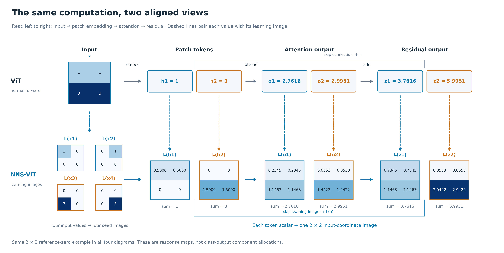
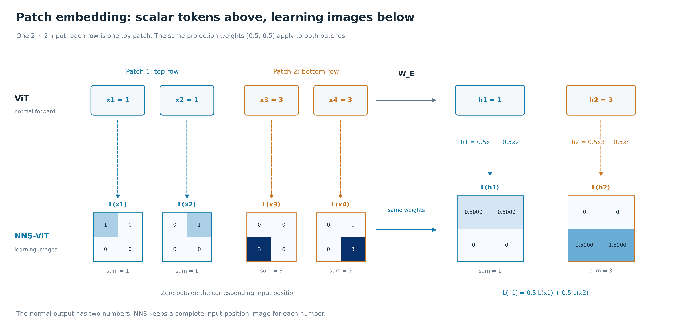
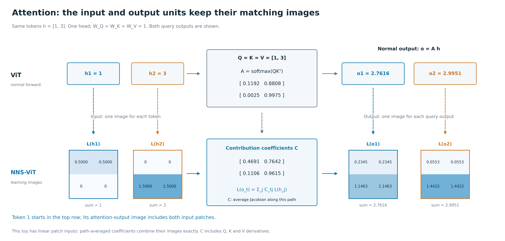
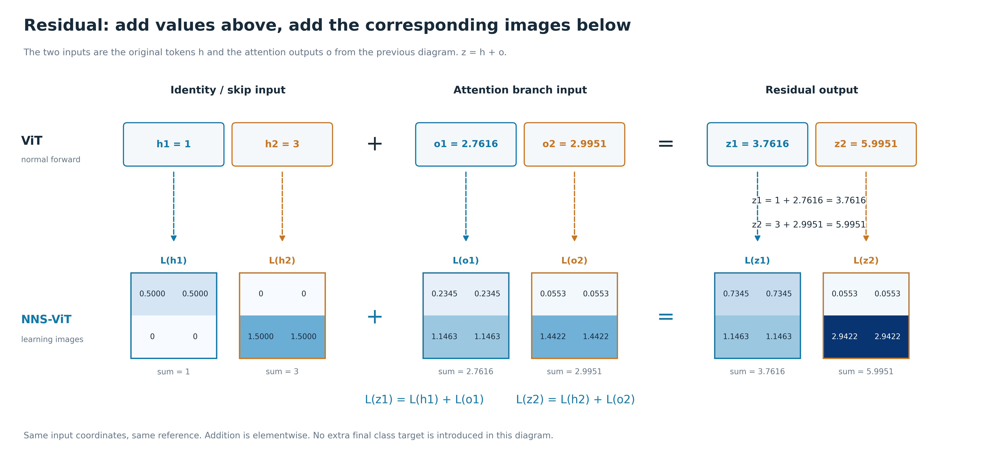

# 同一段 ViT 计算，上面看数值，下面看 learning image

[打开四张上下对照图](../reports/nns_vit_forward_learning_image_comparison_20260917/gallery.html)

这组图按原 NNS 论文 Figure 2 的结构组织：**上排是正常网络的输入、输出单元，下排是与这些单元一一对应的 learning image。** 同色虚线连接同一个单元和它的图，横向顺序保持一致。

上一组 Figure 22–23 解释的是 attention 的导数路线和最终目标的分支分配。这些内容可以作为计算细节，但没有直接回答“模块进去的数和出来的数，各自对应什么 learning image”。这里把这个对应关系单独画清楚。

## 先固定一个从头走到尾的例子

输入是四个标量，按原图位置排成：

$$
x=\begin{bmatrix}x_1&x_2\\x_3&x_4\end{bmatrix}
=\begin{bmatrix}1&1\\3&3\end{bmatrix},\qquad x_0=0.
$$

第一行作为 patch 1，第二行作为 patch 2。每个 patch 用相同线性权重 [0.5,0.5] 得到一个标量 token；再通过一个单维 head 的完整 softmax attention；最后做 residual add。

这是为了读图而设的小型算子链：保留所讨论的 patch 线性映射、attention、residual，省略位置编码、偏置、LayerNorm、MLP 和分类头。它不是已训练 ViT-B/16 的实测结果，也不把两个 1×2 patch 当成正式 ViT 的 patch 设置。

这组图解释**每个对应单元自身的响应**。不把中间单元突然换成“它对最终类别的贡献”。所有输出单元在零参考上的响应也是零，因此每张 learning image 的格子之和正好对应上排的数值。

## 1. Patch embedding：同样的权重，数值相加，图保留位置

**正常 ViT 这一排：**

$$
h_1=0.5x_1+0.5x_2=1,
\qquad h_2=0.5x_3+0.5x_4=3.
$$

原来四个输入值，变成两个 token 的值 1 和 3。

**NNS-ViT 这一排：**先给每个输入坐标一张完整的 2×2 图：

$$
L(x_1)=\begin{bmatrix}1&0\\0&0\end{bmatrix},\quad
L(x_2)=\begin{bmatrix}0&1\\0&0\end{bmatrix},\quad
L(x_3)=\begin{bmatrix}0&0\\3&0\end{bmatrix},\quad
L(x_4)=\begin{bmatrix}0&0\\0&3\end{bmatrix}.
$$

然后使用相同权重组合：

$$
L(h_1)=0.5L(x_1)+0.5L(x_2)
=\begin{bmatrix}0.5&0.5\\0&0\end{bmatrix},
$$

$$
L(h_2)=0.5L(x_3)+0.5L(x_4)
=\begin{bmatrix}0&0\\1.5&1.5\end{bmatrix}.
$$

上排的 h₁ 只有一个数 1；下排的 L(h₁) 进一步说明：这个 1 来自原图左上和右上，各贡献 0.5。下排没有因为生成 token 就把所有位置压成一个格子。

## 2. Attention：同一对输入 token，各自有数值和图

**正常 ViT 这一排：**输入就是上一模块的 h=[1,3]。本例 Q/K/V 的标量投影权重均为 1，head 维度为 1，所以：

$$
Q=K=V=\begin{bmatrix}1\\3\end{bmatrix},\qquad
QK^\top=\begin{bmatrix}1&3\\3&9\end{bmatrix},
$$

$$
A=\operatorname{softmax}_{\mathrm{row}}(QK^\top)
\approx\begin{bmatrix}0.1192&0.8808\\0.0025&0.9975\end{bmatrix},
\qquad
o=AV\approx\begin{bmatrix}2.7616\\2.9951\end{bmatrix}.
$$

上排有两个输入单元 h₁、h₂，也有两个输出单元 o₁、o₂。

**NNS-ViT 这一排：**左边接过来的就是上一张图的 L(h₁)、L(h₂)。右边分别配上这两个 attention 输出单元的响应 learning image：

$$
L(o_1)\approx\begin{bmatrix}0.2345&0.2345\\1.1463&1.1463\end{bmatrix},
\qquad
L(o_2)\approx\begin{bmatrix}0.0553&0.0553\\1.4422&1.4422\end{bmatrix}.
$$

保留完整精度时，四格相加分别为 2.761594 和 2.995055；图上四位小数会有末位舍入差。

**这张图的关键变化：**进入 attention 前，L(h₁) 只在原图上半部分有值；经过 attention 后，L(o₁) 在两块输入上都有贡献。它仍然是一张原图坐标下的 2×2 图，但信息来源已经跨越输入 patch。

这里下排中间明确写出了生成规则。在当前这个 patch 输入为线性函数的例子里，可以先求沿路径平均的 attention 输入到输出系数：

$$
C_{tj}=\int_0^1\frac{\partial o_t(h(\alpha))}{\partial h_j}\,\mathrm d\alpha,
\qquad
C\approx\begin{bmatrix}0.469072&0.764174\\0.110567&0.961496\end{bmatrix}.
$$

然后对已有两张输入图逐格加权：

$$
L(o_1)=0.469072L(h_1)+0.764174L(h_2),
$$

$$
L(o_2)=0.110567L(h_1)+0.961496L(h_2).
$$

这就是下排从左边两张 learning image 到右边两张 learning image 的具体步骤。比如 o₁ 的左上格是 0.469072×0.5≈0.2345，左下格是 0.764174×1.5≈1.1463。

这张图上排用 A 组合正常数值，下排用 C 组合输入位置图。C 包含 Q/K/V 三条影响路径的导数，不等于 clean attention A。计算 C 仍需访问原图到参考图之间的完整计算；并非仅凭两张终点 L(h) 图片就能确定它。

具体地，取所有图共同的原输入路径 x(α)=αx：

$$
L(y)[i]=x_i\int_0^1\frac{\partial y(\alpha x)}{\partial x_i}\,\mathrm d\alpha.
$$

对 y=o₁ 或 o₂，导数包含 Q/K 对 attention 权重的影响以及 Value 的影响。本例的 patch embedding 为线性函数，其输入导数沿路径不变，所以可以把它提出积分，得到图中的 C 加权组合。对于经过多个非线性层的 token，必须在每个路径点组合局部 Jacobian 与上游位置贡献，再积分；不能普遍把终点学习图乘一个平均矩阵就当作精确传播。两排对应关系可以像原论文那样画，但图注需要交代当前 ViT 算法的实际规则。

## 3. Residual：上面加数，下面按同一位置加图

**正常 ViT 这一排：**旁路 h 与 attention 分支输出 o 相加：

$$
z_1=h_1+o_1\approx1+2.7616=3.7616,
\qquad
z_2=h_2+o_2\approx3+2.9951=5.9951.
$$

**NNS-ViT 这一排：**这次相加可以直接对应到输入位置图。参考和路径相同，响应积分对加法是线性的：

$$
L(z_1)=L(h_1)+L(o_1)
\approx\begin{bmatrix}0.7345&0.7345\\1.1463&1.1463\end{bmatrix},
$$

$$
L(z_2)=L(h_2)+L(o_2)
\approx\begin{bmatrix}0.0553&0.0553\\2.9422&2.9422\end{bmatrix}.
$$

左上加左上，右上加右上，其余位置同理。这里先加原始数值，再画图；不是加颜色，也不是加归一化热图。图中不引入 F=z² 或另一个最终类别目标，以免把模块自身的输入输出对应关系打断。

## 与当前实现的关系

这组图采用响应 learning image：给每个对应单元 y 定义 L(y)，与当前用输入路径积分解释内部标量的规则一致。其作用是讲清正常网络单元与 learning image 的一一对应，不宣称已保存真实 ViT 每个 token/channel 的完整学习图像。

当前 NNS-v2 的类别成分图另有最终目标的下游导数：它描述内部单元对固定类别的贡献，不能拿来替换这里的单元自身响应图。此前分支对账图研究的是那个对象。本组先把用户所需的模块前向/learning-image 对照讲清，类别分解属于进一步分析。

本例没有负输出贡献，因此没有人为增加一排负图；每张图直接显示完整响应地图。所有小图用相同 2×2 坐标，颜色只帮助阅读，具体数字始终标在格子中。
