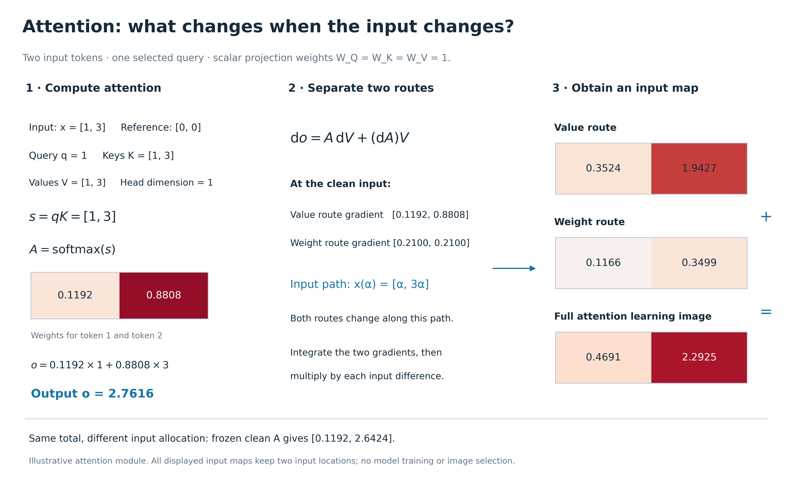
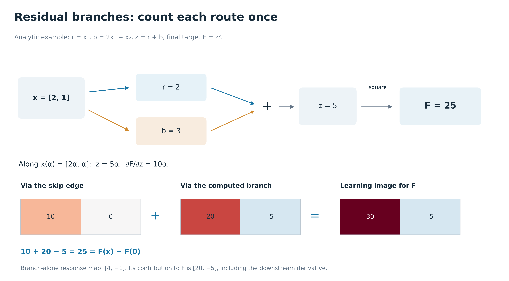
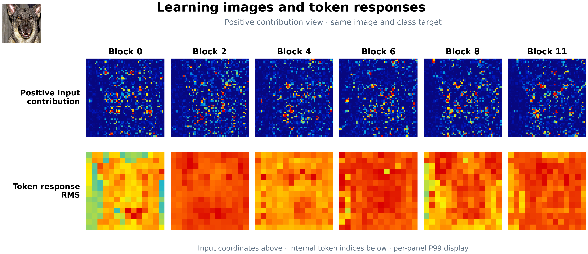

# Attention 和 residual 的 learning image：公式、例子与图

[新增图组](../reports/nns_vit_attention_residual_examples_20260917/gallery.html) · [原 Figure 18](../reports/nns_vit_learning_image_figures_15_21_20260917/figures_png/figure_18_learning_image_vit_operators.png) · [learning image 入门](learning_image_source_reading_20260917.md)

这份说明把 Figure 18 的后两部分展开。先算 attention 怎样混合输入，再算它的输入贡献；然后算 residual 两条路怎样各自贡献到最终目标。例子里的权重、参考和目标都写出来，可从头验算。

## 1. Attention：输入一变，权重和 Value 都会变

### 1.1 先看一个 head 的前向计算

设输入 token 矩阵为 H，先忽略偏置符号：

$$
Q=HW_Q,\quad K=HW_K,\quad V=HW_V,
\qquad S=\frac{QK^\top}{\sqrt{d_k}},
\qquad A=\operatorname{softmax}_{\rm row}(S),
\qquad O=AV.
$$

Q/K 用来决定“这次怎样混合 token”，V 是被混合的内容。对于选中的一个 query t：

$$
o_t=\sum_j a_{tj}v_j.
$$

注意力概率为正，也不意味着输入贡献全为正：最终影响还取决于 Value、后续权重以及输入如何改变 attention。

### 1.2 为什么导数有两部分

由乘积法则：

$$
\mathrm dO=\underbrace{A\,\mathrm dV}_{\text{被读取的内容改变}}
+\underbrace{(\mathrm dA)V}_{\text{混合权重改变}}.
$$

第二部分的导数继续经过 softmax 和 Q/K：

$$
\mathrm dS=\frac{(\mathrm dQ)K^\top+Q(\mathrm dK)^\top}{\sqrt{d_k}},
\qquad \mathrm dQ=(\mathrm dH)W_Q,\quad \mathrm dK=(\mathrm dH)W_K,
\quad \mathrm dV=(\mathrm dH)W_V.
$$

对一行 attention，把概率写成列向量 a，有：

$$
J_{\rm softmax}=\operatorname{diag}(a)-aa^\top,
\qquad
\frac{\partial a_j}{\partial s_k}=a_j(\mathbf 1[j=k]-a_k).
$$

所以改变一个 score 会同时改变这行的多个概率。完整 NNS-ViT 沿真实模型的路径计算这些导数；旧的 fixed-attention 条件方法固定选定的 A，相应位置的 dA 项为零。

### 1.3 两个 token 的具体数值

这里明确使用一个两 token、单维 head 的示意模型。W_Q=W_K=W_V=1，选择第一个 token 的输出作为目标，输入 x=[1,3]，参考 x₀=[0,0]。它用于讲原理，不是某个真实 ViT head 的拟合结果。

$$
q=x_1=1,\quad K=[x_1,x_2]=[1,3],\quad V=[1,3],\quad d_k=1.
$$

先算 score 和注意力：

$$
s=[qk_1,qk_2]=[1,3],
\qquad a=\left[\frac{e^1}{e^1+e^3},\frac{e^3}{e^1+e^3}\right]
\approx[0.119203,0.880797].
$$

再算输出：

$$
o=0.119203\times1+0.880797\times3\approx2.761594.
$$

这个前向加权和还不是完整的输入 learning image，因为 x₁、x₂ 也参与了概率的计算。为看清导数，令：

$$
p=a_2=\sigma(x_1x_2-x_1^2),
\qquad o=(1-p)x_1+px_2.
$$

微分展开为：

$$
\mathrm do=(1-p)\,\mathrm dx_1+p\,\mathrm dx_2+(x_2-x_1)\,\mathrm dp,
$$

$$
\mathrm dp=p(1-p)\big[(x_2-2x_1)\,\mathrm dx_1+x_1\,\mathrm dx_2\big].
$$

因此在 x=[1,3] 处：

| 对哪个输入求导 | 经 Value 的项 | 经 attention 权重的项 | 完整导数 |
|---|---:|---:|---:|
| x₁ | 0.119203 | 0.209987 | 0.329190 |
| x₂ | 0.880797 | 0.209987 | 1.090784 |

这只是原图处的局部导数。Learning image 还要把参考到原图整条路径上的贡献累计起来。

### 1.4 从局部导数到 learning image

沿路径 x(α)=[α,3α]，α 从 0 到 1，p(α)=σ(2α²)。对两个输入位置：

$$
L_i^{V}=\Delta x_i\int_0^1
\left[\sum_j a_j\frac{\partial v_j}{\partial x_i}\right]_{x(\alpha)}\mathrm d\alpha,
\qquad
L_i^{A}=\Delta x_i\int_0^1
\left[\sum_j v_j\frac{\partial a_j}{\partial x_i}\right]_{x(\alpha)}\mathrm d\alpha.
$$

本例中每个位置的系数为：

$$
L^V=\left[\int_0^1(1-p)\,\mathrm d\alpha,\;
3\int_0^1p\,\mathrm d\alpha\right]
\approx[0.352449,1.942653],
$$

$$
I=\int_0^1 2\alpha^2p(1-p)\,\mathrm d\alpha\approx0.116623,
\qquad L^A=[I,3I]\approx[0.116623,0.349869].
$$

把两条路在原输入位置相加：

$$
\boxed{L=L^V+L^A\approx[0.469072,2.292522]},
\qquad \sum_iL_i=2.761594=o(x)-o(x_0).
$$

**完整路径中的 Value 项，和固定 clean attention 的方法，是两个不同的计算。** 在完整路径里，A(x(α)) 每一步都变；固定版本则使用原图上的 A(x)。固定版目标为：

$$
\tilde o(z)=0.119203z_1+0.880797z_2,
\qquad L^{\rm frozen}\approx[0.119203,2.642391].
$$

本例中两种图的总和相同，但两个位置分到的数不同。这也说明只核对“总和守恒”还不够判断解释是否相同。

在真实 ViT 中，Q/K/V 由 LayerNorm 后的 token 表示产生；自动微分还要穿过前面的 block、LayerNorm、GELU。若目标是最终类别，还要包含 head 后的拼接、输出投影与其余网络。本图的两路公式描述同一次乘法分解；不能再把 Q/K 分解当成额外独立贡献加到 dA 项之上，否则会重复计数。

## 2. Residual：同一个输入有两条到目标的路

### 2.1 先画清楚网络结构

ViT 第一处 residual 可写成：

$$
u=u(x),\qquad b=B(u),\qquad z=u+b,\qquad F=G(z).
$$

其中 B 包括 attention、head 拼接与输出投影。u 直接进入加法器的是旁路，B(u) 是计算分支。F 可以是最后的类别 logit，不必等于 z 本身。

设 g(α)=∇_zF，在同一条输入路径上：

$$
L_i^{\rm skip}=\Delta x_i\int_0^1g(\alpha)^\top
\frac{\partial u}{\partial x_i}\,\mathrm d\alpha,
\qquad
L_i^{\rm branch}=\Delta x_i\int_0^1g(\alpha)^\top
\frac{\partial B(u)}{\partial x_i}\,\mathrm d\alpha.
$$

若这两条边完整覆盖所选切分里的路线，则：

$$
\boxed{L_i^{\rm skip}+L_i^{\rm branch}=\operatorname{IG}_i(F)}.
$$

在内部 block，u 本身是输入 x 的函数，所以旁路对原图的导数一般不等于单位矩阵。必须追到原图坐标，不能直接把内部激活放回输入网格。

### 2.2 带非线性后续输出的可手算例子

为了看清“分支响应”和“对最终输出的贡献”，取：

$$
x=[2,1],\quad x_0=[0,0],
\qquad r=x_1,\quad b=2x_1-x_2,\quad z=r+b,\quad F=z^2.
$$

前向很简单：r=2、b=3、z=5、F=25。沿路径 x(α)=[2α,α]：

$$
z(\alpha)=5\alpha,\qquad \frac{\partial F}{\partial z}=2z=10\alpha.
$$

旁路对最终目标的 learning image：

$$
L^{\rm skip}
=\left[2\int_0^1 10\alpha\times1\,\mathrm d\alpha,\;
1\int_0^1 10\alpha\times0\,\mathrm d\alpha\right]
=[10,0].
$$

计算分支对最终目标的 learning image：

$$
L^{\rm branch}
=\left[2\int_0^1 10\alpha\times2\,\mathrm d\alpha,\;
1\int_0^1 10\alpha\times(-1)\,\mathrm d\alpha\right]
=[20,-5].
$$

两张图按输入位置相加：

$$
\boxed{L^F=[10,0]+[20,-5]=[30,-5]},
\qquad 30-5=25=F(x)-F(x_0).
$$

如果只问 b 自身的响应，则它的图为 [4,−1]，总和为 b(x)−b(0)=3。若问 b 这条路对最终 F 的贡献，才是 [20,−5]，因为后续平方运算改变了作用大小。这就是旧单 head 自身响应图与完整类别成分图需要分开命名的原因。

### 2.3 为什么代码里还要单独处理旁路

对内部 u 一次性求 ∂F/∂u，通常已经包含旁路和 B(u) 两条路。若把它全部当作“旁路贡献”，再加一遍 B 分支，就会重复计算。

本项目完整切分按边记账：旁路使用加法器输出处的下游导数 g，经过 u 的输入导数回到原图；计算分支单独经过 B 的导数。这与 [stage_x_nns_v2.py](../src/vitnns/stage_x_nns_v2.py) 中 residual component 的 cotangent_key 处理一致。

多 head 时，输出投影后的 attention 分支为：

$$
B_{\rm attn}(u)=\sum_h O_h(u)W_O^{(h)}+b_O,
\qquad \sum_h L^{h}=L^{\rm attn},
\qquad L^{\rm skip}+L^{\rm attn}=L^{\rm total}.
$$

每个 head 都必须通过 W_O 对应的那部分列和后续目标导数，不能直接平均 head 热图来代替。常量偏置仍在前向里影响响应和后续导数；其在引入处的直接输入变化为零。

第二处 residual 为 z+MLP(LN(z))，同理分成 z 旁路和 MLP 分支。这是另一处切分，不能把第一处和第二处的总图再相加。

真实数组的相加展示见 [Figure 21](../reports/nns_vit_learning_image_figures_15_21_20260917/figures_png/figure_21_learning_image_component_sum.png)。本次 Figure 23 专门补上它背后的公式与完整数值步骤。

## 3. 正贡献和负贡献有必要每张都展示吗

**没有。数学计算需要保留符号，论文排版不要求每幅图都放两行。** 应根据这张图要回答的问题决定：

| 要讲什么 | 推荐展示 |
|---|---|
| 让读者看见哪些输入区域正向贡献 | 一张正贡献图，标题写 Positive contribution |
| 解释正负符号、相邻正负或抵消 | 一张红蓝 signed 图，必要时加同一区域放大 |
| 检查旁路/head 相加是否恢复总图 | 对 signed 原始值求和，展示共用色阶的 signed 图 |
| 同时讨论正负区域的不同现象 | 才把正负拆开并排，说明符号相对哪个目标 |
| 完整记录与复现 | 保存原始 signed map；完整正负拆分图放补充材料 |

**你对旧图的判断有道理：两排正负图外观近似，却没有增加一个清楚的问题，会占版面并增加误读。** 这种相似可能来自同一轮廓附近的符号交错，也受显示方式影响；它不自动说明计算正确或错误。没有必要为了让两排看起来不同而挑选某个样本。

只画正图时，先算带符号贡献，再取正部：

$$
L^+(r,c)=\max(L(r,c),0),\qquad
L^-(r,c)=\max(-L(r,c),0).
$$

负贡献仍在原始数据里。读者看不到的区域可能是负贡献，也可能只是很小的正贡献，因此不把正图的背景解释成“模型没有使用这里”。对于 RGB 或 cell 聚合，仍先按协议进行带符号求和，再取正部。

也可以选择展示绝对贡献 |L|，但那回答的是“哪里贡献幅度较大”，正负方向已经丢失，标题必须相应改变。归一化、截断后的彩色图不能拿来做贡献求和。

### 已提供 Figure 19 的正贡献正文版

这版保留旧图同一张样本、同一类别、同六个 block 和同一 P99 显示，只去掉负幅度行。上排看正输入贡献，下排看 token RMS；数值和缩放规则逐项继承。完整 signed 数据和正负版仍可从旧图组查阅。

对整篇图组的建议是：Figure 1、19、20 这类概览使用正贡献为主；Figure 2、21 和本次 residual 例子需要解释符号或守恒，使用红蓝 signed 图；全头正负图保留在补充画廊。是否保留某一张图的负行，取决于它是否承载正文的具体结论。

## 4. 本次验证

Attention 使用 Gauss–Legendre 路径积分，并以独立自适应积分复核两条路线；原图处总导数另用有限差分验证。Residual 用解析积分 [10,0]、[20,−5]、[30,−5] 检查。Figure 19 的正贡献与 RMS 源数组摘要和 P99 参数均与旧图一致。

全部是 CPU 数值示例或已有数据的重新排版；没有运行模型前向、重新计算真实归因或新增干预实验。
