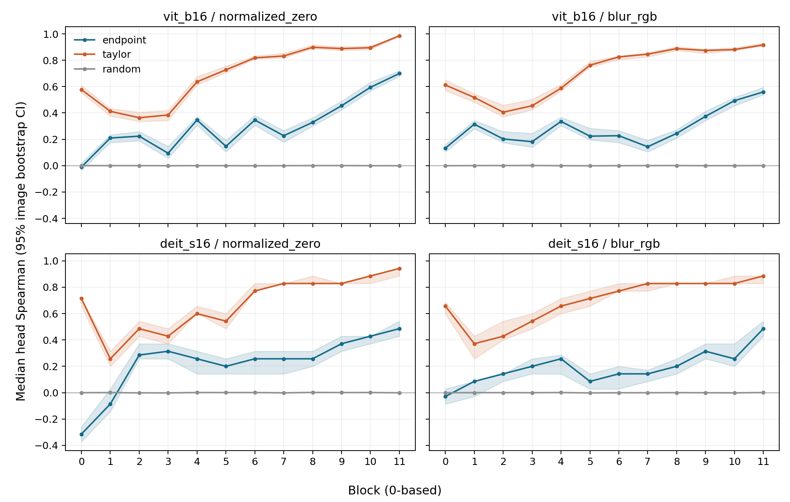

# Endpoint M1 结果与完成审计

M1为原确认性研究之后的**补充冻结实验（supplementary frozen study）**。原C4a all-family omnibus保持NOT_SUPPORTED，11/12 family满足全部family-level条件，结论为广泛但非普遍的成分级关联。

## 1. 执行范围与来源

两模型共享400张图像，0-based blocks 0–11、ground-truth logit、normalized-zero与blur。ViT-B/16每层12 heads，DeiT-S每层6 heads。最终每图每reference分别有240/168个不同成分，合计326,400个成分—reference条件。复用E4已有255,744个条件，补算70,656个条件；两条residual skip edge全400图，Q/K补齐后336图。

每个集合有七种predictor：Endpoint absolute mass、activation norm、gradient norm、absolute activation×gradient、reference displacement norm、absolute activation-space Taylor、random。outcome统一为绝对logit替换效应。Endpoint mean absolute mass为m/150528；固定输入维度下排序相同。signed effect与signed sum保存在逐成分记录，不混入主要绝对效应统计。

128,000个原始比较集合，每个1,000次固定种子随机排序，共128,000,000次permutation；加上图像内block平均得到134,400个图像级集合。保留随机均值、标准差、分位数和20-bin Spearman直方图。

## 2. RQ3a绝对关联与RQ3b基线增量

同层head ranking中，Endpoint具有正向关联；Taylor的中位Spearman、Capture@1/@3均更高，Regret@1更低。下表先在每图内平均12层指标，再取400图中位数。

| Model | Reference | Endpoint rho | Taylor rho | Endpoint Capture@1 | Taylor Capture@1 | Endpoint Capture@3 | Taylor Capture@3 | Endpoint Regret@1 | Taylor Regret@1 |
|---|---|---:|---:|---:|---:|---:|---:|---:|---:|
| vit_b16 | normalized_zero | 0.2815 | 0.6742 | 0.5174 | 0.8038 | 0.6149 | 0.8567 | 0.1701 | 0.0571 |
| vit_b16 | blur_rgb | 0.2727 | 0.6856 | 0.5075 | 0.8203 | 0.6185 | 0.8659 | 0.1163 | 0.0346 |
| deit_s16 | normalized_zero | 0.1952 | 0.6095 | 0.5609 | 0.8028 | 0.7122 | 0.8894 | 0.2381 | 0.0860 |
| deit_s16 | blur_rgb | 0.1476 | 0.6238 | 0.5506 | 0.8426 | 0.7105 | 0.8970 | 0.1326 | 0.0443 |

Image #1：每panel固定一个模型/reference。横轴block，纵轴图像级head Spearman中位数，阴影为95% image-bootstrap CI。同层排序与跨层结果分开报告。

同层head图像内平均的绝对关联检验如下；大于0与大于0.10是分别计算的假设。

| Model | Reference | Absolute null threshold | Holm p | Decision |
|---|---|---:|---:|---|
| deit_s16 | blur_rgb | 0.00 | 4.89e-61 | SUPPORTED |
| deit_s16 | blur_rgb | 0.10 | 1.52e-08 | SUPPORTED |
| deit_s16 | normalized_zero | 0.00 | 3.82e-73 | SUPPORTED |
| deit_s16 | normalized_zero | 0.10 | 3.26e-26 | SUPPORTED |
| vit_b16 | blur_rgb | 0.00 | 2.6e-118 | SUPPORTED |
| vit_b16 | blur_rgb | 0.10 | 6.73e-99 | SUPPORTED |
| vit_b16 | normalized_zero | 0.00 | 2.6e-118 | SUPPORTED |
| vit_b16 | normalized_zero | 0.10 | 8e-104 | SUPPORTED |

## 3. Residual identity例外及决策指标

跨层residual_identity family包含12层24条skip edges。Endpoint-minus-Taylor Spearman配对中位差在四种组合均为正且通过统一Holm；Capture@1配对中位差均为0。这支持该成分集合上的排序关联增量，不能推广为Top-1决策增益或所有成分的优势。

| Model | Reference | Endpoint-Taylor rho | 95% CI | Holm p | Capture@1 difference |
|---|---|---:|---|---:|---:|
| vit_b16 | normalized_zero | 0.4209 | [0.3748, 0.4504] | 4.12e-83 | 0.0000 |
| vit_b16 | blur_rgb | 0.0865 | [0.0374, 0.1313] | 0.0317 | 0.0000 |
| deit_s16 | normalized_zero | 0.1987 | [0.1670, 0.2191] | 1.06e-31 | 0.0000 |
| deit_s16 | blur_rgb | 0.1465 | [0.1226, 0.1874] | 2e-16 | 0.0000 |

按§10.3核对：reference沿用E4预处理；Taylor梯度位于clean点，位移为z_clean-z_ref；skip替换保留clean sibling branch。生产中每图检查noop和E4五类已有成分的前向/基线parity。另对两模型固定evaluation order 0、blocks 0/5/11执行float64多epsilon中心差分与手写skip反事实；诊断标为post-hoc implementation diagnostic。跨层尺度及下游非线性可能影响排序，但本轮未将其确认为机制原因。

## 4. 六类基线完整比较

| Baseline | Valid tests | Endpoint superiority supported | Not supported | Undefined small-set tests |
|---|---:|---:|---:|---:|
| activation_norm | 180 | 71 | 109 | 156 |
| gradient_norm | 180 | 72 | 108 | 156 |
| activation_gradient | 180 | 25 | 155 | 156 |
| displacement_norm | 180 | 50 | 130 | 156 |
| taylor | 180 | 12 | 168 | 156 |
| random | 180 | 122 | 58 | 156 |

计数包含相关层级比较和value/V命名别名，不是独立实验成功率。全部24,696条统计汇总见结果根all_summary.csv，14,112条配对差值和95% CI见all_paired_comparisons.csv；相对random的Capture差值即随机提升。Regret使用baseline−Endpoint，使正值均表示Endpoint更好。

## 5. 统计合同

图像为最终单位；中位数、10,000次图像bootstrap、95% percentile CI。中位数bootstrap使用经验CDF与联合中心次序统计量等价采样，并通过普通image-index bootstrap独立测试。pooled先平均同一image ID两模型指标，仅作描述性补充。

2,016项Endpoint-baseline Spearman检验使用单侧exact sign test，完整集合统一Holm。672项绝对检验分别检验median rho>0与>0.10，另做统一Holm。QKV三项、residual两项不定义Spearman，对应INVALID_UNDEFINED_METRIC；其pairwise/top1有效。undefined不表示采集失败，不删除其他有效指标中的图像。所有有效主要比较保留400图；early/middle/late单边family只有四项，Spearman仍离散，需结合pairwise/NDCG解释。CI为逐比较区间，Holm用于注册Spearman检验。

## 6. 分family与层级结果

value与V均指同一V projection edge，不能当作独立证据。routing为softmax attention概率张量，Q/K/V为projection张量；residual_branch合并attention与MLP。每一行的所有基线使用相同成分集合。

| Model | Reference | Family | Stratum | Endpoint rho | Taylor rho | Endpoint-Taylor rho | Holm p |
|---|---|---|---|---:|---:|---:|---:|
| vit_b16 | normalized_zero | head | across_block | 0.2909 | 0.7182 | -0.4131 | 1 |
| vit_b16 | normalized_zero | head | early | 0.1856 | 0.4524 | -0.2689 | 1 |
| vit_b16 | normalized_zero | head | middle | 0.2555 | 0.7641 | -0.4998 | 1 |
| vit_b16 | normalized_zero | head | late | 0.5583 | 0.9250 | -0.3575 | 1 |
| vit_b16 | normalized_zero | routing | across_block | 0.0490 | 0.3671 | -0.3077 | 1 |
| vit_b16 | normalized_zero | routing | early | -0.4000 | 0.2000 | -0.6000 | 1 |
| vit_b16 | normalized_zero | routing | middle | 0.0000 | 0.4000 | -0.4000 | 1 |
| vit_b16 | normalized_zero | routing | late | 0.4000 | 0.8000 | -0.2000 | 1 |
| vit_b16 | normalized_zero | value | across_block | 0.2238 | 0.3846 | -0.1503 | 1 |
| vit_b16 | normalized_zero | value | early | 0.2000 | 0.4000 | -0.2000 | 1 |
| vit_b16 | normalized_zero | value | middle | 0.0000 | 0.2000 | -0.2000 | 1 |
| vit_b16 | normalized_zero | value | late | 0.8000 | 0.8000 | 0.0000 | 1 |
| vit_b16 | normalized_zero | Q | across_block | 0.0105 | 0.3531 | -0.3217 | 1 |
| vit_b16 | normalized_zero | Q | early | -0.6000 | 0.0000 | -0.6000 | 1 |
| vit_b16 | normalized_zero | Q | middle | 0.2000 | 0.2000 | 0.0000 | 1 |
| vit_b16 | normalized_zero | Q | late | 0.8000 | 0.8000 | 0.0000 | 1 |
| vit_b16 | normalized_zero | K | across_block | 0.3007 | 0.3287 | -0.0420 | 1 |
| vit_b16 | normalized_zero | K | early | 0.3000 | 0.4000 | 0.0000 | 1 |
| vit_b16 | normalized_zero | K | middle | 0.0000 | 0.4000 | -0.4000 | 1 |
| vit_b16 | normalized_zero | K | late | 0.4000 | 0.4000 | 0.0000 | 1 |
| vit_b16 | normalized_zero | V | across_block | 0.2238 | 0.3846 | -0.1503 | 1 |
| vit_b16 | normalized_zero | V | early | 0.2000 | 0.4000 | -0.2000 | 1 |
| vit_b16 | normalized_zero | V | middle | 0.0000 | 0.2000 | -0.2000 | 1 |
| vit_b16 | normalized_zero | V | late | 0.8000 | 0.8000 | 0.0000 | 1 |
| vit_b16 | normalized_zero | residual_identity | across_block | 0.1587 | -0.2613 | 0.4209 | 4.12e-83 |
| vit_b16 | normalized_zero | residual_identity | early | 0.1429 | -0.1310 | 0.2857 | 1.26e-21 |
| vit_b16 | normalized_zero | residual_identity | middle | -0.0714 | -0.1190 | 0.0238 | 1 |
| vit_b16 | normalized_zero | residual_identity | late | 0.5952 | -0.1190 | 0.5952 | 9.76e-91 |
| vit_b16 | normalized_zero | residual_branch | across_block | 0.1774 | 0.4783 | -0.2952 | 1 |
| vit_b16 | normalized_zero | residual_branch | early | -0.2262 | 0.2381 | -0.4048 | 1 |
| vit_b16 | normalized_zero | residual_branch | middle | 0.0714 | 0.3810 | -0.2619 | 1 |
| vit_b16 | normalized_zero | residual_branch | late | 0.7143 | 0.7857 | -0.0476 | 1 |
| vit_b16 | blur_rgb | head | across_block | 0.3063 | 0.7244 | -0.4084 | 1 |
| vit_b16 | blur_rgb | head | early | 0.2562 | 0.5218 | -0.2454 | 1 |
| vit_b16 | blur_rgb | head | middle | 0.2367 | 0.7604 | -0.5181 | 1 |
| vit_b16 | blur_rgb | head | late | 0.4600 | 0.8981 | -0.4238 | 1 |
| vit_b16 | blur_rgb | routing | across_block | 0.0734 | 0.4615 | -0.3706 | 1 |
| vit_b16 | blur_rgb | routing | early | -0.4000 | 0.2000 | -0.6000 | 1 |
| vit_b16 | blur_rgb | routing | middle | 0.0000 | 0.4000 | -0.2000 | 1 |
| vit_b16 | blur_rgb | routing | late | 0.4000 | 0.8000 | -0.2000 | 1 |
| vit_b16 | blur_rgb | value | across_block | 0.3112 | 0.3497 | -0.0455 | 1 |
| vit_b16 | blur_rgb | value | early | 0.4000 | 0.4000 | 0.0000 | 1 |
| vit_b16 | blur_rgb | value | middle | 0.0000 | 0.4000 | -0.2000 | 1 |
| vit_b16 | blur_rgb | value | late | 0.6000 | 0.7000 | 0.0000 | 1 |
| vit_b16 | blur_rgb | Q | across_block | 0.0000 | 0.3671 | -0.3706 | 1 |
| vit_b16 | blur_rgb | Q | early | -0.4000 | 0.2000 | -0.6000 | 1 |
| vit_b16 | blur_rgb | Q | middle | 0.0000 | 0.4000 | -0.2000 | 1 |
| vit_b16 | blur_rgb | Q | late | 0.8000 | 0.8000 | 0.0000 | 1 |
| vit_b16 | blur_rgb | K | across_block | 0.3497 | 0.3636 | -0.0315 | 1 |
| vit_b16 | blur_rgb | K | early | 0.4000 | 0.2000 | 0.0000 | 1 |
| vit_b16 | blur_rgb | K | middle | 0.2000 | 0.4000 | -0.2000 | 1 |
| vit_b16 | blur_rgb | K | late | 0.6000 | 0.4000 | 0.0000 | 1 |
| vit_b16 | blur_rgb | V | across_block | 0.3112 | 0.3497 | -0.0455 | 1 |
| vit_b16 | blur_rgb | V | early | 0.4000 | 0.4000 | 0.0000 | 1 |
| vit_b16 | blur_rgb | V | middle | 0.0000 | 0.4000 | -0.2000 | 1 |
| vit_b16 | blur_rgb | V | late | 0.6000 | 0.7000 | 0.0000 | 1 |
| vit_b16 | blur_rgb | residual_identity | across_block | 0.1296 | 0.0439 | 0.0865 | 0.0317 |
| vit_b16 | blur_rgb | residual_identity | early | 0.1905 | 0.0952 | 0.1190 | 0.000824 |
| vit_b16 | blur_rgb | residual_identity | middle | -0.0714 | -0.0119 | -0.0476 | 1 |
| vit_b16 | blur_rgb | residual_identity | late | 0.4762 | 0.3810 | 0.0238 | 1 |
| vit_b16 | blur_rgb | residual_branch | across_block | 0.2091 | 0.3443 | -0.1348 | 1 |
| vit_b16 | blur_rgb | residual_branch | early | 0.0357 | 0.1190 | -0.0595 | 1 |
| vit_b16 | blur_rgb | residual_branch | middle | 0.0238 | 0.2738 | -0.2381 | 1 |
| vit_b16 | blur_rgb | residual_branch | late | 0.5714 | 0.6190 | -0.0238 | 1 |
| deit_s16 | normalized_zero | head | across_block | 0.1910 | 0.6862 | -0.4891 | 1 |
| deit_s16 | normalized_zero | head | early | 0.1100 | 0.4887 | -0.3826 | 1 |
| deit_s16 | normalized_zero | head | middle | 0.2417 | 0.6830 | -0.4204 | 1 |
| deit_s16 | normalized_zero | head | late | 0.3457 | 0.8678 | -0.4991 | 1 |
| deit_s16 | normalized_zero | routing | across_block | 0.0909 | 0.4056 | -0.3217 | 1 |
| deit_s16 | normalized_zero | routing | early | 0.0000 | 0.3000 | -0.2000 | 1 |
| deit_s16 | normalized_zero | routing | middle | 0.0000 | 0.4000 | -0.2000 | 1 |
| deit_s16 | normalized_zero | routing | late | 0.4000 | 0.6000 | -0.2000 | 1 |
| deit_s16 | normalized_zero | value | across_block | 0.0350 | 0.3497 | -0.2937 | 1 |
| deit_s16 | normalized_zero | value | early | 0.0000 | 0.2000 | -0.2000 | 1 |
| deit_s16 | normalized_zero | value | middle | 0.2000 | 0.4000 | -0.2000 | 1 |
| deit_s16 | normalized_zero | value | late | 0.2000 | 0.6000 | -0.4000 | 1 |
| deit_s16 | normalized_zero | Q | across_block | 0.0350 | 0.4510 | -0.3986 | 1 |
| deit_s16 | normalized_zero | Q | early | 0.2000 | 0.4000 | -0.2000 | 1 |
| deit_s16 | normalized_zero | Q | middle | 0.0000 | 0.4000 | -0.2000 | 1 |
| deit_s16 | normalized_zero | Q | late | 0.8000 | 0.8000 | 0.0000 | 1 |
| deit_s16 | normalized_zero | K | across_block | -0.0140 | 0.2517 | -0.2727 | 1 |
| deit_s16 | normalized_zero | K | early | 0.6000 | 0.2000 | 0.4000 | 7.84e-08 |
| deit_s16 | normalized_zero | K | middle | 0.2000 | 0.4000 | -0.2000 | 1 |
| deit_s16 | normalized_zero | K | late | 0.4000 | 0.4000 | 0.0000 | 1 |
| deit_s16 | normalized_zero | V | across_block | 0.0350 | 0.3497 | -0.2937 | 1 |
| deit_s16 | normalized_zero | V | early | 0.0000 | 0.2000 | -0.2000 | 1 |
| deit_s16 | normalized_zero | V | middle | 0.2000 | 0.4000 | -0.2000 | 1 |
| deit_s16 | normalized_zero | V | late | 0.2000 | 0.6000 | -0.4000 | 1 |
| deit_s16 | normalized_zero | residual_identity | across_block | 0.1143 | -0.0796 | 0.1987 | 1.06e-31 |
| deit_s16 | normalized_zero | residual_identity | early | 0.0714 | -0.2857 | 0.3333 | 9.89e-27 |
| deit_s16 | normalized_zero | residual_identity | middle | 0.1429 | -0.2857 | 0.3929 | 7.04e-14 |
| deit_s16 | normalized_zero | residual_identity | late | 0.4048 | 0.4524 | 0.0000 | 1 |
| deit_s16 | normalized_zero | residual_branch | across_block | 0.1352 | 0.3765 | -0.2317 | 1 |
| deit_s16 | normalized_zero | residual_branch | early | 0.0000 | 0.0952 | -0.0238 | 1 |
| deit_s16 | normalized_zero | residual_branch | middle | 0.2143 | 0.3333 | -0.0952 | 1 |
| deit_s16 | normalized_zero | residual_branch | late | 0.2857 | 0.6429 | -0.3095 | 1 |
| deit_s16 | blur_rgb | head | across_block | 0.1817 | 0.6964 | -0.5060 | 1 |
| deit_s16 | blur_rgb | head | early | 0.1496 | 0.5135 | -0.3370 | 1 |
| deit_s16 | blur_rgb | head | middle | 0.1439 | 0.7591 | -0.6013 | 1 |
| deit_s16 | blur_rgb | head | late | 0.3278 | 0.8522 | -0.5013 | 1 |
| deit_s16 | blur_rgb | routing | across_block | 0.1014 | 0.5524 | -0.4476 | 1 |
| deit_s16 | blur_rgb | routing | early | -0.2000 | 0.4000 | -0.6000 | 1 |
| deit_s16 | blur_rgb | routing | middle | 0.0000 | 0.6000 | -0.4000 | 1 |
| deit_s16 | blur_rgb | routing | late | 0.4000 | 0.8000 | -0.2000 | 1 |
| deit_s16 | blur_rgb | value | across_block | 0.1469 | 0.3986 | -0.2552 | 1 |
| deit_s16 | blur_rgb | value | early | 0.2000 | 0.4000 | 0.0000 | 1 |
| deit_s16 | blur_rgb | value | middle | 0.1000 | 0.4000 | -0.2000 | 1 |
| deit_s16 | blur_rgb | value | late | 0.2000 | 0.4000 | -0.2000 | 1 |
| deit_s16 | blur_rgb | Q | across_block | 0.0629 | 0.4615 | -0.3427 | 1 |
| deit_s16 | blur_rgb | Q | early | 0.0000 | 0.4000 | -0.2000 | 1 |
| deit_s16 | blur_rgb | Q | middle | 0.2000 | 0.4000 | 0.0000 | 1 |
| deit_s16 | blur_rgb | Q | late | 0.8000 | 0.8000 | 0.0000 | 1 |
| deit_s16 | blur_rgb | K | across_block | 0.1678 | 0.4126 | -0.2308 | 1 |
| deit_s16 | blur_rgb | K | early | 0.4000 | 0.4000 | 0.0000 | 1 |
| deit_s16 | blur_rgb | K | middle | 0.2000 | 0.4000 | -0.2000 | 1 |
| deit_s16 | blur_rgb | K | late | 0.4000 | 0.6000 | 0.0000 | 1 |
| deit_s16 | blur_rgb | V | across_block | 0.1469 | 0.3986 | -0.2552 | 1 |
| deit_s16 | blur_rgb | V | early | 0.2000 | 0.4000 | 0.0000 | 1 |
| deit_s16 | blur_rgb | V | middle | 0.1000 | 0.4000 | -0.2000 | 1 |
| deit_s16 | blur_rgb | V | late | 0.2000 | 0.4000 | -0.2000 | 1 |
| deit_s16 | blur_rgb | residual_identity | across_block | 0.1717 | 0.0513 | 0.1465 | 2e-16 |
| deit_s16 | blur_rgb | residual_identity | early | 0.1429 | 0.0238 | 0.1667 | 0.000267 |
| deit_s16 | blur_rgb | residual_identity | middle | 0.0476 | -0.0476 | 0.0952 | 1 |
| deit_s16 | blur_rgb | residual_identity | late | 0.4643 | 0.2857 | 0.1905 | 1.32e-08 |
| deit_s16 | blur_rgb | residual_branch | across_block | 0.2287 | 0.3970 | -0.1696 | 1 |
| deit_s16 | blur_rgb | residual_branch | early | 0.2857 | 0.1905 | 0.0714 | 1 |
| deit_s16 | blur_rgb | residual_branch | middle | 0.0714 | 0.3810 | -0.2857 | 1 |
| deit_s16 | blur_rgb | residual_branch | late | 0.3571 | 0.6190 | -0.2381 | 1 |

## 7. 覆盖率与论文

原registry覆盖表从EP0实际条目重算，中英文主稿Table 6同步发布。post-block覆盖率192/(12×197×768)=0.01058%与192/(12×197×384)=0.02115%；complete仅指registry-complete。head scalar是CLS指定channel；module aggregates不是单神经元；不同注册条目可能选中同一logit。M3的6,144目标审计未在本轮执行。

## 8. 复现与验收

配置：config/nns_vit_endpoint/endpoint_m1.json；需求映射：docs/endpoint_m1_execution_20260918.md。task_manifest.json冻结800任务和E3/E4字节哈希；freeze.json与analysis_freeze.json冻结实现；per_image/*.json.gz保留成分数据、指标、随机种子和分布。task_validation.json及inference_validation.json记录源复算，completion_audit.json和terminal_receipt.json记录最终验收。

复算命令（已存在的PASS审计文件会只核对、不覆盖）：

    CUDA_VISIBLE_DEVICES='' ../.conda/envs/vitnns/bin/python scripts/validate_endpoint_m1.py --tasks --inference
    CUDA_VISIBLE_DEVICES='' ../.conda/envs/vitnns/bin/python papers/nns_vit_endpoint/scripts/validate_endpoint_scanner_draft.py

补算800/800任务，8张H20用时43.26秒，任务GPU时间0.07898 GPU-hours，不包含历史E3/E4成本。最大noop误差1.62125e-5，已有E4前向/基线最大绝对差6.62804e-5，均满足1e-4+1e-4|source|。新增科学结果和execution完成状态分开记录；完成后停在M1。
