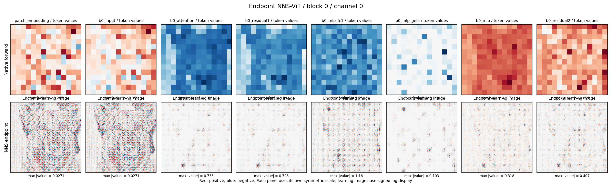
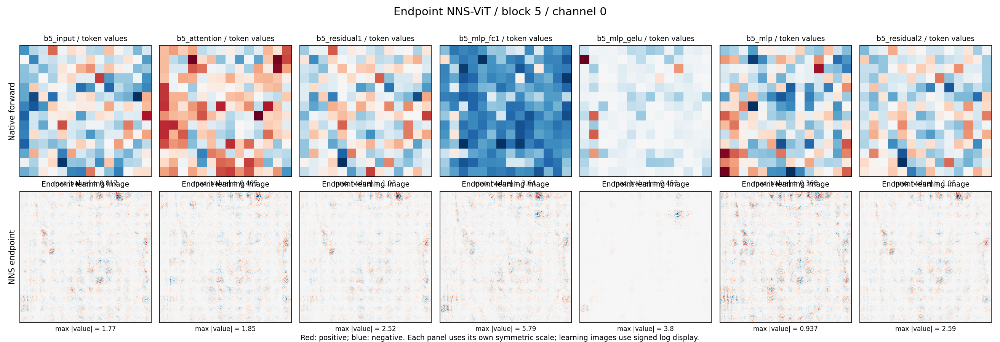
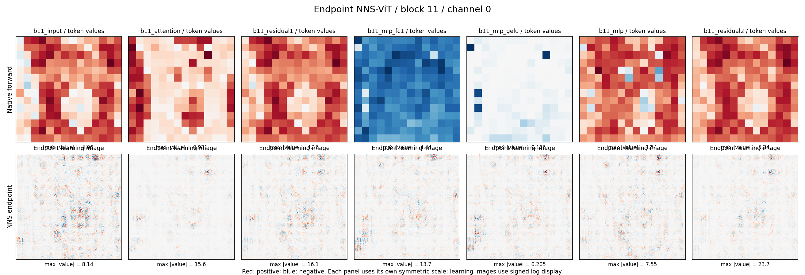
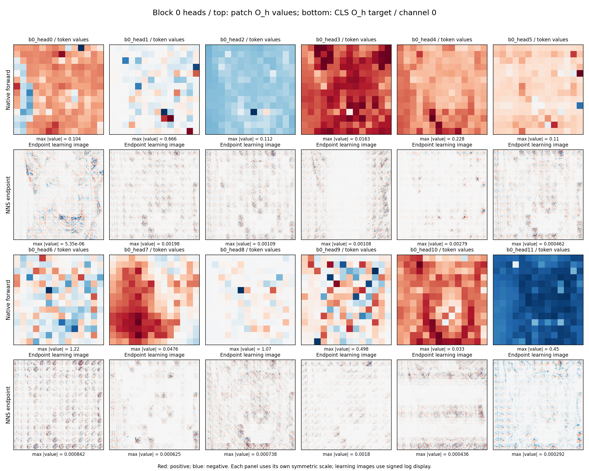
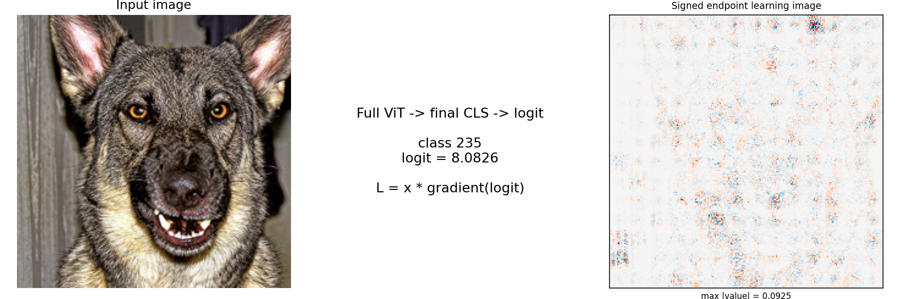
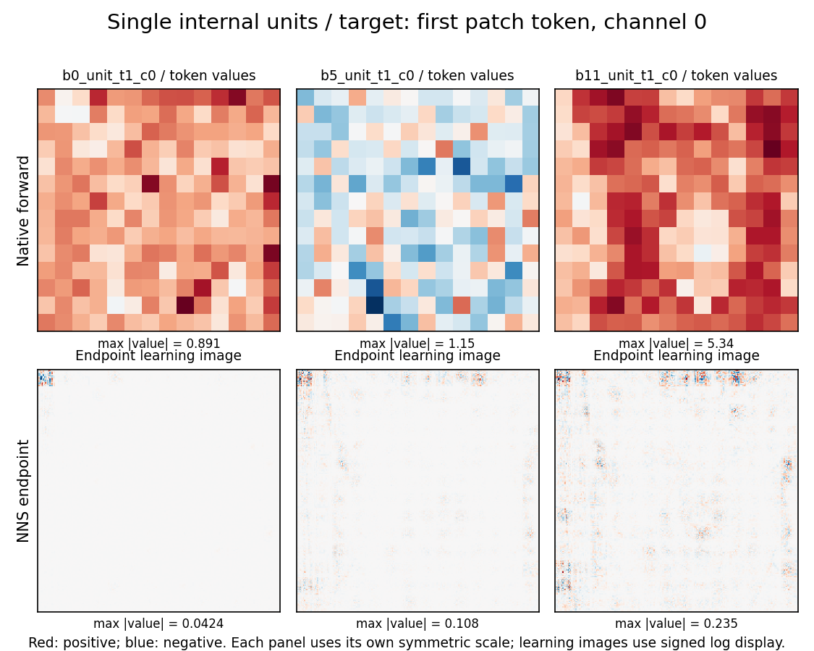
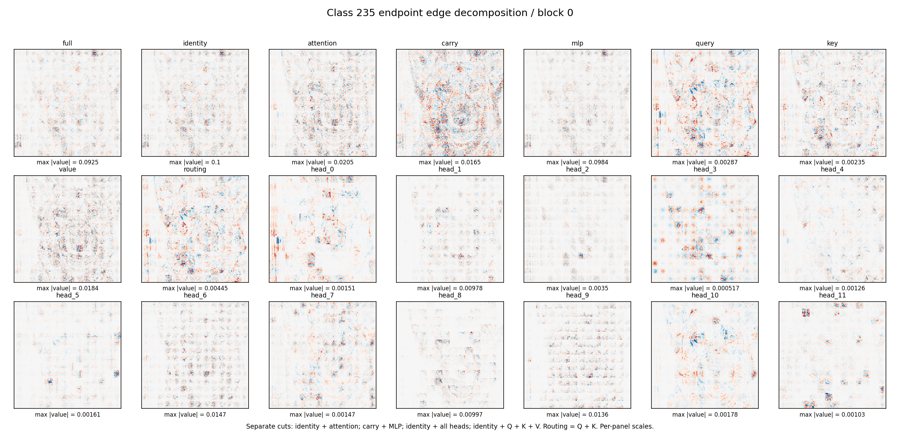
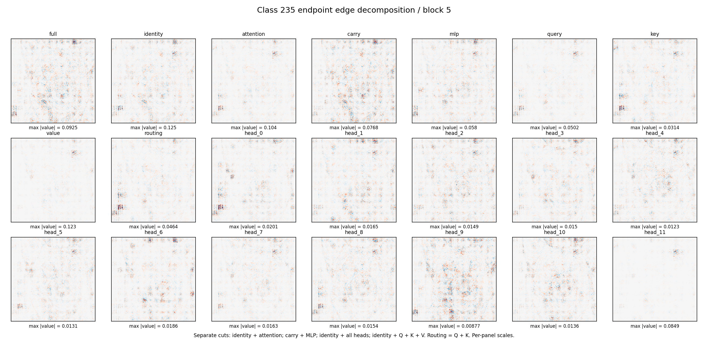
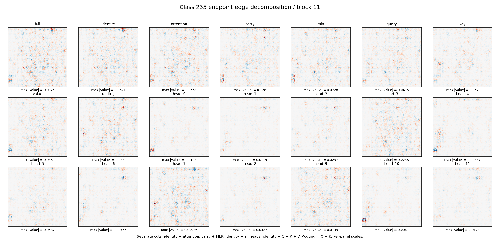

# Endpoint NNS-ViT：Image #1–#9

本页对应 [scanner 实现说明](endpoint_nns_vit_scanner_20260918.md) 与 R3 单图演示。所有 learning image 均来自归一化模型输入的 `x * grad`，原始 signed RGB 张量独立保存。图中红为正、蓝为负，每个面板按自身最大绝对值对称缩放；learning image 额外做 signed log 显示，没有 smoothing。跨面板颜色深浅不能直接比较贡献大小，数值比较应读取报告和原始数组。

## Image #1：Block 0 模块链

上排是各模块 channel 0 在 196 个 patch token 上的真实前向值；下排解释同一模块所有 patch token 的 channel 0 之和。这里是聚合目标，不是单个神经元。patch embedding 和 block 输入的图像归因相同，因为本模型在二者之间只加入图像无关的 CLS/position 常数；前向值仍会变化。两次 residual 的下排地图分别满足输入图 + 分支图的逐像素加法关系。

## Image #2：Block 5 模块链

保持 channel 0 和聚合规则，观察中间层的输入、attention、第一次 residual、MLP fc1、GELU、MLP 输出和第二次 residual。fc1 与 GELU 的图显示终点导数改变如何影响输入学习图像；这些面板对应不同目标，不把图的差异直接解释成该模块的独立因果效果。

## Image #3：Block 11 模块链

最深 block 的同类扫描。深层仍保留原始 224×224 signed 像素归因，并没有先压缩成 patch attribution 再上采样。通道聚合图不等同于最终分类图，分类目标单独展示在 Image #5。

## Image #4：12 个 head 的内部目标

每个 head 的目标固定为 block 0、CLS query、head 内 channel 0 的 output-projection 前响应。上排空间网格显示该 channel 在 patch query token 上的值；下排解释 CLS query 的单个响应，不能将两者误读成相同的 token 聚合目标。所有 head 使用同一个固定坐标方向，不按图像挑选方向。

对于 block 0 的 CLS 目标，Query 源于图像无关的 CLS/position，因此其图像 Query 分量严格为零；Key/Value 仍依赖图像。这一结论只适用于该内部目标，不能推广到整个 block 的最终类别贡献。

## Image #5：Classifier

展示真实输入 → 完整 ViT/CLS/class 235 logit → 一个 signed learning image。计算包含全部 attention routing、output projection、LayerNorm、GELU、residual 和 classifier 路径。logit 为 8.08262，输入 endpoint 像素和为 1.42146；后者是局部一阶输入归因，不要求重构完整 logit。

## Image #6：真正的单元 learning images

目标分别是 block 0/5/11 输出中的第一个 patch token、channel 0。上排显示同一通道的空间 token 数值作定位参考，下排只解释选定 token-channel。浅层图中左上方目标 patch 的直接输入路径明显，深层图中可看到更广的图像依赖。这是单图观察，不是跨样本机制结论。

## Image #7：Block 0 对同一类别目标的结构分解

所有成分都解释同一个 class 235 logit。分别检查 identity + attention、carry + MLP、identity + 12 heads、identity + Q + K + V 的闭合。routing 等于 Q + K，是另一种合并展示，不能与 Q/K 再次相加。本图 Query 包含整个 block 的所有 query token 对最终目标的路径，因此可以非零，与 Image #4 的 CLS 内部单元 Query 为零不矛盾。

## Image #8：Block 5 对同一类别目标的结构分解

把完整切面移到 block 5，最终目标保持 class 235 logit。各成分使用真实下游梯度，head 分量包含 projection 与后续 blocks 的作用。每种完整切面都重构 Image #5 的同一原始 endpoint 图。

## Image #9：Block 11 对同一类别目标的结构分解

最后一个 block 的终点结构分解。三层共 15 个完整切面的最大绝对闭合误差为 $4.44	imes10^{-16}$；这验证分解没有遗漏或重复记账。图的分量是当前输入上的一阶路径贡献，不能直接解释为删掉相应 head/branch 的干预效果。

## 文件

- [scan_report.json](../reports/endpoint_nns_vit_scan_r3_20260918/scan_report.json)：每个目标与分量的 scalar、signed sum、absolute mass、闭合误差、定义与来源。
- [raw_arrays.npz](../reports/endpoint_nns_vit_scan_r3_20260918/raw_arrays.npz)：原始 float64 signed RGB 归因、输入梯度、token 值、结构分量。
- [artifact_manifest.json](../reports/endpoint_nns_vit_scan_r3_20260918/artifact_manifest.json)：逐文件大小与 SHA-256。
