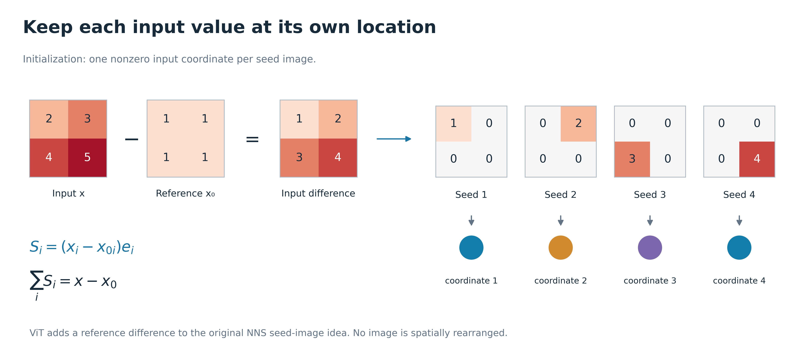
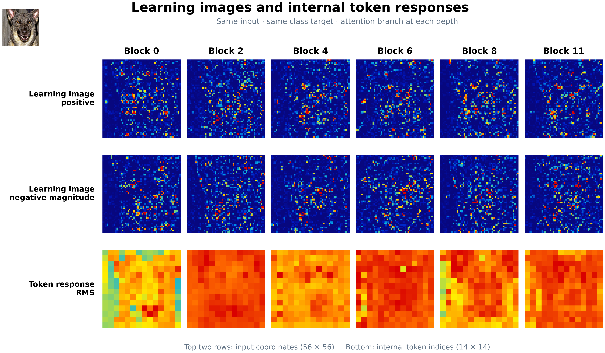
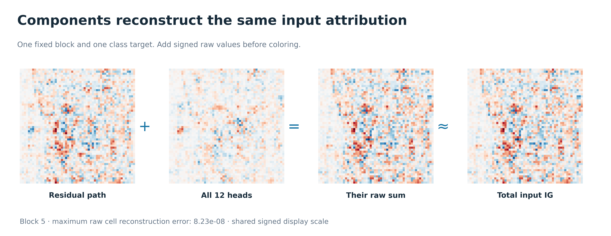

# NNS-ViT 和 learning image：从旧架构材料到 Figure 15–21

**先看正常 ViT 与 NNS 的上下对应图：**[总览和三个模块的成对输入输出](../reports/nns_vit_forward_learning_image_comparison_20260917/gallery.html) · [一步一步的读图说明](ViT正常前向与NNS学习图像逐步对照_20260917.md)。这组图按原论文 Figure 2 的对应关系重画：上排正常数值，下排同名 learning image，同一输入连续经过 patch embedding、attention、residual。下排 attention 的生成系数和残差的逐格相加都在图中写出。

[新增图组画廊](../reports/nns_vit_learning_image_figures_15_21_20260917/gallery.html) · [逐图说明](../reports/nns_vit_learning_image_figures_15_21_20260917/figure_analysis.md) · [原 Figure 1–14](../reports/nns_vit_unified_paper_figures_r8_20260916/gallery.html)

Figure 18 中 attention/residual 的详细公式与完整数值例子，已补在 [Attention 与 residual 详解](attention_residual_learning_image_详解_20260917.md)，对应新增 Figure 22–23。Figure 19 另有 [正贡献正文候选版](../reports/nns_vit_attention_residual_examples_20260917/figures_png/figure_19_positive_learning_images_reading_view.png)；完整正负版仍在原图组。

## 先回答两个问题

**NNS-ViT 是什么？** 它是把 Neural Network Scanner 的“查看网络内部单元”思路用于 Vision Transformer 的方法体系。ViT 负责识别图像；NNS-ViT 在选定的内部响应或组件旁，配上一张能对回输入位置的图，帮助分析它与输入哪些位置有关。

**learning image 是什么？** 它是“某个内部对象对应的输入贡献图”。普通激活值告诉你一个单元的响应有多大；learning image 进一步保留位置，说明输入各处对它贡献多少。一个标量变成一幅图，不是增加了新的观测，而是把来源位置展开了。

例如某个单元的响应变化为 7，仅知道 7 看不出来源。若它的 learning image 是：

$$
\begin{bmatrix}2&4\\3&-2\end{bmatrix},
\qquad 2+4+3-2=7,
$$

就可以看出四个输入位置分别贡献了多少，右下位置的贡献方向与另外三个位置相反。Figure 15–17 把这个例子完整画出来。

在本项目中要给 learning image 加上目标：**响应 learning image** 解释选定单元自身的响应；**类别成分 learning image** 解释最终类别贡献中经过该组件的部分。新增 Figure 19–21 是后者，它们固定同一个类别目标。R8 Figure 2 的单 head 自身响应属于前者。

## 我从你指定的材料里读到了什么

| 文件 | 具体位置 | 与这次新增图的关系 |
|---|---|---|
| [参考文章.pdf](../../论文1/参考文章.pdf) | PDF 第 3–6 页 Figure 2–5；第 10 页 Figure 13；第 11 页 Figure 14 | 初始化、加权组合、卷积等价线性连接，以及 learning image/feature map 上下对照 |
| [论文架构.pptx](../../论文1/论文架构/论文架构.pptx) | 第 4–6、8–10 页 | 按 patch embedding、学习图像、Value、head 和深度组织研究问题 |
| [个人讨论20241223.pptx](../../论文1/论文架构/个人讨论20241223.pptx) | 第 3–4、7、10 页 | 显式保留“内部单元 × 输入位置”张量；区分使用 learning-image Q/K 和原输入 Q/K 的试验 |
| [个人讨论20250311.pdf](../../论文1/论文架构/个人讨论20250311.pdf) | 第 4、6–10、15–16 页 | 各模块的学习图像、层间排列和局部对象展示，是 Figure 19–20 的版式参考 |
| [个人讨论20250521.pptx](../../论文1/论文架构/个人讨论20250521.pptx) 及 [PDF](../../论文1/论文架构/个人讨论20250521.pdf) | 第 1–7 页 | patch 局部性、空间距离和扰动问题；属于历史问题来源 |
| [个人讨论20250527.pptx](../../论文1/论文架构/个人讨论20250527.pptx) 及 [PDF](../../论文1/论文架构/个人讨论20250527.pdf) | 第 1–8 页 | 不同层/head 的 Value 和注意力图，引出“响应强度”和“贡献”应该分开显示 |
| [0623组会叶子琪.pptx](../../论文1/论文架构/0623组会叶子琪.pptx) | 第 4–9 页 | 每个 patch 配完整输入图、保留位置编码、逐模块查看的总体设想 |

共读取五份正式 PPTX、三份讨论 PDF 和一份参考论文 PDF。以“~$”开头的三份小文件是 Office 锁文件，不是额外讲义。文件哈希记录在新图包的 render_manifest.json 中。

旧 PPT 强调的“保留输入位置，逐模块扫描”已经进入这组讲解。旧 tiny-ImageNet 模型的 46%→78.12%、EE 分数，以及从彩色 PNG 转灰度算熵，仍是历史讨论；它们的模型、数据和算子与当前图不同，不能直接并入当前 ViT-B/16 的结论。跨 block 相同 head 编号也不意味着共享同一套参数或同一种语义角色。

## 像原论文一样，分三步理解

### 第一步：初始化时保留位置

原 NNS 把输入拆为单坐标图 Iᵢ=xᵢeᵢ。本项目解释相对参考输入的变化，使用等价的差值种子：

$$
S_i=(x_i-x_{0i})e_i,
\qquad \sum_iS_i=x-x_0.
$$

这里 eᵢ 只在输入位置 i 为 1。原始位置没有被挪到某个 patch 左上角，也没有均匀摊开。Figure 16 用四个位置说明这件事。

### 第二步：计算它们对内部目标的系数

线性网络的系数就是相应权重乘积；Figure 17 可以直接手算。原论文的线性/ReLU 主干还使用当前样本的激活门和池化选择。到了 ViT，attention 和非线性导数会随路径输入改变，因而对一个标量响应 hᵤ 定义：

$$
\bar J_{u,i}=\int_0^1\frac{\partial h_u(x_0+\alpha(x-x_0))}{\partial x_i}\,\mathrm d\alpha,
\qquad L_u=\sum_i\bar J_{u,i}S_i.
$$

这把“初始位置图 × 输入到单元的系数”与路径积分连接起来。它是当前算法的数学表示，实际通过自动微分求导，不会把每张 Sᵢ 当作一个独立样本送入 ViT。非线性模型里 F(ΣSᵢ) 一般不等于 ΣF(Sᵢ)。

### 第三步：把系数留在对应输入位置

对于一个 scalar 单元，Lᵤ[i] 就是一个输入坐标的贡献。对于 head 或 branch，把属于组件的坐标贡献按定义组合，得到组件图。

完整 NNS-v2 还乘上“内部坐标对最终类别输出的导数”。在一次完整切分 C 内：

$$
L_j^{C}[i]=(x_i-x_{0i})\int_0^1
\frac{\partial F_y}{\partial h_j}\frac{\partial h_j}{\partial x_i}\,\mathrm d\alpha,
\qquad \sum_{j\in C}L_j^{C}[i]=\operatorname{IG}_i(F_y).
$$

导数在路径上的输入处计算，并按计算图边记账，包括 residual 旁路。这个定义保留原 NNS 的输入位置思想，但采用 IG/路径分解，计算方式不同于原 CNN 的门控权重传播。

## 你旧 PPT 中的高维学习图像怎样对应到现在

2024 年讨论稿将一个 (token, channel) 单元配上整张 28×28 输入图。推广到 RGB ViT，一个完整对象可以写成：

$$
L_{\ell,t,d}[k,r,c],
\qquad \text{索引为 block、token、channel、输入 RGB channel、输入行、输入列。}
$$

这能表达“内部的一个单元，对输入的每一个位置是什么关系”。若只保留 RGB 求和后的图，则最后三维变为输入行、列。head 包含多个通道与 token，是否聚合以及聚合目标必须注明。

当前无需重新生成所有单神经元图，就能画出已有的 head/branch learning image：Y2 留存了每层全部 12 个 head 的 56×56 输入 cell 图、attention 分支图和 residual 图。这些是带最终类别目标的组件聚合图，不是旧稿中所有 (token,channel) 单元的高维 learning-image 张量。每个 4×4 输入区域汇成一个 cell，故有 56×56；显示放大到 224×224 也不会增加新信息。

## 怎样像原论文 Figure 13 那样展示

原论文比较滤波器 learning image 与对应 feature map。ViT 没有同样的卷积 feature map，本图改用同一 attention 分支的 token 响应幅度作对照：

$$
E_\ell(t)=\sqrt{\frac1D\sum_d O_{\ell,t,d}^{\,2}}.
$$

上两排使用已有的输入贡献图，分别显示正与负幅度；下排把 attention 分支输出 O 的 196 个 patch token 的 RMS 排成 14×14。RMS 只是内部响应强度，不是对类别的贡献。CLS 也参与前向和贡献计算，只是在下排空间排列时单独省去它。

这张图说明两种图怎样对应，并未新增“它们应该高度相似”的结论。下排含所有通道、包含输出投影偏置；上排是相对参考的类别贡献，偏置的直接路径变化为零。两者即使长得不同，也有明确的不同含义。

实测样本固定为 Y2 冻结队列的第一张图 ILSVRC2012_val_00007922.JPEG，类别目标 235。单次保留的 CPU 前向结果与原记录的目标 logit 绝对误差为 2.8610×10⁻⁶。图 21 在 B5 上用 12 个 head 加旁路重构总输入 cell 图，最大误差约 8.23×10⁻⁸。

Figure 15–18 的意义是让人看懂定义；Figure 19–21 的意义是把定义落到真实数据上。完整 12 层、每层 12 个 head 的正负图另附在新画廊中。

正负图不必在正文每次都成对出现。若只说明正向贡献位置，正文使用标明 Positive contribution 的正图即可；解释符号、抵消或组件相加时使用 signed 图；完整负图放补充材料。数学和统计始终保留原始符号，不能用只保留正值的地图代替完整贡献对账。具体展示规则和例子见 [详解第 3 节](attention_residual_learning_image_详解_20260917.md)。

## 文字核对记录

按 academic-defensive-writing-auditor 检查本次说明与图注，重点是把对象说清楚，不用“高亮更漂亮”替代实证。

| Location | Original | Type | Severity | Necessary caveat? | Why it feels defensive | Likely reviewer reaction | Recommended action | Rewrite |
|---|---|---|---|---|---|---|---|---|
| 旧 PPT 背景 | 通过生成合成的学习图像来揭示学习行为 | D14 | Major | Yes | 术语替代了具体计算对象 | 容易误认为生成模型 | 明确当前输入和组件 | 给选定内部响应配一张保持输入坐标的贡献图。 |
| 旧 PPT 结论 | 层间熵趋势揭示关键语义转变 | D10 | Major | Yes | 从外观指标跳到机制结论 | 缺乏对应检验 | 保留问题，限定观察 | 新图展示固定目标下的空间形态，语义分工须单独检验。 |
| Figure 19 图注 | learning image 与 feature map 高度相关 | D12 | Major | Yes | 借用 CNN 的结论 | 误读为 ViT 已验证结果 | 明确两种坐标和统计含义 | 对照输入贡献图和内部 token 响应，分别注明定义。 |

### Paper-level defensive-writing score

本次说明和图注估计 2/10。正文用定义、例子和图片展开；必要的目标及显示限制集中说明。

### Highest-priority removals

1. 将“合成图像”替换为输入坐标贡献图。
2. 删除从热图外观直接推出稳定语义角色的表述。
3. 将原论文的 feature-map 相关性结论与本次 ViT 响应对照分开。

### Necessary caveats to preserve

解析图与实测图分开标注；响应目标与类别目标分开；本次实测图是组件聚合，原始分辨率为 56×56 cells；逐面板色彩只比较形态；同一切分内相加，跨层不重复相加。

### Repeated phrase audit

这份正文没有使用“我们不声称”“为避免误解”等预先辩解句。原模型、参考路径、图像坐标和内部 token 坐标的区别属于必要定义。
