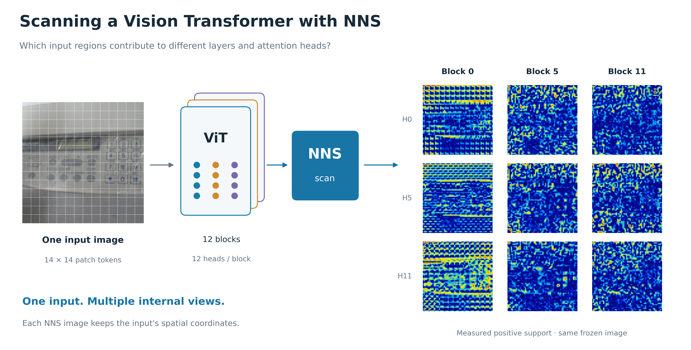
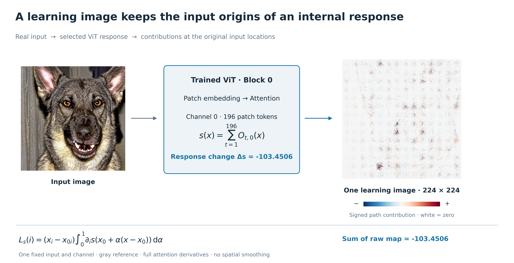
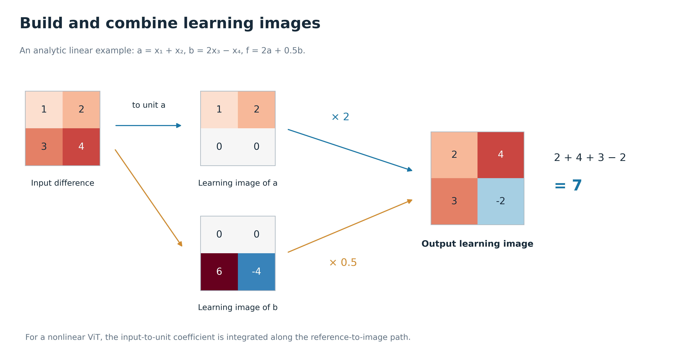
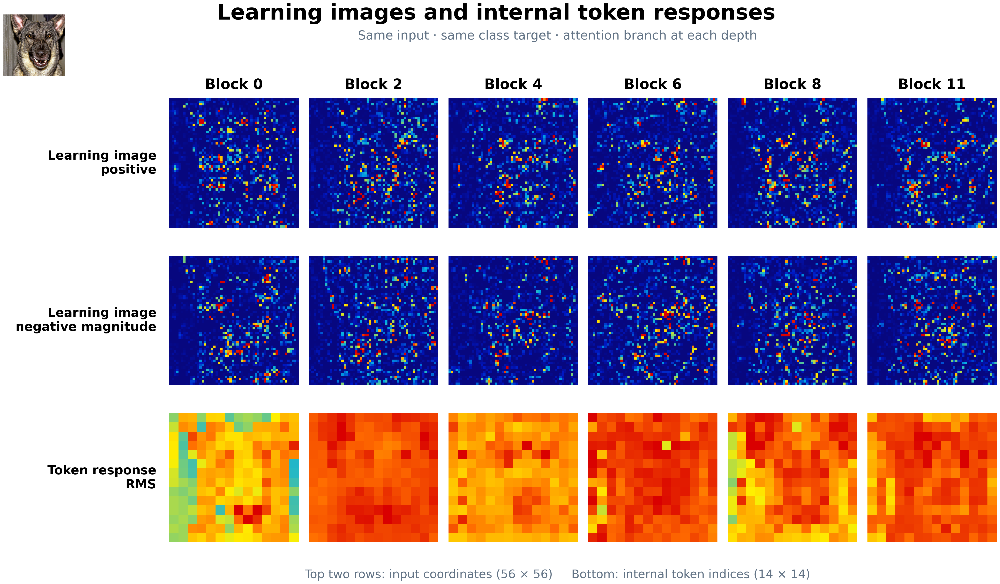
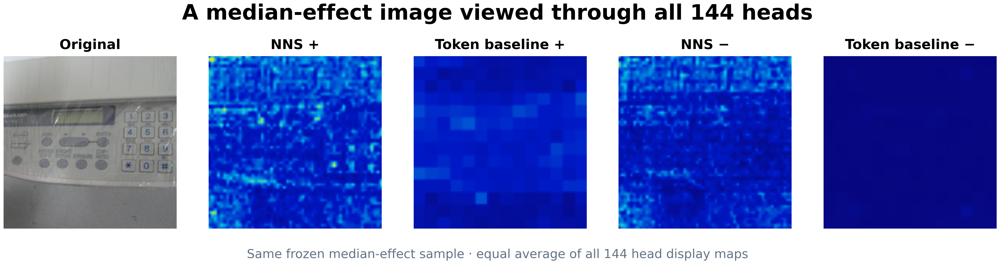
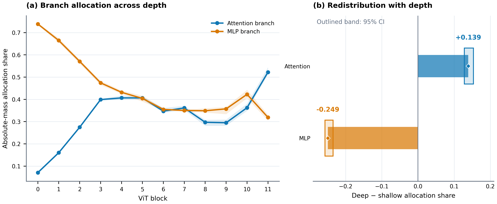

# 论文写作前置条件与结论—证据—图表映射

日期：2026-09-16

> 当前图包：[R9 图表索引](../reports/nns_vit_unified_paper_figures_r9_20260917/figure_index.md) · [完整画廊](../reports/nns_vit_unified_paper_figures_r9_20260917/gallery.html) · [逐图说明](../reports/nns_vit_unified_paper_figures_r9_20260917/figure_analysis.md) · [论文大纲](论文大纲_NNS_ViT_R9_20260917.md)。R9 包含 31 张编号图：原有实验、learning image 概念、全部四张逐步对照及三个模块的真实响应图。Figure 2 用真实输入和单张完整 learning image 重画。

> 原论文提出 NNS 和 learning image，并研究 FCN/CNN；本文研究这一视角在 ViT 上怎样实现、能看出什么。本文中的“扫描”“思考”指查看固定模型处理一张输入时的内部响应，不表示人类思维，也不是训练过程的录像。

适用仓库：vitnns_rebuild

文档性质：论文启动审计、结论边界与图表选用指南

审计范围：阶段 A–F、X、Y、S，以及《论文1实现审计与后续计划》和当前阶段执行文档

## 1. 这篇论文到底研究什么

### 1.1 总体判断

当前已有结果足以开始写作。眼下需要做的是把方法、结果和图表讲成一条清楚的主线；最终投稿前的交接、参考文献和复现材料见第 9 节。

论文中心问题为：**用 NNS 打开一个已经训练好的 ViT，能否看见输入图像中的信息怎样对应到不同 patch、head、层和分支，并判断这些解释在干预实验中是否有用？**

现有数据支持开展这项内部解释研究。Stage D 对指定 head 的输入归因提供正式干预证据；Stage E 刻画尺度与层头依赖；Stage X/Y 给出完整路径分解的实现验证和分支分配分析。方法原创性需要逐项对照 IG、conductance 和已有 neuron/path attribution 文献，不能从图像分辨率或工程完整性直接推导。当前允许开始组织论文证据，不等于方法新颖性和最终投稿包已审定。

### 1.2 论文可以明确写出的总论点

> 我们把 NNS 的 learning image 思想扩展到 ViT，在输入图像坐标下查看内部响应及其贡献组织。研究表明，ViT 的输入贡献具有空间、head 和深度上的差异；learning image 既能展示这些差异，也能把它们转化为可检验的区域排序和分支分配问题。

说人话：**原论文给 CNN 的神经元配了一张“它从输入里接收了什么”的图；我们把这种查看方式带到 ViT，进一步问：哪个 head 对应哪些位置，换一层后怎样变化，不同分支分别承担了多少输入贡献。**

这句话概括研究内容，不要求每个小问题都得到正结果。较明确的实证是指定 head 下的细粒度干预收益，以及 attention/MLP 分支份额的深浅变化；patch mixing 和总体 head 组织的结果另列在第 3 节。

主要实证来自 500 张独立图像：在冻结 ViT-B/16 的预定 head 和 fine-cell 干预下，输入归因的排序优于同目标 token 贡献的均匀空间展开。尺度和层头分析界定这一收益的条件。独立 class-targeted 比较中，NNS 低于 Grad-CAM、高于 rollout；完整路径分解则支持按成分分析贡献分配，Stage Y 给出了 attention/MLP 分支份额的深浅差异。Stage S 的目标对齐与语义解码结果作为 post-hoc exploratory 延伸。

`block 0`、`head 9`、`fine-4×4` 等词是验证上述论点时使用的具体实验设置，应写在 Methods、结果表或图注中，不应充当论文总论点本身。

### 1.3 Figure 1–3 的分工与首图一句话

**Figure 1：让读者看懂 NNS 怎样查看 ViT 内部。** 图题采用“Scanning a Vision Transformer with NNS”。输入图像经过 patch embedding 和 ViT，右侧以层为列、head 为行展示对应的真实输入贡献图。首图的价值句为“给不同内部响应配一张能对回输入位置的图”。整体构图借鉴原 NNS 论文的扫描视角，不放统计方格或基线计算。

**Figure 2：learning image 是什么。** 真实输入经过 patch embedding 与 B0 attention；选定 channel 0 在 196 个 patch-token 输出上的响应和，再用一张完整 224×224 learning image 展开输入位置贡献。红、蓝在同一张图上编码符号；原始图和重构响应变化一致。输入为既有 Y2 队列首图，通道按索引固定。它解释模块自身响应，主实验仍用 B0/H9 条件 Value-path。详见 [R9 制图定义](unified_paper_figures_r9_design_20260917.md)。

**Figure 3：怎样评价。** 保留 R4 的 fine/native 单位、同分排序、insertion/deletion 和图像级统计。

首图、Figure 8–9 共用 F3 已冻结的 median-effect 样本 order 44。Figure 8 采用用户选定的 F3H 全头视图，改变展示单元而不更换样本。现有 F3H 的目标是各层各 head 的 CLS 响应：输入 patch 网格表示位置，不冒充每个 patch-query 都有独立实测归因。全头显示平均描述空间支持，不是完整类别归因。500 图统计留在 Figure 4–7。

### 1.4 原论文中的 learning image 是什么

依据 Dou、Shen、Zhao、Mu 的 *Understanding neural network through neuron level visualization*，Neural Networks 168 (2023), 484–495，[DOI](https://doi.org/10.1016/j.neunet.2023.09.030)。本地可读 [方法第 3 节](<../../相关文章/Understanding neural network through neuron level visualization/en/03-proposed-method.md>) 和 [实验第 4 节](<../../相关文章/Understanding neural network through neuron level visualization/en/04-experiments.md>)。

普通 feature map 把一个神经元的激活画在网络内部的位置；learning image 则给这个神经元配一整张输入坐标图，说明这个输入的哪些部分通过网络与该神经元联系起来。它针对当前样本，换一张输入，learning image 也会变。

原论文先把输入拆成很多张只保留一个输入坐标的图。令输入向量为 x，第 i 个标准基向量为 e_i：

$$
I_i^0=x_i e_i,
\qquad x=\sum_i I_i^0.
$$

例如 x=(3,2)，初始化图是 I₁=(3,0)、I₂=(0,2)。一个无偏置单元若用权重 (1,−1)，它的输入位置图就是 (3,−2)，正负相加为输出 1。ReLU 在这里打开，保留这张图：神经元激活为正，其输入贡献仍可以一正一负。若另一个输入使该单元的激活前输出不大于零，ReLU 门关闭，对应的激活后 learning image 置零。

用统一的行列记号重写原论文式 (4)–(13)，线性组合后按当前样本的 ReLU 状态开关：

$$
I_q^{\ell}=s_q^{\ell}\sum_p W_{qp}^{\ell}I_p^{\ell-1},
\qquad s_q^{\ell}=\mathbf 1[z_q^{\ell}>0].
$$

这样可以把多层门控权重连起来，追到输入坐标：

$$
I_q^{\ell}[i]=x_i C_{qi}^{0\to\ell}.
$$

这是对原文线性/ReLU 主干的记号整理；是否计入末层激活门取决于解释的是激活前还是激活后单元。原文这些公式没有单列偏置项，不能据此给任意带偏置网络补写“所有 learning image 都严格重构输出”的定理。

对 CNN，卷积核能展开成稀疏、共享参数的线性连接，max-pooling 则按当前样本的获胜位置选择上一层单元，因此可以沿用上述思路。原论文还研究了带 skip connection 的模型；“考虑 residual”本身不是本文首次提出。

原文第 4.2 节还会按激活值加权聚合神经元图，比较滤波器 learning image 与 feature map；第 4.2.3 节展示分类输出单元，并对显示图做最大池化和插值。这些都是原论文已有内容，应明确引用。

### 1.5 到了 ViT，为什么要改计算方法

ViT 先把 patch 编码成 token，再让 token 之间通过 attention 交换信息。一个 head 的简式为：

$$
Q=HW_Q,\quad K=HW_K,\quad V=HW_V,
\qquad A(H)=\operatorname{softmax}(QK^\top/\sqrt{d_h}),
\qquad O=A(H)V(H).
$$

卷积的连接权重由训练后的参数给定；attention 的混合权重 A 还随当前输入改变。输入变化时，既会改变“读什么”，也会改变“从哪里读”：

$$
\mathrm dO=(\mathrm dA)V+A(\mathrm dV).
$$

此外，LayerNorm、softmax 和 GELU 也不能统一当作原论文的 ReLU 零一开关。因此，本文保留“内部单元对应输入位置图”的思想，重新定义 ViT 上要解释的目标和贡献计算。

| 项目 | 原论文 FCN/CNN | 本项目 ViT 的处理 |
|---|---|---|
| 查看哪个内部单元 | 神经元，CNN 的通道与空间位置 | block、head、token、MLP 单元或 residual 分支；实际图表要注明目标 |
| 连接怎样组合输入 | 线性/卷积权重，加当前样本的激活门、池化选择 | attention 是输入相关的；分别研究固定 attention 的条件路径和完整模型路径 |
| 每个输入位置的数怎么算 | 输入值乘经过门控的连接贡献 | 相对参考输入的路径积分；完整版本再按内部成分分解 |
| 图上的空间坐标 | 保留输入位置 | 同样保留输入位置；token 编号与输入位置分别处理 |
| 聚合多个内部单元 | 原论文有求和或激活加权视图 | 完整切分内按链式法则求和；展示平均另行命名 |
| 如何验证 | feature map/learning image 对照、神经元相似性、可视化比较等 | 增加输入干预、尺度/层头对照、分解重构、完整性与稳定性检查 |

这里列的是从原论文到本项目的具体适配。路径积分采用 IG，完整成分分解与 conductance/path attribution 有直接联系；这些数学工具不能写成本文首次发明。

### 1.6 本项目实际上有三种图，目标要分开

**第一种：看某个 head 的内部响应。** 这是 Figure 1、3–9 中 Value-path 图及主实验的对象。R9 Figure 2 用模块自身响应展示通用 learning image 定义，目标另列。把选定 head 的 clean attention 固定下来，令：

$$
g_{\ell h}(z)=\sum_j A_{\ell h}(x)_{\mathrm{CLS},j}V_{\ell h,j}(z),
\qquad u=\frac{g_{\ell h}(x)-g_{\ell h}(x_0)}{\|g_{\ell h}(x)-g_{\ell h}(x_0)\|_2},
\qquad f_{\ell h}(z)=u^\top g_{\ell h}(z).
$$

head 输出是一个向量；固定 u 是为了把“这个 head 的响应”变成一个可计算贡献的数。方向退化时按协议报无效。沿路径只固定所选 head 的 attention；在深层目标之前，其余网络计算仍随输入运行。相同 H9 编号在不同 block 中属于不同参数组，不能称为同一个物理 head。

**第二种：看固定所有 attention 后的类别响应。** Figure 10–11 的 F3C 使用全部 12 个 block 在原图上的 attention，得到条件模型 Fᴬ(x)。解释的是固定类别 y 的 Fᴬ_y；Value、MLP、residual 等仍参与计算。它把“在这套固定信息混合方式下，哪些输入位置支持类别输出”单独拿出来研究。

**第三种：看完整类别贡献经过哪些内部成分。** NNS-v2 保留原模型 F_y 的 Q/K/V、softmax、LayerNorm、GELU、输出投影和 residual 计算，attention 也随路径输入变化。先得到完整输入 IG，再把贡献分配给同一个完整切分里的 token、head、MLP 或旁路。Figure 12–13 采用这一完整模型体系。

| 图表/证据 | 解释目标 | 是否固定 attention |
|---|---|---|
| Figure 1、3–9，Stage D/E/F3H | 单个 CLS head-direction 标量；Figure 8–9 为这些图的显示平均 | 固定被解释 head 的 clean attention |
| Figure 2、28–31，R9 实测 | B0 三模块指定通道在 196 个 patch-token 输出上的响应和 | 不固定，保留完整 attention 导数 |
| Figure 10–11，F3C | 条件模型的固定类别 logit | 固定全部 block 的 clean attention |
| Figure 12–13，NNS-v2 / X/Y | 原模型固定类别 logit 及其内部成分 | 不固定，走完整模型计算 |
| Figure 14，Stage S | 标注类别 logit 的全 head attention 分支贡献；另测隐藏表示的解码 | 路径分解使用完整模型；probe 来自隐藏表示，不是 learning image |

源码入口：[Value-path](../src/vitnns/stage_c_value_path.py)、[F3C 条件类别归因](../src/vitnns/stage_f_f3c1_kernels.py)、[NNS-v2](../src/vitnns/stage_x_nns_v2.py)、[完整切分定义](stage_x_protocol.md)、[Stage S 目标定义](nns_vit_patch_depth_s1_protocol_20260914.md)。

### 1.7 learning image 在 NNS-ViT 中怎样定义

本文可把它叫作“带符号的输入贡献图”：**选定内部响应后，用一张保持输入坐标的图，表示各位置相对参考输入累计了多少贡献。** 这里的 learning 沿用原论文术语；它描述已训练模型对当前输入的反应，不是生成一张新图片，也不等于模型重建出了原图。

对上述前两种目标 f，令灰色参考为 x₀，路径为 x(α)=x₀+α(x−x₀)：

$$
R_i^f(x;x_0)=(x_i-x_{0i})\int_0^1
\frac{\partial f(x(\alpha))}{\partial x_i}\,\mathrm d\alpha.
$$

例如 f(x₁,x₂)=2x₁−x₂，x=(3,4)、x₀=(1,1)，那么 R=(4,−3)，总和 1 等于 f(x)−f(x₀)。位置 1 对这次目标变化给了 +4，位置 2 给了 −3。换参考输入，贡献解释也会跟着变。

RGB 图先保留三个通道的原始贡献，再按符号求和：

$$
\mathcal L_f(r,c)=\sum_{k\in\{R,G,B\}}R^f_{k,r,c},
\qquad \sum_i R_i^f\approx f(x)-f(x_0).
$$

最后一个近似由数值积分精度决定，需要实际检查。R9 Figure 2 使用新计算的原生 224×224 模块响应图。已有 Y2 类别成分图为 56×56，每个 cell 累加 4×4 输入像素；两组目标和分辨率分别标注。

正负图满足 L⁺=max(L,0)、L⁻=max(−L,0)。同一个原始 cell 不会同时为正和负，但相邻 cell 可以符号相反，所以两张平滑热图可能呈现相似轮廓。R9 Figure 2 在单张完整地图中保留符号，nearest 显示；不再使用正负放大分图。拆分能恢复原图证明的是符号处理一致，不能单凭这点断言整个归因算法都正确；模型目标、积分收敛和干预结果还要各自验证。

“推高/压低”是便于读图的简称，准确含义是对参考到原图这条路径上目标变化的正/负归因。单独遮掉一个区域后的变化可能受非线性和交互影响，需要另做干预测量。

**完整 NNS-v2 的成分 learning image 多回答了一步：这部分输入贡献经过了哪个内部成分？** 在一个截住所有输入到输出路线的切分 C 中，令 h_j 是该切分的标量边坐标：

$$
K^C_{ij}=(x_i-x_{0i})\int_0^1
\frac{\partial F_y}{\partial h_j}(x(\alpha))
\frac{\partial h_j}{\partial x_i}(x(\alpha))\,\mathrm d\alpha,
\qquad \mathcal L^C_j[i]=K^C_{ij}.
$$

一个 head 的图是属于该 head 的坐标 j 的求和；实际计算按计算图的边分配，残差旁路也必须算进去。这样：

$$
\sum_{j\in C}K^C_{ij}=\operatorname{IG}_i(F_y),
\qquad \sum_i\sum_{j\in C}K^C_{ij}=F_y(x)-F_y(x_0).
$$

公式描述理论恒等关系，数值实现按误差容限检查。第一处 residual 的“旁路 + 全部 heads”和第二处的“旁路 + MLP”是两个不同切分。不同层是在重新拆解同一个总贡献，不能把 12 层的图再相加。单 head 自身响应的 R 图与 head 对最终类别的 K 图，也不是同一个东西。

偏置、位置编码和 CLS 常量参与模型前向及后续导数；沿只改变输入的路径，它们在引入处的直接变化量为零。这不等于把它们从网络删除。

### 1.8 patch、token、head：别把几种“位置”混起来

**输入 patch** 是原图上的一块区域；**token** 是网络内部的一个向量；**head** 是用一组 Q/K/V 进行信息混合的计算分支。只有最初 patch embedding 时，图像 token 与输入 patch 有直接局部对应；经过 attention 后，token 可以包含来自其他位置的信息。

若已有完整切分中的 token 成分图，可以把输入贡献按 patch 汇总，定义“输入 patch p 到内部 token t”的贡献矩阵：

$$
M^C_{p,t}=\sum_{i\in P_p}\sum_{j\in T_t}K^C_{ij}.
$$

这是要研究 patch 间关系时应定义的对象，和 attention 权重矩阵不是同一量。当前 Stage Y 的 patch-mixing 主端点为 INVALID、n=0，因此本文只能解释这个研究问题及其计算定义，不能写出“已发现某种跨 patch 混合规律”。F3H 的 144-head 图也只包含 CLS 查询，不能当成逐 patch-query 图谱。

### 1.9 本文相对原 NNS-CNN 做了什么

可以在 Introduction 末尾用三点概括贡献：

1. **给出 ViT 上的 learning image 定义和实现。** 把查看对象扩展到 token、head、MLP 与 residual；分别说明条件响应和完整类别目标，处理 ViT 的输入相关 attention 与非线性计算。
2. **把内部图像变成可核对的贡献分解。** 用输入路径积分定义相对参考的正负贡献，在完整模型中按完整切分分配，并检查与总输入归因的重构关系。
3. **研究 ViT 的空间与内部组织。** 用图谱、输入干预、尺度对照和分支统计研究 patch 内细节、head 差异及深度变化，同时报告没得到明确答案的问题。

原论文已经提出 NNS、learning image、神经元图聚合、残差模型比较以及池化后的展示图。本文的定位是这些思想在 ViT 上的适配和研究；IG 与链式法则分解是采用的数学基础，独立方法新颖性仍需与 conductance、neuron/path attribution 文献逐项比较。

### 1.10 新增 Figure 15–21：把 learning image 单独讲透

**理解模块输入输出时，优先看 [正常 ViT / NNS learning image 的两排对应图](../reports/nns_vit_forward_learning_image_comparison_20260917/gallery.html)。** 这组新图用同一输入逐步画出 patch embedding、attention、residual：上排每个输入/输出单元的数值，下排各自的 learning image，同名虚线逐一对应。[逐步说明](ViT正常前向与NNS学习图像逐步对照_20260917.md) 列出同一组数如何从头算到尾；attention 下排明确写出该线性 patch 输入例子的路径贡献系数 C，不再以最终类别的分支对账替代模块自身响应对照。

读完《论文架构》目录的五份 PPTX、三份讨论 PDF 和《参考文章.pdf》后，新增了一组专门讲 learning image 的图，独立于 Figure 1–14。

[新增图组画廊](../reports/nns_vit_learning_image_figures_15_21_20260917/gallery.html) · [逐图说明](../reports/nns_vit_learning_image_figures_15_21_20260917/figure_analysis.md) · [来源阅读和定义说明](learning_image_source_reading_20260917.md)

| 新图 | 读者应该看懂什么 | 原论文的对应画法 |
|---|---|---|
| Figure 15 | 内部响应是一个数，learning image 把其输入来源位置展开 | Figure 2 的单元与图一一对应 |
| Figure 16 | 输入变化拆成单坐标种子，位置始终保留 | Figure 3 的初始化 |
| Figure 17 | 输入位置图怎样被加权，怎样组合成下一单元的图 | Figure 4 的生成过程；本图采用可手算线性例子 |
| Figure 18 | patch embedding、attention、residual 对贡献计算分别有什么要求 | Figure 5 的算子适配思路 |
| Figure 19 | 真实的逐层 learning image 与内部 token 响应分别表示什么 | Figure 13 的上下对照 |
| Figure 20 | 同一个最终类别目标下，不同 head 的贡献图有何不同 | 增加 ViT 特有的 head 维度 |
| Figure 21 | 同一切分里的 head 图和旁路图怎样相加恢复总图 | 将组合规则落到真实数组并核对误差 |

Figure 19–21 使用 Y2 第一张冻结样本的完整类别贡献分解，所有列保持同一个类别目标。当前保存的地图是 head/branch 聚合后的 56×56 输入 cell 图；对应 token 响应由相同模型的 CPU 前向取得。旧 PPT 的“每个 token/channel 单独一张全输入图”是更细的对象，本次不把聚合图混称为全部单神经元图。

### 1.11 Figure 18 的展开：attention、residual 与正负图取舍

[详细公式与逐步计算](attention_residual_learning_image_详解_20260917.md) · [Figure 22–23 及正贡献候选图画廊](../reports/nns_vit_attention_residual_examples_20260917/gallery.html)

- **Figure 22** 从两个 token 的 Q/K/V、softmax 和输出开始，把 A dV 与 (dA)V 两条路沿输入路径积分，再在两个输入位置相加。还展示完整路径的 Value 项与固定 clean attention 方法的区别。
- **Figure 23** 用旁路 r=x₁、分支 b=2x₁−x₂、最终目标 F=(r+b)² 的数值例子说明下游导数怎样进入 learning image，并给出两条路 [10,0]+[20,−5]=[30,−5] 的完整计算。
- **Figure 19 正贡献正文候选版** 保留旧图相同数据与色阶，只去掉负幅度行。上排正贡献、下排 token 响应；原始 signed 数据和完整正负图保留。

上述两张解析图用于解释计算，不是新增真实模型实验。正负图的取舍由具体问题决定：空间概览可以只放正贡献并明确标签；符号与重构问题用 signed 图；完整负贡献图放补充材料。原 Figure 2 的符号解释和 Figure 21 的相加检查仍需要符号信息，但不要求每次拆成两幅同色热图。

## 2. 用户选定图片包的判断

### 2.1 总体判断

这里必须区分“核心证据源”和“可直接放进正文的成图”。F1 与 F3C4 的数据是核心证据，但现有 PNG 主要服务结果审计和完整披露，不应直接作为正文视觉设计。正文应以 F2 的定量结构、F3C visual 的样本×方法矩阵和 F3H 的层×head 图谱为视觉骨架，并从 F1/F3C4 的正式 JSON 重绘少量简洁统计面板。

| 报告包 | 判断 | 论文位置 | 使用边界 |
|---|---|---|---|
| reports/stage_f_f1_r3_20260907 | 核心数据源；现有 PNG 不直接进正文 | 从正式 plot data 重绘一个紧凑的 n=500 效应面板；旧图转 Supplement/QC | 保留 paired median、CI、500/500 positive 与 fidelity curves，不沿用大标题和审计式双栏布局 |
| reports/stage_f_f2_r4_20260907 | 正文定量图的主要模板 | F2-A、F2-C 清理后进入正文；F2-B、F2-D 进入补充材料 | 删除 stage/status 标题，压缩图例与留白；数据和区间不变 |
| reports/stage_f_f3_r7_20260907 | 方法图素材与 signed 审计源 | Figure 1 重绘素材和 Supplement | 方法流程可重排；signed/shared-scale 图用于方向与幅值审计 |
| reports/stage_f_f3_visual_r4_20260907 | 候选案例来源 | Supplement 或正文边界案例的小面板 | 不作为正文主要视觉风格；逐面板归一化不能用于跨图幅值比较 |
| reports/stage_f_f3c4_report_copy_v1_20260908 | 核心 comparator 数据源；旧 01–03 不直接进正文 | 从 contrast JSON 重绘紧凑点区间图；04–23 留在 Supplement/online atlas | 统计结论保留，去掉现有审计式表盘/流程呈现 |
| reports/stage_f_f3c_visual_v1_20260908 | 正文视觉核心 | 主文“样本×方法”比较矩阵 | 最接近参考论文 Figure 14；正文只选少量按冻结规则确定的样本，完整 50 图保留在线 Supplement |
| reports/stage_f_f3h_full_head_r2_cpu_reconcile_20260907 | 正文视觉核心之一 | 主文层/head progression 或 depth-band panel；全 12×12 atlas 放 Supplement | 最接近参考论文的 layer/neuron visualization；单样本只支持结构展示，不支持 cohort-level head 结论 |
| reports/nns_vit_patch_depth_s6_r3_paper_figure_revision_20260916 | 有用的次级结果 | 主文末段或补充材料 | 全部必须标为 post-hoc exploratory；不能取代 Stage D/F1 的主要验证 |

### 2.2 视觉可用性的修正判断

- F3C visual 和 F3H 是最接近参考论文视觉语言的两个现有包，但仍需重排为正文尺寸，不能直接把 50 图或 12×12 atlas 缩进论文。
- F2 是当前定量图中视觉上最接近可用的一组；保留它的配色与面板逻辑，只需轻量清理内部阶段标题、重复图例和多余留白。
- F1 与 F3C4 的现有统计 PNG 是审计友好图，不是论文视觉模板。它们的核心地位来自正式数据，不来自现有外观。
- F3H 的 19_f3h_g_all_heads_consensus.png 是 Figure 8 的核心视图；18_f3h_g_depth_band_consensus.png 用于 Figure 9。完整 12×12 atlas 另附，首图用首、中、末层与 head 说明扫描视角。
- F3C visual 的 primary pages 最适合作为 comparator showcase 的重绘起点；正文保留少量大尺寸样本行，完整 50 图另行发布。

### 2.3 对 Stage S 图的具体判断

S6-R3 当前版本可以用于论文，尤其是 evidence atlas、depth profile 和 matched occlusion 面板。Image 04 已经不再用“旧规则失败、改规则后通过”的内部流程作为图面主题，这是正确的论文呈现方向。

正文中仍须在 Methods 或 Limitations 用一句中性措辞说明：Stage S 的深度端点与阈值是在 outcome access 后形成的 post-hoc exploratory 分析。图中无需展示治理流程，但正文不能把它改写为预注册或验证性结果。

### 2.4 四个低视觉质量图包的科学价值与处理方式

| 现有图 | 科学意义 | 是否值得美化 | 最终处理 |
|---|---|---|---|
| F1-A cohort interval | 中等；说明 C10 与 Stage D 是两个独立 cohort，并保留历史边界 | 不必占正文重绘优先级 | Supplement，用简洁表或小点区间图替代现有大图 |
| F1-B n=500 ECDF | 很高；直接展示全部 500 个 image-level delta 均为正及其完整分布 | 必须重绘 | 正文 Figure 4；去掉 Stage/F1 工程标题，直接标注 n、median 和 CI |
| F1-C insertion/deletion curves | 很高；解释 delta_fid 来自何种干预曲线差异 | 必须重绘 | 正文 Figure 5；缩短 legend，减小空白，保留 pointwise uncertainty |
| F3-r7 Image 01 method overview | 很高；定义 Value-path、同目标 patch-token 基线与 fidelity 流程 | 必须重绘 | 拆成 Figure 1–2 的方法素材，改为参考文章式流程图 |
| F3-r7/F3-visual 单案例页面 | 展示 best、median、weak、misclassified 等冻结案例 | 保留用于补充查阅 | Figure 8 已改用中位样本全头汇总；旧三案例图留在 R6 |
| F3-r7 rule-to-image、fixed-audit 与 typed-failure 页面 | 审计意义高，正文科学增量低 | 无需做成正文美图 | 保留 Supplement/online audit；用表格交代 selection 与 validity |
| F3-r7/F3-visual 四坐标 progression | 展示同一图像上不同坐标的空间形态 | 并入 F3H 图库 | Figure 9 使用四个深度段的全 head 汇总；完整矩阵另附 |
| F3C4 Image 01 fidelity distributions | 中等；展示五方法逐图分布，但与 contrast 图和曲线信息重叠 | 合并重绘 | 并入 Figure 11 的轻量 distribution/summary 子面板，不单独占一图 |
| F3C4 Image 02 contrast summary | 很高；承载 NNS 相对四个 comparator 的方向、区间与检验 | 必须重绘 | Figure 11 核心 forest/dot-interval panel |
| F3C4 Image 03 fidelity curves | 很高；展示方法差异在 insertion/deletion 过程中的位置 | 必须重绘 | Figure 11 的曲线子面板；使用直接标注或分面，避免超长图例 |
| F3C4 Image 04–23 formal atlas | 审计覆盖度高，但正文与 F3C visual 重复 | 无需逐页美化 | 保留 Supplement；正文视觉由 F3C visual 替代 |

保留 F1-B、F1-C、F3 方法逻辑、F3 冻结案例、F3C4 contrast 和 fidelity curves 的科学内容。F3H Image 19 的图像布局可直接作为正文基础；R7 从同一显示数组重新排版，并附原 PNG。其余材料按正文图、补充图或完整图库组织。

## 3. 主要发现、意义与证据映射

这一节先回答“研究到底发现了什么”，再给实验名称、参数和证据路径。主结论概括研究视角，小结论回答具体问题：

| 层级 | 一句话结论 | 在论文中的作用 |
|---|---|---|
| 研究用途 | 将输入区域的正负作用追溯到指定内部响应，并按 head、层与分支分析贡献 | 摘要、引言与 Figure 1 |
| 核心实证 | 指定 Value-path 的输入归因排序，在 500 图 fine-cell 干预下优于同目标 token 空间基线 | Results 主结果、Figure 4–5 |
| 适用范围 | 这种优势依赖空间分辨率和所分析的内部路径，并不是整个 ViT 的均匀属性 | Results 的尺度与层头分析 |
| 方法关系 | NNS 提供补充视角，但没有全面优于现有解释器，也没有通过广义稳定性扩展 | 方法比较、Discussion 和 Limitations |
| 深度线索 | ViT 内部贡献分配、目标对齐和语义可解码性会随深度变化 | 后续机制结果；其中 Stage S 明确为 post-hoc exploratory |

### 先把 patch、head、层等小结论放在一起

| 问题 | 可以直接写进论文的结论 | 证据与图 | 读图时记住什么 |
|---|---|---|---|
| learning image 有没有用？ | 对指定内部响应，NNS 的输入区域排序在 fine-cell 干预中优于同目标 token 基线 | D10，500/500 个差值为正；Figure 3–5 | 这是一个固定内部目标的检验 |
| 同一个 patch 里面是否有差别？ | 同 patch 内部的输入归因可以不同；主实验的排序收益主要出现在 4×4-cell 评价，整 patch 评价下几乎消失 | Stage E；Figure 2、6 | “图上有细节”和“细节改善某个目标的干预评分”要分别判断 |
| 换成完整类别目标，patch 内收益是否仍成立？ | 当前完整类别研究未达到预定的 patch 内增益要求 | Y-A1，97 图，NOT_SUPPORTED；补充结果表 | Stage D 的正结果不能代替这个不同目标的检验 |
| patch 之间怎么交换贡献？ | 定义了输入 patch 到内部 token 的贡献矩阵，但当前数据不足以给出跨 patch 混合规律 | Y-B3，n=0，INVALID；第 1.8 节与补充表 | 不把 attention 图当成已验证的贡献矩阵 |
| 不同 head 是否一样？ | 同一图像的不同 head 有不同空间图谱；四个预定层头坐标的干预收益也不同 | F3H 全 144-head 图、Stage E；Figure 1、7–9 | H9 在不同 block 中是不同参数组；单张图谱属于描述 |
| head 是否有稳定的深度组织或专门分工？ | 当前联合检验还没有给出明确答案 | Y-B2/B6/B7，INCONCLUSIVE；补充表 | 不把“图不一样”直接写成“head 已形成可复现语义分工” |
| 不同层怎样变化？ | 可以观察层间空间形态变化；较明确的总体深度结果是分支贡献份额的变化 | Figure 9、13；Y-B4/B5 为 SUPPORTED | Y-B1 的空间支持深浅差异未获支持，不据热图推出统一的局部到全局规律 |
| attention 和 MLP 分别怎样变化？ | 深层第一处 residual 的 attention 绝对贡献份额较高，第二处 residual 的 MLP 份额较低 | Y，100 图；Figure 13 | 分属两处切分，两条曲线不能相加当成 100% |
| 高贡献 patch 是否贴近物体、影响类别？ | 探索性结果显示选区更贴近目标，遮挡后目标输出下降更大；深层对齐和目标信息可解码性也更高 | Stage S；Figure 14 | 全部标记为事后探索；对齐增益与解码增益逐图相关约为 0 |
| 与其他解释器相比如何？ | F3C 中低于 Grad-CAM、高于 rollout；与 full IG、raw CLS 的差异未明确检出 | 50 图；Figure 10–11 | 图的精细程度不能替代这组方法比较 |
| 换输入后图是否稳定？ | 广义稳定性没有通过预定门槛；局部聚合后几何一致性提高是一条探索性线索 | Stage X；Figure 12 | 粗粒度更一致不等于细粒度解释已通过稳定性验证 |

负结果也构成小结论：它们说明 NNS-ViT 在哪些问题上已有答案，哪些仍没有答案，而不是把所有观察压成一句“ViT 从浅层到深层越来越懂语义”。

这张图保留你选中的全头视图。它把不同 head 的显示图平均起来，便于看整体空间轮廓；各 head 的响应方向不同，因此这个平均不是把它们对某个类别的真实贡献加起来。

### 3.0 先说明主基线：同目标 patch-token 基线是什么

文档后文将 Stage D 主实验中的 `matched_fixed_clean_attention_patch_token_contribution` 简称为“同目标 patch-token 基线”或“patch 内均匀基线”。它是同目标的 token 空间读出对照。NNS 与该基线的贡献坐标不同，不能直接称为只删除 patch 内细节的纯消融。

对第 \(j\) 个 patch token，它计算：

\[
c_j=A_{\mathrm{clean}}[\mathrm{CLS},j]\,
u^\top\bigl(V_{\mathrm{clean},j}-V_{\mathrm{baseline},j}\bigr).
\]

这里的 \(c_j\) 是第 j 个 token 的 Value 端点变化对指定内部目标的贡献。ViT-B/16 有 \(14\times14=196\) 个图像 token，基线将这 196 个标量按 token 索引排为地图；CLS scalar 单独保留。深层 token 可混合多个输入位置的信息，因此 token j 的贡献与原图 patch j 的输入归因不是同一定义。

主实验在 patch 内的 \(4\times4\) cells 上评价。基线没有 patch 内位置信息，因此把每个 \(16\times16\) patch 的总贡献平均分给其中 16 个 cells：

\[
c_{j,k}^{\mathrm{uniform}}=\frac{c_j}{16},
\qquad k=1,\ldots,16.
\]

例如 token A、B 的贡献分别为 16、8，基线在对应 patch 内分别赋每 cell 1、0.5。NNS 则独立计算输入贡献；这些值不由 c_j 插值得到。两种方法随后使用相同 insertion/deletion 评价。模型的 patch embedding 仍能编码 patch 内结构；这里的均匀性来自基线读出规则。

两种方法的受控关系如下：

| 条件 | NNS | 同目标 patch-token 基线 |
|---|---|---|
| 模型、图像、block/head | 相同 | 相同 |
| fixed-clean attention 与 Value-path target | 相同 | 相同 |
| 输入 reference baseline | 相同 | 相同 |
| 贡献坐标与总量 | 输入坐标的 IG，整体守恒到目标变化 | token 端点贡献；含 CLS 时整体守恒到目标变化 |
| 逐 patch 总量相等 | 不作通用假定 | 不作通用假定 |
| insertion/deletion、fractions 与 paired tie seeds | 相同 | 相同 |
| patch 内部贡献分布 | 由 NNS 计算 | 在 16 个 cells 中均匀分配 |

因此，这个比较回答：**针对同一内部目标，输入归因与 token 贡献的空间展开，哪种排序在细粒度干预下更有用？** Stage E 在预定早期 head 上观察到原生 patch 评价的效应接近零，说明收益依赖干预尺度。这个观察不构成两种归因逐 patch 恒等的通用定理。若要严格隔离 patch 内细节，需比较 NNS 与其自身 patch 聚合再均匀展开的版本，并单独绑定同目标实验；不将当前对照改名为该实验。

NNS 与 Grad-CAM、attention rollout、full-model integrated gradients 和 raw CLS attention 的关系由独立的 50 图像比较回答，见第 3.5 节。论文首次出现时建议写：

> target-matched patch-token baseline with uniform within-patch allocation

中文为“同目标 patch-token 基线（patch 内均匀分配）”，后文可简称“patch 内均匀基线”。

直接定义与验证位置：

- docs/阶段D_protocol.md 的 Target、map 和 fine-cell 定义；
- docs/stage_e_protocol.md 的 baseline and patch-scale sensitivity；
- src/vitnns/stage_c_value_path.py 的 `matched_fixed_clean_attention_patch_token_contribution` 实现。

名称区分：Stage S 中的 matched occlusion control 指与 NNS 选区匹配 patch 数、位置和形状的遮挡对照，不是本节的 Stage D patch-token 基线。

### 3.1 核心实证：对指定内部响应的输入归因具有干预用途

**说人话的结论：** 选择一个内部 head 后，NNS 给出输入区域对该响应的正负贡献。按其正向贡献排序恢复或遮挡小区域，所选内部目标的忠实度评分高于同目标 token 空间基线。

**为什么重要：** 这个结果给内部解释增加了可检验的依据：输出地图的区域排序与真实干预响应相联系。当前主检验针对正向排序；正负地图中的每个局部符号不因此获得独立因果验证。

**核心证据：**

- 独立样本量为 500 张图像。
- 500/500 张图像上，NNS 相对同目标 patch-token 基线（patch 内均匀分配）的 fidelity 差异都为正。
- mean delta_fid = 2.630671903027281。
- median delta_fid = 2.3081996221714247。
- paired-median image-level bootstrap 95% CI = [2.1110806126093067, 2.445235411755993]。

**论文可用表述：**

> 在预定 ViT Value-path 目标上，NNS 的输入归因排序在 500 张图像的 fine-cell 干预中一致优于同目标 token 空间基线。

**实验落点与证据：** 上述结论由冻结 ViT-B/16 的指定 Value-path、预先固定的早期 attention head 和 4×4-cell intervention endpoint 验证。具体设置写入 Methods，不写进总论点。

- evidence/stage_d/d10_recovery_v2_20260906/formal_r2/analysis/analysis.json
- evidence/stage_d/d10_recovery_v2_20260906/formal_r2/analysis/decision.json
- 正文 Figure 4 展示 500 个图像级差异，Figure 5 展示 insertion/deletion 轨迹。

**边界：** 这里验证的是指定 Value-path 内部目标信号的忠实度，不是最终类别输出的完整解释，也不等同于物体定位准确率或人的视觉合理性。

### 3.2 主实验的忠实度收益依赖干预尺度

**说人话的结论：** 当评价单位缩小到 patch 内部时，NNS 明显优于 patch 内均匀基线；当评价重新以整个原生 patch 为单位时，两者差异接近零。

**为什么重要：** 这界定了主实验的用途：细粒度干预能区分两种排序，整块 patch 干预中差异很小。内部成分解释仍是研究目的，空间尺度是检验条件。

对 500 个 native-patch 配对记录复核得到 median ΔFID=0，400 个差值为零，最大绝对差值为 0.0013798887。该结果适用于此预定 head 和评价设置。

**证据：**

- evidence/stage_e/e4_recovery_v2_20260907/formal/paper_data/patch_scale_sensitivity.json
- evidence/stage_e/e4_recovery_v2_20260907/formal/paper_data/upsampling_sensitivity.json
- 正文 Figure 6 对比细粒度评价、原生 patch 评价和不同空间实现。

**论文可用表述：**

> 在这个指定 head 的实验中，NNS 相对 token 基线的优势主要出现在 patch 内 fine-cell 干预；改用整 patch 干预后，优势基本消失。

它提示收益与空间尺度有关。两种方法的坐标定义不同，这个比较并未独立隔离“只增加 patch 内细节”这一因素。

**边界：** 上采样和插值敏感性用于界定测量条件，不单独证明方法优越。

### 3.3 有用的细粒度信息集中在特定内部路径，而非均匀分布在全网络

**说人话的结论：** 主实验所分析的早期 attention 路径含有明显的 patch 内部信息，而另外三个预先指定的层头位置只表现出很小的效应。因此，这不是“ViT 任意一层、任意一个 head 都成立”的现象。

**为什么重要：** 这说明报告具体内部目标有助于解释不同结果。当前四坐标结果给出效应异质性；它没有直接测试“平均所有 head 会丢失多少信息”。

**关键数据：**

| 实验坐标 | valid-only median delta_fid |
|---|---:|
| block 0, head 9 | 2.3081996222 |
| block 4, head 2 | 0.0733655096 |
| block 6, head 10 | 0.0389110607 |
| block 11, head 2 | 0.0561722386 |

其中两个无效端点原位保留，没有删除、替补或填零。

**证据与图片：**

- evidence/stage_e/e4_recovery_v2_20260907/formal/paper_data/layer_head_descriptive.json
- evidence/stage_e/e4_recovery_v2_20260907/formal/analysis_report.json
- 正文 Figure 7 展示四个预定坐标及预测分层；Figure 9 展示一个冻结样本的跨深度空间形态。

**边界：** 这是有限预定坐标的比较，不能概括所有层头，也不能仅凭层头差异推出因果形成顺序。

### 3.4 主结果不是由“模型本来就预测正确”的样本单独造成的

**说人话的结论：** 无论模型最后有没有把图像分对，NNS 相对 patch 内均匀基线的差异方向都为正。

**为什么重要：** 500 张图像上的总体结果不是由正确分类子集单独拉高；NNS 追踪的是指定内部信号，而不是只在最终预测正确时才出现效果。

**关键数据：**

- 正确分类：n=418，median delta_fid = 2.2955282475。
- 误分类：n=82，median delta_fid = 2.3395372150。

**证据与图片：**

- evidence/stage_e/e4_recovery_v2_20260907/formal/paper_data/prediction_strata.json
- 正文 Figure 7 的 prediction-strata 面板。

**边界：** 两组方向一致不代表两组效应等效，也不说明预测正确性与 NNS 效应之间存在因果关系。

### 3.5 NNS 是补充性解释方法，不是所有比较中的第一名

**说人话的结论：** 在单独的 50 图像类别输出比较中，NNS 的 fidelity 高于 attention rollout、低于 Grad-CAM；它与 full-model integrated gradients 和 raw CLS attention 的差异没有达到显著。

**为什么重要：** 主实验说明 NNS 比“整块 patch 均匀分配”保留了更多细粒度信息，但这不等于 NNS 全面优于所有解释方法。不同解释器回答的目标和路径也不完全相同。

**关键数据：**

| 对比 | mean difference | 95% CI | 结果 |
|---|---:|---:|---|
| NNS − Grad-CAM | -0.0558543281 | [-0.0708505871, -0.0410011760] | Grad-CAM 更高；raw p=9.9999e-6 |
| NNS − rollout | 0.0394318222 | [0.0200903340, 0.0593777525] | NNS 更高；Holm p=0.0007799922 |
| NNS − full IG | 见正式 contrast 表 | 跨 0 | 未检出差异 |
| NNS − raw CLS attention | 见正式 contrast 表 | 跨 0 | 未检出差异 |

**证据与图片：**

- evidence/stage_f/f3c4_analysis_r1_20260908/formal/paper_data/method_summary.json
- evidence/stage_f/f3c4_analysis_r1_20260908/formal/paper_data/contrast_summary.json
- evidence/stage_f/f3c4_analysis_r1_20260908/formal/paper_data/scientific_interpretation.json
- evidence/stage_f/f3c4_analysis_r3_terminal_seal_20260908/formal/completion/f3c4.json
- 正文 Figure 10 展示相同样本上的空间差异，Figure 11 展示正式定量比较。

**边界：** “未检出差异”不等于两种方法等效；方法高低以正式统计为准，不从逐面板归一化热图判断。

### 3.6 NNS-v2 将完整输入归因分配到内部成分

**说人话的结论：** NNS-v2 为指定完整切分中的 head、MLP 和 residual 成分计算输入贡献图；同一切分内的图相加，恢复同目标 full-model IG 总图。它提供的是内部成分索引下的解释。

**为什么重要：** 相同的总归因还可以按内部计算成分查看，从而量化分支分配和深度变化。这是 Figure 13 的分析基础。Figure 1 的 Value-path 例子解释一个内部标量，与本节分解完整 class logit 的对象分别标注。

**关键数据：**

- NNS-v2 与 full-model IG identity control 的 pixelwise max error = 0。
- 135 个完整 cuts、38,107 个 components 通过完整性检查。
- 对审计样本、135 个 cuts 的最大 pixelwise 重构误差 = 1.5646e-6。

**证据与论文位置：**

- evidence/stage_x/x1_r1_nns_v2_20260908/formal/identity_control_validation.json
- evidence/stage_x/x1_r1_nns_v2_20260908/formal/complete_cut_validation.json
- Methods 的实现验证段；完整 identity/completeness 表放 Supplement。

**边界：** 同合同下 NNS-v2 总图与 full-model IG 同一；这里的技术内容在于切分、成分计算和 ViT 结构映射。其相对既有 conductance/path attribution 的新颖性另作文献对照，数值对账不替代该判断。

### 3.7 当前证据不支持“图像稍微变化，NNS 仍保持稳定”

**说人话的结论：** NNS 在固定图像和固定协议下有明确的 fidelity 结果，但面对更广泛的输入变换时，稳定性测试没有达到预定要求，也没有达到相对 Grad-CAM 的非劣标准。

**为什么重要：** 论文应把 NNS 的贡献写成“固定设置下揭示细粒度内部贡献”，而不是“对各种扰动都稳定的通用解释器”。

**关键数据：**

- 199/200 个 clean routes 有效。
- 115 个稳定性 cells 中只有 50 个通过。
- 对 Grad-CAM 的 stability noninferiority 未通过。

**证据与论文位置：**

- evidence/stage_x/x2_r2_r1_r1_nns_v2_development_20260910/formal/status.json
- docs/NNS-v2前瞻性主张扩展方案.md
- Results 末段或 Limitations 简洁报告；完整表放 Supplement。

### 3.8 探索性发现：把热图看得更粗时，几何一致性会提高

**说人话的结论：** 对图像变换前后的 NNS 热图做比较时，逐像素结果的一致性较低；先把局部区域聚合成较大的格子，一致性会升高。这说明一部分不稳定来自细小区域内部的重新分配。

**为什么重要：** 这个结果帮助解释“为什么粗粒度图看起来更稳定”，同时也提示代价：聚合会隐藏 NNS 试图揭示的局部差异，因此不能用变粗后的稳定性替代细粒度 fidelity 主结果。

**关键数据：**

- signed Spearman：pixel 0.1137，4×4 0.2177，16×16 0.3378。
- 局部单元内部残差占 SSE 的 0.9255 和 0.9974。
- 综合解释为 MIXED_OR_INCONCLUSIVE。

**证据与图片：**

- evidence/stage_x/x2_mech_m2_20260910/formal/completion/x2_mech_m2.json
- docs/stage_x_x2_mech_results_to_paper_handoff_20260910.md
- 正文 Figure 12，标记为 post-hoc exploratory mechanism analysis。

**边界：** 这些相关和分解结果与“局部重排”解释相符，但没有建立因果机制，也没有把广义稳定性结论改为通过。

### 3.9 ViT 在不同深度会重新分配 attention 与 MLP 分支的贡献份额

**说人话的结论：** 与浅层平均相比，深层中第一处 residual 的 attention 分支承担了更高的绝对贡献份额，而第二处 residual 的 MLP 分支承担了更低的份额。ViT 内部的贡献路线并不是从浅层到深层保持不变。

**为什么重要：** 这为“同一输入在网络深处如何经过不同计算分支”提供了可量化描述，也是 NNS 从单张热图走向内部结构分析的一项结果。

**关键数据：**

- attention branch 的 deep-minus-shallow estimate = 0.1391086，95% CI = [0.1282204, 0.1533007]，adjusted p = 0.0001399986。
- MLP branch 的 deep-minus-shallow estimate = -0.2492264，95% CI = [-0.2572125, -0.2348599]，adjusted p = 0.0001399986。
- 其余机制问题中，patch 内增益和空间支持深度差异未获支持，head organization 证据不确定，patch mixing 与整体扰动端点无有效结论。

**证据与图片：**

- evidence/stage_y/y4_r5_mechanism_analysis_20260914/formal/claim_decision_summary.json
- evidence/stage_y/y4_r5_mechanism_analysis_20260914/formal/hypothesis_test_table.json
- evidence/stage_y/y4_r5_mechanism_analysis_20260914/formal/completion/y4_r5.json
- 正文 Figure 13 展示 12 个 blocks 的完整轨迹和 deep-minus-shallow contrasts。

**边界：** 贡献份额随深度变化是结构性结果，但尚未证明这种变化造成了第 3.1 节的 fidelity 优势。

可以把“切分”理解成在网络的一处岔路上记账。第一处分别记旁路和 attention，第二处分别记旁路和 MLP。这两个账本各自完整，但它们是同一个计算过程的不同位置，不能把两本账再加一遍。

### 3.10 Post-hoc exploratory 深度发现：深层平均更对齐目标，也更容易解码，但两种变化并不同步

**说人话的结论：** 这组探索性分析得到三层结果：NNS 高贡献 patches 比位置对照更贴近目标物体；遮挡这些 patches 比遮挡位置和形状匹配的对照区域更影响目标输出；深层表示中的目标信息也比浅层更容易被线性读出。可是，在逐张图像上，“NNS 对齐变强多少”和“表示变得多容易解码”几乎没有线性相关。

**为什么重要：** 结果支持“ViT 的目标相关信息具有深度组织”，但也表明贡献对齐和表示可解码性是两个不同侧面，不能把其中一个当成另一个的形成原因。

**端点翻译与数据：**

| 技术端点 | 它实际回答的问题 | estimate | ordinary BCa 95% CI | 有效性 |
|---|---|---:|---:|---:|
| P1 | NNS 高贡献区域是否比位置对照更贴近目标区域？ | 0.0626003 | [0.0573913, 0.0678941] | 235/240 valid |
| P2 | 遮挡 NNS 选区是否比遮挡匹配对照区更影响目标输出？ | 0.0749396 | [0.0570842, 0.0927267] | 224/240 valid |
| D1 | NNS 与目标区域的对齐在深层和浅层之间是否变化？ | 0.0363142 | [0.0316152, 0.0409722] | 235/240 valid |
| D2 | 目标区域信息的线性可解码性在深层和浅层之间是否变化？ | 0.0461515 | [0.0440878, 0.0482441] | 3424/3482 valid |

P2 的 matching image coverage 为 95.3%，coordinate/control coverage 为 99.8%。D1 与 D2 有 233 张共同有效图像，Pearson r = 0.0016059，same-sign fraction = 0.6180。

**证据与图片：**

- evidence/nns_vit_patch_depth/s5_r1_posthoc_exploratory_20260916/endpoint_decisions.json
- evidence/nns_vit_patch_depth/s5_r1_posthoc_exploratory_20260916/depth_profiles_and_D1_D2_relationship.json
- evidence/nns_vit_patch_depth/s6_r1_posthoc_exploratory_reporting_20260916/terminal_receipt.json
- 正文 Figure 14 汇总 endpoint、depth progression、matched occlusion 和 D1/D2 relation；更完整的单项图放 Supplement。

**研究性质与边界：** 本节全部属于 post-hoc exploratory。当前 P2 判定阈值是在 outcome access 后指定，原先更严格的 P2 规则没有通过；该过程在 Methods 或 Supplement 中立披露，不作为正文图的叙事主题。这些结果不能写成 preregistered、confirmatory 或因果机制。

## 4. 早期阶段对论文可信度的支撑

### 4.1 Stage A：模型与注意力实现验证

Stage A 为方法实现提供数值基础：

- fused/unfused logits 最大误差 = 4.32133674621582e-6。
- attention recomputation 误差 = 0。
- hook non-invasive 检查通过。

直接证据：

- evidence/stage_a/recovery_v2_d8c2f84/validation.json
- evidence/stage_a/recovery_v2_d8c2f84/provenance.json

这些结果适合进入 Methods 和 reproducibility supplement，不需要成为主文结果图。

### 4.2 Stage B：方法定义有效，但正式 artifact 需补归档

当前 checkout 中没有 outputs/stage_b_formal_30732c9，但 docs/阶段C-step-by-step.md 记录 C0 曾重新验证其正式状态和哈希链：

- status SHA-256：2129134ff256fe9421a599e420ac2f79a19342b005d0f0ce34ecdba670d7a846。
- manifest SHA-256：57b2ff7e3189c086650d6680252e16373617260e14f404b9ba78223c3963c7eb。
- bound commit：30732c9f1413c58a36dd6a8d85ba8ea5788e0c8a。
- formal=true，dirty=false。

因此 Stage B 不构成启动写作的科学阻碍，但最终复现包应恢复原 artifact，或用明确的 archive binding 固定其远端位置和内容哈希。

### 4.3 Stage C：形成候选与边界，但不是最终主结论

Stage C 的小样本结果为 Stage D 的大样本验证提供方向：

- n=15 fidelity component median = 1.7534972022995547。
- 15/15 为正。
- 95% CI = [1.3317595184568727, 3.3813212483296478]。

但 Stage C 总体状态同时包含 NO_GO_NOVELTY、FAIL_SPATIAL 和 workflow BLOCKED。论文不应把 Stage C 写成独立成功验证；可以把它作为开发流程或 Stage D 设计来源，最终科学主张以 Stage D 为准。

### 4.4 Stage D–F：论文主证据链

Stage D 提供正式大样本验证，Stage E 提供尺度、层头和分层描述，Stage F 将这些结果转换为论文图与 comparator 分析。这三阶段共同构成论文正文的主体。

Stage E 的 scientific validity 为 MIXED，原因是两个 typed failures 被保留；这不会抹去有效端点，但要求结果表明确给出 valid、NA 和 failed 数量。

当前统一候选图包为 R9，包含 Figure 1–31 的 PNG/PDF/SVG、双语图注、逐图说明、来源清单和新算三模块的原始响应图。这次完成的是制图与写作说明；正式结果交接和投稿包准备仍按第 9 节办理。

## 5. R9 完整论文图集：31 张编号图

Figure 1 展示研究视角，Figure 2 解释 learning image，Figure 3 说明怎样评价。后续图分别展示干预结果、空间尺度、head/层差异、方法比较与深度分析。[R9 图表索引](../reports/nns_vit_unified_paper_figures_r9_20260917/figure_index.md) 收录全部图及其原始图库。

| 图号 | 论文问题与拟展示内容 | 正式数据或视觉素材 | 是否已有可直接使用的图 | 重绘要求 |
|---|---|---|---|---|
| Figure 1 | NNS 怎样扫描 ViT | F3H order 44 的九个 layer/head 图 | R9 继承原实验图 | 先看输入，再看层/head 图谱，理解同一输入可以有不同内部视图 |
| Figure 2 | learning image 如何展开内部响应的输入来源 | 固定首图、B0 attention channel 0 的真实响应图 | R9 重画 | 真实输入、内部响应、单张完整 learning image；不再正负分组 |
| Figure 3 | 怎样评价区域排序 | Stage D 干预协议，Stage E 尺度定义 | R9 继承原实验图 | 同面积恢复/遮挡；先按图像计算，再汇总 |
| Figure 4 | 主实验的总体差异 | D10 per_sample_delta.csv、analysis.json | R9 继承原实验图 | 直方图和 ECDF 展示 500 图差值，500/500 为正 |
| Figure 5 | 恢复和遮挡过程怎样变化 | D10 fidelity curves | R9 继承原实验图 | 分别看 insertion、deletion 的轨迹与逐点区间 |
| Figure 6 | 收益是否依赖评价格子大小 | E4 patch_scale_sensitivity、upsampling_sensitivity | R9 继承原实验图 | fine-cell 与原生 patch 结果对照，并检查空间算子 |
| Figure 7 | 换层/head、换预测分组后怎样 | E4 layer_head_descriptive、prediction_strata | R9 继承原实验图 | 四个坐标及正确/错误预测组；小效应用局部放大轴展示 |
| Figure 8 | 整张图经过所有 head 后的空间概貌 | F3H Image 19，全 144-head 显示平均 | R9 继承原实验图 | 原图与正负汇总并排；属于描述性平均 |
| Figure 9 | 空间图谱随深度怎样变化 | F3H Image 18，四组 36-head 显示平均 | R9 继承原实验图 | 四个深度段，同一输入和同一显示规则 |
| Figure 10 | 同一张图在不同解释器下长什么样 | F3C visual 第 1 页完整五张样本 | R9 继承原实验图 | 原生、pooled、Grad-CAM、full IG、rollout、raw CLS 并排 |
| Figure 11 | 方法比较的分数怎样 | F3C4 method_summary、contrast_summary、curve data | R9 继承原实验图 | 50 图分布、四个差值区间与 deletion 轨迹 |
| Figure 12 | 局部聚合与几何稳定性有什么关系 | X2-MECH multiscale_stability_summary、within_between_summary | R9 继承原实验图 | 事后探索；聚合后更一致，不能改写原稳定性未通过的结论 |
| Figure 13 | attention/MLP 分支怎样分配贡献 | Y4-R5 branch_allocation_summary、hypothesis_test_table | R9 继承原实验图 | 12 层曲线与深浅差异；两个 residual 切分分开解释 |
| Figure 14 | 高贡献区域、目标对齐与解码怎样联系 | Stage S endpoint_decisions、depth_profiles_and_D1_D2_relationship | R9 继承原实验图 | 全部为事后探索；区分对齐、干预、probe 和它们的关系 |

新增图全部纳入同一 R9 包，按方法与实验位置安排：

| 图号 | 内容 | 论文用途 |
|---|---|---|
| 15–18 | 单元对应、初始化、生成与 ViT 算子 | learning image 方法定义 |
| 19–21 | 真实类别成分、不同 head、完整切分相加 | 内部成分可视化与验证；19 使用正贡献候选版 |
| 22–23 | attention 导数路线、residual 下游目标 | 计算细节 |
| 24–27 | 正常前向与 learning image 总览、patch embedding、attention、residual | 原四张上下对照图全部原样纳入 |
| 28 | 同一真实输入经过三个模块的 learning image 与 token 响应 | 对应原 NNS Figure 13 的实测总览 |
| 29–31 | patch embedding、B0 attention、B0 residual 的四个固定通道 | 三个模块的真实输出 |

新三模块图解释各模块自身的通道响应和，原生输入地图 224×224；已有 Figure 19–21 解释最终类别成分，输入 cell 图 56×56。不同目标均在图注标明。原始带符号 RGB 数组、64/128 阶积分对照和完整 signed 图片与主图一同保存。

建议补充材料：

- F1 现有 ECDF、curve 与 cohort 图作为统计核对和扩展结果。
- F2-B operator/upsampling sensitivity。
- F2-D QC、validity 和 typed failures。
- F3 signed/shared-scale/unclipped 审计图。
- F3H 完整单样本 12×12 full-head atlas、逐 block pages 与 consensus 图。
- F3C 完整 50 图 primary/signed/unclipped pages，以及 F3C4 正式审计 atlas。
- X1 identity/completeness 表。
- X2 stability NO-GO 完整表。
- X2-MECH 分解表。
- Y4-R5 claim-level 结果与 INVALID accounting。
- Stage S post-hoc exploratory 完整 endpoint、matching 与 D1/D2 表。

R9 完整收录 31 张图，取消原 14 张范围限制。投稿版面可合并或将推导和多通道细节放入补充材料；逐步对照、真实三模块输出、主要干预及其条件分析共同构成论文主线。具体章节与全部图号见 [论文大纲](论文大纲_NNS_ViT_R9_20260917.md)。

## 6. 图表制作规范

### 6.1 正文图的视觉原则

- 参考 Understanding neural network through neuron level visualization 的 fig-07、fig-13 和 fig-14：矩阵单元尽量大，行列含义直接写在边缘，减少图内文字和空白。
- 页面白底，原图保持自然颜色。非负形态图沿用深蓝低值背景与亮色高值；signed 图用红白蓝区分符号，零对应白色。
- 正文图只保留短标题、panel letter、行标签和列标签；stage 名称、receipt、gate、PASS/FAIL、旧门与新门不进入图面。
- F3C 正文保留五张样本、八列：五种解释器，加 NNS/full IG 的 pooled 显示和原图。完整 50 图进入附带画廊。
- F3H 正文使用 4 个 depth bands 或 4–6 个有预先定义依据的 coordinates。完整 12×12 atlas 进入 Supplement。
- F2/F1/F3C4 定量结果统一重绘：共享字体和色板、淡化坐标轴、最多一个图例、尽量直接标注 estimate 与 95% CI，避免重复三套 legend 和大面积空白。
- 图注提供样本量、聚合单位、置信区间方法和必要的统计边界。数值必须来自正式 paper_data 或 analysis JSON，不从 PNG 反读。
- 逐面板归一化图表达空间形态；signed 图显示方向，共享色阶仅在同目标、同参考和同单位下支持幅值比较。

### 6.2 参考图到本项目图的具体映射

| 参考图 | 借鉴内容 | 本项目对应输出 |
|---|---|---|
| fig-01 至 fig-05 | 扫描视角、内部单元对应输入图、learning image 初始化 | Figure 1–2 和第 1.4–1.7 节；明确标出 ViT 的新定义 |
| fig-07、fig-13 | 以网络深度为列、以表示或方法为行的热图 progression | F3H Figure 9 与 Stage S Figure 14 |
| fig-14 | 原图在第一列、解释方法在后续列、样本按行排列 | F3C visual Figure 10 |
| fig-08、fig-09、fig-10、fig-12 | 简洁的小倍数折线或类间比较，图内元素少 | Figure 4–7、11–13 的定量子面板 |

### 6.3 Stage X、Y、S 的图形化要求

- Stage X Figure 12 不只画汇总折线。可在左侧加入由 M1 已封存 raw maps 生成的一个固定 route/transform 示意行：clean、transformed、inverse-mapped，分别显示 NNS-v2 与 Grad-CAM；右侧给出 pixel/4×4/16×16 cohort summaries。示例 route 必须由固定规则确定，例如 map manifest 中首个 valid route，不能按图形美观程度筛选。
- Stage X 的关键数值面板应同时呈现 signed Spearman、ROAD Combined 和 NNS within/between SSE。三种量纲分面显示，不使用双 y 轴，也不把 M2 的 mixed/inconclusive 结果包装为 stability PASS。
- Stage Y Figure 13 使用 12 个 block 的完整 trajectory，而不是只画 shallow/deep 两点。正文主面板聚焦 first-attention share 与 second-MLP share；B4/B5 deep-minus-shallow estimates 和 95% CI 作为右侧点区间。head organization、intrapatch、patch mixing 和 perturbation outcomes 进入相邻结果表或 Supplement。
- Stage S Figure 14 可拆成 14a endpoint forest、14b depth progression、14c matched occlusion、14d D1/D2 relation。四个子图使用同一字号、颜色和边距；整个标题与每个相关图注明确写 post-hoc exploratory。

### 6.4 定性图的使用原则

- 用于表现总体样本分布的例子沿用冻结规则；用于解释方法的事后展示选择明确写出，不当成总体代表。
- R9 Figure 2 使用既有首图与预定 channel 0 的实际响应图；旧 R8 的 H10 及放大框不再用于当前 Figure 2。Figure 8 的中位样本身份、Figure 10 的冻结第一页样本保持原定义。
- full-head atlas 和 50-image atlas 用于覆盖与透明度，不用单个样本推出总体规律。
- 展示图不能单独支持 fidelity、稳定性或显著性结论。

### 6.5 当前图表状态

| 优先级 | 工作 | 原因 |
|---|---|---|
| 已完成 | R9 Figure 1–31、三模块真实图、双语图注、逐图说明和原始图库 | 当前候选图可用于正文讨论和排版 |
| 写作时处理 | 按投稿版面确定主图/补充图，缩放后复查字号 | 目前是完整候选图组，最终版面尚需统一 |
| 投稿前处理 | 正式结果交接、主张与来源绑定 | 完成论文引用和复现链条 |

图表顺序服务叙事，证据强弱由实验设计和数据决定。方法图帮读者理解对象，定量图回答解释是否有用。

## 7. 论文逐节结论与证据路径

| 论文部分 | 应写内容 | 主要数据 | 主要图表 |
|---|---|---|---|
| Introduction | 哪些输入区域与指定内部响应相关，贡献如何随 head、层与分支变化 | 主张由 D/E 与 X/Y 分别支撑 | Figure 1 研究价值总览 |
| Methods: 从 CNN 到 ViT | 原 learning image、attention 的输入依赖、ViT 上的三类目标 | 原论文第 3 节；本文第 1.4–1.6 节及源码 | 原论文 Figure 2、本论文 Figure 1–2 |
| Methods: 贡献计算与评价 | 路径积分、完整切分、参考输入、干预、统计与完整性检查 | Stage D/F3C/X protocol；本文第 1.7 节 | Figure 2–3；Supplement identity table |
| Results 1 | n=500 fine-4×4 主效应和 fidelity curves | Stage D D10 analysis/decision | Figure 4–5 |
| Results 2 | 尺度、operator、layer/head 和预测分层 | Stage E paper_data | Figure 6–7 |
| Results 3 | 冻结案例及 layer/head 空间 progression | Stage F3 visual、F3H 与 Stage E 坐标统计 | Figure 8–9；完整 signed/full-head atlas 进 Supplement |
| Results 4 | 样本级方法差异，以及与 Grad-CAM、rollout、full IG、raw CLS attention 的定量关系 | Stage F3C visual 与 F3C4 contrast data | Figure 10–11；完整 primary/signed/unclipped atlas 进 Supplement |
| Results 5 | post-hoc exploratory 多尺度稳定性与粒度关系 | Stage X X2-MECH | Figure 12；完整 association/control 表进 Supplement |
| Results 6 | block-level branch allocation 与其他机制端点 | Stage Y Y4-R5 | Figure 13；完整 claim-decision 和 INVALID accounting 进 Supplement |
| Results 7 | post-hoc exploratory 深度扩展 | Stage S S5/S6 | Figure 14，标题和图注保留 post-hoc exploratory |
| Discussion | 内部成分解释的用途、尺度与目标依赖、comparator 关系，以及路径分解相对既有方法的技术差异 | Stage D/E/F/X/Y/S 联合 | 区分干预收益、结构描述和技术原创性 |
| Limitations | 单模型/数据设置、固定 head、尺度依赖、稳定性 NO-GO、机制 mixed、Stage S post-hoc exploratory | X2、X2-MECH、Y4、S5 | Supplement tables |

## 8. 可以写与不能写的句子

### 8.1 推荐表述

- “NNS 将选定 ViT 内部响应与输入区域的正负贡献联系起来。”
- “在预定 Value-path 与 fine-cell 干预下，NNS 在 500 张图像上的忠实度评分均高于同目标 token 空间基线。”
- “该主实验的忠实度收益随干预尺度和预定层头坐标变化。”
- “在一个完整计算切分内，NNS-v2 成分图相加恢复同合同下的 full-model IG。”
- “NNS 在冻结比较集中高于 attention rollout，但低于 Grad-CAM。”
- “ViT 的 attention 与 MLP 分支贡献份额随深度发生不同方向的变化。”
- “post-hoc exploratory 深度分析显示，深层平均具有更强的目标对齐和线性可解码性，但两种变化在逐图像层面并不同步。”

### 8.2 不应出现的表述

- “NNS 普遍优于现有可解释性方法。”
- “NNS 比 Grad-CAM 更忠实。”
- “NNS 在原生 patch 尺度仍有优势。”
- “NNS 具有普遍扰动稳定性。”
- “这些结果证明了 NNS 的因果形成机制。”
- “probe 显著，因此 NNS 显著。”
- “Stage S 是 preregistered、outcome-blind 或 confirmatory。”
- “与 full IG 或 raw CLS attention 等效。”
- “单个 full-head atlas 证明总体 head 组织规律。”

## 9. 开始写论文前后的任务边界

### 9.1 已满足的写作启动条件

- 主要问题、方法对象和固定评价协议已经明确。
- Stage A 实现验证和 provenance 可用。
- Stage D 大样本主结果已封存。
- Stage E 的尺度、层头和预测分层数据可用。
- Stage F 的正式数值图、展示图和 comparator 数据可用。
- Stage X 已给出实现一致性和广义稳定性边界。
- Stage Y 已有 claim-level 机制结果。
- Stage S 已完成 CPU-only post-hoc exploratory 分析与报告。
- 主要正结果、负结果、无效端点和边界结果能够共同进入论文。

因此可以立即启动 scoped manuscript drafting。

### 9.2 最终投稿包仍需完成的工作

1. 执行 Y5 results-to-paper handoff。当前 Y4-R5 明确给出 next_authorization=STAGE_Y5_RESULTS_TO_PAPER_HANDOFF_ONLY，且 y5_executed=false。
2. 完成 R9 Figure 1–31 的正文/补充排版审阅；随后通过 F3-Final 或等价正式交接固定 panel 顺序、caption、source JSON、render script、展示变换和内容哈希。
3. 创建 `papers/<paper_id>/` 目录，按 Stage G G0–G7 完成中英文稿、补充材料、图注和证据检查。
4. 建立正式参考文献库存和 BibTeX。Stage X 的 17 篇文献 registry 可作为起点，但当前仓库没有完整 .bib、.ris 或 .enw 文件。
5. 建立与 IG、conductance、neuron/path attribution 的技术对照表，逐项标注继承操作、ViT 适配和新增实证；随后固定贡献声明。
6. 恢复或 archive-bind Stage B formal artifact，保证最终复现包不依赖仅存于历史日志的绑定信息。
7. 在成稿后运行 claim-to-evidence 审计：每个数值、样本量、区间、p 值和图注必须能回指正式 JSON；每个限制必须与 INVALID、NOT_SUPPORTED 或 NO-GO 记录一致。

这些工作是论文交付和复现工作，不是要求重新进行主要 GPU 实验。

## 10. 最终结论

这篇论文研究 NNS 如何帮助我们查看 ViT。我们把原论文的 learning image 思想转化为适用于 token、head 和内部计算分支的输入贡献图，用它比较不同位置和深度的响应，并以干预和完整分解检验这些解释。

主要发现是：指定 head 的细粒度输入排序具有干预收益，层/head 的图谱和收益存在差异，完整类别目标下 attention 与 MLP 的分支贡献份额随深度变化。关于跨 patch 混合和可复现 head 组织，目前仍没有确定结论。目标区域对齐与语义可解码性的深度趋势作为探索性结果单列。

Figure 1 展示扫描视角，Figure 2 定义 learning image，Figure 3 交代检验方法；后续每组图分别承接一个小结论。这样论文可以用宽一些的主线组织内容，同时让具体结论都能找到对应证据。

当前可以组织 manuscript draft。正式贡献声明还需完成既有归因方法的技术对照；最终投稿包需要 Y5、统一 F3-Final、Stage G 写作、BibTeX 和 Stage B artifact 归档绑定。
