# 通过学习图像理解视觉 Transformer 的内部响应与贡献分配

> 中文论文初稿 · R10-R4 图件绑定版 · 2026-09-17

## 摘要

视觉 Transformer 以图像 patch 为基本输入单元，通过多头注意力、前馈网络和残差连接逐层形成视觉表征。然而，模型内部的 token、通道、注意力头和分支响应通常处在不同的表示空间中，难以用统一方式观察它们从输入图像中学到了什么，以及这些内部响应如何共同形成最终预测。本文提出 NNS-ViT，将 Neural Network Scanner 的 learning image 方法扩展到视觉 Transformer。对于给定图像，NNS-ViT 为指定的内部响应生成一张保持原始输入位置的学习图像，并允许将不同神经元、注意力头和网络分支的学习图像组合起来，从而在统一的图像坐标中观察 ViT 的工作过程。该方法无需改变模型结构或重新训练模型。

我们围绕 ViT 的完整计算链开展研究，从 patch embedding 开始，依次分析多头注意力、MLP、残差连接、跨层贡献分配以及最终分类输出。实验首先验证学习图像与真实模块响应之间的数值对应关系，并通过输入干预评价学习图像所给出的区域排序；随后比较不同空间尺度、不同层和注意力头上的解释结果，并与多种 ViT 解释方法进行对照；最后，将完整类别归因分解到内部注意力头和网络分支，以分析视觉信息在网络深度方向上的组织与变化。

实验结果表明，NNS-ViT 能够在输入空间中呈现 ViT 不同内部组件的响应来源，揭示原生 patch 表示中未直接展开的细粒度空间结构，并将这些结构与模型响应的变化联系起来。不同层、注意力头和分支形成了不同的学习图像，类别贡献在网络深度上也发生系统性的重新分配。同时，解释效果随目标、空间尺度和内部路径而变化，说明 ViT 的内部工作机制不能由单一 attention 图或单一层级概括。NNS-ViT 为观察、比较和评价视觉 Transformer 的内部计算提供了一种统一的输入空间视角。

**关键词：** Vision Transformer；Neural Network Scanner；learning image；神经网络可视化；内部响应；贡献分解；可解释性

## 1. 引言

人工神经网络已经成为图像识别的重要工具，但模型如何从输入图像中形成内部表征和最终判断，仍然难以直接观察。可解释性研究通常从输入、内部单元或输出三个层次描述模型：输入归因指出哪些区域与预测相关，特征可视化呈现内部单元偏好的模式，attention 可视化展示信息在 token 之间的传递。不同方法产生的结果具有不同的坐标、目标和含义，因此很难把它们连成一条完整的模型工作过程。

视觉 Transformer（ViT）进一步放大了这一问题。ViT 先把图像划分为 patch，再将 patch 编码为 token；每个 transformer block 使用多头注意力交换 token 信息，使用 MLP 变换通道表示，并通过两次 residual addition 保留和叠加信息。经过多层计算后，CLS token 被送入分类器形成类别输出（Dosovitskiy et al., 2021）。在这一过程中，输入图像、patch token、attention head、MLP branch、residual stream 和类别 logit 分属不同表示空间。普通 feature map 或 attention map 可以显示某一层的响应，却难以持续回答“这个响应从原图的哪里学来”以及“不同内部响应怎样组合成最终输出”。

Dou et al. (2023) 提出的 Neural Network Scanner（NNS）从神经元层级观察网络。其核心对象是 learning image：给定一个输入和网络单元，为该单元构造一张保持输入位置的图像，用来表示该单元从输入中学到的特征；多个单元的 learning image 可以进一步组合，以分析层和网络组件的工作过程。原方法在 FCN 和 CNN 上展示了这种统一可视化方式。ViT 的计算结构不同于 FCN 和 CNN：attention 权重随输入变化，多个 head 共同产生输出，MLP 和 residual 在每个 block 内交替作用，最终分类依赖全部 blocks 和 CLS token。因此，将 learning image 用于 ViT，需要重新定义内部观察对象，并保持 attention、branch 和 classifier 之间的计算关系。

本文提出 NNS-ViT，用统一的输入空间图像扫描视觉 Transformer。对于任意选定的内部标量响应，NNS-ViT 沿参考输入到观测输入的路径累计输入贡献，并把这些贡献放回原始位置。这样，patch embedding 中的一个通道、attention 输出中的一个方向、MLP 分支、residual 输出以及最终类别 logit 都可以对应一张 learning image。不同内部成分的图可以在满足完整切分的条件下组合，使同一类别输出能够按 attention head、MLP 和 residual 路径展开。Figure 1 展示 NNS-ViT 的整体扫描视角，Figure 2 展示真实内部响应与 learning image 的对应，Figures 15–27 进一步说明其初始化、组合和 ViT 算子计算。

基于这一表示，我们研究 ViT 工作过程中的四类问题。第一，patch embedding、attention、MLP 和 residual 分别从输入图像的哪些位置形成响应，这些响应如何沿 block 继续组合并到达 classifier。第二，learning image 中的空间结构是否与真实模型响应相关，即按照图中的贡献排序改变输入时，目标响应是否随之变化。第三，不同 layer、head、spatial scale 和类别目标产生的学习图像有何差异，以及一张 attention map 能否代表完整的模型解释。第四，完整类别贡献如何分配给内部 head 和 branch，这种分配是否随网络深度改变。

实验在训练完成的 ViT-B/16 上展开。我们首先用解析示例和真实模型输出验证 learning image 的数值完整性、attention 路径以及 residual 加法关系，并把扫描过程从 patch embedding 延伸到最终类别输出。随后，通过大样本输入干预检验区域排序，结果显示 learning image 能揭示 patch 内部对特定响应有用的空间差异；这种作用取决于评价尺度和内部位置。跨层与全 head 图谱显示 ViT 内部形成多样的空间响应，而独立解释器比较表明不同解释方法各有适用范围。最后，完整切分把最终类别归因分配到 attention 与 MLP 等内部成分，显示这些分支的贡献份额随深度重新组织。

本文的主要贡献如下：

1. 提出面向视觉 Transformer 的 NNS-ViT，在不改变模型结构和训练过程的条件下，为内部响应和类别输出生成保持输入位置的 learning image。
2. 建立从 patch embedding、multi-head attention、MLP 和两次 residual addition 到最终 classifier 的统一扫描方法，使不同层、head、branch 和输出单元能够在同一输入坐标下观察和组合。
3. 将 learning image 从视觉展示连接到可检验的模型行为，通过输入干预、空间尺度、层头变化和解释器比较评价其反映内部响应的能力。
4. 将完整类别归因组织为可重构的内部成分图，并据此研究 attention 与 MLP 等计算分支在网络深度上的贡献分配。

本文其余部分安排如下。第 2 节回顾神经元可视化、输入归因、ViT attention 分析和解释评价。第 3 节介绍 NNS-ViT 的 learning image、ViT 算子和完整切分方法。第 4 节说明模型、数据和评价协议。第 5 节展示 ViT 的扫描结果并分析空间结构、干预效果、解释器差异和深度贡献。第 6 节讨论研究局限，第 7 节总结全文并给出后续研究方向。

## 2. 相关工作

### 2.1 神经元与特征可视化

神经网络内部可视化大致分为两类。第一类寻找能够最大化某个单元响应的输入，用于描述模型偏好的刺激；第二类从一个给定输入出发，解释该输入如何形成内部响应或输出。Feature visualization、network dissection、反卷积和类激活图分别从优化输入、语义概念、局部响应和类别判别区域刻画模型。它们提供了有用的观察对象，但不同层的 token、channel 或 feature map 通常不共享统一的输入坐标和守恒关系。

Dou et al. (2023) 提出 Neural Network Scanner（NNS），为 FCN 和 CNN 中的神经元构造 learning image。该方法将输入值连同其位置传播到内部单元，并通过组合神经元图查看卷积、池化和 residual 模块。本文继承“一个内部对象对应一张输入空间图”的研究视角，但采用相对参考输入的路径积分来处理 ViT 中的平滑非线性、输入相关 attention 和类别输出。原工作在 FCN/CNN 上的实验结果不作为本文 ViT 结论的证据。

### 2.2 输入归因与内部路径归因

Integrated Gradients（IG）沿参考输入到观测输入的路径积分梯度，并满足灵敏度和实现不变性等公理；在数值积分充分时，各输入维度归因之和逼近输出差值（Sundararajan et al., 2017）。本文使用 IG 形式构造内部响应或类别标量的 learning image，因此 reference、积分路径和 completeness 都属于方法定义，而不是显示参数。

内部归因进一步追问一个输出通过哪些隐藏单元或路径形成。Neuron conductance 将 IG 的思想扩展到隐藏单元，度量归因经过单元的流量（Dhamdhere et al., 2018）。本文的完整切分同样使用输入方向导数与下游目标导数的链式分解，并把一个 class-logit 归因组织为 ViT 的 head、attention、MLP 和 residual 成分。该数学关系属于 IG/conductance/path-attribution 范畴；本文关注的是 ViT 结构映射、完整切分验证和相关实证，而不把路径积分或链式法则作为新发明。更完整的 path-attribution 技术对照仍需在投稿前补齐 `[REFERENCE REQUIRED]`。

### 2.3 ViT attention 与类别解释

ViT 把 patch token 的关系编码在多层多头 attention 中（Dosovitskiy et al., 2021）。Raw CLS attention 可以直接排成 patch 网格，但它不包含完整下游类别导数。Attention rollout 将层间 attention 与 residual 路径递归相乘，用于估计 token 间的累计 attention flow（Abnar and Zuidema, 2020）。Chefer et al. (2021) 将 relevance 与 attention gradient 结合，在 transformer 图上聚合类别相关解释。Grad-CAM 则以目标梯度对特征通道加权，最初用于卷积网络，后续也被适配到 ViT（Selvaraju et al., 2017）。

另一组研究从可视分析角度研究多头 attention。Li et al. (2023) 比较 head importance、patch 邻域关系和跨层 attention pattern；Yeh et al. (2023) 通过 query-key 联合嵌入提供跨输入的全局 attention 视图。这些方法主要呈现 attention 结构或交互模式。本文以输入坐标下的响应贡献为核心对象，并将 raw attention、rollout、Grad-CAM 和 full-model IG 作为不同目标或不同路径的对照，而不是把它们视为同一种热图。

### 2.4 解释评价

解释图的视觉可读性不能替代其与模型响应的关系。已有工作使用删除、插入、faithfulness correlation、sensitivity、randomization 和复杂度等指标评价解释。Komorowski et al. (2023) 在 ViT 医学影像任务中同时比较 faithfulness、sensitivity 和 complexity，说明解释器的评价需要明确目标与指标。本文的主实验采用配对 insertion/deletion 曲线：按解释图排序逐步恢复或替换输入区域，再比较同一内部目标的响应。独立类别输出实验则在固定 50 图队列上比较五类解释器。

稳定性研究表明，输入的微小变化可能显著改变归因。本文把空间稳定性作为独立问题处理。稳定性门未通过时，细粒度 fidelity 的正结果仍按其原目标报告，但不被扩写为几何鲁棒性。随后进行的多尺度聚合仅提供事后探索性解释。

## 3. 方法

### 3.1 问题定义与 learning image

令 $x\in\mathbb{R}^{3\times224\times224}$ 为规范化后的图像，$x_0$ 为规范化空间中的全零参考，对应 RGB 灰色 0.5。给定模型中的标量目标 $s(x)$，本文把该目标相对参考的 learning image 定义为

$$
L_s[i]=(x_i-x_{0i})\int_0^1
\frac{\partial s(x_0+\alpha(x-x_0))}{\partial x_i}\,d\alpha.
$$

在积分和数值误差允许的范围内，

$$
\sum_i L_s[i]\approx s(x)-s(x_0).
$$

原始 learning image 保留三个 RGB 通道和符号。二维图先对 RGB 通道做带符号求和；正部、负部、signed-log、P99 截断和颜色映射仅用于显示，不参与 completeness、residual additivity 或统计计算。Figures 15–17 说明输入坐标初始化和图像组合，Figure 2 给出真实 attention 响应的 learning image。

### 3.2 ViT 前向结构

冻结模型接收 $224\times224$ RGB 输入，以 $16\times16$ patch 形成 196 个图像 token，并加入 CLS 与位置编码。第 $b$ 个 transformer block 写为

$$
a_b=\operatorname{Attention}(\operatorname{LN}_1(h_b)),\qquad
r_b^{(1)}=h_b+a_b,
$$

$$
m_b=\operatorname{MLP}(\operatorname{LN}_2(r_b^{(1)})),\qquad
h_{b+1}=r_b^{(2)}=r_b^{(1)}+m_b.
$$

12 个 blocks 后，

$$
u=\operatorname{FinalNorm}(h_{12}),\qquad
\ell=W_{\mathrm{cls}}u_{\mathrm{CLS}}+b_{\mathrm{cls}}.
$$

B0 MLP 的维度为 $768\rightarrow3072\rightarrow768$，使用 GELU。分类器是作用于 final-normalized CLS 的 $\operatorname{Linear}(768,1000)$；它与 block 内 MLP 分支是不同模块。Figures 18 和 24–27 以解析例连接正常前向与 learning image，Figures 28–35 使用真实模型输出。

### 3.3 三类目标

#### 3.3.1 模块自身响应

对 patch embedding、attention、MLP 或 residual 输出 $q(x)\in\mathbb{R}^{196\times768}$，固定通道 $c$ 的展示目标为

$$
s_{q,c}(x)=\sum_{t=1}^{196}q(x)_{t,c}.
$$

CLS 参与前向 attention，但不进入这一空间 token 求和。$L_{s_{q,c}}$ 回答该模块响应的变化来自哪些输入位置，不乘最终类别的下游导数。Figures 29–33 固定通道 0、255、511 和 767；通道由索引预先确定。

#### 3.3.2 固定 clean attention 的条件 Value-path 目标

主干预实验针对 block $b$、head $h$ 的 CLS head-direction。由 clean forward 捕获 attention $A_{\mathrm{clean}}$，并令

$$
g(z)=\sum_{j=0}^{196}A_{\mathrm{clean}}[\mathrm{CLS},j]V(z)_j,
$$

$$
d=g(x)-g(x_0),\qquad u=\frac{d}{\lVert d\rVert_2},\qquad
f(z)=u^\top g(z).
$$

$A_{\mathrm{clean}}$、$d$ 与 $u$ 在积分前冻结。该目标保留 Value 随输入变化的路径，切断 Q、K 和 softmax attention 沿积分路径的变化，因此称为 fixed-clean-attention conditional Value-path attribution。它不是完整 Q/K/V 归因，也不是完整类别解释。

#### 3.3.3 完整类别输出与完整切分成分

完整类别 learning image 直接令 $s(x)=\ell_y(x)$，梯度经过全部 blocks、final norm、CLS 与 classifier。完整切分进一步在模型内部选取一组不重叠且覆盖计算的成分 $z_k$，用输入路径方向导数与下游类别导数形成成分图 $K_k$。同一 cut 内有

$$
\sum_k K_k[i]\approx L_{\ell_y}[i].
$$

不同 cuts 是同一总归因的不同记账视图，不能跨 cut 再次相加。Figures 19–21 展示 head/branch 成分和重构；Figure 34 直接展示完整 class logit。

### 3.4 Attention 与 residual 的数值对应

完整 attention learning image 对输入的导数包含 Value 路径和 routing 路径：

$$
d(AV)=A\,dV+(dA)V.
$$

固定 clean attention 的条件目标删除第二项，而真实模块响应和完整类别 IG 保留两项。Figure 22 用两 token 例子展示两者差异。

对共同输入路径和 reference，residual add 的 learning image 按输入坐标相加：

$$
L_{h+a}=L_h+L_a,\qquad
L_{r^{(1)}+m}=L_{r^{(1)}}+L_m.
$$

加法在原始带符号 RGB 数组上检查，之后才执行显示变换。Figure 23 给出下游类别目标的解析例，Figures 31–33 给出真实 Block 0 的两次 residual。

### 3.5 同目标 patch-token 基线

主实验的对照首次写作 target-matched patch-token baseline with uniform within-patch allocation。对第 $j$ 个图像 patch token，

$$
c_j=A_{\mathrm{clean}}[\mathrm{CLS},j]\,
u^\top\left(V(x)_j-V(x_0)_j\right).
$$

196 个 $c_j$ 形成 $14\times14$ token 空间地图；CLS scalar 单独保留。评价时，每个 $16\times16$ patch 被切成 16 个 $4\times4$ cells，基线令

$$
c_{j,k}^{\mathrm{uniform}}=\frac{c_j}{16},\qquad k=1,\ldots,16.
$$

NNS 与该基线共享模型、图像、内部目标、reference、干预 fractions 和 tie seeds。二者的坐标定义不同，且不假定逐 patch 总量相等。这个比较检验输入归因排序与 token 贡献的均匀空间展开在同一内部目标上的干预用途。它不同于 Stage S 中按 patch 数、位置和形状匹配的 matched occlusion control。

### 3.6 干预与忠实度估计量

对目标 $t$，令 $\Delta=t(x)-t(x_0)$、$\sigma=\operatorname{sign}(\Delta)$，归一化响应为

$$
S(z)=\sigma\frac{t(z)-t(x_0)}{|\Delta|}.
$$

排序分数取 $\sigma M$ 的正部。Insertion 从 reference 按排序恢复 RGB 空间单元，deletion 从 clean input 按相同排序替换为空间 reference。两条曲线使用 fractions $0,0.05,\ldots,1$，每个 fraction 的实际横坐标为替换单元数占全部单元数的比例。AUC 不裁剪响应。

对图像 $i$、方法 $m$、方向 $d$ 和 tie repeat $q$，先对五次配对 repeats 求均值 $\bar A(i,m,d)$，再定义

$$
\Delta_{\mathrm{fid}}(i)=\frac{1}{2}\left[
\bar A(i,\mathrm{NNS},\mathrm{ins})-\bar A(i,\mathrm{base},\mathrm{ins})
+\bar A(i,\mathrm{base},\mathrm{del})-\bar A(i,\mathrm{NNS},\mathrm{del})
\right].
$$

正值表示 NNS 排序在配对 insertion/deletion 定义下更高。统计单位是图像；repeat、curve point、cell 和方法都不增加样本量。

### 3.7 显示规则

正式数值来自原始数组。正贡献蓝图使用正部和逐面板 P99（全零时使用 max）缩放；signed 图使用对称色限或 signed-log。需要比较同一坐标下的 NNS 与基线时使用共同色限。逐面板缩放的图只能比较热点位置和空间组织，不能比较跨面板颜色强度。Figure 35 的四个 classifier 标量使用共同 max-absolute signed-log 色标。

## 4. 实验设置

### 4.1 模型与预处理

主实验使用冻结的 `vit_base_patch16_224.augreg2_in21k_ft_in1k`。模型含 12 个 transformer blocks，每个 block 含 12 个 attention heads，embedding 宽度为 768；输入为 224x224 RGB，patch 大小为 16x16。Stage D 冻结的 state-dict SHA-256 为 `2e718037429f18ec77aa629471beb2e99993d7383375188bab777aba04d5e4d0`。R10 单图扩展另记录 checkpoint 文件 SHA-256 `489bfa2f1aa3b6781e268a87eb629816b89eebba439420978a794b8e8151565d`。两者是不同绑定层级的摘要，不在正文中互换。

规范预处理将 RGB 图像短边以 bicubic resize 到 248，随后 center crop 为 224x224，并用 mean 和 standard deviation 均为 $(0.5,0.5,0.5)$ 的变换规范化。Learning image 的 reference 是规范化后的全零张量，对应原 RGB 空间中的均匀灰色 0.5。模型在 evaluation 模式运行。

### 4.2 数据队列与样本角色

Stage D 主队列包含 ImageNet-1k 验证集的 500 张图像。样本在 outcome access 之前通过冻结的元数据算法从 50,000 条候选中排序选取，并与早期 Stage C 样本按 sample ID、路径和图像摘要保持不重叠。全部 500 张图像进入确认性分母，不按预测正确性筛选。

C10 的 15 图 holdout 是较早的开发与门控队列，只作为历史结果报告，不与 Stage D 合并。Stage E 在访问 D10 结果后进行尺度、上采样、层头和预测分层分析，属于 secondary/descriptive analysis。类别解释器比较使用独立的 50 图正式队列。完整切分的分支份额分析使用 100 图队列；Stage X2-MECH 的多尺度分析和 Stage S 的深度扩展按各自冻结有效分母报告。

Figures 28-35 使用冻结样本 `ILSVRC2012_val_00007922.JPEG`。该图的官方类别和模型 clean argmax 均为 class 235（German shepherd）。这一样本只用于计算对应和方法展示，不进入新的总体推断。

### 4.3 数值积分与计算检查

Stage D 的 Value-path learning image 使用 float32 Gauss-Legendre quadrature，阶数按 $[512,1024,2048,4096,8192]$ 递增，并保留第一个满足 conservation 阈值的结果。每个图像的方法对共享 clean input、reference、target、空间投影、fractions 和 tie priorities。任何方向退化、target delta 退化、非有限值、形状错误或缺失 artifact 都按冻结类型记为 invalid，而不换样或填零。

R10 的真实模块页使用 float64 CPU 计算。B0 MLP 与第二 residual 在 128 阶通过 convergence 和 completeness；完整 classifier 路径因非线性更强，递增到 4096 阶。所有 residual identity 都在未着色 RGB 数组上逐坐标验证。

### 4.4 主干预协议

主目标固定为 block 0/head 9 的 fixed-clean-attention CLS head-direction Value path。NNS 与同目标 patch-token 基线都投影到 3,136 个 4x4 cells。Insertion 从灰色 reference 恢复单元，deletion 从 clean input 替换单元；每个方向包含 21 个 fractions 和 5 个共享 tie repeats。图内先对 repeats 求均值，再形成唯一的图像级 delta-fidelity。

确认性汇总报告 positive count、mean、median、sample standard deviation 和 10,000 次图像级 paired-median percentile bootstrap 95% CI。冻结 PASS 规则要求全部 500 图有效、至少 400 个严格正差值、median 不低于 0.02 且 CI 下界大于 0。C10 与 Stage D 各自保留独立的决策状态。

### 4.5 Secondary/descriptive sensitivity

Stage E 在同一 500 图队列上比较 4x4-cell 与 native 14x14-patch 评价，并描述四个预定坐标 $(0,9)$、$(4,2)$、$(6,10)$ 和 $(11,2)$。预测分层按模型是否正确分类报告。Stage E 的结果不重选主坐标，也不改变 Stage D 决策。E2 的实际成本超出原预算后使用了明确、仅限该阶段的 owner waiver；E3 在 block 11/head 2 保留两个 IG conservation typed failures，因此 E4 的 package/workflow 通过而 scientific validity 为 `MIXED`。

### 4.6 独立类别解释器比较

50 图比较中的 NNS 目标是所有 blocks 的 attention 固定在 clean 状态时的条件类别 logit。Value tensors、head concatenation、output projections、residual paths、MLPs、final norm 和 classifier 保持活动。四个冻结对照为 ViT Grad-CAM、full-model IG、attention rollout 和 raw CLS attention。前两者为类别相关方法；rollout 和 raw CLS attention 不使用类别目标。

Primary contrast 是 NNS minus ViT Grad-CAM，使用未校正的注册检验。NNS minus full-model IG、rollout 和 raw CLS attention 构成 Holm 校正的 secondary family。每个 contrast 的统计单位均为图像，报告 mean、bootstrap 95% CI 和注册 p value。逐面板归一化 atlas 只用于空间形态观察。

### 4.7 完整切分与深度分析

完整切分实现首先验证总 NNS 图与同合同 full-model IG 的 identity，再在 135 个 cuts、38,107 个 components 上验证逐 cut 重构。Stage Y 将完整类别贡献分别切分为第一处 residual 的 identity/attention 和第二处 residual 的 residual/MLP。对每个切分，分支绝对贡献份额以该切分两项 absolute mass 之和为分母；两处切分的份额不相加。

深浅层对比和其他机制端点按冻结 family 使用 Holm 校正。六个 claim 分别输出 `SUPPORTED`、`NOT_SUPPORTED`、`INCONCLUSIVE` 或 `INVALID`，不合并为总体 PASS。

### 4.8 稳定性与事后探索分析

Stage X 在 200 条预期 clean routes 上评价几何稳定性，其中 199 条有效；预定 broad-claim gate 未通过。随后 M2 在 CPU-only 条件下对既有 signed maps 进行 pixel、4x4-cell 与 native-patch 聚合、SSE 分解和跨尺度 association 分析，标记为 post-hoc exploratory。

Stage S 同样作为 post-hoc exploratory 分析，报告目标区域对齐、matched occlusion、深度对齐差值和线性 probe gain。P2 的最终阈值在 outcome access 后确定；原始更严格规则未通过。该分析用于生成后续假设，不改变 Stage D、Stage X 或 Stage Y 的原决策。

### 4.9 可复现性与证据绑定

模型、图像、样本顺序、目标、数值积分、失败类型、统计 seeds 和输出摘要均记录在机器可读 manifest、receipt 与 inventory 中。R10-R4 图包含 35 张 PNG/PDF/SVG，terminal status 为 `PASS_PRESENTATION_RENDER`，且声明 `new_inference=false`。稿件中的数值从冻结 JSON/CSV 读取；PNG 仅用于排版和人工查看。

## 5. 结果与讨论

### 5.1 Learning image 与真实 ViT 前向计算对应

Figures 24-27 先用解析例把输入、patch projection、attention 和 residual 的正常前向值与 learning image 对齐。Attention 的完整输入导数同时包含 $A,dV$ 与 $(dA)V$；Figure 22 显示，固定 clean attention 后得到的条件 Value-path 图与完整路径图不同。Figure 23 则显示，对一个下游标量目标，residual 与 branch 的成分图在输入坐标逐点相加。

真实 ViT 结果延续了这两项对应关系。Figures 28-31 追踪同一冻结图像的 patch embedding、B0 attention 与第一次 residual。Figures 32-33 增加 B0 MLP 和第二次 residual，使完整 Block 0 闭合。四个固定通道的 MLP 和 block-output learning images 在 128 阶 Gauss-Legendre 积分下满足 completeness；第二次 residual 的最大逐像素 RGB 加法误差为 $3.33\times10^{-16}$。R10 重新计算的第一次 residual 与此前保存结果逐元素相同。

Figure 34 将目标延伸到 class 235 的完整 logit。Clean 与 reference logits 分别为 8.082624 和 -0.384007，目标差值为 8.466630。4096 阶相对 2048 阶的地图 L1 变化为 $8.293\times10^{-4}$，completeness 绝对误差为 0.004874。Figure 35 在同一路径上比较 class 235、runner-up class 174、两者 margin 和全局最低分 class 171。Clean logits 分别为 8.0826、7.6327、0.4499 和 -2.9210；四个目标均通过其冻结 completeness 阈值。

这些图建立的是计算对象与输入坐标的对应。Module-own-response 图回答内部响应来自哪里，class-logit 图回答最终标量变化来自哪里，margin 图则解释两个类别输出之差。Figures 28-35 使用一张冻结图像，因此它们验证方法和数值关系，而不估计通道语义或类别机制的总体分布。

### 5.2 指定内部目标的细粒度干预结果

Stage D 在独立 500 图队列上评价 block 0/head 9 的固定 Value-path 目标。Figure 4 给出每张图像的配对 delta-fidelity，Figure 5 给出 insertion 和 deletion 轨迹。500/500 个差值严格为正，mean 为 2.6307，median 为 2.3082，sample SD 为 1.4807。10,000 次配对图像 bootstrap 得到 median 的 95% CI [2.1111, 2.4452]。该结果通过了预先冻结的 positive-count、effect-size 与 CI 门，Stage D 决策为 `GO_FIDELITY_SCOPE`。

同目标 patch-token 基线保留 token 空间贡献，并在每个原生 patch 内均匀分给 16 个细粒度 cells。两种方法解释相同的内部方向并使用相同干预协议，但其贡献坐标不同。对这一目标，输入归因提供了更有效的 4x4-cell 干预排序。该比较不要求逐 patch 质量相等，且评价对象是区域排序而非每个 signed cell。

较早的 C10 15 图队列给出了相同 fidelity component 的正向证据：15/15 个差值为正，中位数 1.7535，95% CI [1.3318, 3.3813]。C10 的复合判定仍为 `NO_GO_NOVELTY`，因为 translation 与 center-crop/resize spatial gates 失败；其 workflow 为 `BLOCKED`，Holm 状态为 `HOLM_BLOCKED_UNDERSPECIFIED`。Stage D 是独立的 fidelity-only 复制与外推，两个 cohort 没有池化。

### 5.3 主效应依赖空间尺度和内部坐标

Figure 6 比较细粒度、原生 patch 和空间实现。将评价单位改为 14x14 原生 patch 后，500 张图像的 median delta-fidelity 为 0，400 个差值恰为 0，最大绝对差值仅 0.00138。细粒度主效应因此不是一个与评价尺度无关的整体优势；它主要出现在 patch 内的 4x4-cell 排序。

Figure 7 进一步比较四个预定层头坐标。$(0,9)$ 的 valid-only median 为 2.3082，而 $(4,2)$、$(6,10)$ 和 $(11,2)$ 分别为 0.0734、0.0389 和 0.0562。前三个坐标均有 500 个有效结果；$(11,2)$ 有 498 个有效结果和两个保留的 IG-conservation typed failures，发生在 selection orders 117 和 352。该异质性说明方法效果取决于被解释的内部路径；本次比较范围为这四个坐标。

按最终预测分层后，正确分类的 418 张图像 median 为 2.2955，误分类的 82 张图像 median 为 2.3395，两组差值均全部为正。效应出现在两个预测分层中；本研究未为两组幅值设置等价性检验。

Stage E 是 D10 之后的 secondary/descriptive analysis。E2 的非成本条件通过，但实际 cost status 为 `FAIL_COST`，由明确且仅限 E2 的 owner waiver 接受。E3 的两项 typed failure 被保留，最终 E4 package/workflow 通过而 scientific validity 为 `MIXED`。这些状态不改变有效端点的数值，但决定了分母和结论写法。

### 5.4 全 head 图谱描述差异，不建立稳定分工

Figures 8-9 从一个冻结的中位效应样本展示 144 个 head 及其跨深度空间形态。图谱显示不同 block/head 的热点位置、范围和符号结构不同。Figure 20 还固定 blocks 0、5、11 与 heads 0、5、11，在同一类别目标上展示成分图。

这些图以查看前冻结的索引描述空间组织。跨 head 的显示平均不同于类别贡献的代数求和，因为各 head 可对应不同响应方向和独立缩放。在 Stage Y 联合检验中，effective-head-count 对比为 `INCONCLUSIVE`，allocation-ablation association 和 top-versus-bottom ablation 对比均未达到冻结门。当前证据显示 head 图谱具有差异，稳定语义分工仍未确定。

### 5.5 独立类别解释器比较给出互补而非全面优势

Figures 10-11 比较固定 clean attention 的条件类别 NNS、ViT Grad-CAM、full-model IG、attention rollout 和 raw CLS attention。正式 50 图 primary contrast `NNS - Grad-CAM` 的 mean 为 -0.05585，95% CI [-0.07085, -0.04100]，注册的 unadjusted $p=9.9999\times10^{-6}$。NNS 在该 fidelity 指标上低于 Grad-CAM。

Secondary contrast `NNS - rollout` 的 mean 为 0.03943，95% CI [0.02009, 0.05938]，Holm-adjusted $p=0.000780$，显示 NNS 高于 rollout。`NNS - full-model IG` 的 mean 为 0.00558，95% CI [-0.00570, 0.01667]；`NNS - raw CLS attention` 的 mean 为 0.01126，95% CI [-0.00452, 0.02675]。两者 Holm-adjusted $p$ 均为 0.3473，因此本实验未检出差异；这一结果不构成统计等价。

方法比较也强调了目标差异。条件 NNS 固定每层 clean attention，但保留 Value、residual、MLP 和 classifier；full-model IG 允许 attention 随积分输入变化；rollout 与 raw CLS attention 不使用类别目标。Figure 10 的逐面板归一化只显示空间形状，方法高低由 Figure 11 的完整 50 图统计决定。

### 5.6 完整切分把同一类别归因组织为内部成分

Figure 21 展示一个完整 cut 的重构：residual 成分与 12 个 head 成分在着色前相加，恢复同一 total input IG。实现控制中，总 NNS 图与同合同 full-model IG 的逐元素最大误差为 0。135 个完整 cuts、38,107 个 components 通过验证，审计样本上的最大逐像素 cut 重构误差为 $1.5646\times10^{-6}$。

总图与同合同 full-model IG 相同。完整切分增加的是内部成分索引：同一个类别 attribution 可以按 head、attention、MLP、residual 或其他冻结 cut 查看。每个 cut 都是总归因的一种替代分解，应分别解释。

### 5.7 Attention 与 MLP 的贡献份额随深度向相反方向变化

Figure 13 报告 100 张图像上两处 residual cut 的分支绝对贡献份额。第一处 residual 中，attention share 的 deep-minus-shallow estimate 为 0.1391，95% CI [0.1282, 0.1533]，Holm-adjusted $p=0.000140$。第二处 residual 中，MLP share 的对应 estimate 为 -0.2492，95% CI [-0.2572, -0.2349]，adjusted $p=0.000140$。

这两个结果支持冻结类别目标下的深度依赖分支重分配：深层第一处 residual 的 attention 绝对质量份额更高，而深层第二处 residual 的 MLP 份额更低。它们属于两个独立 cut，各自在 identity/attention 或 residual/MLP 内归一化，不能相加为一个三分支百分比。

Stage Y 的其他结果限制了进一步推断。完整类别目标的 patch 内增益和空间支持深浅差异为 `NOT_SUPPORTED`；head organization 为 `INCONCLUSIVE`；patch mixing 与一组扰动端点因有效分母为 0 而 `INVALID`。因此，分支份额变化不能被解释为 Stage D fidelity 优势的已证实原因，也不能扩写成统一的浅层到深层语义规律。

### 5.8 广义稳定性未通过，多尺度只提供探索性线索

Stage X 的 200 条预期 clean routes 中有 199 条有效，但只有 115 个稳定性 cells 中的 50 个通过，且相对 Grad-CAM 的 stability noninferiority 未通过。Broad-claim development 因而保持 `NO_GO`。这项负结果说明，固定设置下的 fidelity 不能自动推广为输入变换下的稳定解释。

Figure 12 汇总后续 post-hoc exploratory 分析。在冻结共同域内，NNS signed Spearman 从 pixel 的 0.1137 上升到 4x4-cell 的 0.2177 和 native-patch 的 0.3378。局部单元内部残差占 SSE 的 0.9255 和 0.9974，与细粒度区域内部重新分配的解释相符。该分析的机制分支为 `MIXED_OR_INCONCLUSIVE`：粗粒度聚合提高 association，却同时隐藏了主干预实验关注的 patch 内差异。

### 5.9 事后深度扩展区分对齐、遮挡和可解码性

Figure 14 汇总 Stage S 的四个 post-hoc exploratory endpoints。NNS 高贡献区域相对位置对照的目标对齐差值 P1 为 0.06260，ordinary BCa 95% CI [0.05739, 0.06789]，235/240 有效。Matched occlusion 差值 P2 为 0.07494，95% CI [0.05708, 0.09273]，224/240 有效。深层减浅层的对齐差值 D1 为 0.03631，95% CI [0.03162, 0.04097]；线性 probe gain 的 D2 为 0.04615，95% CI [0.04409, 0.04824]。

在 233 张共同有效图像上，D1 与 D2 的 Pearson correlation 仅为 0.00161，same-sign fraction 为 0.6180。总体平均都随深度增加，但逐图变化几乎不线性相关，因此对齐增强和可解码性增强是不同现象。P2 的最终 0.07 阈值在 outcome access 后确定，原始规则未通过；本节只生成后续假设，不提供确认性机制结论。

### 5.10 综合讨论

本研究把 learning image 从一种内部可视化对象转化为三类可核对的问题。第一，输入坐标下的图能否重构目标变化以及 residual 相加；第二，图的区域排序能否预测对同一目标的输入干预；第三，完整类别归因如何在内部 cut 上分配。方法展示、Stage D 和 Stage X/Y 分别回答这三个层次。

最清晰的正结果位于固定内部目标和细粒度干预：NNS 输入归因排序优于同目标 token 空间基线的均匀展开。原生 patch 尺度差异消失，其他坐标效应缩小，说明 patch 内空间信息和目标选择共同决定了这一结果。独立 class-output comparison 又显示 NNS 并非所有解释器中的第一名。因而，更合适的定位是一个用于观察指定内部响应和分解类别贡献的补充工具。

完整切分把“图看起来不同”推进到成分记账：同一 total attribution 能够被 head 与 branch 重构，分支份额也可以跨深度比较。当前唯一获得 Stage Y 支持的机制主张是 attention 与 MLP 份额的深度变化；其他未支持、未决或无效端点给出了清楚的研究边界。

## 6. 局限

第一，主干预结论具有明确的目标范围。Stage D 解释冻结 ViT-B/16 的 block 0/head 9 fixed-clean-attention Value-path，并在 4x4-cell endpoint 上比较同目标 patch-token 基线。它不是完整类别解释、物体定位指标或人类视觉合理性检验。Native-patch 和其他层头结果显示，该效应不能推广为 ViT 全网络的均匀属性。

第二，空间稳定性仍是未解决问题。C10 的 translation 与 center-crop/resize gates 失败，Stage X 的广义稳定性和相对 Grad-CAM 的 noninferiority 也未通过。多尺度聚合提高相关性是一项事后探索观察；它不能替代细粒度稳定性，也不能把 broad stability 决策改为通过。

第三，不同解释器并非完全同目标。50 图比较中的条件 NNS、full-model IG、Grad-CAM、rollout 和 raw CLS attention 使用不同的类别条件或计算路径。正式 contrast 仍能比较冻结 fidelity 指标，但不能据此建立与目标无关的全序排名。未显著的 NNS-full IG 和 NNS-raw attention 对比也不证明等价。

第四，单图模块展示的外推范围有限。Figures 28-35 在一张冻结图像上验证输入坐标、completeness、residual additivity 和 classifier target 差异。固定通道不代表总体语义，四个 classifier 输出也不代表类别间的总体空间机制。

第五，部分后续证据是 descriptive 或 post-hoc exploratory。Stage E 在 D10 之后执行，且 E4 scientific validity 为 `MIXED`；Stage X2-MECH 和 Stage S 不具有确认性地位。Stage S 的 P2 阈值在 outcome access 后确定，原始规则未通过。它们适合提出后续假设，不应提升摘要中的主要因果或确认性结论。

第六，方法新颖性仍需文献级技术审查。Learning image 的源思想来自 Dou et al.，路径积分来自 IG，内部成分计算与 conductance/path attribution 直接相关。本文已经验证 ViT 结构映射和实证用途，但投稿前仍需完成逐项操作对照和最终贡献声明。

最后，当前实验集中在一个冻结 ViT-B/16 和 ImageNet-1k 验证图像上。不同模型规模、训练目标、patch 大小、reference、数据域和视觉任务是否保持相同结论，需要独立研究。

## 7. 结论与未来工作

本文提出 NNS-ViT，通过 learning image 观察视觉 Transformer 的内部工作过程。给定训练完成的 ViT 和一幅输入图像，该方法无需修改网络结构，即可把指定内部响应或类别输出表示为一张保持原始输入位置的图像。不同 token、channel、attention head 和网络分支的 learning image 可以在统一坐标下展示和组合，使模型内部原本分散在不同表示空间中的计算过程变得可比较。

我们从 patch embedding 开始扫描 ViT，依次研究 attention、MLP、两次 residual addition、跨层贡献以及最终 classifier。真实模型计算表明，learning image 能够对应模块自身响应，并通过完整性和 residual 加法关系进行数值核对。不同通道、head、layer 和类别输出形成不同的空间贡献结构；正确类别、竞争类别和类别间 margin 也对应不同的 learning image。这些结果展示了 ViT 如何从同一输入中组织不同内部响应，并将它们逐步组合成最终输出。

我们进一步从多个角度评价 learning image 的解释能力。输入干预表明，细粒度输入贡献能够提供原生 patch-token 表示未直接展开的空间排序信息；尺度和层头分析说明这种信息随观察对象和评价尺度变化。与其他 ViT 解释方法的比较显示，NNS-ViT 提供的是互补的内部响应视角。完整切分则把最终类别归因分配到 attention head、MLP 和 residual 等内部成分，在保持总归因可重构的同时，揭示不同计算分支随网络深度发生的贡献重组。

NNS-ViT 为视觉 Transformer 建立了一条从输入位置到内部响应、再到最终类别输出的可视化路径。它既可以用于观察单个组件学到了什么，也可以组合多个组件来分析模型如何工作，并通过干预和成分重构检验这些观察。未来工作将把该方法扩展到更多 Vision Transformer 架构、训练目标和视觉任务，研究跨样本稳定的 head 与通道组织，改进输入变化下的空间稳定性，并探索 learning image 在模型诊断、结构比较和模型优化中的应用。

## 参考文献

Abnar, S., & Zuidema, W. (2020). Quantifying attention flow in transformers. *Proceedings of the 58th Annual Meeting of the Association for Computational Linguistics*, 4190-4197.

Chefer, H., Gur, S., & Wolf, L. (2021). Transformer interpretability beyond attention visualization. *Proceedings of the IEEE/CVF Conference on Computer Vision and Pattern Recognition*, 782-791.

Dhamdhere, K., Sundararajan, M., & Yan, Q. (2018). How important is a neuron? *arXiv preprint arXiv:1805.12233*.

Dosovitskiy, A., Beyer, L., Kolesnikov, A., et al. (2021). An image is worth 16x16 words: Transformers for image recognition at scale. *International Conference on Learning Representations*.

Dou, H., Shen, F., Zhao, J., & Mu, X. (2023). Understanding neural network through neuron level visualization. *Neural Networks, 168*, 484-495. https://doi.org/10.1016/j.neunet.2023.09.030

Komorowski, P., Baniecki, H., & Biecek, P. (2023). Towards evaluating explanations of Vision Transformers for medical imaging. *arXiv preprint arXiv:2304.06133*.

Li, Y., Wang, J., Dai, X., Wang, L., Yeh, C.-C. M., Zheng, Y., Zhang, W., & Ma, K.-L. (2023). How does attention work in Vision Transformers? A visual analytics attempt. *arXiv preprint arXiv:2303.13731*.

Selvaraju, R. R., Cogswell, M., Das, A., Vedantam, R., Parikh, D., & Batra, D. (2017). Grad-CAM: Why did you say that? Visual explanations from deep networks via gradient-based localization. *Proceedings of the IEEE International Conference on Computer Vision*, 618-626.

Sundararajan, M., Taly, A., & Yan, Q. (2017). Axiomatic attribution for deep networks. *Proceedings of the 34th International Conference on Machine Learning*.

Yeh, C., Chen, Y., Wu, A., Chen, C., Viegas, F., & Wattenberg, M. (2023). AttentionViz: A global view of Transformer attention. *arXiv preprint arXiv:2305.03210*.

> This list is a drafting bibliography. Final venue metadata, page ranges, capitalization, and BibTeX keys require a submission-stage reference audit.

## 图版与图注

### 图 1. 使用 NNS 扫描视觉 Transformer

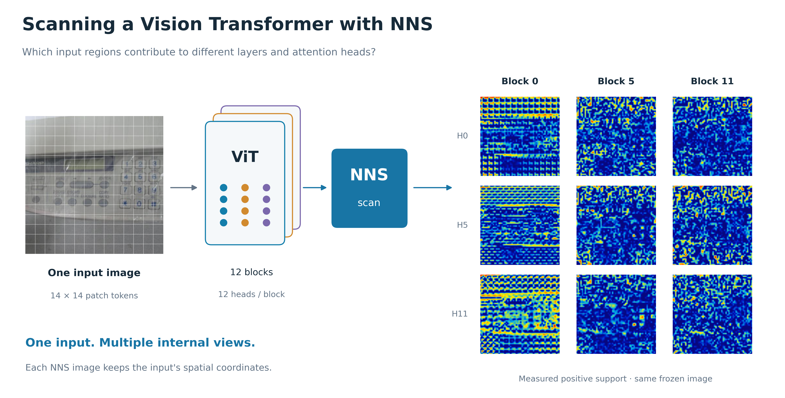

NNS 扫描 ViT 的内部响应。左侧将同一张输入图像分成 patch tokens，经过已训练的 ViT；右侧按层（B0、B5、B11）和 head（H0、H5、H11）排列实测 NNS 正贡献图。每格表示输入位置对该坐标 CLS head-direction Value-path 标量的正贡献。层和 head 采用首、中、末位置作展示，不按效果排名。底色到亮色表示该坐标显示尺度下的正贡献。示例为先前冻结的 order 44 中位效应样本。网格标记输入 patch 位置；这些地图的查询目标是 CLS，不是各 patch-query 的独立归因。Figure 2 解释对应关系，Figure 8–9 展示全部 head 的汇总。

### 图 2. 学习图像保留内部响应的输入来源

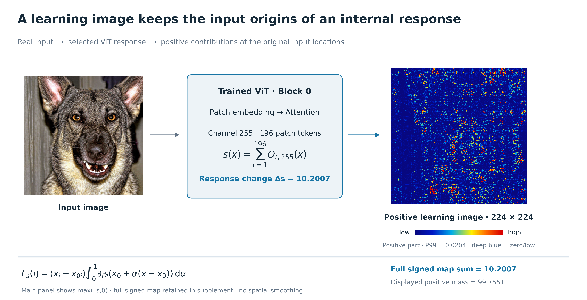

真实输入经过 ViT 的 patch embedding 和 B0 attention 后，选定 Figure 30 的 channel 255 在 196 个 patch-token 输出上的总和作为内部响应 s。右侧只显示正贡献 max(Ls,0)，采用与 Figure 30 channel 255 上排完全一致的蓝底 heat palette、逐面板 P99 缩放和 nearest。深蓝表示零或低正贡献，亮色表示较高正贡献。底部 full signed map sum 仍由未裁剪 signed 原始数组计算。当前目标的完整 signed 对照见 supplement/figure_30_signed 的 channel 255；旧 Figure 2 的 channel-0 signed 图仅作为历史备份。输入与 channel 255 均在计算前固定；本图仍是模块自身响应的单样本展示。

### 图 3. 在统一空间尺度上评价区域排序

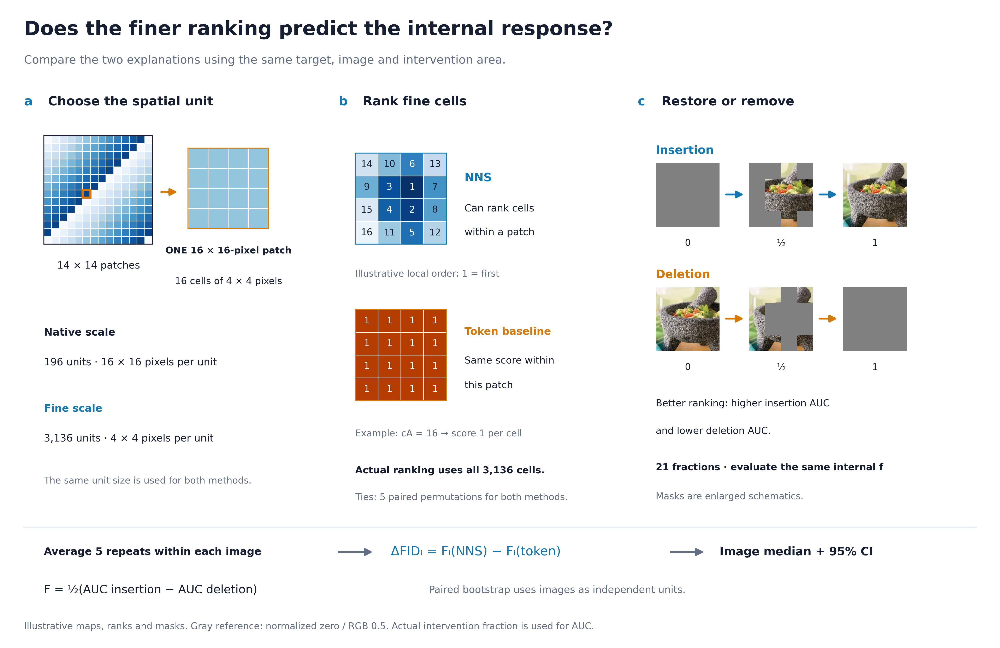

统一空间尺度上的排序与忠实度评价。224×224 图像包含 14×14=196 个原生 patch，每个 16×16-pixel patch 再划为 16 个 4×4-pixel cells，全图 3,136 个 fine cells。NNS 对每 cell 的 signed 输入贡献求和后按目标方向取正部排序；token 基线先把每个 c_j 均分，再按相同规则排序，因此同一 patch 内同分，不同 patch 之间仍可不同。图中的 1–16 为一个 patch 内的示意局部次序；真实实验在全部 cells 上排序，并对所有同分组使用 5 次方法间配对的 tie permutations。Insertion 从同一灰色参考恢复高分区域，deletion 从原图替换高分区域；两者均评价 原协议 B0/H9 的固定 clean-attention head-direction 标量 f，使用相同干预面积预算。图中放大的遮挡块只说明操作顺序，不是实际 4×4-pixel mask 或实验结果。原协议使用 21 fractions、实际干预比例上的 AUC，响应不截断到 [0,1]。每图先平均 5 次 AUC，计算 F=½(AUC_ins−AUC_del) 及 ΔFID=F_NNS−F_token；随后以图像为独立单位报告 median 和 paired bootstrap 95% CI。 本图干预仍针对原协议 B0/H9 的固定 clean-attention Value-path 标量；R9 Figure 2 改用真实模块响应演示通用定义，两者目标分别注明。

### 图 4. 细粒度主效应分布

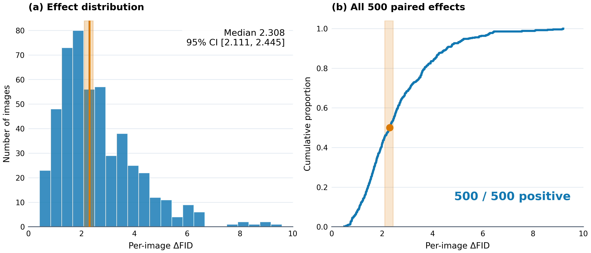

Fine-scale 主效应。(a) 直方图保留全部 500 个逐图 ΔFID；橙色线为 median，橙色区域为该 median 的正式 paired-image bootstrap 95% CI。(b) 相同数据的 ECDF，圆点定位 median，橙色区域仍表示 median CI，而非 ECDF 的同时置信带。500/500 个差异为正；median=2.3081996222，95% CI=[2.1110806126, 2.4452354118]。

### 图 5. 忠实度轨迹

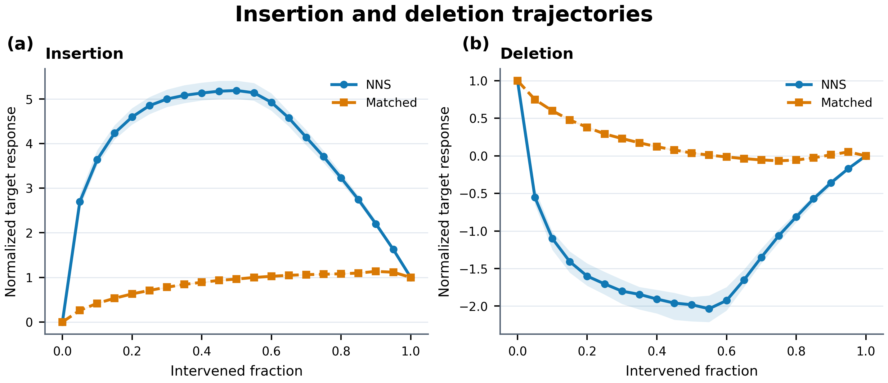

NNS 与 matched patch 的 median insertion/deletion trajectories。阴影为 pointwise bootstrap interval。

### 图 6. 尺度与算子敏感性

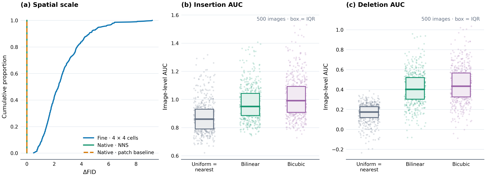

尺度与上采样敏感性。(a) fine 4×4-cell 与 native-patch 评价的 ΔFID 分布。(b,c) 每个点为一个图像的 insertion/deletion AUC，横向抖动仅用于避让；箱体为第 25–75 百分位，箱内线为 median，每类均为 500 张图像。全部数据点和极值保留；IQR 不是置信区间。Uniform 与 mass-preserving nearest 完全等价，合并为一个 evidence class；bilinear 与 bicubic 为描述性 sensitivity。

### 图 7. 层头坐标与预测分层

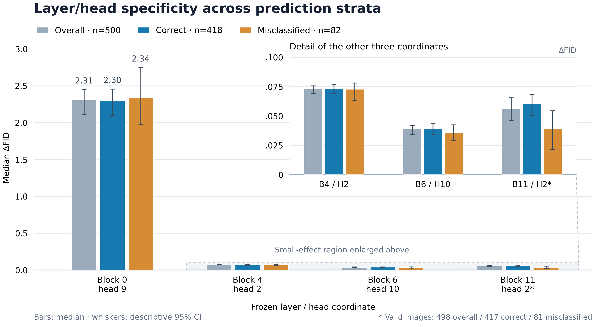

Figure 7. 四个冻结 layer/head 坐标的 NNS−patch baseline median ΔFID。灰、蓝、橙色分别表示 overall、correct、misclassified，柱高为 median，误差线为原 Stage E 图像级配对 bootstrap 描述性 95% CI。主图所有坐标共用从零起始的纵轴，右上 inset 将后三个坐标按 0–0.10 的线性纵轴放大；两处呈现的是同一组数值，不能重复计为新观测。总体 cohort 为 500，正确/误分类分别为 418/82；block 11/head 2 的有效数为 498/417/81，其余坐标全部有效，两个 typed failures 仍保留在分母中。坐标在 Stage C 冻结，三组包含重叠样本，不是三个独立实验，也未检验组间等效性。区间沿用 Stage E 的描述性 bootstrap namespace，与 Figure 4 的正式主分析区间略有差异。

### 图 8. 中位效应图像的 144-head 图谱

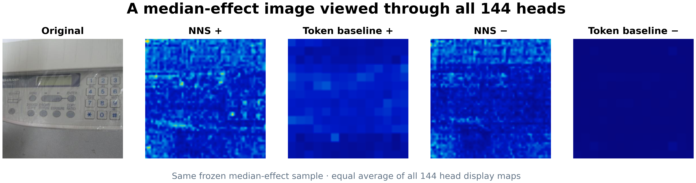

中位效应图像的全头空间汇总。使用用户指定的 F3H Image 19 所对应的同一数据：order 44、ILSVRC2012_val_00002287.JPEG。左至右为原图、NNS 正贡献汇总、同目标 token baseline 正贡献汇总、NNS 负贡献幅度汇总及 baseline 负贡献幅度汇总。每个 B/H 坐标的两种方法先共用最大绝对值 L，采用 log1p(999·m/L)/log(1000) 并按原 F3H 规则线性放大，再对全部 12×12=144 个 head 等权平均。图像“中位效应”标签来自主实验 B0/H9 的冻结选样，不是对平均图的 fidelity 评价；平均图描述空间支持，不是类别归因。原始 Image 19 也逐字节收录在 reference_gallery。

### 图 9. Transformer 深度方向的空间支持

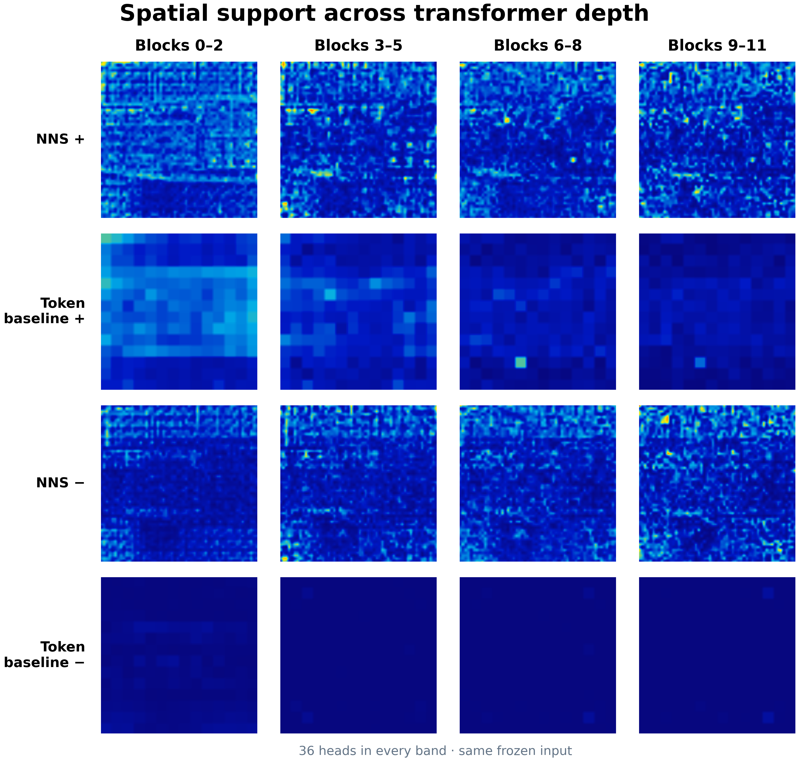

同一中位效应样本在四个深度段的空间支持。列为 B0–2、B3–5、B6–8、B9–11；行依次为 NNS 正、token baseline 正、NNS 负贡献幅度及 token baseline 负贡献幅度。每列使用该段全部 3×12=36 个 head，沿用 F3H Image 18 的逐坐标配对色阶和显示数组平均。该图用来观察深度与空间形态的关系，颜色不表示跨层可比的原始幅值，也不把这些阶段预先命名为边缘、部件或语义阶段。

### 图 10. 同一图像的不同解释

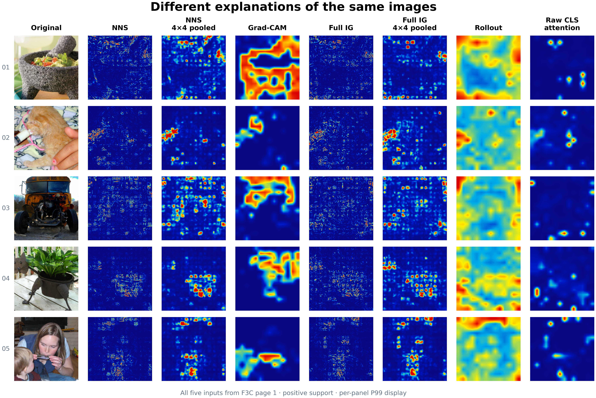

同一输入的多种解释视图。完整保留 F3C visual 第 1 页的五张样本，按冻结 formal positions 1–5 排列。列为原图、NNS 原生正贡献、NNS 4×4 最大池化后双线性显示、Grad-CAM、full-model IG 正贡献、full IG 的相同池化显示、rollout 和 raw CLS attention。NNS 在这里以条件 class logit 为目标，与 Figure 1、8、9 的单 head 目标不同。每个热图分别按自身 P99 缩放，池化仅用于显示；方法定量比较见 Figure 11，完整 50 图及 signed/unclipped 对照附在画廊。

### 图 11. 解释方法的统计比较

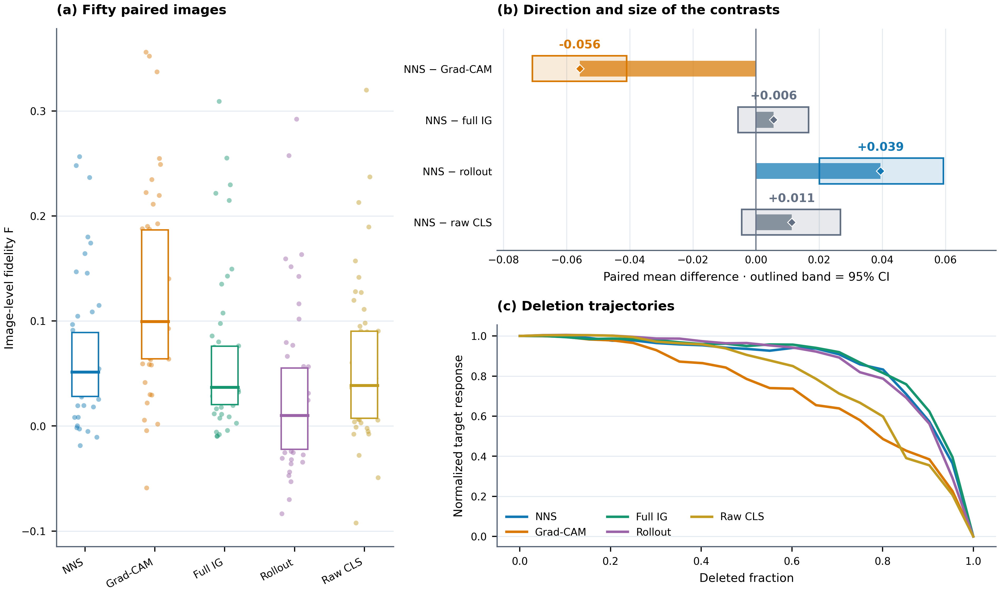

50 张冻结图像上的解释方法比较。(a) 每图五次 tie-repeat 平均 fidelity 的散点，箱体表示 IQR，箱内线表示 median。(b) 四个注册的 NNS−comparator paired mean contrasts：实心条从零延伸至估计值，菱形定位 mean，空心矩形左右边界为正式 bootstrap 95% CI；矩形高度只用于展示。NNS−Grad-CAM 为负，NNS−rollout 为正，full IG 与 raw CLS contrasts 的区间跨零。区间不是样本 IQR，也没有由区间拟合概率密度。primary Grad-CAM contrast 使用原始检验，secondary family 沿用 Holm，图面不重新作显著性决策。(c) 原 median deletion trajectories。

### 图 12. 事后探索性多尺度机制

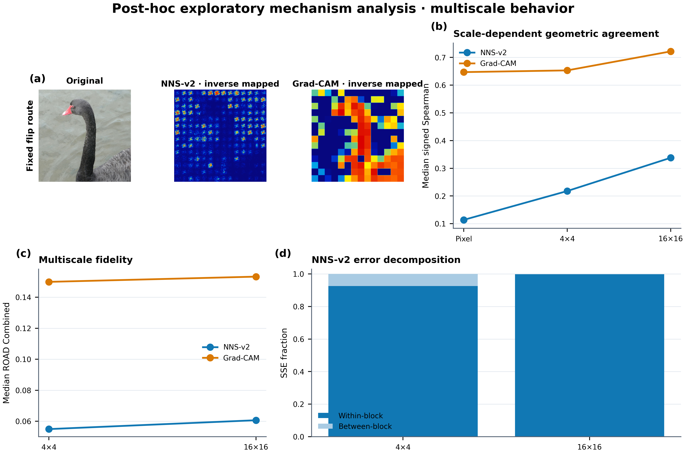

Post-hoc exploratory multiscale mechanism analysis。固定 flip route 的示例 map，以及 pixel、4×4、16×16 下的 geometric agreement、ROAD fidelity 和 NNS-v2 SSE decomposition。

### 图 13. ViT 各 block 的分支贡献分配

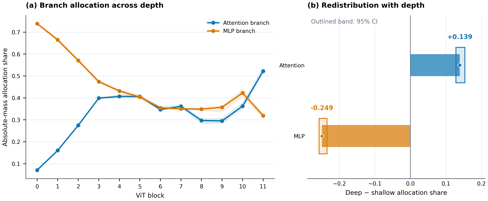

ViT block-level class-logit complete-cut branch allocation。(a) 完整 12-block attention 与 MLP branch absolute-mass share trajectories，色带为原逐 block 95% CI。(b) B4/B5 的 deep-minus-shallow 估计：实心条表示符号与大小，菱形表示 estimate，空心矩形左右边界表示正式 95% CI。Attention 与 MLP 使用一致的蓝/橙标识。这里比较的是分别定义的 residual cuts 中的 allocation shares，两条曲线不应相加当成一个二分概率分布。受支持的分支结论不替代 Y4 其他 claim 的 INVALID/NOT_SUPPORTED 记录。

### 图 14. 事后探索性深度扩展

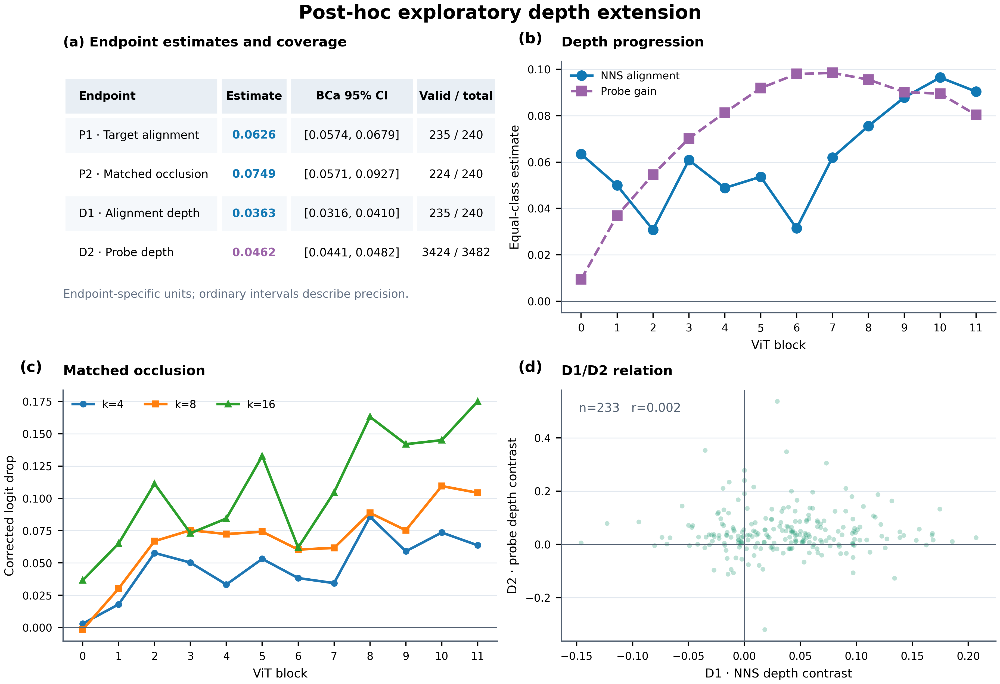

Post-hoc exploratory 深度扩展。(a) 分别列出 P1、P2、D1、D2 的 estimate、ordinary BCa 95% CI 与有效/总图像数，端点含义不同，不共用效应坐标轴。P1、D1 为 235/240，P2 为 224/240，D2 为 3424/3482；对应 NA 为 5、5、16、58，failed 均为 0。ordinary CI 只表示精度，不替代调整后的判断规则。(b) NNS alignment 与 probe gain 的完整 depth profiles，比较各自的深度变化，不将两者幅值视为同一物理量。(c) 固定三种 patch budgets 下的 matched-control-corrected logit drops。(d) 233 个有效配对图像的 D1/D2 关系，Pearson r 约为 0.002。全部 Stage S 结论属于 post-hoc exploratory；端点及 P2 阈值在 outcome access 后形成，不作 confirmatory 或因果机制解释。

### 图 15. 一个内部成分对应一张输入空间图像

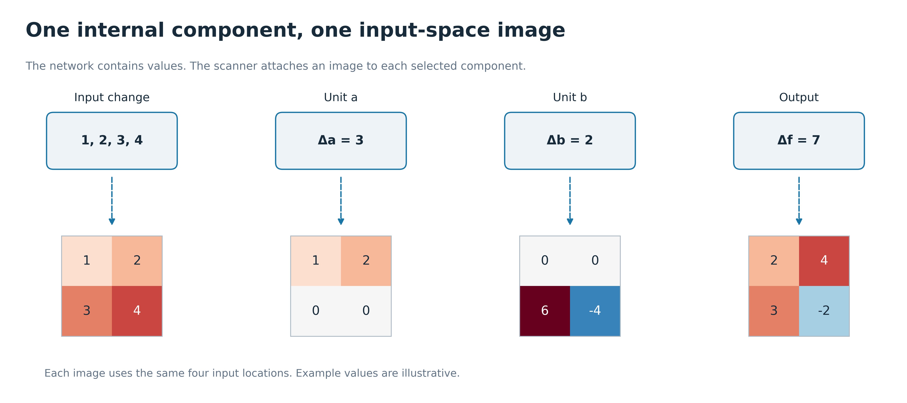

把网络里的一个数和一张输入位置图配起来。上面是内部响应的变化量，下面说明这次变化来自输入的哪几个位置。四张图始终用同一套位置坐标。这张采用可手算的线性示例，不是 ViT 实测结果。

### 图 16. 保留每个输入值的原始位置

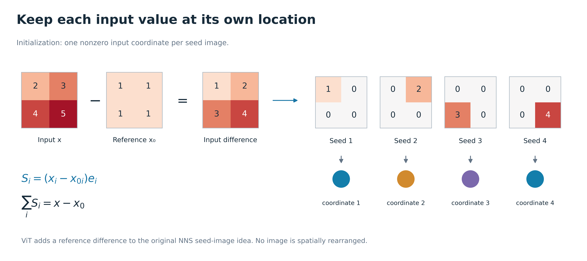

先用原图减去参考图，得到这次需要解释的输入变化。然后拆成四张小图，每张只保留一个位置，其余位置为零；四张相加正好恢复输入差值。真实 RGB 输入对应每个像素的三个通道。实现用自动微分计算这些位置的贡献，不必真的存下十几万张稀疏图。

### 图 17. 构建并组合学习图像

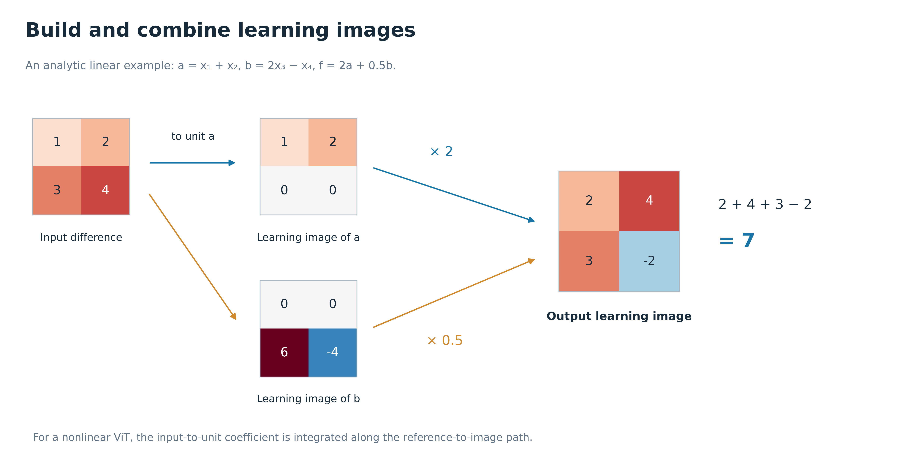

沿用上一图的输入差值。单元 a 的图是 [1,2;0,0]，单元 b 的图是 [0,0;6,-4]。输出用 2a+0.5b，因此输出图是 [2,4;3,-2]，总和为 7。你可以看见数值被重新加权，但原来的位置始终没丢。ViT 的系数还随输入变化，所以实际方法要沿参考到原图的路径累计。

### 图 18. 从 patch projection 到 Transformer 组件

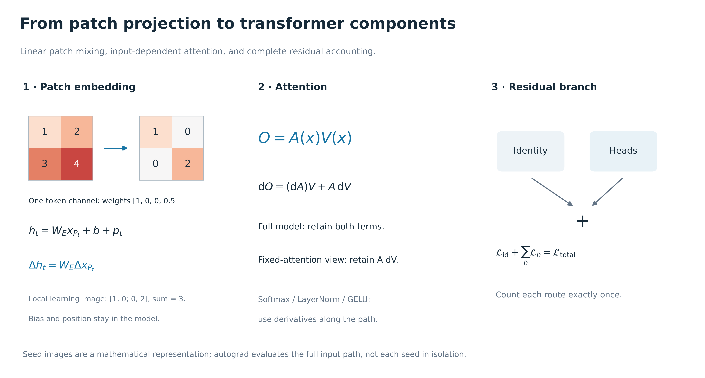

Patch embedding 可以先按线性连接理解；位置编码和偏置仍保留在模型里。到了 attention，输入既会改变注意力权重 A，也会改变 Value，完整方法需要两部分导数。最后 residual 旁路也要算，才能把贡献账算完整。旧的固定 attention 图只研究其中一个条件视角。

### 图 19. 类别成分学习图像与 token 响应

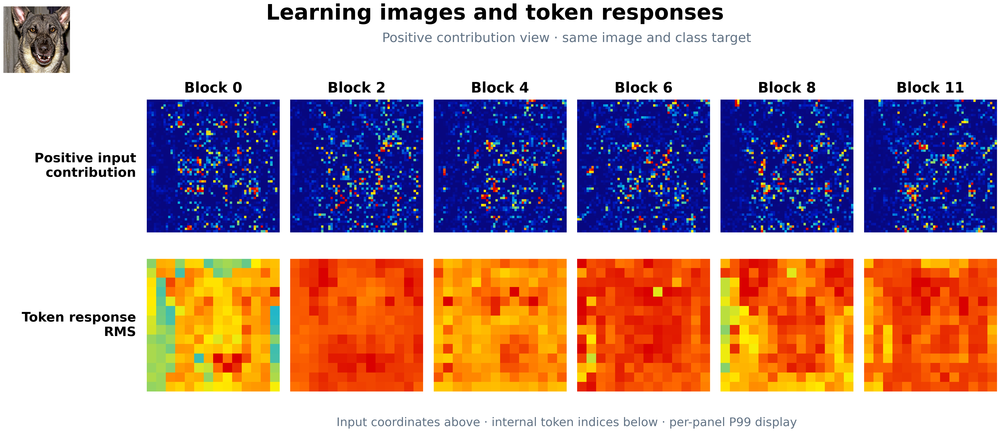

同一类别目标下，六个 block 的 attention 分支正输入贡献与对应 token RMS。上排为既有 56×56 input-cell 成分图，下排为 196 个 patch-token 输出跨通道的 RMS。输入固定为 Y2 队列首图、类别目标 235；采用逐面板 P99 与 nearest。完整 signed/负幅度图保留于本包 supplement。上排解释最终类别的分支成分；Figure 28–31 解释模块自身响应。

### 图 20. 同一图像和类别目标下的不同 head

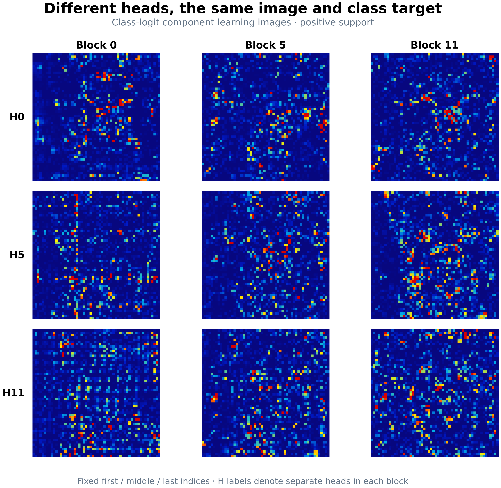

固定同一输入和最终类别，比较不同 head 分到的输入贡献。每个小图是一个 head 的成分 learning image，这比换不同 head 自身的响应目标更适合看共同任务下的差异。图中保留 H0/H5/H11、B0/B5/B11 这些固定位置，完整逐 block 12-head 图另附。颜色逐面板缩放，亮度不用于排名。

### 图 21. 内部成分重构总输入归因

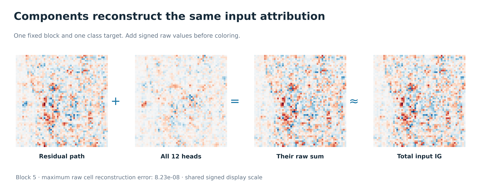

同一个 block 的 residual 旁路图，加上全部 12 个 head 的图，会恢复总输入贡献图。这里先对原始正负数求和，再着色；不是把几张颜色图片叠起来。它展示 learning image 怎样组合成更大组件，同时能检查是否漏掉某条路径。

### 图 22. Attention 中的 Value 与 routing 导数

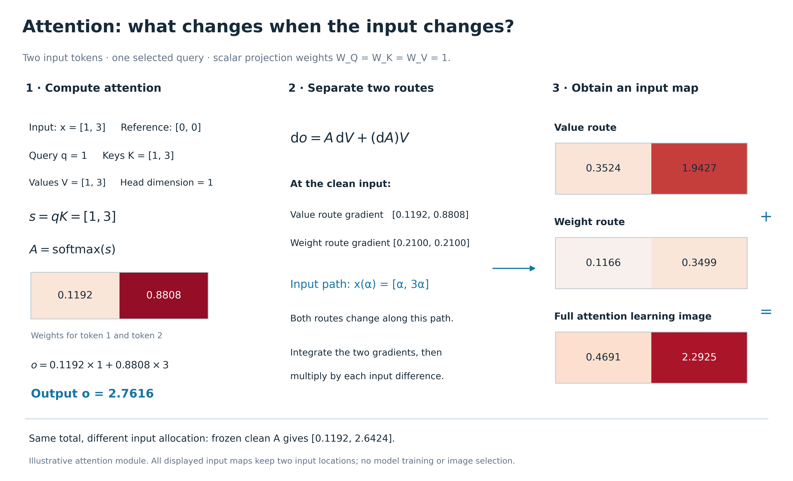

两个 token 的解析 attention 例子。固定选第一个 token 作 query，输入 [1,3]、参考 [0,0]，Q/K/V 标量投影权重均为 1，d_k=1。先算 qK、softmax 和输出，再将输入导数分为 A dV 与 (dA)V 两项。沿直线路径 [α,3α] 采用 Gauss–Legendre 数值积分，得到两个输入位置的完整归因。冻结 clean attention 时的图是另一个条件函数的归因，不等于完整路径中 A dV 那一项。本图是解析示意，不是已训练 ViT 的实测结果。

### 图 23. Residual 路径对下游目标的贡献

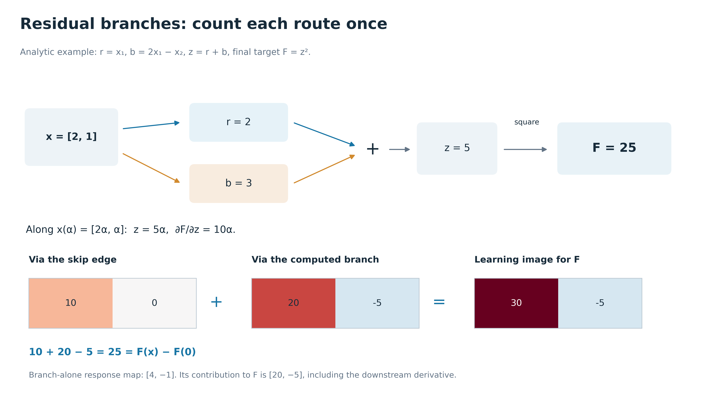

解析 residual 例子。输入 [2,1]、参考 [0,0]，旁路 r=x₁，分支 b=2x₁−x₂，相加 z=r+b，最终目标 F=z²。沿路径 z=5α，下游导数为 10α。分别经过旁路和分支的输入贡献为 [10,0] 和 [20,−5]，和为 [30,−5]，总和 25 恢复目标差值。分支对 F 的贡献包括下游导数，因此不同于它自身响应的 [4,−1]。两格固定表示输入位置 1 和 2。

### 图 24. 正常前向与学习图像的逐步总览

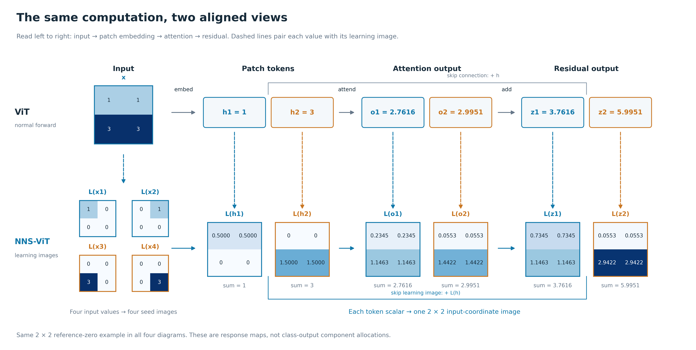

同一小型解析链的总览：输入 [1,1;3,3] 依次经过线性 patch embedding、完整 softmax attention 和 residual。上排是正常响应，下排是同名响应 learning image，虚线逐一对应。 原始四图全部原样纳入 R9。这是算子示意，不是训练后 ViT 实测；真实输出见 Figure 28–31。

### 图 25. Patch embedding 的数值与学习图像

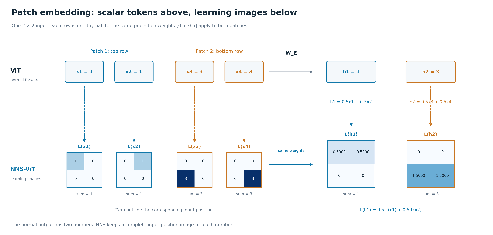

四个单坐标输入图通过 [0.5,0.5] 权重形成两张 token 学习图。图值相加分别得到响应 1 和 3，输入位置保留。 原始四图全部原样纳入 R9。这是算子示意，不是训练后 ViT 实测；真实输出见 Figure 28–31。

### 图 26. Attention 的数值与学习图像

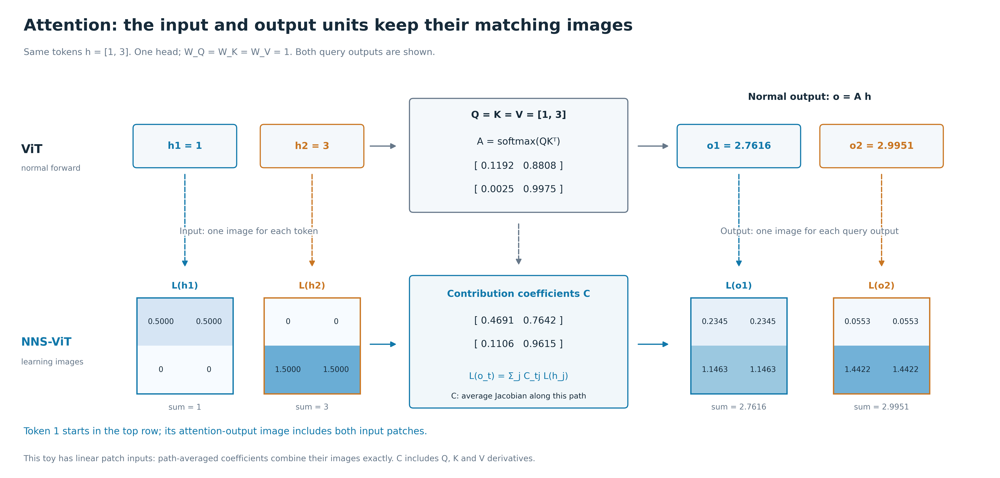

正常值使用 A 组合 V；本例输入 patch 映射为线性，learning image 可用沿路径平均的完整 Jacobian 系数 C 组合。C 含 Q/K/V 路径，不等于 clean attention。 原始四图全部原样纳入 R9。这是算子示意，不是训练后 ViT 实测；真实输出见 Figure 28–31。

### 图 27. Residual 的数值与学习图像

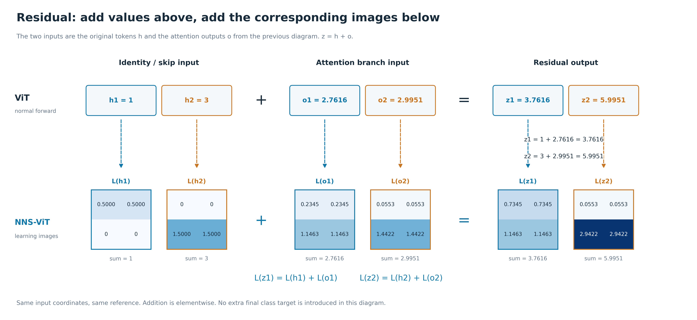

同一参考和路径下，residual 的响应图逐位置相加，L(z)=L(h)+L(o)。相加发生在原始值上，着色在之后。 原始四图全部原样纳入 R9。这是算子示意，不是训练后 ViT 实测；真实输出见 Figure 28–31。

### 图 28. 真实 ViT 三模块中的学习图像演化

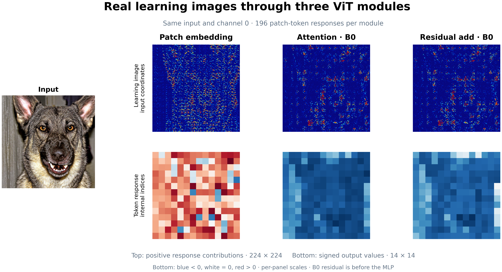

同一通道 0 连续经过三个模块。固定输入 ILSVRC2012_val_00007922.JPEG，规范化灰色参考为零；patch 输出与 B0 attention、B0 第一次 residual 相加前后的真实响应。每个目标为指定通道在 196 个 patch-token 输出上的总和，CLS 参与前向但不计入这项空间聚合。上排为该响应的输入 IG 正贡献，224×224，RGB 先带符号求和；下排为相同通道的原始 signed token 值，排为 14×14。上排各面板正部 P99（零则 max）缩放，下排各面板 max-abs signed-log(kappa=9)，均用 nearest。完整 signed learning image 与 RGB 原始数组在补充目录。该单样本图不度量总体层间趋势或 feature-map 相关性。

### 图 29. 真实 patch-embedding 通道学习图像

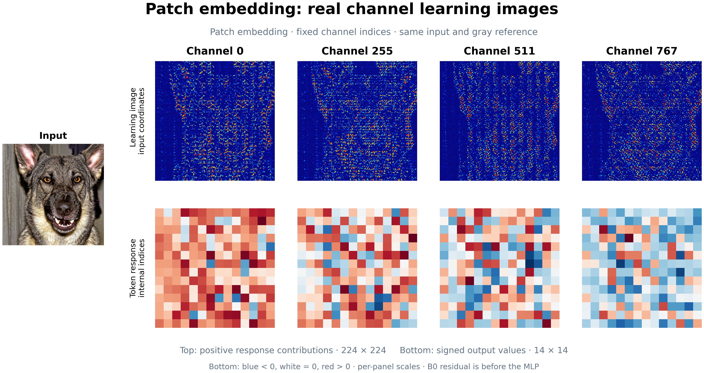

Patch embedding 的固定通道 0、255、511、767。固定输入 ILSVRC2012_val_00007922.JPEG，规范化灰色参考为零；patch 输出与 B0 attention、B0 第一次 residual 相加前后的真实响应。每个目标为指定通道在 196 个 patch-token 输出上的总和，CLS 参与前向但不计入这项空间聚合。上排为该响应的输入 IG 正贡献，224×224，RGB 先带符号求和；下排为相同通道的原始 signed token 值，排为 14×14。上排各面板正部 P99（零则 max）缩放，下排各面板 max-abs signed-log(kappa=9)，均用 nearest。完整 signed learning image 与 RGB 原始数组在补充目录。该单样本图不度量总体层间趋势或 feature-map 相关性。

### 图 30. 真实 attention 通道学习图像

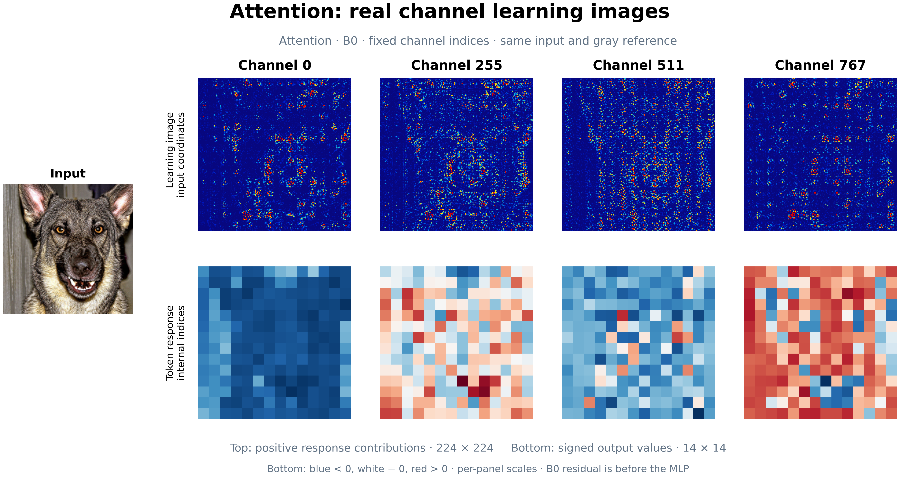

Attention · B0 的固定通道 0、255、511、767。固定输入 ILSVRC2012_val_00007922.JPEG，规范化灰色参考为零；patch 输出与 B0 attention、B0 第一次 residual 相加前后的真实响应。每个目标为指定通道在 196 个 patch-token 输出上的总和，CLS 参与前向但不计入这项空间聚合。上排为该响应的输入 IG 正贡献，224×224，RGB 先带符号求和；下排为相同通道的原始 signed token 值，排为 14×14。上排各面板正部 P99（零则 max）缩放，下排各面板 max-abs signed-log(kappa=9)，均用 nearest。完整 signed learning image 与 RGB 原始数组在补充目录。该单样本图不度量总体层间趋势或 feature-map 相关性。

### 图 31. 真实第一次 residual 学习图像

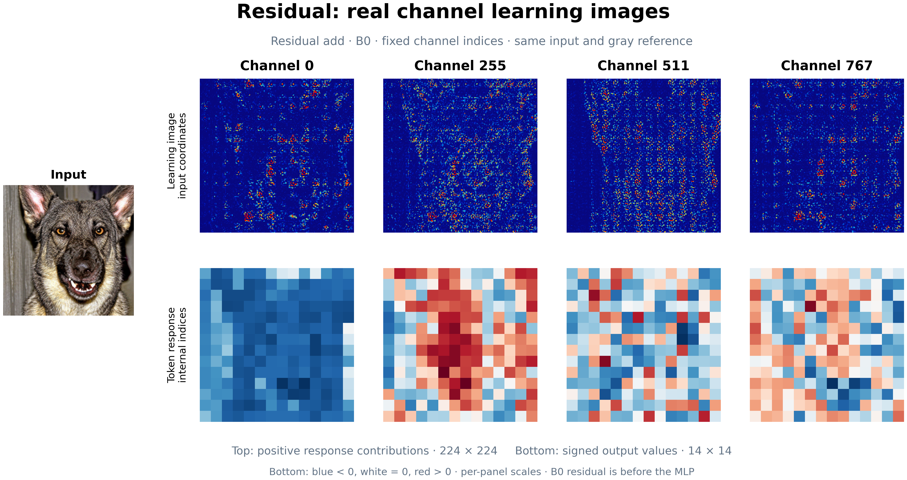

Residual add · B0 的固定通道 0、255、511、767。固定输入 ILSVRC2012_val_00007922.JPEG，规范化灰色参考为零；patch 输出与 B0 attention、B0 第一次 residual 相加前后的真实响应。每个目标为指定通道在 196 个 patch-token 输出上的总和，CLS 参与前向但不计入这项空间聚合。上排为该响应的输入 IG 正贡献，224×224，RGB 先带符号求和；下排为相同通道的原始 signed token 值，排为 14×14。上排各面板正部 P99（零则 max）缩放，下排各面板 max-abs signed-log(kappa=9)，均用 nearest。完整 signed learning image 与 RGB 原始数组在补充目录。该单样本图不度量总体层间趋势或 feature-map 相关性。

### 图 32. 真实 B0 MLP 分支学习图像

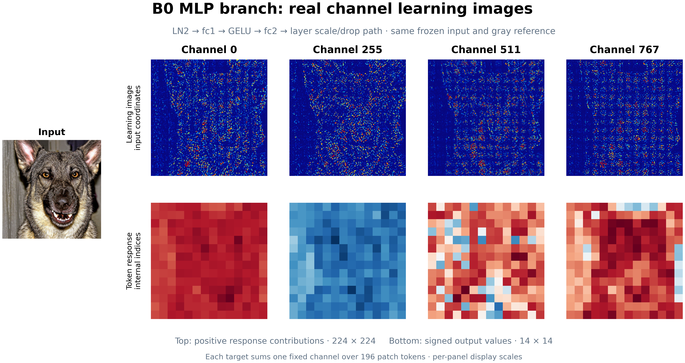

B0 MLP branch 的真实响应 learning image。固定通道 0、255、511、767，每个目标为该通道在 196 个 patch-token MLP 输出上的总和。上排为 224×224 输入贡献正部，下排为同一通道的 14×14 signed token 值。真实前向包含 LN2、fc1、GELU、fc2、layer scale 与 drop path；完整 signed 图见 supplement。

### 图 33. 真实 B0 block-output 学习图像

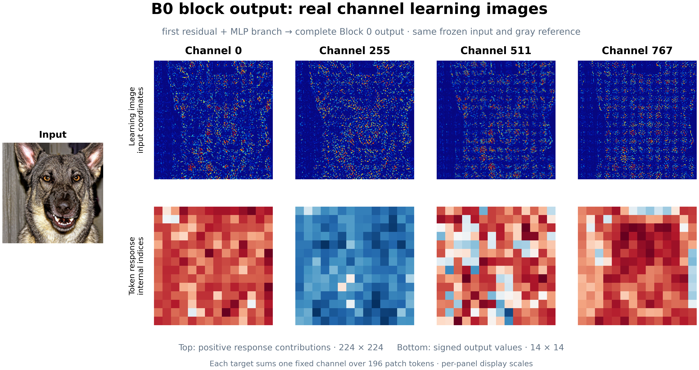

B0 第二次 residual add 后的完整 block output。固定通道和版式与 Figure 32 相同。原始 RGB learning image 逐像素满足 L(second residual)=L(first residual)+L(MLP branch)，最大误差为 3.33×10⁻¹⁶；着色只在加法核对之后进行。

### 图 34. 从输入图像到预测类别 logit

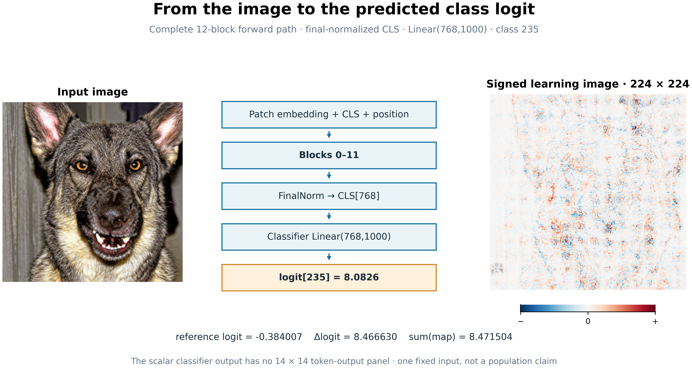

真实预测类别 235 的完整 logit learning image。梯度经过全部 12 个 blocks、final norm、CLS 选择与 Linear(768,1000)，相对灰色参考积分回 224×224 输入坐标。clean logit 为 8.082624，参考 logit 为 −0.384007。类别标量没有 14×14 token 输出，因此本图不套用模块通道页。

### 图 35. 正确类、竞争类、margin 与低分输出的学习图像

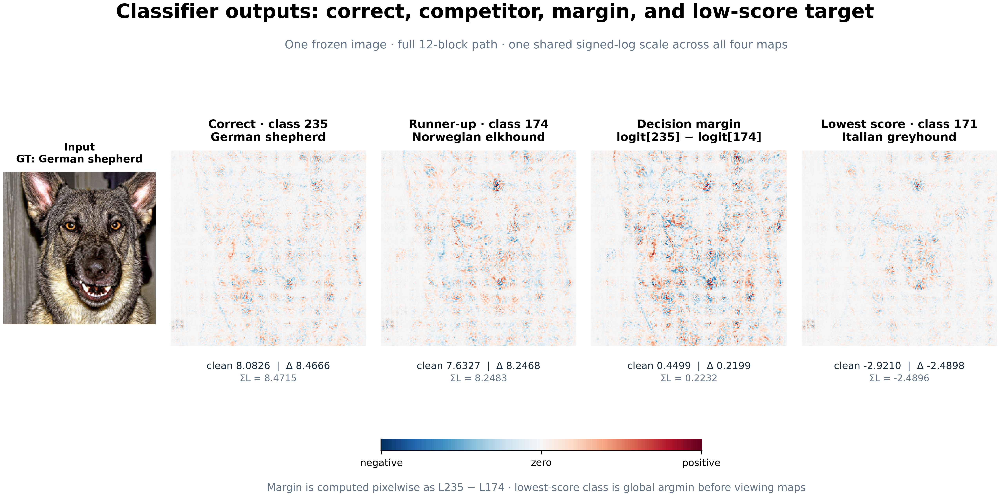

同一冻结输入的四个 classifier 标量 learning image。类别 235 是官方真值 German shepherd 且为 clean argmax；类别 174 Norwegian elkhound 是最高竞争输出；第三列为逐像素 L235−L174 的判别 margin；类别 171 Italian greyhound 是 1000 个 clean logits 的全局最低分。四图采用共同 max-abs signed-log 色标。低分类别按 logit 排序预先确定，不按归因图观感挑选。
