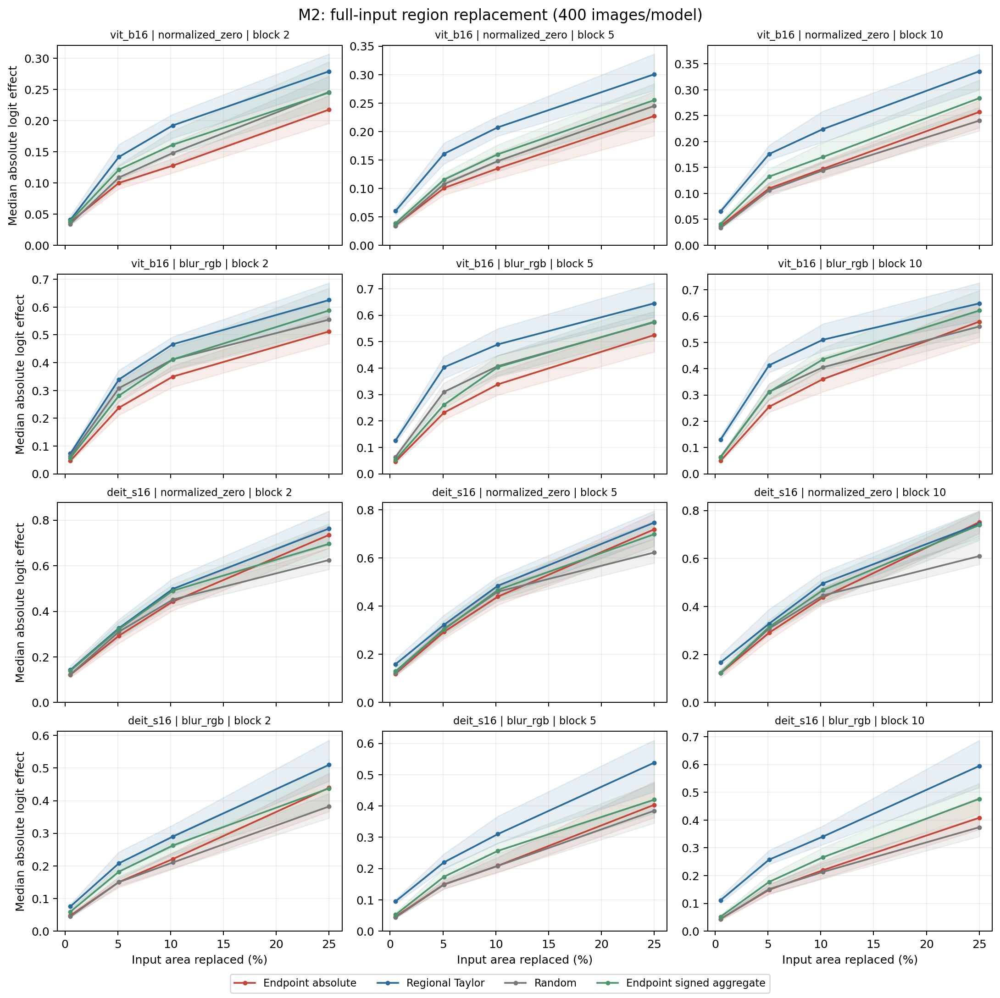
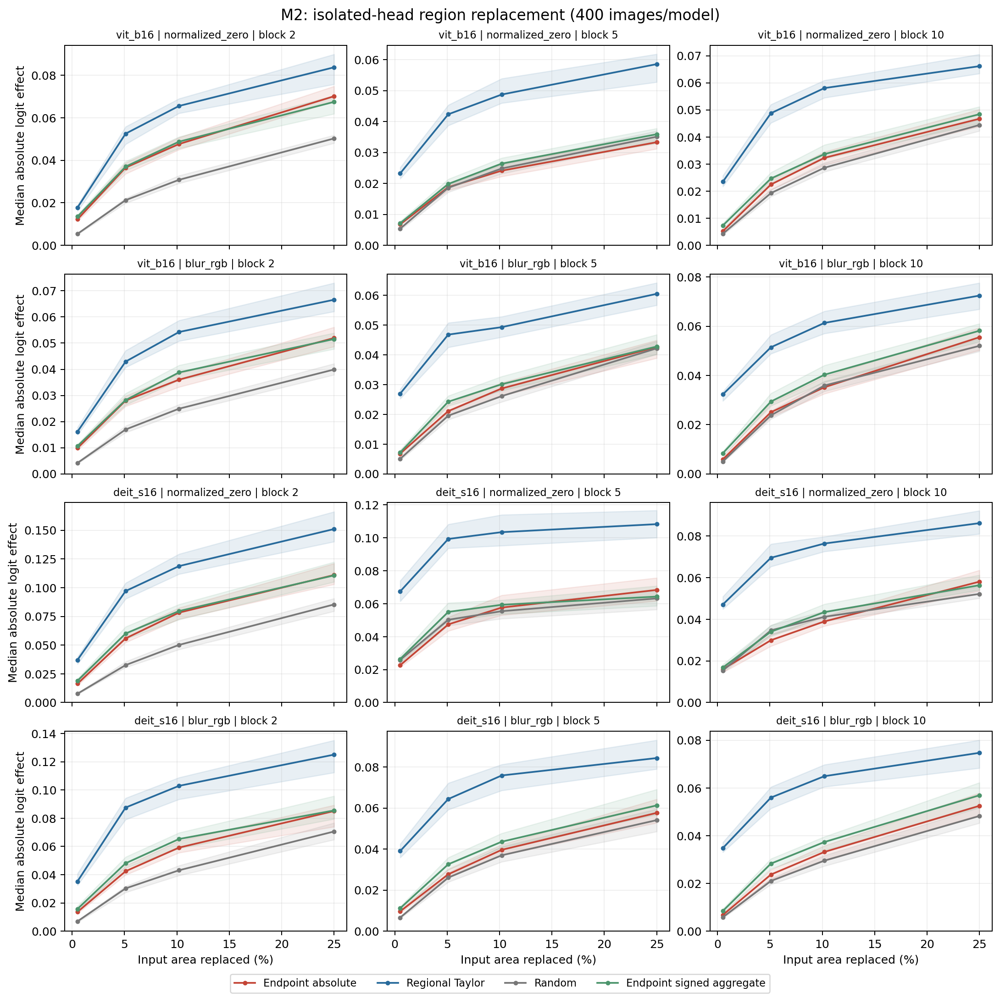
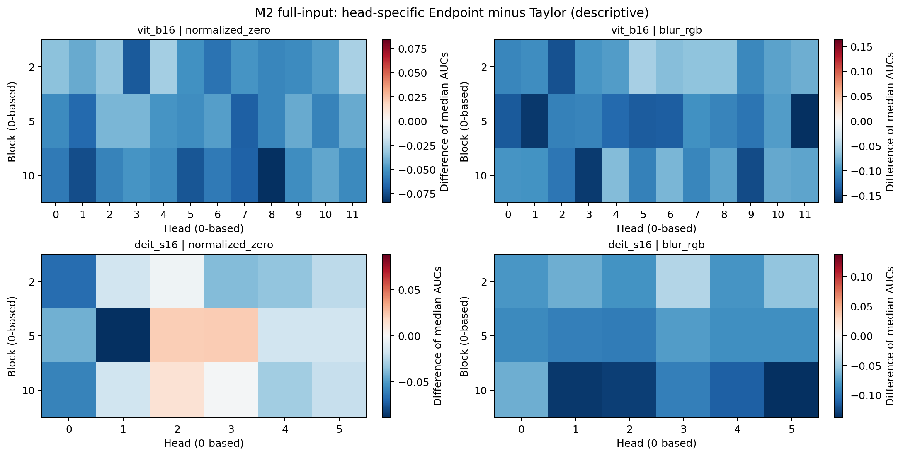

# M2: Supplementary cross-layer, all-head spatial utility

M2 evaluated all heads in blocks 2, 5, and 10 on 400 images per model, using two references, eight selection methods, and four patch budgets. Across the 12 model/reference/block comparisons for full-input effects, 0 supported Endpoint-absolute superiority over regional Taylor and 11 supported Taylor superiority after the shared Holm correction. The corresponding counts for isolated-head effects were 0 and 12. The tables report each layer separately; a non-rejected directional test does not establish equivalence.

## 1. Protocol and definitions

The only full-input contrast without supported Taylor superiority was DeiT-S with normalized zero at block 5: the paired median Endpoint-minus-Taylor AUC was −0.0424, with a 95% interval of [−0.0614, −0.0142] and Holm p=0.528. This is a per-comparison interval, whereas Holm covers all 672 tests, so their significance statements differ. Taylor outperformed Endpoint in isolated effects across every early/middle/late combination, extending the original spatial negative result to the all-head averages at the three evaluated layers. Individual-head differences remain descriptive.

This supplementary frozen study was specified after the primary study. Original RQ3 showed broad but non-universal family-level support (11/12); original C4a/C4b omnibus decisions remain NOT_SUPPORTED. The base Endpoint is normalized-input Gradient × Input. Head maps propagate local Jacobian components, and structural closure and finite-region utility are evaluated separately. The sealed M1 registry coverage table remains applicable; registry-complete denotes completion of the registered set.

Blocks use zero-based indices: 2/5/10 represent early/middle/late layers. ViT-B/16 has 12 heads per block and DeiT-S has six. References are normalized zero and raw-RGB blur (kernel 31, sigma 10). The primary budgets replace 1, 10, 20, or 49 patches of 16×16 pixels: 0.51%, 5.10%, 10.20%, and 25% of the input. Separate complete tables retain the original 4×4 region grid at 1/2/4 regions.

The eight methods are Endpoint absolute, Endpoint signed aggregate, regional Taylor, gradient-only, activation displacement, random, center, and attention. For head h, E_h=x⊙J_hᵀg_h, where g_h=∇_{z_h}F. The absolute predictor is Σ|E|; the signed predictor ranks |ΣE|, with raw signed sums retained. Regional Taylor is |g_hᵀ(z_h(x)−z_h(x_R))|, matching the selected head's finite activation displacement. Methods select from the same candidate pool, resolving ties by row-major region ID; random uses 20 fixed uniform permutations.

The primary outcome is the absolute logit change from full-input regional replacement, |F(x)−F(x_R)|. The isolated outcome inserts the selected head activation induced by that input into the clean computation, retaining other heads and bypasses. Each random repetition yields an absolute effect and AUC before averaging repetitions and heads within an image. Medians use 10,000 image-bootstrap draws and 95% intervals; one Holm family covers 672 bidirectional AUC sign tests. Per-budget intervals, head summaries, and means across three blocks are descriptive.

## 2. Cross-layer comparisons

**Table M2-1. Full-input regional replacement: normalized AUC over patch budgets.** A paired median differs from the difference between two marginal medians.

| Model | Reference | Block | Endpoint AUC | Taylor AUC | Random AUC | Paired E−T [95% CI] | Holm p(E>T) | Holm p(T>E) |
|---|---|---:|---:|---:|---:|---|---:|---:|
| vit_b16 | normalized_zero | 2 | 0.1451 | 0.1977 | 0.1614 | -0.0289 [-0.0376, -0.0206] | 1 | 2.49e-17 |
| vit_b16 | normalized_zero | 5 | 0.1481 | 0.2130 | 0.1606 | -0.0434 [-0.0531, -0.0358] | 1 | 9.41e-18 |
| vit_b16 | normalized_zero | 10 | 0.1640 | 0.2377 | 0.1604 | -0.0552 [-0.0633, -0.0414] | 1 | 2.31e-26 |
| vit_b16 | blur_rgb | 2 | 0.3629 | 0.4306 | 0.4013 | -0.0690 [-0.0835, -0.0531] | 1 | 4.34e-16 |
| vit_b16 | blur_rgb | 5 | 0.3624 | 0.4811 | 0.4044 | -0.1042 [-0.1222, -0.0789] | 1 | 2.59e-25 |
| vit_b16 | blur_rgb | 10 | 0.3783 | 0.4850 | 0.4055 | -0.0967 [-0.1146, -0.0809] | 1 | 5.56e-28 |
| deit_s16 | normalized_zero | 2 | 0.4657 | 0.5040 | 0.4426 | -0.0374 [-0.0550, -0.0197] | 1 | 0.0422 |
| deit_s16 | normalized_zero | 5 | 0.4608 | 0.5007 | 0.4347 | -0.0424 [-0.0614, -0.0142] | 1 | 0.528 |
| deit_s16 | normalized_zero | 10 | 0.4679 | 0.4998 | 0.4375 | -0.0406 [-0.0604, -0.0201] | 1 | 0.0282 |
| deit_s16 | blur_rgb | 2 | 0.2557 | 0.3385 | 0.2289 | -0.0551 [-0.0807, -0.0414] | 1 | 1.1e-08 |
| deit_s16 | blur_rgb | 5 | 0.2491 | 0.3597 | 0.2390 | -0.0701 [-0.0852, -0.0547] | 1 | 6.79e-15 |
| deit_s16 | blur_rgb | 10 | 0.2651 | 0.3782 | 0.2312 | -0.0984 [-0.1180, -0.0757] | 1 | 5.84e-20 |

**Table M2-2. Isolated-head regional replacement: normalized AUC over patch budgets.**

| Model | Reference | Block | Endpoint AUC | Taylor AUC | Random AUC | Paired E−T [95% CI] | Holm p(E>T) | Holm p(T>E) |
|---|---|---:|---:|---:|---:|---|---:|---:|
| vit_b16 | normalized_zero | 2 | 0.0487 | 0.0630 | 0.0317 | -0.0140 [-0.0159, -0.0120] | 1 | 7.98e-47 |
| vit_b16 | normalized_zero | 5 | 0.0241 | 0.0470 | 0.0237 | -0.0229 [-0.0253, -0.0208] | 1 | 1.04e-115 |
| vit_b16 | normalized_zero | 10 | 0.0321 | 0.0555 | 0.0291 | -0.0228 [-0.0241, -0.0214] | 1 | 2.42e-97 |
| vit_b16 | blur_rgb | 2 | 0.0365 | 0.0527 | 0.0257 | -0.0135 [-0.0150, -0.0126] | 1 | 6.18e-64 |
| vit_b16 | blur_rgb | 5 | 0.0296 | 0.0487 | 0.0272 | -0.0194 [-0.0214, -0.0175] | 1 | 1.68e-91 |
| vit_b16 | blur_rgb | 10 | 0.0367 | 0.0594 | 0.0352 | -0.0209 [-0.0223, -0.0197] | 1 | 2.35e-94 |
| deit_s16 | normalized_zero | 2 | 0.0770 | 0.1156 | 0.0521 | -0.0343 [-0.0380, -0.0286] | 1 | 2.28e-58 |
| deit_s16 | normalized_zero | 5 | 0.0563 | 0.0989 | 0.0526 | -0.0399 [-0.0450, -0.0359] | 1 | 2.35e-82 |
| deit_s16 | normalized_zero | 10 | 0.0399 | 0.0738 | 0.0407 | -0.0323 [-0.0351, -0.0294] | 1 | 4.05e-90 |
| deit_s16 | blur_rgb | 2 | 0.0568 | 0.0977 | 0.0445 | -0.0380 [-0.0422, -0.0334] | 1 | 6.6e-69 |
| deit_s16 | blur_rgb | 5 | 0.0400 | 0.0705 | 0.0363 | -0.0282 [-0.0318, -0.0250] | 1 | 7.52e-85 |
| deit_s16 | blur_rgb | 10 | 0.0340 | 0.0622 | 0.0303 | -0.0272 [-0.0298, -0.0244] | 1 | 2.35e-82 |

## 3. Eight-method comparison

**Table M2-3. Directional test counts across the eight methods.** Each denominator is 12: two models × two references × three blocks. Counts include correlated conditions.

| Outcome | Baseline | Endpoint greater / 12 | Baseline greater / 12 |
|---|---|---:|---:|
| full | endpoint_signed | 0 | 9 |
| full | regional_taylor | 0 | 11 |
| full | gradient_only | 0 | 0 |
| full | displacement_only | 0 | 9 |
| full | random | 1 | 2 |
| full | center | 0 | 8 |
| full | attention | 0 | 11 |
| isolated | endpoint_signed | 0 | 6 |
| isolated | regional_taylor | 0 | 12 |
| isolated | gradient_only | 0 | 3 |
| isolated | displacement_only | 2 | 8 |
| isolated | random | 9 | 0 |
| isolated | center | 4 | 4 |
| isolated | attention | 4 | 6 |

The supplementary 4×4-grid results had the same direction: Taylor superiority was supported in 9/12 full-input and 12/12 isolated contrasts, with 0/12 supporting Endpoint superiority in either outcome. The four patch budgets and the original grid are reported separately because their candidate regions have different sizes.

Full-input replacement changes multiple model paths, whereas head isolation fixes the remaining computation at its clean values; regional Taylor uses the displacement associated with the latter. Layer conclusions follow the model/reference/block paired contrasts. A component map's spatial resolution and finite-region selection utility are distinct properties.

Regret uses the best evaluated candidate: all 196 or 16 singleton regions are evaluated at the one-region budget, and larger budgets use the union of selections from all methods and random repetitions. This reference covers evaluated candidates rather than a global optimum over all region combinations.

## 4. Figures

Image #1: Full-input effect–budget curves. Each panel fixes model, reference, and block; the ordinate is the image-level median absolute logit effect with 95% image-bootstrap intervals.

Image #2: Isolated-head curves with the same layout. Heads are averaged within each image before medians and intervals are computed across images.

Image #3: Differences between head-specific median Endpoint and Taylor AUCs describe head heterogeneity. These differ from paired-median contrasts; each panel has its own color scale.

Sources: [Evidence matrix](../notes/endpoint_m2_evidence_matrix.md); [Figure manifest](../figure_manifest_m2.json).
