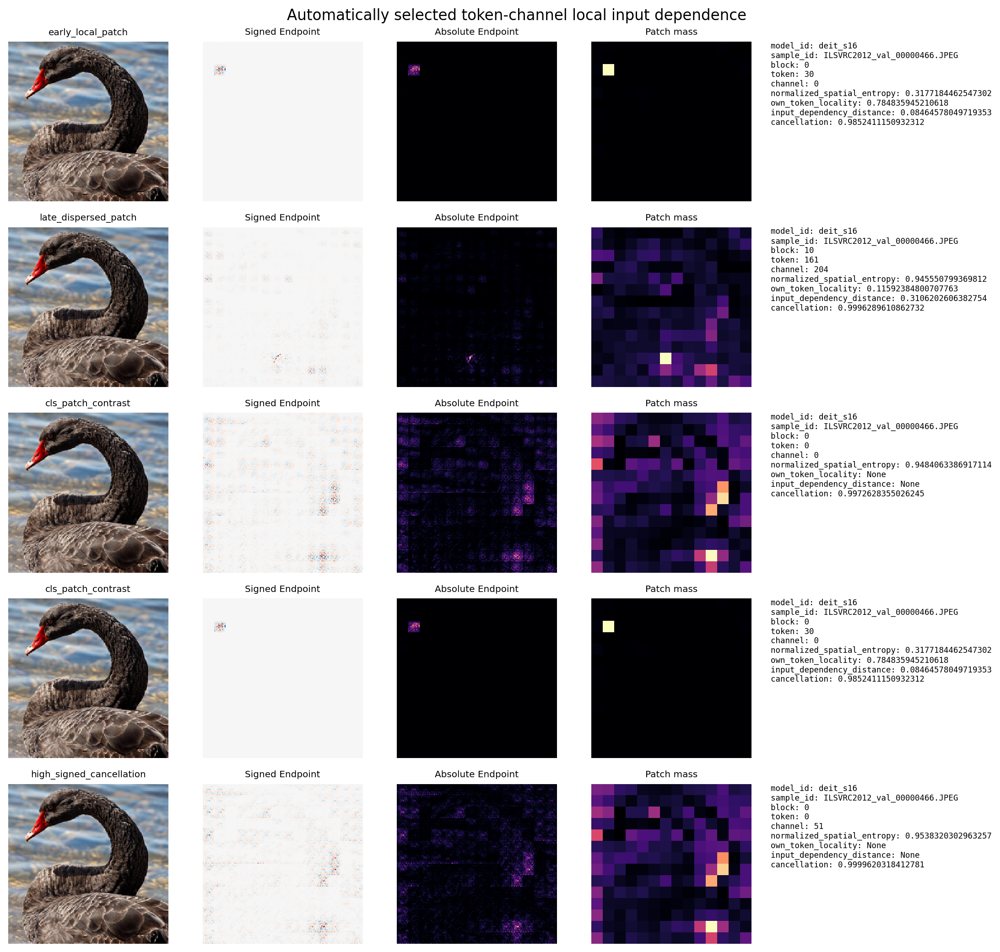
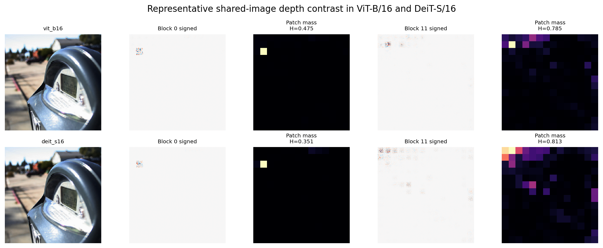
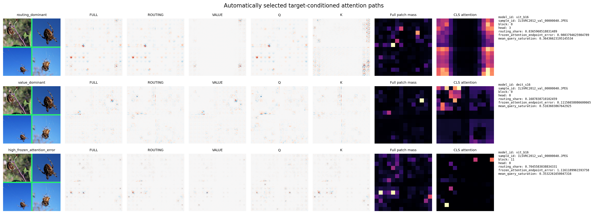
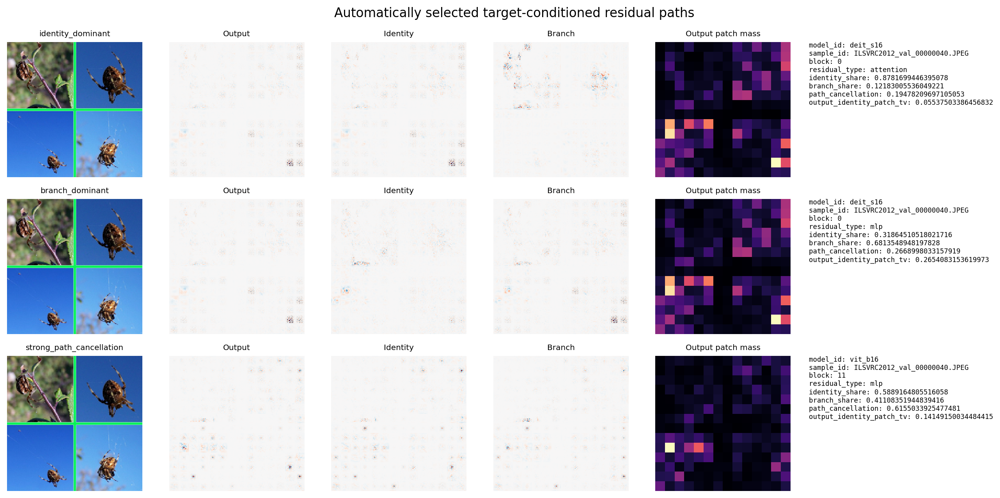
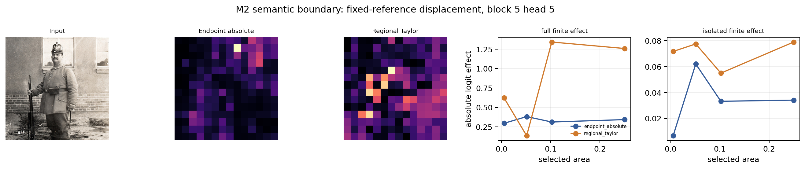

# Endpoint M6 mechanism cases and visualization atlas

M6 automatically selects eleven mechanism cases from all sealed M3/M4 records and one semantic-boundary case from M2. Selection reads numerical records only; images and pixel-level maps are accessed or recomputed after the selection is sealed. No case is reselected by visual appearance, and no inferential test is added.

| Case | Frozen metric | Selected value | Selected identity |
|---|---|---:|---|
| m3_early_local_patch | own_token_locality | 0.784836 | deit_s16/ILSVRC2012_val_00000466.JPEG/0/30/0/-/- |
| m3_late_dispersed_patch | normalized_spatial_entropy | 0.945551 | deit_s16/ILSVRC2012_val_00000466.JPEG/10/161/204/-/- |
| m3_cls_patch_contrast | cls_minus_patch_entropy_same_image_block_channel | 0.630688 | deit_s16/ILSVRC2012_val_00000466.JPEG/0/0/0/-/-; deit_s16/ILSVRC2012_val_00000466.JPEG/0/30/0/-/- |
| m4_routing_dominant | routing_share | 0.836597 | vit_b16/ILSVRC2012_val_00000040.JPEG/0/-/-/3/- |
| m4_value_dominant | routing_share | 0.168784 | deit_s16/ILSVRC2012_val_00000040.JPEG/0/-/-/0/- |
| m4_high_frozen_attention_error | frozen_attention_endpoint_error | 1.116119 | vit_b16/ILSVRC2012_val_00000040.JPEG/11/-/-/8/- |
| m4_identity_dominant | identity_share | 0.878170 | deit_s16/ILSVRC2012_val_00000040.JPEG/0/-/-/-/attention |
| m4_branch_dominant | identity_share | 0.318645 | deit_s16/ILSVRC2012_val_00000040.JPEG/0/-/-/-/mlp |
| m4_strong_path_cancellation | path_cancellation | 0.615503 | vit_b16/ILSVRC2012_val_00000040.JPEG/11/-/-/-/mlp |
| m3_high_signed_cancellation | cancellation | 0.999962 | deit_s16/ILSVRC2012_val_00000466.JPEG/0/0/51/-/- |
| m3_model_layer_difference | vit_minus_deit_late_minus_early_entropy | -0.003040 | vit_b16/ILSVRC2012_val_00031240.JPEG/0/30/271/-/-; vit_b16/ILSVRC2012_val_00031240.JPEG/11/30/369/-/-; deit_s16/ILSVRC2012_val_00031240.JPEG/0/30/89/-/-; deit_s16/ILSVRC2012_val_00031240.JPEG/11/30/138/-/- |
| m2_semantic_boundary | one_minus_spearman_endpoint_absolute_vs_regional_taylor | 0.965377 | deit_s16/ILSVRC2012_val_00005247.JPEG/5/-/-/5/- |

## Image #1: neuron atlas

The figure reports the input, signed Endpoint, absolute Endpoint, 14×14 patch mass, block/token/channel identity, entropy, locality, distance, and cancellation. The early-local, late-dispersed, CLS–patch, and high-cancellation cases come from frozen 5% tails over the complete M3 numerical records. They visualize local input dependence for registered units; the visual patterns are not assigned learned-concept labels.

## Image #2: ViT-B/16 and DeiT-S/16 layer contrast

The shared image is nearest to the cross-image median ViT-minus-DeiT difference in late-minus-early entropy. Token-30 channels at blocks 0 and 11 are then selected nearest to each image-block median entropy. This is a predefined representative case, not the largest model difference. Both models show more dispersed local first-order input dependence at the later block; channel IDs are not semantic matches across models.

## Image #3: attention routing/value cases

The rows are the fixed-ID choices from the highest 5% routing share, lowest 5% routing share, and highest 5% frozen-attention Endpoint error tails. Full, routing, Value, Q, and K maps explain the same ground-truth logit; Q+K reconstructs routing and routing+Value reconstructs full. The final panel shows CLS-query attention weights for the same head. Routing share is a relative path-norm scale, not a causal contribution percentage, and attention weights are not Endpoint dependence.

## Image #4: residual identity/branch cases

The rows come from the highest 5% identity share, lowest 5% identity share, and highest 5% path-cancellation tails. Output, identity/carry, and branch use the same residual-output cotangent and satisfy output = identity + branch. The maps show preservation, rewriting, and cancellation of target-conditioned local dependence; path shares are not finite ablation effects.

## Image #5: M2 semantic boundary

After fixing DeiT-S, block 5, patch geometry, and the normalized-zero reference, this case is selected nearest to the median Endpoint-absolute versus regional-Taylor rank difference. Finite-effect outcomes are not used for selection. Endpoint measures local scaling dependence at the observed input, whereas regional Taylor also uses activation displacement to the specified reference. The curves reuse sealed M2 full and isolated finite effects to show the two estimands in the same case.

## Conclusion

M6 converts the M3 token-channel spatial-broadening result and the M4 attention/residual path differences into traceable, machine-selected cases. The images explain the aggregate patterns; the M3/M4 image-level analyses remain the evidence for population-level conclusions. Display normalization changes only the color mapping, while numerical statements and closure checks use raw arrays and sealed sources.
