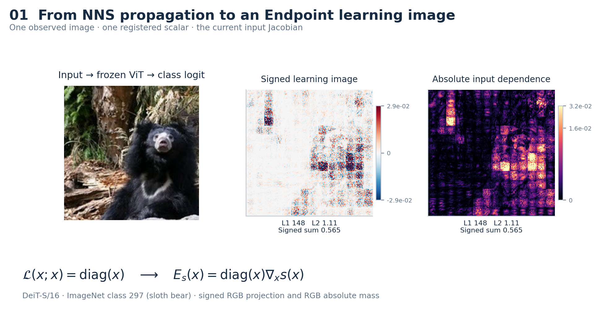
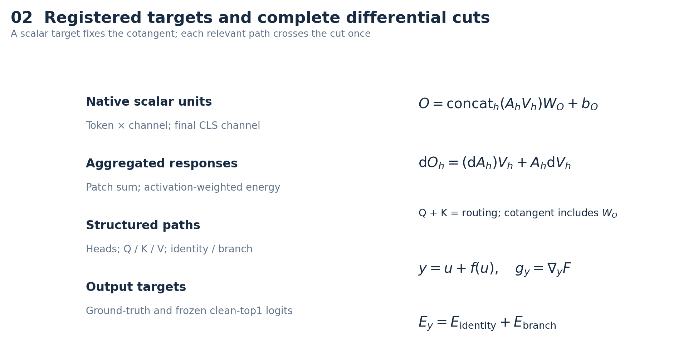
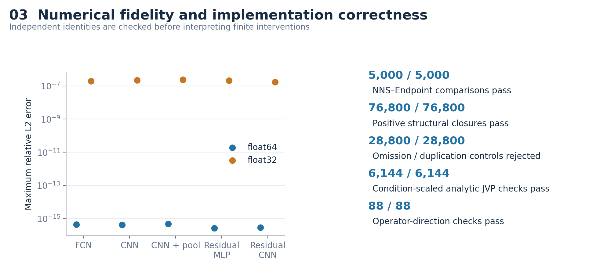
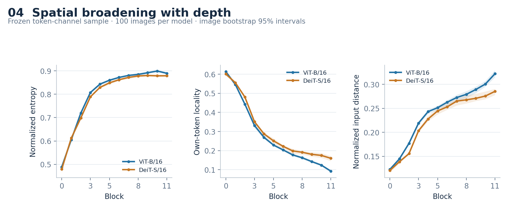
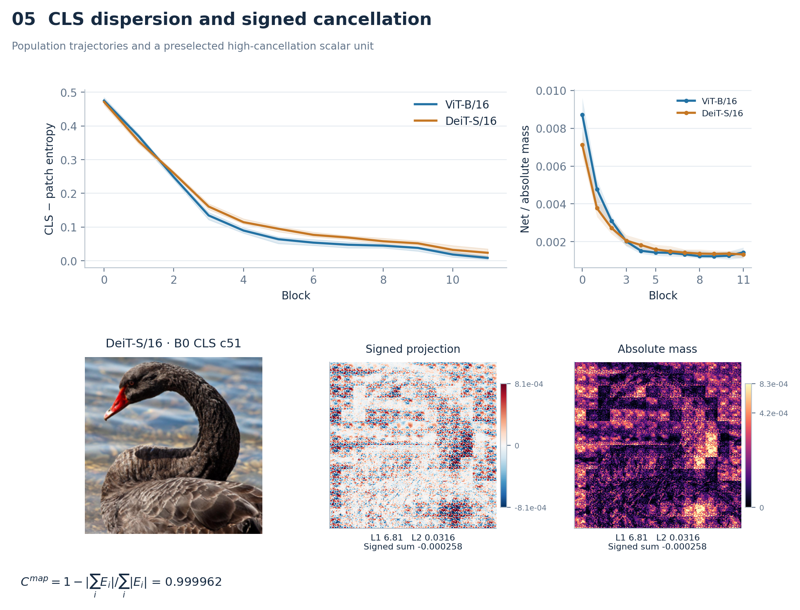
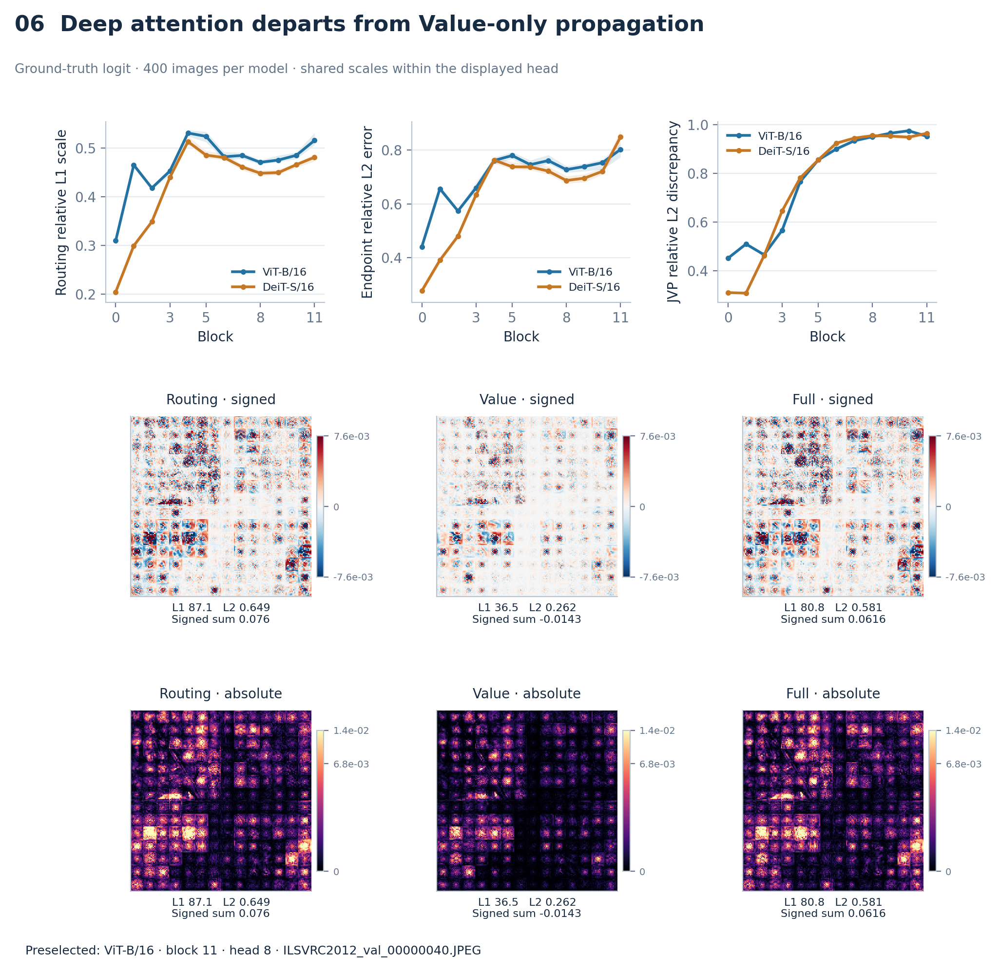
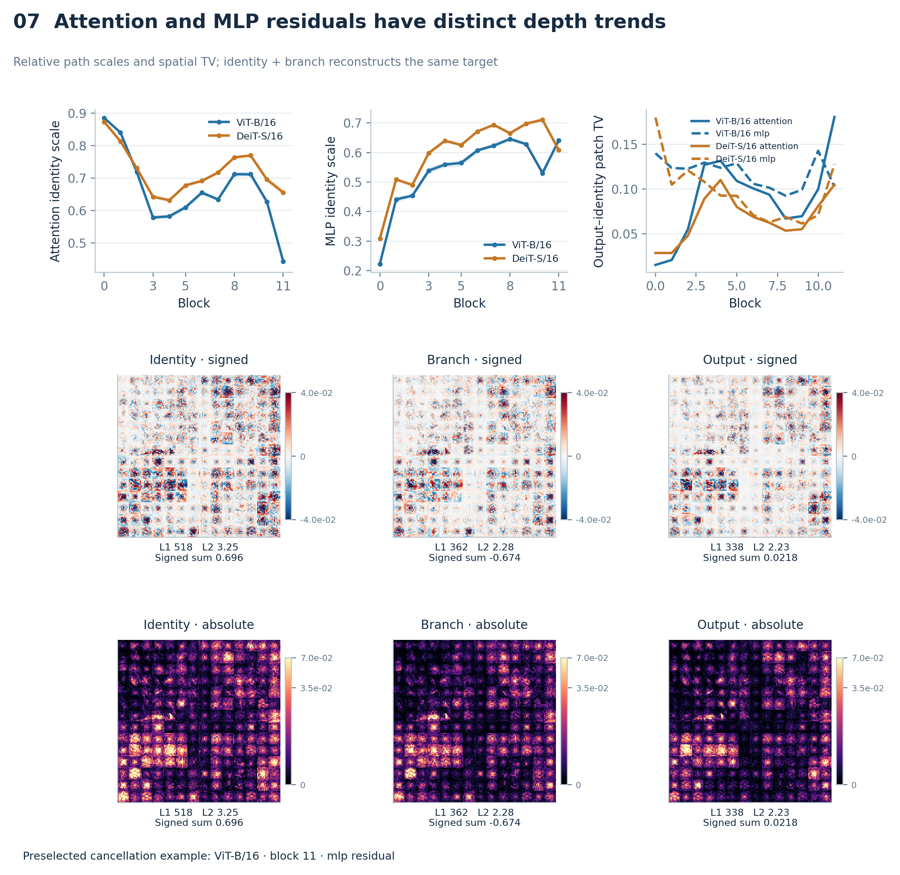
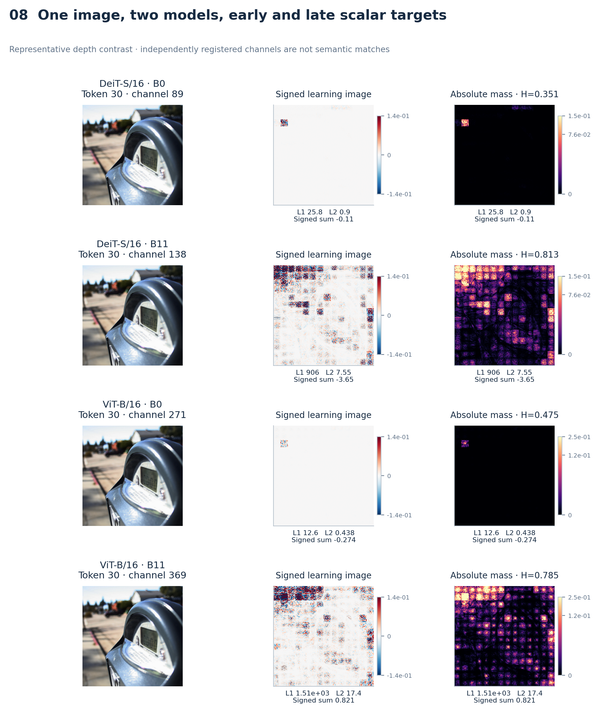
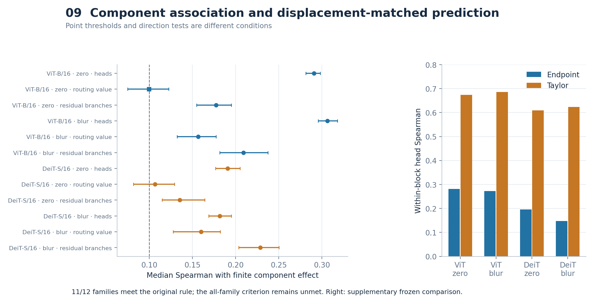
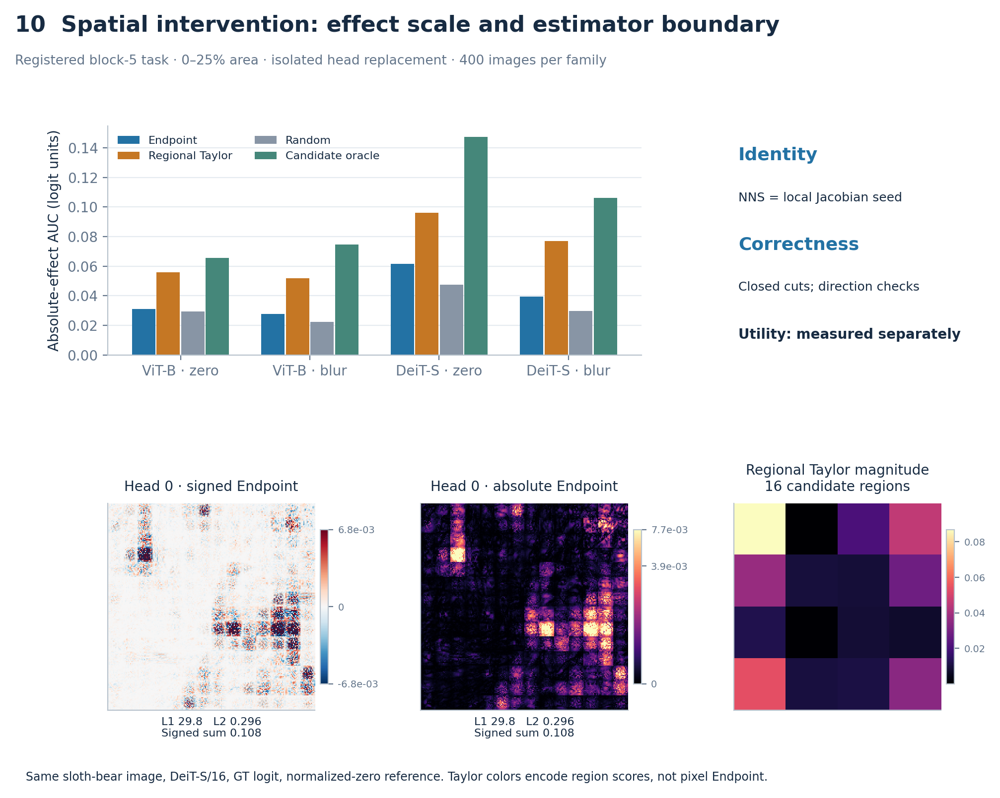

# From NNS to Vision Transformers: Auditable Learning Images and Structured Local-Jacobian Analysis of Internal Targets

- Authors: [AUTHOR REQUIRED]
- Affiliations: [AFFILIATION REQUIRED]
- Corresponding author: [CORRESPONDING AUTHOR REQUIRED]

## Abstract

We extend the input-coordinate learning-image propagation of Neural Network Scanner (NNS) to Vision Transformers (ViTs). Under the locally differentiable conditions covered by original NNS, layerwise propagation equals input-value-seeded local Jacobian propagation; a scalar target's Endpoint is $E_s(x)=x\odot\nabla_xs(x)$ in normalized-input coordinates. The technical contributions are a unified registry of heterogeneous ViT targets, attention and residual decompositions, and independent closure and directional-derivative checks. In ViT-B/16 and DeiT-S/16, all 5,000 original-NNS numerical comparisons and registered structural closure checks pass. A stratified token-channel audit shows spatial broadening of local input dependence with depth. Target-conditioned attention analysis shows that deep attention departs further from a Value-only Jacobian approximation with fixed attention weights. Attention and MLP residuals exhibit different identity/branch depth trends. Finite replacement experiments find broad but non-universal component-level association, while reference-matched regional Taylor achieves higher effects in registered spatial interventions. NNS-ViT provides a unified local input-coordinate representation of internal targets and distinguishes structural correctness, component-level behavioral association, and spatial intervention selection.

Keywords: Vision Transformer; learning image; Gradient × Input; local Jacobian; attention; finite intervention

## 1. Introduction

ViT internal objects include token-channel units, attention heads, MLP branches, residual streams, and class logits (Dosovitskiy et al., 2021). These objects occupy different tensor spaces. Activations and attention weights alone do not specify how an internal target depends on the original image coordinates. NNS associates FCN/CNN neurons with learning images that preserve input positions (Dou et al., 2023). Its current-state propagation principle provides a starting point for unifying these objects.

We formalize this principle as true local Jacobian propagation and extend it to LayerNorm, GELU, softmax attention, and residual connections. The base Endpoint is numerically identical to Gradient × Input for the same target. This work makes four contributions: establishing the theoretical and numerical connection to original NNS; registering heterogeneous ViT scalar targets; constructing and validating attention/residual differential cuts; and using depth atlases and finite replacement to characterize local structural patterns and behavioral meaning separately.

We organize the evidence as follows. RQ1 examines original-NNS fidelity; RQ2 examines target registration and scan coverage; RQ3 examines structural closure and numerical correctness; RQ4a–c examine token-channel, attention routing/value, and residual identity/branch patterns; RQ5a–b calibrate component-level association and spatial intervention utility. We then analyze how reference choice changes the estimand. Figure 1 relates an observed image and a scalar target to its signed and absolute learning images.

<!-- FIGURE_1_START -->

**Figure 1.** The observed input, its ground-truth class logit, and two complementary learning images. Signed maps sum RGB channels; absolute maps sum channelwise absolute values. Both signs remain in the analysis. The frozen display sample is class 297 (sloth bear).
<!-- FIGURE_1_END -->

## 2. Related Work

NNS preserves input coordinates in single-neuron maps and activation-weighted filter aggregation. We formalize its local propagation and extend its operator coverage. Captum's NeuronGradient and InputXGradient already provide internal scalar selection and input-times-gradient computation. Our additions concern registered objects, structural paths, and independently checkable validation.

Integrated Gradients (Sundararajan et al., 2017) uses reference displacement and path-averaged gradients; conductance (Dhamdhere et al., 2018) further analyzes how output attribution passes through hidden units. Endpoint uses the current-point Jacobian and an input-value seed. Attention rollout describes cross-layer token flow (Abnar and Zuidema, 2020), while Chefer et al. (2021) and AttnLRP (Achtibat et al., 2024) use relevance propagation. Their propagation rules and explanatory objects differ; Supplementary Table S5 compares these objects.

Activation patching measures finite output changes after replacing internal activations. Activation-space Taylor approximates this change with the inner product of the clean cotangent and replacement displacement. AtP* discusses approximation errors associated with attention saturation and cancellation (Kramár et al., 2024). We evaluate both whole-component ranking and within-component region ranking so that the validation object matches the intended task.

## 3. Method

### 3.1 Proposition 1: the local Jacobian identity of NNS

Let the image input $x\in\mathbb R^d$ and scalar gradient $\nabla_xs\in\mathbb R^d$ be column vectors. For $u(x)\in\mathbb R^m$, the learning-image matrix is $\mathcal L(u;x)\in\mathbb R^{m\times d}$. Initialization and propagation are

$$
\mathcal L(x;x)=\operatorname{diag}(x),\qquad
\mathcal L(v;x)=\sum_aJ_{f,u_a}(x)\mathcal L(u_a;x),\quad v=f(u_1,\ldots,u_r).
$$

**Proposition 1.** If all local Jacobians are evaluated at the same current forward state, then

$$
\mathcal L(u;x)=J_{u,x}(x)\operatorname{diag}(x),\qquad
\mathcal L(s;x)=\nabla_xs(x)^\top\operatorname{diag}(x),\qquad
E_s(x)=\mathcal L(s;x)^\top=\operatorname{diag}(x)\nabla_xs(x).
$$

**Proof.** At the input, $J_{x,x}=I$. In topological order, substitute each predecessor's expression into the propagation rule and apply the multi-input chain rule. Transposing the scalar node's learning-image row gives the column-vector Endpoint. For linear, convolutional, and current-ReLU-gate operations, this recovers the original NNS coefficients. MaxPool uses the current forward winner. At ReLU zero and MaxPool ties, we use the framework's fixed derivative convention; smooth regions use ordinary derivatives.

Endpoint describes the target's local first-order dependence on coordinate scaling: changing $x_i$ to $(1+\epsilon)x_i$ produces first-order response $\epsilon E_{s,i}$. In general,

$$
\sum_iE_{s,i}=x^\top\nabla_xs(x)\ne s(x).
$$

Euler's theorem gives equality for differentiable degree-one homogeneous functions. A general ViT containing biases, fixed tokens, positional embeddings, LayerNorm, softmax, and GELU does not satisfy this condition. Endpoint reconstructs local input-Jacobian bookkeeping rather than all sources of the target or a complete function-value decomposition. The CLS token, positional embeddings, and patch/LN/QKV/MLP/classifier biases have no separate image-coordinate terms, but they change the current function and Jacobian.

If $x=(r-\mu)/\sigma$, then

$$
x_i\frac{\partial s}{\partial x_i}=(r_i-\mu_i)\frac{\partial s}{\partial r_i}.
$$

Endpoint therefore requires no externally selected intervention reference, while depending on the model's input coordinates and normalization origin.

### 3.2 Scalar targets and filter aggregation

The registry distinguishes native token-channel units, aggregate responses, structural paths, and output targets (Figure 2). For patch activations in channel $c$, define

$$
s_{\mathrm{energy}}=\frac12\sum_{t=1}^{196}h_{t,c}^2,\qquad
\nabla_xs_{\mathrm{energy}}=\sum_th_{t,c}\nabla_xh_{t,c},\qquad
E_{\mathrm{energy}}=\sum_th_{t,c}E_{h_{t,c}}.
$$

This is the Jacobian form of original NNS activation-weighted filter aggregation; energy is an aggregate scalar rather than one neuron. Targets also include patch sums, internal head coordinates, final CLS channels, ground-truth logits, and frozen clean-top1 logits. Equal channel indices across models do not imply semantic correspondence.

### 3.3 True attention and residual differentials

For each head, $Q=XW_Q+b_Q$, $K=XW_K+b_K$, $V=XW_V+b_V$, and

$$
A=\operatorname{softmax}(QK^\top/\sqrt{d_h}),\quad O_h=AV,\quad
\mathrm dO_h=(\mathrm dA)V+A\mathrm dV.
$$

The first term separates into Q and K input-differential paths, giving

$$
E^{\mathrm{attn}}=E^Q+E^K+E^V=E^{\mathrm{routing}}+E^{\mathrm{value}}.
$$

The head edges precede concatenation and output projection: $O=\operatorname{concat}_h(O_h)W_O+b_O$. Their downstream cotangents include $W_O$ and all subsequent derivatives to the target; the bias has no input-differential term. Q/K/V paths share upstream inputs and can overlap in input space. Path-norm ratios describe local scales, not mutually exclusive causal percentages.

For a residual $y=u+f(u)$, let $g_y=\nabla_yF$. Its two terms are

$$
E^{\mathrm{id}}=\operatorname{diag}(x)J_{u,x}^\top g_y,\qquad
E^{\mathrm{branch}}=\operatorname{diag}(x)J_{u,x}^\top J_{f,u}^\top g_y.
$$

The identity path uses $g_y$ at the residual output. Using $\nabla_uF$, which already includes the branch, would double-count paths. Their sum reconstructs Endpoint without implying a function-value decomposition $F=F_{\mathrm{id}}+F_{\mathrm{branch}}$.

<!-- FIGURE_2_START -->

**Figure 2.** Heterogeneous scalar targets and attention/residual differential cuts. Head edges precede output projection, whose derivative is included in the cotangent; residual identity uses the output-edge cotangent.
<!-- FIGURE_2_END -->

### 3.4 Proposition 2: Endpoint closure of a valid edge cut

For cut edges $\{z_k\}$ and target $F$, define

$$
E^C_{k,i}=x_i\left\langle g_{z_k},\frac{\partial z_k}{\partial x_i}\right\rangle.
$$

**Proposition 2.** If each relevant input-to-target differential path crosses the cut exactly once, all components use the same forward state, cotangents are attached to the correct edges, and no paths are omitted or duplicated, then $\sum_kE^C_{k,i}=x_i\partial F/\partial x_i$.

**Proof.** Expand the chain rule into Jacobian products over input-to-target paths. A valid cut partitions these paths without omission or duplication. Each group factors into its upstream Jacobian to $z_k$ and the downstream cotangent at that edge. Summing all groups and multiplying by $x_i$ gives the result. A cut internal to one branch reconstructs that branch; reconstruction of a full residual or target must also include bypass paths.

### 3.5 Mass, cancellation, and the Value-only approximation

In the original normalized-input RGB tensor coordinates, define $m(E)=\sum_i|E_i|$ and $a(E)=\sum_iE_i$. Within-map and between-path cancellation are

$$
C^{\mathrm{map}}=1-\frac{|\sum_iE_i|}{\sum_i|E_i|},\qquad
C^{\mathrm{path}}=1-\frac{\|E^{(1)}+E^{(2)}\|_1}{\|E^{(1)}\|_1+\|E^{(2)}\|_1}.
$$

Routing scale is $\|E^{\mathrm{routing}}\|_1/(\|E^{\mathrm{routing}}\|_1+\|E^{\mathrm{value}}\|_1)$; identity scale is defined analogously. The Value-only approximation retains $A\mathrm dV$ and omits $(\mathrm dA)V$. Endpoint and JVP relative errors use the L2 norm of the complete map or complete directional response, respectively. An error near 0.95 indicates a discrepancy on the scale of the full response.

Signed displays use $\sum_cE_c$, and absolute displays use $\sum_c|E_c|$. Related maps share a P99 robust scale and asinh display transform, with raw RGB L1, L2, and signed-sum annotations. Statistics use original coordinates; zero denominators or norms yield NA.

### 3.6 Finite replacement and spatial region selection

The finite component effect is $e_k=F(x)-F(x;z_k\leftarrow z_k^{\mathrm{ref}})$. The primary statistic compares $m(E_k)$ and $|e_k|$ with within-image Spearman correlation. The Taylor quantity is $p_k=\langle\nabla_{z_k}F,z_k(x)-z_k^{\mathrm{ref}}\rangle$.

The spatial task fixes three heads at block 5, divides the input into $4\times4$ regions, and replaces 1, 2, or 4 regions. Only the selected head edge is replaced by the activation produced by that perturbed input; other heads and the identity remain clean. Each curve integrates absolute isolated effect over 0–25% area using trapezoids and divides by 0.25, then averages the three heads within each image. The random baseline averages 20 signed-effect curves before taking absolute values and integrating. Endpoint, total G×I, raw gradient, regional Taylor, and random share the region pool and area budgets.

## 4. Experimental Design

### 4.1 Models, data, and sampling

Two frozen ImageNet models share 400 evaluation images. Discovery/calibration/evaluation sets contain 64/64/400 images with disjoint images and classes. Inputs undergo bicubic resize to short side 248 and a center crop to 224. Models use evaluation mode, disabled dropout/drop path, and unfused attention for structural experiments.

<!-- TABLE_1_START -->
**Table 1. Models and input settings.**

| Model / setting | ViT-B/16 | DeiT-S/16 |
| --- | --- | --- |
| Blocks / heads / hidden dimension | 12 / 12 / 768 | 12 / 6 / 384 |
| Registered scalar targets/image | 457 | 385 |
| Evaluation images | 400 | 400 (same IDs) |
| Resize / crop | 248 / 224 | 248 / 224 |
| Normalization mean | [0.5, 0.5, 0.5] | [0.485, 0.456, 0.406] |
| Normalization std | [0.5, 0.5, 0.5] | [0.229, 0.224, 0.225] |
<!-- TABLE_1_END -->

The stratified atlas uses a separate 100-image cohort. Each block selects CLS, 15 spatially stratified patch tokens, and 32 hash-selected channels, giving $12\times16\times32=6,144$ post-block scalars per model-image. Aggregation occurs within images before using images as statistical units. Early/middle/late denote blocks 0–3/4–7/8–11. Let $p_j$ be normalized absolute mass over 196 input patches; the spatial metrics are

$$
H=-\frac{\sum_jp_j\log p_j}{\log196},\quad
L_t=\sum_{j:\|r_j-r_t\|_\infty\le1}p_j,\quad
D_t=\sum_jp_j\frac{\|r_j-r_t\|_2}{13\sqrt2},\quad
\operatorname{TV}(p,q)=\frac12\sum_j|p_j-q_j|.
$$

Locality includes the target patch's $3\times3$ neighborhood, clipped at boundaries; CLS locality/distance are NA. Attention saturation averages $1+\sum_j A_{qj}\log A_{qj}/\log197$ over all queries, with a separate CLS-query version. These definitions match the original records.

### 4.2 Frozen statistics and supplementary descriptions

The original component-family rule requires a correlation point estimate of at least 0.10, a positive-direction sign test against zero that survives Holm correction, and coverage and CI-precision criteria. Spatial families require paired median gains of at least 0.05 over all four baselines and analogous direction, coverage, and precision conditions. **The 0.10/0.05 values are practical thresholds on point estimates; the sign-test null concerns zero, not whether the population median exceeds 0.10/0.05.** The original behavioral tests share one 28-test Holm family and use 10,000 bootstrap replicates; maximum CI widths are 0.30/0.50.

Atlas tests use five-test Holm families per model; attention/residual analyses use their frozen model-specific families. Subsequent residual spatial-TV sensitivity is labeled post-hoc and corrected separately. The additional absolute AUC, oracle regret, reference-change, and rank summaries in this revision are descriptive recomputations and do not replace frozen decisions.

## 5. Results

### 5.1 RQ1: original-NNS fidelity

In FCN, CNN, CNN-MaxPool, residual-MLP, and residual-CNN networks, each precision uses 100 inputs per network. All 5,000 comparisons between explicit layerwise propagation and Endpoint pass. Maximum relative-L2 errors are $4.769\times10^{-16}$ in float64 and $2.427\times10^{-7}$ in float32 (Figure 3). The same propagation identity explains the energy-aggregation and MaxPool-winner conditions.

<!-- FIGURE_3_START -->

**Figure 3.** Original-NNS numerical equivalence across five compatible network families, structural closure, negative controls, and independent direction checks. Each left-panel point is the maximum relative-L2 error for that network/precision; validation counts are not independent statistical sample sizes.
<!-- FIGURE_3_END -->

### 5.2 RQ2: registry and scan coverage

All 800/800 image-model tasks complete 336,800/336,800 scalar-target Endpoint evaluations, with 457/385 targets per image. Original post-block token-channel coverage is 0.01058% for ViT-B/16 and 0.02115% for DeiT-S/16; the stratified atlas increases this to 0.338%/0.677% and produces 1,228,800 records. This is a registry-complete scan without missing entries in the frozen catalog; spatial conclusions concern sampled units. Full coverage and resource records are in the supplement.

### 5.3 RQ3: structural closure and numerical validation

All 76,800 positive closures satisfy the float32 elementwise contract $|\mathrm{error}|\le10^{-5}+10^{-4}|\mathrm{reference}|$; all 28,800 omission or duplication controls are rejected. Maximum relative-L2 error is $1.41446\times10^{-5}$. All 6,144 condition-scaled analytic JVP checks pass, as do 88 float64 direction checks across 11 operator classes. The worst best-step finite-difference error is $1.632\times10^{-10}$.

Of 57,600 float32 finite-difference checks in the stratified atlas, 36 miss tolerance (0.0625%). Same-coordinate float64 multi-step checks under the frozen review procedure all pass. The original failures and precision curves remain in the supplement; they do not uniquely localize error to an upstream operator.

### 5.4 RQ4a: token-channel spatial broadening and cancellation

Late-minus-early entropy increases by 0.2201/0.2250 in ViT-B/16 and DeiT-S/16, locality decreases by 0.3558/0.3424, and normalized distance increases by 0.1312/0.1219. Each contrast has the registered direction in 100/100 images and survives its model's Holm tests (Figure 4). These measurements describe spatial broadening of local input dependence.

<!-- FIGURE_4_START -->

**Figure 4.** Depth trajectories of entropy, locality, and distance for the frozen stratified token-channel sample. Blue/orange denote ViT-B/16 and DeiT-S/16; bands are image-bootstrap 95% CIs over 100 images.
<!-- FIGURE_4_END -->

CLS-minus-patch entropy narrows from 0.4752/0.4712 at block 0 to 0.0086/0.0238 at block 11. Signed net/absolute mass falls from 0.00872/0.00712 to 0.00144/0.00132. Figure 5 combines population trajectories with a preselected high-cancellation case. Absolute mass measures the total magnitude of local first-order terms, rather than knowledge quantity or net directional effect.

<!-- FIGURE_5_START -->

**Figure 5.** Population trajectories of CLS-minus-patch entropy and net/absolute mass appear above a high-map-cancellation unit selected by frozen metrics. Signed and absolute views are paired, with original RGB masses and norms annotated below.
<!-- FIGURE_5_END -->

### 5.5 RQ4b: attention routing/value

Target-conditioned decomposition covers 400 images, all 12 blocks, and all heads. Routing scale increases from 0.3092/0.2041 at block 0 to 0.5154/0.4808 at block 11; Value-only Endpoint error increases from 0.4407/0.2774 to 0.8022/0.8488. Late-minus-early tests support larger routing scales and approximation discrepancies (Figure 6).

<!-- FIGURE_6_START -->

**Figure 6.** Routing scale, Value-only Endpoint error, and JVP discrepancy over 400 images; bands are image-bootstrap 95% CIs. Routing/value/full maps of one head share a scale within the signed row and within the absolute row, with original mass, norm, and signed-sum annotations. The example illustrates decomposition rather than replacing population evidence.
<!-- FIGURE_6_END -->

Block-11 JVP discrepancies are 0.9516/0.9636; full-response norms are 14.9711/1.5155 and absolute discrepancies are 13.8064/1.4228. The discrepancy is therefore on the scale of the full response and is not generally attributable to near-zero denominators. This ratio is not an omitted-contribution percentage.

Mean-query saturation correlates negatively with routing scale among heads within the same image and block. After controlling for activation and cotangent norms, partial-rank correlations remain −0.1442/−0.3257. Sharper attention is not a proxy for stronger routing differentials. CLS-query relationships are weaker, with two adjusted ViT-B tests at $p=0.0629$. Full post-hoc sensitivity results are in the supplement.

### 5.6 RQ4c: residual identity/branch

Late-minus-early identity scales are −0.1242/−0.0449 for attention residuals and +0.1798/+0.1780 for MLP residuals. The two sublayers exhibit different transmission trends (Figure 7). Post-hoc full-cohort spatial-TV analysis further gives attention changes of +0.0520/+0.0282 and MLP changes of −0.0187/−0.0462; all four survive a separate Holm correction. Oppositely signed first-order paths can substantially cancel when added, so path scales cannot be read as final contribution fractions.

<!-- FIGURE_7_START -->

**Figure 7.** Attention/MLP identity scales and output–identity patch TV, above shared-scale identity/branch/output maps from a high-path-cancellation case. TV curves describe the frozen cohort; late-minus-early inference comes from a separate post-hoc sensitivity analysis.
<!-- FIGURE_7_END -->

Figure 8 presents early/late signed and absolute scalar maps from both models for one preselected image, sharing display scales within each model. Cases are selected by frozen metrics to illustrate population patterns. The token-channel atlas and class-logit path analysis use different targets and cohorts: each model's original raw-map bridge overlaps the 100-image atlas in only one image. They establish a descriptive model-level connection.

<!-- FIGURE_8_START -->

**Figure 8.** A shared-image cross-model depth comparison selected by frozen metrics. Early/late maps share signed and absolute scales within each model. Independently registered channels do not establish semantic matching across layers or models.
<!-- FIGURE_8_END -->

### 5.7 RQ5a: broad but non-universal component association

Eleven of twelve families satisfy every frozen criterion (Figure 9; Table 2). The unsupported ViT-B/16 normalized-zero routing/value estimate is 0.09956521739130435, with 95% CI [0.0748, 0.1226] and Holm $p=3.0036\times10^{-14}$. Its DeiT-S/16 counterpart is 0.1065, CI [0.0817, 0.1291], which satisfies the original rule but likewise does not establish that the population median exceeds 0.10. Table 2 adds whether the CI lower bound exceeds 0.10 as descriptive sensitivity, without changing the original status. The all-family omnibus C4a remains NOT_SUPPORTED.

<!-- TABLE_2_START -->
**Table 2. Original component families and threshold sensitivity.**

| Model | Reference | Family | Median rho | 95% CI | Holm p | Frozen status | CI lower > 0.10 |
| --- | --- | --- | --- | --- | --- | --- | --- |
| ViT-B/16 | normalized-zero | heads | 0.2909 | [0.2813, 0.2982] | 2.17e-119 | SUPPORTED | yes |
| ViT-B/16 | normalized-zero | routing/value | 0.0996 | [0.0748, 0.1226] | 3.00e-14 | NOT_SUPPORTED | no |
| ViT-B/16 | normalized-zero | residual/branches | 0.1774 | [0.1548, 0.1952] | 2.56e-46 | SUPPORTED | yes |
| ViT-B/16 | blur | heads | 0.3063 | [0.2957, 0.3181] | 2.17e-119 | SUPPORTED | yes |
| ViT-B/16 | blur | routing/value | 0.1565 | [0.1322, 0.1774] | 9.96e-29 | SUPPORTED | yes |
| ViT-B/16 | blur | residual/branches | 0.2091 | [0.1817, 0.2374] | 1.46e-41 | SUPPORTED | yes |
| DeiT-S/16 | normalized-zero | heads | 0.1910 | [0.1769, 0.2052] | 1.88e-76 | SUPPORTED | yes |
| DeiT-S/16 | normalized-zero | routing/value | 0.1065 | [0.0817, 0.1291] | 2.11e-10 | SUPPORTED | no |
| DeiT-S/16 | normalized-zero | residual/branches | 0.1352 | [0.1148, 0.1643] | 4.35e-19 | SUPPORTED | yes |
| DeiT-S/16 | blur | heads | 0.1817 | [0.1688, 0.1951] | 3.82e-72 | SUPPORTED | yes |
| DeiT-S/16 | blur | routing/value | 0.1600 | [0.1278, 0.1822] | 9.90e-31 | SUPPORTED | yes |
| DeiT-S/16 | blur | residual/branches | 0.2287 | [0.2035, 0.2504] | 3.70e-54 | SUPPORTED | yes |
<!-- TABLE_2_END -->

A supplementary frozen study compares seven predictors for within-block head ranking. Taylor has higher Spearman and Capture@1/3 and lower Regret@1 than Endpoint (Table 3). Across-layer residual identity has paired Endpoint-minus-Taylor Spearman differences of 0.0865–0.4209, but median Capture@1 differences are zero. Incremental value depends on the component and metric.

<!-- TABLE_3_START -->
**Table 3. Supplementary frozen within-block head ranking: E=Endpoint, T=Taylor.**

| Model | Reference | E rho | T rho | E Capture@1 | T Capture@1 | E Capture@3 | T Capture@3 | E Regret@1 | T Regret@1 |
| --- | --- | --- | --- | --- | --- | --- | --- | --- | --- |
| ViT-B/16 | normalized-zero | 0.2815 | 0.6742 | 0.5174 | 0.8038 | 0.6149 | 0.8567 | 0.1701 | 0.0571 |
| ViT-B/16 | blur | 0.2727 | 0.6856 | 0.5075 | 0.8203 | 0.6185 | 0.8659 | 0.1163 | 0.0346 |
| DeiT-S/16 | normalized-zero | 0.1952 | 0.6095 | 0.5609 | 0.8028 | 0.7122 | 0.8894 | 0.2381 | 0.0860 |
| DeiT-S/16 | blur | 0.1476 | 0.6238 | 0.5506 | 0.8426 | 0.7105 | 0.8970 | 0.1326 | 0.0443 |
<!-- TABLE_3_END -->

<!-- FIGURE_9_START -->

**Figure 9.** Original C4a family estimates and image-bootstrap 95% CIs. The dashed 0.10 line is a point-estimate threshold; a square marks the unsupported family. The right panel reports Endpoint/Taylor Spearman for the supplementary frozen within-block head comparison, which does not replace C4a.
<!-- FIGURE_9_END -->

### 5.8 RQ5b: spatial intervention boundary

All four families miss the joint +0.05 criterion over all four baselines, and C4b remains NOT_SUPPORTED. Paired median Endpoint-minus-regional-Taylor AUC differences are −0.023433, −0.023697, −0.029900, and −0.035630, with intervals below zero (Table 4). Gains over random are positive but far below 0.05.

<!-- TABLE_4_START -->
**Table 4. Original paired spatial-intervention AUC differences.**

| Model | Reference | vs total G×I | vs gradient | vs Taylor | vs random | Frozen status |
| --- | --- | --- | --- | --- | --- | --- |
| ViT-B/16 | normalized-zero | -0.0009 | -0.0000 | -0.0234 | 0.0011 | NOT_SUPPORTED |
| ViT-B/16 | blur | -0.0010 | -0.0007 | -0.0237 | 0.0042 | NOT_SUPPORTED |
| DeiT-S/16 | normalized-zero | -0.0018 | -0.0006 | -0.0299 | 0.0107 | NOT_SUPPORTED |
| DeiT-S/16 | blur | 0.0002 | -0.0002 | -0.0356 | 0.0085 | NOT_SUPPORTED |
<!-- TABLE_4_END -->

Table 5 reports absolute AUC. At each head and budget, the candidate oracle takes the largest absolute isolated effect among actually evaluated region sets, then integrates and averages heads within images. It is not the optimum over all possible regions, and optimal sets need not be nested across budgets. Table 6 computes regret as $(A_{oracle}-A_m)/A_{oracle}$ within each image before taking the median, with zero denominators marked NA. Median within-image AUC ratios to $|F(x)|$ are 0.0031–0.0072 for Endpoint and 0.0059–0.0107 for Taylor. Raw-logit ratios provide an output-scale reference and depend on the model's logit origin.

<!-- TABLE_5_START -->
**Table 5. Absolute AUC and output scale (400 images per setting).**

| Model | Reference | Endpoint AUC | Taylor AUC | Random AUC | Candidate oracle AUC | Clean GT logit |
| --- | --- | --- | --- | --- | --- | --- |
| ViT-B/16 | normalized-zero | 0.0309 | 0.0558 | 0.0294 | 0.0654 | 8.8989 |
| ViT-B/16 | blur | 0.0276 | 0.0518 | 0.0225 | 0.0747 | 8.8989 |
| DeiT-S/16 | normalized-zero | 0.0617 | 0.0961 | 0.0475 | 0.1474 | 8.7974 |
| DeiT-S/16 | blur | 0.0395 | 0.0770 | 0.0296 | 0.1063 | 8.7974 |
<!-- TABLE_5_END -->

<!-- TABLE_6_START -->
**Table 6. Normalized oracle regret and within-image logit-scale ratios.**

| Model | Reference | Endpoint regret | Taylor regret | Random regret | Endpoint AUC/abs(logit) | Taylor AUC/abs(logit) |
| --- | --- | --- | --- | --- | --- | --- |
| ViT-B/16 | normalized-zero | 0.5303 | 0.1442 | 0.5563 | 0.0035 | 0.0062 |
| ViT-B/16 | blur | 0.6366 | 0.2557 | 0.6942 | 0.0031 | 0.0059 |
| DeiT-S/16 | normalized-zero | 0.5646 | 0.3352 | 0.6780 | 0.0072 | 0.0107 |
| DeiT-S/16 | blur | 0.6289 | 0.2705 | 0.7130 | 0.0045 | 0.0089 |
<!-- TABLE_6_END -->

<!-- FIGURE_10_START -->

**Figure 10.** Median absolute-effect AUC in four registered settings, including an oracle over evaluated candidates. Below are signed/absolute Endpoint and regional Taylor for the same sloth-bear image, DeiT-S block-5 head 0, and normalized-zero reference. Taylor cells represent 16 region-displacement scores and are not comparable to pixel Endpoint color values.
<!-- FIGURE_10_END -->

### 5.9 Method semantics and reference analysis

Endpoint equality across intervention references follows from its definition and reuse of the clean map. All 163,200 component pairs verify equality of stored values. Taylor magnitude and absolute finite-effect changes use $|q_0-q_b|>\mathrm{atol}+\mathrm{rtol}\max(|q_0|,|q_b|)$, with the original analysis's $\mathrm{atol}=10^{-12},\mathrm{rtol}=0$. Every pair exceeds tolerance. Table S3 reports medians and q10/q90 of absolute and relative changes.

Identical complete rankings occur in only 46/9,600 Taylor and 64/9,600 finite-effect head-block comparisons, all in DeiT-S. Table 7 gives less restrictive rank summaries: for example, median image-level Taylor top-1 agreement is 0.3333 in both models and top-3 overlap is 0.5000/0.6111. Reference changes affect ordering beyond score scale, although a changed complete ranking does not imply that every pair of heads changes order. Table S4 provides image-level q10/q90.

<!-- TABLE_7_START -->
**Table 7. Cross-reference head-rank concordance (12 blocks averaged within image).**

| Model | Quantity | Spearman | Kendall tau-b | Top-1 agreement | Top-3 overlap | Mean abs rank displacement |
| --- | --- | --- | --- | --- | --- | --- |
| DeiT-S/16 | finite_effect | 0.3071 | 0.2444 | 0.4167 | 0.6111 | 1.5278 |
| DeiT-S/16 | taylor | 0.3000 | 0.2389 | 0.3333 | 0.6111 | 1.5278 |
| ViT-B/16 | finite_effect | 0.3759 | 0.2803 | 0.3333 | 0.5000 | 2.9444 |
| ViT-B/16 | taylor | 0.3782 | 0.2828 | 0.3333 | 0.5000 | 2.9444 |
<!-- TABLE_7_END -->

## 6. Discussion

The local Jacobian identity, implementation correctness, and finite-intervention utility are separately testable properties. The first two establish structural relationships between internal targets and image coordinates; the third depends on replacement displacement, target component, and candidate regions. Regional Taylor explicitly incorporates displacement under the chosen reference and is closer to the estimand of this study's region interventions.

Spatial broadening, Value-only approximation discrepancy, and differing attention/MLP residual trends characterize local input dependence in two trained models. High signed cancellation shows that large absolute mass can coexist with small net directional response. Positive signed-map values identify positive local coordinate-scaling terms; they are not direct evidence of prediction support under finite deletion.

The negative association between mean-query attention sharpness and routing dependence suggests that attention weights alone cannot substitute for target-conditioned path analysis. Token-channel and class-logit trajectories are complementary; a matched-target bridge is the direct next test of their relationship.

## 7. Limitations

The study covers two ImageNet classification ViTs. They differ simultaneously in model size, head count, hidden dimension, and training strategy, so cross-model differences cannot be uniquely assigned to one factor. Random-initialization/untrained controls are absent; the contributions of architecture, initialization, and training to spatial and path trends are unresolved. These trends therefore do not establish learned semantic mechanisms. Alternative checkpoints of the same architecture, self-supervised models, and other tasks remain unevaluated.

Structural path analysis is conditioned on the ground-truth logit. Mechanism robustness across GT/clean-top1 targets and correct/incorrect predictions has not been established. Stored clean-top1 total maps do not substitute for those path decompositions. Target/cohort mismatch limits the token-channel/class-logit bridge; matched-target full–value entropy, locality, and TV comparisons are planned. Five-network equivalence tests provide the current numerical fidelity evidence; original-NNS-style CNN pixel examples and a small functional visualization comparison remain possible extensions.

Registry-complete does not mean exhaustive enumeration of neurons. Spatial intervention conclusions are specific to the registered layer, heads, region pool, references, and raw-logit isolated effect. ViT-B Path IG passes only GT 41/64 and clean-top1 40/64 cases at the frozen 512-point cap, below the 61/64 calibration requirement. Cross-model Endpoint–Path comparisons therefore lack a common calibrated numerical basis. Reproducibility details and prioritized follow-up experiments are in the supplement.

## 8. Conclusion

Original NNS learning images can be formalized as input-value-seeded local Jacobian propagation, which Endpoint extends to ViT operators. Heterogeneous internal scalars map to common input coordinates, and valid attention/residual cuts close their corresponding Endpoints. Sampled token-channel units in two trained models show spatial broadening with depth, deep attention departs further from Value-only approximation, and attention and MLP residuals exhibit different local transmission trends. Finite replacement yields broad but non-universal component association and shows that displacement-matched Taylor better serves this study's reference-specific region selection.

## Data, Code, and Reproducibility

Preprocessing, full coverage tables, frozen decisions, numerical failure reviews, supplementary figures, and the descriptive recomputation are in the [supplement](supplement_revision_v1.md). Author, affiliation, and final archive details require author completion: [REPOSITORY AND ARCHIVE REQUIRED].

## References

See the [reference list](../references/endpoint_scanner_references_r1.md).
