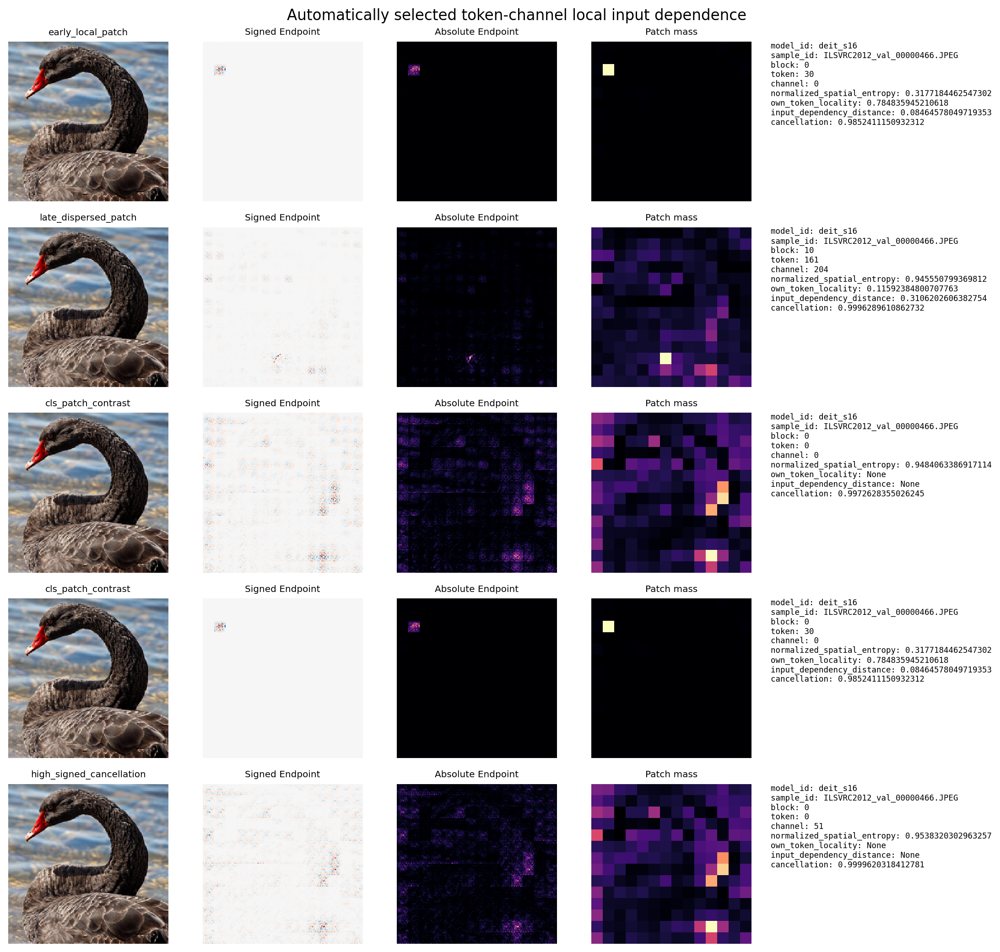
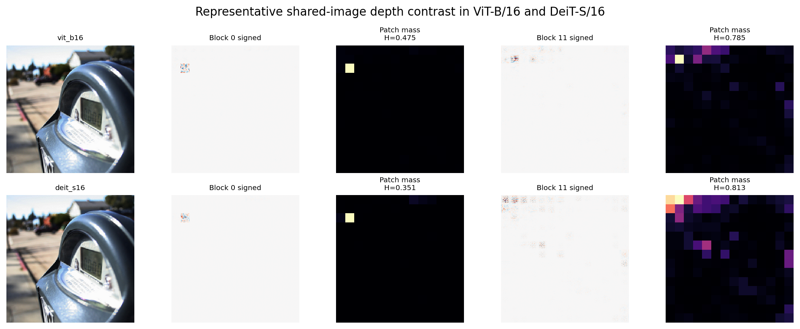
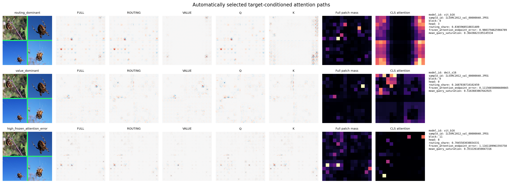
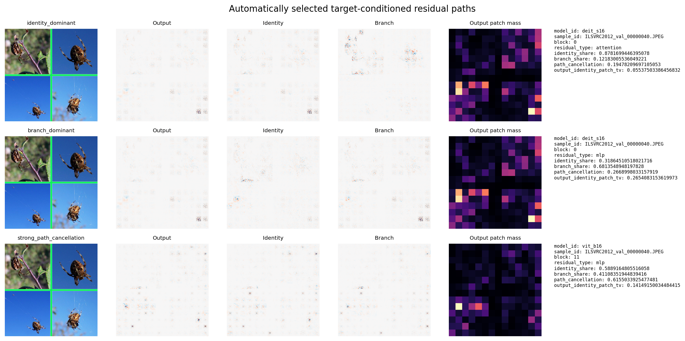
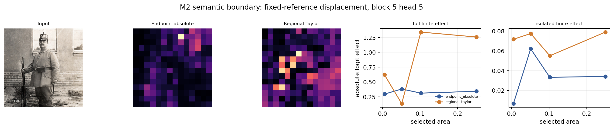

# NNS-ViT Endpoint Scanner: Registered Internal-Target Scanning and Structured Decomposition of Vision Transformers

- Authors: `[AUTHOR REQUIRED]`
- Affiliations: `[AFFILIATION REQUIRED]`
- Corresponding author: `[CORRESPONDING AUTHOR REQUIRED]`

> Draft R3 (M4 review revision), September 19, 2026. Figure numbers follow the sealed Endpoint packages (Figures 1–33).
> They may be renumbered for submission according to
> `papers/nns_vit_endpoint/zh/outline.md` without changing figure content, numerical
> values, or conclusions.

## Abstract

Internal explanations of Vision Transformers (ViTs) span tokens, channels, attention heads,
routing and value paths, MLP branches, and residual streams. Their different tensor shapes and
computational roles make it difficult to scan, structurally reconcile, and behaviorally evaluate
them in a common coordinate system. We present the NNS-ViT Endpoint Scanner, which adapts the
input-value initialization and current-state propagation principle of the Neural Network Scanner
to ViTs. For any registered scalar target, it produces
$L_s^{\mathrm{Endpoint}}(x)=x\odot\nabla_xs(x)$ and decomposes the same final target through
complete computational-edge cuts into head, Q/K/V, routing/value, attention-residual, and
MLP-residual components. The base quantity is Gradient × Input; the subject of this study is the
registration of ViT targets, structural accounting, and the empirical utility of the resulting
components under finite interventions. We evaluated ViT-B/16 and DeiT-S/16 on a shared cohort of
400 ImageNet evaluation images. Registered scanning completed 800/800 image-model tasks and
336,800 finite target evaluations. Structural tests passed 76,800 positive closure checks,
rejected 28,800 omission or double-counting controls, and passed 6,144 condition-scaled analytic
JVP checks. A direct fidelity bridge produced 5,000 target-level numerical comparisons between
explicit layerwise NNS propagation and Endpoint across five compatible network families; all met
their precision-specific contracts. In a frozen 100-image stratified audit, each model-image
contributed 6,144 post-block token-channel units. Both models showed depth-related spatial
broadening of local first-order input dependence: late blocks had higher spatial entropy, lower
own-token locality, and greater normalized input distance than early blocks. Under matched
activation replacement, 11 of 12 preregistered families met the
family-level criteria. RQ3 showed broad but non-universal support at the family level, while
the preregistered all-family omnibus criterion was not supported (`NOT_SUPPORTED`). The
remaining family retained a significant positive association, but its confidence interval
spanned the 0.10 practical-effect threshold. In spatially targeted
interventions, none of four families simultaneously outperformed total G×I, raw gradient,
regional Taylor, and random regions; regional Taylor attained a higher median effect in every
family. A target-conditioned analysis of the frozen ground-truth logit further showed that late attention had larger routing-to-total-path norm ratios and larger Value-only Jacobian discrepancies than early attention. Attention and MLP residuals had opposite identity-path depth trends, and their spatial changes also diverged. These ratios and normalized errors describe local Jacobian geometry rather than percent contributions.

Endpoint therefore provides a numerically validated internal-target representation whose
sampled token-channel maps broaden spatially with depth. Component-level finite-effect
association and reference-specific local-region selection remain distinct capabilities.

Keywords: Vision Transformer; neural-network interpretation; Gradient × Input; structural
decomposition; activation replacement; attention head

## 1. Introduction

Vision Transformers organize image representations as patch tokens and repeatedly transform them
through multi-head self-attention, MLPs, and residual streams (Dosovitskiy et al., 2021). This
architecture creates many potential objects of interpretation: a token-channel unit, an attention
head, Q/K routing, Value content, an MLP branch, or a final class logit. These objects occupy
different tensor spaces. Direct inspection of activations or attention weights can describe an
internal state, but it does not by itself show how that state depends on the original input, nor
does it ensure that multiple structural components account for a common target without omission
or double counting.

Existing ViT interpretation methods address different parts of this problem. Attention rollout
recursively aggregates attention flow between tokens (Abnar and Zuidema, 2020). Transformer
relevance methods propagate class-related quantities through a computational graph (Chefer et
al., 2021; Achtibat et al., 2024). Input-attribution methods map a final output to pixel
coordinates. These methods differ in their targets, propagation rules, and evaluation criteria.
Interpretation of internal structure also requires three questions to remain separate: what is the
mathematical identity of a quantity, whether the implementation realizes that identity, and
whether the quantity predicts a finite intervention. Gradient agreement or structural closure
cannot replace intervention tests, and a spatially detailed map need not be a better region
selector than an estimate constructed directly for a candidate intervention.

The Neural Network Scanner (NNS) of Dou et al. (2023) associates a position-preserving learning
image with an internal neuron in an FCN or CNN. When affine layers, convolutions, active ReLU
gates, and unique MaxPool winners use their current local propagation coefficients, the
single-neuron rule can be written as the product of the input and the gradient at the current
point. ViTs introduce LayerNorm, GELU, input-dependent softmax attention, two residual additions,
and multiple token- and branch-level objects. Their treatment requires explicit Jacobians,
structural cuts, and target identities. We retain the endpoint-propagation view of NNS but do not
present $x\odot\nabla_xs(x)$ as a new base attribution formula.

We develop the NNS-ViT Endpoint Scanner and evaluate four original utility questions (Figure 1),
supplemented by a direct NNS-fidelity bridge and a stratified token-channel mechanism audit:

1. **RQ1: registered scanning.** Can a common registry of internal scalars and output targets be
   scanned completely, finitely, and auditably in two frozen ViTs?
2. **RQ2: structural correctness.** Can head, Q/K/V, routing/value, and residual cuts reconstruct
   their registered objects while rejecting omissions and double counting?
3. **RQ3: component-level utility.** Does the input-space mass of an Endpoint component predict
   the finite logit effect of replacing that component with a reference activation?
4. **RQ4: spatial utility.** Under a fixed region pool and budget, does a full-resolution
   component map localize finite effects better than total G×I, raw gradient, regional Taylor,
   and random regions?

This work makes six contributions. First, it formalizes the NNS endpoint principle through the
actual ViT Jacobian and specifies the roles of the normalized-input origin, LayerNorm, GELU,
softmax attention, MLPs, and residual connections. Second, it constructs registered target
catalogs for two ViTs and completes 336,800 target evaluations on a shared 400-image cohort.
Third, it defines complete edge cuts that map heads, attention differential paths, and both
residual branches into a common input coordinate system and reconstruct their registered objects.
Fourth, it evaluates correctness and utility separately using closure controls, analytic JVPs,
matched activation replacement, and spatially targeted intervention. Fifth, it directly compares
original layerwise NNS propagation with Endpoint and validates eleven ViT operator Jacobians
against autograd and directional finite differences. Sixth, it shows depth-related spatial broadening in a frozen token-channel sample and relates this atlas result to target-conditioned attention routing and sublayer-specific residual transmission. The behavioral studies separately delimit component-level and reference-specific spatial utility.

## 2. Related Work

### 2.1 Neuron visualization and NNS

Internal visualization methods either search for inputs that maximize a unit or begin with an
observed sample and trace its internal response. Feature visualization, network dissection,
deconvolutional views, and class activation maps characterize preferred inputs, semantic concepts,
local responses, or class-related regions. NNS defines a different object: a position-preserving
learning image associated with a neuron or aggregate response in an FCN or CNN (Dou et al., 2023).
We retain this internal-target-to-input-coordinate organization and extend current-state
propagation to actual ViT operators. Captum NeuronGradient and InputXGradient already provide
clear precedents for internal scalar selectors and input-times-gradient. The technical work here
therefore concerns registry scope, structural cuts, closure validation, and finite-intervention
auditing rather than hooks, selectors, or the base G×I formula.

### 2.2 Input attribution, path integration, and conductance

Integrated Gradients (IG) integrates gradients along a path from a reference to the observed input
and satisfies axioms including sensitivity and implementation invariance (Sundararajan et al.,
2017). Neuron conductance further measures how output attribution flows through a hidden unit
(Dhamdhere et al., 2018). The distinction between these methods and Endpoint is an attribution
definition rather than a CNN-versus-Transformer distinction: Endpoint uses the Jacobian at the
observed input and an input-value seed, whereas IG uses a reference-difference seed and a
path-averaged Jacobian. We preserve that boundary. Because ViT-B/16 did not satisfy the
preregistered Path-IG calibration gate within the maximum 512-point numerical range, we do not
report cross-model Endpoint-versus-Path fidelity, stability, or cost-quality conclusions.

### 2.3 Transformer interpretation and structural analysis

Raw attention describes token relations but lacks a complete downstream class derivative.
Attention rollout aggregates attention and residual routes across layers (Abnar and Zuidema,
2020). Chefer et al. (2021) and AttnLRP (Achtibat et al., 2024) apply relevance rules to
Transformer graphs. LibraGrad modifies backward paths to reduce gradient-flow imbalance in
Transformers (Mehri et al., 2025). These studies establish that attention, skip connections, and
gradient paths all matter for interpretation. Endpoint Scanner retains the model's actual local
Jacobian and treats raw attention, relevance propagation, and modified-backward attribution as
distinct methods.

### 2.4 Activation patching and evaluation of explanations

Activation patching measures an output change by replacing an internal activation. Attribution
Patching approximates a finite effect with the inner product of an activation displacement and a
clean gradient; AtP* further analyzes failures caused by attention saturation and cancellation
(Kramár et al., 2024). This distinction is central here: a local derivative identity establishes
correctness, whereas finite replacement evaluates behavioral prediction. We study both
whole-component ranking and region ranking under a fixed spatial budget, using activation-space
regional Taylor as a mandatory baseline for the latter.

## 3. Method

### 3.1 Mathematical identity of an Endpoint learning image

Let $x\in\mathbb R^d$ be the input tensor actually received by the model. For a computational
node $u(x)\in\mathbb R^m$, define a learning-image matrix
$\mathcal L(u;x)\in\mathbb R^{m\times d}$. Input coordinates are initialized as

$$
\mathcal L(x;x)=\operatorname{diag}(x).
$$

For $v=f(u_1,\ldots,u_r)$, with every Jacobian evaluated at the current forward state,

$$
\mathcal L(v;x)=\sum_{a=1}^{r}J_{f,u_a}(x)\mathcal L(u_a;x).
$$

Recursive application of the chain rule to a scalar target $s(x)$ gives

$$
\boxed{L_s^{\mathrm{Endpoint}}(x)=x\odot\nabla_xs(x)}.
$$

This identity recovers the original NNS learning-image rule when input values initialize the
diagonal, biases are excluded from image coordinates, ReLU uses the framework subgradient at
zero, and MaxPool follows the realized framework winner, including its tie rule. It is an identity
of local input dependence rather than a decomposition of the function value. CLS tokens, position
embeddings, and model biases receive no separate image-coordinate allocation. LayerNorm, GELU,
and softmax attention are Jacobian-form generalizations beyond the original NNS operator set.

Figure 2 separates the seeds and Jacobians used by the original NNS-CNN rule, ViT Endpoint, and
Path IG. Endpoint has no reference forward and does not generally satisfy baseline-difference
completeness. The coordinate system is the normalized RGB tensor received by the model. If
$x=(r-\mu)/\sigma$, then

$$
x_i\frac{\partial s}{\partial x_i}
=(r_i-\mu_i)\frac{\partial s}{\partial r_i}.
$$

Canonical Endpoint thus uses the model normalization mean as its origin when written in raw-RGB
coordinates. Two-dimensional displays sum the original signed RGB tensor over channels. Absolute
values, positive parts, and per-panel display scaling are not used for statistical inference.

### 3.2 Registered internal targets

The scanner accepts any registered scalar target. The catalog includes token-channel units,
patch-channel sums, patch-channel energies excluding CLS, internal attention-head coordinates, a
final CLS channel, the ground-truth raw logit, and the frozen clean-top1 raw logit. The energy
target is

$$
s_{\mathrm{energy}}(x)=\frac12\sum_{t=1}^{196}h_{t,c}(x)^2,
$$

which corresponds to the activation-weighted filter aggregation in the original NNS. ViT-B/16
has 457 registered targets per image and DeiT-S/16 has 385, both spanning all 12 blocks
(Figures 7 and 11). Equal channel indices across models are not interpreted as semantic matches.

### 3.3 ViT operators and attention differential paths

The canonical backend uses the standard unfused Block/Attention implementation in timm 0.9.16.
Patch embedding, LayerNorm, GELU, Q/K/V projections, row-wise softmax, multi-head concatenation,
output projection, MLPs, both residual additions, final LayerNorm, and the classifier all use
their actual current-state Jacobians. The fused backend is used only for forward parity because it
does not expose the registered structural edges.

For one attention head, let

$$
Q=XW_Q,\qquad K=XW_K,\qquad V=XW_V,
$$

$$
A=\operatorname{softmax}(QK^\top/\sqrt{d_h}),\qquad O=AV.
$$

Its differential is

$$
\mathrm dO=(\mathrm dA)V+A(\mathrm dV),
$$

where $\mathrm dA$ is further composed of Q and K paths. This yields the registered Q+K+V and
routing+Value decompositions (Figure 5). LayerNorm retains its mean-variance coupling, and GELU
retains its smooth derivative; neither is replaced with frozen statistics or a binary ReLU gate.

### 3.4 Structured endpoint decomposition

For a final scalar $F$ and a cut component $z_k$, define the input-coordinate component map

$$
E^C_{k,i}=x_i\left\langle\nabla_{z_k}F(x),
\frac{\partial z_k(x)}{\partial x_i}\right\rangle.
$$

If the cut contains every corresponding path from input to target without duplication, then

$$
\sum_kE^C_{k,i}=x_i\frac{\partial F(x)}{\partial x_i}.
$$

We register six types of cuts: all heads reconstructing the attention branch; identity plus heads
reconstructing the first residual total; Q+K+V or routing+Value reconstructing the attention
branch; identity plus either differential decomposition reconstructing the residual total; and
carry plus the MLP branch reconstructing the second residual total (Figures 10 and 15). A residual
identity follows its actual input edge. Omitting a nonzero branch or adding a bypass twice must be
rejected by closure validation.

### 3.5 Local correctness and finite activation replacement

For each component map, define its signed sum and absolute mass as

$$
a_k=\sum_iE^C_{k,i},\qquad m_k=\sum_i|E^C_{k,i}|.
$$

Let $v_k=J_{z_k,x}x$. The analytic local contract is

$$
a_k=\langle\nabla_{z_k}F,v_k\rangle.
$$

It checks the consistency of the hook, cotangent, and constructed direction. The finite effect of a
same-image reference-activation replacement is

$$
e_k=F(x)-F(x;z_k\leftarrow z_k^{\mathrm{ref}}).
$$

We use normalized-zero and RGB-blur references. The primary RQ3 quantity is the within-image
$\operatorname{Spearman}(m_k,|e_k|)$, with separate families for heads, routing/value, and residual
branches. The activation-displacement Taylor predictor

$$
p_k^{\mathrm{ref}}=\langle\nabla_{z_k}F,z_k(x)-z_k^{\mathrm{ref}}\rangle
$$

is reported as a preregistered secondary predictor but is not part of the C4a support gate
(Figures 19 and 22).

### 3.6 Spatially targeted intervention

RQ4 fixes head 0, the middle head, and the last head in block 5. The 224×224 input is partitioned
into a 4×4 grid of non-overlapping 56×56 regions. Rankings select the top 1, 2, or 4 regions,
corresponding to 6.25%, 12.5%, and 25% of the image. Endpoint scores a region by RGB-level
absolute component mass. The four mandatory baselines are total Endpoint/G×I, raw input
gradient, regional activation-space Taylor, and 20 frozen random-region permutations (Figure 23).

For a candidate-region union $R$ in a single head, the finite effect is

$$
F(x)-F\bigl(z_h(x_R),z_{-h}(x),\mathrm{identity}(x)\bigr),
$$

where $x_R$ applies the corresponding reference replacement. Effects are first averaged over the
three heads within an image. We then compute the trapezoidal area under the absolute isolated-effect
curve from 0% to 25% area and divide by 0.25. All methods share the candidate pool, spatial
budget, and finite-effect definition.

### 3.7 Stratified token-channel audit

M3 freezes 100 shared images by a metadata-only hash rule. At every block it samples the CLS
token, 15 fixed spatially stratified patch tokens, and 32 independently hashed channels, yielding
$12\times16\times32=6{,}144$ post-block scalar units per model-image. This covers 0.338% of
ViT-B/16 and 0.677% of DeiT-S post-block token-channel coordinates. Each Endpoint is reduced to
signed and absolute mass, positive and negative mass, L2 norm, 196-patch signed and absolute
vectors, normalized entropy, own-token locality, normalized input distance, and signed
cancellation. Zero-mass maps propagate NA rather than epsilon-regularized ratios.

Units are reduced within each image and block before image-level bootstrap or paired sign tests.
CLS-patch contrasts separately reduce 32 CLS channels and $15\times32$ patch-token channels
within each image and block; phase summaries then take the median of four block-level paired
differences. The image is the inferential unit throughout.

## 4. Experimental Design

### 4.1 Models, data, and preprocessing

We use `vit_base_patch16_224.augreg2_in21k_ft_in1k` and
`deit_small_patch16_224.fb_in1k`. Both have 12 blocks; ViT-B/16 uses 12 heads and a
768-dimensional representation, whereas DeiT-S/16 uses 6 heads and 384 dimensions. Images come
from ImageNet validation. Frozen metadata rules define disjoint discovery, calibration, and
evaluation sets of 64, 64, and 400 images, respectively; both models use all 400 evaluation IDs.
Images are resized to a short side of 248 using bicubic antialiasing and center-cropped to 224.
Each model uses its frozen mean and standard deviation.

Production used Torch 2.2.2+cu121, timm 0.9.16, torchvision 0.17.2+cu121, NumPy 1.26.4, and
Pillow 10.2.0. Models ran in evaluation mode with dropout and drop path disabled, and canonical
structural experiments used unfused attention. SHA-256 digests bind model files, image members,
target registries, task payloads, and result files.

**Table 1. Models, preprocessing, and registered targets.**

| Item | ViT-B/16 | DeiT-S/16 |
|---|---:|---:|
| timm model | `vit_base_patch16_224.augreg2_in21k_ft_in1k` | `deit_small_patch16_224.fb_in1k` |
| Blocks / heads / hidden dim | 12 / 12 / 768 | 12 / 6 / 384 |
| Registered targets/image | 457 | 385 |
| Evaluation images | 400 | 400 (same IDs) |
| Resize / crop | short side 248 / center crop 224 | short side 248 / center crop 224 |
| Normalization mean | [0.5, 0.5, 0.5] | [0.485, 0.456, 0.406] |
| Normalization std | [0.5, 0.5, 0.5] | [0.229, 0.224, 0.225] |

**Table 6. Actual coverage of the original registry.** B=12, T=197 (CLS + 196 patches), D=768/384, and head width=64. Candidate populations follow the object definitions below. Module aggregates use the six modules at blocks 0/5/11: four D-wide modules and two 4D-wide modules per selected block.

| Model | Object | Candidate definition | Candidates | Registered/image | Coverage | Strategy | Scalar neuron |
|---|---|---|---:|---:|---:|---|---|
| vit_b16 | post-block token-channel | 12*197*D | 1,815,552 | 192 | 0.01058% | 12 blocks x 4 tokens x 4 channels | yes |
| vit_b16 | post-block patch sum/energy | 2*12*D | 18,432 | 96 | 0.52083% | 12 blocks x 4 channels x 2 aggregates | no |
| vit_b16 | attention-head coordinate | 12*H*197*64 | 1,815,552 | 144 | 0.00793% | all heads; CLS token; within-head channel 0 | yes |
| vit_b16 | module patch aggregate | 3*(4D+2*4D) | 27,648 | 18 | 0.06510% | blocks 0/5/11; six modules; channel 0 | no |
| vit_b16 | patch embedding aggregate | D | 768 | 4 | 0.52083% | four fixed channels; sum over patches | no |
| vit_b16 | final CLS coordinate | D | 768 | 1 | 0.13021% | channel 0 | yes |
| vit_b16 | ground-truth logit | 1000 | 1,000 | 1 | 0.10000% | frozen image label | output |
| vit_b16 | clean-top1 logit | 1000 | 1,000 | 1 | 0.10000% | frozen clean prediction | output |
| deit_s16 | post-block token-channel | 12*197*D | 907,776 | 192 | 0.02115% | 12 blocks x 4 tokens x 4 channels | yes |
| deit_s16 | post-block patch sum/energy | 2*12*D | 9,216 | 96 | 1.04167% | 12 blocks x 4 channels x 2 aggregates | no |
| deit_s16 | attention-head coordinate | 12*H*197*64 | 907,776 | 72 | 0.00793% | all heads; CLS token; within-head channel 0 | yes |
| deit_s16 | module patch aggregate | 3*(4D+2*4D) | 13,824 | 18 | 0.13021% | blocks 0/5/11; six modules; channel 0 | no |
| deit_s16 | patch embedding aggregate | D | 384 | 4 | 1.04167% | four fixed channels; sum over patches | no |
| deit_s16 | final CLS coordinate | D | 384 | 1 | 0.26042% | channel 0 | yes |
| deit_s16 | ground-truth logit | 1000 | 1,000 | 1 | 0.10000% | frozen image label | output |
| deit_s16 | clean-top1 logit | 1000 | 1,000 | 1 | 0.10000% | frozen clean prediction | output |

A complete scan is registry-complete: every preregistered entry was executed. Post-block coordinates cover 0.01058%/0.02115% of their candidate populations. Head coordinates select one CLS head-channel scalar. Ground-truth and clean-top1 remain two registry entries but select the same logit on correctly classified images; registry-entry counts differ from distinct scalar-function counts. Endpoint is normalized-input Gradient × Input. Structural accounting decomposes the local Jacobian, rather than a causal decomposition of function values.

### 4.2 Confirmatory analysis

Before evaluation outcomes were read, the analysis plan froze 16 families and 28 test IDs. C4a
contains 12 families from 2 models × 2 references × 3 component families. Its primary statistic is
the median of 400 image-level Spearman correlations, with a practical-effect threshold of 0.10.
C4b contains four model-reference families. Each must attain a paired image-level median
improvement of at least 0.05 over each of four mandatory baselines.

For each family, 10,000 paired image-cluster percentile bootstrap replicates produce a 95%
interval. Each test uses a two-sided exact sign test, and all 28 test IDs enter one Holm correction
at $\alpha=0.05$. A family requires at least 360 jointly valid images and a sign test requires at
least 300 nonzero image differences. Maximum interval widths are 0.30 for C4a and 0.50 for C4b.
The statistical unit is always the image; heads, blocks, references, and random permutations are
not treated as independent observations.

### 4.3 Validation and reproducibility

Each stage uses immutable result roots, exact-coverage audits, and independent validators.
Structural closure includes positive cases that must pass and omission or duplication controls that
must fail. The statistical validator imports neither Torch, timm, nor PIL; it recomputes per-image
quantities, bootstrap intervals, sign tests, Holm adjustments, and family decisions from sealed
task records. A CPU-only renderer creates the paper figure package from sealed numerical records
and display arrays. Display-normalized images are not inputs to statistical inference.

M3 also compares explicit layerwise NNS propagation with autograd Endpoint on FCN, CNN,
CNN-MaxPool, residual-MLP, and residual-CNN graphs using 100 inputs per precision and network.
The resulting 5,000 target comparisons are numerical validation cases rather than independent
statistical samples. Eleven ViT operators receive eight float64 directional checks each, using
analytic Jacobian-vector products, autograd JVP/VJP duality, and nine central-difference steps.
The atlas reports image-level medians and 10,000-replicate bootstrap intervals. Its five frozen
tests per model use two-sided exact sign tests and a model-specific Holm family.

## 5. Results

### 5.1 RQ1: Registered target scanning was complete and tractable

All 800 image-model tasks finished uniquely, with no missing, duplicate, invalid, or formally
retried task. The 457 targets per ViT-B/16 image and 385 targets per DeiT-S/16 image yielded
336,800/336,800 finite target evaluations. Ground-truth and clean-top1 raw signed RGB class maps
were retained for every image. Full raw atlases were stored for the first 16 evaluation IDs in
both models, giving 32 atlases; neither the near-zero index nor the failure index contained an
entry. Figure 12 shows the frozen first eight images in both models, and Figure 13 shows a
multi-target atlas.

Formal wall time was 1,752.71 s, and the conservative four-card upper bound was 1.9475 GPU-hours.
Peak reserved GPU memory was 2.284 GB, peak CPU resident memory was 2.018 GB, and retained data
occupied 9.290 GB. Formal throughput was 192.16 targets/s and 0.4564 images/s. Median/P95/maximum
full-atlas latency was 7.853/8.015/8.240 s for DeiT-S/16 and 9.485/9.751/10.615 s for ViT-B/16
(Figure 14). These measurements support RQ1: the registered catalog was completed on the fixed
models and cohort and produced an auditable atlas.

**Table 2. RQ1 registered-scan coverage and resources.**

| Metric | Result |
|---|---:|
| Image-model tasks | 800/800 |
| Finite target evaluations | 336,800/336,800 |
| Formal wall time | 1,752.71 s |
| Four-card upper-bound GPU-hours | 1.9475 |
| Formal throughput | 192.16 targets/s |
| Peak reserved GPU memory | 2.284 GB |
| Peak CPU RSS | 2.018 GB |
| Retained data | 9.290 GB |

### 5.2 RQ2: Structural cuts satisfied positive and negative contracts

The formal closure experiment covered 400 images, two models, all 12 blocks, and eight registered
cuts per block, producing 76,800 positive checks. Every check satisfied the float32 contract
`atol=1e-5, rtol=1e-4`. The maximum relative L2 error was
$1.4144569831842091\times10^{-5}$ and the maximum absolute error was
$2.47955322265625\times10^{-5}$. The latter does not violate the contract because the elementwise
criterion is $|\mathrm{error}|\leq\mathrm{atol}+\mathrm{rtol}|\mathrm{reference}|$.

Three checker controls per block deliberately omitted a nonzero head or routing term or duplicated
a residual contribution. All 28,800 controls were rejected as intended (Figure 16). A CPU-only
validator independently reconstructed 384 raw block arrays from the first 16 evaluation IDs.
RQ2 is therefore supported for the registered cuts in these two standard timm ViTs: components
reconstruct their attention-branch or residual-total object, and the checker detects common
omission and double-counting errors.

### 5.3 Local differential implementation passed directional checks

The analytic local contract further tested whether the signed component sum equaled a JVP-derived
directional quantity at the same hook and cotangent. All 6,144 condition-scaled analytic JVP
checks on the first 16 evaluation orders of both models passed (Figure 18). The maximum absolute
error was $2.648076753197781\times10^{-5}$, and the maximum
`error/sum_abs_products` was $6.948755071487438\times10^{-6}$, within the frozen boundary
$10^{-5}+10^{-5}\sum_i|g_i(Jx)_i|$. This result verifies the local differential implementation;
it does not substitute for the finite replacements in the next section.

**Table 3. RQ2 structural-closure and local-differential checks.**

| Check | Count | Result | Maximum error |
|---|---:|---|---:|
| Registered positive closures | 76,800 | all passed | relative L2 = 1.41446e-05 |
| Omission/double-counting controls | 28,800 | all rejected as intended | not applicable |
| Condition-scaled analytic JVP | 6,144 | all passed | absolute = 2.64808e-05 |
| JVP condition-scaled ratio | 6,144 | all passed | 6.94876e-06 |

### 5.4 RQ3: Broad but non-universal component-level finite-effect association

RQ3 compares Endpoint component mass $m_k$ within an image with the absolute finite replacement
effect $|e_k|$ of the same component. Eleven of the twelve preregistered families satisfied all
conditions on point estimate, positive direction, Holm significance, coverage, and interval
precision (Figure 20). Median family-level Spearman correlations ranged from 0.099565 to 0.306320.
For ViT-B/16, head-family estimates were 0.290853 under normalized zero and 0.306320 under blur;
for DeiT-S/16 they were 0.190961 and 0.181668. The four residual-branch estimates were 0.177391,
0.209130, 0.135217, and 0.228696.

The only family that did not meet all conditions was ViT-B/16 × normalized zero × routing/value.
Its estimate was 0.09956521739130435, with a 95% interval of [0.07478260869565218,
0.12260869565217392] and a Holm-adjusted $p$ value of
$3.0036026037128944\times10^{-14}$. The direction was positive and survived multiplicity
correction. The estimate was close to the preregistered 0.10 threshold, but its confidence
interval spanned values below and above that threshold (Figure 21).

**RQ3 showed broad but non-universal support at the family level, while the preregistered
all-family omnibus criterion was not supported.** C4a remains `NOT_SUPPORTED`. Eleven of
twelve families met every condition; the remaining family retained a significant positive
association. Original C4a evaluates absolute ranking association; supplementary M1 separately
evaluates incremental performance against predictor baselines.

**Table 4. The 12 C4a families for RQ3.** Each row has $n=400$; $p$ is adjusted over all 28
tests by Holm's method.

| Model | Reference | Component family | Median Spearman | 95% CI | Holm $p$ | Family status |
|---|---|---|---:|---:|---:|---|
| ViT-B/16 | normalized zero | heads | 0.2909 | [0.2813, 0.2982] | 2.17e-119 | SUPPORTED |
| ViT-B/16 | normalized zero | routing/value | 0.0996 | [0.0748, 0.1226] | 3.00e-14 | NOT_SUPPORTED |
| ViT-B/16 | normalized zero | residual branches | 0.1774 | [0.1548, 0.1952] | 2.56e-46 | SUPPORTED |
| ViT-B/16 | blur | heads | 0.3063 | [0.2957, 0.3181] | 2.17e-119 | SUPPORTED |
| ViT-B/16 | blur | routing/value | 0.1565 | [0.1322, 0.1774] | 9.96e-29 | SUPPORTED |
| ViT-B/16 | blur | residual branches | 0.2091 | [0.1817, 0.2374] | 1.46e-41 | SUPPORTED |
| DeiT-S/16 | normalized zero | heads | 0.1910 | [0.1769, 0.2052] | 1.88e-76 | SUPPORTED |
| DeiT-S/16 | normalized zero | routing/value | 0.1065 | [0.0817, 0.1291] | 2.11e-10 | SUPPORTED |
| DeiT-S/16 | normalized zero | residual branches | 0.1352 | [0.1148, 0.1643] | 4.35e-19 | SUPPORTED |
| DeiT-S/16 | blur | heads | 0.1817 | [0.1688, 0.1951] | 3.82e-72 | SUPPORTED |
| DeiT-S/16 | blur | routing/value | 0.1600 | [0.1278, 0.1822] | 9.90e-31 | SUPPORTED |
| DeiT-S/16 | blur | residual branches | 0.2287 | [0.2035, 0.2504] | 3.70e-54 | SUPPORTED |

### 5.5 RQ4: Full-resolution component maps did not provide the registered spatial gain

RQ4 required each model-reference family to achieve a paired median improvement of at least 0.05
over total G×I, raw gradient, regional Taylor, and random regions simultaneously. None of the four
families met this joint condition (Figure 26). Endpoint-minus-random median effects were positive
in all four families—0.001069, 0.004212, 0.010689, and 0.008460—but remained well below 0.05.
Differences from total G×I and raw gradient were close to zero and mixed in direction.

Regional Taylor attained a higher median effect in every family. Endpoint-minus-regional-Taylor
contrasts were −0.023433, −0.023697, −0.029900, and −0.035630, with all bootstrap intervals below
zero (Figure 27). Figure 24 shows real block-5 component and baseline maps; the maps visualize
spatial form, whereas the statistical comparisons use raw arrays and finite-intervention curves.
RQ4 is therefore `NOT_SUPPORTED`: for the fixed heads, region pool, spatial budget, references,
and effect metric, full-resolution component maps did not show joint information gain over the
four mandatory baselines.

**Table 5. Image-level paired-median C4b contrasts for RQ4.** Values are Endpoint minus the
baseline. A family required all four contrasts to be at least +0.05.

| Model | Reference | vs total G×I | vs raw gradient | vs regional Taylor | vs random | Family status |
|---|---|---:|---:|---:|---:|---|
| ViT-B/16 | normalized zero | −0.0009 | −0.0000 | −0.0234 | 0.0011 | NOT_SUPPORTED |
| ViT-B/16 | blur | −0.0010 | −0.0007 | −0.0237 | 0.0042 | NOT_SUPPORTED |
| DeiT-S/16 | normalized zero | −0.0018 | −0.0006 | −0.0299 | 0.0107 | NOT_SUPPORTED |
| DeiT-S/16 | blur | 0.0002 | −0.0002 | −0.0356 | 0.0085 | NOT_SUPPORTED |

<!-- M1_SUPPLEMENT_START -->
### 5.6 M1: Predictor baselines and stratified ranking (supplementary frozen study)

M1 was frozen after the primary study, using the same 400 images, two models, 12 blocks,
two references, and ground-truth logit. Seven predictors share component definitions:
Endpoint mass, activation norm, gradient norm, absolute activation×gradient, displacement
norm, absolute activation-space Taylor, and random. Heads, routing, value/V, Q, K and both
residual families cover 400 images; value/V names the same edge. Each set uses 1,000 random
permutations, totaling 128,000,000. Image bootstrap uses 10,000 replicates and 95% CIs.
Paired Spearman tests receive joint Holm correction; median rho>0 and >0.10 are separate tests.

**Table 7. M1 within-block head ranking.** Metrics are first averaged across 12 blocks per
image and then summarized by the median over 400 images.

| Model | Reference | Endpoint rho | Taylor rho | Endpoint Capture@1 | Taylor Capture@1 | Endpoint Capture@3 | Taylor Capture@3 | Endpoint Regret@1 | Taylor Regret@1 |
|---|---|---:|---:|---:|---:|---:|---:|---:|---:|
| vit_b16 | normalized_zero | 0.2815 | 0.6742 | 0.5174 | 0.8038 | 0.6149 | 0.8567 | 0.1701 | 0.0571 |
| vit_b16 | blur_rgb | 0.2727 | 0.6856 | 0.5075 | 0.8203 | 0.6185 | 0.8659 | 0.1163 | 0.0346 |
| deit_s16 | normalized_zero | 0.1952 | 0.6095 | 0.5609 | 0.8028 | 0.7122 | 0.8894 | 0.2381 | 0.0860 |
| deit_s16 | blur_rgb | 0.1476 | 0.6238 | 0.5506 | 0.8426 | 0.7105 | 0.8970 | 0.1326 | 0.0443 |

Taylor had higher Spearman and Capture and lower Regret in all four combinations.
Across-block residual identity showed positive Endpoint-minus-Taylor median Spearman
differences of 0.0865–0.4209, all passing joint Holm; corresponding Capture@1 median
differences were zero. Incremental utility depends on the component and metric. QKV
triplets and residual pairs use pairwise/top1 accuracy, with Spearman recorded as NA.
Pooled results first average the two models per image and are descriptive. Complete
stratified tables, CIs, random-relative gains and source recomputation are in
docs/endpoint_m1_results_20260918.md and the M1 result root. Original C4a remains NOT_SUPPORTED.
<!-- M1_SUPPLEMENT_END -->

### 5.7 M3: NNS fidelity and depth-related spatial broadening

Explicit layerwise NNS propagation and Endpoint met their precision-specific contracts in all
5,000 target comparisons. The overall relative-L2 median, 99th percentile, and maximum were
$1.088\times10^{-16}$, $1.602\times10^{-7}$, and $2.427\times10^{-7}$. Float64 had a
maximum of $4.769\times10^{-16}$; float32 had a 99th percentile of $1.782\times10^{-7}$.
All 88 operator-direction records passed. Maximum analytic-autograd JVP error was
$3.431\times10^{-16}$, maximum JVP-VJP duality error was $2.344\times10^{-14}$, and the
largest best-step finite-difference error was $1.632\times10^{-10}$ (Figure 32).

The 200 image-model tasks produced 1,228,800 frozen token-channel Endpoint records. At the image
level, every model-specific late-minus-early contrast had the registered direction: entropy
increased by 0.2201/0.2250, locality decreased by 0.3558/0.3424, and normalized distance increased
by 0.1312/0.1219 for ViT-B/16 and DeiT-S. Each contrast had the same sign in 100/100 images and
passed its five-test model-specific Holm family. The complete trajectories show that most entropy
growth occurs through early and middle blocks, whereas locality continues to fall and distance
continues to rise through block 11 (Figure 29). This supports **spatial broadening of local input
dependence** in the frozen unit sample, rather than a uniform whole-image state or global-semantic
claim.

CLS-unit entropy exceeded patch-unit entropy at every block in both models (Figure 30). The paired
block-level gap narrowed from 0.4752/0.4712 at block 0 to 0.0086/0.0238 at block 11. With
block-first aggregation, the early/middle/late image-level gaps were 0.3082/0.0592/0.0283 for
ViT-B/16 and 0.3084/0.0874/0.0406 for DeiT-S. These descriptive values recover the expected
broader CLS input dependence without treating entropy as causal information integration.

Signed cancellation was near saturation, so we additionally report
$R_{\mathrm{net}}=|\sum_iE_i|/\sum_i|E_i|$. Across all sampled units, image-level median
$R_{\mathrm{net}}$ fell from 0.00872 to 0.00144 in ViT-B/16 and from 0.00712 to 0.00132 in
DeiT-S between blocks 0 and 11. A 120-map raw subset separates cancellation within RGB channels,
within patches after RGB aggregation, and across signed patch totals (Figure 31). The nested
survival identity held to $6.94\times10^{-18}$. Recomputing the same 24 maps in float64 changed
any cancellation metric by at most $1.84\times10^{-6}$. Absolute mass therefore measures total
local first-order magnitude, not net directional effect.

The frozen float32 directional check retained 36 failures among 57,600 conditions (0.0625%), all
from the first sampled patch token in blocks 7-11. Float32 error increased as the tested step
decreased, whereas the same coordinates in float64 showed an error decrease followed by
round-off increase (Figure 33). All 36 float64 counterparts passed. The post-block targets do not
identify a unique upstream operator, so the audit records a precision-sensitive finite-difference
failure rather than assigning it to LayerNorm, softmax, or another operator.

<!-- M4_MECHANISM_START -->
### 5.8 M4: Target-conditioned attention routing/value and residual mechanisms

M4 estimates target-conditioned local input-Jacobian path accounting for the frozen ground-truth logit; every component includes that target's downstream cotangent. Routing and identity shares are relative absolute-Endpoint path-norm scales, and JVP error is a normalized RMS directional discrepancy. They describe path scale and directional mismatch rather than percentages of a function value or causal effect.

Three findings remain after this refinement: late attention has larger routing relative path-norm scale and Value-only approximation error than early attention; mean-query saturation is negatively associated with routing scale/error; and attention versus MLP residuals have opposite identity-path depth trends. The review analysis also rules out generally near-zero block-11 denominators and adds full-cohort spatial inference for the attention-residual rewrite interpretation.

#### JVP discrepancy distribution and denominator

| Model | Block-11 metric | q10 | q25 | median [95% image-bootstrap CI] | q75 | q90 |
|---|---|---:|---:|---:|---:|---:|
| vit_b16 | relative_error | 0.8295 | 0.8994 | 0.9516 [0.9450, 0.9634] | 0.9847 | 0.9975 |
| vit_b16 | absolute_error | 4.9251 | 8.1568 | 13.8064 [12.5536, 14.9287] | 22.1253 | 37.3237 |
| vit_b16 | full_response_denominator | 5.5214 | 9.2066 | 14.9711 [13.5656, 16.5269] | 24.1453 | 38.1938 |
| deit_s16 | relative_error | 0.8212 | 0.8966 | 0.9636 [0.9546, 0.9718] | 0.9947 | 1.0191 |
| deit_s16 | absolute_error | 0.4985 | 0.8908 | 1.4228 [1.3004, 1.5479] | 2.3028 | 3.5636 |
| deit_s16 | full_response_denominator | 0.5719 | 0.9790 | 1.5155 [1.4165, 1.6181] | 2.4635 | 3.6999 |

The block-11 normalized RMS discrepancy medians are 0.9516 and 0.9636. The corresponding image-level head-median full-Jacobian response denominators are 14.9711 (q10=5.5214) and 1.5155 (q10=0.5719), while the absolute routing discrepancies are 13.8064 and 1.4228. The high relative errors therefore accompany same-order absolute discrepancies rather than generally near-zero denominators. They indicate directional differences comparable in norm with the full response, not an additive omission or path-contribution fraction.

#### Saturation sensitivity

| Model | Saturation | Outcome | Unadjusted rho | After output/cotangent-norm adjustment rho [95% CI] |
|---|---|---|---:|---:|
| vit_b16 | mean_query | routing_share | -0.2937 | -0.1442 [-0.1613, -0.1321] |
| vit_b16 | mean_query | frozen_attention_endpoint_error | -0.2238 | -0.1129 [-0.1293, -0.0968] |
| vit_b16 | mean_query | frozen_attention_jvp_error | -0.3462 | -0.1453 [-0.1555, -0.1342] |
| vit_b16 | cls_query | routing_share | -0.1608 | -0.0296 [-0.0450, -0.0017] |
| vit_b16 | cls_query | frozen_attention_endpoint_error | -0.1469 | -0.0255 [-0.0450, -0.0013] |
| vit_b16 | cls_query | frozen_attention_jvp_error | -0.2133 | -0.0642 [-0.0855, -0.0487] |
| deit_s16 | mean_query | routing_share | -0.3143 | -0.3257 [-0.3521, -0.2894] |
| deit_s16 | mean_query | frozen_attention_endpoint_error | -0.2286 | -0.2185 [-0.2428, -0.1870] |
| deit_s16 | mean_query | frozen_attention_jvp_error | -0.2857 | -0.2786 [-0.3005, -0.2428] |
| deit_s16 | cls_query | routing_share | -0.0857 | -0.1082 [-0.1392, -0.0838] |
| deit_s16 | cls_query | frozen_attention_endpoint_error | -0.0286 | -0.0969 [-0.1372, -0.0596] |
| deit_s16 | cls_query | frozen_attention_jvp_error | -0.0571 | -0.1259 [-0.1549, -0.1023] |

Mean-query saturation remains negatively associated with all three outcomes in both models after adjustment for the head projection-input activation norm and downstream-cotangent norm. CLS-query relations are weaker: the fully adjusted ViT-B routing-share and Endpoint-error tests do not survive the 18-test model-specific sensitivity Holm family (both Holm p=0.0629), whereas its JVP-error relation and all three DeiT-S relations remain supported. The formal summary should therefore use all-query saturation; one CLS row is not an equivalent proxy.

| Model | Phase | Fully adjusted mean-query saturation–Endpoint-error rho | q10 | q90 |
|---|---|---:|---:|---:|
| vit_b16 | early | -0.1704 | -0.3816 | 0.0372 |
| vit_b16 | middle | -0.0992 | -0.3445 | 0.1507 |
| vit_b16 | late | -0.0804 | -0.3566 | 0.2067 |
| deit_s16 | early | -0.5109 | -0.8463 | -0.1098 |
| deit_s16 | middle | -0.1604 | -0.6083 | 0.3660 |
| deit_s16 | late | -0.0266 | -0.4684 | 0.4543 |

The negative association is concentrated in early and middle blocks and approaches zero in the late phase. Thus attention sharpness is not a positive routing proxy under this within-image, within-layer head comparison; the association does not establish that saturation causes routing changes.

#### Residual spatial change

The spatial metric is total variation between the output and identity normalized 14×14 patch absolute distributions.

| Model | Residual | Late−early spatial TV [95% CI] | Pos/neg/tie images | Holm p | Branch-share–TV rho [95% CI] |
|---|---|---:|---:|---:|---:|
| vit_b16 | attention | 0.0520 [0.0488, 0.0547] | 378/22/0 | 2.144e-84 | 0.9161 [0.9091, 0.9231] |
| vit_b16 | mlp | -0.0187 [-0.0220, -0.0150] | 111/289/0 | 2.181e-19 | 0.6084 [0.5664, 0.6434] |
| deit_s16 | attention | 0.0282 [0.0257, 0.0300] | 383/17/0 | 1.109e-90 | 0.9021 [0.8951, 0.9091] |
| deit_s16 | mlp | -0.0462 [-0.0516, -0.0412] | 36/364/0 | 4.300e-69 | 0.8182 [0.7972, 0.8322] |

Attention residuals have larger output–identity spatial differences in late than early blocks in both models (+0.0520 for ViT-B/16 and +0.0282 for DeiT-S), whereas MLP residual differences decrease (−0.0187 and −0.0462). All four post-hoc spatial sensitivity tests survive Holm correction. The within-image cross-block association between branch relative path-norm scale and spatial TV is also positive. The attention-residual rewrite description is therefore supported jointly by relative norm and spatial-distribution evidence, while remaining a target-conditioned local-Jacobian result rather than a finite intervention effect.

#### Model-dependent MLP path cancellation

| Model | Late−early path cancellation [95% CI] | Pos/neg/tie images | Original M4 Holm p |
|---|---:|---:|---:|
| vit_b16 | 0.0688 [0.0561, 0.0832] | 304/96/0 | 2.840e-26 |
| deit_s16 | -0.0588 [-0.0674, -0.0492] | 103/297/0 | 6.661e-23 |

MLP identity–branch path cancellation increases with depth in ViT-B/16 and decreases in DeiT-S; both original frozen tests survive correction. The paper can state that the models exhibit significant opposite trends, but not a model-invariant MLP cancellation law.

#### Descriptive M3–M4 bridge

The 16 pre-retained E3 class-logit raw maps per model permit comparison of complete-attention, routing, and Value patch absolute distributions.

| Model | Block | H(full) | H(value) | H(full)−H(value) | Full–Value patch TV [95% CI] |
|---|---:|---:|---:|---:|---:|
| vit_b16 | 0 | 0.9208 | 0.9257 | -0.0099 | 0.0550 [0.0455, 0.0952] |
| vit_b16 | 5 | 0.8802 | 0.9054 | -0.0237 | 0.1835 [0.1618, 0.2495] |
| vit_b16 | 11 | 0.9033 | 0.8912 | 0.0051 | 0.1865 [0.1534, 0.2116] |
| deit_s16 | 0 | 0.9273 | 0.9282 | 0.0006 | 0.0307 [0.0268, 0.0365] |
| deit_s16 | 5 | 0.8976 | 0.9097 | -0.0224 | 0.1565 [0.1221, 0.2476] |
| deit_s16 | 11 | 0.8826 | 0.8714 | 0.0140 | 0.1811 [0.1403, 0.2226] |

Full–Value patch TV rises from 0.0550/0.0307 at block 0 to 0.1865/0.1811 at block 11, indicating larger spatial-shape differences between late complete attention and its Value-only approximation. Entropy differences are nonmonotonic and cross zero for ViT-B at block 11, so the data do not support an additive claim that routing increases entropy.

| Model | M3 metric | M4 bridge metric | 12-block median trajectory Spearman |
|---|---|---|---:|
| vit_b16 | entropy | full_minus_value_entropy | 0.3916 |
| vit_b16 | entropy | full_value_patch_tv | 0.2727 |
| vit_b16 | locality | full_minus_value_entropy | -0.4406 |
| vit_b16 | locality | full_value_patch_tv | -0.3357 |
| vit_b16 | distance | full_minus_value_entropy | 0.4406 |
| vit_b16 | distance | full_value_patch_tv | 0.3357 |
| deit_s16 | entropy | full_minus_value_entropy | 0.1259 |
| deit_s16 | entropy | full_value_patch_tv | 0.4406 |
| deit_s16 | locality | full_minus_value_entropy | -0.1259 |
| deit_s16 | locality | full_value_patch_tv | -0.5105 |
| deit_s16 | distance | full_minus_value_entropy | 0.1259 |
| deit_s16 | distance | full_value_patch_tv | 0.5105 |

M3 entropy versus Full–Value TV has block-trajectory rho 0.2727/0.4406; locality has −0.3357/−0.5105 and distance 0.3357/0.5105. These directions are compatible with M3 spatial broadening, but M3 uses 100-image token-channel targets whereas the raw bridge uses 16-image class-logit targets, with only one overlapping image per model. The result is a model-level depth-trajectory bridge and does not identify a causal effect of routing on the M3 broadening.

#### Cut, cotangent, and numerical locations

The attention cut is each head's AV output before head concatenation and output projection; concatenation, projection, and all later layers enter the downstream cotangent at that AV edge. Q/K are the actual post-q/k-normalization edges and Value is the value-projection edge. The timm models are pre-LN: the first residual is u + attention(norm1(u)) with clean g_r1, and the second is r1 + MLP(norm2(r1)) with clean g_r2. Identity and branch use the same clean residual-output cotangent.

| Numerical diagnostic | Model | Image | Block | Head/Residual | Maximum error |
|---|---|---|---:|---|---:|
| qkv_closure_max_abs | vit_b16 | ILSVRC2012_val_00005415.JPEG | 11 |  | 1.574e-05 |
| frozen_identity_max_abs | vit_b16 | ILSVRC2012_val_00005415.JPEG | 11 |  | 1.621e-05 |
| explicit_jvp_relative_error | vit_b16 | ILSVRC2012_val_00025231.JPEG | 0 | 3 | 2.502e-05 |
| residual_closure_max_abs | vit_b16 | ILSVRC2012_val_00005592.JPEG | 11 | mlp | 2.480e-05 |

The largest explicit-versus-native JVP relative error is 2.502e-5 at ViT-B/16 block 0 head 3. The table locates the other maxima. Algebraic closure, implementation correctness, and behavioral interpretation remain separate evidence claims.

#### Revised one-sentence conclusion

For the tested models, observed inputs, and frozen ground-truth logit, late attention's target-conditioned local input Jacobian is less accurately approximated by Value-only propagation with fixed attention weights; attention residuals show increasing branch-relative path norm and spatial change, whereas MLP residuals show increasing identity-relative path norm. These are local Jacobian path and spatial-distribution results, not function-value percentages or finite causal importance.

<!-- M4_MECHANISM_END -->

## 6. Discussion

### 6.1 Identity, correctness, and utility are different conclusions

Endpoint identity follows from the chain rule: for the same input-endpoint scalar target, the base
map is $x\odot\nabla_xs(x)$. Structural closure and analytic JVP checks show that the
implementation realizes the registered target, hook, cotangent, and edge accounting. Finite
activation replacement and spatial intervention ask whether the resulting quantities predict
behavior under non-infinitesimal changes. Figure 28 summarizes these evidence levels. Keeping them
separate prevents two invalid inferences: closure is not behavioral utility, and a negative
intervention result does not overturn the chain-rule identity.

### 6.2 RQ3 and RQ4 differ in their evaluation tasks

The RQ3 and RQ4 outcomes are compatible. RQ3 compares structural components within an image and
asks whether a head, routing/value component, or residual branch with greater total mass also has a
larger whole-component replacement effect. RQ4 fixes a head and asks which of 16 input regions
should be replaced first to produce a larger finite effect. The former is component-level ranking;
the latter is within-component spatial ranking.

Endpoint absolute mass retains a complete first-order distribution of a structural component over
the input, but it does not explicitly incorporate the activation displacement induced by replacing
a candidate region. Regional Taylor multiplies this displacement by the clean cotangent and is
therefore more directly aligned with the regional replacement task. Its consistent advantage in
all four families supports this task-level interpretation. The present experiments do not imply
that regional Taylor is universally superior at other layers, spatial scales, tasks, or models.

### 6.3 Interpreting the RQ3 boundary family

The ViT-B/16 normalized-zero routing/value estimate was 0.099565, with a 95% interval of
[0.0748, 0.1226]. The directional test supports a positive association, while attainment of
the practical-effect threshold of 0.10 remains uncertain. Eleven of twelve families meeting
all conditions supports broad but non-universal association; the preregistered all-family
omnibus remains `NOT_SUPPORTED`.

### 6.4 Implications for evaluating internal ViT explanations

An internal explanation may possess some of the following properties without possessing all of
them: complete registered-target coverage, structurally closed accounting, locally correct derivatives,
prediction of whole-component finite effects, and spatial selection beyond strong baselines. Each
property requires a corresponding test. In particular, display resolution describes coordinate
granularity, not the amount of additional intervention-relevant information. Evaluation should
match the intended use. RQ3 directly informs structural-component screening, whereas RQ4 shows
that regional activation-space information cannot be ignored when selecting local regions.

### 6.5 Spatial broadening and signed cancellation

M3 adds a mechanism-level use distinct from finite-intervention prediction. Entropy, locality,
and distance jointly show that sampled post-block units depend on progressively broader and more
distant input regions. The twelve-block curves locate most of the transition in early and middle
depth rather than implying a binary local-to-global switch. At the same time, small
$R_{\mathrm{net}}$ values show that these broad maps contain opposing signed terms. This helps
explain why absolute Endpoint mass can retain component-ranking information in M1 while remaining
less aligned than reference-matched Taylor with the finite spatial replacements in M2.

### 6.6 Target-conditioned routing and sublayer-specific residual transmission

M3 and M4 describe complementary levels of the local Jacobian. M3 measures how sampled post-block token-channel maps broaden over input coordinates. M4 fixes the ground-truth logit and partitions its downstream-cotangent-weighted input Jacobian through attention and residual paths. Late attention had larger routing path-norm ratios and larger Value-only approximation discrepancies in both models. Attention residuals showed higher late-minus-early spatial change, whereas MLP residuals showed lower late-minus-early spatial change. The pre-retained 16-image raw-map subset per model also showed increasing full-versus-Value patch-distribution distance over depth. Model-level block trajectories were directionally consistent with the M3 atlas, but the target and cohort mismatch precludes a unit-level or causal claim.

The saturation result is also submetric-specific. Mean-query saturation retained negative associations with routing scale and both approximation errors after controlling for head-output and downstream-cotangent norms. CLS-query associations were smaller; the fully adjusted ViT-B routing and Endpoint-error tests did not survive the post-hoc sensitivity Holm family. Mean-query saturation is therefore the supported summary, while CLS-query saturation provides a narrower sensitivity boundary.

<!-- M5_POSITIONING_START -->
### 6.7 Method positioning and reference conditions

For a registered scalar target $F$ and the normalized input $x$, Endpoint is
$E(x)=x\odot\nabla_xF(x)$. It requires no externally chosen intervention reference. This is not coordinate-free: if $x=(r-\mu)/\sigma$, then
$x_i\partial F/\partial x_i=(r_i-\mu_i)\partial F/\partial r_i$. The normalization mean is therefore the raw-RGB origin of canonical Endpoint. For a logit target, Endpoint is Input × Gradient in normalized-input coordinates.

We reused the sealed M1 records for two references. Within every image and block, all attention heads were ranked separately; the 12 block-level Spearman coefficients were averaged per image and summarized over 400 images. Endpoint absolute mass and signed sum were exactly identical across references in all 163,200 paired component records. By contrast, Taylor magnitude and absolute finite effect changed in every paired record. Exact head rankings agreed across references in only 46/9,600 Taylor comparisons and 64/9,600 finite-effect comparisons.

| Model | Taylor cross-reference rho | Effect cross-reference rho | Endpoint rho: zero / blur | Taylor rho: zero / blur | Taylor−Endpoint: zero / blur |
|---|---:|---:|---:|---:|---:|
| ViT-B/16 | 0.3782 | 0.3759 | 0.2815 / 0.2727 | 0.6742 / 0.6856 | 0.3878 / 0.4082 |
| DeiT-S/16 | 0.3000 | 0.3071 | 0.1952 / 0.1476 | 0.6095 / 0.6238 | 0.4048 / 0.4738 |

The low cross-reference concordance shows that the intervention reference changes component ordering, not merely score scale. Endpoint retains one observed-input ranking and its association is evaluated against each reference-specific outcome. Activation-space Taylor includes the corresponding displacement and had higher behavioral association in all four model-reference combinations. The sealed M2 arrays provide the same task-level pattern for spatial selection: regional Taylor had higher median AUC in all 24 model-reference-block-outcome groups, with the original Holm decisions retained.

| Method | Primary question | Internal scalar | Input map | External reference | Local-Jacobian closure | Finite replacement |
|---|---|---:|---:|---:|---:|---:|
| Endpoint | observed-input local dependence | yes | yes | no | yes | empirical, limited |
| Activation-space Taylor | specified replacement prediction | yes | regional score | yes | not primary | strongly matched |
| Integrated Gradients | baseline-to-input path attribution | yes | yes | yes | extensible | baseline difference |
| Attention rollout | across-layer attention flow | usually no | yes | no | no | not primary |
| Grad-CAM | class-related coarse localization | partial | yes | no | no | not primary |
| Chefer/AttnLRP | Transformer relevance propagation | partial | yes | usually no | implementation-dependent | not unified |
| Attention weights | token allocation | attention object | patch/token | no | no | not by weights alone |

The comparison concerns estimands and information conditions. Output localization methods answer a different question from registered internal-target scanning, and this study makes no output-localization superiority claim. Path IG remained outside the cross-model release because ViT-B passed only 41/64 ground-truth and 40/64 clean-top1 calibration cases at the frozen maximum of 512 points, below the 61/64 gate.

Observed package costs were 0.079 GPU-hours for the new M1 acquisition and 5.982 GPU-hours for the joint M2 intervention package. These packages share forwards and combine multiple predictors, controls, and counterfactuals, so they do not identify comparable per-method runtimes. Operationally, Endpoint uses an observed-input forward and target backward/VJP; Taylor additionally uses a reference displacement; IG evaluates multiple path nodes; and finite replacement requires candidate counterfactual forwards.
<!-- M5_POSITIONING_END -->

<!-- M6_ATLAS_START -->
### 6.8 Automatically selected mechanism cases

M6 automatically selects eleven mechanism cases from all sealed M3/M4 records and one semantic-boundary case from M2. Selection reads numerical records only; images and pixel-level maps are accessed or recomputed after the selection is sealed. No case is reselected by visual appearance, and no inferential test is added.

| Case | Frozen metric | Selected value | Selected identity |
|---|---|---:|---|
| m3_early_local_patch | own_token_locality | 0.784836 | deit_s16/ILSVRC2012_val_00000466.JPEG/0/30/0/-/- |
| m3_late_dispersed_patch | normalized_spatial_entropy | 0.945551 | deit_s16/ILSVRC2012_val_00000466.JPEG/10/161/204/-/- |
| m3_cls_patch_contrast | cls_minus_patch_entropy_same_image_block_channel | 0.630688 | deit_s16/ILSVRC2012_val_00000466.JPEG/0/0/0/-/-; deit_s16/ILSVRC2012_val_00000466.JPEG/0/30/0/-/- |
| m4_routing_dominant | routing_share | 0.836597 | vit_b16/ILSVRC2012_val_00000040.JPEG/0/-/-/3/- |
| m4_value_dominant | routing_share | 0.168784 | deit_s16/ILSVRC2012_val_00000040.JPEG/0/-/-/0/- |
| m4_high_frozen_attention_error | frozen_attention_endpoint_error | 1.116119 | vit_b16/ILSVRC2012_val_00000040.JPEG/11/-/-/8/- |
| m4_identity_dominant | identity_share | 0.878170 | deit_s16/ILSVRC2012_val_00000040.JPEG/0/-/-/-/attention |
| m4_branch_dominant | identity_share | 0.318645 | deit_s16/ILSVRC2012_val_00000040.JPEG/0/-/-/-/mlp |
| m4_strong_path_cancellation | path_cancellation | 0.615503 | vit_b16/ILSVRC2012_val_00000040.JPEG/11/-/-/-/mlp |
| m3_high_signed_cancellation | cancellation | 0.999962 | deit_s16/ILSVRC2012_val_00000466.JPEG/0/0/51/-/- |
| m3_model_layer_difference | vit_minus_deit_late_minus_early_entropy | -0.003040 | vit_b16/ILSVRC2012_val_00031240.JPEG/0/30/271/-/-; vit_b16/ILSVRC2012_val_00031240.JPEG/11/30/369/-/-; deit_s16/ILSVRC2012_val_00031240.JPEG/0/30/89/-/-; deit_s16/ILSVRC2012_val_00031240.JPEG/11/30/138/-/- |
| m2_semantic_boundary | one_minus_spearman_endpoint_absolute_vs_regional_taylor | 0.965377 | deit_s16/ILSVRC2012_val_00005247.JPEG/5/-/-/5/- |

## Image #1: neuron atlas

The figure reports the input, signed Endpoint, absolute Endpoint, 14×14 patch mass, block/token/channel identity, entropy, locality, distance, and cancellation. The early-local, late-dispersed, CLS–patch, and high-cancellation cases come from frozen 5% tails over the complete M3 numerical records. They visualize local input dependence for registered units; the visual patterns are not assigned learned-concept labels.

## Image #2: ViT-B/16 and DeiT-S/16 layer contrast

The shared image is nearest to the cross-image median ViT-minus-DeiT difference in late-minus-early entropy. Token-30 channels at blocks 0 and 11 are then selected nearest to each image-block median entropy. This is a predefined representative case, not the largest model difference. Both models show more dispersed local first-order input dependence at the later block; channel IDs are not semantic matches across models.

## Image #3: attention routing/value cases

The rows are the fixed-ID choices from the highest 5% routing share, lowest 5% routing share, and highest 5% frozen-attention Endpoint error tails. Full, routing, Value, Q, and K maps explain the same ground-truth logit; Q+K reconstructs routing and routing+Value reconstructs full. The final panel shows CLS-query attention weights for the same head. Routing share is a relative path-norm scale, not a causal contribution percentage, and attention weights are not Endpoint dependence.

## Image #4: residual identity/branch cases

The rows come from the highest 5% identity share, lowest 5% identity share, and highest 5% path-cancellation tails. Output, identity/carry, and branch use the same residual-output cotangent and satisfy output = identity + branch. The maps show preservation, rewriting, and cancellation of target-conditioned local dependence; path shares are not finite ablation effects.

## Image #5: M2 semantic boundary

After fixing DeiT-S, block 5, patch geometry, and the normalized-zero reference, this case is selected nearest to the median Endpoint-absolute versus regional-Taylor rank difference. Finite-effect outcomes are not used for selection. Endpoint measures local scaling dependence at the observed input, whereas regional Taylor also uses activation displacement to the specified reference. The curves reuse sealed M2 full and isolated finite effects to show the two estimands in the same case.

## Conclusion

M6 converts the M3 token-channel spatial-broadening result and the M4 attention/residual path differences into traceable, machine-selected cases. The images explain the aggregate patterns; the M3/M4 image-level analyses remain the evidence for population-level conclusions. Display normalization changes only the color mapping, while numerical statements and closure checks use raw arrays and sealed sources.
<!-- M6_ATLAS_END -->

## 7. Limitations

This study covers two ImageNet classification ViTs, one shared 400-image evaluation cohort, and
frozen standard timm implementations. The results do not directly extend to hierarchical
Transformers, detection or segmentation tasks, self-supervised models, or other data domains.
The M3 atlas covers 6,144 frozen post-block token-channel coordinates per model-image: 0.338% of
the ViT-B/16 and 0.677% of the DeiT-S candidate populations. It does not enumerate all
token-channel combinations, MLP hidden units, or Q/K/V coordinates. Its depth findings concern
local first-order image-coordinate dependence and do not by themselves establish global semantic
representations or causal importance.
Canonical Endpoint depends on the input-coordinate origin and does not generally satisfy
baseline-difference completeness. RQ4 is restricted to block 5, three heads per model, a 4×4 region
pool, a maximum area of 25%, two references, and raw-logit isolated-effect AUC; other spatial
scales or intervention objects may yield different rankings.

M4 conditions every path map on the downstream cotangent of the frozen ground-truth logit at the observed input. Routing and identity shares are relative path-norm scales, not additive percentages of the final Endpoint or causal effects. The normalized JVP discrepancy is a ratio of directional norms, not a percent omitted. The full-versus-Value spatial bridge uses 16 pre-retained class-logit maps per model; it is descriptive and is not paired to the 100-image token-channel M3 cohort.

Preregistered Path-IG calibration did not reach the 61/64 numerical-coverage gate for ViT-B/16.
Consequently, this paper contains no formal cross-model Endpoint-versus-Path fidelity, stability,
or cost-quality comparison. That numerical failure does not change the Endpoint-only identity,
closure, atlas, or intervention results, but it limits method-comparison claims. The 36 retained
float32 finite-difference failures passed the frozen float64 recovery, so the numerical state is
`PASS_FLOAT64_RECOVERY_WITH_RETAINED_FLOAT32_FAILURE` rather than unconditional PASS. Finally, color images in
the paper use per-panel display scaling and support spatial-form comparisons only. Quantitative
cross-image claims use raw signed tensors, component summaries, and finite-intervention records.

## 8. Conclusion

NNS-ViT Endpoint Scanner adapts the endpoint-propagation principle of NNS to Vision Transformers,
associates registered internal targets with a common input-coordinate map, and uses complete edge
cuts to reconcile attention and residual structure. Experiments on two models and 400 images
support registry-complete scanning, structural closure, and local differential correctness. A
separate 100-image stratified audit directly links original NNS propagation to Endpoint and shows
consistent depth-related spatial broadening of sampled token-channel input dependence in both
models. For the frozen ground-truth logit, late attention was less accurately represented by a Value-only Jacobian, and attention versus MLP residuals showed opposite identity-path depth trends. These are target-conditioned local path-accounting results.

Under matched
activation replacement, Endpoint component mass met every confirmatory condition in 11 of 12
families, supporting broad but non-universal association; the all-family omnibus remains
`NOT_SUPPORTED`. Spatially
targeted interventions did not show joint gain over four mandatory baselines, and regional Taylor
was stronger in all four families. Component-level structural explanation and local-region
selection should therefore be treated as distinct uses requiring distinct validation.

## Data, code, and reproducibility materials

Code, frozen protocols, target registries, stage-level validation reports, the statistical release,
33 sealed base figures and four M4-review supplemental figures are maintained in the project repository. The anonymized submission link,
license, archival DOI, and data-access statement remain `[REPOSITORY AND ARCHIVE REQUIRED]`.

## References

The references used by this draft are listed in
`papers/nns_vit_endpoint/references/endpoint_scanner_references_r1.md`. Final BibTeX, DOI, page-range, and venue
metadata require a submission-stage audit.
