# NNS-ViT: Understanding Internal Responses in Vision Transformers through Learning Images

- Authors: [AUTHOR REQUIRED]
- Affiliations: [AFFILIATION REQUIRED]
- Corresponding author: [CORRESPONDING AUTHOR REQUIRED]

## Abstract

Vision Transformers transform images into predictions through layers of attention and feed-forward computation, yet the input dependence of their internal units remains difficult to inspect. We introduce NNS-ViT, extending the learning-image representation of Neural Network Scanner to Vision Transformers. The method associates neurons, channel aggregates, attention paths, and residual branches with images that preserve input positions, allowing heterogeneous internal objects to be examined in a common coordinate system. We formulate learning-image generation through local Jacobians and derive attention routing/value and residual identity/branch decompositions. Studies of ViT-B/16 and DeiT-S/16 show that sampled units depend on broader and more distant input regions with depth, that deep attention departs further from a fixed-weight Value-only approximation, and that attention and MLP residuals exhibit different depth trends. Layerwise visualizations relate learning images to actual forward feature maps. Finite replacement experiments reveal component-level behavioral information while showing that spatial intervention also depends on the replacement reference and displacement. NNS-ViT provides a unified view of internal ViT responses and characterizes its local structural and behavioral meaning.

Keywords: Vision Transformer; neural network visualization; learning image; local Jacobian; attention

## 1. Introduction

Vision Transformers (ViTs) divide images into patch tokens and build representations through self-attention and feed-forward layers (Dosovitskiy et al., 2021). This architecture models relationships across positions while making internal computation difficult to interpret. Token-channel units represent responses at particular positions, attention heads transmit information across positions, and residual connections combine inputs with branch outputs. Understanding their relationships calls for a representation that preserves input locations and applies to different internal objects.

Existing visualizations commonly show feature maps, attention weights, or class-related regions. Each view serves a purpose, but their resolutions, targets, and propagation rules differ. A forward feature map shows a channel's response on the token grid, whereas attention weights describe allocation between tokens. Neither is the same object as an internal scalar's dependence on the original image. Mapping internal targets to common input coordinates provides a shared basis for comparing modules.

Neural Network Scanner (NNS) associates a neuron with a learning image that preserves input positions (Dou et al., 2023). We extend this idea to ViT normalization, smooth activations, input-dependent attention, and residual structure. Figure 1 outlines the approach: ordinary forward computation produces internal responses and predictions, while NNS-ViT generates corresponding input-coordinate maps for selected responses. Researchers can therefore inspect where a response depends on an image across layers and compare the local influence of different paths on the same target.

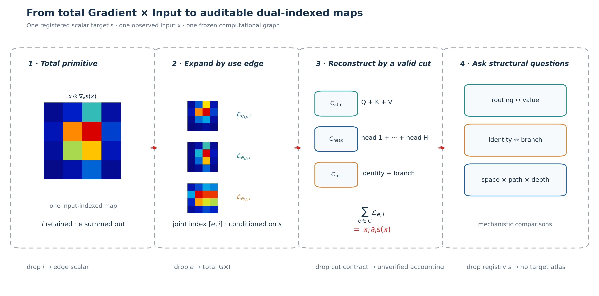

**Figure 1.** The same input produces a prediction through the ordinary forward computation. NNS-ViT associates internal and output targets with learning images in the original input coordinates. Dashed lines link targets to their images.

This work makes three contributions. First, we express NNS learning images through local Jacobians and extend them to the actual operators used by ViTs. Second, we unify scalar units and attention/residual paths in one representation and derive their combination over valid computational cuts. Third, we combine layerwise visualization, cohort-level spatial statistics, and finite replacement to examine depth trends, path differences, and behavioral meaning. The learning image is numerically Gradient × Input for the same target; the extension concerns the common representation of internal objects and their structural relationships.

We next review related work, explain learning images through coordinate initialization and layerwise generation, and derive their ViT decompositions. The experiments examine representation correctness, changes across layers and modules, visual comparisons with other methods, and finite interventions.

## 2. Related Work

### 2.1 Neuron and feature visualization

Neuron visualization examines internal responses through input patterns or observed samples. NNS organizes a neuron's computation as an input-coordinate learning image and represents convolutional channels through activation-weighted aggregation (Dou et al., 2023). This organization lets internal objects with different native spatial structures share one image representation. We apply it to token-channel units, channel aggregates, and ViT paths while preserving their respective scalar definitions.

### 2.2 Gradient attribution and Transformer visualization

Gradient × Input represents the input-weighted gradient at the observed point. Integrated Gradients averages gradients along a reference-to-input path (Sundararajan et al., 2017), and conductance further describes how output attribution passes through hidden units (Dhamdhere et al., 2018). We use the true current-point Jacobian. Grad-CAM forms class-related localization from gradient-weighted feature maps (Selvaraju et al., 2017). Attention rollout combines attention flow across layers (Abnar and Zuidema, 2020), while Transformer relevance methods use specific propagation rules (Chefer et al., 2021; Achtibat et al., 2024). Their targets differ, so our same-input experiments treat them as complementary views.

### 2.3 Internal intervention and explanation evaluation

Activation replacement measures finite output changes after substituting internal responses. Activation-space Taylor approximates this change by the inner product of the clean gradient and replacement displacement; AtP* analyzes errors associated with attention saturation and cancellation (Kramár et al., 2024). Local input dependence and finite replacement answer different questions. We therefore examine whole-component ranking separately from region selection under a fixed spatial budget.

## 3. Method

### 3.1 Learning-image initialization and generation

A neuron produces a scalar value, whereas its learning image retains the input coordinates on which that scalar depends. Figure 2 illustrates this correspondence in a four-coordinate network; Figure 3 splits the input into coordinate images, and Figure 4 combines them using local derivatives.

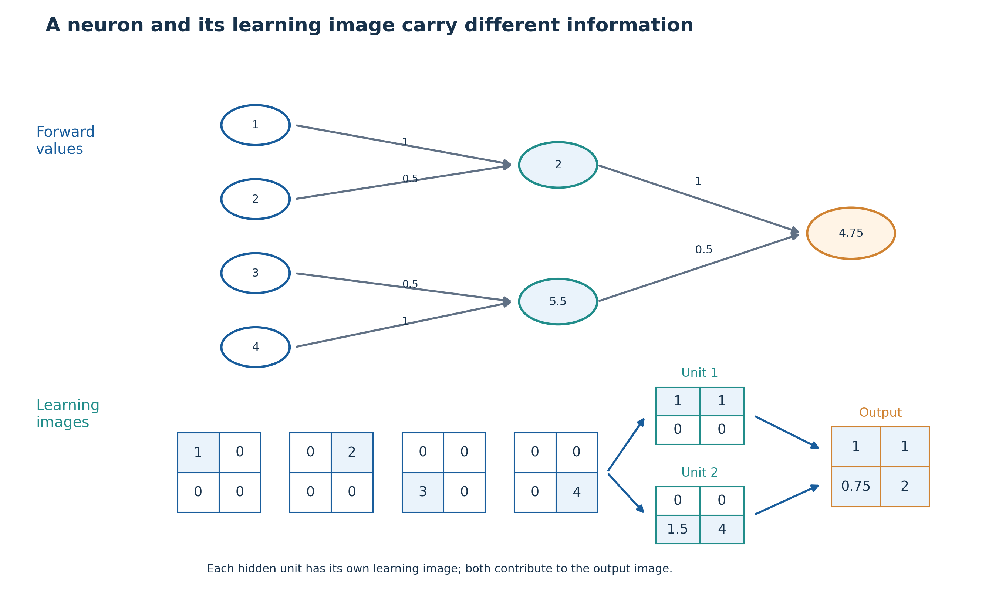

**Figure 2.** A four-coordinate linear example. The upper diagram shows neuron values; the lower matrices preserve each input coordinate through the same computation. Values follow directly from the displayed weights.

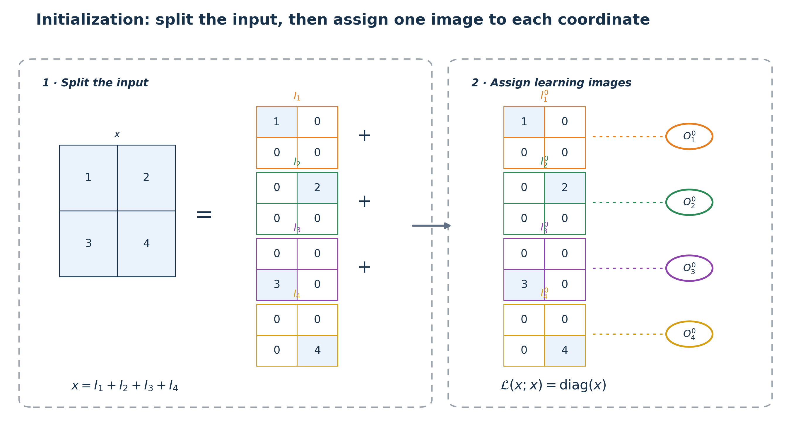

**Figure 3.** Input values initialize a diagonal learning-image matrix. Each split coordinate retains its location; RGB channels follow the same initialization independently.

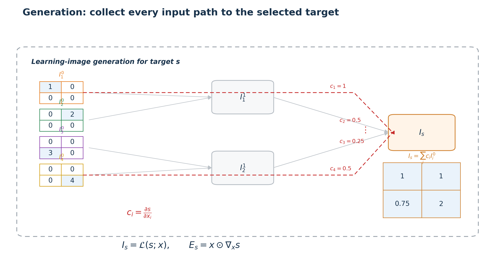

**Figure 4.** Local derivatives weight the incoming learning images. Layerwise propagation equals input times target gradient. The figure shows the complete numerical operation for the defined linear example.

Let the image input $x\in\mathbb R^d$ and scalar gradient $\nabla_xs\in\mathbb R^d$ be column vectors. For $u(x)\in\mathbb R^m$, the learning-image matrix is $\mathcal L(u;x)\in\mathbb R^{m\times d}$. Initialization and propagation are

$$
\mathcal L(x;x)=\operatorname{diag}(x),\qquad
\mathcal L(v;x)=\sum_aJ_{f,u_a}(x)\mathcal L(u_a;x),\quad v=f(u_1,\ldots,u_r).
$$

**Proposition 1.** If all local Jacobians are evaluated at the same current forward state, then

$$
\mathcal L(u;x)=J_{u,x}(x)\operatorname{diag}(x),\qquad
\mathcal L(s;x)=\nabla_xs(x)^\top\operatorname{diag}(x),\qquad
E_s(x)=\mathcal L(s;x)^\top=\operatorname{diag}(x)\nabla_xs(x).
$$

**Proof.** At the input, $J_{x,x}=I$. In topological order, substitute each predecessor's expression into the propagation rule and apply the multi-input chain rule. Transposing the scalar node's learning-image row gives the column-vector Endpoint. For linear, convolutional, and current-ReLU-gate operations, this recovers the original NNS coefficients. MaxPool uses the current forward winner. At ReLU zero and MaxPool ties, we use the framework's fixed derivative convention; smooth regions use ordinary derivatives.

Endpoint describes the target's local first-order dependence on coordinate scaling: changing $x_i$ to $(1+\epsilon)x_i$ produces first-order response $\epsilon E_{s,i}$. In general,

$$
\sum_iE_{s,i}=x^\top\nabla_xs(x)\ne s(x).
$$

Euler's theorem gives equality for differentiable degree-one homogeneous functions. A general ViT containing biases, fixed tokens, positional embeddings, LayerNorm, softmax, and GELU does not satisfy this condition. Endpoint reconstructs local input-Jacobian decomposition rather than all sources of the target or a complete function-value decomposition. The CLS token, positional embeddings, and patch/LN/QKV/MLP/classifier biases have no separate image-coordinate terms, but they change the current function and Jacobian.

If $x=(r-\mu)/\sigma$, then

$$
x_i\frac{\partial s}{\partial x_i}=(r_i-\mu_i)\frac{\partial s}{\partial r_i}.
$$

Endpoint therefore requires no externally selected intervention reference, while depending on the model's input coordinates and normalization origin.

### 3.2 From input patches to internal scalars

Patch embedding maps a local image block to a token vector. Figure 5 shows that linear projection changes response dimensions while the learning image remains on the input-pixel grid.

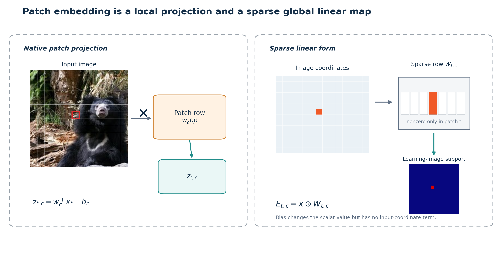

**Figure 5.** Patch embedding is a local linear map. A token-channel learning image retains the original input grid; the illustrated support is one patch. Biases have no independent image-coordinate term.

We distinguish native token-channel units, aggregate responses, structural paths, and output targets (Figure 8). For patch activations in channel $c$, define

$$
s_{\mathrm{energy}}=\frac12\sum_{t=1}^{196}h_{t,c}^2,\qquad
\nabla_xs_{\mathrm{energy}}=\sum_th_{t,c}\nabla_xh_{t,c},\qquad
E_{\mathrm{energy}}=\sum_th_{t,c}E_{h_{t,c}}.
$$

This is the Jacobian form of original NNS activation-weighted filter aggregation; energy is an aggregate scalar rather than one neuron. Targets also include patch sums, internal head coordinates, final CLS channels, ground-truth logits, and frozen clean-top1 logits. Equal channel indices across models do not imply semantic correspondence.

### 3.3 Attention and residual path decomposition

Figure 6 separates content transmission from weight changes, and Figure 7 relates residual identity and branch paths.

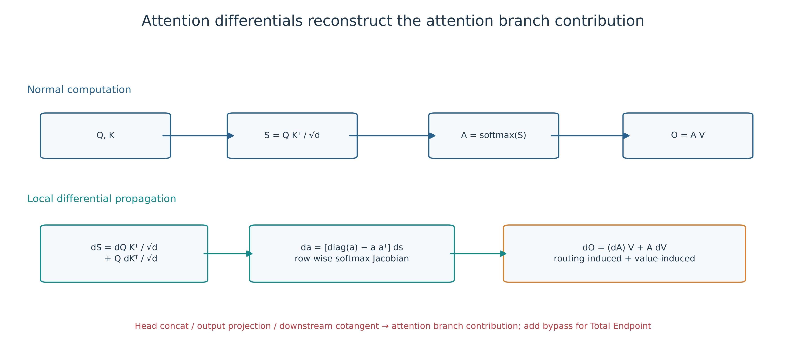

**Figure 6.** Q/K changes alter routing through attention weights; V changes propagate through the current weights. The two differential paths sum to the full attention differential, with output projection included in the downstream cotangent.

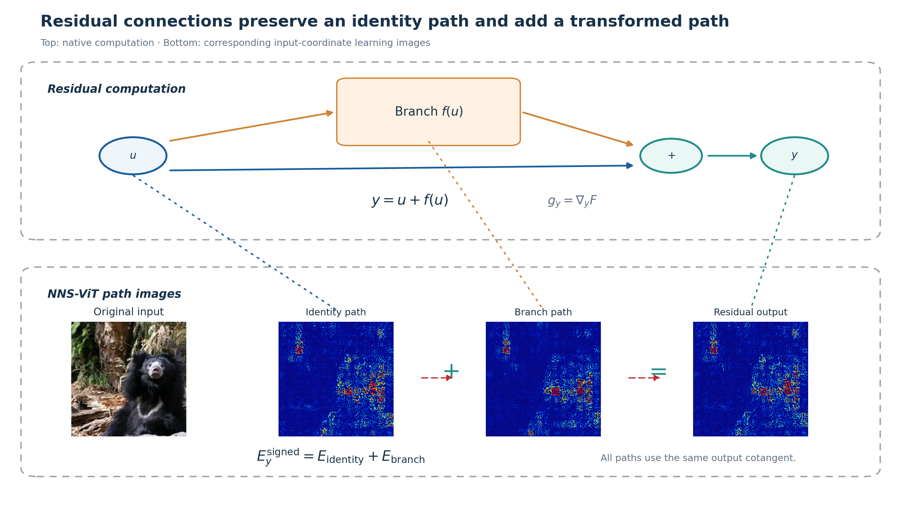

**Figure 7.** The residual has two distinct computational edges. Below are their learning images for the same sloth-bear input and class target. Additivity holds for signed maps; blue positive views show spatial structure.

For each head, $Q=XW_Q+b_Q$, $K=XW_K+b_K$, $V=XW_V+b_V$, and

$$
A=\operatorname{softmax}(QK^\top/\sqrt{d_h}),\quad O_h=AV,\quad
\mathrm dO_h=(\mathrm dA)V+A\mathrm dV.
$$

The first term separates into Q and K input-differential paths, giving

$$
E^{\mathrm{attn}}=E^Q+E^K+E^V=E^{\mathrm{routing}}+E^{\mathrm{value}}.
$$

The head edges precede concatenation and output projection: $O=\operatorname{concat}_h(O_h)W_O+b_O$. Their downstream cotangents include $W_O$ and all subsequent derivatives to the target; the bias has no input-differential term. Q/K/V paths share upstream inputs and can overlap in input space. Path-norm ratios describe local scales, not mutually exclusive causal percentages.

For a residual $y=u+f(u)$, let $g_y=\nabla_yF$. Its two terms are

$$
E^{\mathrm{id}}=\operatorname{diag}(x)J_{u,x}^\top g_y,\qquad
E^{\mathrm{branch}}=\operatorname{diag}(x)J_{u,x}^\top J_{f,u}^\top g_y.
$$

The identity path uses $g_y$ at the residual output. Using $\nabla_uF$, which already includes the branch, would double-count paths. Their sum reconstructs Endpoint without implying a function-value decomposition $F=F_{\mathrm{id}}+F_{\mathrm{branch}}$.

### 3.4 Combination over a complete computational cut

For cut edges $\{z_k\}$ and target $F$, define

$$
E^C_{k,i}=x_i\left\langle g_{z_k},\frac{\partial z_k}{\partial x_i}\right\rangle.
$$

**Proposition 2.** If each relevant input-to-target differential path crosses the cut exactly once, all components use the same forward state, cotangents are attached to the correct edges, and no paths are omitted or duplicated, then $\sum_kE^C_{k,i}=x_i\partial F/\partial x_i$.

**Proof.** Expand the chain rule into Jacobian products over input-to-target paths. A valid cut partitions these paths without omission or duplication. Each group factors into its upstream Jacobian to $z_k$ and the downstream cotangent at that edge. Summing all groups and multiplying by $x_i$ gives the result. A cut internal to one branch reconstructs that branch; reconstruction of a full residual or target must also include bypass paths.

### 3.5 Mass, cancellation, and the Value-only approximation

In the original normalized-input RGB tensor coordinates, define $m(E)=\sum_i|E_i|$ and $a(E)=\sum_iE_i$. Within-map and between-path cancellation are

$$
C^{\mathrm{map}}=1-\frac{|\sum_iE_i|}{\sum_i|E_i|},\qquad
C^{\mathrm{path}}=1-\frac{\|E^{(1)}+E^{(2)}\|_1}{\|E^{(1)}\|_1+\|E^{(2)}\|_1}.
$$

Routing scale is $\|E^{\mathrm{routing}}\|_1/(\|E^{\mathrm{routing}}\|_1+\|E^{\mathrm{value}}\|_1)$; identity scale is defined analogously. The Value-only approximation retains $A\mathrm dV$ and omits $(\mathrm dA)V$. Endpoint and JVP relative errors use the L2 norm of the complete map or complete directional response, respectively. An error near 0.95 indicates a discrepancy on the scale of the full response.

Statistics use complete signed RGB tensors; zero denominators or norms yield NA. The blue display convention is described in the experimental settings.

### 3.6 Finite replacement and spatial region selection

The finite component effect is $e_k=F(x)-F(x;z_k\leftarrow z_k^{\mathrm{ref}})$. The primary statistic compares $m(E_k)$ and $|e_k|$ with within-image Spearman correlation. The Taylor quantity is $p_k=\langle\nabla_{z_k}F,z_k(x)-z_k^{\mathrm{ref}}\rangle$.

The spatial task fixes three heads at block 5, divides the input into $4\times4$ regions, and replaces 1, 2, or 4 regions. Only the selected head edge is replaced by the activation produced by that perturbed input; other heads and the identity remain clean. Each curve integrates absolute isolated effect over 0–25% area using trapezoids and divides by 0.25, then averages the three heads within each image. The random baseline averages 20 signed-effect curves before taking absolute values and integrating. Endpoint, total G×I, raw gradient, regional Taylor, and random share the region pool and area budgets.

## 4. Experimental Setup

### 4.1 Models and images

We study ImageNet classification models ViT-B/16 and DeiT-S/16. They share 400 evaluation images, with separate sets of 64 discovery and 64 calibration images. Inputs are resized to short side 248 and center-cropped to 224 using each model's normalization; dropout and drop path are disabled. Table 1 summarizes the models.

**Table 1. Model settings**

| Model / setting | ViT-B/16 | DeiT-S/16 |
| --- | --- | --- |
| Blocks / heads / hidden dimension | 12 / 12 / 768 | 12 / 6 / 384 |
| Registered scalar targets/image | 457 | 385 |
| Evaluation images | 400 | 400 (same IDs) |
| Resize / crop | 248 / 224 | 248 / 224 |
| Normalization mean | [0.5, 0.5, 0.5] | [0.485, 0.456, 0.406] |
| Normalization std | [0.5, 0.5, 0.5] | [0.229, 0.224, 0.225] |

The stratified unit study uses a separate set of 100 shared images. Each block selects CLS, 15 spatially stratified patch tokens, and 32 predetermined channels. This gives 6,144 post-block scalars per model-image and 1,228,800 records. Original post-block token-channel coverage is 0.01058%/0.02115% in ViT-B/16 and DeiT-S/16; the stratified study covers 0.338%/0.677%. These fractions define the scope of unit sampling.

### 4.2 Visualization settings

Concept and layerwise figures use a sloth-bear image with a recognizable subject; method comparisons also include a mantis and a little blue heron. Images are selected for presentation readability, while population conclusions retain the complete cohorts. To relate learning images to forward features, each layer selects the channel with highest spatial variance across patch activations and uses its energy as the scalar target. Figures report the channel index and actual 14×14 forward feature map; selected channels may differ across layers.

Main learning images use a deep-blue, cyan, yellow and red positive view. With $P=\max(\sum_cE_c,0)$, displayed values are $\sqrt{\min(P/q_{.99},1)}$, where $q_{.99}$ is computed over positive pixels. This transform improves visibility of weak detail while preserving pixel positions and is excluded from statistics. Figure 22 pairs it with signed and absolute views. Comparisons separately show a patch-max and bilinear-interpolation display variant to distinguish native fine detail from a smoothed regional view.

### 4.3 Statistics and numerical validation

Population inference aggregates within images and treats images as statistical units, with 10,000 bootstrap replicates. The 0.10 component-correlation and 0.05 regional-gain values are point-estimate thresholds; sign tests examine direction relative to zero, with the original 28-test Holm correction and CI-width limits of 0.30/0.50. Unit-depth statistics use five-test families per model. Subsequent residual spatial-TV analysis is labeled post-hoc and corrected separately.

Discrete numerical checks are reported in tables rather than sparse error plots. Table 2 summarizes numerical agreement in five original-NNS-compatible network families and structural checks. Original float32 finite-difference failures and their float64 reviews remain in the supplement.

**Table 2. Numerical agreement and structural checks**

| Compatible network | Max relative L2: float64 | Max relative L2: float32 | Comparisons |
| --- | --- | --- | --- |
| fcn | 4.371e-16 | 1.964e-07 | 1,000 |
| cnn | 4.289e-16 | 2.189e-07 | 1,000 |
| cnn_maxpool | 4.769e-16 | 2.427e-07 | 1,000 |
| residual_mlp | 2.686e-16 | 2.155e-07 | 1,000 |
| residual_cnn | 2.923e-16 | 1.692e-07 | 1,000 |

| Structural / directional check | Count | Result |
| --- | --- | --- |
| Positive closures | 76,800 | All pass |
| Omission/duplication controls | 28,800 | All rejected |
| Analytic JVP | 6,144 | All pass |
| Operator directions | 88 | All pass |
| Atlas float32 finite differences | 57,600 | 36 outside tolerance |
| Same-coordinate float64 review | 36 | All pass |

## 5. Results and Analysis

### 5.1 Learning images and forward features across layers

Figures 8–11 examine internal responses for one input. A forward feature map gives channel values on the token grid; a learning image describes the corresponding scalar's local dependence on input pixels. The paired views therefore complement each other. Early learning images retain local texture, and subsequent layers produce different distributions and details. Background responses and isolated hotspots also occur, showing that high resolution alone does not ensure a complete object contour.

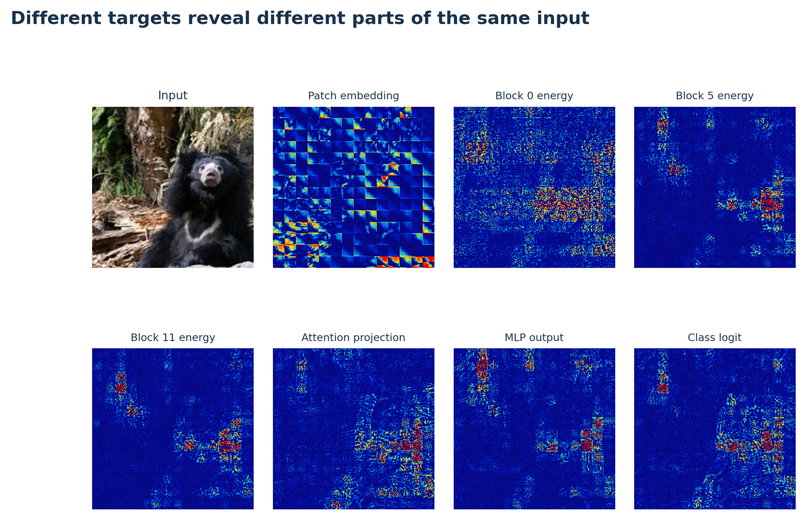

**Figure 8.** Different internal and class targets for one image. Energy targets use the channel of highest forward spatial variance and are distinct from individual token-channel and final class targets.

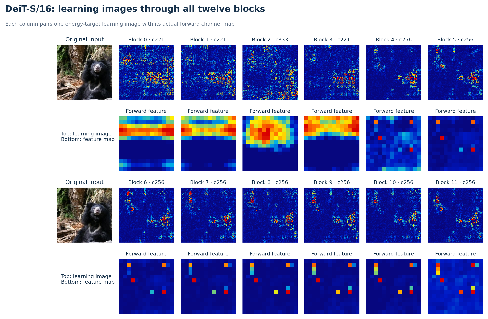

**Figure 9.** Learning images and actual forward features across all 12 blocks for the same sloth-bear input. Each block selects a channel by forward spatial variance. The upper row shows its energy-target input map, and the lower row the positive native 14×14 activation. Panels are independently scaled.

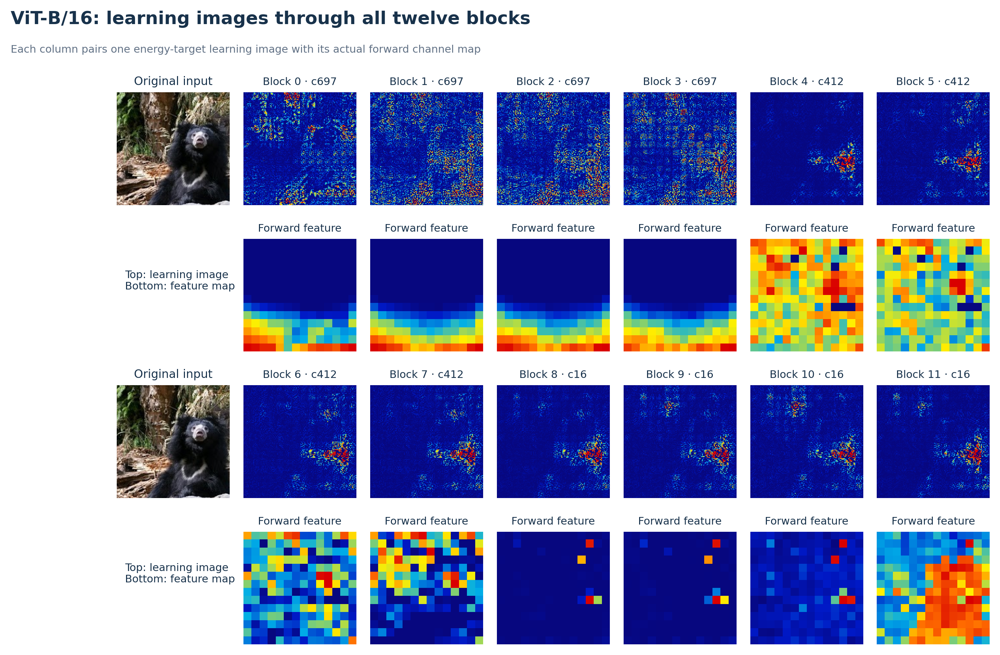

**Figure 10.** Learning images and actual forward features across all 12 blocks for the same sloth-bear input. Each block selects a channel by forward spatial variance. The upper row shows its energy-target input map, and the lower row the positive native 14×14 activation. Panels are independently scaled.

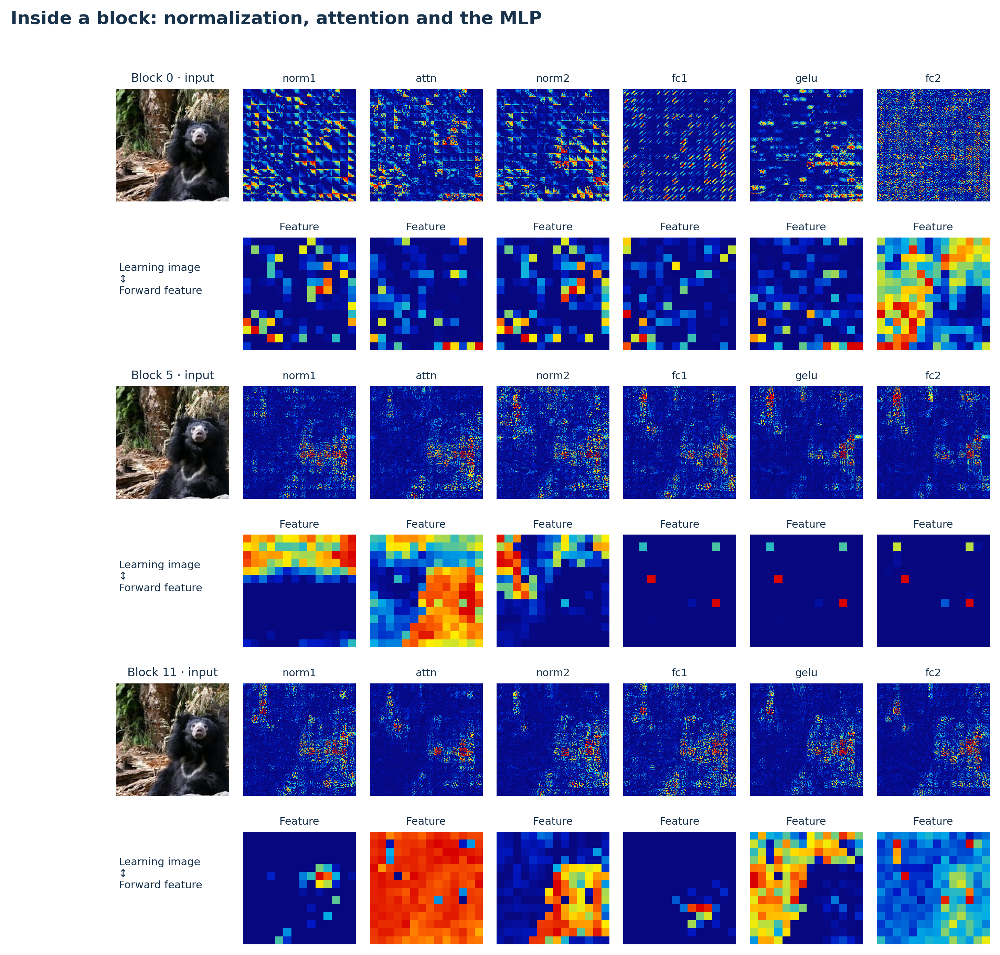

**Figure 11.** Learning images and actual forward activations inside DeiT-S blocks 0, 5 and 11. Each module independently selects a high-spatial-variance channel and defines an energy target, covering LayerNorm, attention projection and MLP fc1/GELU/fc2.

The sampled-unit statistics characterize this change further (Figure 12). Late-minus-early entropy increases by 0.2201/0.2250 in ViT-B/16 and DeiT-S/16, own-token locality decreases by 0.3558/0.3424, and normalized distance increases by 0.1312/0.1219. All contrasts have the same direction in 100/100 images. Early/middle/late refer to blocks 0–3/4–7/8–11; sampled units depend on broader and more distant input regions.

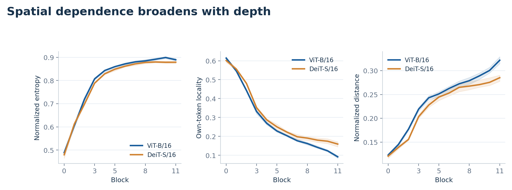

**Figure 12.** Image-level depth trajectories from the full cohorts, with 95% bootstrap intervals. Spatial analyses use 100 images per model and attention/residual analyses 400; inference follows the original analysis.

CLS-minus-patch entropy narrows from 0.4752/0.4712 at block 0 to 0.0086/0.0238 at block 11. Net/absolute mass falls from 0.00872/0.00712 to 0.00144/0.00132. Spatial broadening and substantial signed cancellation can coexist, so absolute mass measures the total magnitude of local terms rather than the net response.

### 5.2 Attention heads and routing/value paths

Figure 13 shows all DeiT-S heads at three depths, and Figure 14 compares class maps for three inputs across both models. Multiple spatially overlapping head paths can connect the input to the same class target. Figure 15 separates attention into Q, K, routing and value, allowing changes in allocation weights to be examined separately from content transmission.

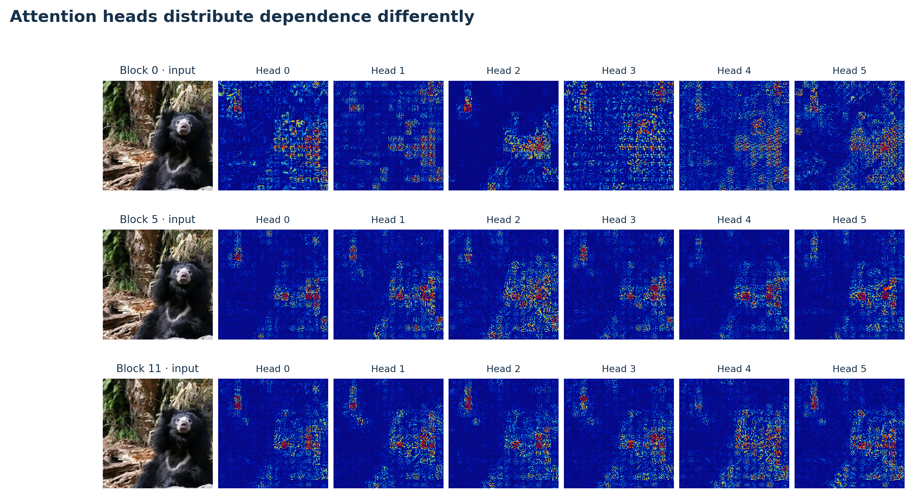

**Figure 13.** All six DeiT-S heads at blocks 0, 5 and 11, conditioned on the same ground-truth logit. Each row retains the original image, and no heads are selected by visual appearance.

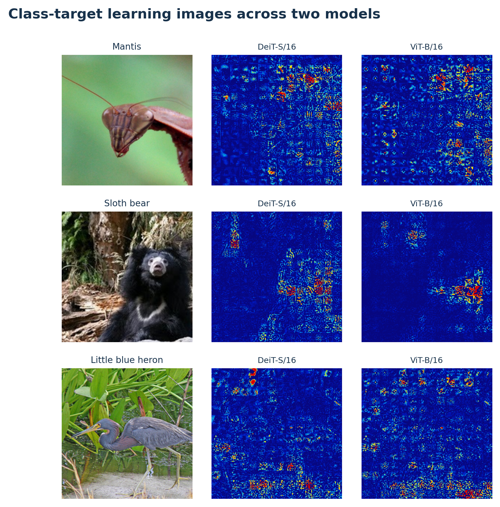

**Figure 14.** Three presentation-selected images with recognizable subjects and same-class Endpoints from both models. Color intensities are not used for cross-model magnitude comparisons.

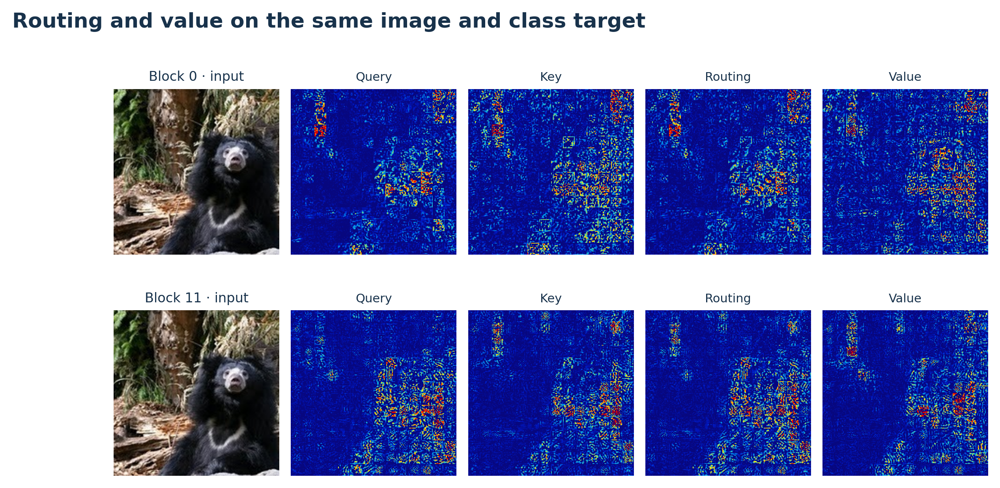

**Figure 15.** Q, K, routing and value paths at early and late blocks for the same sloth-bear image. Blue displays retain positive detail; signed closure and absolute masses use complete original arrays.

In the target-conditioned analysis of 400 images, routing scale increases from 0.3092/0.2041 at block 0 to 0.5154/0.4808 at block 11; Value-only Endpoint error increases from 0.4407/0.2774 to 0.8022/0.8488 (Figure 16). Corresponding JVP discrepancies reach 0.9516/0.9636, with full-response norms 14.9711/1.5155 and absolute discrepancies 13.8064/1.4228. Deep-layer discrepancies are on the scale of the full response and are not omitted-contribution percentages.

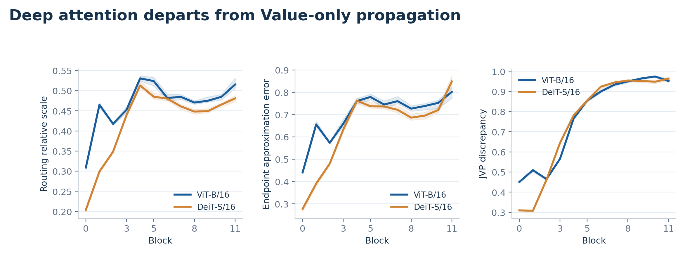

**Figure 16.** Image-level depth trajectories from the full cohorts, with 95% bootstrap intervals. Spatial analyses use 100 images per model and attention/residual analyses 400; inference follows the original analysis.

After controlling for activation and downstream-cotangent norms, partial-rank correlations between mean-query saturation and routing scale remain −0.1442/−0.3257. Sharper attention is not a direct proxy for stronger routing dependence. CLS-query results are weaker; complete sensitivity analyses are in the supplement.

### 5.3 Distinct roles of residual paths

Figure 17 shows attention and MLP residuals for the same input and target. Both combine identity and branch paths, but their identity paths originate at different input edges and exhibit different depth trends. Late-minus-early identity scales are −0.1242/−0.0449 for attention residuals and +0.1798/+0.1780 for MLP residuals (Figure 18).

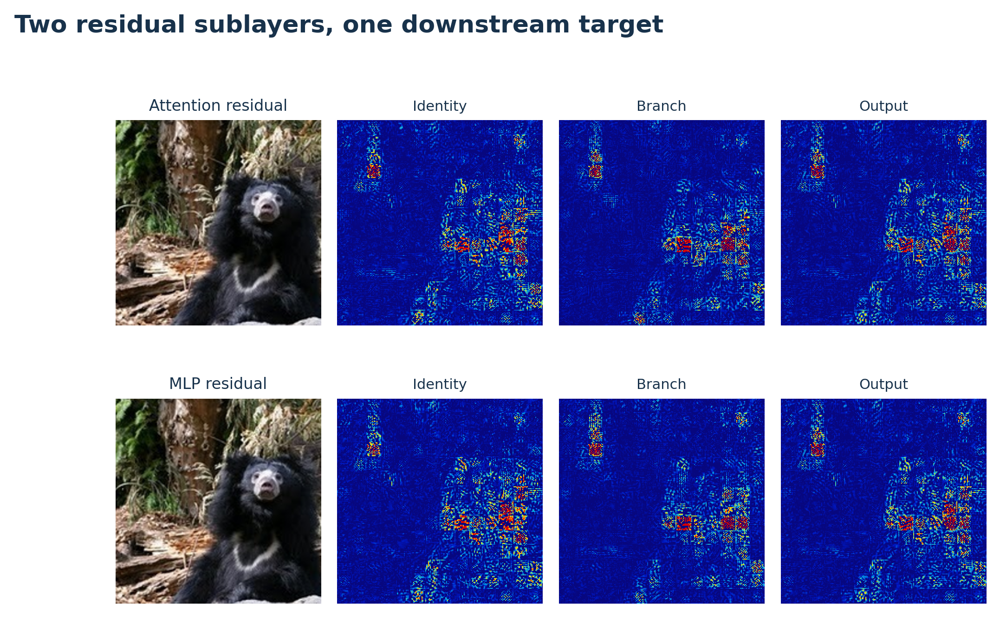

**Figure 17.** Attention and MLP residual paths in block 5 for the same class target. The identity paths refer to different residual input edges. Positive displays are not additive; the complete signed maps satisfy closure.

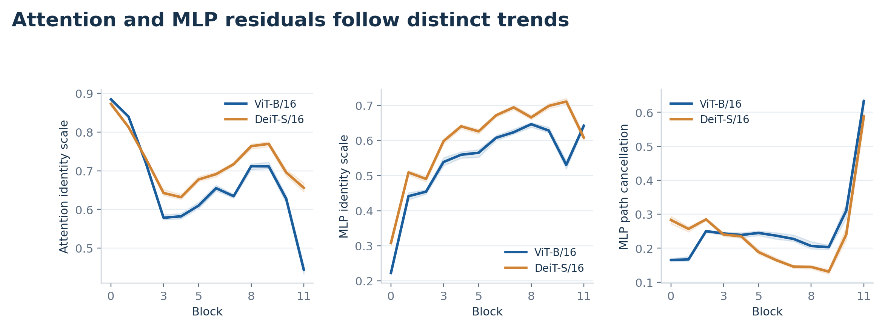

**Figure 18.** Image-level depth trajectories from the full cohorts, with 95% bootstrap intervals. Spatial analyses use 100 images per model and attention/residual analyses 400; inference follows the original analysis.

Subsequent full-cohort spatial analysis gives late-minus-early output–identity patch-TV changes of +0.0520/+0.0282 for attention and −0.0187/−0.0462 for MLP; all four survive a separate Holm correction. These results describe different local transmission patterns in two trained models. Token-channel depth analysis and class-path analysis use different targets and provide complementary model-level observations.

### 5.4 Comparison with other visual explanations

Figures 19–20 compare same-input Endpoint, Grad-CAM, attention rollout and raw attention. Endpoint and Grad-CAM use the GT logit. Grad-CAM is evaluated at the final block's norm1 output, avoiding degenerate terminal patch gradients caused by CLS readout. Rollout uses head averaging, identity residuals, row normalization and successive matrix multiplication; raw attention uses the final block's mean CLS-to-patch weights.

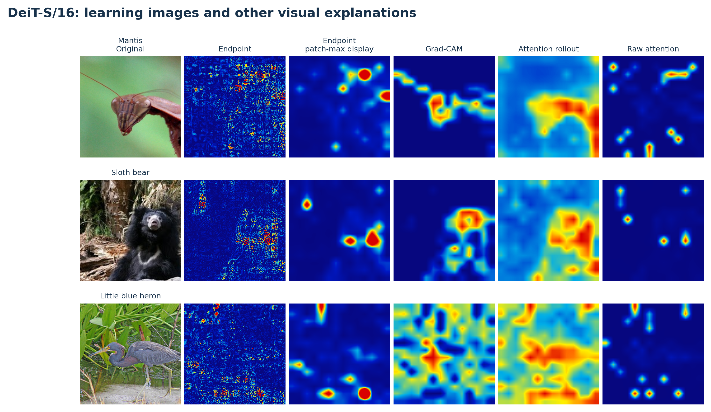

**Figure 19.** Actual same-input Endpoint, its patch-max display variant, Grad-CAM, attention rollout and raw attention. Endpoint/Grad-CAM use the same GT logit; attention methods are class-agnostic. A common blue palette and independent normalization compare spatial form and granularity, not quantitative superiority.

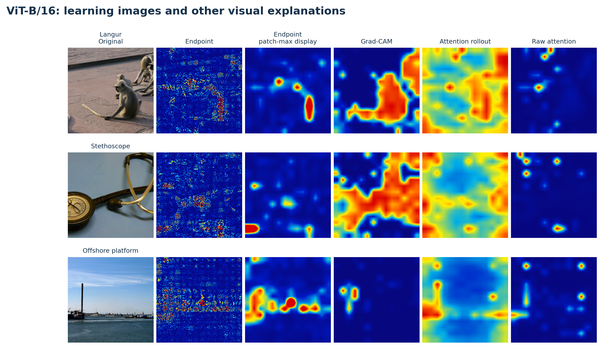

**Figure 20.** Actual same-input Endpoint, its patch-max display variant, Grad-CAM, attention rollout and raw attention. Endpoint/Grad-CAM use the same GT logit; attention methods are class-agnostic. A common blue palette and independent normalization compare spatial form and granularity, not quantitative superiority. Figure 20 examples were selected by the presealed Endpoint/input-detail readability rule before comparison methods were computed.

Endpoint retains pixel-scale local terms, whereas Grad-CAM and attention methods provide coarser regional distributions. The patch-max interpolation variant shows that aggregation and interpolation alone can substantially change the appearance of a learning image without changing its base definition. Methods sometimes emphasize different regions, reflecting differences in their targets and propagation rules. This comparison illustrates granularity and explanatory objects; ranking methods requires quantitative evaluation matched to the intended task.

### 5.5 From component association to spatial intervention

In component replacement, 11 of 12 model–reference–component-family combinations satisfy the original composite criteria. Table 3 directly reports estimates, intervals and threshold relationships. ViT-B normalized-zero routing/value has estimate 0.09956521739130435 and the corresponding DeiT-S estimate is 0.1065; both intervals cross 0.10. Satisfying a family criterion and establishing a population effect above 0.10 are therefore different conclusions. The original all-family criterion criterion is unmet.

**Table 3. Component association estimates and intervals**

| Model | Reference | Family | Median rho | 95% CI | Holm p | Composite criterion | CI lower > 0.10 |
| --- | --- | --- | --- | --- | --- | --- | --- |
| ViT-B/16 | normalized-zero | heads | 0.2909 | [0.2813, 0.2982] | 2.17e-119 | Met | yes |
| ViT-B/16 | normalized-zero | routing/value | 0.0996 | [0.0748, 0.1226] | 3.00e-14 | Unmet | no |
| ViT-B/16 | normalized-zero | residual/branches | 0.1774 | [0.1548, 0.1952] | 2.56e-46 | Met | yes |
| ViT-B/16 | blur | heads | 0.3063 | [0.2957, 0.3181] | 2.17e-119 | Met | yes |
| ViT-B/16 | blur | routing/value | 0.1565 | [0.1322, 0.1774] | 9.96e-29 | Met | yes |
| ViT-B/16 | blur | residual/branches | 0.2091 | [0.1817, 0.2374] | 1.46e-41 | Met | yes |
| DeiT-S/16 | normalized-zero | heads | 0.1910 | [0.1769, 0.2052] | 1.88e-76 | Met | yes |
| DeiT-S/16 | normalized-zero | routing/value | 0.1065 | [0.0817, 0.1291] | 2.11e-10 | Met | no |
| DeiT-S/16 | normalized-zero | residual/branches | 0.1352 | [0.1148, 0.1643] | 4.35e-19 | Met | yes |
| DeiT-S/16 | blur | heads | 0.1817 | [0.1688, 0.1951] | 3.82e-72 | Met | yes |
| DeiT-S/16 | blur | routing/value | 0.1600 | [0.1278, 0.1822] | 9.90e-31 | Met | yes |
| DeiT-S/16 | blur | residual/branches | 0.2287 | [0.2035, 0.2504] | 3.70e-54 | Met | yes |

In the supplementary within-block head comparison, Taylor achieves higher Spearman and Capture and lower Regret (Table 4). Across-layer residual identity has Endpoint-minus-Taylor Spearman differences of 0.0865–0.4209 but a zero median Capture@1 difference, indicating task- and metric-dependent incremental value.

**Table 4. Within-block head ranking: E=Endpoint, T=Taylor**

| Model | Reference | E rho | T rho | E Capture@1 | T Capture@1 | E Capture@3 | T Capture@3 | E Regret@1 | T Regret@1 |
| --- | --- | --- | --- | --- | --- | --- | --- | --- | --- |
| ViT-B/16 | normalized-zero | 0.2815 | 0.6742 | 0.5174 | 0.8038 | 0.6149 | 0.8567 | 0.1701 | 0.0571 |
| ViT-B/16 | blur | 0.2727 | 0.6856 | 0.5075 | 0.8203 | 0.6185 | 0.8659 | 0.1163 | 0.0346 |
| DeiT-S/16 | normalized-zero | 0.1952 | 0.6095 | 0.5609 | 0.8028 | 0.7122 | 0.8894 | 0.2381 | 0.0860 |
| DeiT-S/16 | blur | 0.1476 | 0.6238 | 0.5506 | 0.8426 | 0.7105 | 0.8970 | 0.1326 | 0.0443 |

The spatial experiment fixes three heads in block 5, a shared 4×4 region pool and a maximum 25% area. Figure 21 and Tables 5–7 report paired differences, absolute AUC and normalized regret. Paired median Endpoint-minus-regional-Taylor differences are −0.023433, −0.023697, −0.029900 and −0.035630. None of the four families meets the +0.05 criterion over every baseline. The candidate oracle maximizes effects only over evaluated sets and is not a global optimum over all regions.

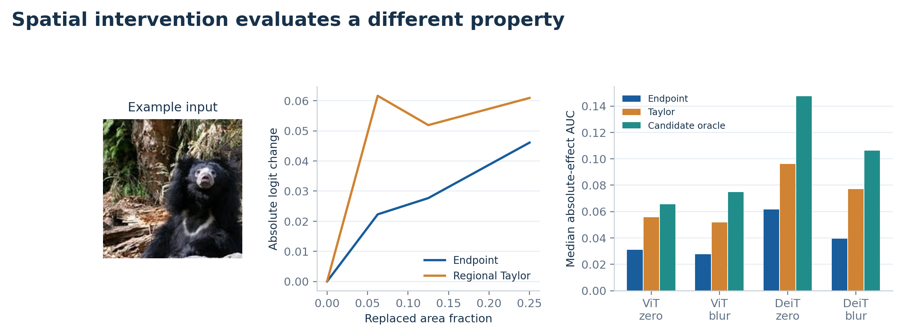

**Figure 21.** Finite region-replacement curves for the example and absolute AUC over complete 400-image families. The candidate oracle is restricted to evaluated region sets; mathematical closure and spatial intervention selection measure different properties.

**Table 5. Paired spatial-intervention differences**

| Model | Reference | vs total G×I | vs gradient | vs Taylor | vs random | Composite criterion |
| --- | --- | --- | --- | --- | --- | --- |
| ViT-B/16 | normalized-zero | -0.0009 | -0.0000 | -0.0234 | 0.0011 | Unmet |
| ViT-B/16 | blur | -0.0010 | -0.0007 | -0.0237 | 0.0042 | Unmet |
| DeiT-S/16 | normalized-zero | -0.0018 | -0.0006 | -0.0299 | 0.0107 | Unmet |
| DeiT-S/16 | blur | 0.0002 | -0.0002 | -0.0356 | 0.0085 | Unmet |

**Table 6. Absolute AUC and output scale**

| Model | Reference | Endpoint AUC | Taylor AUC | Random AUC | Candidate oracle AUC | Clean GT logit |
| --- | --- | --- | --- | --- | --- | --- |
| ViT-B/16 | normalized-zero | 0.0309 | 0.0558 | 0.0294 | 0.0654 | 8.8989 |
| ViT-B/16 | blur | 0.0276 | 0.0518 | 0.0225 | 0.0747 | 8.8989 |
| DeiT-S/16 | normalized-zero | 0.0617 | 0.0961 | 0.0475 | 0.1474 | 8.7974 |
| DeiT-S/16 | blur | 0.0395 | 0.0770 | 0.0296 | 0.1063 | 8.7974 |

**Table 7. Candidate-oracle regret and logit-scale ratios**

| Model | Reference | Endpoint regret | Taylor regret | Random regret | Endpoint AUC/abs(logit) | Taylor AUC/abs(logit) |
| --- | --- | --- | --- | --- | --- | --- |
| ViT-B/16 | normalized-zero | 0.5303 | 0.1442 | 0.5563 | 0.0035 | 0.0062 |
| ViT-B/16 | blur | 0.6366 | 0.2557 | 0.6942 | 0.0031 | 0.0059 |
| DeiT-S/16 | normalized-zero | 0.5646 | 0.3352 | 0.6780 | 0.0072 | 0.0107 |
| DeiT-S/16 | blur | 0.6289 | 0.2705 | 0.7130 | 0.0045 | 0.0089 |

Cross-reference analysis clarifies this distinction. Endpoint uses the clean observed-input map, whereas Taylor explicitly uses replacement displacement. Across 163,200 component pairs, Taylor magnitude and absolute effect change under the original atol=1e-12, rtol=0 criterion. Their distributions and head-rank concordance are reported in supplementary tables. Reference choice changes intervention-related ordering, so local input maps and displacement estimators serve different questions.

## 6. Discussion

Learning images place heterogeneous internal objects on the same input grid. Explicit targets, layers and channels let readers compare forward responses with input dependence and inspect how attention and residual paths combine. The derivations and numerical checks establish correspondence to the defined Jacobian objects; finite replacement further characterizes their behavioral use.

Blue high-intensity displays make distributed texture easier to inspect while showing only the positive signed RGB sum. Figure 22 pairs this view with signed and absolute maps. Positive values indicate the sign of local coordinate-scaling terms rather than prediction support under finite deletion, and large absolute mass can coexist with substantial cancellation.

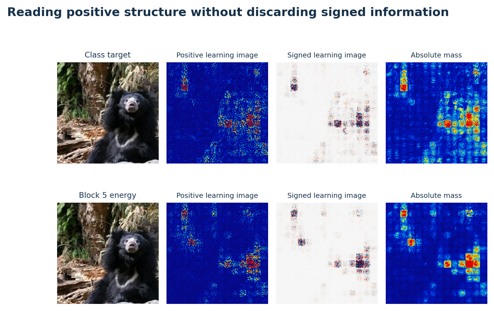

**Figure 22.** Blue positive, signed and RGB absolute-mass views of the same original arrays. The positive view displays spatial detail, signed maps retain direction, and absolute maps preserve magnitude before channel cancellation.

The study cannot yet separate architectural, initialization and training contributions to depth trends. The two models differ in size, head count and training strategy, and random-initialization and same-architecture alternative-checkpoint controls are absent. Path results condition on GT logits; robustness to clean-top1 targets and correct/incorrect subsets remains to be studied. Sampled token-channel and class paths do not form a unit-matched causal chain. Spatial conclusions also depend on the chosen layer, regions and reference. ViT-B Path IG does not meet the common calibration requirement within the fixed 512-point range, so cross-model Endpoint–Path comparisons are not reported.

## 7. Conclusion

We extend NNS learning images to Vision Transformers through a local-Jacobian representation of neurons, channel aggregates and structural paths. Coordinate initialization and layerwise generation preserve input locations, while attention and residual decompositions expose different paths to the same target. Experiments in two models reveal spatial broadening with depth, stronger deep-attention dependence on routing differentials, and distinct changes in attention and MLP residuals. Comparisons with forward features and other visual explanations clarify the representation's granularity and target; finite replacement further characterizes component association and region-selection performance. Training controls and matched-target studies offer a next step toward explaining the origins of these local structural patterns.

## References and Supplementary Material

[References](../references.md); [supplement](supplement.md). Author, affiliation and final archive information remain to be completed: [REPOSITORY AND ARCHIVE REQUIRED].
