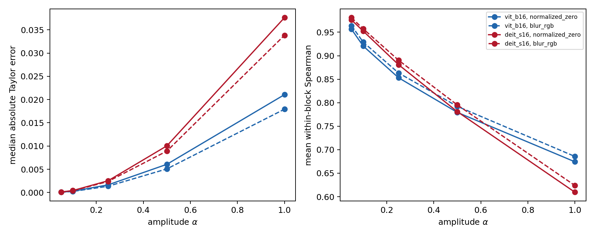
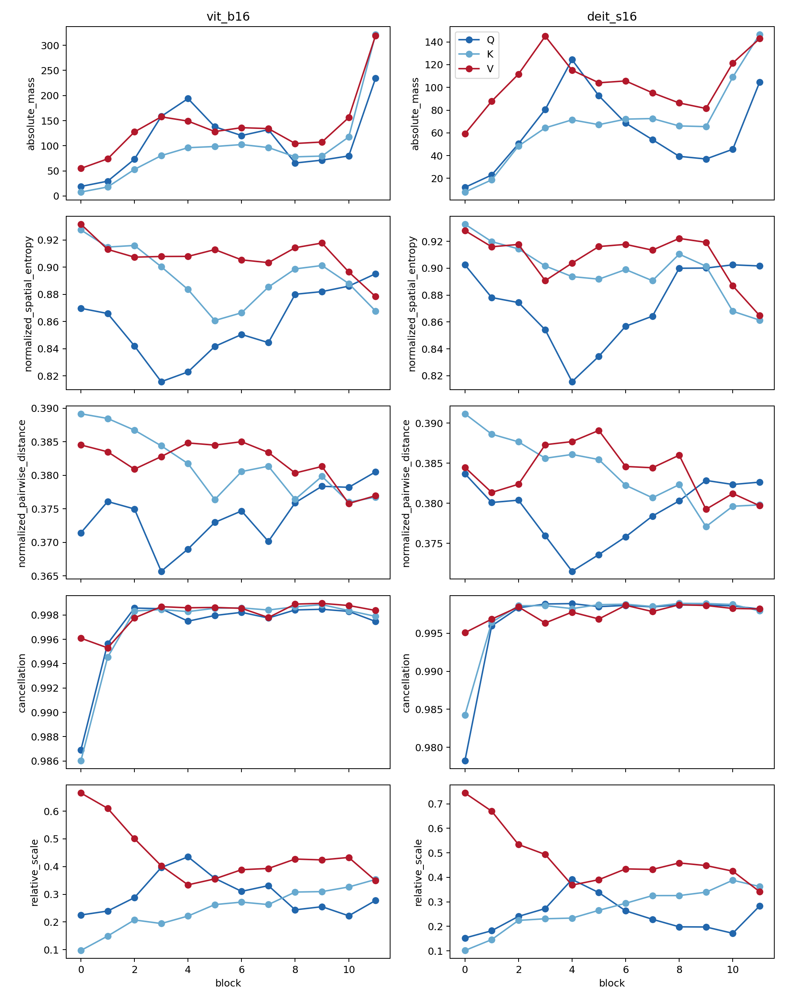
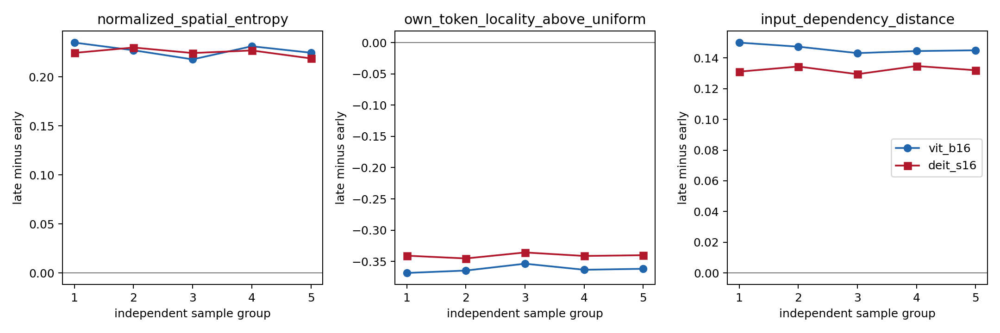

# Revision v3 Step 2: Credibility Experiments

This report completes the multi-amplitude finite intervention, population-level Q/K/V statistics, and five independent channel/token sampling replications. Samples, targets, and estimands were fixed before outcome access; the image is the sole inferential unit.

## 1. Multi-amplitude finite intervention

Each model uses the original ENDPOINT-M1 cohort of 400 images, frozen ground-truth logits, all attention heads in all 12 blocks, and normalized-zero/blur references. The intervention is $z_\alpha=(1-\alpha)z_{\rm clean}+\alpha z_{\rm ref}$, and the first-order prediction is $p_\alpha=\alpha\langle\nabla_zF,z_{\rm clean}-z_{\rm ref}\rangle$. Entries are image-level medians. Spearman correlation is computed across heads within each image and block and then averaged over the 12 blocks.

| Model | Reference | $\alpha$ | $|e_\alpha|$ | $|p_\alpha|$ | Absolute error | Relative error | Spearman |
| --- | --- | ---: | ---: | ---: | ---: | ---: | ---: |
| ViT-B/16 | zero | 0.05 | 0.002922 | 0.002903 | 0.000069 | 0.0272 | 0.9564 |
| ViT-B/16 | zero | 0.10 | 0.005795 | 0.005807 | 0.000266 | 0.0524 | 0.9205 |
| ViT-B/16 | zero | 0.25 | 0.014466 | 0.014517 | 0.001638 | 0.1216 | 0.8531 |
| ViT-B/16 | zero | 0.50 | 0.028453 | 0.029035 | 0.006064 | 0.2231 | 0.7794 |
| ViT-B/16 | zero | 1.00 | 0.056748 | 0.058069 | 0.021058 | 0.3913 | 0.6742 |
| ViT-B/16 | blur | 0.05 | 0.002471 | 0.002479 | 0.000057 | 0.0262 | 0.9639 |
| ViT-B/16 | blur | 0.10 | 0.004912 | 0.004957 | 0.000224 | 0.0514 | 0.9289 |
| ViT-B/16 | blur | 0.25 | 0.012021 | 0.012393 | 0.001341 | 0.1212 | 0.8633 |
| ViT-B/16 | blur | 0.50 | 0.023885 | 0.024786 | 0.005077 | 0.2219 | 0.7922 |
| ViT-B/16 | blur | 1.00 | 0.046413 | 0.049572 | 0.017925 | 0.3883 | 0.6856 |
| DeiT-S/16 | zero | 0.05 | 0.004951 | 0.005035 | 0.000105 | 0.0259 | 0.9762 |
| DeiT-S/16 | zero | 0.10 | 0.010104 | 0.010071 | 0.000415 | 0.0511 | 0.9524 |
| DeiT-S/16 | zero | 0.25 | 0.025327 | 0.025177 | 0.002521 | 0.1227 | 0.8810 |
| DeiT-S/16 | zero | 0.50 | 0.052060 | 0.050354 | 0.010036 | 0.2342 | 0.7810 |
| DeiT-S/16 | zero | 1.00 | 0.105217 | 0.100707 | 0.037632 | 0.4345 | 0.6095 |
| DeiT-S/16 | blur | 0.05 | 0.004384 | 0.004419 | 0.000093 | 0.0241 | 0.9810 |
| DeiT-S/16 | blur | 0.10 | 0.008877 | 0.008838 | 0.000364 | 0.0477 | 0.9571 |
| DeiT-S/16 | blur | 0.25 | 0.021907 | 0.022095 | 0.002371 | 0.1168 | 0.8905 |
| DeiT-S/16 | blur | 0.50 | 0.044622 | 0.044191 | 0.008908 | 0.2244 | 0.7952 |
| DeiT-S/16 | blur | 1.00 | 0.091581 | 0.088381 | 0.033841 | 0.4186 | 0.6238 |

The cohort median absolute error increases monotonically with amplitude in all four model–reference combinations, and all 1,600 image–reference curves are individually monotone. Ranking correlation decreases concurrently. This establishes a local first-order boundary for the prescribed head-output interpolation: predictions are closer to finite effects at small amplitudes, with increasing error at larger amplitudes.

## 2. Population-level Q/K/V statistics

Q-, K-, and V-induced class-target maps are computed for 400 images per model and all 12 blocks. Normalized pairwise distance is the expected distance between two independent draws from the absolute-mass patch distribution divided by $13\sqrt2$; it does not require an arbitrarily selected target patch. The table reports image-level median block-11-minus-block-0 differences and 95% bootstrap intervals. The data file contains every block estimate.

| Model | Path | Absolute mass | Entropy | Pairwise distance | Cancellation | Relative scale |
| --- | --- | ---: | ---: | ---: | ---: | ---: |
| ViT-B/16 | Q | 208.8022 [193.7022, 229.1715] | 0.0268 [0.0217, 0.0314] | 0.0108 [0.0071, 0.0143] | 0.0099 [0.0083, 0.0122] | 0.0427 [0.0220, 0.0549] |
| ViT-B/16 | K | 308.5203 [285.6579, 347.7998] | -0.0586 [-0.0636, -0.0528] | -0.0109 [-0.0150, -0.0073] | 0.0104 [0.0093, 0.0123] | 0.2553 [0.2449, 0.2675] |
| ViT-B/16 | V | 255.5471 [235.9237, 295.1770] | -0.0530 [-0.0591, -0.0471] | -0.0082 [-0.0106, -0.0052] | 0.0018 [0.0015, 0.0023] | -0.3088 [-0.3249, -0.2882] |
| DeiT-S/16 | Q | 91.9272 [86.3993, 98.2857] | -0.0038 [-0.0080, 0.0005] | -0.0021 [-0.0046, 0.0022] | 0.0192 [0.0177, 0.0223] | 0.1292 [0.1169, 0.1376] |
| DeiT-S/16 | K | 140.0030 [128.9647, 148.3989] | -0.0669 [-0.0736, -0.0590] | -0.0100 [-0.0140, -0.0059] | 0.0119 [0.0106, 0.0144] | 0.2581 [0.2507, 0.2649] |
| DeiT-S/16 | V | 73.3232 [63.7414, 84.2214] | -0.0669 [-0.0748, -0.0609] | -0.0054 [-0.0094, -0.0021] | 0.0027 [0.0021, 0.0032] | -0.3915 [-0.4044, -0.3840] |

K and V increase in absolute mass and cancellation and decrease in entropy and pairwise distance in both models. K gains relative scale while V loses relative scale. Q also gains absolute mass, cancellation, and relative scale in both models, but its spatial direction differs: entropy and distance increase in ViT-B, whereas the small DeiT-S decreases have intervals spanning zero. Q, K, and V therefore have distinct population depth trajectories rather than one common expansion or contraction pattern.

## 3. Five independent sampling replications

Each group independently resamples 16 tokens and 32 channels per block on the same 100-image-per-model M3 cohort. The five namespaces were frozen before execution. Entries are image-level median late-minus-early differences with 95% bootstrap intervals.

| Model | Metric | Group 1 | Group 2 | Group 3 | Group 4 | Group 5 |
| --- | --- | ---: | ---: | ---: | ---: | ---: |
| ViT-B/16 | Entropy | 0.2351 [0.2261, 0.2441] | 0.2273 [0.2201, 0.2342] | 0.2179 [0.2137, 0.2244] | 0.2313 [0.2248, 0.2364] | 0.2247 [0.2162, 0.2306] |
| ViT-B/16 | Locality | -0.3685 [-0.3767, -0.3642] | -0.3646 [-0.3715, -0.3569] | -0.3537 [-0.3619, -0.3470] | -0.3634 [-0.3726, -0.3597] | -0.3618 [-0.3687, -0.3535] |
| ViT-B/16 | Distance | 0.1500 [0.1452, 0.1536] | 0.1473 [0.1431, 0.1517] | 0.1432 [0.1382, 0.1486] | 0.1445 [0.1411, 0.1484] | 0.1450 [0.1403, 0.1488] |
| DeiT-S/16 | Entropy | 0.2246 [0.2167, 0.2347] | 0.2301 [0.2233, 0.2387] | 0.2244 [0.2184, 0.2309] | 0.2271 [0.2210, 0.2354] | 0.2189 [0.2138, 0.2283] |
| DeiT-S/16 | Locality | -0.3408 [-0.3476, -0.3333] | -0.3453 [-0.3538, -0.3355] | -0.3357 [-0.3403, -0.3291] | -0.3413 [-0.3507, -0.3353] | -0.3401 [-0.3461, -0.3321] |
| DeiT-S/16 | Distance | 0.1311 [0.1270, 0.1389] | 0.1344 [0.1302, 0.1382] | 0.1294 [0.1255, 0.1344] | 0.1347 [0.1299, 0.1386] | 0.1320 [0.1268, 0.1384] |

All 30 model–group–metric combinations reproduce increasing entropy, decreasing locality, and increasing distance. Across-group standard deviations for late-minus-early are 0.00653, 0.00546, and 0.00270 in ViT-B/16 and 0.00409, 0.00342, and 0.00225 in DeiT-S/16. The depth-broadening result is therefore stable across five independent target samples in both fixed checkpoints.

## 4. Conclusion and evidence entry points

The amplitude sweep establishes a first-order boundary for the prescribed head-output interpolation; population statistics show distinct Q/K/V spatial and scale trajectories; and the five independent samples close the gap left by bootstrap-only sensitivity analysis. The inference scope remains the two fixed ImageNet checkpoints and the frozen cohorts.

[Complete amplitude summary](../evidence/revision_v3_step2/multi_amplitude_summary.csv) · [All-block Q/K/V summary](../evidence/revision_v3_step2/qkv_block_summary.csv) · [Q/K/V depth contrasts](../evidence/revision_v3_step2/qkv_depth_contrasts.csv) · [Complete independent-sampling summary](../evidence/revision_v3_step2/independent_sampling_summary.csv) · [Between-group variation](../evidence/revision_v3_step2/independent_sampling_variation.json) · [Validation report](../evidence/revision_v3_step2/validation_report.json)
