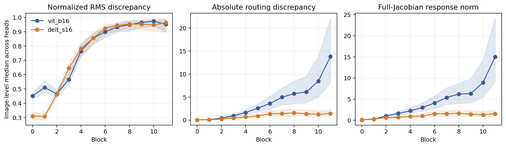
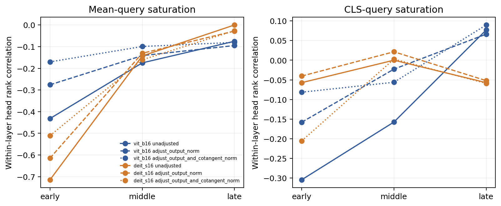
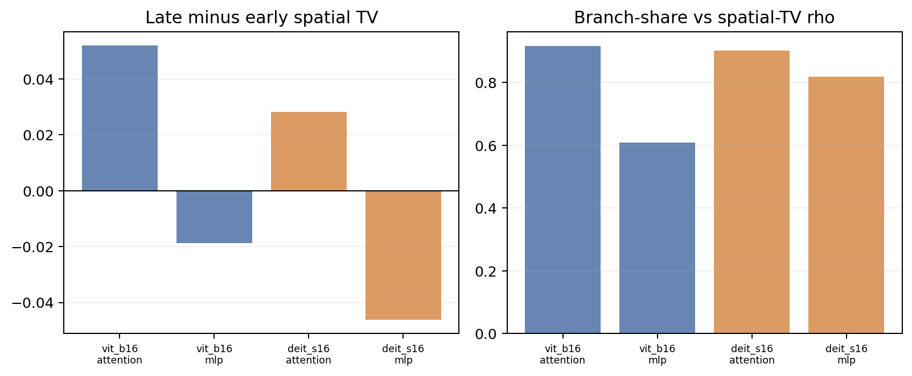
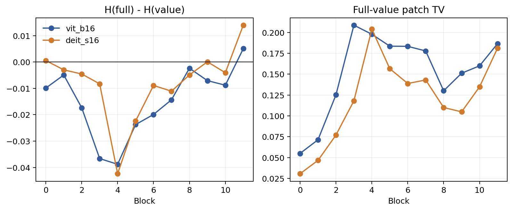

# Supplement: Computational-graph interpretation of NNS and ViT structural paths (revision v2)

[Return to manuscript](manuscript.md). This file contains reproducibility parameters, complete statistics, archived figure navigation, and prospective experiment scope. RQ labels in the current manuscript follow the revision.

## S1. Model and registry details

Models: `vit_base_patch16_224.augreg2_in21k_ft_in1k` and `deit_small_patch16_224.fb_in1k`. Torch 2.2.2+cu121; timm 0.9.16; torchvision 0.17.2+cu121; NumPy 1.26.4; Pillow 10.2.0.

**Table S1. Original scalar registry coverage.**

| Model | Object | Candidate definition | Candidates | Registered/image | Coverage | Strategy | Scalar neuron |
| --- | --- | --- | --- | --- | --- | --- | --- |
| vit_b16 | post-block token-channel | 12*197*D | 1,815,552 | 192 | 0.01058% | 12 blocks x 4 tokens x 4 channels | yes |
| vit_b16 | post-block patch sum/energy | 2*12*D | 18,432 | 96 | 0.52083% | 12 blocks x 4 channels x 2 aggregates | no |
| vit_b16 | attention-head coordinate | 12*H*197*64 | 1,815,552 | 144 | 0.00793% | all heads; CLS token; within-head channel 0 | yes |
| vit_b16 | module patch aggregate | 3*(4D+2*4D) | 27,648 | 18 | 0.06510% | blocks 0/5/11; six modules; channel 0 | no |
| vit_b16 | patch embedding aggregate | D | 768 | 4 | 0.52083% | four fixed channels; sum over patches | no |
| vit_b16 | final CLS coordinate | D | 768 | 1 | 0.13021% | channel 0 | yes |
| vit_b16 | ground-truth logit | 1000 | 1,000 | 1 | 0.10000% | frozen image label | output |
| vit_b16 | clean-top1 logit | 1000 | 1,000 | 1 | 0.10000% | frozen clean prediction | output |
| deit_s16 | post-block token-channel | 12*197*D | 907,776 | 192 | 0.02115% | 12 blocks x 4 tokens x 4 channels | yes |
| deit_s16 | post-block patch sum/energy | 2*12*D | 9,216 | 96 | 1.04167% | 12 blocks x 4 channels x 2 aggregates | no |
| deit_s16 | attention-head coordinate | 12*H*197*64 | 907,776 | 72 | 0.00793% | all heads; CLS token; within-head channel 0 | yes |
| deit_s16 | module patch aggregate | 3*(4D+2*4D) | 13,824 | 18 | 0.13021% | blocks 0/5/11; six modules; channel 0 | no |
| deit_s16 | patch embedding aggregate | D | 384 | 4 | 1.04167% | four fixed channels; sum over patches | no |
| deit_s16 | final CLS coordinate | D | 384 | 1 | 0.26042% | channel 0 | yes |
| deit_s16 | ground-truth logit | 1000 | 1,000 | 1 | 0.10000% | frozen image label | output |
| deit_s16 | clean-top1 logit | 1000 | 1,000 | 1 | 0.10000% | frozen clean prediction | output |

**Table S2. Resources and extended validation coverage.**

| Resource / validation | Value |
| --- | --- |
| Formal scan wall time | 1,752.71 s |
| Four-card GPU-hours upper bound | 1.9475 |
| Throughput | 192.16 targets/s |
| Retained data | 9.290 GB |
| Peak reserved GPU memory | 2.284 GB |
| Peak CPU RSS | 2.018 GB |
| M1 random permutations | 128,000,000 |
| M4 attention / residual / JVP records | 86,400 / 19,200 / 691,200 |

### S1.1 Implementation and core-metric pseudocode

All models run in evaluation mode. M3 computes chunked VJPs with torch.autograd.grad in is_grads_batched mode and frozen gradient_chunk_size=16. Evidence JSON files record random seeds, model and image hashes, worker environments, and per-task times. Table S2 reports scan time, throughput, memory, and retained storage; the 456 supplemental-control tasks total 2.4502 GPU-hours. Core implementations reside in src/vitnns/endpoint_m3_atlas.py, src/vitnns/endpoint_m4.py, and the corresponding scripts/run_endpoint_*.py entry points.

    Endpoint(s, x):
        g <- VJP(s, x) at the observed forward state
        return x * g

    StructuredCut(F, edges, reconstruction_target):
        for each actual use-edge z_k in a valid cut:
            g_k <- downstream cotangent dF/dz_k
            E_k <- x * VJP(z_k, x; vector=g_k)
        assert sum_k E_k closes to reconstruction_target # branch contribution or Total Endpoint

    SpatialMetrics(E, target_patch):
        M[p] <- sum_rgb abs(E[p, rgb])
        if sum_p M[p] == 0: return NA
        p_patch <- patch_sum(M) / sum_p M[p]
        entropy <- -sum_j p_patch[j] log(p_patch[j]) / log(196)
        locality <- neighborhood_mass(target_patch) - uniform_neighborhood_mass
        distance <- sum_j p_patch[j] normalized_distance(j, target_patch)

    RandomRegionAUC(repeats):
        for each random repeat r:
            curve_r <- absolute finite effect at every area budget
            auc_r <- trapezoid(curve_r, area in [0, 0.25]) / 0.25
        return mean_r auc_r

CLS has no natural target patch, so locality and target-relative distance are defined only for patch-token targets; zero-mass cases propagate as NA. Tokens, channels, and heads are aggregated within each image by prespecified rules before image-level inference.

## S2. Frozen decisions and numerical diagnostics

C4a: BROAD_BUT_NON_UNIVERSAL_FAMILY_LEVEL_SUPPORT; original all-family omnibus NOT_SUPPORTED. C4b: NOT_SUPPORTED. The numerical atlas status is PASS_FLOAT64_RECOVERY_WITH_RETAINED_FLOAT32_FAILURE: 36/57,600 float32 failures are retained and 36/36 same-coordinate float64 checks pass. These fields are not interchangeable.

## S3. Reference sensitivity

Change uses atol=1e-12 and rtol=0. Relative change is abs(q0-qblur)/max(abs(q0),abs(qblur)); both-zero denominators are NA. Component quantiles describe the pooled records, not independent inferential samples.

**Table S3. Changes in Taylor magnitude and absolute finite effect.**

| Model | Quantity | Component pairs | Above tolerance | Abs change median [q10,q90] | Relative change median [q10,q90] |
| --- | --- | --- | --- | --- | --- |
| DeiT-S/16 | finite_effect | 67200 | 100.0% | 0.1365 [0.0161, 1.6575] | 0.4927 [0.0985, 0.8997] |
| DeiT-S/16 | taylor | 67200 | 100.0% | 0.1215 [0.0150, 0.7867] | 0.5186 [0.1172, 0.9033] |
| ViT-B/16 | finite_effect | 96000 | 100.0% | 0.0713 [0.0076, 1.4414] | 0.5300 [0.1117, 0.9137] |
| ViT-B/16 | taylor | 96000 | 100.0% | 0.0688 [0.0078, 0.5471] | 0.5225 [0.1133, 0.9052] |

Head rankings use average ranks and Kendall tau-b. Top-K ties are broken by ascending component ID; Top-3 overlap is intersection size / 3. Rank displacement uses original rank positions, so model head counts affect its scale. Each image averages 12 blocks, then summaries use 400 images. Full-order equality counts are Taylor 0/4,800 and effect 0/4,800 for ViT-B, Taylor 46/4,800 and effect 64/4,800 for DeiT-S.

**Table S4. Image-level rank concordance distributions.**

| Model | Quantity | Metric | Image median [q10,q90] | n / NA |
| --- | --- | --- | --- | --- |
| DeiT-S/16 | finite_effect | spearman | 0.3071 [0.1238, 0.4524] | 400 / 0 |
| DeiT-S/16 | finite_effect | kendall_tau_b | 0.2444 [0.0989, 0.3678] | 400 / 0 |
| DeiT-S/16 | finite_effect | top1_agreement | 0.4167 [0.1667, 0.5833] | 400 / 0 |
| DeiT-S/16 | finite_effect | top3_overlap | 0.6111 [0.5278, 0.6944] | 400 / 0 |
| DeiT-S/16 | finite_effect | mean_absolute_rank_displacement | 1.5278 [1.2778, 1.7528] | 400 / 0 |
| DeiT-S/16 | taylor | spearman | 0.3000 [0.1000, 0.4476] | 400 / 0 |
| DeiT-S/16 | taylor | kendall_tau_b | 0.2389 [0.0778, 0.3667] | 400 / 0 |
| DeiT-S/16 | taylor | top1_agreement | 0.3333 [0.1667, 0.5833] | 400 / 0 |
| DeiT-S/16 | taylor | top3_overlap | 0.6111 [0.5278, 0.6944] | 400 / 0 |
| DeiT-S/16 | taylor | mean_absolute_rank_displacement | 1.5278 [1.3056, 1.8056] | 400 / 0 |
| ViT-B/16 | finite_effect | spearman | 0.3759 [0.2622, 0.4904] | 400 / 0 |
| ViT-B/16 | finite_effect | kendall_tau_b | 0.2803 [0.1967, 0.3740] | 400 / 0 |
| ViT-B/16 | finite_effect | top1_agreement | 0.3333 [0.2500, 0.5833] | 400 / 0 |
| ViT-B/16 | finite_effect | top3_overlap | 0.5000 [0.4167, 0.6111] | 400 / 0 |
| ViT-B/16 | finite_effect | mean_absolute_rank_displacement | 2.9444 [2.6111, 3.2917] | 400 / 0 |
| ViT-B/16 | taylor | spearman | 0.3782 [0.2539, 0.4914] | 400 / 0 |
| ViT-B/16 | taylor | kendall_tau_b | 0.2828 [0.1942, 0.3737] | 400 / 0 |
| ViT-B/16 | taylor | top1_agreement | 0.3333 [0.2500, 0.5833] | 400 / 0 |
| ViT-B/16 | taylor | top3_overlap | 0.5000 [0.4167, 0.6111] | 400 / 0 |
| ViT-B/16 | taylor | mean_absolute_rank_displacement | 2.9444 [2.5972, 3.2792] | 400 / 0 |

## S4. Method objects

**Table S5. Functional comparison.**

| Method | Primary object | External reference | Propagation / contract |
| --- | --- | --- | --- |
| Endpoint | Normalized-input Total Endpoint | No; normalization origin matters | Global cuts close to total; branch partitions close to branch |
| Activation-space Taylor | Specified replacement effect | Yes | Clean cotangent × displacement |
| Integrated Gradients | Baseline-to-input attribution | Yes | Path-average gradient; baseline-difference completeness |
| Attention rollout | Token flow | No | Accumulated attention / residual flow |
| Grad-CAM | Class-conditioned coarse localization | No | Gradient-weighted feature maps |
| Chefer / AttnLRP | Transformer relevance | Implementation-specific | Method-specific relevance rules |
| Raw attention | Token allocation | No | Forward attention weights |

## S5. Corrected absolute random AUC and oracle

The current random baseline takes absolute effects before integration within each repeat, then averages AUCs. Corrected results, repeat distributions and MC stability are in [supplementary experiments S9](supplement_experiments_v1.md). The old analysis is retained as a historical reconstruction of its original estimand.

## S6. Detailed attention/residual evidence (historical stage identifiers retained)

### Historical M4: attention routing/value and residual mechanisms

M4 covered a shared 400-image cohort, both models, all 12 blocks, and every head for the frozen ground-truth logit. The result contains 86,400 image-block-head attention records, 19,200 image-block-residual records, and 691,200 direction-head JVP records. Per-head Q+K+V reconstructed the native attention Endpoint, routing+value reconstructed the same object, and identity/carry plus branch reconstructed the full logit Endpoint at both residual additions.

The independent CPU audit recomputed 230,400 E3 summary fields. Maximum absolute Q/K/V and residual closure errors were 1.574e-05 and 2.480e-05. The maximum relative error between the explicit attention differential and native JVP was 2.502e-05. All 19,200 identity/carry omission controls failed closure as intended, and 384 attention-detach block checks passed for the first 16 frozen evaluation orders.

#### Attention routing and value

| Model | Block | Routing share | Frozen-attention Endpoint error | Frozen-attention JVP error | Mean-query saturation | Routing-value path cancellation |
|---|---:|---:|---:|---:|---:|---:|
| vit_b16 | 0 | 0.3092 | 0.4407 | 0.4508 | 0.4656 | 0.1555 |
| vit_b16 | 5 | 0.5239 | 0.7792 | 0.8547 | 0.3183 | 0.2342 |
| vit_b16 | 11 | 0.5154 | 0.8022 | 0.9516 | 0.3470 | 0.3069 |
| deit_s16 | 0 | 0.2041 | 0.2774 | 0.3099 | 0.3825 | 0.1377 |
| deit_s16 | 5 | 0.4852 | 0.7375 | 0.8548 | 0.3191 | 0.2635 |
| deit_s16 | 11 | 0.4808 | 0.8488 | 0.9636 | 0.3329 | 0.3692 |

Frozen attention retains only A dV. Endpoint and JVP errors therefore quantify omitted routing differentials along the input-scaling direction and eight frozen Rademacher directions, respectively. The tests below aggregate heads and blocks within each image before image-level inference; Holm families were frozen separately by model.

| Model | Domain | Type | Frozen test | Image-level median | Pos/neg/tie | Holm p | Decision |
|---|---|---|---|---:|---:|---:|---|
| vit_b16 | attention | attention-head | late_minus_early_routing_share | 0.0523 | 360/40/0 | 1.715e-65 | SUPPORTED_DIFFERENCE |
| vit_b16 | attention | attention-head | late_minus_early_frozen_attention_endpoint_error | 0.1444 | 383/17/0 | 5.545e-91 | SUPPORTED_DIFFERENCE |
| vit_b16 | attention | attention-head | saturation_routing_relation | -0.2937 | 5/395/0 | 2.611e-109 | SUPPORTED_DIFFERENCE |
| vit_b16 | attention | attention-head | saturation_error_relation | -0.2238 | 12/388/0 | 7.108e-98 | SUPPORTED_DIFFERENCE |
| vit_b16 | residual | attention | late_minus_early_identity_share | -0.1242 | 38/362/0 | 4.068e-67 | SUPPORTED_DIFFERENCE |
| vit_b16 | residual | attention | late_minus_early_path_cancellation | -0.0105 | 173/227/0 | 7.970e-03 | SUPPORTED_DIFFERENCE |
| vit_b16 | residual | mlp | late_minus_early_identity_share | 0.1798 | 396/4/0 | 1.644e-111 | SUPPORTED_DIFFERENCE |
| vit_b16 | residual | mlp | late_minus_early_path_cancellation | 0.0688 | 304/96/0 | 2.840e-26 | SUPPORTED_DIFFERENCE |
| deit_s16 | attention | attention-head | late_minus_early_routing_share | 0.1355 | 399/1/0 | 9.317e-118 | SUPPORTED_DIFFERENCE |
| deit_s16 | attention | attention-head | late_minus_early_frozen_attention_endpoint_error | 0.2896 | 400/0/0 | 3.098e-120 | SUPPORTED_DIFFERENCE |
| deit_s16 | attention | attention-head | saturation_routing_relation | -0.3143 | 15/379/6 | 5.158e-92 | SUPPORTED_DIFFERENCE |
| deit_s16 | attention | attention-head | saturation_error_relation | -0.2286 | 52/338/10 | 1.794e-52 | SUPPORTED_DIFFERENCE |
| deit_s16 | residual | attention | late_minus_early_identity_share | -0.0449 | 48/352/0 | 6.053e-58 | SUPPORTED_DIFFERENCE |
| deit_s16 | residual | attention | late_minus_early_path_cancellation | -0.0074 | 171/229/0 | 4.314e-03 | SUPPORTED_DIFFERENCE |
| deit_s16 | residual | mlp | late_minus_early_identity_share | 0.1780 | 397/3/0 | 1.652e-113 | SUPPORTED_DIFFERENCE |
| deit_s16 | residual | mlp | late_minus_early_path_cancellation | -0.0588 | 103/297/0 | 6.661e-23 | SUPPORTED_DIFFERENCE |

Saturation relations use Spearman correlations across heads within each image and layer before aggregation, separating head-level association from common depth trends. The table reports their observed directions without assuming that sharper softmax rows must yield larger routing omission.

#### Residual identity and branch

| Model | Residual | Block | Identity share | Path cancellation | Identity-branch cosine | Output-identity patch TV |
|---|---|---:|---:|---:|---:|---:|
| vit_b16 | attention | 0 | 0.8847 | 0.1465 | -0.3315 | 0.0150 |
| vit_b16 | attention | 5 | 0.6100 | 0.2381 | 0.0606 | 0.1089 |
| vit_b16 | attention | 11 | 0.4442 | 0.3578 | -0.0506 | 0.1803 |
| vit_b16 | mlp | 0 | 0.2225 | 0.1654 | 0.1849 | 0.1398 |
| vit_b16 | mlp | 5 | 0.5648 | 0.2450 | 0.1321 | 0.1287 |
| vit_b16 | mlp | 11 | 0.6418 | 0.6333 | -0.9071 | 0.1023 |
| deit_s16 | attention | 0 | 0.8729 | 0.1820 | -0.4181 | 0.0284 |
| deit_s16 | attention | 5 | 0.6775 | 0.1983 | 0.1826 | 0.0798 |
| deit_s16 | attention | 11 | 0.6559 | 0.2538 | 0.0757 | 0.1047 |
| deit_s16 | mlp | 0 | 0.3078 | 0.2831 | -0.0186 | 0.1798 |
| deit_s16 | mlp | 5 | 0.6257 | 0.1886 | 0.3342 | 0.0923 |
| deit_s16 | mlp | 11 | 0.6079 | 0.5878 | -0.7599 | 0.1276 |

Identity share partitions absolute Endpoint mass between the skip and branch paths. Path cancellation compares their signed sum with the sum of their absolute masses. Output-identity patch TV measures the spatial change from the identity-only distribution to the residual output. For ViT-B/16, the minimum/maximum spatial-TV blocks were 0/11 for attention residuals and 8/10 for MLP residuals; the DeiT-S pairs were 1/4 and 9/0. These locations are descriptive medians over the frozen cohort.

| Model | Phase | Attention−MLP identity share | Attention−MLP path cancellation | Attention−MLP spatial TV |
|---|---|---:|---:|---:|
| vit_b16 | early | 0.3382 | 0.0004 | -0.0902 |
| vit_b16 | middle | 0.0327 | 0.0165 | -0.0050 |
| vit_b16 | late | 0.0376 | -0.0664 | -0.0173 |
| deit_s16 | early | 0.2697 | -0.0564 | -0.0796 |
| deit_s16 | middle | 0.0280 | 0.0009 | -0.0026 |
| deit_s16 | late | 0.0512 | -0.0041 | -0.0047 |

| Model | Residual | Branch share–path cancellation Spearman across 12 blocks |
|---|---|---:|
| vit_b16 | attention | 0.5140 |
| vit_b16 | mlp | -0.2657 |
| deit_s16 | attention | 0.3182 |
| deit_s16 | mlp | 0.4650 |

The first table directly compares attention and MLP residuals. The second asks whether path cancellation changes with branch mass. Both are frozen A1 descriptive analyses outside the original M4 Holm families.

#### Signed, absolute, and cancellation views

Every path retains signed sum, absolute mass, positive/negative mass, and within-map cancellation. M4 keeps within-map cancellation separate from routing/value or identity/branch path cancellation. Zero denominators, zero norms, and constant-head correlations propagate as NA without epsilon substitution.

| Model | Path | Block | Signed magnitude | Absolute mass | Map cancellation |
|---|---|---:|---:|---:|---:|
| vit_b16 | routing | 0 | 0.0362 | 2.6596 | 0.9867 |
| vit_b16 | routing | 5 | 0.0600 | 33.7856 | 0.9982 |
| vit_b16 | routing | 11 | 0.0608 | 40.7842 | 0.9982 |
| vit_b16 | value | 0 | 0.0306 | 7.6041 | 0.9952 |
| vit_b16 | value | 5 | 0.0380 | 28.0522 | 0.9986 |
| vit_b16 | value | 11 | 0.0654 | 39.0241 | 0.9981 |
| vit_b16 | attention_identity | 0 | 1.3315 | 495.2271 | 0.9972 |
| vit_b16 | attention_identity | 5 | 0.9816 | 387.1208 | 0.9977 |
| vit_b16 | attention_identity | 11 | 0.8778 | 313.3689 | 0.9974 |
| vit_b16 | attention_branch | 0 | 0.3930 | 63.8344 | 0.9934 |
| vit_b16 | attention_branch | 5 | 0.4140 | 250.3045 | 0.9983 |
| vit_b16 | attention_branch | 11 | 0.6133 | 398.0202 | 0.9986 |
| vit_b16 | mlp_identity | 0 | 0.6860 | 130.4998 | 0.9945 |
| vit_b16 | mlp_identity | 5 | 1.0976 | 334.0699 | 0.9971 |
| vit_b16 | mlp_identity | 11 | 1.8214 | 827.8407 | 0.9977 |
| vit_b16 | mlp_branch | 0 | 0.6309 | 438.0538 | 0.9986 |
| vit_b16 | mlp_branch | 5 | 0.4504 | 271.9139 | 0.9983 |
| vit_b16 | mlp_branch | 11 | 0.7961 | 460.2701 | 0.9981 |
| deit_s16 | routing | 0 | 0.0756 | 4.5294 | 0.9829 |
| deit_s16 | routing | 5 | 0.0506 | 38.3865 | 0.9986 |
| deit_s16 | routing | 11 | 0.0504 | 35.9257 | 0.9986 |
| deit_s16 | value | 0 | 0.0818 | 18.4261 | 0.9950 |
| deit_s16 | value | 5 | 0.0776 | 40.1955 | 0.9979 |
| deit_s16 | value | 11 | 0.0586 | 38.8767 | 0.9985 |
| deit_s16 | attention_identity | 0 | 1.6888 | 459.3077 | 0.9960 |
| deit_s16 | attention_identity | 5 | 1.1087 | 370.3635 | 0.9969 |
| deit_s16 | attention_identity | 11 | 1.1539 | 372.6598 | 0.9966 |
| deit_s16 | attention_branch | 0 | 0.4543 | 63.9204 | 0.9922 |
| deit_s16 | attention_branch | 5 | 0.4112 | 169.7186 | 0.9974 |
| deit_s16 | attention_branch | 11 | 0.3639 | 185.3893 | 0.9980 |
| deit_s16 | mlp_identity | 0 | 0.8741 | 170.6143 | 0.9946 |
| deit_s16 | mlp_identity | 5 | 1.1847 | 317.7498 | 0.9962 |
| deit_s16 | mlp_identity | 11 | 1.7620 | 614.5721 | 0.9973 |
| deit_s16 | mlp_branch | 0 | 0.7619 | 412.5634 | 0.9981 |
| deit_s16 | mlp_branch | 5 | 0.3466 | 197.6662 | 0.9982 |
| deit_s16 | mlp_branch | 11 | 0.4532 | 354.6503 | 0.9988 |

#### Review-R2 sensitivity and estimand refinement

Review-R2 tested whether the large late-block Value-only JVP discrepancies were driven by small
denominators. At block 11, the median relative discrepancies were 0.9516 for ViT-B/16 and 0.9636
for DeiT-S/16; the corresponding full-response denominators were 14.9711 and 1.5155, while
absolute discrepancies were 13.8064 and 1.4228. The discrepancies therefore occur at the same
norm scale as the full response rather than arising generally from near-zero denominators.

**M4 Review Archived R2 Figure 1.** Block-11 distributions of normalized JVP discrepancy, absolute
discrepancy, and full-response denominator for both models.

After adjustment for head projection-input activation norm and downstream-cotangent norm,
mean-query saturation remained negatively associated with routing share, Endpoint error, and JVP
error in both models. The fully adjusted correlations were −0.1442/−0.3257,
−0.1129/−0.2185, and −0.1453/−0.2786 for ViT-B/16 and DeiT-S/16, respectively. CLS-query
relations were weaker: the adjusted ViT-B routing-share and Endpoint-error tests had Holm
$p=0.0629$. The supported summary therefore concerns all-query mean saturation, with the
association concentrated in early and middle blocks.

**M4 Review Archived R2 Figure 2.** Unadjusted and partial-rank saturation relations, including phase-level
sensitivity and the weaker CLS-query result.

The full-cohort spatial analysis measured total variation between output and identity 14×14 patch
absolute distributions. Attention residual late-minus-early differences were +0.0520
([0.0488, 0.0547]) for ViT-B/16 and +0.0282 ([0.0257, 0.0300]) for DeiT-S/16; MLP residual
differences were −0.0187 ([−0.0220, −0.0150]) and −0.0462 ([−0.0516, −0.0412]). All four
post-hoc sensitivity tests survived Holm correction. Branch-relative path scale and spatial TV
were positively associated within images across blocks.

**M4 Review Archived R2 Figure 3.** Full-cohort residual spatial-change sensitivity for attention and MLP
sublayers.

On 16 pre-retained class-logit maps per model, Full–Value patch TV rose from 0.0550/0.0307 at
block 0 to 0.1865/0.1811 at block 11. Its 12-block trajectory was directionally compatible with
M3 entropy, locality, and distance, but M3 used 100-image token-channel targets with only one
overlapping image per model. This is a model-level trajectory bridge, not a unit-level or causal
link between routing and spatial broadening.

**M4 Review Archived R2 Figure 4.** Descriptive bridge between M3 spatial trajectories and full-versus-Value
class-logit map differences.

#### Figures

- Image #1 (m4_attention_depth): routing share, frozen-attention Endpoint error, and eight-direction JVP error across blocks; bands are 10,000-replicate image-bootstrap 95% intervals.
- Image #2 (m4_attention_saturation): descriptive block-level locations of saturation versus routing/error; formal association tests use within-image, within-layer head Spearman correlations.
- Image #3 (m4_residual_depth): identity share, path cancellation, and spatial TV for attention and MLP residuals.

#### Interpretation boundary

M4 quantifies local Jacobian path accounting at the observed input for the frozen ground-truth logit. A larger routing share or branch mass indicates more local input dependence along that path; causal importance requires separate finite-intervention evidence.

## S7. Complete supplementary image index

- [S01 — S01_figure_01_endpoint_scanner_method_overview](../supplement/S01_figure_01_endpoint_scanner_method_overview.png)
- [S02 — S02_figure_02_endpoint_cnn_and_path_method_identity](../supplement/S02_figure_02_endpoint_cnn_and_path_method_identity.png)
- [S03 — S03_figure_03_same_target_endpoint_versus_path](../supplement/S03_figure_03_same_target_endpoint_versus_path.png)
- [S04 — S04_figure_04_original_cnn_endpoint_gates](../supplement/S04_figure_04_original_cnn_endpoint_gates.png)
- [S05 — S05_figure_05_attention_q_k_v_differential_paths](../supplement/S05_figure_05_attention_q_k_v_differential_paths.png)
- [S06 — S06_figure_06_residual_edge_accounting](../supplement/S06_figure_06_residual_edge_accounting.png)
- [S07 — S07_figure_07_unit_sum_and_energy_targets](../supplement/S07_figure_07_unit_sum_and_energy_targets.png)
- [S08 — S08_figure_08_state_seed_and_input_coordinates](../supplement/S08_figure_08_state_seed_and_input_coordinates.png)
- [S09 — S09_figure_09_layernorm_and_gelu_jacobians](../supplement/S09_figure_09_layernorm_and_gelu_jacobians.png)
- [S10 — S10_figure_10_structured_edge_cuts](../supplement/S10_figure_10_structured_edge_cuts.png)
- [S11 — S11_figure_11_registered_target_atlas_design](../supplement/S11_figure_11_registered_target_atlas_design.png)
- [S12 — S12_figure_12_sloth_bear_class_logit_maps_across_models](../supplement/S12_figure_12_sloth_bear_class_logit_maps_across_models.png)
- [S13 — S13_figure_13_sloth_bear_multi_target_atlas](../supplement/S13_figure_13_sloth_bear_multi_target_atlas.png)
- [S14 — S14_figure_14_scan_scale_latency_and_resources](../supplement/S14_figure_14_scan_scale_latency_and_resources.png)
- [S15 — S15_figure_15_structural_closure_contracts](../supplement/S15_figure_15_structural_closure_contracts.png)
- [S16 — S16_figure_16_formal_closure_and_negative_controls](../supplement/S16_figure_16_formal_closure_and_negative_controls.png)
- [S17 — S17_figure_17_sloth_bear_structural_component_maps](../supplement/S17_figure_17_sloth_bear_structural_component_maps.png)
- [S18 — S18_figure_18_condition_scaled_analytic_jvp_checks](../supplement/S18_figure_18_condition_scaled_analytic_jvp_checks.png)
- [S19 — S19_figure_19_matched_finite_activation_replacement](../supplement/S19_figure_19_matched_finite_activation_replacement.png)
- [S20 — S20_figure_20_c4a_family_estimates_and_intervals](../supplement/S20_figure_20_c4a_family_estimates_and_intervals.png)
- [S21 — S21_figure_21_rq3_threshold_zoom_and_boundary_exception](../supplement/S21_figure_21_rq3_threshold_zoom_and_boundary_exception.png)
- [S22 — S22_figure_22_endpoint_and_registered_secondary_predictors](../supplement/S22_figure_22_endpoint_and_registered_secondary_predictors.png)
- [S23 — S23_figure_23_spatial_intervention_protocol](../supplement/S23_figure_23_spatial_intervention_protocol.png)
- [S24 — S24_figure_24_sloth_bear_block_5_maps_for_spatial_ranking](../supplement/S24_figure_24_sloth_bear_block_5_maps_for_spatial_ranking.png)
- [S25 — S25_figure_25_one_image_spatial_effect_curves](../supplement/S25_figure_25_one_image_spatial_effect_curves.png)
- [S26 — S26_figure_26_c4b_mandatory_baseline_contrasts](../supplement/S26_figure_26_c4b_mandatory_baseline_contrasts.png)
- [S27 — S27_figure_27_rq4_family_summary](../supplement/S27_figure_27_rq4_family_summary.png)
- [S28 — S28_figure_28_identity_correctness_utility_conclusion](../supplement/S28_figure_28_identity_correctness_utility_conclusion.png)
- [S29 — S29_figure_29_m3_block_trajectories](../supplement/S29_figure_29_m3_block_trajectories.png)
- [S30 — S30_figure_30_m3_cls_minus_patch_entropy_by_block](../supplement/S30_figure_30_m3_cls_minus_patch_entropy_by_block.png)
- [S31 — S31_figure_31_m3_cancellation_scales](../supplement/S31_figure_31_m3_cancellation_scales.png)
- [S32 — S32_figure_32_original_nns_versus_endpoint_numerical_equivalence](../supplement/S32_figure_32_original_nns_versus_endpoint_numerical_equivalence.png)
- [S33 — S33_figure_33_m3_finite_difference_diagnostics](../supplement/S33_figure_33_m3_finite_difference_diagnostics.png)
- [S34 — S34_figure_34_registered_target_learning_images](../supplement/S34_figure_34_registered_target_learning_images.png)
- [S35 — S35_figure_35_block5_structural_learning_images](../supplement/S35_figure_35_block5_structural_learning_images.png)
- [S36 — S36_figure_36_spatial_ranking_learning_images](../supplement/S36_figure_36_spatial_ranking_learning_images.png)
- [S37 — S37_figure_37_channel0_depth_progression](../supplement/S37_figure_37_channel0_depth_progression.png)
- [S38 — S38_figure_38_attention_head_depth_atlas](../supplement/S38_figure_38_attention_head_depth_atlas.png)
- [S39 — S39_figure_39_vit_b16_attention_head_depth_atlas](../supplement/S39_figure_39_vit_b16_attention_head_depth_atlas.png)
- [S40 — S40_figure_40_vit_b16_module_chain](../supplement/S40_figure_40_vit_b16_module_chain.png)
- [S41 — S41_figure_12_sloth_bear_class_logit_maps_across_models_signed](../supplement/S41_figure_12_sloth_bear_class_logit_maps_across_models_signed.png)
- [S42 — S42_figure_13_sloth_bear_multi_target_atlas_signed](../supplement/S42_figure_13_sloth_bear_multi_target_atlas_signed.png)
- [S43 — S43_figure_17_sloth_bear_structural_component_maps_signed](../supplement/S43_figure_17_sloth_bear_structural_component_maps_signed.png)
- [S44 — S44_figure_24_sloth_bear_block_5_maps_for_spatial_ranking_signed](../supplement/S44_figure_24_sloth_bear_block_5_maps_for_spatial_ranking_signed.png)
- [S45 — S45_block_00](../supplement/S45_block_00.png)
- [S46 — S46_block_01](../supplement/S46_block_01.png)
- [S47 — S47_block_02](../supplement/S47_block_02.png)
- [S48 — S48_block_03](../supplement/S48_block_03.png)
- [S49 — S49_block_04](../supplement/S49_block_04.png)
- [S50 — S50_block_05](../supplement/S50_block_05.png)
- [S51 — S51_block_06](../supplement/S51_block_06.png)
- [S52 — S52_block_07](../supplement/S52_block_07.png)
- [S53 — S53_block_08](../supplement/S53_block_08.png)
- [S54 — S54_block_09](../supplement/S54_block_09.png)
- [S55 — S55_block_10](../supplement/S55_block_10.png)
- [S56 — S56_block_11](../supplement/S56_block_11.png)
- [S57 — S57_block_00](../supplement/S57_block_00.png)
- [S58 — S58_block_01](../supplement/S58_block_01.png)
- [S59 — S59_block_02](../supplement/S59_block_02.png)
- [S60 — S60_block_03](../supplement/S60_block_03.png)
- [S61 — S61_block_04](../supplement/S61_block_04.png)
- [S62 — S62_block_05](../supplement/S62_block_05.png)
- [S63 — S63_block_06](../supplement/S63_block_06.png)
- [S64 — S64_block_07](../supplement/S64_block_07.png)
- [S65 — S65_block_08](../supplement/S65_block_08.png)
- [S66 — S66_block_09](../supplement/S66_block_09.png)
- [S67 — S67_block_10](../supplement/S67_block_10.png)
- [S68 — S68_block_11](../supplement/S68_block_11.png)
- [S69 — S69_supp_m2_01_M2_F1](../supplement/S69_supp_m2_01_M2_F1.png)
- [S70 — S70_supp_m2_02_M2_F2](../supplement/S70_supp_m2_02_M2_F2.png)
- [S71 — S71_supp_m2_03_M2_F3](../supplement/S71_supp_m2_03_M2_F3.png)
- [S72 — S72_supp_m3_01_m3_atlas_depth](../supplement/S72_supp_m3_01_m3_atlas_depth.png)
- [S73 — S73_supp_m3_02_m3_map_similarity](../supplement/S73_supp_m3_02_m3_map_similarity.png)
- [S74 — S74_supp_m4_01_m4_attention_depth](../supplement/S74_supp_m4_01_m4_attention_depth.png)
- [S75 — S75_supp_m4_02_m4_attention_saturation](../supplement/S75_supp_m4_02_m4_attention_saturation.png)
- [S76 — S76_supp_m4_03_m4_residual_depth](../supplement/S76_supp_m4_03_m4_residual_depth.png)
- [S77 — S77_supp_m4_review_01_m4_review_jvp_diagnostics](../supplement/S77_supp_m4_review_01_m4_review_jvp_diagnostics.png)
- [S78 — S78_supp_m4_review_02_m4_review_saturation_robustness](../supplement/S78_supp_m4_review_02_m4_review_saturation_robustness.png)
- [S79 — S79_supp_m4_review_03_m4_review_residual_spatial](../supplement/S79_supp_m4_review_03_m4_review_residual_spatial.png)
- [S80 — S80_supp_m4_review_04_m4_review_m3_m4_bridge](../supplement/S80_supp_m4_review_04_m4_review_m3_m4_bridge.png)
- [S81 — S81_supp_m6_01_m6_neuron_atlas](../supplement/S81_supp_m6_01_m6_neuron_atlas.png)
- [S82 — S82_supp_m6_02_m6_model_layer_comparison](../supplement/S82_supp_m6_02_m6_model_layer_comparison.png)
- [S83 — S83_supp_m6_03_m6_attention_cases](../supplement/S83_supp_m6_03_m6_attention_cases.png)
- [S84 — S84_supp_m6_04_m6_residual_cases](../supplement/S84_supp_m6_04_m6_residual_cases.png)
- [S85 — S85_supp_m6_05_m6_m2_semantic_boundary](../supplement/S85_supp_m6_05_m6_m2_semantic_boundary.png)
- [S86 — S86_figure_34_registered_target_learning_images_signed](../supplement/S86_figure_34_registered_target_learning_images_signed.png)
- [S87 — S87_figure_35_block5_structural_learning_images_signed](../supplement/S87_figure_35_block5_structural_learning_images_signed.png)
- [S88 — S88_figure_36_spatial_ranking_learning_images_signed](../supplement/S88_figure_36_spatial_ranking_learning_images_signed.png)
- [S89 — S89_figure_37_channel0_depth_progression_signed](../supplement/S89_figure_37_channel0_depth_progression_signed.png)
- [S90 — S90_figure_38_attention_head_depth_atlas_signed](../supplement/S90_figure_38_attention_head_depth_atlas_signed.png)
- [S91 — S91_figure_39_vit_b16_attention_head_depth_atlas_signed](../supplement/S91_figure_39_vit_b16_attention_head_depth_atlas_signed.png)
- [S92 — S92_figure_40_vit_b16_module_chain_signed](../supplement/S92_figure_40_vit_b16_module_chain_signed.png)

## S8. Current qualitative comparisons

The six CPU image-model computations use the same source images, checkpoints and preprocessing. Grad-CAM uses the last norm1 patch activations; attention rollout and raw attention are class-agnostic. These presentation-selected examples add no population tests. See [display protocol](../evidence/display_protocol.md) and [compute receipt](../evidence/compute_receipt.json).

Revision v2 moves the following presentation-oriented or repetitive figures out of the main text. File names retain their original publication-R2 numbers to preserve hashes and provenance bindings:

- [Coordinate initialization](../figures/png/fig_03_coordinate_initialization.png)
- [Local-derivative propagation](../figures/png/fig_04_local_derivative_generation.png)
- [Patch embedding](../figures/png/fig_05_patch_embedding.png)
- [DeiT-S/16 across twelve layers](../figures/png/fig_09_deit_s16_layerwise.png)
- [ViT-B/16 across twelve layers](../figures/png/fig_10_vit_b16_layerwise.png)
- [Module-level learning images and forward activations](../figures/png/fig_11_module_learning_images.png)
- [All attention heads](../figures/png/fig_13_all_heads.png)
- [Cross-model display examples](../figures/png/fig_14_cross_model_examples.png)
- [DeiT-S/16 method display](../figures/png/fig_19_deit_s16_method_comparison.png)
- [ViT-B/16 method display](../figures/png/fig_20_vit_b16_method_comparison.png)
- [Positive, signed, and absolute reading views](../figures/png/fig_22_signed_and_blue.png)

**Table S6. Cross-reference rank concordance.**

| Model | Quantity | Spearman | Kendall tau-b | Top-1 agreement | Top-3 overlap | Mean abs rank displacement |
| --- | --- | --- | --- | --- | --- | --- |
| DeiT-S/16 | finite_effect | 0.3071 | 0.2444 | 0.4167 | 0.6111 | 1.5278 |
| DeiT-S/16 | taylor | 0.3000 | 0.2389 | 0.3333 | 0.6111 | 1.5278 |
| ViT-B/16 | finite_effect | 0.3759 | 0.2803 | 0.3333 | 0.5000 | 2.9444 |
| ViT-B/16 | taylor | 0.3782 | 0.2828 | 0.3333 | 0.5000 | 2.9444 |

[New supplementary experiments S9–S14](supplement_experiments_v1.md)

## S15. Data, models, populations, and analysis identities

ImageNet data come from the official ILSVRC2012 validation set. Models instantiate timm 0.9.16 standard Block/Attention and strictly load checkpoint keys. All checkpoint byte counts and SHA-256 values were recomputed. AugReg names identify IN21K pretraining followed by IN1K fine-tuning or IN1K training; DeiT-S uses public Facebook IN1K weights. Results condition on these parameter states.

| Model ID | Exact timm name / training | Bytes | SHA-256 |
| --- | --- | --- | --- |
| vit_b16 | vit_base_patch16_224.augreg2_in21k_ft_in1k | 346329934 | 489bfa2f1aa3b6781e268a87eb629816b89eebba439420978a794b8e8151565d |
| deit_s16 | deit_small_patch16_224.fb_in1k | 88251143 | cd65a15597004d0ce19d7a9daef969903972db5b398e3a5febcd3c4df1d8f59f |
| vit_b16_in1k | vit_base_patch16_224.augreg_in1k | 346335542 | 69c9a2822a47838f57e522350b10ccc0d89d67fdcee07603e4ae3259b3350336 |
| vit_s16_augreg | vit_small_patch16_224.augreg_in21k_ft_in1k | 88267574 | 545815b4e770d2fa6ca4b3ccba7c16b035e474354e52d17ca197ea4efecbf4d3 |

Discovery, calibration, and evaluation contain 64, 64, and 400 classes, respectively, with one image per class. The 100-class unit study is an evaluation subset. E1 has five images from each of 100 classes; E5 has one from each of 400 classes. E5 uses class_e5/image_e5 hash ordering after excluding historical exposures and E1. The matrix reports image identity overlap. Classes may recur across later cohorts; independent images do not imply independent classes. E5 train/validation/test labels belong to a separate prediction analysis and do not change this all-400-image H1–H4 check.

| Cohort | discovery | calibration | evaluation | unit_study | e1 | e5 |
| --- | --- | --- | --- | --- | --- | --- |
| discovery | 64 | 0 | 0 | 0 | 0 | 0 |
| calibration | 0 | 64 | 0 | 0 | 0 | 0 |
| evaluation | 0 | 0 | 400 | 100 | 0 | 0 |
| unit_study | 0 | 0 | 100 | 100 | 0 | 0 |
| e1 | 0 | 0 | 0 | 0 | 500 | 0 |
| e5 | 0 | 0 | 0 | 0 | 0 | 400 |

Preprocessing uses Pillow 10.2.0 RGB without EXIF transpose. Torchvision 0.17.2 resizes the PIL image’s shorter side to 248 with bicubic interpolation and antialias=True, center-crops to 224, converts to float32, and divides by 255. Table 2 specifies model normalization. Blur operates after cropping in RGB with a 31×31 Gaussian kernel, sigma=10, and reflect padding=15, then normalizes. Evaluation mode disables dropout and drop path. CLS, positions, and biases are fixed. The original logit target uses the official ground-truth class; clean-top1 is a separate frozen readout. Neither determines cohort selection. The original registry records its four-token/four-channel per-block selections. M3 fixes CLS plus 15 tokens from 3×5 spatial strata and 32 channels per block. Equal cross-model channel indices do not imply semantic correspondence. Structural analysis scans all heads and 12 blocks; the primary regional task fixes block 5 with ViT-B heads 0/6/11 and DeiT-S heads 0/3/5.

Selections use deterministic rules or explicit seeds. Actual IDs and targets appear in [cohort bindings](../evidence/revision_v6/cohort_bindings.json). Original protocols retain exact random-control keys and invocation order; seeds from different analyses are not interchangeable.

| Purpose | Frozen seed / deterministic rule |
| --- | --- |
| Original image selection | SHA256(NNS_VIT_ENDPOINT_EP0_R1_20260918 &#124; class &#124; WNID), then namespace &#124; image &#124; filename |
| Unit cohort | SHA256(ENDPOINT_M3_COHORT_20260919 &#124; sample_id &#124; image_sha256), lowest 100 |
| Unit channels | SHA256(ENDPOINT_M3_CHANNEL_20260919 &#124; model &#124; block &#124; channel), lowest 32 |
| Unit tokens | CLS + nearest patch to each of 3×5 strata centers; row-major ties |
| Original bootstrap | SHA256(namespace &#124; bootstrap &#124; family_id), first 8 bytes big-endian; PCG64 |
| Unit bootstrap | SHA256(ENDPOINT_M3_BOOTSTRAP_20260919 &#124; M3 &#124; model &#124; metric), first 8 bytes |
| Structural bootstrap | SHA256(M4 &#124; test &#124; model &#124; test_id), with residual type inserted where applicable |
| Random initialization | 202609201, 202609202, 202609203 |
| Independent cohort / target selection | NNS_VIT_REVISION_V5_20260921_R1 namespace; class_e5, image_e5 and post/block/channel/token keys |
| Independent-cohort bootstrap | ENDPOINT_M1_20260918_V1 &#124; 20260918 &#124; bootstrap &#124; V5 &#124; (model,hypothesis) |
| Coordinate/threshold bootstrap | SHA256(2026092302 &#124; analysis key), first 8 bytes; 10,000 PCG64 replicates |
| Analytic directions | NumPy default_rng(2026092301), three normalized Gaussian directions |
| Regional random orders | Frozen namespace/model/image/reference/head/repeat keys in original intervention registry; 20 repeats |

Confirmatory identity is relative to each locally frozen pre-analysis plan; no external registration is supplied. Families retain their original members and uses, without retrospective combination with the original 28 tests. The [analysis identity record](../evidence/revision_v6/analysis_identity.json) contains all 28 test IDs and source hashes. The 0.10/0.05 thresholds lack external utility calibration and are researcher-set operational choices. Original decisions jointly require validity, attempted coverage, n and interval precision, the point estimate, and Holm significance; CI lower > 0.10 is not required. [All 68 threshold sensitivity rows](../evidence/revision_v6/threshold_sensitivity.csv) are available.

| Analysis | Identity | Multiplicity family | Local freeze evidence |
| --- | --- | --- | --- |
| original_component_and_region | confirmatory | 28 tests jointly Holm; 12 component correlations + 16 regional baseline contrasts | local pre-outcome plan; first committed occurrence below; 6237ef87a1af0205973b76bee172defe33a0a6da 2026-09-18T09:26:20+08:00 |
| unit_depth | confirmatory | five per model: entropy, locality, distance, cancellation, CLS-patch entropy | local pre-outcome plan; first committed occurrence below; f2eba3f60d765e6a9729d9ff12a57bd01f93f952 2026-09-19T13:53:48+08:00 |
| attention_residual_depth | confirmatory | four attention tests/model; two residual tests/model/type | local pre-outcome plan; first committed occurrence below; 1a1000bcdd15d8b0e76406f4376a82d60ec79b86 2026-09-19T17:25:17+08:00 |
| head_baselines | exploratory | separate paired and absolute Spearman families; other metrics descriptive | local pre-outcome plan; first committed occurrence below; 33c8c320446a631b2e451016b3268eefdd9c926b 2026-09-19T04:20:36+08:00 |
| residual_spatial_tv | post-hoc | four Holm contrasts across model and residual type | 2026-09-19T10:59:17.569991+00:00; protocol timestamp and hashes |
| QKV_spatial | prospective robustness | 30 descriptive contrasts; no confirmatory family combined with prior tests | 2026-09-20T17:14:57.250515+00:00; protocol timestamp and hashes |
| independent_cohort_checkpoints | prospective robustness | H1-H4 Holm separately within each checkpoint | local pre-outcome plan; first committed occurrence below; 944f54c99c8d83803d461224565b93a779e75915 2026-09-21T11:31:10+08:00 |
| training_target_sampling_controls | exploratory | descriptive 2000 bootstrap; training control resamples image and initialization seed; sampling control resamples target strata and images | 2026-09-20T00:22:59.620440+00:00; 395d30b3804983d0e51e99a28d0c3c900aca8fda 2026-09-20T22:41:48+08:00 |
| coordinate_sensitivity_v6 | prospective robustness | no significance-based success criterion; report all directions and intervals | 2026-09-22T16:43:58.690139+00:00; protocol timestamp and hashes |
| threshold_sensitivity_v6 | post-hoc | descriptive thresholds only; original tests and decisions immutable | 2026-09-22T16:43:58.690139+00:00; protocol timestamp and hashes |

## S16. Finite-replacement variables and executable pseudocode

A and V are forward variables; routing-induced/value-induced are differential partitions. Table 6’s A/V family contains one all-head A and one all-head V replacement per block, totaling 24 components. Head families include all block/head pairs; residual families contain attention and MLP branches per block. Reference activations come from a complete reference forward. The consumer slot is part of replacement identity.

| Replacement | Forward tensor / shape (batch=1) | Consumer input slot | Clean state and recomputation |
| --- | --- | --- | --- |
| Attention probability | A [1,H,197,197], after softmax/dropout | left input of A @ V | V, other branches and residual identity clean; recompute AV, concat, output projection, residual suffix |
| V projection | V [1,H,197,64], qkv projection slice | right input of A @ V | Q/K/A and identity clean; recompute AV and entire suffix |
| Head output | slice of projection_input [1,197,H×64], head h channels h×64:(h+1)×64 | attn.proj input channels | all other head slices and residual identity clean; recompute projection and suffix |
| Attention branch | drop_path1 output [1,197,D] | residual1 add branch input | identity u clean; recompute residual sum, MLP and remaining blocks |
| MLP branch | drop_path2 output [1,197,D] | residual2 add branch input | carry r1 clean; recompute residual sum and remaining blocks |

    clean_rgb = RGB(image) / 255
    clean_rgb = center_crop(resize_shorter_side(clean_rgb, 248, bicubic, antialias=True), 224)
    x = (clean_rgb - mu) / sigma
    reference_zero = zeros_like(x)             # raw RGB equals mu
    reference_blur = (GaussianBlur(clean_rgb, kernel=31, sigma=10, reflect_padding=15) - mu) / sigma
    clean = forward_and_capture(x)
    reference = forward_and_capture(reference_input)
    for fixed block, component, consumer slot:
        replacement = reference.tensor_at(component, slot)
        patched = forward(x, replace_only_this_use=replacement)
        effect = clean.GT_logit - patched.GT_logit
        # All sibling heads and bypass inputs remain clean before the replacement.
        # Every node downstream of the replaced use is recomputed normally.

    for singleton region P in the fixed 4x4 grid of 56x56 pixels:
        x_P = x.copy(); x_P[P] = reference_input[P]
        mixed[P] = forward_and_capture(x_P)
        regional_Taylor[P] = abs(dot(clean_head_cotangent, clean_head - mixed[P].head))
    rank_regions(score, ties=ascending_region_id)
    for budget in [1, 2, 4]:
        selected = top_regions(budget)
        x_selected = x with selected pixels from reference_input
        mixed = forward_and_capture(x_selected)
        full_input_effect = clean.GT_logit - mixed.GT_logit
        isolated = forward(x, target_head_slice=mixed.head_slice)
        isolated_effect = clean.GT_logit - isolated.GT_logit
    AUC = trapezoid(abs(isolated_effect), areas=[0,1/16,2/16,4/16]) / 0.25
    image_AUC = mean(AUC across the three fixed heads)
    random_AUC = mean(AUC per random repeat, then heads) # abs before averaging repeats

Full-input effects change the entire forward computation. Isolated-component effects insert only the target tensor from a mixed-input forward into a clean forward, preserving sibling heads and bypass inputs. Candidate sets match across regional scores, but Taylor requires singleton mixed forwards and therefore additional information. Region ties use ascending IDs; head ties use ascending component IDs; Spearman uses average ranks. Candidate-envelope AUC takes the greatest evaluated absolute effect separately at each area, then integrates and averages heads. It may join points from different rankings and is not an executable globally optimal region policy. It supplies an upper envelope over evaluated candidates and the regret denominator.

## S17. Coordinate sensitivity and independent analytic checks

All representations use the same current input point, fixed target, and checkpoint. Raw gradient divides by model sigma; the common-origin weighted gradient uses raw RGB zero, independently of model mean. Cells report image-level median differences and 95% bootstrap intervals. Unit n=100 and structural n=400 per model, with no missing images. Coordinates are paired within images and are not additional samples.

$$
E_i^{(x)}=x_i\frac{\partial s}{\partial x_i},\qquad
G_i^{(r)}=\frac1{\sigma_i}\frac{\partial s}{\partial x_i},\qquad
E_i^{(0)}=r_i\frac{\partial s}{\partial r_i}
=\left(x_i+\frac{\mu_i}{\sigma_i}\right)\frac{\partial s}{\partial x_i}.
$$

| Model | Object / metric | Contrast | Normalized Endpoint | Raw-pixel gradient | Common-origin gradient | n / NA |
| --- | --- | --- | --- | --- | --- | --- |
| deit_s16 | K / entropy | block11_minus_block0 | -0.067 [-0.074, -0.059] | -0.066 [-0.073, -0.060] | -0.061 [-0.069, -0.053] | 400 / 0 |
| deit_s16 | K / entropy | late_minus_early | -0.028 [-0.031, -0.024] | -0.029 [-0.032, -0.026] | -0.027 [-0.031, -0.024] | 400 / 0 |
| deit_s16 | Q / entropy | block11_minus_block0 | -0.004 [-0.008, 0.0005] | 0.003 [-0.001, 0.006] | 0.002 [-0.003, 0.006] | 400 / 0 |
| deit_s16 | Q / entropy | late_minus_early | 0.018 [0.013, 0.022] | 0.018 [0.015, 0.022] | 0.015 [0.012, 0.018] | 400 / 0 |
| deit_s16 | V / entropy | block11_minus_block0 | -0.067 [-0.075, -0.061] | -0.076 [-0.081, -0.068] | -0.070 [-0.077, -0.062] | 400 / 0 |
| deit_s16 | V / entropy | late_minus_early | -0.013 [-0.016, -0.011] | -0.016 [-0.017, -0.013] | -0.015 [-0.017, -0.013] | 400 / 0 |
| deit_s16 | attention / output_identity_tv | block11_minus_block0 | 0.078 [0.072, 0.085] | 0.079 [0.070, 0.085] | 0.074 [0.067, 0.081] | 400 / 0 |
| deit_s16 | attention / output_identity_tv | late_minus_early | 0.028 [0.026, 0.030] | 0.028 [0.026, 0.030] | 0.027 [0.026, 0.029] | 400 / 0 |
| deit_s16 | mlp / output_identity_tv | block11_minus_block0 | -0.050 [-0.059, -0.040] | -0.044 [-0.057, -0.037] | -0.037 [-0.043, -0.029] | 400 / 0 |
| deit_s16 | mlp / output_identity_tv | late_minus_early | -0.046 [-0.052, -0.041] | -0.044 [-0.051, -0.039] | -0.039 [-0.044, -0.034] | 400 / 0 |
| deit_s16 | unit / distance | block11_minus_block0 | 0.163 [0.159, 0.169] | 0.169 [0.164, 0.175] | 0.171 [0.167, 0.178] | 100 / 0 |
| deit_s16 | unit / distance | late_minus_early | 0.122 [0.120, 0.128] | 0.129 [0.126, 0.132] | 0.127 [0.122, 0.131] | 100 / 0 |
| deit_s16 | unit / entropy | block11_minus_block0 | 0.397 [0.387, 0.404] | 0.426 [0.412, 0.438] | 0.418 [0.400, 0.427] | 100 / 0 |
| deit_s16 | unit / entropy | late_minus_early | 0.225 [0.212, 0.228] | 0.245 [0.241, 0.249] | 0.221 [0.217, 0.229] | 100 / 0 |
| deit_s16 | unit / locality | block11_minus_block0 | -0.455 [-0.467, -0.432] | -0.453 [-0.469, -0.441] | -0.477 [-0.493, -0.455] | 100 / 0 |
| deit_s16 | unit / locality | late_minus_early | -0.342 [-0.353, -0.333] | -0.359 [-0.366, -0.352] | -0.356 [-0.361, -0.344] | 100 / 0 |
| vit_b16 | K / entropy | block11_minus_block0 | -0.059 [-0.064, -0.053] | -0.052 [-0.058, -0.048] | -0.046 [-0.054, -0.041] | 400 / 0 |
| vit_b16 | K / entropy | late_minus_early | -0.021 [-0.024, -0.019] | -0.019 [-0.023, -0.016] | -0.019 [-0.022, -0.016] | 400 / 0 |
| vit_b16 | Q / entropy | block11_minus_block0 | 0.027 [0.022, 0.031] | 0.026 [0.018, 0.031] | 0.014 [0.009, 0.018] | 400 / 0 |
| vit_b16 | Q / entropy | late_minus_early | 0.037 [0.033, 0.043] | 0.039 [0.033, 0.044] | 0.034 [0.030, 0.037] | 400 / 0 |
| vit_b16 | V / entropy | block11_minus_block0 | -0.053 [-0.059, -0.047] | -0.057 [-0.061, -0.049] | -0.055 [-0.060, -0.050] | 400 / 0 |
| vit_b16 | V / entropy | late_minus_early | -0.010 [-0.012, -0.008] | -0.009 [-0.011, -0.007] | -0.010 [-0.012, -0.007] | 400 / 0 |
| vit_b16 | attention / output_identity_tv | block11_minus_block0 | 0.166 [0.159, 0.172] | 0.167 [0.159, 0.174] | 0.167 [0.160, 0.175] | 400 / 0 |
| vit_b16 | attention / output_identity_tv | late_minus_early | 0.052 [0.049, 0.055] | 0.054 [0.051, 0.056] | 0.053 [0.050, 0.055] | 400 / 0 |
| vit_b16 | mlp / output_identity_tv | block11_minus_block0 | -0.037 [-0.043, -0.031] | -0.034 [-0.038, -0.029] | -0.032 [-0.039, -0.025] | 400 / 0 |
| vit_b16 | mlp / output_identity_tv | late_minus_early | -0.019 [-0.022, -0.015] | -0.017 [-0.020, -0.013] | -0.018 [-0.021, -0.014] | 400 / 0 |
| vit_b16 | unit / distance | block11_minus_block0 | 0.197 [0.190, 0.204] | 0.205 [0.200, 0.211] | 0.209 [0.203, 0.214] | 100 / 0 |
| vit_b16 | unit / distance | late_minus_early | 0.131 [0.129, 0.136] | 0.138 [0.134, 0.141] | 0.134 [0.129, 0.138] | 100 / 0 |
| vit_b16 | unit / entropy | block11_minus_block0 | 0.398 [0.392, 0.409] | 0.440 [0.426, 0.447] | 0.412 [0.402, 0.426] | 100 / 0 |
| vit_b16 | unit / entropy | late_minus_early | 0.220 [0.211, 0.227] | 0.240 [0.235, 0.246] | 0.217 [0.209, 0.223] | 100 / 0 |
| vit_b16 | unit / locality | block11_minus_block0 | -0.526 [-0.534, -0.516] | -0.543 [-0.554, -0.532] | -0.545 [-0.552, -0.538] | 100 / 0 |
| vit_b16 | unit / locality | late_minus_early | -0.356 [-0.363, -0.350] | -0.367 [-0.373, -0.361] | -0.356 [-0.364, -0.347] | 100 / 0 |

DeiT-S Q changes B11−B0 point-estimate sign across coordinates and all three intervals cross zero. Differences between phase and endpoint contrasts also show why an endpoint comparison cannot replace a trajectory. Main claims remain restricted to normalized-input Endpoint. Other objects support direction retention for these three representations, not general parameterization invariance.

The independent NumPy float64 reference explicitly constructs affine, LayerNorm, softmax diag(a)−aaᵀ, Q/K/V, head concatenation/output projection, GELU/MLP, and residual-identity Jacobians. It imports no scanner, hooks, or autograd. A separate driver compares reference maps with the actual main scanner on single-head, double-head, and pre-LN residual attention/MLP tiny models. All 32 component comparisons and nine frozen-direction finite differences pass, with maximum component absolute error 1.11e-16. Per-component relative L2 errors and tolerances appear in [analytic results](../evidence/revision_v6/analytic_reference_results.json). Shared-producer wrong-slot, attention Q/K-slot exchange, premature fan-out merging, and duplicated merged terms are rejected after the correct implementation passes. Coverage is limited to these numerical graphs and fault types, rather than all possible scanner errors.

The legacy regional key raw_gradient stores ∇x, not ∇r; the main text names its actual coordinates. Random region order hashes the joined NNS_VIT_ENDPOINT_E5_RANDOM_REGIONS_V1, task_seed, model_id, reference_id, head, and repeat string with SHA-256, uses its first eight big-endian bytes as the PCG64 seed, then applies permutation(16). task_seed derives from NNS_VIT_ENDPOINT_QUEUE_V1 and task_id.
