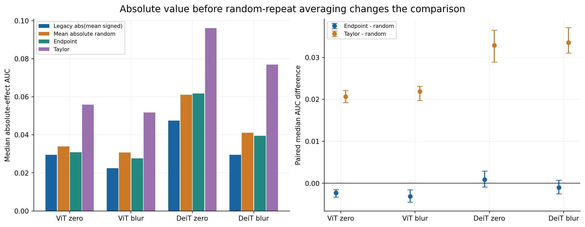
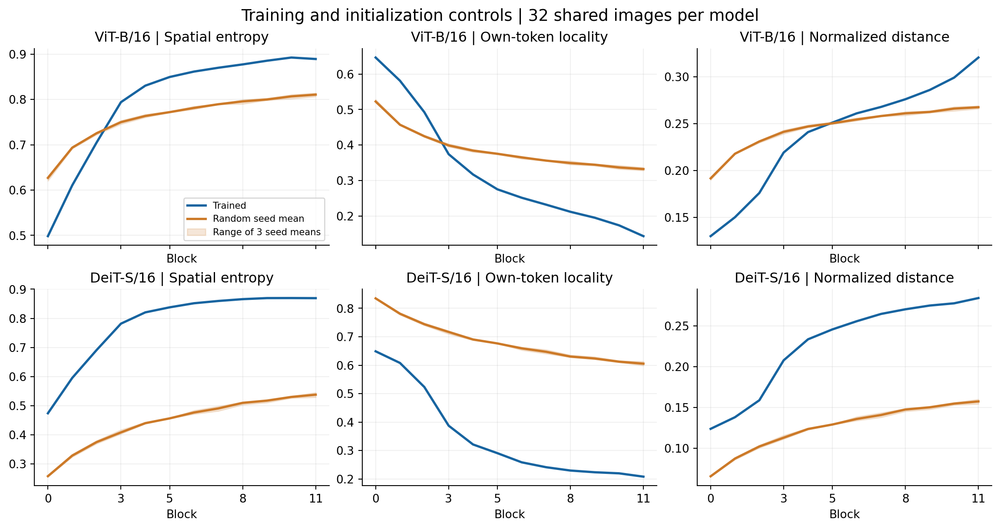
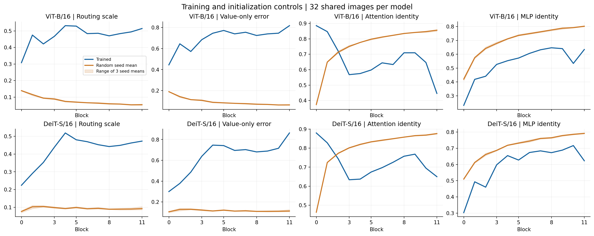
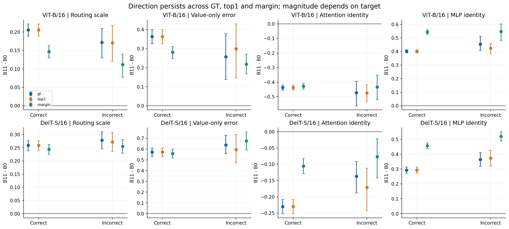
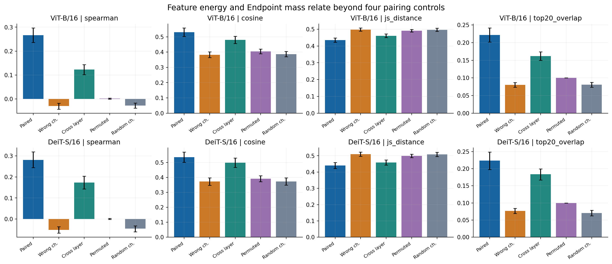

# Supplementary experiments v1: training, target and forward-response controls

This supplement executes the minimum package in Section 11 of the experiment request and both P0 corrections. New estimates are supplementary descriptive analyses; original confirmatory decisions and sealed evidence are retained. Cohorts, channels, initialization seeds and estimators were fixed before model execution.

## S9. Correction of the random-region baseline

Each random repetition takes the absolute effect before AUC integration; its AUC is then averaged over 20 repetitions and heads within an image. The legacy estimator averaged signed curves first and underestimated absolute-effect random performance through cancellation. The table reports medians and paired median differences for 400-image families, with 2,000 image-bootstrap intervals.

$$
\widehat A_{\rm random}=\frac1R\sum_{r=1}^R\frac1{0.25}\int_0^{0.25}|e_r(a)|\,da.
$$

| Model | Reference | Legacy random median | Corrected random mean | Corrected random median | Endpoint - random median [95% CI] | Taylor - random median [95% CI] |
| --- | --- | --- | --- | --- | --- | --- |
| ViT-B/16 | normalized-zero | 0.0294 | 0.0366 | 0.0339 | -0.0023 [-0.0033, -0.0015] | 0.0207 [0.0192, 0.0221] |
| ViT-B/16 | blur | 0.0225 | 0.0355 | 0.0307 | -0.0031 [-0.0045, -0.0016] | 0.0219 [0.0197, 0.0232] |
| DeiT-S/16 | normalized-zero | 0.0475 | 0.0728 | 0.0611 | 0.0009 [-0.0009, 0.0029] | 0.0329 [0.0289, 0.0365] |
| DeiT-S/16 | blur | 0.0296 | 0.0505 | 0.0411 | -0.0010 [-0.0025, 0.0007] | 0.0336 [0.0311, 0.0371] |

After correction, both ViT-B Endpoint-minus-random median differences are negative; both DeiT-S intervals include zero. All four Taylor-minus-random intervals remain positive. The Endpoint–Taylor comparison is unchanged.

The median per-image relative Monte Carlo SE is 5.1%–6.9%, with q90 of 7.6%–8.9%. Resampling 5/10/20 repetitions from the observed pool shows increasing error at smaller repetition counts. Conditional on the fixed images, cohort-mean Monte Carlo variation is smaller than image-sampling uncertainty; small single-image advantages remain poorly resolved. This diagnostic covers the observed repetition pool and does not establish that 20 repetitions meet every precision requirement.

| Model | Reference | Median relative MC SE | q90 relative MC SE | MC image error R=5 | R=10 | R=20 |
| --- | --- | --- | --- | --- | --- | --- |
| ViT-B/16 | normalized-zero | 0.0506 | 0.0759 | 0.0020 | 0.0014 | 0.0010 |
| ViT-B/16 | blur | 0.0665 | 0.0883 | 0.0026 | 0.0018 | 0.0013 |
| DeiT-S/16 | normalized-zero | 0.0622 | 0.0851 | 0.0046 | 0.0032 | 0.0023 |
| DeiT-S/16 | blur | 0.0687 | 0.0895 | 0.0035 | 0.0024 | 0.0017 |

[20-repeat cohort distribution](../evidence/supplement_v1/baseline_repeat_cohort_values.csv) · [Per-image repeats](../evidence/supplement_v1/baseline_repeat_image_values.csv) · [Paired image values, MC SE, split-half and leave-one-repeat-out](../evidence/supplement_v1/baseline_image_values.csv)

## S10. Trained and randomly initialized models

Each ViT-B/16 and DeiT-S/16 architecture has three random states (202609201, 202609202, 202609203), sharing the first 32 frozen M3 images, all 12 blocks, 16 tokens and 16 frozen channels per block with the trained model; M4 includes all heads. Random states use the same timm 0.9.16 architecture and native initialization, and each state is fixed across images. Trained statistics are selected from existing M3/M4 raw arrays for the identical images and targets. Units are aggregated within images; early=0–3 and late=8–11. Trained-minus-random intervals independently resample shared images and initialization seeds in 2,000 crossed-bootstrap draws.

Random models already show increasing entropy and distance and decreasing locality, indicating an architectural/initialization basis for spatial broadening. Trained entropy late-minus-early is 0.2288/0.2256, compared with random means of 0.0940/0.1718. Training strengthens broadening. Routing scale increases in the trained models while its mean random trend is negative; attention identity also changes in opposite directions between trained and random states. MLP identity increases in both, with the ViT-B trained-minus-random interval including zero. Three seeds limit inference over the initialization population; the comparison separates trained parameter states from native initialization without isolating architecture from initialization.

| Model | Study | Metric | Trained late - early | Random late - early | Trained - random [95% CI] | Random seed 1 / 2 / 3 |
| --- | --- | --- | --- | --- | --- | --- |
| DeiT-S/16 | m3 | cancellation | 0.0020 | 0.0036 | -0.0016 [-0.0029, -0.0005] | 0.0032 / 0.0028 / 0.0050 |
| DeiT-S/16 | m3 | cls_minus_patch_entropy | -0.2685 | -0.1717 | -0.0968 [-0.1051, -0.0889] | -0.1697 / -0.1740 / -0.1714 |
| DeiT-S/16 | m3 | distance | 0.1276 | 0.0576 | 0.0700 [0.0624, 0.0781] | 0.0574 / 0.0584 / 0.0569 |
| DeiT-S/16 | m3 | entropy | 0.2256 | 0.1718 | 0.0539 [0.0473, 0.0602] | 0.1699 / 0.1740 / 0.1714 |
| DeiT-S/16 | m3 | locality | -0.3441 | -0.1445 | -0.1997 [-0.2115, -0.1882] | -0.1433 / -0.1466 / -0.1436 |
| DeiT-S/16 | m4 | attention_identity_scale | -0.0579 | 0.1188 | -0.1767 [-0.1916, -0.1618] | 0.1232 / 0.1142 / 0.1190 |
| DeiT-S/16 | m4 | attention_output_identity_tv | 0.0306 | -0.0026 | 0.0331 [0.0274, 0.0388] | -0.0029 / -0.0025 / -0.0023 |
| DeiT-S/16 | m4 | attention_path_cancellation | 0.0958 | -0.0042 | 0.1001 [0.0890, 0.1115] | 0.0002 / -0.0036 / -0.0093 |
| DeiT-S/16 | m4 | attention_residual_path_cancellation | 0.0188 | -0.0848 | 0.1036 [0.0810, 0.1271] | -0.0889 / -0.0770 / -0.0884 |
| DeiT-S/16 | m4 | jvp_discrepancy | 0.5465 | -0.0944 | 0.6409 [0.6150, 0.6673] | -0.0871 / -0.0859 / -0.1101 |
| DeiT-S/16 | m4 | mlp_identity_scale | 0.2063 | 0.1461 | 0.0602 [0.0308, 0.0907] | 0.1423 / 0.1431 / 0.1528 |
| DeiT-S/16 | m4 | mlp_output_identity_tv | -0.0610 | -0.0041 | -0.0569 [-0.0722, -0.0413] | -0.0047 / -0.0042 / -0.0034 |
| DeiT-S/16 | m4 | mlp_residual_path_cancellation | -0.0381 | -0.0756 | 0.0375 [0.0101, 0.0675] | -0.0731 / -0.0761 / -0.0775 |
| DeiT-S/16 | m4 | routing_scale | 0.1314 | -0.0043 | 0.1357 [0.1151, 0.1564] | 0.0023 / -0.0032 / -0.0120 |
| DeiT-S/16 | m4 | saturation_error | 0.7536 | -0.0348 | 0.7884 [0.6387, 0.9354] | -0.0348 / -0.0348 / -0.0348 |
| DeiT-S/16 | m4 | saturation_routing | 0.7598 | -0.0348 | 0.7946 [0.6417, 0.9491] | -0.0357 / -0.0339 / -0.0348 |
| DeiT-S/16 | m4 | value_error | 0.2676 | -0.0088 | 0.2764 [0.2406, 0.3122] | -0.0008 / -0.0071 / -0.0184 |
| ViT-B/16 | m3 | cancellation | 0.0024 | 0.0008 | 0.0016 [0.0008, 0.0023] | 0.0014 / 0.0010 / 0.0000 |
| ViT-B/16 | m3 | cls_minus_patch_entropy | -0.2741 | -0.0940 | -0.1802 [-0.1893, -0.1709] | -0.0933 / -0.0970 / -0.0917 |
| ViT-B/16 | m3 | distance | 0.1292 | 0.0399 | 0.0893 [0.0833, 0.0953] | 0.0399 / 0.0410 / 0.0387 |
| ViT-B/16 | m3 | entropy | 0.2288 | 0.0940 | 0.1348 [0.1232, 0.1466] | 0.0934 / 0.0968 / 0.0918 |
| ViT-B/16 | m3 | locality | -0.3522 | -0.1005 | -0.2517 [-0.2598, -0.2431] | -0.1001 / -0.1036 / -0.0979 |
| ViT-B/16 | m4 | attention_identity_scale | -0.1144 | 0.1631 | -0.2775 [-0.3004, -0.2520] | 0.1629 / 0.1662 / 0.1603 |
| ViT-B/16 | m4 | attention_output_identity_tv | 0.0507 | -0.0046 | 0.0553 [0.0454, 0.0644] | -0.0042 / -0.0040 / -0.0058 |
| ViT-B/16 | m4 | attention_path_cancellation | 0.0797 | -0.0421 | 0.1218 [0.1136, 0.1303] | -0.0428 / -0.0413 / -0.0423 |
| ViT-B/16 | m4 | attention_residual_path_cancellation | 0.0138 | -0.1050 | 0.1188 [0.0932, 0.1447] | -0.1028 / -0.1084 / -0.1038 |
| ViT-B/16 | m4 | jvp_discrepancy | 0.4501 | -0.2600 | 0.7101 [0.6739, 0.7465] | -0.2621 / -0.2548 / -0.2631 |
| ViT-B/16 | m4 | mlp_identity_scale | 0.1951 | 0.1819 | 0.0132 [-0.0093, 0.0361] | 0.1829 / 0.1851 / 0.1775 |
| ViT-B/16 | m4 | mlp_output_identity_tv | -0.0205 | -0.0042 | -0.0163 [-0.0295, -0.0047] | -0.0041 / -0.0045 / -0.0041 |
| ViT-B/16 | m4 | mlp_residual_path_cancellation | 0.0887 | -0.0866 | 0.1753 [0.1350, 0.2174] | -0.0845 / -0.0907 / -0.0846 |
| ViT-B/16 | m4 | routing_scale | 0.0512 | -0.0479 | 0.0991 [0.0810, 0.1160] | -0.0485 / -0.0470 / -0.0481 |
| ViT-B/16 | m4 | saturation_error | 0.3568 | 0.0232 | 0.3336 [0.2370, 0.4496] | 0.0827 / -0.0498 / 0.0366 |
| ViT-B/16 | m4 | saturation_routing | 0.4379 | 0.0203 | 0.4177 [0.3136, 0.5211] | 0.0636 / -0.0431 / 0.0402 |
| ViT-B/16 | m4 | value_error | 0.1437 | -0.0623 | 0.2061 [0.1689, 0.2420] | -0.0621 / -0.0615 / -0.0633 |

[Early/late and difference estimates](../evidence/supplement_v1/training_analysis.json) · [Image values](../evidence/supplement_v1/training_image_trends.csv)

## S11. Target robustness

The frozen M3 cohort supplies 100 images per model, with GT, clean-top1 and top1-minus-runnerup targets at blocks 0/5/11 and all heads. Class indices are fixed on the clean input. Correct/incorrect counts are 92/8 for ViT-B and 86/14 for DeiT-S; GT and top1 are identical on correct images. The table reports image-level B11-minus-B0 after head aggregation for all/correct/incorrect groups. Targets within a group share bootstrap image indices.

Routing scale and Value-only error increase with depth under all three targets; attention identity decreases and MLP identity increases, with consistent directions in correct and incorrect subsets. Margin targets change magnitudes: ViT-B routing increases by 0.1439 rather than the GT value of 0.2031, and DeiT-S attention identity changes by −0.1014 rather than −0.2168. The incorrect subsets contain only 8/14 images, limiting their precision.

Native attention-output JVPs depend on the model and input, independently of the explained class, so their eight-direction discrepancy is inherited from the identical original M4 images. The additional target_contracted_jvp contracts directional derivatives with each target cotangent at the head output and measures target-dependent Value-only discrepancy. The two quantities are reported separately. Saturation relations use within-block Spearman across heads; their depth changes are reported alongside complete block values, target contrasts and NA counts in the data files.

| Model | Subset | Target | Metric | n | B11 - B0 mean | 95% CI |
| --- | --- | --- | --- | --- | --- | --- |
| ViT-B/16 | all | gt | routing_scale | 100 | 0.2031 | [0.1868, 0.2189] |
| ViT-B/16 | all | top1 | routing_scale | 100 | 0.2030 | [0.1862, 0.2184] |
| ViT-B/16 | all | margin | routing_scale | 100 | 0.1439 | [0.1283, 0.1595] |
| ViT-B/16 | all | gt | value_error | 100 | 0.3539 | [0.3170, 0.3877] |
| ViT-B/16 | all | top1 | value_error | 100 | 0.3572 | [0.3203, 0.3917] |
| ViT-B/16 | all | margin | value_error | 100 | 0.2762 | [0.2448, 0.3059] |
| ViT-B/16 | all | gt | jvp_discrepancy | 100 | 0.4757 | [0.4569, 0.4942] |
| ViT-B/16 | all | top1 | jvp_discrepancy | 100 | 0.4757 | [0.4569, 0.4942] |
| ViT-B/16 | all | margin | jvp_discrepancy | 100 | 0.4757 | [0.4569, 0.4942] |
| ViT-B/16 | all | gt | attention_path_cancellation | 100 | 0.1587 | [0.1469, 0.1699] |
| ViT-B/16 | all | top1 | attention_path_cancellation | 100 | 0.1601 | [0.1488, 0.1713] |
| ViT-B/16 | all | margin | attention_path_cancellation | 100 | 0.1427 | [0.1326, 0.1529] |
| ViT-B/16 | all | gt | saturation_routing | 100 | -0.1076 | [-0.1852, -0.0322] |
| ViT-B/16 | all | top1 | saturation_routing | 100 | -0.1087 | [-0.1849, -0.0364] |
| ViT-B/16 | all | margin | saturation_routing | 100 | 0.0102 | [-0.0637, 0.0853] |
| ViT-B/16 | all | gt | saturation_error | 100 | -0.0495 | [-0.1332, 0.0347] |
| ViT-B/16 | all | top1 | saturation_error | 100 | -0.0517 | [-0.1335, 0.0312] |
| ViT-B/16 | all | margin | saturation_error | 100 | 0.0421 | [-0.0353, 0.1223] |
| ViT-B/16 | all | gt | target_contracted_jvp | 100 | 0.3382 | [0.3029, 0.3751] |
| ViT-B/16 | all | top1 | target_contracted_jvp | 100 | 0.3414 | [0.3046, 0.3786] |
| ViT-B/16 | all | margin | target_contracted_jvp | 100 | 0.2887 | [0.2568, 0.3201] |
| ViT-B/16 | all | gt | attention_identity_scale | 100 | -0.4390 | [-0.4577, -0.4213] |
| ViT-B/16 | all | top1 | attention_identity_scale | 100 | -0.4392 | [-0.4568, -0.4219] |
| ViT-B/16 | all | margin | attention_identity_scale | 100 | -0.4285 | [-0.4479, -0.4085] |
| ViT-B/16 | all | gt | attention_output_identity_tv | 100 | 0.1823 | [0.1692, 0.1956] |
| ViT-B/16 | all | top1 | attention_output_identity_tv | 100 | 0.1848 | [0.1723, 0.1978] |
| ViT-B/16 | all | margin | attention_output_identity_tv | 100 | 0.1233 | [0.1128, 0.1340] |
| ViT-B/16 | all | gt | attention_residual_path_cancellation | 100 | 0.2017 | [0.1688, 0.2320] |
| ViT-B/16 | all | top1 | attention_residual_path_cancellation | 100 | 0.2042 | [0.1719, 0.2345] |
| ViT-B/16 | all | margin | attention_residual_path_cancellation | 100 | 0.0329 | [0.0108, 0.0553] |
| ViT-B/16 | all | gt | mlp_identity_scale | 100 | 0.4057 | [0.3937, 0.4183] |
| ViT-B/16 | all | top1 | mlp_identity_scale | 100 | 0.4033 | [0.3919, 0.4144] |
| ViT-B/16 | all | margin | mlp_identity_scale | 100 | 0.5437 | [0.5254, 0.5627] |
| ViT-B/16 | all | gt | mlp_output_identity_tv | 100 | -0.0275 | [-0.0369, -0.0182] |
| ViT-B/16 | all | top1 | mlp_output_identity_tv | 100 | -0.0277 | [-0.0370, -0.0186] |
| ViT-B/16 | all | margin | mlp_output_identity_tv | 100 | -0.0897 | [-0.0985, -0.0805] |
| ViT-B/16 | all | gt | mlp_residual_path_cancellation | 100 | 0.4451 | [0.4210, 0.4662] |
| ViT-B/16 | all | top1 | mlp_residual_path_cancellation | 100 | 0.4546 | [0.4343, 0.4731] |
| ViT-B/16 | all | margin | mlp_residual_path_cancellation | 100 | 0.1074 | [0.0777, 0.1369] |
| ViT-B/16 | correct | gt | routing_scale | 92 | 0.2058 | [0.1891, 0.2222] |
| ViT-B/16 | correct | top1 | routing_scale | 92 | 0.2058 | [0.1891, 0.2222] |
| ViT-B/16 | correct | margin | routing_scale | 92 | 0.1467 | [0.1299, 0.1633] |
| ViT-B/16 | correct | gt | value_error | 92 | 0.3623 | [0.3256, 0.4001] |
| ViT-B/16 | correct | top1 | value_error | 92 | 0.3623 | [0.3256, 0.4001] |
| ViT-B/16 | correct | margin | value_error | 92 | 0.2813 | [0.2476, 0.3116] |
| ViT-B/16 | correct | gt | jvp_discrepancy | 92 | 0.4829 | [0.4657, 0.4998] |
| ViT-B/16 | correct | top1 | jvp_discrepancy | 92 | 0.4829 | [0.4657, 0.4998] |
| ViT-B/16 | correct | margin | jvp_discrepancy | 92 | 0.4829 | [0.4657, 0.4998] |
| ViT-B/16 | correct | gt | attention_path_cancellation | 92 | 0.1605 | [0.1480, 0.1723] |
| ViT-B/16 | correct | top1 | attention_path_cancellation | 92 | 0.1605 | [0.1480, 0.1723] |
| ViT-B/16 | correct | margin | attention_path_cancellation | 92 | 0.1453 | [0.1339, 0.1561] |
| ViT-B/16 | correct | gt | saturation_routing | 92 | -0.1206 | [-0.2004, -0.0436] |
| ViT-B/16 | correct | top1 | saturation_routing | 92 | -0.1206 | [-0.2004, -0.0436] |
| ViT-B/16 | correct | margin | saturation_routing | 92 | -0.0131 | [-0.0883, 0.0598] |
| ViT-B/16 | correct | gt | saturation_error | 92 | -0.0628 | [-0.1478, 0.0175] |
| ViT-B/16 | correct | top1 | saturation_error | 92 | -0.0628 | [-0.1478, 0.0175] |
| ViT-B/16 | correct | margin | saturation_error | 92 | 0.0260 | [-0.0562, 0.1081] |
| ViT-B/16 | correct | gt | target_contracted_jvp | 92 | 0.3431 | [0.3039, 0.3823] |
| ViT-B/16 | correct | top1 | target_contracted_jvp | 92 | 0.3431 | [0.3039, 0.3823] |
| ViT-B/16 | correct | margin | target_contracted_jvp | 92 | 0.2953 | [0.2618, 0.3283] |
| ViT-B/16 | correct | gt | attention_identity_scale | 92 | -0.4362 | [-0.4546, -0.4194] |
| ViT-B/16 | correct | top1 | attention_identity_scale | 92 | -0.4362 | [-0.4546, -0.4194] |
| ViT-B/16 | correct | margin | attention_identity_scale | 92 | -0.4281 | [-0.4478, -0.4091] |
| ViT-B/16 | correct | gt | attention_output_identity_tv | 92 | 0.1884 | [0.1759, 0.2016] |
| ViT-B/16 | correct | top1 | attention_output_identity_tv | 92 | 0.1884 | [0.1759, 0.2016] |
| ViT-B/16 | correct | margin | attention_output_identity_tv | 92 | 0.1259 | [0.1143, 0.1374] |
| ViT-B/16 | correct | gt | attention_residual_path_cancellation | 92 | 0.2164 | [0.1837, 0.2492] |
| ViT-B/16 | correct | top1 | attention_residual_path_cancellation | 92 | 0.2164 | [0.1837, 0.2492] |
| ViT-B/16 | correct | margin | attention_residual_path_cancellation | 92 | 0.0374 | [0.0136, 0.0611] |
| ViT-B/16 | correct | gt | mlp_identity_scale | 92 | 0.4015 | [0.3894, 0.4136] |
| ViT-B/16 | correct | top1 | mlp_identity_scale | 92 | 0.4015 | [0.3894, 0.4136] |
| ViT-B/16 | correct | margin | mlp_identity_scale | 92 | 0.5434 | [0.5249, 0.5620] |
| ViT-B/16 | correct | gt | mlp_output_identity_tv | 92 | -0.0285 | [-0.0381, -0.0189] |
| ViT-B/16 | correct | top1 | mlp_output_identity_tv | 92 | -0.0285 | [-0.0381, -0.0189] |
| ViT-B/16 | correct | margin | mlp_output_identity_tv | 92 | -0.0900 | [-0.0996, -0.0807] |
| ViT-B/16 | correct | gt | mlp_residual_path_cancellation | 92 | 0.4577 | [0.4381, 0.4765] |
| ViT-B/16 | correct | top1 | mlp_residual_path_cancellation | 92 | 0.4577 | [0.4381, 0.4765] |
| ViT-B/16 | correct | margin | mlp_residual_path_cancellation | 92 | 0.1127 | [0.0840, 0.1427] |
| ViT-B/16 | incorrect | gt | routing_scale | 8 | 0.1719 | [0.1298, 0.2101] |
| ViT-B/16 | incorrect | top1 | routing_scale | 8 | 0.1706 | [0.1210, 0.2183] |
| ViT-B/16 | incorrect | margin | routing_scale | 8 | 0.1120 | [0.0779, 0.1399] |
| ViT-B/16 | incorrect | gt | value_error | 8 | 0.2568 | [0.1380, 0.3788] |
| ViT-B/16 | incorrect | top1 | value_error | 8 | 0.2985 | [0.1477, 0.4298] |
| ViT-B/16 | incorrect | margin | value_error | 8 | 0.2183 | [0.1684, 0.2715] |
| ViT-B/16 | incorrect | gt | jvp_discrepancy | 8 | 0.3924 | [0.2737, 0.5011] |
| ViT-B/16 | incorrect | top1 | jvp_discrepancy | 8 | 0.3924 | [0.2737, 0.5011] |
| ViT-B/16 | incorrect | margin | jvp_discrepancy | 8 | 0.3924 | [0.2737, 0.5011] |
| ViT-B/16 | incorrect | gt | attention_path_cancellation | 8 | 0.1385 | [0.1052, 0.1729] |
| ViT-B/16 | incorrect | top1 | attention_path_cancellation | 8 | 0.1563 | [0.1272, 0.1850] |
| ViT-B/16 | incorrect | margin | attention_path_cancellation | 8 | 0.1125 | [0.0926, 0.1367] |
| ViT-B/16 | incorrect | gt | saturation_routing | 8 | 0.0411 | [-0.2710, 0.3628] |
| ViT-B/16 | incorrect | top1 | saturation_routing | 8 | 0.0271 | [-0.2099, 0.2570] |
| ViT-B/16 | incorrect | margin | saturation_routing | 8 | 0.2780 | [-0.0166, 0.5656] |
| ViT-B/16 | incorrect | gt | saturation_error | 8 | 0.1031 | [-0.2203, 0.4493] |
| ViT-B/16 | incorrect | top1 | saturation_error | 8 | 0.0760 | [-0.1198, 0.2850] |
| ViT-B/16 | incorrect | margin | saturation_error | 8 | 0.2273 | [0.0402, 0.4187] |
| ViT-B/16 | incorrect | gt | target_contracted_jvp | 8 | 0.2814 | [0.1617, 0.3988] |
| ViT-B/16 | incorrect | top1 | target_contracted_jvp | 8 | 0.3210 | [0.1766, 0.4598] |
| ViT-B/16 | incorrect | margin | target_contracted_jvp | 8 | 0.2126 | [0.1223, 0.3130] |
| ViT-B/16 | incorrect | gt | attention_identity_scale | 8 | -0.4712 | [-0.5617, -0.3925] |
| ViT-B/16 | incorrect | top1 | attention_identity_scale | 8 | -0.4740 | [-0.5316, -0.4160] |
| ViT-B/16 | incorrect | margin | attention_identity_scale | 8 | -0.4324 | [-0.5205, -0.3503] |
| ViT-B/16 | incorrect | gt | attention_output_identity_tv | 8 | 0.1119 | [0.0867, 0.1380] |
| ViT-B/16 | incorrect | top1 | attention_output_identity_tv | 8 | 0.1432 | [0.1076, 0.1813] |
| ViT-B/16 | incorrect | margin | attention_output_identity_tv | 8 | 0.0931 | [0.0694, 0.1182] |
| ViT-B/16 | incorrect | gt | attention_residual_path_cancellation | 8 | 0.0321 | [-0.0432, 0.1290] |
| ViT-B/16 | incorrect | top1 | attention_residual_path_cancellation | 8 | 0.0640 | [-0.0001, 0.1464] |
| ViT-B/16 | incorrect | margin | attention_residual_path_cancellation | 8 | -0.0194 | [-0.0629, 0.0265] |
| ViT-B/16 | incorrect | gt | mlp_identity_scale | 8 | 0.4537 | [0.4078, 0.5139] |
| ViT-B/16 | incorrect | top1 | mlp_identity_scale | 8 | 0.4232 | [0.3842, 0.4573] |
| ViT-B/16 | incorrect | margin | mlp_identity_scale | 8 | 0.5469 | [0.4811, 0.6039] |
| ViT-B/16 | incorrect | gt | mlp_output_identity_tv | 8 | -0.0169 | [-0.0455, 0.0156] |
| ViT-B/16 | incorrect | top1 | mlp_output_identity_tv | 8 | -0.0190 | [-0.0503, 0.0132] |
| ViT-B/16 | incorrect | margin | mlp_output_identity_tv | 8 | -0.0862 | [-0.1020, -0.0693] |
| ViT-B/16 | incorrect | gt | mlp_residual_path_cancellation | 8 | 0.3002 | [0.1584, 0.4207] |
| ViT-B/16 | incorrect | top1 | mlp_residual_path_cancellation | 8 | 0.4195 | [0.3318, 0.5030] |
| ViT-B/16 | incorrect | margin | mlp_residual_path_cancellation | 8 | 0.0468 | [-0.0459, 0.1747] |
| DeiT-S/16 | all | gt | routing_scale | 100 | 0.2617 | [0.2450, 0.2785] |
| DeiT-S/16 | all | top1 | routing_scale | 100 | 0.2607 | [0.2438, 0.2778] |
| DeiT-S/16 | all | margin | routing_scale | 100 | 0.2460 | [0.2302, 0.2625] |
| DeiT-S/16 | all | gt | value_error | 100 | 0.5806 | [0.5452, 0.6180] |
| DeiT-S/16 | all | top1 | value_error | 100 | 0.5745 | [0.5354, 0.6131] |
| DeiT-S/16 | all | margin | value_error | 100 | 0.5744 | [0.5352, 0.6135] |
| DeiT-S/16 | all | gt | jvp_discrepancy | 100 | 0.6374 | [0.6193, 0.6563] |
| DeiT-S/16 | all | top1 | jvp_discrepancy | 100 | 0.6374 | [0.6193, 0.6563] |
| DeiT-S/16 | all | margin | jvp_discrepancy | 100 | 0.6374 | [0.6193, 0.6563] |
| DeiT-S/16 | all | gt | attention_path_cancellation | 100 | 0.2407 | [0.2279, 0.2540] |
| DeiT-S/16 | all | top1 | attention_path_cancellation | 100 | 0.2392 | [0.2263, 0.2529] |
| DeiT-S/16 | all | margin | attention_path_cancellation | 100 | 0.2318 | [0.2209, 0.2430] |
| DeiT-S/16 | all | gt | saturation_routing | 100 | -0.3766 | [-0.4594, -0.2909] |
| DeiT-S/16 | all | top1 | saturation_routing | 100 | -0.3789 | [-0.4634, -0.2920] |
| DeiT-S/16 | all | margin | saturation_routing | 100 | -0.2943 | [-0.3863, -0.2006] |
| DeiT-S/16 | all | gt | saturation_error | 100 | -0.3371 | [-0.4417, -0.2337] |
| DeiT-S/16 | all | top1 | saturation_error | 100 | -0.3486 | [-0.4509, -0.2480] |
| DeiT-S/16 | all | margin | saturation_error | 100 | -0.0817 | [-0.1794, 0.0137] |
| DeiT-S/16 | all | gt | target_contracted_jvp | 100 | 0.5393 | [0.4936, 0.5852] |
| DeiT-S/16 | all | top1 | target_contracted_jvp | 100 | 0.5523 | [0.5020, 0.6041] |
| DeiT-S/16 | all | margin | target_contracted_jvp | 100 | 0.5375 | [0.4887, 0.5895] |
| DeiT-S/16 | all | gt | attention_identity_scale | 100 | -0.2168 | [-0.2369, -0.1960] |
| DeiT-S/16 | all | top1 | attention_identity_scale | 100 | -0.2216 | [-0.2418, -0.2006] |
| DeiT-S/16 | all | margin | attention_identity_scale | 100 | -0.1014 | [-0.1224, -0.0796] |
| DeiT-S/16 | all | gt | attention_output_identity_tv | 100 | 0.0821 | [0.0723, 0.0918] |
| DeiT-S/16 | all | top1 | attention_output_identity_tv | 100 | 0.0859 | [0.0759, 0.0961] |
| DeiT-S/16 | all | margin | attention_output_identity_tv | 100 | 0.0337 | [0.0255, 0.0420] |
| DeiT-S/16 | all | gt | attention_residual_path_cancellation | 100 | 0.0709 | [0.0464, 0.0949] |
| DeiT-S/16 | all | top1 | attention_residual_path_cancellation | 100 | 0.0706 | [0.0456, 0.0950] |
| DeiT-S/16 | all | margin | attention_residual_path_cancellation | 100 | -0.0152 | [-0.0397, 0.0084] |
| DeiT-S/16 | all | gt | mlp_identity_scale | 100 | 0.3029 | [0.2846, 0.3227] |
| DeiT-S/16 | all | top1 | mlp_identity_scale | 100 | 0.3041 | [0.2847, 0.3235] |
| DeiT-S/16 | all | margin | mlp_identity_scale | 100 | 0.4663 | [0.4484, 0.4830] |
| DeiT-S/16 | all | gt | mlp_output_identity_tv | 100 | -0.0414 | [-0.0564, -0.0263] |
| DeiT-S/16 | all | top1 | mlp_output_identity_tv | 100 | -0.0413 | [-0.0566, -0.0252] |
| DeiT-S/16 | all | margin | mlp_output_identity_tv | 100 | -0.1197 | [-0.1312, -0.1073] |
| DeiT-S/16 | all | gt | mlp_residual_path_cancellation | 100 | 0.2912 | [0.2535, 0.3278] |
| DeiT-S/16 | all | top1 | mlp_residual_path_cancellation | 100 | 0.3101 | [0.2762, 0.3429] |
| DeiT-S/16 | all | margin | mlp_residual_path_cancellation | 100 | -0.0462 | [-0.0768, -0.0155] |
| DeiT-S/16 | correct | gt | routing_scale | 86 | 0.2590 | [0.2389, 0.2772] |
| DeiT-S/16 | correct | top1 | routing_scale | 86 | 0.2590 | [0.2389, 0.2772] |
| DeiT-S/16 | correct | margin | routing_scale | 86 | 0.2445 | [0.2258, 0.2624] |
| DeiT-S/16 | correct | gt | value_error | 86 | 0.5713 | [0.5310, 0.6118] |
| DeiT-S/16 | correct | top1 | value_error | 86 | 0.5713 | [0.5310, 0.6118] |
| DeiT-S/16 | correct | margin | value_error | 86 | 0.5580 | [0.5160, 0.5994] |
| DeiT-S/16 | correct | gt | jvp_discrepancy | 86 | 0.6362 | [0.6153, 0.6562] |
| DeiT-S/16 | correct | top1 | jvp_discrepancy | 86 | 0.6362 | [0.6153, 0.6562] |
| DeiT-S/16 | correct | margin | jvp_discrepancy | 86 | 0.6362 | [0.6153, 0.6562] |
| DeiT-S/16 | correct | gt | attention_path_cancellation | 86 | 0.2396 | [0.2250, 0.2535] |
| DeiT-S/16 | correct | top1 | attention_path_cancellation | 86 | 0.2396 | [0.2250, 0.2535] |
| DeiT-S/16 | correct | margin | attention_path_cancellation | 86 | 0.2285 | [0.2155, 0.2406] |
| DeiT-S/16 | correct | gt | saturation_routing | 86 | -0.4027 | [-0.4930, -0.3083] |
| DeiT-S/16 | correct | top1 | saturation_routing | 86 | -0.4027 | [-0.4930, -0.3083] |
| DeiT-S/16 | correct | margin | saturation_routing | 86 | -0.3116 | [-0.4140, -0.2066] |
| DeiT-S/16 | correct | gt | saturation_error | 86 | -0.3841 | [-0.4930, -0.2638] |
| DeiT-S/16 | correct | top1 | saturation_error | 86 | -0.3841 | [-0.4930, -0.2638] |
| DeiT-S/16 | correct | margin | saturation_error | 86 | -0.0850 | [-0.1894, 0.0159] |
| DeiT-S/16 | correct | gt | target_contracted_jvp | 86 | 0.5355 | [0.4808, 0.5896] |
| DeiT-S/16 | correct | top1 | target_contracted_jvp | 86 | 0.5355 | [0.4808, 0.5896] |
| DeiT-S/16 | correct | margin | target_contracted_jvp | 86 | 0.5281 | [0.4708, 0.5831] |
| DeiT-S/16 | correct | gt | attention_identity_scale | 86 | -0.2298 | [-0.2518, -0.2078] |
| DeiT-S/16 | correct | top1 | attention_identity_scale | 86 | -0.2298 | [-0.2518, -0.2078] |
| DeiT-S/16 | correct | margin | attention_identity_scale | 86 | -0.1054 | [-0.1286, -0.0821] |
| DeiT-S/16 | correct | gt | attention_output_identity_tv | 86 | 0.0885 | [0.0775, 0.0999] |
| DeiT-S/16 | correct | top1 | attention_output_identity_tv | 86 | 0.0885 | [0.0775, 0.0999] |
| DeiT-S/16 | correct | margin | attention_output_identity_tv | 86 | 0.0356 | [0.0266, 0.0449] |
| DeiT-S/16 | correct | gt | attention_residual_path_cancellation | 86 | 0.0827 | [0.0547, 0.1116] |
| DeiT-S/16 | correct | top1 | attention_residual_path_cancellation | 86 | 0.0827 | [0.0547, 0.1116] |
| DeiT-S/16 | correct | margin | attention_residual_path_cancellation | 86 | -0.0110 | [-0.0399, 0.0195] |
| DeiT-S/16 | correct | gt | mlp_identity_scale | 86 | 0.2928 | [0.2735, 0.3141] |
| DeiT-S/16 | correct | top1 | mlp_identity_scale | 86 | 0.2928 | [0.2735, 0.3141] |
| DeiT-S/16 | correct | margin | mlp_identity_scale | 86 | 0.4574 | [0.4379, 0.4762] |
| DeiT-S/16 | correct | gt | mlp_output_identity_tv | 86 | -0.0346 | [-0.0509, -0.0184] |
| DeiT-S/16 | correct | top1 | mlp_output_identity_tv | 86 | -0.0346 | [-0.0509, -0.0184] |
| DeiT-S/16 | correct | margin | mlp_output_identity_tv | 86 | -0.1145 | [-0.1268, -0.1011] |
| DeiT-S/16 | correct | gt | mlp_residual_path_cancellation | 86 | 0.3265 | [0.2927, 0.3609] |
| DeiT-S/16 | correct | top1 | mlp_residual_path_cancellation | 86 | 0.3265 | [0.2927, 0.3609] |
| DeiT-S/16 | correct | margin | mlp_residual_path_cancellation | 86 | -0.0345 | [-0.0692, 0.0001] |
| DeiT-S/16 | incorrect | gt | routing_scale | 14 | 0.2785 | [0.2462, 0.3109] |
| DeiT-S/16 | incorrect | top1 | routing_scale | 14 | 0.2717 | [0.2366, 0.3090] |
| DeiT-S/16 | incorrect | margin | routing_scale | 14 | 0.2551 | [0.2297, 0.2818] |
| DeiT-S/16 | incorrect | gt | value_error | 14 | 0.6374 | [0.5562, 0.7293] |
| DeiT-S/16 | incorrect | top1 | value_error | 14 | 0.5942 | [0.4738, 0.7350] |
| DeiT-S/16 | incorrect | margin | value_error | 14 | 0.6752 | [0.5912, 0.7607] |
| DeiT-S/16 | incorrect | gt | jvp_discrepancy | 14 | 0.6446 | [0.6040, 0.6821] |
| DeiT-S/16 | incorrect | top1 | jvp_discrepancy | 14 | 0.6446 | [0.6040, 0.6821] |
| DeiT-S/16 | incorrect | margin | jvp_discrepancy | 14 | 0.6446 | [0.6040, 0.6821] |
| DeiT-S/16 | incorrect | gt | attention_path_cancellation | 14 | 0.2471 | [0.2123, 0.2797] |
| DeiT-S/16 | incorrect | top1 | attention_path_cancellation | 14 | 0.2369 | [0.1957, 0.2831] |
| DeiT-S/16 | incorrect | margin | attention_path_cancellation | 14 | 0.2521 | [0.2257, 0.2803] |
| DeiT-S/16 | incorrect | gt | saturation_routing | 14 | -0.2163 | [-0.4408, 0.0163] |
| DeiT-S/16 | incorrect | top1 | saturation_routing | 14 | -0.2327 | [-0.4122, -0.0448] |
| DeiT-S/16 | incorrect | margin | saturation_routing | 14 | -0.1878 | [-0.3878, 0.0286] |
| DeiT-S/16 | incorrect | gt | saturation_error | 14 | -0.0490 | [-0.3469, 0.2367] |
| DeiT-S/16 | incorrect | top1 | saturation_error | 14 | -0.1306 | [-0.3633, 0.0939] |
| DeiT-S/16 | incorrect | margin | saturation_error | 14 | -0.0612 | [-0.3674, 0.2327] |
| DeiT-S/16 | incorrect | gt | target_contracted_jvp | 14 | 0.5631 | [0.5059, 0.6286] |
| DeiT-S/16 | incorrect | top1 | target_contracted_jvp | 14 | 0.6555 | [0.4921, 0.8523] |
| DeiT-S/16 | incorrect | margin | target_contracted_jvp | 14 | 0.5956 | [0.4935, 0.6992] |
| DeiT-S/16 | incorrect | gt | attention_identity_scale | 14 | -0.1368 | [-0.1879, -0.0917] |
| DeiT-S/16 | incorrect | top1 | attention_identity_scale | 14 | -0.1713 | [-0.2423, -0.1122] |
| DeiT-S/16 | incorrect | margin | attention_identity_scale | 14 | -0.0768 | [-0.1418, -0.0212] |
| DeiT-S/16 | incorrect | gt | attention_output_identity_tv | 14 | 0.0426 | [0.0273, 0.0589] |
| DeiT-S/16 | incorrect | top1 | attention_output_identity_tv | 14 | 0.0700 | [0.0394, 0.1080] |
| DeiT-S/16 | incorrect | margin | attention_output_identity_tv | 14 | 0.0219 | [0.0026, 0.0449] |
| DeiT-S/16 | incorrect | gt | attention_residual_path_cancellation | 14 | -0.0021 | [-0.0379, 0.0375] |
| DeiT-S/16 | incorrect | top1 | attention_residual_path_cancellation | 14 | -0.0041 | [-0.0474, 0.0455] |
| DeiT-S/16 | incorrect | margin | attention_residual_path_cancellation | 14 | -0.0407 | [-0.0834, 0.0012] |
| DeiT-S/16 | incorrect | gt | mlp_identity_scale | 14 | 0.3651 | [0.3177, 0.4134] |
| DeiT-S/16 | incorrect | top1 | mlp_identity_scale | 14 | 0.3737 | [0.3208, 0.4260] |
| DeiT-S/16 | incorrect | margin | mlp_identity_scale | 14 | 0.5210 | [0.4896, 0.5517] |
| DeiT-S/16 | incorrect | gt | mlp_output_identity_tv | 14 | -0.0829 | [-0.1111, -0.0537] |
| DeiT-S/16 | incorrect | top1 | mlp_output_identity_tv | 14 | -0.0822 | [-0.1229, -0.0378] |
| DeiT-S/16 | incorrect | margin | mlp_output_identity_tv | 14 | -0.1514 | [-0.1788, -0.1242] |
| DeiT-S/16 | incorrect | gt | mlp_residual_path_cancellation | 14 | 0.0745 | [-0.0319, 0.1855] |
| DeiT-S/16 | incorrect | top1 | mlp_residual_path_cancellation | 14 | 0.2091 | [0.1068, 0.3061] |
| DeiT-S/16 | incorrect | margin | mlp_residual_path_cancellation | 14 | -0.1185 | [-0.1821, -0.0485] |

[All block estimates, paired contrasts and NA counts](../evidence/supplement_v1/target_analysis.json) · [Image-block values](../evidence/supplement_v1/target_block_values.csv)

## S12. Quantitative feature–Endpoint relationship

Each model uses 32 frozen images, 12 blocks and 16 frozen random channels per block, giving 12,288 energy targets. The sum covers 196 patch tokens and excludes CLS, matching the energy definition in the forward displays. Raw RGB Endpoint absolute mass is aggregated to patches; display normalization and spatial-variance channel selection do not enter the analysis.

$$
s_{b,c}=\frac12\sum_{t=1}^{196}h_{b,t,c}^2,\qquad
q_t=\frac{h_{b,t,c}^2}{\sum_{j=1}^{196}h_{b,j,c}^2},\qquad
p_t=\frac{\sum_{i\in P_t}|x_i\partial s_{b,c}/\partial x_i|}{\sum_i|x_i\partial s_{b,c}/\partial x_i|}.
$$

Mean image-level Spearman is 0.2663/0.2811 for correct pairing, with positive paired-difference intervals against wrong-channel, cross-layer same-channel, patch-permutation and random-channel controls. Cosine, Jensen–Shannon distance and top-20 overlap are also reported. Same-channel forward energy and local input dependence are associated beyond these controls, with substantial departures from equivalence. Channel and block medians are taken within each image before image-level statistics.

| Model | Pairing | Metric | Mean | 95% CI |
| --- | --- | --- | --- | --- |
| ViT-B/16 | paired | spearman | 0.2663 | [0.2366, 0.2973] |
| ViT-B/16 | wrong_channel | spearman | -0.0298 | [-0.0426, -0.0177] |
| ViT-B/16 | cross_layer | spearman | 0.1232 | [0.1019, 0.1435] |
| ViT-B/16 | permuted | spearman | 0.0013 | [-0.0010, 0.0036] |
| ViT-B/16 | random_channel | spearman | -0.0275 | [-0.0389, -0.0175] |
| ViT-B/16 | paired | cosine | 0.5304 | [0.5029, 0.5575] |
| ViT-B/16 | wrong_channel | cosine | 0.3826 | [0.3643, 0.4011] |
| ViT-B/16 | cross_layer | cosine | 0.4802 | [0.4562, 0.5032] |
| ViT-B/16 | permuted | cosine | 0.4043 | [0.3888, 0.4198] |
| ViT-B/16 | random_channel | cosine | 0.3868 | [0.3691, 0.4041] |
| ViT-B/16 | paired | js_distance | 0.4351 | [0.4223, 0.4484] |
| ViT-B/16 | wrong_channel | js_distance | 0.4974 | [0.4884, 0.5070] |
| ViT-B/16 | cross_layer | js_distance | 0.4604 | [0.4498, 0.4716] |
| ViT-B/16 | permuted | js_distance | 0.4909 | [0.4837, 0.4983] |
| ViT-B/16 | random_channel | js_distance | 0.4960 | [0.4869, 0.5059] |
| ViT-B/16 | paired | top20_overlap | 0.2215 | [0.2016, 0.2414] |
| ViT-B/16 | wrong_channel | top20_overlap | 0.0805 | [0.0734, 0.0871] |
| ViT-B/16 | cross_layer | top20_overlap | 0.1621 | [0.1496, 0.1742] |
| ViT-B/16 | permuted | top20_overlap | 0.1000 | [0.1000, 0.1000] |
| ViT-B/16 | random_channel | top20_overlap | 0.0809 | [0.0738, 0.0875] |
| DeiT-S/16 | paired | spearman | 0.2811 | [0.2442, 0.3191] |
| DeiT-S/16 | wrong_channel | spearman | -0.0514 | [-0.0670, -0.0361] |
| DeiT-S/16 | cross_layer | spearman | 0.1735 | [0.1430, 0.2036] |
| DeiT-S/16 | permuted | spearman | 0.0003 | [-0.0021, 0.0029] |
| DeiT-S/16 | random_channel | spearman | -0.0458 | [-0.0611, -0.0318] |
| DeiT-S/16 | paired | cosine | 0.5359 | [0.5010, 0.5697] |
| DeiT-S/16 | wrong_channel | cosine | 0.3723 | [0.3477, 0.3966] |
| DeiT-S/16 | cross_layer | cosine | 0.4989 | [0.4673, 0.5300] |
| DeiT-S/16 | permuted | cosine | 0.3912 | [0.3718, 0.4111] |
| DeiT-S/16 | random_channel | cosine | 0.3733 | [0.3490, 0.3974] |
| DeiT-S/16 | paired | js_distance | 0.4406 | [0.4225, 0.4587] |
| DeiT-S/16 | wrong_channel | js_distance | 0.5094 | [0.4962, 0.5228] |
| DeiT-S/16 | cross_layer | js_distance | 0.4584 | [0.4429, 0.4740] |
| DeiT-S/16 | permuted | js_distance | 0.4990 | [0.4886, 0.5098] |
| DeiT-S/16 | random_channel | js_distance | 0.5085 | [0.4958, 0.5218] |
| DeiT-S/16 | paired | top20_overlap | 0.2234 | [0.1973, 0.2484] |
| DeiT-S/16 | wrong_channel | top20_overlap | 0.0770 | [0.0695, 0.0844] |
| DeiT-S/16 | cross_layer | top20_overlap | 0.1836 | [0.1668, 0.1992] |
| DeiT-S/16 | permuted | top20_overlap | 0.1000 | [0.1000, 0.1000] |
| DeiT-S/16 | random_channel | top20_overlap | 0.0707 | [0.0625, 0.0785] |

| Model | Control | Metric | Paired similarity advantage | 95% CI |
| --- | --- | --- | --- | --- |
| ViT-B/16 | wrong_channel | spearman | 0.2961 | [0.2763, 0.3165] |
| ViT-B/16 | cross_layer | spearman | 0.1431 | [0.1292, 0.1579] |
| ViT-B/16 | permuted | spearman | 0.2649 | [0.2350, 0.2961] |
| ViT-B/16 | random_channel | spearman | 0.2937 | [0.2709, 0.3183] |
| ViT-B/16 | wrong_channel | cosine | 0.1478 | [0.1367, 0.1584] |
| ViT-B/16 | cross_layer | cosine | 0.0502 | [0.0429, 0.0582] |
| ViT-B/16 | permuted | cosine | 0.1261 | [0.1126, 0.1391] |
| ViT-B/16 | random_channel | cosine | 0.1436 | [0.1318, 0.1543] |
| ViT-B/16 | wrong_channel | js_distance | 0.0623 | [0.0579, 0.0666] |
| ViT-B/16 | cross_layer | js_distance | 0.0253 | [0.0220, 0.0286] |
| ViT-B/16 | permuted | js_distance | 0.0558 | [0.0495, 0.0617] |
| ViT-B/16 | random_channel | js_distance | 0.0608 | [0.0562, 0.0654] |
| ViT-B/16 | wrong_channel | top20_overlap | 0.1410 | [0.1262, 0.1570] |
| ViT-B/16 | cross_layer | top20_overlap | 0.0594 | [0.0484, 0.0711] |
| ViT-B/16 | permuted | top20_overlap | 0.1215 | [0.1016, 0.1414] |
| ViT-B/16 | random_channel | top20_overlap | 0.1406 | [0.1246, 0.1574] |
| DeiT-S/16 | wrong_channel | spearman | 0.3325 | [0.3092, 0.3568] |
| DeiT-S/16 | cross_layer | spearman | 0.1076 | [0.0975, 0.1181] |
| DeiT-S/16 | permuted | spearman | 0.2807 | [0.2430, 0.3192] |
| DeiT-S/16 | random_channel | spearman | 0.3268 | [0.3009, 0.3532] |
| DeiT-S/16 | wrong_channel | cosine | 0.1636 | [0.1527, 0.1741] |
| DeiT-S/16 | cross_layer | cosine | 0.0370 | [0.0315, 0.0425] |
| DeiT-S/16 | permuted | cosine | 0.1447 | [0.1259, 0.1633] |
| DeiT-S/16 | random_channel | cosine | 0.1626 | [0.1507, 0.1740] |
| DeiT-S/16 | wrong_channel | js_distance | 0.0687 | [0.0638, 0.0737] |
| DeiT-S/16 | cross_layer | js_distance | 0.0177 | [0.0146, 0.0207] |
| DeiT-S/16 | permuted | js_distance | 0.0584 | [0.0501, 0.0663] |
| DeiT-S/16 | random_channel | js_distance | 0.0679 | [0.0628, 0.0730] |
| DeiT-S/16 | wrong_channel | top20_overlap | 0.1465 | [0.1262, 0.1660] |
| DeiT-S/16 | cross_layer | top20_overlap | 0.0398 | [0.0297, 0.0504] |
| DeiT-S/16 | permuted | top20_overlap | 0.1234 | [0.0973, 0.1484] |
| DeiT-S/16 | random_channel | top20_overlap | 0.1527 | [0.1328, 0.1723] |

[Unit metrics](../evidence/supplement_v1/feature_unit_values.csv) · [Image-block values](../evidence/supplement_v1/feature_block_image_values.csv)

## S13. Sampling sensitivity

The same 32 images reuse all original M3 32 channels and 15 patch strata. Channel and token-stratum bootstraps use 256 draws each, image bootstrap uses 2,000 draws, and each block or spatial stratum is omitted in turn. The table gives resampling and deletion-sensitivity ranges. The three spatial trend directions persist across all ranges. This resampling analysis does not constitute independent channel-seed replication. CLS-minus-patch is the all-layer difference; other metrics are late-minus-early.

| Model | Metric | Reference mean | Image CI | Channel bootstrap range | Token bootstrap range | Leave-one-block range | Leave-one-stratum range |
| --- | --- | --- | --- | --- | --- | --- | --- |
| ViT-B/16 | entropy | 0.2392 | [0.2303, 0.2480] | [0.2307, 0.2472] | [0.2326, 0.2421] | [0.1847, 0.2937] | [0.2375, 0.2403] |
| ViT-B/16 | locality | -0.3607 | [-0.3683, -0.3526] | [-0.3678, -0.3523] | [-0.3641, -0.3526] | [-0.4091, -0.3123] | [-0.3617, -0.3596] |
| ViT-B/16 | distance | 0.1331 | [0.1274, 0.1389] | [0.1295, 0.1358] | [0.1168, 0.1478] | [0.1182, 0.1479] | [0.1296, 0.1366] |
| ViT-B/16 | cancellation | 0.0024 | [0.0021, 0.0028] | [0.0020, 0.0029] | [0.0022, 0.0027] | [0.0016, 0.0032] | [0.0024, 0.0025] |
| ViT-B/16 | cls_minus_patch_entropy | 0.0564 | [0.0454, 0.0669] | [0.0551, 0.0590] | [0.0527, 0.0636] | [0.0528, 0.0600] | [0.0548, 0.0580] |
| DeiT-S/16 | entropy | 0.2236 | [0.2167, 0.2299] | [0.2190, 0.2279] | [0.2185, 0.2274] | [0.1800, 0.2673] | [0.2232, 0.2254] |
| DeiT-S/16 | locality | -0.3412 | [-0.3527, -0.3300] | [-0.3447, -0.3376] | [-0.3494, -0.3315] | [-0.3797, -0.3026] | [-0.3429, -0.3378] |
| DeiT-S/16 | distance | 0.1261 | [0.1191, 0.1338] | [0.1249, 0.1277] | [0.1138, 0.1381] | [0.1176, 0.1347] | [0.1239, 0.1304] |
| DeiT-S/16 | cancellation | 0.0020 | [0.0016, 0.0025] | [0.0018, 0.0022] | [0.0018, 0.0024] | [0.0014, 0.0025] | [0.0019, 0.0021] |
| DeiT-S/16 | cls_minus_patch_entropy | 0.0829 | [0.0699, 0.0943] | [0.0813, 0.0850] | [0.0741, 0.0931] | [0.0749, 0.0909] | [0.0794, 0.0848] |

## S14. Cross-layer all-head M2 and scope

The main block-5 three-head experiment corresponds to the original confirmatory protocol. Sealed M2 covers blocks 2/5/10, two models, all heads, two references and 400 images per family. Under native patch geometry, 11/12 full-input and 12/12 isolated-head families favor regional Taylor. The table retains Holm correction over the original 672 bidirectional AUC tests.

| Model | Reference | Block | Outcome | n images | Taylor > Endpoint Holm p | Supported |
| --- | --- | --- | --- | --- | --- | --- |
| DeiT-S/16 | blur | 10 | full | 400 | 5.841e-20 | True |
| DeiT-S/16 | blur | 10 | isolated | 400 | 2.355e-82 | True |
| DeiT-S/16 | normalized-zero | 10 | full | 400 | 0.0282 | True |
| DeiT-S/16 | normalized-zero | 10 | isolated | 400 | 4.045e-90 | True |
| DeiT-S/16 | blur | 2 | full | 400 | 1.103e-08 | True |
| DeiT-S/16 | blur | 2 | isolated | 400 | 6.597e-69 | True |
| DeiT-S/16 | normalized-zero | 2 | full | 400 | 0.04217 | True |
| DeiT-S/16 | normalized-zero | 2 | isolated | 400 | 2.276e-58 | True |
| DeiT-S/16 | blur | 5 | full | 400 | 6.793e-15 | True |
| DeiT-S/16 | blur | 5 | isolated | 400 | 7.52e-85 | True |
| DeiT-S/16 | normalized-zero | 5 | full | 400 | 0.5283 | False |
| DeiT-S/16 | normalized-zero | 5 | isolated | 400 | 2.355e-82 | True |
| ViT-B/16 | blur | 10 | full | 400 | 5.562e-28 | True |
| ViT-B/16 | blur | 10 | isolated | 400 | 2.351e-94 | True |
| ViT-B/16 | normalized-zero | 10 | full | 400 | 2.309e-26 | True |
| ViT-B/16 | normalized-zero | 10 | isolated | 400 | 2.424e-97 | True |
| ViT-B/16 | blur | 2 | full | 400 | 4.341e-16 | True |
| ViT-B/16 | blur | 2 | isolated | 400 | 6.185e-64 | True |
| ViT-B/16 | normalized-zero | 2 | full | 400 | 2.49e-17 | True |
| ViT-B/16 | normalized-zero | 2 | isolated | 400 | 7.981e-47 | True |
| ViT-B/16 | blur | 5 | full | 400 | 2.591e-25 | True |
| ViT-B/16 | blur | 5 | isolated | 400 | 1.679e-91 | True |
| ViT-B/16 | normalized-zero | 5 | full | 400 | 9.405e-18 | True |
| ViT-B/16 | normalized-zero | 5 | isolated | 400 | 1.042e-115 | True |

Optional cascading randomization, the P2 same-target M3–M4 bridge, independent channel seeds and alternative checkpoints, and P3 input transforms and CNN display were not executed. Training controls concern local parameter-dependent structure; different scalar targets do not form a unit-matched finite causal mechanism. Original Path-IG calibration failure and confirmatory decisions are retained.

[Frozen protocol](../evidence/supplement_v1/protocol.md) · [Source bindings](../evidence/supplement_v1/source_bindings.json) · [Task acquisition](../evidence/supplement_v1/acquisition_receipt.json) · [Numerical validation](../evidence/supplement_v1/validation_report.json)
