# NNS-ViT：通过学习图像理解视觉 Transformer 的内部响应

- 作者：[AUTHOR REQUIRED]
- 单位：[AFFILIATION REQUIRED]
- 通讯作者：[CORRESPONDING AUTHOR REQUIRED]

## 摘要

视觉 Transformer 通过多层注意力和前馈网络将图像转换为类别预测，但不同内部单元如何依赖输入图像仍难以直接观察。本文提出 NNS-ViT，将 Neural Network Scanner 的学习图像表示推广到视觉 Transformer。该方法为神经元、通道聚合响应、注意力路径和残差分支生成保留输入位置的学习图像，使不同内部对象可以在同一图像坐标中进行分析。我们以局部 Jacobian 形式描述学习图像的生成，并推导注意力 routing/value 和残差 identity/branch 的分解。对 ViT-B/16 和 DeiT-S/16 的研究表明，抽样单元的输入依赖随深度向更广、更远的区域扩展，深层注意力更难由固定权重的 Value-only 近似表示，注意力与 MLP 残差呈现不同的层深变化。逐层可视化进一步展示学习图像与前向特征图的对应关系。有限替换实验揭示，学习图像包含成分级行为信息，而具体区域干预还依赖替换参考与位移。该研究提供了一种观察 ViT 内部响应的统一表示，并刻画其局部结构与行为含义。

关键词：视觉 Transformer；神经网络可视化；学习图像；局部 Jacobian；注意力

## 1. 引言

视觉 Transformer（ViT）将图像划分为 patch tokens，随后通过自注意力和前馈网络逐层建立表示（Dosovitskiy et al., 2021）。这一结构能够处理不同位置间的关系，也使内部计算的解释更加复杂：token-channel 单元描述特定位置的响应，attention head 在多个位置间传递信息，残差连接又将输入与分支输出叠加。要理解这些对象之间的联系，需要一种能够保留输入空间位置、并适用于不同内部对象的表示。

现有可视化通常展示特征图、注意力权重或类别相关区域。这些视图各有用途，但其空间分辨率、目标和传播规则不同。前向特征图说明一个通道在 token 网格上的响应，attention 权重说明 token 间的分配关系；它们与某个内部标量关于原始图像的依赖并不是同一个对象。将内部目标映射回统一输入坐标，可以为跨模块比较提供共同的观察基础。

Neural Network Scanner（NNS）为神经元关联一张保留输入位置的 learning image（Dou et al., 2023）。本文沿用这一思想，将学习图像扩展到 ViT 的归一化、平滑激活、输入依赖注意力和残差结构。Figure 1 概括了方法：正常前向计算产生内部响应和预测，NNS-ViT 则为选定响应生成相应的输入坐标图。因此，研究者可以沿网络逐层查看一个响应依赖哪些图像位置，也可以比较不同路径对同一目标的局部影响。

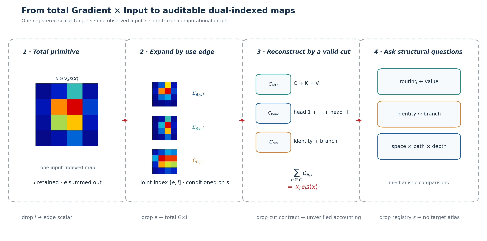

**Figure 1.** 同一输入经过正常前向计算得到预测；NNS-ViT 为内部目标与输出目标提供保留输入位置的学习图像。虚线表示目标与学习图像的对应关系。

本文的贡献包括三个方面。首先，我们给出 NNS 学习图像的局部 Jacobian 表达，并将其推广到 ViT 的实际计算算子。其次，我们建立从标量单元到 attention/residual 路径的统一表示，推导不同路径在合法计算切面上的组合关系。最后，我们结合逐层可视化、全样本空间统计和有限替换实验，分析输入依赖的层深变化、路径差异与行为含义。本文的学习图像在数值上是同目标 Gradient × Input；方法的扩展在于内部对象及其结构关系的统一表达。

下文先介绍相关工作，再以坐标初始化和逐层生成说明学习图像，随后给出 ViT 结构分解。实验部分依次讨论表示的正确性、层间与模块间变化、方法可视化比较及有限干预。

## 2. 相关工作

### 2.1 神经元与特征可视化

神经元可视化通过输入模式或实际样本分析内部响应。NNS 将单个神经元的计算组织为输入坐标 learning image，并用 activation-weighted aggregation 表示卷积通道（Dou et al., 2023）。这种组织方式使具有不同原生空间结构的内部对象可以共享同一图像表示。本文将其用于 token-channel 单元、通道聚合响应和 ViT 内部路径，同时保留它们各自的标量定义。

### 2.2 梯度归因与 Transformer 可视化

Gradient × Input 表示观测点上的输入加权梯度；Integrated Gradients 沿参考到输入的路径平均梯度（Sundararajan et al., 2017），conductance 进一步描述输出归因经过隐藏单元的过程（Dhamdhere et al., 2018）。本文使用当前点的真实 Jacobian。Grad-CAM 通过梯度加权特征图获得类别相关定位（Selvaraju et al., 2017）。Attention rollout 组合跨层 attention flow（Abnar and Zuidema, 2020），Transformer relevance 方法则采用特定传播规则（Chefer et al., 2021；Achtibat et al., 2024）。这些方法的目标不同，实验中将其作为互补视图进行同输入比较。

### 2.3 内部干预与解释评价

Activation replacement 通过替换内部响应测量有限输出变化。Activation-space Taylor 使用 clean gradient 与替换位移的内积近似该变化；AtP* 分析了注意力饱和与抵消带来的近似误差（Kramár et al., 2024）。局部输入依赖与有限替换回答不同问题，因此本文分别考察整成分排序和固定空间预算下的区域选择。

## 3. 方法

### 3.1 学习图像的初始化与生成

一个神经元输出标量值，学习图像则保留该标量所依赖的输入坐标。Figure 2 用四坐标网络说明这种对应关系；Figure 3 将输入拆为坐标图；Figure 4 展示这些图如何按局部导数组合。

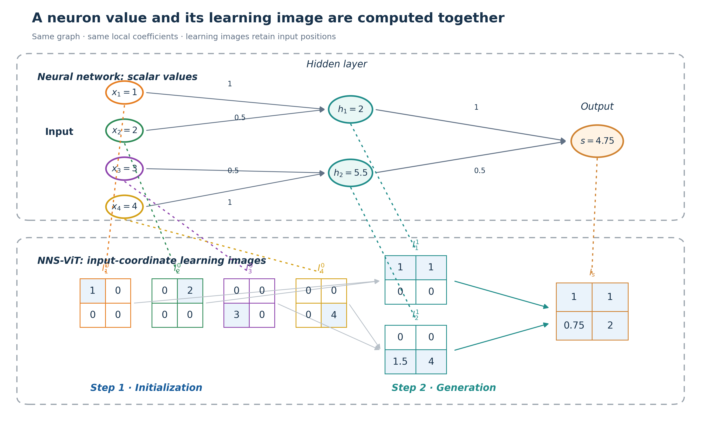

**Figure 2.** 同一四坐标网络的正常数值计算与 NNS-ViT 学习图像传播。节点与对应学习图像使用同色标记；下方矩阵保留各输入项的位置，并按上方网络的局部系数组合。

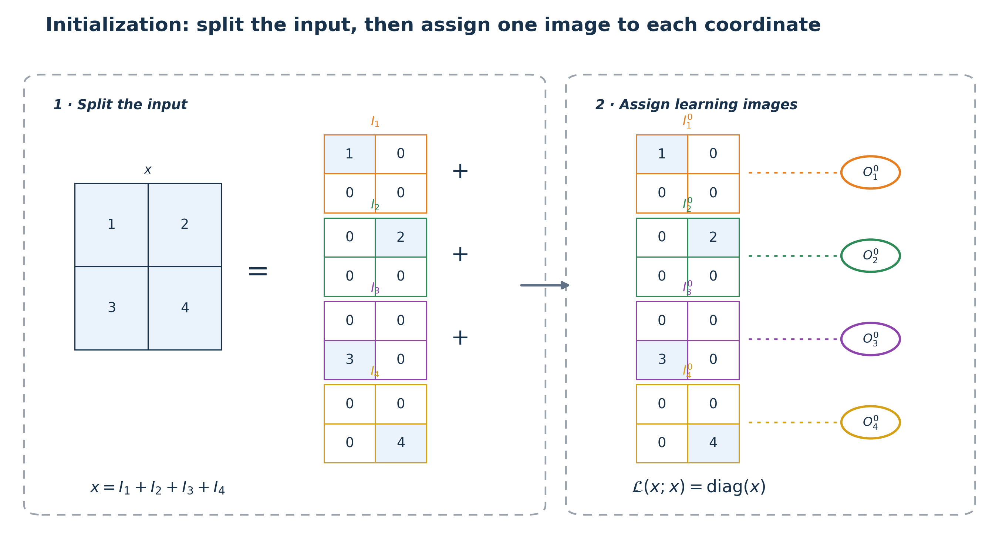

**Figure 3.** 初始化分为拆分与分配两步：输入矩阵被拆成四张稀疏坐标图，并按同色虚线分配给四个输入节点。每张图同时保存输入值与其位置。

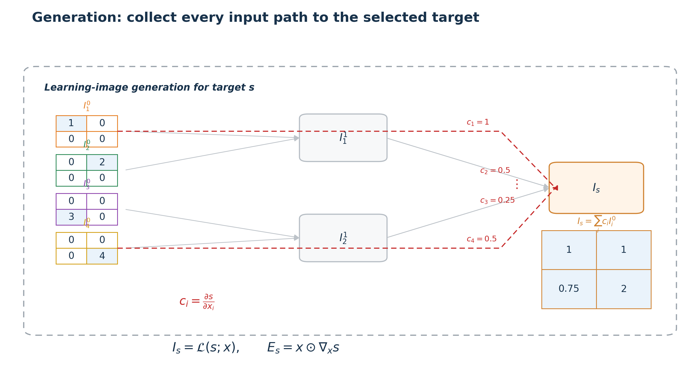

**Figure 4.** 中间网络以灰色显示，红色虚线路径突出每个输入坐标到目标的合成局部系数。右下矩阵是四张输入 learning images 的加权和，与输入乘目标梯度一致。

设图像输入为列向量 $x\in\mathbb R^d$，标量梯度 $\nabla_xs\in\mathbb R^d$ 也按列向量记。对 $u(x)\in\mathbb R^m$，learning-image 矩阵为 $\mathcal L(u;x)\in\mathbb R^{m\times d}$。初始化与传播规则为

$$
\mathcal L(x;x)=\operatorname{diag}(x),\qquad
\mathcal L(v;x)=\sum_aJ_{f,u_a}(x)\mathcal L(u_a;x),\quad v=f(u_1,\ldots,u_r).
$$

**命题 1。** 若所有局部 Jacobian 在同一当前前向状态求值，则

$$
\mathcal L(u;x)=J_{u,x}(x)\operatorname{diag}(x),\qquad
\mathcal L(s;x)=\nabla_xs(x)^\top\operatorname{diag}(x),\qquad
E_s(x)=\mathcal L(s;x)^\top=\operatorname{diag}(x)\nabla_xs(x).
$$

**证明。** 输入处 $J_{x,x}=I$。按计算图拓扑顺序递推，将各前驱的表达式代入传播规则，再使用多输入链式法则，即得到每个节点的结论。对标量节点转置得到列向量 Endpoint。在线性、卷积和当前 ReLU gate 下，该规则恢复原始 NNS 系数；MaxPool 使用当前前向 winner。ReLU 零点和 MaxPool 并列遵循框架的固定导数选择，光滑区域内使用通常导数。

Endpoint 表示当前点上目标关于各输入坐标缩放方向的局部一阶依赖：对 $x_i\mapsto(1+\epsilon)x_i$，其一阶响应为 $\epsilon E_{s,i}$。一般有

$$
\sum_iE_{s,i}=x^\top\nabla_xs(x)\ne s(x).
$$

一阶齐次函数在可微点可由 Euler 定理得到等号；含 bias、固定 token、位置编码、LayerNorm、softmax 和 GELU 的一般 ViT 不满足这一条件。Endpoint 重构局部输入 Jacobian 分解，不能作为目标全部来源或函数值的完整分解。CLS token、位置编码和 patch/LN/QKV/MLP/classifier 的偏置没有独立图像坐标项，但会改变当前函数和 Jacobian。

若 $x=(r-\mu)/\sigma$，则

$$
x_i\frac{\partial s}{\partial x_i}=(r_i-\mu_i)\frac{\partial s}{\partial r_i}.
$$

因此 Endpoint 不需要外部选择的 intervention reference，但依赖模型输入坐标及 normalization origin。

### 3.2 从输入 patch 到内部标量

ViT 的 patch embedding 将每个局部图像块映射到 token 向量。Figure 5 表明，线性投影改变响应维度，而学习图像仍位于输入像素网格。

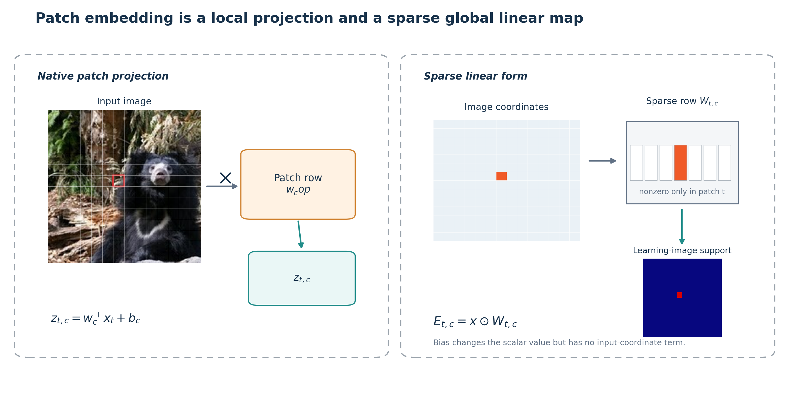

**Figure 5.** 左栏以真实图像说明 patch embedding 的局部投影；右栏将同一运算写成全局输入上的稀疏线性行。橙色区域在 token、稀疏权重与 learning-image support 之间一一对应。

本文区分原生 token-channel 单元、聚合响应、结构路径和输出目标（Figure 8）。对通道 $c$ 的 patch activations，定义

$$
s_{\mathrm{energy}}=\frac12\sum_{t=1}^{196}h_{t,c}^2,\qquad
\nabla_xs_{\mathrm{energy}}=\sum_th_{t,c}\nabla_xh_{t,c},\qquad
E_{\mathrm{energy}}=\sum_th_{t,c}E_{h_{t,c}}.
$$

这给出原始 NNS activation-weighted filter aggregation 的 Jacobian 形式；energy 是聚合标量而非单个神经元。目标还包括 patch sum、head 内部坐标、final CLS channel、ground-truth logit 和 frozen clean-top1 logit。跨模型同编号 channel 不视为同语义单元。

### 3.3 Attention 与 residual 的路径分解

Figure 6 将内容传递与权重变化分开，Figure 7 则将 residual 的 identity 与 branch 并列。

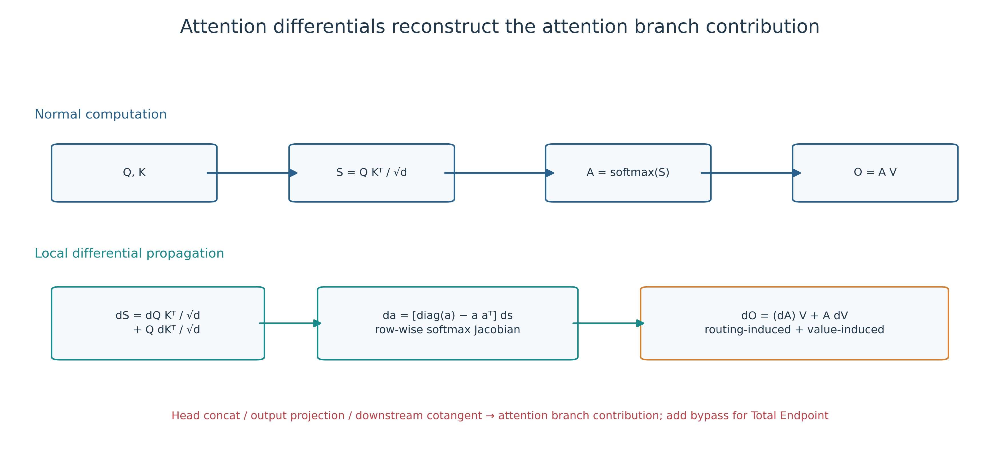

**Figure 6.** Q/K 的变化通过 attention weights 改变 routing；V 的变化通过当前权重传播。两条微分路径相加重构完整 attention 微分，head 下游 cotangent 包含 output projection。

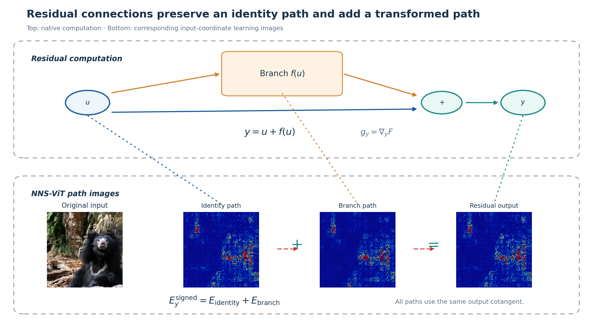

**Figure 7.** 上方显示 residual 的 identity 与 branch 两条真实计算边；下方用同色虚线连接到同一输入、同一类别目标的路径 learning images。完整 signed maps 相加得到 residual output，蓝底正部用于阅读空间结构。

对每个 head，$Q=XW_Q+b_Q$、$K=XW_K+b_K$、$V=XW_V+b_V$，且

$$
A=\operatorname{softmax}(QK^\top/\sqrt{d_h}),\quad O_h=AV,\quad
\mathrm dO_h=(\mathrm dA)V+A\mathrm dV.
$$

第一项再分为 Q 和 K 两条输入微分路径，因此

$$
E^{\mathrm{attn}}=E^Q+E^K+E^V=E^{\mathrm{routing}}+E^{\mathrm{value}}.
$$

Head 边位于拼接和 output projection 之前：$O=\operatorname{concat}_h(O_h)W_O+b_O$。其下游 cotangent 包含 $W_O$ 及目标之后的全部导数；偏置没有输入微分项。Q/K/V 路径共享上游输入，允许在输入空间重叠。路径 norm 比例描述局部尺度，不能解释为互斥因果百分比。

对 residual $y=u+f(u)$，令 $g_y=\nabla_yF$。正确的两项为

$$
E^{\mathrm{id}}=\operatorname{diag}(x)J_{u,x}^\top g_y,\qquad
E^{\mathrm{branch}}=\operatorname{diag}(x)J_{u,x}^\top J_{f,u}^\top g_y.
$$

Identity 使用 residual 输出处的 $g_y$；直接使用已包含 branch 的 $\nabla_uF$ 会重复记账。相加恢复 Endpoint，但不产生 $F=F_{\mathrm{id}}+F_{\mathrm{branch}}$ 的函数值分解。

### 3.4 完整计算切面上的组合关系

对目标 $F$ 的切面边 $\{z_k\}$，定义

$$
E^C_{k,i}=x_i\left\langle g_{z_k},\frac{\partial z_k}{\partial x_i}\right\rangle.
$$

**命题 2。** 若每条相关 input-to-target differential path 恰好穿过切面一次，各成分使用同一前向状态，cotangent 位于相应真实边，且没有遗漏或重复路径，则 $\sum_kE^C_{k,i}=x_i\partial F/\partial x_i$。

**证明。** 展开链式法则为各输入到目标路径的 Jacobian 乘积。合法切面把路径不重不漏地分组；每组可因式分解为到达 $z_k$ 的上游 Jacobian 与该边的下游 cotangent。对所有组求和，再乘输入坐标 $x_i$，即得结论。分支内部的 cut 只重构该分支；重构完整 residual 或目标时还需纳入 bypass。

### 3.5 质量、抵消与 Value-only 近似

在原始 normalized-input RGB 张量坐标上定义 $m(E)=\sum_i|E_i|$、$a(E)=\sum_iE_i$。单图抵消和两路径抵消分别为

$$
C^{\mathrm{map}}=1-\frac{|\sum_iE_i|}{\sum_i|E_i|},\qquad
C^{\mathrm{path}}=1-\frac{\|E^{(1)}+E^{(2)}\|_1}{\|E^{(1)}\|_1+\|E^{(2)}\|_1}.
$$

Routing scale 为 $\|E^{\mathrm{routing}}\|_1/(\|E^{\mathrm{routing}}\|_1+\|E^{\mathrm{value}}\|_1)$；identity scale 同理。Value-only 近似保留 $A\mathrm dV$，遗漏 $(\mathrm dA)V$。Endpoint 与 JVP 的相对误差分别以完整 map 或完整方向响应的 L2 norm 为分母。约 0.95 的误差表示与完整响应同量级的差异。

统计在完整 signed RGB 张量上计算，零分母或零范数记为 NA。蓝底显示规则在实验设置中说明。

### 3.6 有限替换与空间区域选择

成分有限效应为 $e_k=F(x)-F(x;z_k\leftarrow z_k^{\mathrm{ref}})$，主要统计比较每图 $m(E_k)$ 与 $|e_k|$ 的 Spearman 相关。Taylor 量为 $p_k=\langle\nabla_{z_k}F,z_k(x)-z_k^{\mathrm{ref}}\rangle$。

空间任务固定 block 5 的三个 heads，将输入分成 $4\times4$ 区域并依次替换 1、2、4 个区域。干预只把目标 head 的边替换为对应扰动输入产生的 activation，其余 heads 与 identity 保持 clean。每条曲线先取 absolute isolated effect，在面积 0–25% 上作梯形积分并除以 0.25，再在图内平均三个 heads。随机基线先平均 20 条 signed effect 曲线，再取绝对值积分。Endpoint、total G×I、raw gradient、regional Taylor 和 random 共用候选池与面积预算。

## 4. 实验设置

### 4.1 模型与图像

实验采用 ViT-B/16 和 DeiT-S/16 两个 ImageNet 分类模型。两模型共享 400 张 evaluation 图像；另有互不重叠的 64 张 discovery 和 64 张 calibration 图像。输入短边 resize 到 248 后中心裁剪为 224，采用各模型的 normalization 参数，推理时关闭 dropout 和 drop path。Table 1 列出模型设置。

**Table 1. 模型设置**

| Model / setting | ViT-B/16 | DeiT-S/16 |
| --- | --- | --- |
| Blocks / heads / hidden dimension | 12 / 12 / 768 | 12 / 6 / 384 |
| Registered scalar targets/image | 457 | 385 |
| Evaluation images | 400 | 400 (same IDs) |
| Resize / crop | 248 / 224 | 248 / 224 |
| Normalization mean | [0.5, 0.5, 0.5] | [0.485, 0.456, 0.406] |
| Normalization std | [0.5, 0.5, 0.5] | [0.229, 0.224, 0.225] |

分层单元研究使用另外 100 张共享图像，每层选择 CLS、15 个空间分层 patch tokens 和 32 个预定 channels。每个 model-image 包含 6,144 个 post-block 标量，共 1,228,800 个记录。原目录覆盖 ViT-B/16 与 DeiT-S/16 post-block token-channel 候选的 0.01058%/0.02115%，分层研究覆盖 0.338%/0.677%。这些比例界定了本文的单元抽样范围。

### 4.2 可视化设置

概念和层间图使用主体可辨的懒熊样本，方法对比另外使用螳螂和小蓝鹭。样本按展示可读性选择，总体结论仍来自完整样本。为对应学习图像与前向特征，每层按 patch activation 的空间方差选择通道，并将该通道的 energy 定义为标量目标。图中同时给出通道编号及实际 14×14 前向 feature map；不同层可以选择不同通道。

主学习图像采用深蓝至青、黄、红的正部视图。设 $P=\max(\sum_cE_c,0)$，显示值为 $\sqrt{\min(P/q_{.99},1)}$，其中 $q_{.99}$ 在正值像素上计算。该变换提高弱细节的可见性，并保持像素位置；它不参与任何统计。Figure 22 同时显示 signed 与 absolute 视图。对比图另列 patch-max 加双线性插值的显示变体，明确区分原生细粒度图与平滑区域图。

### 4.3 统计与数值验证

所有总体推断先在图内聚合，以图像作为统计单位，使用 10,000 次 bootstrap。成分相关规则的 0.10 与区域增益规则的 0.05 是点估计门槛；符号检验检验相对零的方向，采用原 28 项 Holm 校正，CI 精度上限分别为 0.30/0.50。单元层深统计按模型使用五项校正；后续 residual spatial-TV 分析单独标为 post-hoc。

表格用于报告离散数值验证，避免把少量误差点绘为趋势。Table 2 汇总五类原始 NNS 兼容网络的数值一致性与结构检查。原始 float32 有限差分失败和 float64 复核保留在补充材料中。

**Table 2. 数值一致性与结构检查**

| Compatible network | Max relative L2: float64 | Max relative L2: float32 | Comparisons |
| --- | --- | --- | --- |
| fcn | 4.371e-16 | 1.964e-07 | 1,000 |
| cnn | 4.289e-16 | 2.189e-07 | 1,000 |
| cnn_maxpool | 4.769e-16 | 2.427e-07 | 1,000 |
| residual_mlp | 2.686e-16 | 2.155e-07 | 1,000 |
| residual_cnn | 2.923e-16 | 1.692e-07 | 1,000 |

| Structural / directional check | Count | Result |
| --- | --- | --- |
| Positive closures | 76,800 | All pass |
| Omission/duplication controls | 28,800 | All rejected |
| Analytic JVP | 6,144 | All pass |
| Operator directions | 88 | All pass |
| Atlas float32 finite differences | 57,600 | 36 outside tolerance |
| Same-coordinate float64 review | 36 | All pass |

## 5. 结果与分析

### 5.1 学习图像与前向特征的层间变化

Figures 8–11 以同一输入展示内部响应。前向 feature map 给出通道在 token 网格上的值，学习图像给出相应 scalar 对输入像素的局部依赖；两行空间图因此能够相互补充。浅层学习图像保留局部纹理，后续层产生不同的分布和细节。图中也存在背景响应与离散热点，表明高分辨率本身不保证完整物体轮廓。

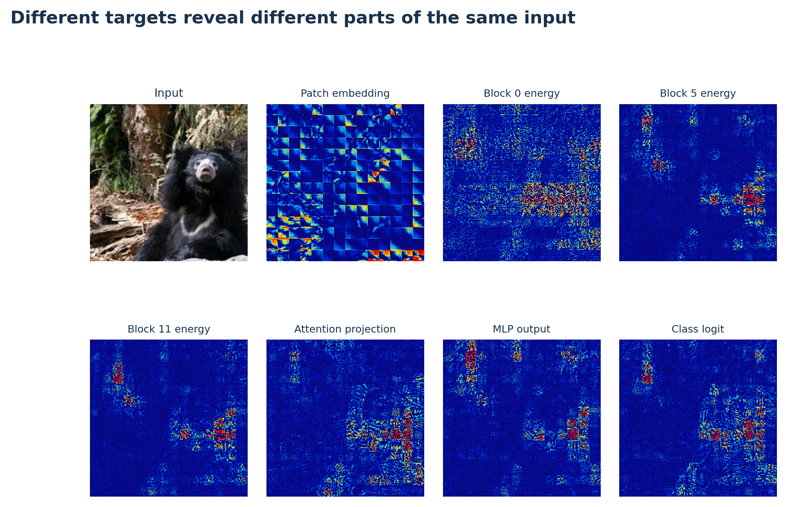

**Figure 8.** 同一图像的不同内部与类别目标。Energy targets 使用前向空间方差最大的通道；这与单个 token-channel 目标和最终类别目标区分。

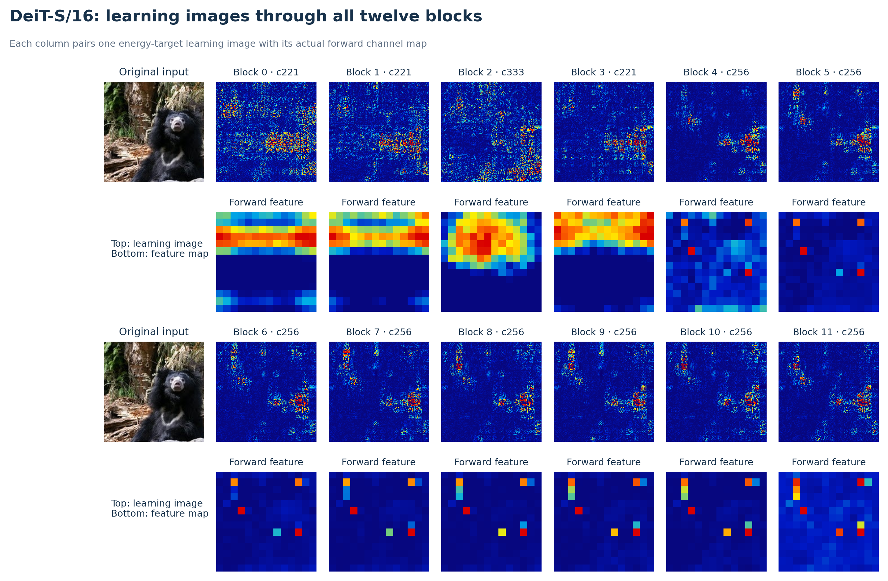

**Figure 9.** 同一懒熊输入跨全部 12 层的学习图像及真实前向特征。每层通道按前向空间方差选择；上排为该通道 energy scalar 的输入图，下排为该通道原生 14×14 activation 的正部。各面板独立缩放。

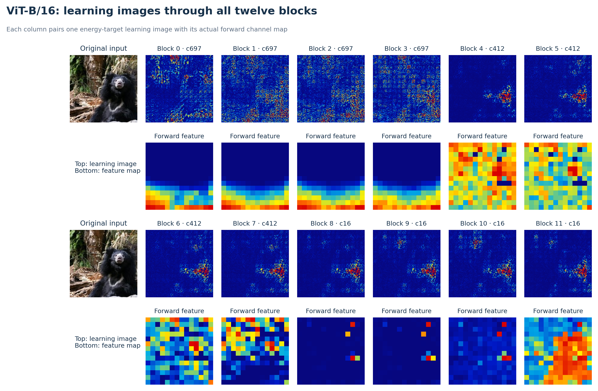

**Figure 10.** 同一懒熊输入跨全部 12 层的学习图像及真实前向特征。每层通道按前向空间方差选择；上排为该通道 energy scalar 的输入图，下排为该通道原生 14×14 activation 的正部。各面板独立缩放。

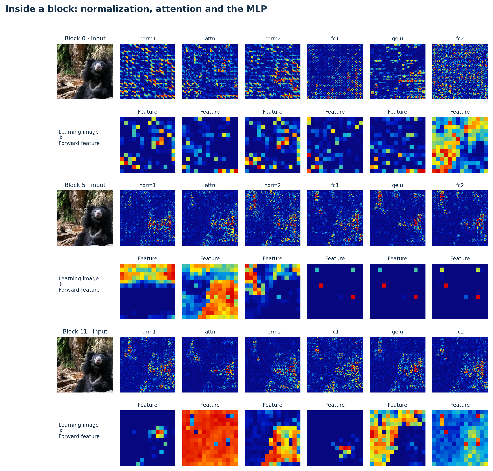

**Figure 11.** DeiT-S blocks 0、5、11 内部模块的学习图像和真实前向 activation。每个模块独立选择高空间方差通道并定义 energy target；LayerNorm、attention projection、MLP 的 fc1/GELU/fc2 清楚对应。

单元抽样统计进一步描述这一变化（Figure 12）。ViT-B/16 与 DeiT-S/16 的 late-minus-early entropy 增加 0.2201/0.2250，own-token locality 下降 0.3558/0.3424，normalized distance 增加 0.1312/0.1219。各对比均有 100/100 张图呈相同方向。这里的 early/middle/late 指 blocks 0–3/4–7/8–11，结果表明抽样单元依赖更广、更远的输入区域。

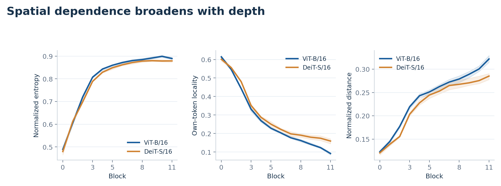

**Figure 12.** 完整样本 的图像级层深轨迹，阴影为 95% bootstrap 区间。空间分析每模型 100 图，attention/residual 每模型 400 图；推断沿用预先指定的分析。

CLS-minus-patch entropy 从 block 0 的 0.4752/0.4712 缩小到 block 11 的 0.0086/0.0238。Net/absolute mass 同时从 0.00872/0.00712 降至 0.00144/0.00132。空间扩展与较强正负抵消可以同时出现，absolute mass 因而描述局部项的总幅值而非净响应。

### 5.2 注意力头与 routing/value 路径

Figure 13 展示三个深度处的全部 DeiT-S heads；Figure 14 给出三个输入在两模型中的类别图。相同类别目标可通过多个空间上重叠的 head 路径依赖输入。Figure 15 将 attention 进一步分为 Q、K、routing 和 value，使分配权重的变化与内容传递可以分别观察。

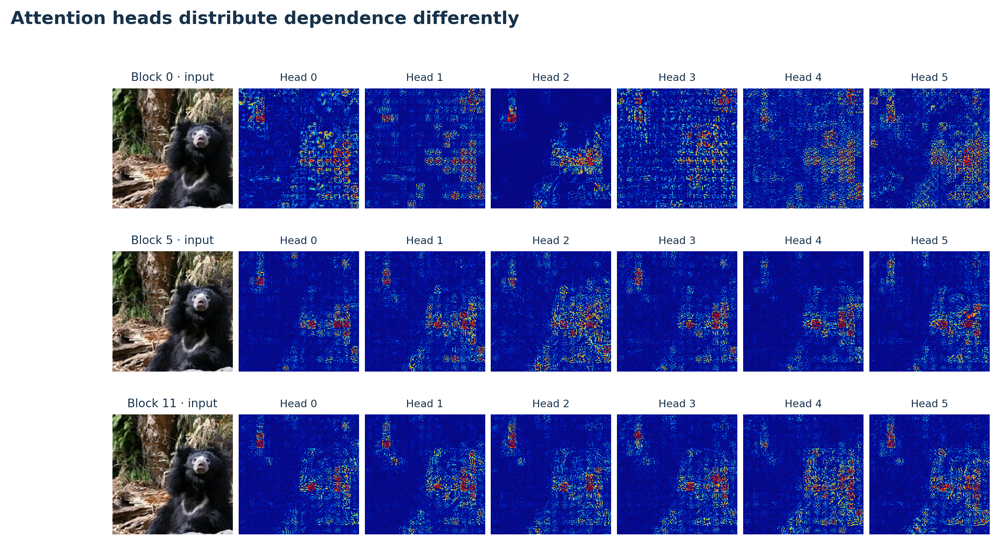

**Figure 13.** DeiT-S 在 blocks 0、5、11 的全部六个 heads，对同一个 ground-truth logit 的输入依赖图。原图逐行保留，无按地图观感筛选 head。

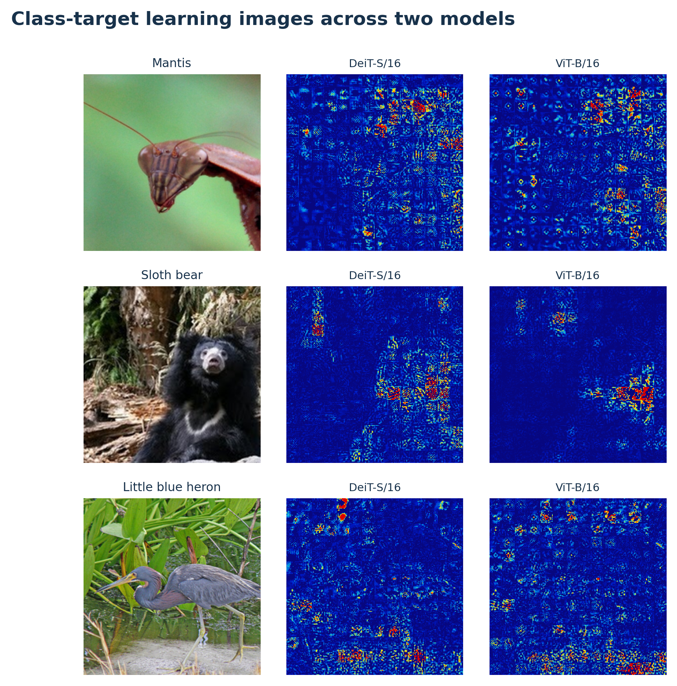

**Figure 14.** 三个主体可辨的展示样本及两模型的同类别 Endpoint。样本为展示选择，模型间颜色强度不作为量值比较。

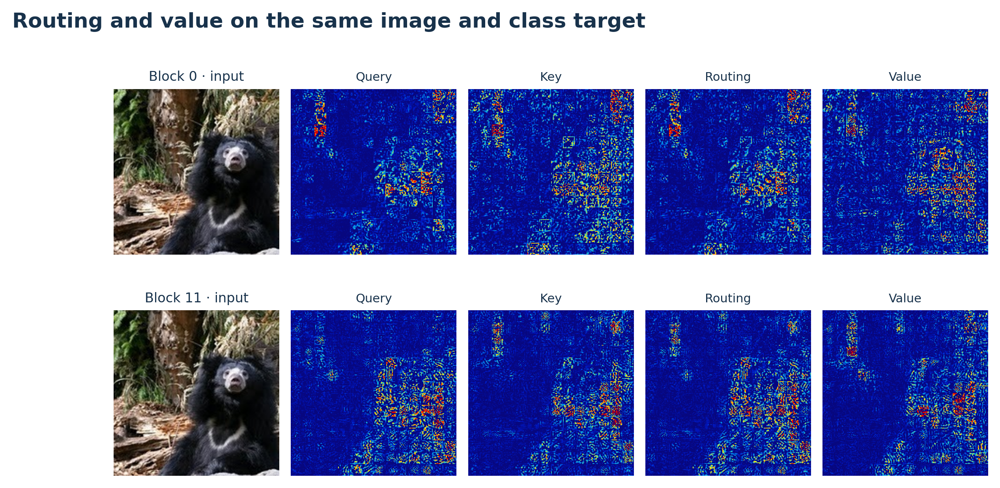

**Figure 15.** 同一懒熊输入在浅层和深层的 Q、K、routing 与 value 路径。蓝底保留正部细节；signed closure 和绝对质量来自完整原始数组。

在 400 张图的目标条件化分析中，routing scale 从 block 0 的 0.3092/0.2041 增至 block 11 的 0.5154/0.4808；Value-only Endpoint error 从 0.4407/0.2774 增至 0.8022/0.8488（Figure 16）。相应 JVP discrepancy 达到 0.9516/0.9636，完整响应 norm 为 14.9711/1.5155，绝对差异为 13.8064/1.4228。深层差异与完整响应同量级，不能解释为遗漏贡献的百分比。

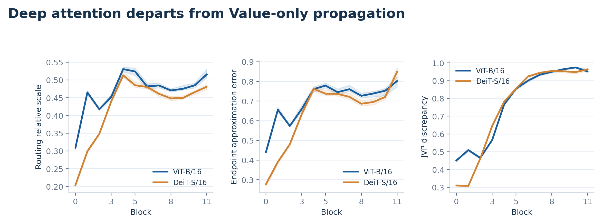

**Figure 16.** 完整样本 的图像级层深轨迹，阴影为 95% bootstrap 区间。空间分析每模型 100 图，attention/residual 每模型 400 图；推断沿用预先指定的分析。

控制 activation norm 与下游 cotangent norm 后，mean-query saturation 与 routing scale 的 偏秩相关仍为 −0.1442/−0.3257。Sharper attention 不能直接作为更强 routing dependence 的代理；CLS-query 结果较弱，完整敏感性分析见补充材料。

### 5.3 残差路径的不同作用

Figure 17 以同一输入和目标展示 attention 与 MLP residual。两种结构均为 identity 加 branch，但 identity 的输入边不同；其局部依赖也呈现不同的层深趋势。Attention residual 的 late-minus-early identity scale 为 −0.1242/−0.0449，MLP residual 为 +0.1798/+0.1780（Figure 18）。

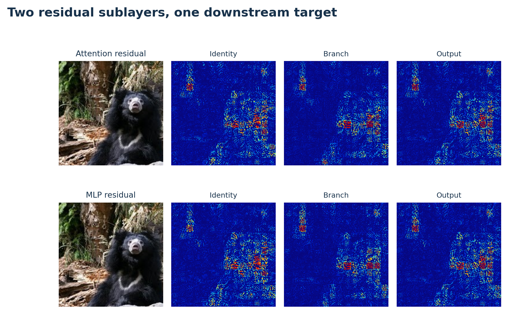

**Figure 17.** 同一 block 5 中 attention 与 MLP residual 对同一类别目标的两条路径。两行的 identity 指向不同 residual 输入边。正部图不可直接相加，完整 signed maps 满足闭合。

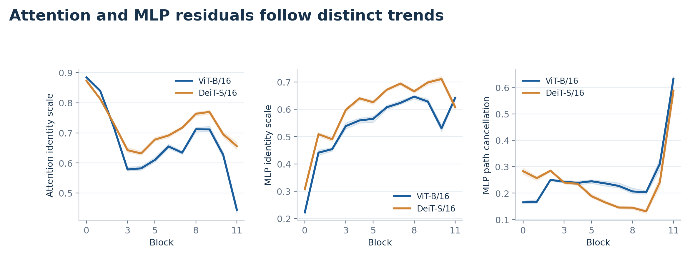

**Figure 18.** 完整样本 的图像级层深轨迹，阴影为 95% bootstrap 区间。空间分析每模型 100 图，attention/residual 每模型 400 图；推断沿用预先指定的分析。

后续全 cohort 空间分析得到，attention output–identity patch TV 的 late-minus-early 变化为 +0.0520/+0.0282，MLP 为 −0.0187/−0.0462，四项通过单独 Holm 校正。这些结果描述两个训练模型中不同 residual 子层的局部传递方式。Token-channel 层间分析与类别路径使用不同目标，因此二者提供互补的模型级观察。

### 5.4 与其他可视化方法的比较

Figures 19–20 比较同一输入上的 Endpoint、Grad-CAM、attention rollout 和 raw attention。Endpoint 与 Grad-CAM 均使用 GT logit；Grad-CAM 在最后一个 block 的 norm1 输出处计算，避免最终 CLS 读出使末端 patch 梯度退化。Attention rollout 使用 head 均值、identity residual、逐行归一化及逐层矩阵相乘，raw attention 使用末层 CLS-to-patch head 均值。

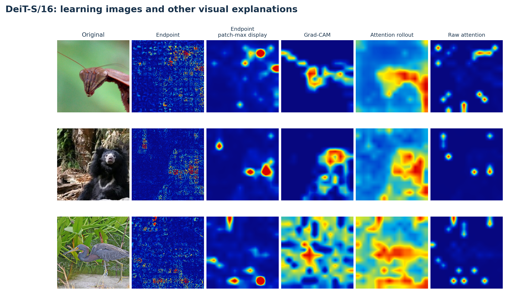

**Figure 19.** 同输入实际计算的 Endpoint、patch-max 显示变体、Grad-CAM、attention rollout 与 raw attention。Endpoint/Grad-CAM 使用同一 GT logit；后两种 attention 方法不依赖类别。所有图采用相同蓝底色系并独立归一化，只比较表示形态与粒度。

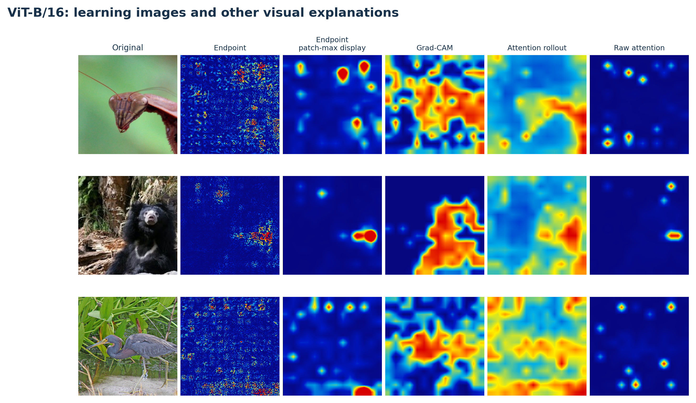

**Figure 20.** 同输入实际计算的 Endpoint、patch-max 显示变体、Grad-CAM、attention rollout 与 raw attention。Endpoint/Grad-CAM 使用同一 GT logit；后两种 attention 方法不依赖类别。所有图采用相同蓝底色系并独立归一化，只比较表示形态与粒度。 Figure 20 的三例在计算比较方法前，已按预先封存的 Endpoint/输入细节可读性规则选定。

Endpoint 保留像素尺度的局部项，Grad-CAM 和 attention 类方法提供较粗的区域分布。Patch-max 插值版本表明，聚合与插值本身就能显著改变学习图像的外观；它不改变基础定义。图中各方法有时突出不同区域，这反映目标与传播规则的差别。该比较用于说明表示粒度与对象，方法排序仍需要对应任务的定量评价。

### 5.5 从成分关联到区域干预

在成分替换实验中，12 个模型–reference–成分族组合有 11 个满足原复合条件。Table 3 直接列出相关估计、区间和阈值关系。ViT-B normalized-zero routing/value 为 0.09956521739130435，DeiT-S 对应估计为 0.1065，两个区间均跨越 0.10。因此 family 条件是否满足与总体效应是否超过 0.10 是不同判断；原 全部成分族的联合条件 未满足。

**Table 3. 成分关联估计及区间**

| Model | Reference | Family | Median rho | 95% CI | Holm p | Composite criterion | CI lower > 0.10 |
| --- | --- | --- | --- | --- | --- | --- | --- |
| ViT-B/16 | normalized-zero | heads | 0.2909 | [0.2813, 0.2982] | 2.17e-119 | Met | yes |
| ViT-B/16 | normalized-zero | routing/value | 0.0996 | [0.0748, 0.1226] | 3.00e-14 | Unmet | no |
| ViT-B/16 | normalized-zero | residual/branches | 0.1774 | [0.1548, 0.1952] | 2.56e-46 | Met | yes |
| ViT-B/16 | blur | heads | 0.3063 | [0.2957, 0.3181] | 2.17e-119 | Met | yes |
| ViT-B/16 | blur | routing/value | 0.1565 | [0.1322, 0.1774] | 9.96e-29 | Met | yes |
| ViT-B/16 | blur | residual/branches | 0.2091 | [0.1817, 0.2374] | 1.46e-41 | Met | yes |
| DeiT-S/16 | normalized-zero | heads | 0.1910 | [0.1769, 0.2052] | 1.88e-76 | Met | yes |
| DeiT-S/16 | normalized-zero | routing/value | 0.1065 | [0.0817, 0.1291] | 2.11e-10 | Met | no |
| DeiT-S/16 | normalized-zero | residual/branches | 0.1352 | [0.1148, 0.1643] | 4.35e-19 | Met | yes |
| DeiT-S/16 | blur | heads | 0.1817 | [0.1688, 0.1951] | 3.82e-72 | Met | yes |
| DeiT-S/16 | blur | routing/value | 0.1600 | [0.1278, 0.1822] | 9.90e-31 | Met | yes |
| DeiT-S/16 | blur | residual/branches | 0.2287 | [0.2035, 0.2504] | 3.70e-54 | Met | yes |

补充同层 head 比较中，Taylor 具有更高 Spearman 与 Capture、更低 Regret（Table 4）。跨层 residual identity 的 Endpoint−Taylor Spearman 差为 0.0865–0.4209，但 Capture@1 中位差为零，表明增量价值依赖任务和指标。

**Table 4. 同层 head 排序：E=Endpoint，T=Taylor**

| Model | Reference | E rho | T rho | E Capture@1 | T Capture@1 | E Capture@3 | T Capture@3 | E Regret@1 | T Regret@1 |
| --- | --- | --- | --- | --- | --- | --- | --- | --- | --- |
| ViT-B/16 | normalized-zero | 0.2815 | 0.6742 | 0.5174 | 0.8038 | 0.6149 | 0.8567 | 0.1701 | 0.0571 |
| ViT-B/16 | blur | 0.2727 | 0.6856 | 0.5075 | 0.8203 | 0.6185 | 0.8659 | 0.1163 | 0.0346 |
| DeiT-S/16 | normalized-zero | 0.1952 | 0.6095 | 0.5609 | 0.8028 | 0.7122 | 0.8894 | 0.2381 | 0.0860 |
| DeiT-S/16 | blur | 0.1476 | 0.6238 | 0.5506 | 0.8426 | 0.7105 | 0.8970 | 0.1326 | 0.0443 |

区域实验固定 block 5 的三个 heads，所有方法共用 4×4 候选区域及最高 25% 面积。Figure 21 和 Tables 5–7 给出配对差、绝对 AUC 与归一化 regret。Endpoint−regional Taylor 的配对中位差为 −0.023433、−0.023697、−0.029900、−0.035630；四个 family 都未满足相对全部基线的 +0.05 条件。候选 oracle 仅取实际评价集合的最优效果，不能视为全部可能区域的全局最优。

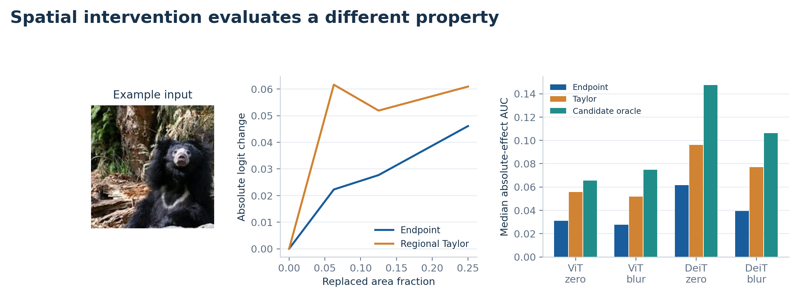

**Figure 21.** 左侧示例的有限区域替换曲线与右侧完整 400 图 family 的绝对 AUC。候选 oracle 只在已评价区域集合中取最优；数学闭合与区域干预选择属于不同性质。

**Table 5. 空间干预配对差**

| Model | Reference | vs total G×I | vs gradient | vs Taylor | vs random | Composite criterion |
| --- | --- | --- | --- | --- | --- | --- |
| ViT-B/16 | normalized-zero | -0.0009 | -0.0000 | -0.0234 | 0.0011 | Unmet |
| ViT-B/16 | blur | -0.0010 | -0.0007 | -0.0237 | 0.0042 | Unmet |
| DeiT-S/16 | normalized-zero | -0.0018 | -0.0006 | -0.0299 | 0.0107 | Unmet |
| DeiT-S/16 | blur | 0.0002 | -0.0002 | -0.0356 | 0.0085 | Unmet |

**Table 6. 绝对 AUC 与输出尺度**

| Model | Reference | Endpoint AUC | Taylor AUC | Random AUC | Candidate oracle AUC | Clean GT logit |
| --- | --- | --- | --- | --- | --- | --- |
| ViT-B/16 | normalized-zero | 0.0309 | 0.0558 | 0.0294 | 0.0654 | 8.8989 |
| ViT-B/16 | blur | 0.0276 | 0.0518 | 0.0225 | 0.0747 | 8.8989 |
| DeiT-S/16 | normalized-zero | 0.0617 | 0.0961 | 0.0475 | 0.1474 | 8.7974 |
| DeiT-S/16 | blur | 0.0395 | 0.0770 | 0.0296 | 0.1063 | 8.7974 |

**Table 7. 候选 oracle regret 与 logit 尺度比**

| Model | Reference | Endpoint regret | Taylor regret | Random regret | Endpoint AUC/abs(logit) | Taylor AUC/abs(logit) |
| --- | --- | --- | --- | --- | --- | --- |
| ViT-B/16 | normalized-zero | 0.5303 | 0.1442 | 0.5563 | 0.0035 | 0.0062 |
| ViT-B/16 | blur | 0.6366 | 0.2557 | 0.6942 | 0.0031 | 0.0059 |
| DeiT-S/16 | normalized-zero | 0.5646 | 0.3352 | 0.6780 | 0.0072 | 0.0107 |
| DeiT-S/16 | blur | 0.6289 | 0.2705 | 0.7130 | 0.0045 | 0.0089 |

跨 reference 分析补充了这一结果的含义。Endpoint 使用观测输入处的 clean map，而 Taylor 显式使用替换位移。对 163,200 个成分配对，Taylor magnitude 与 absolute effect 在原 atol=1e-12、rtol=0 标准下均发生变化；分布及 head 排名一致性见补充表。Reference 会改变干预相关排序，局部输入图与位移估计器因而适用于不同问题。

## 6. 讨论

学习图像使不同内部对象能够在同一输入网格上观察。通过图中明确的目标、层与通道，读者可以比较前向响应和输入依赖，也可以检查注意力与残差如何组合局部路径。本文的理论推导和数值检验保证这些视图对应所定义的 Jacobian 对象；有限替换则进一步说明其行为用途。

蓝底高亮视图便于读取分散纹理，但只显示 signed RGB-sum 的正部。Figure 22 将其与 signed 和 absolute 视图并列。正部表示局部坐标缩放项的符号，不等同于有限删除时的预测支持；较大 absolute mass 也可能伴随较强抵消。

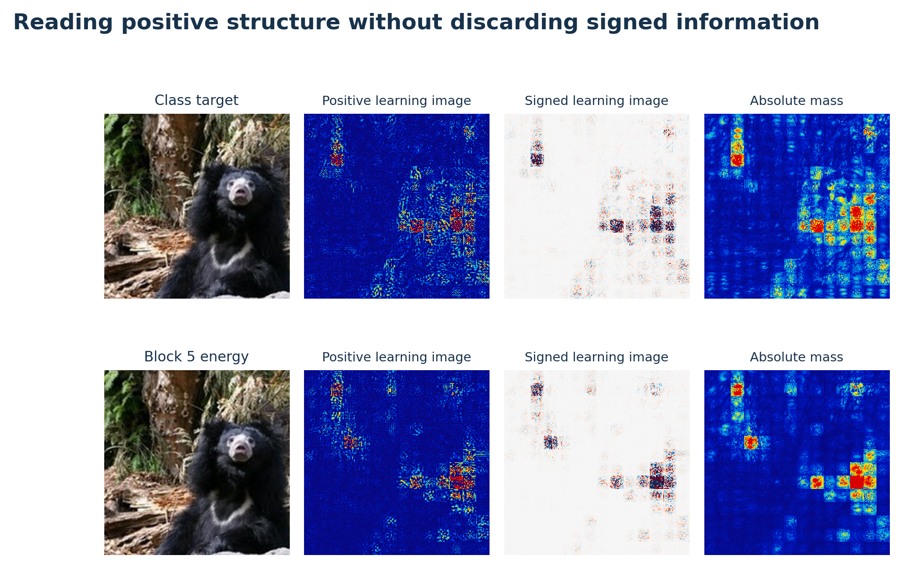

**Figure 22.** 同一原始图的蓝底正部、signed 与 RGB absolute mass 三种视图。正部用于读取空间细节，signed 保留方向，absolute 保留通道抵消前的总幅值。

本研究尚不能区分层深趋势来自架构、初始化还是训练。两模型同时在规模、head 数与训练策略上不同；缺少随机初始化和同架构替代 checkpoint 控制。路径结果以 GT logit 为条件，其在 clean-top1 目标以及正确/错误分类子集中的稳健性仍需研究。抽样 token-channel 与类别路径没有组成逐单元匹配的因果链。空间干预结论也受所选层、区域和 reference 限定。ViT-B Path IG 在既定 512 点范围内未达到共同校准要求，因此本文不报告跨模型 Endpoint–Path 比较。

## 7. 结论

本文将 NNS 的学习图像思想推广到视觉 Transformer，以局部 Jacobian 统一表示神经元、通道聚合响应和结构路径。坐标初始化与逐层生成保留输入位置，attention 和 residual 分解使同一目标的不同路径可以分别观察。两模型实验展示了输入依赖的层深空间扩展、深层 attention 对 routing differential 的依赖，以及 attention/MLP residual 的不同变化。与前向特征和其他方法的可视化比较说明了该表示的粒度与对象；有限替换进一步界定其成分级关联和区域选择能力。后续研究将结合训练控制与匹配目标实验，分析这些局部结构规律的形成来源。

## 参考文献与补充材料

[参考文献](../references.md)；[补充材料](supplement.md)。作者、单位及最终归档信息待补充：[REPOSITORY AND ARCHIVE REQUIRED]。
