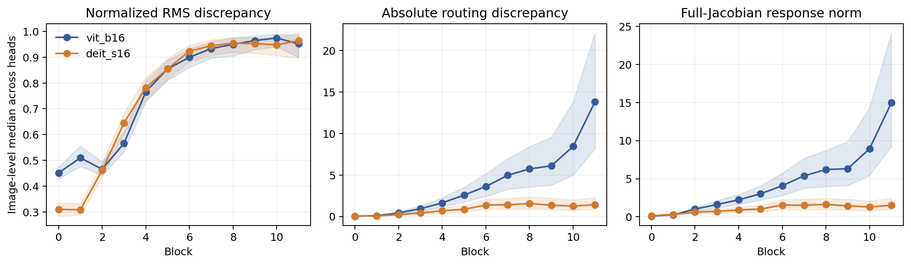
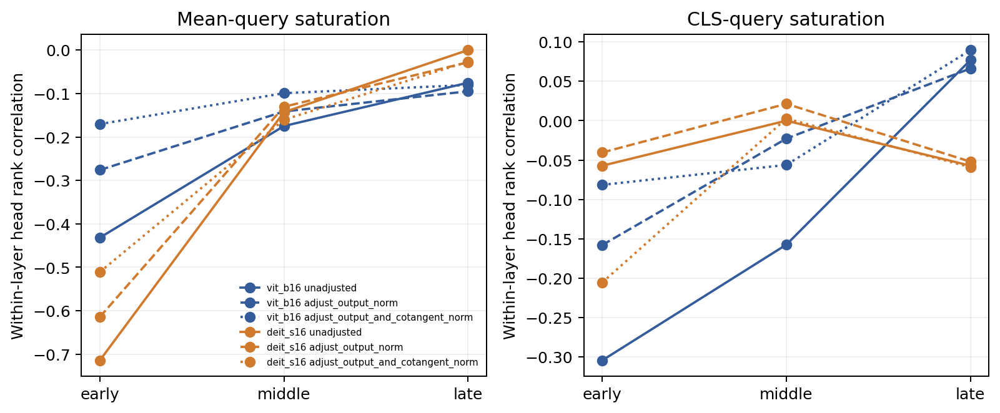
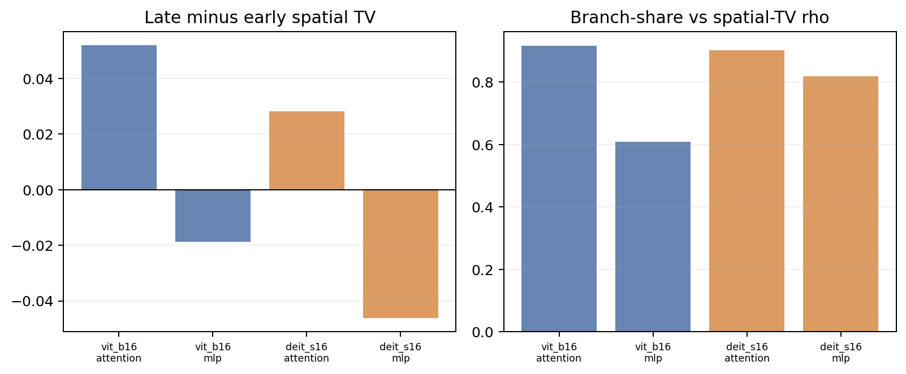
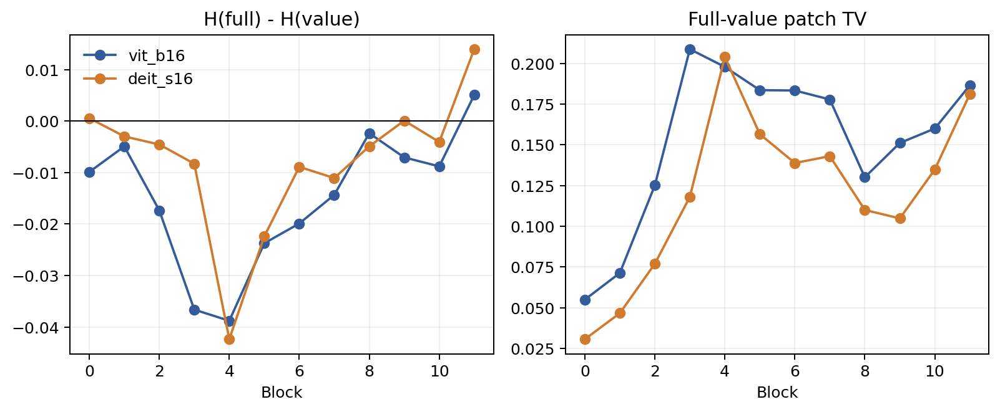

# 补充材料：NNS 计算图解释与 ViT 结构路径分析（修订 v2）

[返回正文](manuscript.md)。本文件包含复现参数、完整统计、历史图索引与后续实验范围。主文 RQ 编号按修订版使用。

## S1. Model and registry details

Models: `vit_base_patch16_224.augreg2_in21k_ft_in1k` and `deit_small_patch16_224.fb_in1k`. Torch 2.2.2+cu121; timm 0.9.16; torchvision 0.17.2+cu121; NumPy 1.26.4; Pillow 10.2.0.

**Table S1. Original scalar registry coverage.**

| Model | Object | Candidate definition | Candidates | Registered/image | Coverage | Strategy | Scalar neuron |
| --- | --- | --- | --- | --- | --- | --- | --- |
| vit_b16 | post-block token-channel | 12*197*D | 1,815,552 | 192 | 0.01058% | 12 blocks x 4 tokens x 4 channels | yes |
| vit_b16 | post-block patch sum/energy | 2*12*D | 18,432 | 96 | 0.52083% | 12 blocks x 4 channels x 2 aggregates | no |
| vit_b16 | attention-head coordinate | 12*H*197*64 | 1,815,552 | 144 | 0.00793% | all heads; CLS token; within-head channel 0 | yes |
| vit_b16 | module patch aggregate | 3*(4D+2*4D) | 27,648 | 18 | 0.06510% | blocks 0/5/11; six modules; channel 0 | no |
| vit_b16 | patch embedding aggregate | D | 768 | 4 | 0.52083% | four fixed channels; sum over patches | no |
| vit_b16 | final CLS coordinate | D | 768 | 1 | 0.13021% | channel 0 | yes |
| vit_b16 | ground-truth logit | 1000 | 1,000 | 1 | 0.10000% | frozen image label | output |
| vit_b16 | clean-top1 logit | 1000 | 1,000 | 1 | 0.10000% | frozen clean prediction | output |
| deit_s16 | post-block token-channel | 12*197*D | 907,776 | 192 | 0.02115% | 12 blocks x 4 tokens x 4 channels | yes |
| deit_s16 | post-block patch sum/energy | 2*12*D | 9,216 | 96 | 1.04167% | 12 blocks x 4 channels x 2 aggregates | no |
| deit_s16 | attention-head coordinate | 12*H*197*64 | 907,776 | 72 | 0.00793% | all heads; CLS token; within-head channel 0 | yes |
| deit_s16 | module patch aggregate | 3*(4D+2*4D) | 13,824 | 18 | 0.13021% | blocks 0/5/11; six modules; channel 0 | no |
| deit_s16 | patch embedding aggregate | D | 384 | 4 | 1.04167% | four fixed channels; sum over patches | no |
| deit_s16 | final CLS coordinate | D | 384 | 1 | 0.26042% | channel 0 | yes |
| deit_s16 | ground-truth logit | 1000 | 1,000 | 1 | 0.10000% | frozen image label | output |
| deit_s16 | clean-top1 logit | 1000 | 1,000 | 1 | 0.10000% | frozen clean prediction | output |

**Table S2. Resources and extended validation coverage.**

| Resource / validation | Value |
| --- | --- |
| Formal scan wall time | 1,752.71 s |
| Four-card GPU-hours upper bound | 1.9475 |
| Throughput | 192.16 targets/s |
| Retained data | 9.290 GB |
| Peak reserved GPU memory | 2.284 GB |
| Peak CPU RSS | 2.018 GB |
| M1 random permutations | 128,000,000 |
| M4 attention / residual / JVP records | 86,400 / 19,200 / 691,200 |

### S1.1 实现与核心指标伪代码

模型均处于 evaluation mode。M3 使用 torch.autograd.grad 的 is_grads_batched 模式分块执行 VJP，冻结 gradient_chunk_size=16；具体随机种子、模型与图像哈希、worker 环境和每任务耗时记录在对应 evidence JSON 中。主扫描的时间、吞吐、显存与保留数据量见 Table S2；补充控制实验的 456 个任务合计 2.4502 GPU-hours。核心实现位于 src/vitnns/endpoint_m3_atlas.py、src/vitnns/endpoint_m4.py 与相应 scripts/run_endpoint_*.py。

    Endpoint(s, x):
        g <- VJP(s, x) at the observed forward state
        return x * g

    StructuredCut(F, edges):
        for each actual use-edge z_k in a valid cut:
            g_k <- downstream cotangent dF/dz_k
            E_k <- x * VJP(z_k, x; vector=g_k)
        assert sum_k E_k closes to Endpoint(F, x)

    SpatialMetrics(E, target_patch):
        M[p] <- sum_rgb abs(E[p, rgb])
        if sum_p M[p] == 0: return NA
        p_patch <- patch_sum(M) / sum_p M[p]
        entropy <- -sum_j p_patch[j] log(p_patch[j]) / log(196)
        locality <- neighborhood_mass(target_patch) - uniform_neighborhood_mass
        distance <- sum_j p_patch[j] normalized_distance(j, target_patch)

    RandomRegionAUC(repeats):
        for each random repeat r:
            curve_r <- absolute finite effect at every area budget
            auc_r <- trapezoid(curve_r, area in [0, 0.25]) / 0.25
        return mean_r auc_r

CLS 没有自然的目标 patch，因此 locality 与 target-relative distance 仅对 patch-token 目标定义；零质量样本传播为 NA。图内 token、channel 与 head 先按预定规则汇总，再以图像为统计单位。

## S2. Frozen decisions and numerical diagnostics

C4a: BROAD_BUT_NON_UNIVERSAL_FAMILY_LEVEL_SUPPORT; original all-family omnibus NOT_SUPPORTED. C4b: NOT_SUPPORTED. The numerical atlas status is PASS_FLOAT64_RECOVERY_WITH_RETAINED_FLOAT32_FAILURE: 36/57,600 float32 failures are retained and 36/36 same-coordinate float64 checks pass. These fields are not interchangeable.

## S3. Reference sensitivity

Change uses atol=1e-12 and rtol=0. Relative change is abs(q0-qblur)/max(abs(q0),abs(qblur)); both-zero denominators are NA. Component quantiles describe the pooled records, not independent inferential samples.

**Table S3. Changes in Taylor magnitude and absolute finite effect.**

| Model | Quantity | Component pairs | Above tolerance | Abs change median [q10,q90] | Relative change median [q10,q90] |
| --- | --- | --- | --- | --- | --- |
| DeiT-S/16 | finite_effect | 67200 | 100.0% | 0.1365 [0.0161, 1.6575] | 0.4927 [0.0985, 0.8997] |
| DeiT-S/16 | taylor | 67200 | 100.0% | 0.1215 [0.0150, 0.7867] | 0.5186 [0.1172, 0.9033] |
| ViT-B/16 | finite_effect | 96000 | 100.0% | 0.0713 [0.0076, 1.4414] | 0.5300 [0.1117, 0.9137] |
| ViT-B/16 | taylor | 96000 | 100.0% | 0.0688 [0.0078, 0.5471] | 0.5225 [0.1133, 0.9052] |

Head rankings use average ranks and Kendall tau-b. Top-K ties are broken by ascending component ID; Top-3 overlap is intersection size / 3. Rank displacement uses original rank positions, so model head counts affect its scale. Each image averages 12 blocks, then summaries use 400 images. Full-order equality counts are Taylor 0/4,800 and effect 0/4,800 for ViT-B, Taylor 46/4,800 and effect 64/4,800 for DeiT-S.

**Table S4. Image-level rank concordance distributions.**

| Model | Quantity | Metric | Image median [q10,q90] | n / NA |
| --- | --- | --- | --- | --- |
| DeiT-S/16 | finite_effect | spearman | 0.3071 [0.1238, 0.4524] | 400 / 0 |
| DeiT-S/16 | finite_effect | kendall_tau_b | 0.2444 [0.0989, 0.3678] | 400 / 0 |
| DeiT-S/16 | finite_effect | top1_agreement | 0.4167 [0.1667, 0.5833] | 400 / 0 |
| DeiT-S/16 | finite_effect | top3_overlap | 0.6111 [0.5278, 0.6944] | 400 / 0 |
| DeiT-S/16 | finite_effect | mean_absolute_rank_displacement | 1.5278 [1.2778, 1.7528] | 400 / 0 |
| DeiT-S/16 | taylor | spearman | 0.3000 [0.1000, 0.4476] | 400 / 0 |
| DeiT-S/16 | taylor | kendall_tau_b | 0.2389 [0.0778, 0.3667] | 400 / 0 |
| DeiT-S/16 | taylor | top1_agreement | 0.3333 [0.1667, 0.5833] | 400 / 0 |
| DeiT-S/16 | taylor | top3_overlap | 0.6111 [0.5278, 0.6944] | 400 / 0 |
| DeiT-S/16 | taylor | mean_absolute_rank_displacement | 1.5278 [1.3056, 1.8056] | 400 / 0 |
| ViT-B/16 | finite_effect | spearman | 0.3759 [0.2622, 0.4904] | 400 / 0 |
| ViT-B/16 | finite_effect | kendall_tau_b | 0.2803 [0.1967, 0.3740] | 400 / 0 |
| ViT-B/16 | finite_effect | top1_agreement | 0.3333 [0.2500, 0.5833] | 400 / 0 |
| ViT-B/16 | finite_effect | top3_overlap | 0.5000 [0.4167, 0.6111] | 400 / 0 |
| ViT-B/16 | finite_effect | mean_absolute_rank_displacement | 2.9444 [2.6111, 3.2917] | 400 / 0 |
| ViT-B/16 | taylor | spearman | 0.3782 [0.2539, 0.4914] | 400 / 0 |
| ViT-B/16 | taylor | kendall_tau_b | 0.2828 [0.1942, 0.3737] | 400 / 0 |
| ViT-B/16 | taylor | top1_agreement | 0.3333 [0.2500, 0.5833] | 400 / 0 |
| ViT-B/16 | taylor | top3_overlap | 0.5000 [0.4167, 0.6111] | 400 / 0 |
| ViT-B/16 | taylor | mean_absolute_rank_displacement | 2.9444 [2.5972, 3.2792] | 400 / 0 |

## S4. Method objects

**Table S5. Functional comparison.**

| Method | Primary object | External reference | Propagation / contract |
| --- | --- | --- | --- |
| Endpoint | Current-input local dependence | No; normalization origin matters | True local Jacobian; valid cuts close |
| Activation-space Taylor | Specified replacement effect | Yes | Clean cotangent × displacement |
| Integrated Gradients | Baseline-to-input attribution | Yes | Path-average gradient; baseline-difference completeness |
| Attention rollout | Token flow | No | Accumulated attention / residual flow |
| Grad-CAM | Class-conditioned coarse localization | No | Gradient-weighted feature maps |
| Chefer / AttnLRP | Transformer relevance | Implementation-specific | Method-specific relevance rules |
| Raw attention | Token allocation | No | Forward attention weights |

## S5. Corrected absolute random AUC and oracle

当前随机基线对每次重复先取绝对值并积分，再平均 AUC。修正结果、重复分布和 MC 稳定性见[supplementary experiments S9](supplement_experiments_v1.md). 旧分析作为原估计器的历史复核保留。

## S6. Detailed attention/residual evidence (historical stage identifiers retained)

### 历史 M4：Attention routing/value 与 residual 机制

M4 完成两模型共享 400 图、12 个 blocks 和全部 heads 的 ground-truth-logit 局部输入依赖分解，共 86,400 个 image-block-head attention records、19,200 个 image-block-residual records 和 691,200 个 direction-head JVP records。Q+K+V 逐 head 重构 native attention Endpoint；routing+value 重构同一对象；attention 和 MLP residual 的 identity/carry 加 branch 均重构完整 logit Endpoint。

独立 CPU 审计复算 230,400 个 E3 summary 字段。最大 Q/K/V closure 绝对误差为 1.574e-05，最大 residual closure 绝对误差为 2.480e-05，显式 attention differential 与 native JVP 的最大相对误差为 2.502e-05。全部 19,200 个省略 identity/carry 负控按预期闭合失败；冻结前 16 个 evaluation orders 的 384 个 attention-detach block checks 通过。

#### Attention routing/value

| 模型 | Block | Routing share | Frozen-attention Endpoint error | Frozen-attention JVP error | Mean-query saturation | Routing-value path cancellation |
|---|---:|---:|---:|---:|---:|---:|
| vit_b16 | 0 | 0.3092 | 0.4407 | 0.4508 | 0.4656 | 0.1555 |
| vit_b16 | 5 | 0.5239 | 0.7792 | 0.8547 | 0.3183 | 0.2342 |
| vit_b16 | 11 | 0.5154 | 0.8022 | 0.9516 | 0.3470 | 0.3069 |
| deit_s16 | 0 | 0.2041 | 0.2774 | 0.3099 | 0.3825 | 0.1377 |
| deit_s16 | 5 | 0.4852 | 0.7375 | 0.8548 | 0.3191 | 0.2635 |
| deit_s16 | 11 | 0.4808 | 0.8488 | 0.9636 | 0.3329 | 0.3692 |

Frozen-attention 只保留 A dV。因此 Endpoint 与 JVP error 分别测量它在输入缩放方向和 8 个冻结 Rademacher 方向上遗漏的 routing differential。以下检验先在图内按层和 head 聚合，再以图像为统计单位；Holm family 按模型冻结。

| 模型 | Domain | 类型 | 冻结检验 | 图像级中位数 | 正/负/平 | Holm p | 判定 |
|---|---|---|---|---:|---:|---:|---|
| vit_b16 | attention | attention-head | late_minus_early_routing_share | 0.0523 | 360/40/0 | 1.715e-65 | SUPPORTED_DIFFERENCE |
| vit_b16 | attention | attention-head | late_minus_early_frozen_attention_endpoint_error | 0.1444 | 383/17/0 | 5.545e-91 | SUPPORTED_DIFFERENCE |
| vit_b16 | attention | attention-head | saturation_routing_relation | -0.2937 | 5/395/0 | 2.611e-109 | SUPPORTED_DIFFERENCE |
| vit_b16 | attention | attention-head | saturation_error_relation | -0.2238 | 12/388/0 | 7.108e-98 | SUPPORTED_DIFFERENCE |
| vit_b16 | residual | attention | late_minus_early_identity_share | -0.1242 | 38/362/0 | 4.068e-67 | SUPPORTED_DIFFERENCE |
| vit_b16 | residual | attention | late_minus_early_path_cancellation | -0.0105 | 173/227/0 | 7.970e-03 | SUPPORTED_DIFFERENCE |
| vit_b16 | residual | mlp | late_minus_early_identity_share | 0.1798 | 396/4/0 | 1.644e-111 | SUPPORTED_DIFFERENCE |
| vit_b16 | residual | mlp | late_minus_early_path_cancellation | 0.0688 | 304/96/0 | 2.840e-26 | SUPPORTED_DIFFERENCE |
| deit_s16 | attention | attention-head | late_minus_early_routing_share | 0.1355 | 399/1/0 | 9.317e-118 | SUPPORTED_DIFFERENCE |
| deit_s16 | attention | attention-head | late_minus_early_frozen_attention_endpoint_error | 0.2896 | 400/0/0 | 3.098e-120 | SUPPORTED_DIFFERENCE |
| deit_s16 | attention | attention-head | saturation_routing_relation | -0.3143 | 15/379/6 | 5.158e-92 | SUPPORTED_DIFFERENCE |
| deit_s16 | attention | attention-head | saturation_error_relation | -0.2286 | 52/338/10 | 1.794e-52 | SUPPORTED_DIFFERENCE |
| deit_s16 | residual | attention | late_minus_early_identity_share | -0.0449 | 48/352/0 | 6.053e-58 | SUPPORTED_DIFFERENCE |
| deit_s16 | residual | attention | late_minus_early_path_cancellation | -0.0074 | 171/229/0 | 4.314e-03 | SUPPORTED_DIFFERENCE |
| deit_s16 | residual | mlp | late_minus_early_identity_share | 0.1780 | 397/3/0 | 1.652e-113 | SUPPORTED_DIFFERENCE |
| deit_s16 | residual | mlp | late_minus_early_path_cancellation | -0.0588 | 103/297/0 | 6.661e-23 | SUPPORTED_DIFFERENCE |

Saturation 关系是在每张图、每一层的 heads 内计算 Spearman 后再汇总，避免把共同层深趋势当成 head 内关系。其方向与支持状态由上表直接给出，不预设 softmax 越尖锐时 routing omission 越大。

#### Residual identity/branch

| 模型 | Residual | Block | Identity share | Path cancellation | Identity-branch cosine | Output-identity patch TV |
|---|---|---:|---:|---:|---:|---:|
| vit_b16 | attention | 0 | 0.8847 | 0.1465 | -0.3315 | 0.0150 |
| vit_b16 | attention | 5 | 0.6100 | 0.2381 | 0.0606 | 0.1089 |
| vit_b16 | attention | 11 | 0.4442 | 0.3578 | -0.0506 | 0.1803 |
| vit_b16 | mlp | 0 | 0.2225 | 0.1654 | 0.1849 | 0.1398 |
| vit_b16 | mlp | 5 | 0.5648 | 0.2450 | 0.1321 | 0.1287 |
| vit_b16 | mlp | 11 | 0.6418 | 0.6333 | -0.9071 | 0.1023 |
| deit_s16 | attention | 0 | 0.8729 | 0.1820 | -0.4181 | 0.0284 |
| deit_s16 | attention | 5 | 0.6775 | 0.1983 | 0.1826 | 0.0798 |
| deit_s16 | attention | 11 | 0.6559 | 0.2538 | 0.0757 | 0.1047 |
| deit_s16 | mlp | 0 | 0.3078 | 0.2831 | -0.0186 | 0.1798 |
| deit_s16 | mlp | 5 | 0.6257 | 0.1886 | 0.3342 | 0.0923 |
| deit_s16 | mlp | 11 | 0.6079 | 0.5878 | -0.7599 | 0.1276 |

Identity share 描述 absolute Endpoint mass 在 skip 与 branch 两条局部路径间的比例；path cancellation 比较两条 signed map 相加前后的 absolute mass。Output-identity patch TV 衡量 residual 输出相对只走 identity 时的空间依赖改变。ViT-B/16 中 attention/MLP residual 的最小与最大空间 TV 位于 blocks 0/11 和 8/10；DeiT-S 对应为 1/4 和 9/0。这些层级定位来自冻结 cohort 的描述性中位数。

| 模型 | Phase | Attention−MLP identity share | Attention−MLP path cancellation | Attention−MLP spatial TV |
|---|---|---:|---:|---:|
| vit_b16 | early | 0.3382 | 0.0004 | -0.0902 |
| vit_b16 | middle | 0.0327 | 0.0165 | -0.0050 |
| vit_b16 | late | 0.0376 | -0.0664 | -0.0173 |
| deit_s16 | early | 0.2697 | -0.0564 | -0.0796 |
| deit_s16 | middle | 0.0280 | 0.0009 | -0.0026 |
| deit_s16 | late | 0.0512 | -0.0041 | -0.0047 |

| 模型 | Residual | Branch share–path cancellation Spearman（跨 12 blocks） |
|---|---|---:|
| vit_b16 | attention | 0.5140 |
| vit_b16 | mlp | -0.2657 |
| deit_s16 | attention | 0.3182 |
| deit_s16 | mlp | 0.4650 |

前一表直接比较 attention 与 MLP residual；后一表回答 branch mass 较大时 path cancellation 是否一并变化。两表均为冻结 A1 描述性分析，不加入原 M4 Holm families。

#### Signed、absolute 与 cancellation

每条路径均同时保留 signed sum、absolute mass、positive/negative mass 和 map cancellation。M4 区分同一 map 内的正负抵消与 routing/value 或 identity/branch 之间的 path cancellation；二者没有合并为单一“重要性”指标。所有零分母、零范数和常数 head 关系严格传播为 NA，没有加入 epsilon。

| 模型 | 路径 | Block | Signed magnitude | Absolute mass | Map cancellation |
|---|---|---:|---:|---:|---:|
| vit_b16 | routing | 0 | 0.0362 | 2.6596 | 0.9867 |
| vit_b16 | routing | 5 | 0.0600 | 33.7856 | 0.9982 |
| vit_b16 | routing | 11 | 0.0608 | 40.7842 | 0.9982 |
| vit_b16 | value | 0 | 0.0306 | 7.6041 | 0.9952 |
| vit_b16 | value | 5 | 0.0380 | 28.0522 | 0.9986 |
| vit_b16 | value | 11 | 0.0654 | 39.0241 | 0.9981 |
| vit_b16 | attention_identity | 0 | 1.3315 | 495.2271 | 0.9972 |
| vit_b16 | attention_identity | 5 | 0.9816 | 387.1208 | 0.9977 |
| vit_b16 | attention_identity | 11 | 0.8778 | 313.3689 | 0.9974 |
| vit_b16 | attention_branch | 0 | 0.3930 | 63.8344 | 0.9934 |
| vit_b16 | attention_branch | 5 | 0.4140 | 250.3045 | 0.9983 |
| vit_b16 | attention_branch | 11 | 0.6133 | 398.0202 | 0.9986 |
| vit_b16 | mlp_identity | 0 | 0.6860 | 130.4998 | 0.9945 |
| vit_b16 | mlp_identity | 5 | 1.0976 | 334.0699 | 0.9971 |
| vit_b16 | mlp_identity | 11 | 1.8214 | 827.8407 | 0.9977 |
| vit_b16 | mlp_branch | 0 | 0.6309 | 438.0538 | 0.9986 |
| vit_b16 | mlp_branch | 5 | 0.4504 | 271.9139 | 0.9983 |
| vit_b16 | mlp_branch | 11 | 0.7961 | 460.2701 | 0.9981 |
| deit_s16 | routing | 0 | 0.0756 | 4.5294 | 0.9829 |
| deit_s16 | routing | 5 | 0.0506 | 38.3865 | 0.9986 |
| deit_s16 | routing | 11 | 0.0504 | 35.9257 | 0.9986 |
| deit_s16 | value | 0 | 0.0818 | 18.4261 | 0.9950 |
| deit_s16 | value | 5 | 0.0776 | 40.1955 | 0.9979 |
| deit_s16 | value | 11 | 0.0586 | 38.8767 | 0.9985 |
| deit_s16 | attention_identity | 0 | 1.6888 | 459.3077 | 0.9960 |
| deit_s16 | attention_identity | 5 | 1.1087 | 370.3635 | 0.9969 |
| deit_s16 | attention_identity | 11 | 1.1539 | 372.6598 | 0.9966 |
| deit_s16 | attention_branch | 0 | 0.4543 | 63.9204 | 0.9922 |
| deit_s16 | attention_branch | 5 | 0.4112 | 169.7186 | 0.9974 |
| deit_s16 | attention_branch | 11 | 0.3639 | 185.3893 | 0.9980 |
| deit_s16 | mlp_identity | 0 | 0.8741 | 170.6143 | 0.9946 |
| deit_s16 | mlp_identity | 5 | 1.1847 | 317.7498 | 0.9962 |
| deit_s16 | mlp_identity | 11 | 1.7620 | 614.5721 | 0.9973 |
| deit_s16 | mlp_branch | 0 | 0.7619 | 412.5634 | 0.9981 |
| deit_s16 | mlp_branch | 5 | 0.3466 | 197.6662 | 0.9982 |
| deit_s16 | mlp_branch | 11 | 0.4532 | 354.6503 | 0.9988 |

#### Review-R2 敏感性与 estimand 收紧

Review-R2 检验 late-block Value-only JVP discrepancy 是否由小分母造成。Block 11 的
relative discrepancy 中位数在 ViT-B/16 和 DeiT-S/16 中为 0.9516 和 0.9636；对应的
full-response denominator 为 14.9711 和 1.5155，absolute discrepancy 为 13.8064 和
1.4228。因此，差异与完整响应处于相同 norm 尺度，并非普遍来自接近零的分母。

**M4 Review Archived R2 Figure 1.** 两模型 block 11 的 normalized JVP discrepancy、absolute
discrepancy 和 full-response denominator 分布。

控制 head projection-input activation norm 和 downstream-cotangent norm 后，两模型的
mean-query saturation 仍与 routing share、Endpoint error 和 JVP error 呈负相关。ViT-B/16
与 DeiT-S/16 的 fully adjusted correlations 依次为 −0.1442/−0.3257、
−0.1129/−0.2185 和 −0.1453/−0.2786。CLS-query 关系更弱：ViT-B 的 adjusted routing
share 和 Endpoint-error 检验均为 Holm $p=0.0629$。因此正式 summary 使用 all-query mean
saturation，并把关联主要定位在 early/middle blocks。

**M4 Review Archived R2 Figure 2.** Saturation 的 unadjusted/partial-rank 关系、phase sensitivity 与较弱的
CLS-query 结果。

全 cohort 空间分析使用 output 与 identity 的归一化 14×14 patch absolute distributions
之间的 total variation。Attention residual 的 late-minus-early 差在 ViT-B/16 和 DeiT-S/16
中为 +0.0520（[0.0488, 0.0547]）和 +0.0282（[0.0257, 0.0300]）；MLP residual 为
−0.0187（[−0.0220, −0.0150]）和 −0.0462（[−0.0516, −0.0412]）。四项 post-hoc
sensitivity tests 全部通过 Holm 校正，branch-relative path scale 与 spatial TV 在图内跨层
也呈正相关。

**M4 Review Archived R2 Figure 3.** Attention 与 MLP 子层的全 cohort residual spatial-change sensitivity。

在每模型 16 张事前保留的 class-logit maps 上，Full–Value patch TV 从 block 0 的
0.0550/0.0307 增至 block 11 的 0.1865/0.1811。其 12-block trajectory 与 M3 entropy、
locality 和 distance 方向相容；但 M3 使用 100 图 token-channel targets，且每模型仅一张图
重叠。因此这里只形成模型级 trajectory bridge，不构成 routing 导致空间扩展的逐单元或
因果联系。

**M4 Review Archived R2 Figure 4.** M3 空间轨迹与 Full–Value class-logit map 差异之间的描述性桥接。

#### 图

- Image #1（m4_attention_depth）：逐 block 展示 routing share、frozen-attention Endpoint error 与 8-direction JVP error；阴影为 10,000 次图像 bootstrap 95% CI。
- Image #2（m4_attention_saturation）：展示 block-level saturation 与 routing/error 的描述性位置；正式相关检验仍使用图内 layer-wise head Spearman。
- Image #3（m4_residual_depth）：同时展示 attention/MLP residual 的 identity share、path cancellation 和空间 TV。

#### 解释边界

M4 定量描述当前输入点和冻结 ground-truth logit 下的局部 Jacobian 路径记账。较高 routing share 或 branch mass 表示该路径承载较多局部输入依赖；因果重要性仍需独立有限干预证据。

## S7. Complete supplementary image index

- [S01 — S01_figure_01_endpoint_scanner_method_overview](../supplement/S01_figure_01_endpoint_scanner_method_overview.png)
- [S02 — S02_figure_02_endpoint_cnn_and_path_method_identity](../supplement/S02_figure_02_endpoint_cnn_and_path_method_identity.png)
- [S03 — S03_figure_03_same_target_endpoint_versus_path](../supplement/S03_figure_03_same_target_endpoint_versus_path.png)
- [S04 — S04_figure_04_original_cnn_endpoint_gates](../supplement/S04_figure_04_original_cnn_endpoint_gates.png)
- [S05 — S05_figure_05_attention_q_k_v_differential_paths](../supplement/S05_figure_05_attention_q_k_v_differential_paths.png)
- [S06 — S06_figure_06_residual_edge_accounting](../supplement/S06_figure_06_residual_edge_accounting.png)
- [S07 — S07_figure_07_unit_sum_and_energy_targets](../supplement/S07_figure_07_unit_sum_and_energy_targets.png)
- [S08 — S08_figure_08_state_seed_and_input_coordinates](../supplement/S08_figure_08_state_seed_and_input_coordinates.png)
- [S09 — S09_figure_09_layernorm_and_gelu_jacobians](../supplement/S09_figure_09_layernorm_and_gelu_jacobians.png)
- [S10 — S10_figure_10_structured_edge_cuts](../supplement/S10_figure_10_structured_edge_cuts.png)
- [S11 — S11_figure_11_registered_target_atlas_design](../supplement/S11_figure_11_registered_target_atlas_design.png)
- [S12 — S12_figure_12_sloth_bear_class_logit_maps_across_models](../supplement/S12_figure_12_sloth_bear_class_logit_maps_across_models.png)
- [S13 — S13_figure_13_sloth_bear_multi_target_atlas](../supplement/S13_figure_13_sloth_bear_multi_target_atlas.png)
- [S14 — S14_figure_14_scan_scale_latency_and_resources](../supplement/S14_figure_14_scan_scale_latency_and_resources.png)
- [S15 — S15_figure_15_structural_closure_contracts](../supplement/S15_figure_15_structural_closure_contracts.png)
- [S16 — S16_figure_16_formal_closure_and_negative_controls](../supplement/S16_figure_16_formal_closure_and_negative_controls.png)
- [S17 — S17_figure_17_sloth_bear_structural_component_maps](../supplement/S17_figure_17_sloth_bear_structural_component_maps.png)
- [S18 — S18_figure_18_condition_scaled_analytic_jvp_checks](../supplement/S18_figure_18_condition_scaled_analytic_jvp_checks.png)
- [S19 — S19_figure_19_matched_finite_activation_replacement](../supplement/S19_figure_19_matched_finite_activation_replacement.png)
- [S20 — S20_figure_20_c4a_family_estimates_and_intervals](../supplement/S20_figure_20_c4a_family_estimates_and_intervals.png)
- [S21 — S21_figure_21_rq3_threshold_zoom_and_boundary_exception](../supplement/S21_figure_21_rq3_threshold_zoom_and_boundary_exception.png)
- [S22 — S22_figure_22_endpoint_and_registered_secondary_predictors](../supplement/S22_figure_22_endpoint_and_registered_secondary_predictors.png)
- [S23 — S23_figure_23_spatial_intervention_protocol](../supplement/S23_figure_23_spatial_intervention_protocol.png)
- [S24 — S24_figure_24_sloth_bear_block_5_maps_for_spatial_ranking](../supplement/S24_figure_24_sloth_bear_block_5_maps_for_spatial_ranking.png)
- [S25 — S25_figure_25_one_image_spatial_effect_curves](../supplement/S25_figure_25_one_image_spatial_effect_curves.png)
- [S26 — S26_figure_26_c4b_mandatory_baseline_contrasts](../supplement/S26_figure_26_c4b_mandatory_baseline_contrasts.png)
- [S27 — S27_figure_27_rq4_family_summary](../supplement/S27_figure_27_rq4_family_summary.png)
- [S28 — S28_figure_28_identity_correctness_utility_conclusion](../supplement/S28_figure_28_identity_correctness_utility_conclusion.png)
- [S29 — S29_figure_29_m3_block_trajectories](../supplement/S29_figure_29_m3_block_trajectories.png)
- [S30 — S30_figure_30_m3_cls_minus_patch_entropy_by_block](../supplement/S30_figure_30_m3_cls_minus_patch_entropy_by_block.png)
- [S31 — S31_figure_31_m3_cancellation_scales](../supplement/S31_figure_31_m3_cancellation_scales.png)
- [S32 — S32_figure_32_original_nns_versus_endpoint_numerical_equivalence](../supplement/S32_figure_32_original_nns_versus_endpoint_numerical_equivalence.png)
- [S33 — S33_figure_33_m3_finite_difference_diagnostics](../supplement/S33_figure_33_m3_finite_difference_diagnostics.png)
- [S34 — S34_figure_34_registered_target_learning_images](../supplement/S34_figure_34_registered_target_learning_images.png)
- [S35 — S35_figure_35_block5_structural_learning_images](../supplement/S35_figure_35_block5_structural_learning_images.png)
- [S36 — S36_figure_36_spatial_ranking_learning_images](../supplement/S36_figure_36_spatial_ranking_learning_images.png)
- [S37 — S37_figure_37_channel0_depth_progression](../supplement/S37_figure_37_channel0_depth_progression.png)
- [S38 — S38_figure_38_attention_head_depth_atlas](../supplement/S38_figure_38_attention_head_depth_atlas.png)
- [S39 — S39_figure_39_vit_b16_attention_head_depth_atlas](../supplement/S39_figure_39_vit_b16_attention_head_depth_atlas.png)
- [S40 — S40_figure_40_vit_b16_module_chain](../supplement/S40_figure_40_vit_b16_module_chain.png)
- [S41 — S41_figure_12_sloth_bear_class_logit_maps_across_models_signed](../supplement/S41_figure_12_sloth_bear_class_logit_maps_across_models_signed.png)
- [S42 — S42_figure_13_sloth_bear_multi_target_atlas_signed](../supplement/S42_figure_13_sloth_bear_multi_target_atlas_signed.png)
- [S43 — S43_figure_17_sloth_bear_structural_component_maps_signed](../supplement/S43_figure_17_sloth_bear_structural_component_maps_signed.png)
- [S44 — S44_figure_24_sloth_bear_block_5_maps_for_spatial_ranking_signed](../supplement/S44_figure_24_sloth_bear_block_5_maps_for_spatial_ranking_signed.png)
- [S45 — S45_block_00](../supplement/S45_block_00.png)
- [S46 — S46_block_01](../supplement/S46_block_01.png)
- [S47 — S47_block_02](../supplement/S47_block_02.png)
- [S48 — S48_block_03](../supplement/S48_block_03.png)
- [S49 — S49_block_04](../supplement/S49_block_04.png)
- [S50 — S50_block_05](../supplement/S50_block_05.png)
- [S51 — S51_block_06](../supplement/S51_block_06.png)
- [S52 — S52_block_07](../supplement/S52_block_07.png)
- [S53 — S53_block_08](../supplement/S53_block_08.png)
- [S54 — S54_block_09](../supplement/S54_block_09.png)
- [S55 — S55_block_10](../supplement/S55_block_10.png)
- [S56 — S56_block_11](../supplement/S56_block_11.png)
- [S57 — S57_block_00](../supplement/S57_block_00.png)
- [S58 — S58_block_01](../supplement/S58_block_01.png)
- [S59 — S59_block_02](../supplement/S59_block_02.png)
- [S60 — S60_block_03](../supplement/S60_block_03.png)
- [S61 — S61_block_04](../supplement/S61_block_04.png)
- [S62 — S62_block_05](../supplement/S62_block_05.png)
- [S63 — S63_block_06](../supplement/S63_block_06.png)
- [S64 — S64_block_07](../supplement/S64_block_07.png)
- [S65 — S65_block_08](../supplement/S65_block_08.png)
- [S66 — S66_block_09](../supplement/S66_block_09.png)
- [S67 — S67_block_10](../supplement/S67_block_10.png)
- [S68 — S68_block_11](../supplement/S68_block_11.png)
- [S69 — S69_supp_m2_01_M2_F1](../supplement/S69_supp_m2_01_M2_F1.png)
- [S70 — S70_supp_m2_02_M2_F2](../supplement/S70_supp_m2_02_M2_F2.png)
- [S71 — S71_supp_m2_03_M2_F3](../supplement/S71_supp_m2_03_M2_F3.png)
- [S72 — S72_supp_m3_01_m3_atlas_depth](../supplement/S72_supp_m3_01_m3_atlas_depth.png)
- [S73 — S73_supp_m3_02_m3_map_similarity](../supplement/S73_supp_m3_02_m3_map_similarity.png)
- [S74 — S74_supp_m4_01_m4_attention_depth](../supplement/S74_supp_m4_01_m4_attention_depth.png)
- [S75 — S75_supp_m4_02_m4_attention_saturation](../supplement/S75_supp_m4_02_m4_attention_saturation.png)
- [S76 — S76_supp_m4_03_m4_residual_depth](../supplement/S76_supp_m4_03_m4_residual_depth.png)
- [S77 — S77_supp_m4_review_01_m4_review_jvp_diagnostics](../supplement/S77_supp_m4_review_01_m4_review_jvp_diagnostics.png)
- [S78 — S78_supp_m4_review_02_m4_review_saturation_robustness](../supplement/S78_supp_m4_review_02_m4_review_saturation_robustness.png)
- [S79 — S79_supp_m4_review_03_m4_review_residual_spatial](../supplement/S79_supp_m4_review_03_m4_review_residual_spatial.png)
- [S80 — S80_supp_m4_review_04_m4_review_m3_m4_bridge](../supplement/S80_supp_m4_review_04_m4_review_m3_m4_bridge.png)
- [S81 — S81_supp_m6_01_m6_neuron_atlas](../supplement/S81_supp_m6_01_m6_neuron_atlas.png)
- [S82 — S82_supp_m6_02_m6_model_layer_comparison](../supplement/S82_supp_m6_02_m6_model_layer_comparison.png)
- [S83 — S83_supp_m6_03_m6_attention_cases](../supplement/S83_supp_m6_03_m6_attention_cases.png)
- [S84 — S84_supp_m6_04_m6_residual_cases](../supplement/S84_supp_m6_04_m6_residual_cases.png)
- [S85 — S85_supp_m6_05_m6_m2_semantic_boundary](../supplement/S85_supp_m6_05_m6_m2_semantic_boundary.png)
- [S86 — S86_figure_34_registered_target_learning_images_signed](../supplement/S86_figure_34_registered_target_learning_images_signed.png)
- [S87 — S87_figure_35_block5_structural_learning_images_signed](../supplement/S87_figure_35_block5_structural_learning_images_signed.png)
- [S88 — S88_figure_36_spatial_ranking_learning_images_signed](../supplement/S88_figure_36_spatial_ranking_learning_images_signed.png)
- [S89 — S89_figure_37_channel0_depth_progression_signed](../supplement/S89_figure_37_channel0_depth_progression_signed.png)
- [S90 — S90_figure_38_attention_head_depth_atlas_signed](../supplement/S90_figure_38_attention_head_depth_atlas_signed.png)
- [S91 — S91_figure_39_vit_b16_attention_head_depth_atlas_signed](../supplement/S91_figure_39_vit_b16_attention_head_depth_atlas_signed.png)
- [S92 — S92_figure_40_vit_b16_module_chain_signed](../supplement/S92_figure_40_vit_b16_module_chain_signed.png)

## S8. 当前定性比较

六项 CPU image-model 计算使用相同来源图像、checkpoint 与预处理。Grad-CAM 使用最后一个 norm1 的 patch activation；attention rollout 与 raw attention 不依赖类别。展示样本不进入总体推断。具体规则见[显示协议](../evidence/display_protocol.md)与[计算收据](../evidence/compute_receipt.json)。

修改意见 v2 将下列展示性或重复性图件从主文移至补充材料；文件名保留原 publication-R2 编号以维持哈希和来源绑定：

- [坐标初始化](../figures/png/fig_03_coordinate_initialization.png)
- [局部导数传播](../figures/png/fig_04_local_derivative_generation.png)
- [Patch embedding](../figures/png/fig_05_patch_embedding.png)
- [DeiT-S/16 十二层图](../figures/png/fig_09_deit_s16_layerwise.png)
- [ViT-B/16 十二层图](../figures/png/fig_10_vit_b16_layerwise.png)
- [模块级学习图像与前向 activation](../figures/png/fig_11_module_learning_images.png)
- [全部 attention heads](../figures/png/fig_13_all_heads.png)
- [跨模型展示样本](../figures/png/fig_14_cross_model_examples.png)
- [DeiT-S/16 方法展示](../figures/png/fig_19_deit_s16_method_comparison.png)
- [ViT-B/16 方法展示](../figures/png/fig_20_vit_b16_method_comparison.png)
- [Positive、signed 与 absolute 读图对照](../figures/png/fig_22_signed_and_blue.png)

**Table S6. 跨 reference 排名一致性。**

| Model | Quantity | Spearman | Kendall tau-b | Top-1 agreement | Top-3 overlap | Mean abs rank displacement |
| --- | --- | --- | --- | --- | --- | --- |
| DeiT-S/16 | finite_effect | 0.3071 | 0.2444 | 0.4167 | 0.6111 | 1.5278 |
| DeiT-S/16 | taylor | 0.3000 | 0.2389 | 0.3333 | 0.6111 | 1.5278 |
| ViT-B/16 | finite_effect | 0.3759 | 0.2803 | 0.3333 | 0.5000 | 2.9444 |
| ViT-B/16 | taylor | 0.3782 | 0.2828 | 0.3333 | 0.5000 | 2.9444 |

[新增补充实验 S9–S14](supplement_experiments_v1.md)
