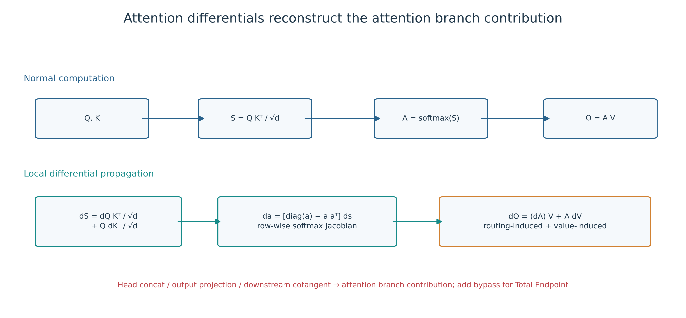
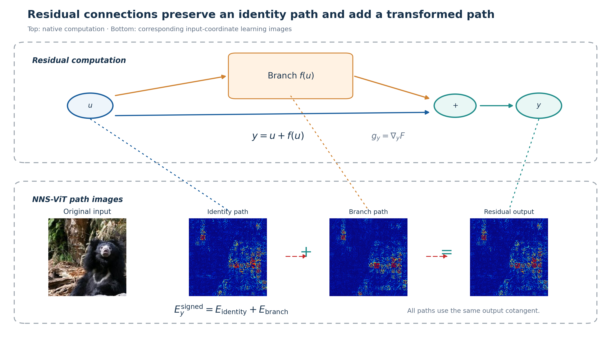
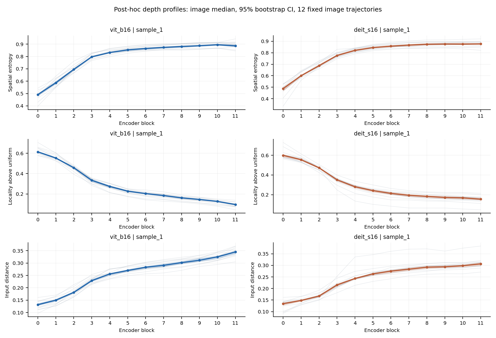
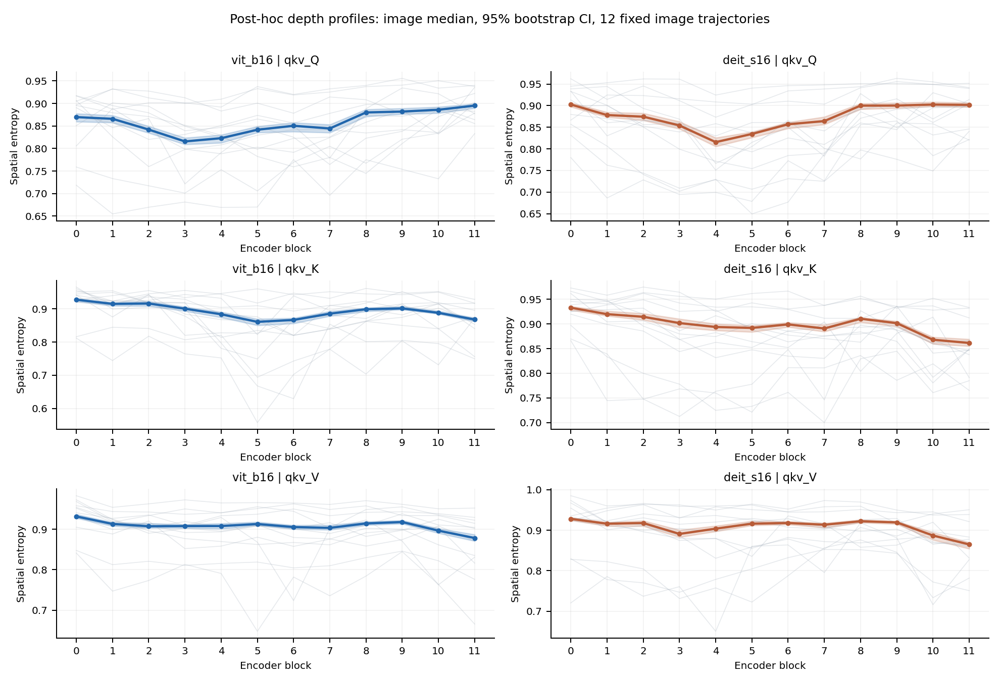
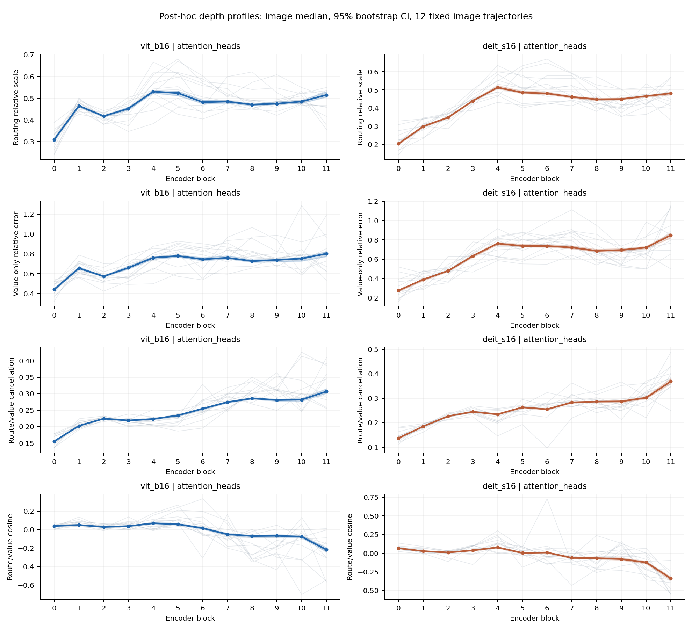
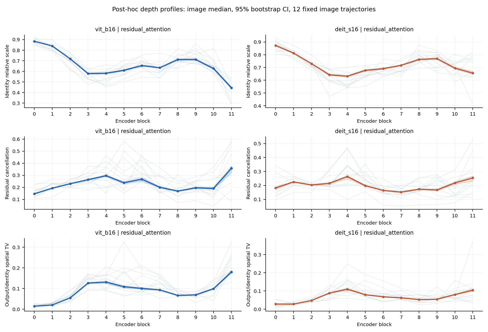
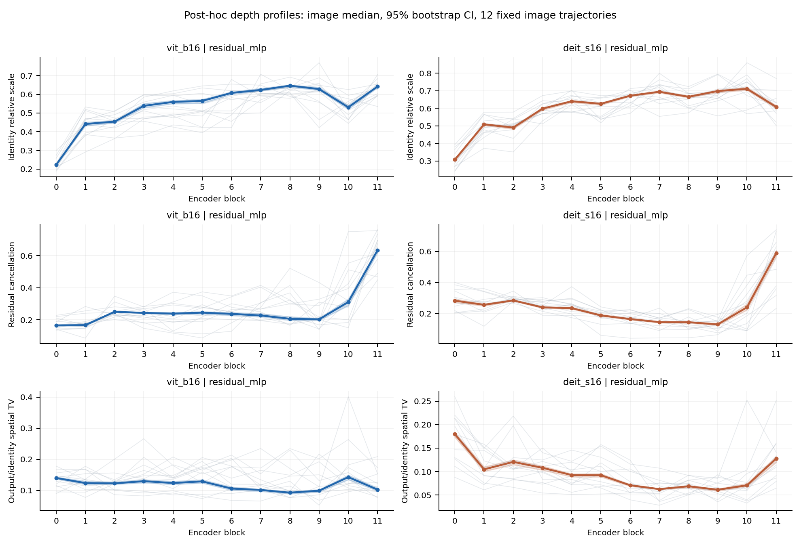
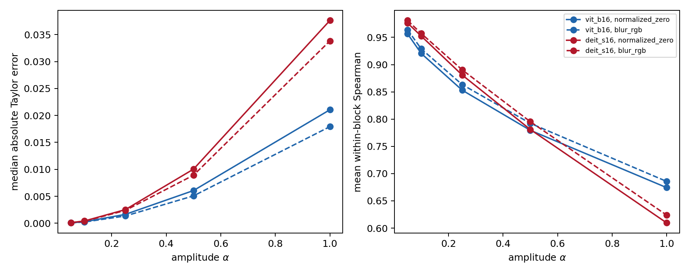
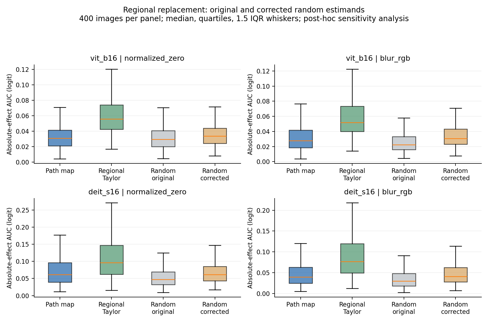

# NNS Structural Decomposition over Real Computational Edges in Vision Transformers and Validation by Finite Replacement

# Abstract

Vision Transformers contain heterogeneous internal objects, including tokens, channels, queries, keys, values, attention heads, and residual paths. A total input map aggregates these structures into input coordinates and obscures the edges through which a target depends on the input. Attention weights and token contributions generally do not provide additive terms indexed by real computational edges in input pixel coordinates. This thesis investigates how to retain both input coordinates and edge identity, and evaluates the resulting representation across depth and under prescribed replacement operations.

Building on the local differential form of NNS learning images, we introduce NNS–ViT structural path-map families over real computational edges. The method registers heterogeneous scalar targets and defines each edge instance by its source node, destination operator, input port, and current edge value. Query, key, value, multi-head, and residual terms are constructed on legal cuts. Closure requires each relevant differential path to cross the cut exactly once, with a common forward state and downstream cotangents bound to the corresponding edge instances.

At two fixed ImageNet-pretrained checkpoints, ViT-B/16 and DeiT-S/16, the structural terms close on the prescribed cuts. Post-hoc reanalysis of all 12 blocks reveals distinct, staged depth profiles for sampled internal targets and query, key, and value terms; early–late differences do not generally imply layer-by-layer change. Small head-output replacements yield low first-order numerical error and stable within-block rankings. Full replacement substantially increases numerical error while retaining some ranking information. The original preregistered all-family joint criterion was not supported; 11 of 12 component families met the predefined family-level operational rule. Regional path maps showed no stable advantage over the corrected random baseline, whereas regional Taylor quantities using the actual reference displacement performed better in the prescribed task.

The main output is a structural path-map family with explicit edge identity, verifiable additive relations, and an empirically characterized scope. Conclusions concern the two fixed checkpoints, registered targets, and prescribed replacements. Full-depth reanalysis and the random-baseline estimator correction are reported as post-hoc analyses.

**Keywords:** Vision Transformer; NNS; structural path-map family; real computational edge; depth differences; finite replacement

# Chapter 1 Introduction

## 1.1 Background and Problem

Vision Transformers process images through patch projections, multi-head attention, and residual connections [1-3]. A scalar target can depend on the input through multiple internal paths: queries and keys alter attention weights, values transmit content under the current weights, and residual connections add identity and transformed branches. A total input map reduces these mechanisms to one value per input coordinate. Different combinations of internal paths can produce similar total maps, making the total map insufficient for identifying the edges carrying the dependence.

Attention weights and token mixing offer a structural view, but weight magnitude does not directly equal a specified target's input response. Input-dependent attention also contains weight-change terms; omitting query- and key-induced changes removes part of the attention differential. Residual connections require distinct treatment of a shared tensor's uses at the identity port and in the branch to avoid omissions and double counting.

Starting from NNS neuron scanning [4], this thesis maps heterogeneous internal targets to common input coordinates while retaining edge identity. Definitions specify the objects, closure verifies additive relations, depth statistics describe fixed implementations, and finite replacement tests whether local structure predicts the prescribed operation.

## 1.2 Overall Question and Three Research Questions

The overall question is how to allocate the local input dependence of a Vision Transformer target to identifiable real computational edges, and how to evaluate the mathematical consistency, depth differences, and finite-replacement value of the resulting terms.

1. **RQ1: How is the structural decomposition defined, and what properties does it satisfy?** We study heterogeneous target registration, real edge instances, legal cuts, query/key/value, multi-head and residual decompositions, closure, and graph dependence.
2. **RQ2: How do structural terms differ across depth?** We study the spatial extent of sampled internal targets, query/key/value profiles, routing and value scales, and attention versus MLP residual paths over the complete depth sequence.
3. **RQ3: How much utility do structural terms retain under prescribed finite replacements?** We distinguish numerical approximation for multi-amplitude head-output replacement, component ranking under full replacement, and spatial selection under regional replacement.

## 1.3 Research Content and Argument

The output is a structural path-map family $\Phi_C(F,x)=\{E_c^C(x):c\in C\}$, where $F$ is a registered scalar target, $C$ is a legal edge cut, and $E_c^C$ retains both input coordinates and edge identity. Aggregating these terms yields the total local input map. Within-head, across-head, and residual cuts provide three structural resolutions for comparing allocations of the same target-conditioned local response.

The theoretical analysis establishes the mathematical prerequisites of local input representations, proves closure for real edge instances, and validates the implementation with omission and duplication controls. The empirical analysis treats the two checkpoints separately, aggregates within images, and estimates image-level medians and intervals across 12 blocks. Replacement experiments vary amplitude along fixed reference displacements and compare full-component and regional outcomes, providing separate evidence for numerical error, ranking, and spatial selection.

## 1.4 Contributions

1. We introduce a structural path-map representation for heterogeneous ViT targets. It covers tokens, channel aggregates, attention heads, residual edges, and class targets while preserving input coordinates and edge identity. Chapter 4 defines target registration and map families; Chapter 6 evaluates spatial and scale differences.
2. We establish legal-cut decomposition over real edge instances. Query, key, value, multi-head, and residual terms are validated through closure, omission controls, duplication controls, and directional derivatives. Chapter 4 also specifies closure conditions and a reparameterization counterexample.
3. We evaluate depth differences and finite-replacement boundaries of structural terms. Chapter 6 separates endpoint contrasts, full-depth trends, and intermediate reversals. Chapter 7 distinguishes numerical approximation, component ranking, and regional selection using multi-amplitude, component, and regional tasks.

## 1.5 Thesis Organization

Chapters 2 and 3 introduce related work and mathematical prerequisites. Chapters 4 and 5 define structural decomposition and study design. Chapters 6 and 7 report depth differences and finite replacement. Chapter 8 discusses and concludes. Detailed targets, tolerances, test families, and reproduction materials appear in appendices.

## 1.6 Chapter Summary

This thesis studies local input-dependence map families indexed by computational edges. The three research questions concern structural definition and closure, depth differences in fixed models, and utility under prescribed replacements.

# Chapter 2 Related Work

## 2.1 Neuron-Level Input Representations

Original NNS splits input coordinates and propagates their responses to an internal neuron to construct a learning image [4]. Its neuron-centered object motivates explicit registration of scalar ViT targets. Chapter 3 states the operator mapping and the conditions for extension to general computation graphs.

Input gradients directly measure local output sensitivity [5], while input-weighted gradients retain coordinate scale [6,11]. Integrated Gradients averages gradients along a path from a reference input and satisfies corresponding completeness axioms [7]. DeepLIFT propagates contribution differences relative to reference activations [6], and conductance extends path integration to hidden units [8]. FullGrad combines the input-gradient term with bias-gradient terms from all layers to form a function-value-complete representation [9], while layer-wise relevance propagation and gradient smoothing provide distinct backward-allocation and denoising strategies [10,12].

These methods first differ in their objects. Current-point input responses are local; path integration and DeepLIFT require references; FullGrad completeness includes bias terms. The present study examines closure of local input differentials on valid computational cuts, which is distinct from function-value decomposition and reference-path completeness.

“Completeness” is not one concept across this literature. Integrated Gradients completeness sums path attribution to an output difference; FullGrad completeness includes input and bias terms; layer-wise relevance propagation emphasizes relevance conservation. Closure in this thesis requires only that one local input differential be partitioned without omission or duplication on a valid cut. A method comparison must first align the quantity being summed, because the same word can otherwise conceal different equalities.

Pointwise and path methods also use different information budgets. Pointwise input-weighted gradients require only the current input and its gradient, whereas Integrated Gradients and conductance require a reference and gradients along a path. The former is direct and suited to local structure; the latter can incorporate nonlinear variation along the path. Chapter 7 turns this distinction into a multi-amplitude experiment instead of inferring relative performance from definitions alone.

## 2.2 ViT Token and Attention Explanations

Attention flow and rollout compose attention matrices across layers [21]. Chefer et al. extend relevance propagation to Transformer attention and skip connections [22]. Counterexamples and interventions challenge the sufficiency of “attention as explanation” [23-24], while vector norms can change contribution estimates derived from attention weights alone [25].

GlobEnc incorporates the full encoder layer into token-contribution propagation [26]; ALTI analyzes contextual mixing [27]; DecompX propagates token representation components to predictions [28]; AttnLRP and LibraGrad construct Transformer attribution through relevance conservation and gradient-flow balancing [29-30]. These methods address token contributions, relevance, or input attribution. The present method retains the model's actual local derivatives and groups one local input differential along specified actual computation edges.

Transformer explanation also requires separating forward mixing from target-conditioned dependence. Attention weights and ALTI-like quantities mainly describe token relations through forward information mixing; class-related gradients and relevance methods include a downstream target in backward propagation. A head can have sharp forward weights yet have a small local path for a class target because its downstream cotangent is small. This thesis carries the output projection and every derivative after the target into each head's cotangent to preserve that target-conditioned meaning.

Token contribution and input-pixel dependence also have different native resolutions. The former is commonly defined on a $14\times14$ patch grid or token sequence; the latter additionally maps through patch-projection weights into pixel coordinates. This thesis reports native pixel maps and patch statistics and excludes display interpolation from numerical analysis, so a difference in spatial resolution is not presented as method superiority.

LeGrad measures feature-formation sensitivity using gradients of attention maps and combines signals across layers and tokens into a spatial map [38]. Its aggregated spatial output does not retain additive terms for individual real edges on a legal cut.

## 2.3 Internal Components and Computational Edges

Studies of internal neurons and feed-forward layers link representational units to model behavior [8,35]. Activation patching replaces an internal variable from a clean state with the value produced by a reference input and measures the output change [31]; causal tracing applies this operation to factual associations [34]. Attribution patching and edge attribution patching approximate finite replacement with an inner product between activation displacement and a local gradient [32], and AtP* further treats attention saturation and cancellation [33].

Such methods directly concern finite effects, but their results depend on the reference, replaced variable, operator, and output target. This thesis retains the clean local map, the reference-aware Taylor quantity, and the actual replacement effect as separate objects and observes first-order error along a multi-amplitude interpolation.

“Causal” in activation replacement denotes a model-internal effect under a prescribed operation on a computation-graph variable. Replacing one head while keeping other heads and the identity route clean creates a hybrid forward state. It answers how that operation changes the target logit, not the causal contribution of a natural image region in a data-generating process. The variable, reference, and unchanged edges are included in the experimental contract so that the conclusion can be reproduced for the same operation.

The computational advantage of first-order edge attribution is that one backward pass can provide local predictions for many components. Its error can arise from gradient change along the displacement, softmax saturation, nonlinear gate changes, and path cancellation [32-33]. Chapter 7 therefore reports absolute error, relative error, and head-ranking correlation. The first two evaluate numerical approximation; the third evaluates ordering information in a screening setting.

Prisma provides activation caching, patching, sparse-autoencoder, and circuit-analysis tools for vision and video Transformers [39], establishing reusable infrastructure for visual mechanism studies. Seeing Through Circuits (2026) introduces Vi-CD to recover class-related visual edge circuits through activation patching and studies behavior modification in CLIP [40]; its object is a task circuit and its recovered behavior. Causal Attribution via Activation Patching (CAAP, 2026) inserts patch-associated source activations into a neutral context and uses a specified class score for spatial attribution [41]; its object is a finite activation-insertion effect under a reference context. These studies directly address edges and prescribed interventions. Our object is the allocation of one target’s local input response across a complete legal cut, evaluated across depth and replacement amplitudes.

## 2.4 Explanation Evaluation

Grad-CAM uses gradient-weighted convolutional features to produce class-related regions [13], while deconvolution and occlusion inspect intermediate features or input perturbations [14]. LIME and SHAP explain predictions through local surrogate models and game-theoretic allocation [15-16]. Similar-looking visualizations need not represent the same statistical object. Parameter-randomization tests, deletion and retention benchmarks, and audits of modified backward rules show that visual readability alone does not establish faithfulness [17-20].

This study consequently separates display from statistics. Blue-base learning images are used to read spatial structure; every conclusion is computed from raw signed arrays, absolute mass, or actual finite replacement. Parameter-state controls assess dependence on a pretrained state without interpreting a contrast between one pretrained model and random initializations as a causal training effect.

Saliency reliability has at least three requirements. The first is parameter sensitivity: an explanation should measurably change on the corresponding object when model parameters change [17,19]. The second is task relation: highly ranked positions should have corresponding effects in a prescribed deletion, retention, or replacement task [18]. The third is numerical and implementation stability: conclusions should not be driven primarily by display normalization, interpolation, or an accidental backward rule. Parameter-state controls, finite internal replacement, and recomputation from raw arrays address these three requirements, respectively.

These requirements also specify the role of case figures. A case can reveal the pixel-space form of a path and help identify implementation errors or hypotheses worth testing; a population claim requires prespecified statistics on the full sample. Display examples are therefore selected for readability and never enter effect-size or interval calculations.

The literature was checked through 21 September 2026. References [38-41] cite the arXiv v1 versions actually consulted, with access dates. Findings from the 2026 preprints are discussed as reported in those versions.

## 2.5 Method Positioning

**Table 2-1 Comparison by explanatory object and evaluation**

| Method | Explanatory object | Input coordinates retained | Internal edge identity retained | Reference required | Closure object | Internal replacement directly evaluated | Graph/parameterization dependence |
|---|---|---|---|---|---|---|---|
| Input-weighted gradients (our total-map premise, Gradient × Input) | Existing current-point total local input map | Yes | No | No | Generally no function-value completeness | Not intrinsic | Differentiable function at fixed input coordinates |
| Original NNS | Neuron learning image | Yes | No | No | Original operator propagation | No | Layer implementation and derivative convention |
| Integrated Gradients | Reference-path input attribution | Yes | No | Yes | Output difference | Usually input perturbation | Input path/coordinates; implementation-invariance conditions |
| Conductance | Hidden-unit path attribution | Can aggregate to input | Hidden-unit identity | Yes | Path attribution sum | Unit ablation possible | Yes, hidden coordinates |
| FullGrad | Input and bias terms | Yes | Layer bias identity | No | Full-gradient representation | Usually input perturbation | Bias terms depend on implementation |
| Attention rollout | Cross-layer token flow | Patch grid | Attention matrices | No | Matrix propagation, not class-score closure | Usually token perturbation | Yes |
| GlobEnc / ALTI / DecompX | Token contributions and representation terms | Usually token coordinates | Encoder components, not our edge cut | No | Method-specific token decomposition | Usually token deletion | Yes |
| AttnLRP / LibraGrad | Input and hidden attribution | Yes | Modified backward rules | No | Relevance conservation or full representation | Usually input perturbation | Yes |
| LeGrad | Feature-formation sensitivity map | Patch grid | Removed by aggregation | No | No edge-cut closure requirement | Primarily spatial evaluation | Yes |
| Activation patching / CAAP | Finite internal replacement effect | CAAP uses a patch grid | Operated variables | Yes | No additive closure requirement | Yes | Yes |
| Edge attribution / AtP* / Vi-CD | Edge importance, approximations, or task circuits | Usually no | Yes | Yes | Specified approximation or circuit behavior | Yes | Yes |
| NNS–ViT | Same-target structural path-map family | Yes | Yes, real edge instances | No for maps; yes for replacement | Legal cut recovers total local input map | Yes, prescribed tasks | Yes |

Prisma supports internal access and circuit analysis; tooling availability is distinct from the mathematical properties of a decomposition.

## 2.6 Remaining Research Question

Existing studies provide input attribution, token contributions, relevance propagation, and internal replacement tools. This thesis studies the allocation of the same local input response to real ViT edges and evaluates its depth differences and prescribed replacement value in fixed models. The comparison concerns retained indices, the object of closure, and direct validation of the specified replacement.

## 2.7 Chapter Summary

Prior work offers input, token, component, and task-circuit views. Structural path-map families retain input coordinates and edge identity simultaneously; subsequent chapters evaluate their mathematical properties and empirical utility separately.

# Chapter 3 NNS Local Input Representations and Their Computation-Graph Form

## 3.1 Chapter Question and Original NNS Input Splitting

This chapter supplies the mathematical prerequisites for RQ1. It maps original NNS input splitting to computation graphs and states the local-derivative conditions, coordinate boundaries, and reproduction scope. Chapter 4 develops the structural decomposition itself.

Original NNS treats input coordinates as separate response sources and propagates them toward a chosen neuron [4]. For a linear layer $u=Wx+b$, coordinate $i$ contributes the input term $W_{:,i}x_i$; convolution restricts the same local linear operator to receptive fields. ReLU uses the current derivative gate, and max pooling uses the forward winner index. Expressing these operations through local Jacobians restates the original rules under the corresponding conditions. LayerNorm, GELU, and softmax require an extension to general computation graphs.

**Table 3-2 Operator-wise mapping from original NNS to computation graphs**

| Original NNS operation | Graph expression | Condition or ambiguity | Treatment here |
|---|---|---|---|
| Input splitting | $\mathcal L(x;x)=\operatorname{diag}(x)$ | Separate RGB coordinates | Retain all input coordinates |
| Linear or convolutional propagation | $\mathcal L(u;x)=W\mathcal L(v;x)$; sparse convolution operator | No direct input-coordinate bias term | Bias affects states and downstream derivatives |
| ReLU gate | $J=\operatorname{diag}(\mathbf 1_{v>0})$ | Subgradient at zero and terminal-gate notation | Framework derivative at the current point |
| Max pooling | $J$ selects current winner locations | Tied maxima | Framework forward-index rule |
| ViT nonlinearities | General local Jacobian | Not defined in the original paper | Extension to LayerNorm, GELU, and softmax |

Table 3-2 specifies operator correspondences and conditions. The original authors' official implementation is unavailable to this study. Reproduction therefore covers the checkable mathematical rules and compatible-network behavior, rather than a line-by-line reproduction of that software.

## 3.2 Method: Learning Images on a Computation Graph

Let a network be a directed acyclic graph $G=(V,E)$ with column-vector input $x\in\mathbb R^d$ and scalar target $s(x)$. For an intermediate variable $u(x)\in\mathbb R^m$, define the learning-image matrix $\mathcal L(u;x)\in\mathbb R^{m\times d}$. Input initialization and a multi-input operator propagate as

**Equation (3-1)**

$$
\mathcal L(x;x)=\operatorname{diag}(x),\qquad
\mathcal L(v;x)=\sum_{a=1}^{r}J_{f,u_a}(x)\mathcal L(u_a;x),\quad
v=f(u_1,\ldots,u_r).
$$

Equation (3-1) evaluates every local Jacobian at the actual forward state. Linear layers, convolutions, and active ReLU gates use their usual derivatives; max pooling uses the current forward winner; fixed framework choices apply at ReLU zeros and max ties.

**Proposition 3-1 (scalar-target identity).** If all local Jacobians are evaluated at the same current state and propagation introduces no normalization, truncation, or relevance redistribution, then

**Equation (3-2)**

$$
\mathcal L(u;x)=J_{u,x}(x)\operatorname{diag}(x),\qquad
E_s(x)=\mathcal L(s;x)^\top=\operatorname{diag}(x)\nabla_xs(x).
$$

**Proof.** At the input, $J_{x,x}=I$. Assume the statement holds for all predecessors in topological order. Substitution into Equation (3-1), followed by the multi-input chain rule, gives $J_{v,x}\operatorname{diag}(x)$. Induction to the scalar target and transposition yield $E_s(x)=x\odot\nabla_xs(x)$.

The quantity is the first-order response along coordinate-scaling directions. For $x_i\mapsto(1+\epsilon)x_i$,

**Equation (3-3)**

$$
s(x+\epsilon x_i e_i)-s(x)=\epsilon E_{s,i}(x)+o(\epsilon).
$$

A general network satisfies

**Equation (3-4)**

$$
\sum_{i=1}^{d}E_{s,i}(x)=x^\top\nabla_xs(x)\neq s(x).
$$

Euler's equality applies to first-degree homogeneous functions at differentiable points. A general ViT with biases, class tokens, positional embeddings, LayerNorm, softmax, and GELU does not satisfy this condition.

If raw pixels $r$ are normalized as $x=(r-\mu)/\sigma$, then

**Equation (3-5)**

$$
x_i\frac{\partial s}{\partial x_i}=(r_i-\mu_i)\frac{\partial s}{\partial r_i}.
$$

The local input map therefore requires no separately selected intervention reference, but depends on the model-input coordinate origin.

## 3.3 Validation Method

Formula validation covers a fully connected network, a convolutional network, a convolutional network with max pooling, a residual multilayer perceptron, and a residual convolutional network. Each class uses 100 inputs, two numerical precisions, and five registered readouts, giving 5,000 comparisons between layerwise propagation and automatic-differentiation Gradient × Input. Eleven operator classes provide 88 direction checks, supplemented by finite differences and analytic Jacobian-vector products.

Validation uses three complementary mechanisms. Formula regression compares two independently organized computations: explicit learning-image propagation and direct automatic differentiation followed by multiplication with the input. Operator-direction checks decompose a complex network into linear, convolutional, pooling, normalization, and nonlinear objects and test the directional response of each local Jacobian. Finite differences do not reuse the analytic backward formula and test first-order predictions through changes in target values under small perturbations.

Floating-point precision affects both target differences and relative-error denominators. When the target response in a direction is small, a float32 finite difference may be dominated by rounding. The protocol retains every float32 exceedance and repeats the same input, coordinate, and direction in float64 instead of dropping difficult cases or widening tolerance. This separates numerical conditioning from the formula identity.

## 3.4 Results

**Table 3-1 Maximum relative L2 error in NNS formula regression**

| Compatible network | Float64 | Float32 | Comparisons |
|---|---:|---:|---:|
| Fully connected | $4.371\times10^{-16}$ | $1.964\times10^{-7}$ | 1,000 |
| Convolutional | $4.289\times10^{-16}$ | $2.189\times10^{-7}$ | 1,000 |
| Convolutional plus max pooling | $4.769\times10^{-16}$ | $2.427\times10^{-7}$ | 1,000 |
| Residual multilayer perceptron | $2.686\times10^{-16}$ | $2.155\times10^{-7}$ | 1,000 |
| Residual convolutional | $2.923\times10^{-16}$ | $1.692\times10^{-7}$ | 1,000 |

The float64 maximum is at most $4.769\times10^{-16}$ and the float32 maximum at most $2.427\times10^{-7}$. All 88 operator-direction checks pass. Of 57,600 float32 finite-difference checks in the ViT atlas, 36 exceed the prespecified tolerance; all 36 same-coordinate float64 reviews pass, with the original failures retained. These results validate the correspondence between Equation (3-2) and the implementation. They are not a reproduction of unavailable original-author software.

## 3.5 Discussion

Input splitting, local Jacobians, and scalar readout jointly define Equation (3-2). For a vector target, each matrix row corresponds to one scalar coordinate. Channel energy is scalarized before applying its cotangent. Positive and negative terms indicate first-order increases and decreases under coordinate scaling; absolute mass discards direction for spatial analysis. Chapter 4 retains structural edge identity on the same input coordinates.

## 3.6 Chapter Summary

This chapter provides the operator mapping, computation-graph expression, and scalar proposition, together with bias, coordinate-origin, nonsmoothness, function-value completeness, and software-reproduction boundaries. These conditions supply the mathematical premises for structural path decomposition.

# Chapter 4 NNS Structural Path Decomposition over Real ViT Computational Edges

## 4.1 Chapter Question

This chapter answers RQ1: how to define structural map families with common input coordinates and real edge identities, which cuts permit additive closure, and which graph-dependent boundaries remain after closure.

## 4.2 Method: Internal Scalar Target Registration

The ViT patch projection maps local pixels to token vectors while learning images remain in pixel coordinates. Four target classes are registered: individual token-channel scalars, channel aggregates across spatial tokens, structural-edge targets, and class outputs. For patch-token activations $h_{t,c}$ of channel $c$, define an energy aggregate

**Equation (4-1)**

$$
s_{\mathrm{eng}}=\frac{1}{2}\sum_{t=1}^{196}h_{t,c}^{2},\qquad
E_{\mathrm{eng}}=\sum_{t=1}^{196}h_{t,c}E_{h_{t,c}}.
$$

Equation (4-1) is the Jacobian form of activation-weighted channel aggregation, but the energy is an aggregate scalar rather than one neuron. Other targets include patch-token sums, attention-head internal coordinates, final class-token channels, ground-truth logits, and frozen clean-top1 logits. A channel index shared by two models is not treated as the same semantic unit.

A target registry stores target semantics, tensor location, aggregation rule, and downstream scalar together. Token-channel targets retain position and channel indices; channel aggregates record the 196 participating patch tokens; head targets record block, head, and the edge before output projection; class targets record the class index and its freezing rule. The registry allows one executor to process objects with different shapes and prevents a channel chosen for a display figure from being confused with a channel in the population sample.

Target types answer different questions. Individual token-channels support locality and input-distance analyses, energy aggregates connect forward channel responses to input dependence, ground-truth logits support structural path comparisons, and clean-top1 targets support target-sensitivity controls. The types share input coordinates but are not numerically pooled.

## 4.3 Method: Real Edge Instances, Map Families, and Legal Cuts

Fix a scalar target $F$ and the current forward state. Define a real edge instance as

**Equation (4-2)**

$$
c=(u,v,r,z_c).
$$

Here $u$ is the source node, $v$ the destination operator, $r$ the input port, and $z_c$ the value in this particular use. Uses of the same tensor by different operators or ports are distinct edge instances. The downstream cotangent differentiates the particular use: conceptually, shared uses are split into independent port variables, differentiated at their current values, and pulled back through the upstream Jacobian.

For an edge-instance set $C$, define the structural path-map family

**Equation (4-3)**

$$
\Phi_C(F,x)=\{E_c^C(x):c\in C\},\qquad
E_{c,i}^C(x)=x_i\left\langle g_c,\frac{\partial z_c}{\partial x_i}\right\rangle,\qquad
g_c=\frac{\partial F}{\partial z_c}.
$$

Equation (4-3) retains two indices: input coordinate $i$ and real edge $c$. At a fixed cut, it supports comparisons of spatial distributions, signed cancellation, and relative scales for the same target response.

A legal cut satisfies five conditions: each relevant input-to-target differential path crosses it exactly once; no bypass is omitted; no path is counted twice; all terms use the same forward state; and downstream cotangents are bound to real edge instances. Relevant paths are those in the declared chain-rule graph, including edges whose current numerical derivative is zero.

**Proposition 4-1 (Legal-cut closure).** Under these conditions,

**Equation (4-4)**

$$
\sum_{c\in C}E_c^C(x)=E_F(x).
$$

**Proof.** Expand the local chain rule into Jacobian products over input-to-target paths. Group each path by its unique cut-edge instance. Each group factors into an upstream Jacobian and the downstream cotangent of that use. The disjoint exhaustive groups sum to the total local input map. Cutting only a residual branch omits the identity bypass; using the full upstream gradient as an identity term and adding the branch counts that branch twice.

Within-head, multi-head, and residual cuts produce $\{E^Q,E^K,E^V\}$, $\{E_h\}_{h=1}^{H}$, and $\{E^{\mathrm{id}},E^{\mathrm{branch}}\}$, respectively. Nested decompositions first close for the declared attention or residual subgraph. Any bypass outside that subgraph must be included before Equation (4-4) can recover the final target's total map.

## 4.4 Method: Attention and Multi-Head Path-Map Families

For one attention head, let

**Equation (4-5)**

$$
Q=XW_Q+b_Q,\quad K=XW_K+b_K,\quad V=XW_V+b_V,\quad
A=\operatorname{softmax}\!\left(\frac{QK^\top}{\sqrt{d_h}}\right),\quad O_h=AV.
$$

Its local differential is

**Equation (4-6)**

$$
\mathrm dO_h=(\mathrm dA)V+A\,\mathrm dV,\quad
\mathrm dA=J_{\mathrm{softmax}}\mathrm dS,\quad
\mathrm dS=\frac{\mathrm dQK^\top+Q\mathrm dK^\top}{\sqrt{d_h}}.
$$

The first two terms in Equation (4-6) define query- and key-induced paths and jointly form the routing path; $A\mathrm dV$ defines the value-induced path:

**Equation (4-7)**

$$
E^{\mathrm{attn}}=E^Q+E^K+E^V
=E^{\mathrm{route}}+E^{\mathrm{value}}.
$$

The head edge lies before concatenation and output projection. Each downstream cotangent includes the output projection and every derivative after the target, giving

**Equation (4-8)**

$$
E^{\mathrm{MHA}}=\sum_{h=1}^{H}E_h.
$$

Equations (4-7) and (4-8) group one local differential. Query, key, and value share upstream inputs and may overlap in input space; norm ratios are not mutually exclusive causal percentages.

**Figure 4-1 Attention differential paths.** Query and key change attention weights, while value transports content under the current weights. The three terms reconstruct the full attention differential on the specified cut.

Executed attention controls retain only the value path and omit nonzero routing, or omit the largest nonzero head. These test routing/value and multi-head coverage. Separate query or key omissions are failure constructions implied by closure and are not counted among executed controls. Query and key terms use the same current state and decompose the local differential without changing the forward operator.

## 4.5 Method: Residual Path-Map Families

For $y=u+f(u)$ and a fixed downstream target, the two addition ports define identity and branch edge instances. With output cotangent $g_y$,

**Equation (4-9)**

$$
E^{\mathrm{id}}=\operatorname{diag}(x)J_{u,x}^{\top}g_y,\qquad
E^{\mathrm{branch}}=\operatorname{diag}(x)J_{u,x}^{\top}J_{f,u}^{\top}g_y,\qquad
E^{\mathrm{res}}=E^{\mathrm{id}}+E^{\mathrm{branch}}.
$$

Equation (4-9) compares identity and branch responses under a common output cotangent. Omitting the identity edge breaks closure. Substituting $\nabla_uF$, which already contains the branch, and adding the branch again duplicates paths. The executed residual control duplicates the identity edge in the first residual connection and is rejected by the duplicate-edge checker.

**Figure 4-2 Residual paths.** The two addition ports retain distinct real edge identities; signed terms sum to the residual subgraph's input response.

## 4.6 Graph Dependence and Non-Uniqueness

Consider $x=(x_1,x_2)^\top$, hidden variable $h=x$, and output $s=(1,1)h=x_1+x_2$. A cut by hidden coordinate gives

**Equation (4-10)**

$$
E_1=(x_1,0)^\top,\qquad E_2=(0,x_2)^\top.
$$

Let

**Equation (4-11)**

$$
R\,(x_1,x_2)^\top=(x_1+x_2,x_2)^\top,\qquad
h'=Rh,\qquad w'=R^{-\top}(1,1)^\top=(1,0)^\top.
$$

By Equation (4-11), the same function is $s=w'^\top h'$, with new hidden-coordinate terms

**Equation (4-12)**

$$
E'_1=(x_1,x_2)^\top,\qquad E'_2=(0,0)^\top.
$$

Equations (4-10) and (4-12) have the same total but different components. Path maps are therefore defined relative to a graph, cut, and parameterization. Closure establishes complete accounting for the specified representation; it does not make components unique functions of the end-to-end mapping.

The counterexample specifies an identification boundary for internal structural allocation. If a research question concerns an end-to-end functional invariant, it should use the total input gradient, function value, or an object with a proved invariance property. If it concerns which edges carry information in a concrete implementation, a graph-relative decomposition is appropriate, provided the implementation and cut are reported. This thesis chooses the latter question and freezes model weights, software paths, and target registration as reproducibility conditions.

Cut granularity also changes explanatory resolution. Treating an attention sublayer as one term supports only a sublayer-versus-identity comparison; cutting by head compares heads; cutting within a head by query, key, and value compares routing and content transport. Finer cuts improve diagnostics but increase cancellation and multiplicity. Results are reported only at these three granularities, all defined through actual edges and a common cotangent and all directly closure-tested.

## 4.7 Spatial and Scale Metrics

For a three-channel local map at pixel $p$, define absolute mass and the patch-mass distribution by

**Equation (4-13)**

$$
M(p)=\sum_{c\in\{R,G,B\}}|E_{p,c}|,\qquad
m_j=\sum_{p\in P_j}M(p),\qquad
q_j=\frac{m_j}{\sum_km_k}.
$$

If total mass is zero, $q_j$ is missing. Normalized spatial entropy, target-patch neighborhood locality, and normalized distance measure extent, near-target concentration, and distance from a target location. The Q/K/V population analysis instead uses the expected distance between two independent draws from $q$, requiring no selected target patch. Signed-map cancellation is

**Equation (4-14)**

$$
C_{\mathrm{map}}=1-\frac{|\sum_iE_i|}{\sum_i|E_i|},\qquad
C_{\mathrm{path}}=1-\frac{\|E^{(1)}+E^{(2)}\|_1}{\|E^{(1)}\|_1+\|E^{(2)}\|_1}.
$$

Routing relative scale is

**Equation (4-15)**

$$
S_{\mathrm{route}}=\frac{\|E^{\mathrm{route}}\|_1}
{\|E^{\mathrm{route}}\|_1+\|E^{\mathrm{value}}\|_1},
$$

with an analogous residual identity scale. Equation (4-14) reports cancellation within signed maps and between paths. The error from retaining only $A\mathrm dV$ is

**Equation (4-16)**

$$
\varepsilon_V=\frac{\|E^{\mathrm{attn}}-E^V\|_2}
{\|E^{\mathrm{attn}}\|_2}.
$$

## 4.8 Structural Closure Results and Complexity

Across the two models, all 76,800 positive Q/K/V, routing/value, multi-head, and residual closure tests pass; all 28,800 omission or duplication controls are rejected; and all 6,144 analytic Jacobian-vector product checks pass. Independent recomputation gives a maximum Q/K/V closure absolute error of $1.574\times10^{-5}$ and a maximum residual closure absolute error of $2.480\times10^{-5}$. These results support structural-accounting correctness on the specified frozen graphs.

Closure validation spans all 400 evaluation images and 12 blocks in both models, thereby testing input variation and numerical conditioning from shallow to deep blocks. Negative controls omit the largest nonzero head, omit nonzero routing, or duplicate the first residual identity term; omission fixtures use zero absolute and relative tolerance, while duplicate edges are rejected by set validation. These establish detection of the prescribed errors, not that every smaller omission would be rejected at the positive numerical tolerance. Analytic Jacobian-vector products directly compare local directional responses and complement input-space component summation.

Computational cost depends on the number of scalar targets and cut size. A total local input map requires one backward pass. Computing all terms of a cut with $|C|$ edges by separate pullbacks requires up to $|C|$ vector–Jacobian actions in the direct implementation. Saving maps for $T$ targets, $|C|$ terms, and $d$ input coordinates requires $O(T|C|d)$ storage. Streaming targets and edges reduces the map buffer to $O(d)$, in addition to forward activations and the backward graph. These costs motivate explicit sampling and aggregation levels for large internal-target studies.

## 4.9 Chapter Summary

The output for RQ1 is a structural path-map family retaining input coordinates and real edge identities. Legal cuts close query/key/value, multi-head, and residual terms. The reparameterization example specifies graph dependence. Subsequent chapters use these objects to study depth differences and prescribed replacement utility.

# Chapter 5 Research Design and Statistical Analysis

## 5.1 Models, Data, and Sample Construction

Experiments use ImageNet-1K pretrained ViT-B/16 and DeiT-S/16 classifiers [1-2]. Both contain 12 encoder blocks; the former has 12 attention heads and hidden dimension 768, while the latter has 6 heads and hidden dimension 384. Images are resized to a short side of 248 and center-cropped to $224\times224$, then normalized by model-specific parameters. Dropout and stochastic depth are disabled for inference.

The sample is selected in a deterministic, outcome-independent order: 528 eligible classes are selected, followed by one image from each class. The first 64 images form the discovery set, the next 64 the calibration set, and the remaining 400 the evaluation set. Sets are disjoint, with at most one image per class. Both models share the same 400 evaluation images. Appendix A specifies the complete selection rule.

This rule prioritizes class coverage and makes split assignment a function of outcome-independent metadata. The discovery split supports implementation debugging and figure design, the calibration split fixes numerical tolerances and display rules, and the evaluation split supports primary statistics. Evaluation images are not chosen from model outputs or learning-image appearance after protocol freeze. One image per class reduces class-frequency imbalance in image-level summaries, while making the target population closer to one image from each selected class than to the natural within-class frequency of ImageNet.

The stratified unit study uses a frozen 100-image subset, selecting the class token, 15 spatially stratified patch tokens, and 32 channels per block. Each model-image contains 6,144 post-block scalars, giving 1,228,800 records. Five independent replications retain the same images but resample 16 tokens and 32 channels per block using separate namespaces frozen before outcome access. The parameter-state control uses 32 shared images per model, three independently initialized states, and the architecture-matched pretrained state.

Token sampling covers the class token and spatial patch strata, while channels are generated independently for each block. The five replications change token and channel targets while holding images fixed and therefore test dependence on a particular internal-target sample. Image-level bootstrap within each group quantifies uncertainty over images. These are different sources of variation, so additional bootstrap replicates cannot substitute for new token-channel samples.

**Table 5-1 Models and major samples**

| Item | ViT-B/16 | DeiT-S/16 |
|---|---:|---:|
| Encoder blocks | 12 | 12 |
| Attention heads | 12 | 6 |
| Hidden dimension | 768 | 384 |
| Registered scalar targets per image | 457 | 385 |
| Main evaluation images | 400 | 400 |
| Stratified-unit images | 100 | 100 |
| Parameter-state control images | 32 | 32 |
| Randomly initialized states | 3 | 3 |

## 5.2 Finite-Replacement Design

The multi-amplitude study interpolates an attention-head output $z$ from the clean state to a reference state:

**Equation (5-1)**

$$
z_\alpha=(1-\alpha)z_{\mathrm{clean}}+\alpha z_{\mathrm{ref}},\qquad
\alpha\in\{0.05,0.10,0.25,0.50,1.00\}.
$$

The actual finite effect and first-order prediction are

**Equation (5-2)**

$$
e_\alpha=F(z_{\mathrm{clean}})-F(z_\alpha),\qquad
p_\alpha=\alpha\left\langle\nabla_zF,z_{\mathrm{clean}}-z_{\mathrm{ref}}\right\rangle.
$$

References are produced by normalized-zero and blurred inputs. The experiment fixes the same 400 images, ground-truth logits, all attention heads in all 12 blocks, and both references. It reports absolute actual and predicted effects, absolute error, relative error, and within-image head-ranking Spearman correlation.

The normalized-zero input maps the model-coordinate origin to a reference state, whereas the blurred input preserves low-frequency color and contour while reducing detail. They create different internal displacements and test whether local ranking depends on reference choice. The amplitude study takes five positions along each particular clean-to-reference direction; it is a distance continuation of the same replacement task rather than a generic random-noise sweep.

Complete component replacement uses

**Equation (5-3)**

$$
e_k=F(x)-F(x;z_k\leftarrow z_k^{\mathrm{ref}}),\qquad
p_k=\left\langle\nabla_{z_k}F,z_k(x)-z_k^{\mathrm{ref}}\right\rangle.
$$

The regional task fixes three heads in block 5, partitions the input into $4\times4$ candidate regions, and replaces 1, 2, or 4 regions, up to 25% area. Each curve takes the absolute isolated effect, integrates over 0–25% area, divides by 0.25, and averages the three heads within image. The candidate oracle selects only among evaluated regions and is not a global optimum over all possible regions.

Component ranking and regional selection use different candidate sets. The component task compares heads or residual edges within one structural family, whereas the regional task compares spatial subsets within fixed heads. The former uses Spearman correlation, top-k capture, and regret to evaluate component screening; the latter uses absolute-effect AUC to evaluate accumulated gain under an area budget. Both concern ranking, but a threshold from one task cannot be transferred directly to the other.

## 5.3 Statistical Principles, Errors, and Missing Values

The statistical unit is the image. Tokens, channels, and heads are aggregated within each image according to the estimand; the two models are summarized separately. Paired differences are computed within an image before taking the across-image median, so the median difference generally differs from a difference of medians. Multi-amplitude errors use the within-image median across all blocks and heads. Rankings use within-block Spearman correlations across heads, followed by the mean across valid blocks. Five target samples share the same 100 images and evaluate target-sampling sensitivity; the image sample size remains 100.

Primary median intervals use 10,000 image-bootstrap repetitions, linear quantiles, and the 2.5th/97.5th percentiles [36]. Original confirmatory and v3 successor analyses resample complete images with replacement. M1/M2 and the present depth analysis use distributionally equivalent empirical-order-statistic sampling of the bootstrap median. Parameter-state and class-target supplements use 2,000 bootstrap repetitions for means; parameter contrasts resample both images and the three random seeds. Each stage uses PCG64 and deterministic seeds derived from a fixed namespace and complete analysis key. Appendix A specifies the rules, and reanalysis result files record individual seeds. These are pointwise precision intervals; Holm correction applies to tests, not to intervals.

Relative error in Equation (5-2) is $|e_\alpha-p_\alpha|/|e_\alpha|$. An exactly zero denominator is missing; the frozen v3 rule adds no stabilizing constant for nonzero small effects. Value-only error uses the full-map Euclidean norm in Equation (4-16), with a zero norm marked missing. Zero absolute mass makes Q/K/V or sampled-target spatial statistics missing rather than zero. The original confirmatory rule separately flags absolute mass at most $10^{-12}$ as near-zero; sign-test values with magnitude at most $10^{-12}$ are ties. Stage-specific rules remain as originally defined.

Spearman uses average ranks for ties. Original confirmatory component rankings require at least 8 valid components, whereas v3 within-block head rankings require at least 4. Constant vectors, insufficient components, or nonfinite inputs yield missing correlations. Full-depth trends require all 12 blocks and a nonconstant metric. Adjacent and phase differences use paired valid images. Outputs include total, valid, and missing counts for each statistic.

The original confirmatory family contains 28 tests: 12 C4a tests from two models, two references, and three component families, plus 16 C4b tests from two models, two references, and four baselines. Holm correction is applied jointly to all 28 two-sided exact sign tests [37], with support also requiring a positive direction. Spatial baselines are the total local input map, raw input gradient, regional Taylor, and random regions. Component families are attention heads, routing/value, and residual branches.

The thresholds 0.10 and 0.05 were frozen before outcome reading as operational criteria: 0.10 is a point-estimate threshold for median component correlation, while 0.05 is a paired regional AUC gain in raw class-logit units. They are not universal explanation-quality standards. The component rule requires a point estimate of at least 0.10 and a significantly positive direction relative to zero; it does not directly test whether population correlation exceeds 0.10. Additional requirements are at least 360 valid images, 300 nonzero sign values, and interval widths at most 0.30 for C4a and 0.50 for C4b.

The fixed 400-image sample is precision-based. At the worst-case sign probability $p=0.5$, the approximate 95% binomial half-width is $1.96\sqrt{0.25/400}=0.049$. No power simulation or target-power claim was part of this design. Precision for correlation and logit effects is assessed by the frozen interval-width gates. Sealed C4a widths are 0.0168–0.0557 and C4b widths 0.0010–0.0082, satisfying their gates; these precision conditions did not cause the original joint failure.

## 5.3.1 Post-Hoc Full-Depth Reanalysis

The new analysis reuses previously inspected numerical records and is post-hoc descriptive reanalysis. Prescribed units are first summarized within each image and block, retaining blocks 0–11. Early, middle, and late phases comprise blocks 0–3, 4–7, and 8–11. Phase medians are computed within each image, then subtracted for middle-minus-early, late-minus-middle, and late-minus-early contrasts. This two-level median differs from the original target-sampling estimator that pooled all units within a phase; both are labeled separately.

Each image contributes a Spearman correlation between block index and metric, summarized by a median and image-bootstrap interval. Block 11 minus block 0 is reported separately as an endpoint contrast. The 11 adjacent differences $\Delta_b=m_{b+1}-m_b$ receive image-level medians and intervals, with Holm correction across 11 two-sided sign tests within each model–object–metric family. Families are reported separately without a confirmatory joint claim across all metrics. Sparse trajectories use 12 images selected by a fixed ordering of image identifiers; all trajectories are provided in data tables.

## 5.4 Analysis Classes and Effective Samples

**Table 5-2 Research questions, estimands, and analysis status**

| Research question | Main estimand | Images per model | Analysis status | Claim object |
|---|---|---:|---|---|
| RQ1 definition and closure | Cut-sum error, directional error, negative controls | 400 | Method/correctness validation | Prescribed graph and cut |
| RQ2 original target space | Entropy, locality, distance pooling units within phase | 100 | Original frozen analysis | Original sampled targets |
| RQ2 five target samples | Late-minus-early and endpoint contrasts | 100 | Successor frozen analysis | Target-sampling sensitivity |
| RQ2 population Q/K/V | Mass, entropy, distance, cancellation, scale endpoints | 400 | Successor frozen analysis | Three structural paths |
| RQ2 full depth | Block intervals, trends, phase/adjacent contrasts | 100 or 400 | Post-hoc descriptive reanalysis | Staged depth differences |
| RQ2 parameter/target sensitivity | Pretrained minus random; top prediction minus true class | 32 or 100 | Frozen supplementary analysis | Parameter state or target choice |
| RQ3 multi-amplitude replacement | Absolute/relative error, head rankings | 400 | Successor frozen analysis | Prescribed interpolation directions |
| RQ3 full-component ranking | Component correlations and joint rule | 400 | Original confirmatory analysis | Joint and family-level operational rules |
| RQ3 original regional selection | Paired gains with original random estimator | 400 | Original confirmatory analysis | Original C4b decision |
| RQ3 corrected random baseline | Absolute-effect AUC per repeat, then averaging | 400 | Post-hoc estimator correction/sensitivity analysis | Regional comparison under corrected estimator |

Original confirmatory analyses retain their samples, estimators, test families, and conclusions. Successor analyses froze new tasks before reading their results, covering multi-amplitude replacement, population Q/K/V, and five target samples. Post-hoc or sensitivity analyses include the random-baseline correction, full-depth reanalysis, and spatial-TV interpretation. Semantic studies are future designs in Chapter 8.

**Table 5-3 Effective and missing values**

| Analysis | Total | Valid | Missing |
|---|---:|---:|---:|
| C4a: 12 families × 400 images | 4 800 | 4 800 | 0 |
| C4b: 16 comparisons × 400 images | 6 400 | 6 400 | 0 |
| Multi-amplitude: two models × two references × five amplitudes × 400 images | 8 000 | 8 000 | 0 |
| Multi-amplitude within-block rankings | 96 000 | 96 000 | 0 |
| Full-depth image–metric trajectories | 30 200 | 30 200 | 0 |
| Full-depth block–image values | 362 400 | 362 400 | 0 |

Multi-amplitude validity in Table 5-3 concerns image-level summaries, not every component relative error. Exactly zero effects make component relative errors missing; Appendix A lists counts by model, reference, and amplitude. In the five target samples, class tokens have no spatial target position, making unit locality and input distance undefined; valid spatial tokens still yield image summaries. Supplementary data provide per-statistic counts.

## 5.5 Visualization and Reproducibility

Population curves use image-level summaries of raw numerical records. Shading shows pointwise 95% bootstrap intervals and sparse gray trajectories show variation among fixed selected images. Display transformations do not enter statistics. Complete values, per-statistic missing counts, and image trajectories accompany the thesis; Appendix A describes file bindings and the software environment.

## 5.6 Chapter Summary

This chapter specified deterministic sample construction, models, finite-replacement operators, and image-level inference. Table 5-2 binds each research question to an estimand, unit, sample size, and analysis type, keeping theoretical identities, numerical correctness, descriptive patterns, and intervention utility separate.

# Chapter 6 Depth Differences in NNS–ViT Structural Terms

## 6.1 Chapter Question and Method

This chapter answers RQ2 for sampled targets, query/key/value paths, routing/value paths, and two residual types. Original frozen statistics and successor endpoint estimates are retained. New block intervals, image trends, phase contrasts, and adjacent differences are post-hoc reanalysis. Models and the five target-sampling groups remain separate.

The complete reanalysis covers 98 model–object–metric families, 30,200 image trajectories, and 362,400 block–image values, with no missing image-level values. Each family has 12 block medians and intervals, all image trajectories, early/middle/late values, three phase differences, an endpoint contrast, a trend statistic, and 11 adjacent differences. The main text presents RQ2-focused measures; Appendix B points to the complete data and atlas.

## 6.2 Results: Complete Profiles of Sampled Internal Targets

Table 6-1 retains the original frozen late-minus-early contrasts for five target samples. Each group shares the same 100 images and resamples tokens and channels. Directions agree across five independent internal-target samples, evaluating sensitivity to target choice.

**Table 6-1 Late-minus-early differences in five independent token-channel samples**

| Model | Metric | Group 1 | Group 2 | Group 3 | Group 4 | Group 5 |
|---|---|---:|---:|---:|---:|---:|
| ViT-B/16 | Entropy | 0.2351 | 0.2273 | 0.2179 | 0.2313 | 0.2247 |
| ViT-B/16 | Locality | −0.3685 | −0.3646 | −0.3537 | −0.3634 | −0.3618 |
| ViT-B/16 | Distance | 0.1500 | 0.1473 | 0.1432 | 0.1445 | 0.1450 |
| DeiT-S/16 | Entropy | 0.2246 | 0.2301 | 0.2244 | 0.2271 | 0.2189 |
| DeiT-S/16 | Locality | −0.3408 | −0.3453 | −0.3357 | −0.3413 | −0.3401 |
| DeiT-S/16 | Distance | 0.1311 | 0.1344 | 0.1294 | 0.1347 | 0.1320 |

**Figure 6-1 Complete internal-target profiles.** The first target sample: points show 100-image medians, shading shows pointwise 95% image-bootstrap intervals, and gray lines show 12 fixed images. Appendix B provides the other four groups under the same rules. Locality and input distance exclude class-token units lacking spatial positions while retaining all valid images.

Entropy and input distance show overall positive trends and locality an overall negative trend, with intermediate entropy reversals. Table 6-4 distinguishes median image trends from adjacent-step directions. A trend near one does not mean every image changes consistently at every step. In the first group, entropy is nondecreasing in only 34 ViT-B/16 images and 31 DeiT-S/16 images; input distance is nondecreasing in 89 and 65 images, respectively. Overall trend and the prevalence of monotone individual trajectories are different estimands.

## 6.3 Results: Complete Query, Key, and Value Profiles

Table 6-2 retains the successor-frozen endpoint estimates. They compare blocks 11 and 0 and do not test monotonicity between them.

**Table 6-2 Image-level median block-11-minus-block-0 Q/K/V differences and 95% intervals**

| Model | Path | Absolute mass | Entropy | Pair distance | Cancellation | Relative scale |
|---|---|---:|---:|---:|---:|---:|
| ViT-B/16 | Query | 208.8022 [193.7022, 229.1715] | 0.0268 [0.0217, 0.0314] | 0.0108 [0.0071, 0.0143] | 0.0099 [0.0083, 0.0122] | 0.0427 [0.0220, 0.0549] |
| ViT-B/16 | Key | 308.5203 [285.6579, 347.7998] | −0.0586 [−0.0636, −0.0528] | −0.0109 [−0.0150, −0.0073] | 0.0104 [0.0093, 0.0123] | 0.2553 [0.2449, 0.2675] |
| ViT-B/16 | Value | 255.5471 [235.9237, 295.1770] | −0.0530 [−0.0591, −0.0471] | −0.0082 [−0.0106, −0.0052] | 0.0018 [0.0015, 0.0023] | −0.3088 [−0.3249, −0.2882] |
| DeiT-S/16 | Query | 91.9272 [86.3993, 98.2857] | −0.0038 [−0.0080, 0.0005] | −0.0021 [−0.0046, 0.0022] | 0.0192 [0.0177, 0.0223] | 0.1292 [0.1169, 0.1376] |
| DeiT-S/16 | Key | 140.0030 [128.9647, 148.3989] | −0.0669 [−0.0736, −0.0590] | −0.0100 [−0.0140, −0.0059] | 0.0119 [0.0106, 0.0144] | 0.2581 [0.2507, 0.2649] |
| DeiT-S/16 | Value | 73.3232 [63.7414, 84.2214] | −0.0669 [−0.0748, −0.0609] | −0.0054 [−0.0094, −0.0021] | 0.0027 [0.0021, 0.0032] | −0.3915 [−0.4044, −0.3840] |

**Figure 6-2 Complete query, key, and value entropy profiles.** Each model contributes 400 images. Shading shows pointwise 95% image-bootstrap intervals and gray lines the fixed 12 images. Appendix B provides equivalent plots for absolute mass, pairwise distance, cancellation, and relative scale.

Query entropy illustrates the distinction between endpoints and the full sequence. Median image trends are 0.4266 in ViT-B/16 and 0.2238 in DeiT-S/16, with intervals above zero. Yet the DeiT-S/16 endpoint contrast is −0.0038 with an interval crossing zero. Its middle-minus-early contrast is −0.0308 and late-minus-middle contrast 0.0516, indicating a decrease followed by recovery. Key and value entropy have negative median full-depth trends in both checkpoints but still contain positive adjacent steps. Each path therefore requires its own staged description.

Absolute mass and relative scale retain different information. At the endpoints, value mass increases while its relative scale decreases because other paths increase more. This endpoint relation does not establish a consistent ordering of growth at every block. Cancellation measures the reduction of signed net mass relative to total magnitude; larger absolute mass does not directly imply greater same-direction output support.

**Table 6-4 Full-depth trends and adjacent directions (post-hoc)**

| Model | Object | Image trend median [95% CI] | Positive/negative steps | Holm-significant steps |
|---|---|---|---|---|
| ViT-B/16 | Sample 1 entropy | 0.9860 [0.9720, 0.9930] | 10 / 1 | 10 |
| ViT-B/16 | Sample 1 locality | -1.0000 [-1.0000, -1.0000] | 0 / 11 | 11 |
| ViT-B/16 | Sample 1 distance | 1.0000 [1.0000, 1.0000] | 11 / 0 | 11 |
| ViT-B/16 | Query entropy | 0.4266 [0.3846, 0.4602] | 7 / 4 | 6 |
| ViT-B/16 | Key entropy | -0.3706 [-0.3986, -0.3357] | 5 / 6 | 9 |
| ViT-B/16 | Value entropy | -0.3287 [-0.3706, -0.2797] | 4 / 7 | 7 |
| ViT-B/16 | Routing scale | 0.3951 [0.3497, 0.4336] | 7 / 4 | 8 |
| ViT-B/16 | Value-only error | 0.5664 [0.5245, 0.5874] | 8 / 3 | 9 |
| ViT-B/16 | Attention identity | -0.4895 [-0.5035, -0.4685] | 5 / 6 | 9 |
| ViT-B/16 | MLP identity | 0.7063 [0.6853, 0.7203] | 9 / 2 | 11 |
| DeiT-S/16 | Sample 1 entropy | 0.9930 [0.9755, 0.9930] | 11 / 0 | 9 |
| DeiT-S/16 | Sample 1 locality | -1.0000 [-1.0000, -1.0000] | 0 / 11 | 11 |
| DeiT-S/16 | Sample 1 distance | 1.0000 [1.0000, 1.0000] | 11 / 0 | 11 |
| DeiT-S/16 | Query entropy | 0.2238 [0.1888, 0.2622] | 6 / 5 | 6 |
| DeiT-S/16 | Key entropy | -0.5035 [-0.5385, -0.4685] | 3 / 8 | 8 |
| DeiT-S/16 | Value entropy | -0.3217 [-0.3497, -0.2727] | 5 / 6 | 9 |
| DeiT-S/16 | Routing scale | 0.5175 [0.4930, 0.5455] | 7 / 4 | 9 |
| DeiT-S/16 | Value-only error | 0.6713 [0.6503, 0.7028] | 8 / 3 | 7 |
| DeiT-S/16 | Attention identity | -0.2797 [-0.3007, -0.2448] | 5 / 6 | 10 |
| DeiT-S/16 | MLP identity | 0.6993 [0.6783, 0.7133] | 7 / 4 | 11 |

Positive/negative counts in Table 6-4 refer to the 11 medians of within-image adjacent differences. Holm correction covers those 11 tests only. Complete effects, intervals, and adjusted probabilities are available in the adjacent-difference data and per-family atlas. No additional joint significance claim is made across models or metrics.

## 6.4 Results: Routing/Value Scales and Approximation Error

Routing-scale medians at blocks 0 and 11 are 0.3092 and 0.5154 in ViT-B/16, and 0.2041 and 0.4808 in DeiT-S/16. Corresponding value-only errors are 0.4407 and 0.8022, and 0.2774 and 0.8488. Table 6-3 reports absolute-mass endpoints.

**Table 6-3 Median absolute mass of attention paths**

| Model | Block | Routing mass | Value mass | Full-attention mass |
|---|---:|---:|---:|---:|
| ViT-B/16 | 0 | 2.6596 | 7.6041 | 9.8604 |
| ViT-B/16 | 11 | 40.7842 | 39.0241 | 54.6768 |
| DeiT-S/16 | 0 | 4.5294 | 18.4261 | 20.1427 |
| DeiT-S/16 | 11 | 35.9257 | 38.8767 | 44.5653 |

**Figure 6-3 Routing scale, value-only error, and path relations.** All curves cover 12 blocks. Gray lines, colored points, and shading show individuals, medians, and image-bootstrap intervals.

Routing scale mainly increases from early to middle blocks and falls from middle to late blocks in both models; Table 6-5 reports the phase contrasts. Value-only error has a positive full-depth trend with mixed adjacent directions. Content transmission at fixed attention weights therefore incompletely approximates the target-conditioned input response, with changes tied to structural stages rather than uninterrupted layer-by-layer growth.

## 6.5 Results: Attention and MLP Residuals

Attention-residual identity scale falls from early to middle blocks and then recovers, whereas MLP-residual phase medians increase from early to late blocks. Original image-level late-minus-early medians are −0.1242 and −0.0449 for attention residuals, and 0.1798 and 0.1780 for MLP residuals. Both residual types contain local reversals in the complete adjacent-difference sequence.

**Figure 6-4 Complete attention-residual profiles.** Identity scale, path cancellation, and output–identity spatial total variation measure scale balance, signed cancellation, and spatial-shape differences.

**Figure 6-5 Complete MLP-residual profiles.** Statistical and display rules match Figure 6-4, enabling comparison between the specified residual sublayers.

**Table 6-5 Phase and endpoint contrasts (post-hoc)**

| Model | Object | Middle minus early | Late minus middle | Block 11 minus block 0 |
|---|---|---|---|---|
| ViT-B/16 | Query entropy | -0.0011 [-0.0043, 0.0028] | 0.0386 [0.0359, 0.0451] | 0.0268 [0.0218, 0.0313] |
| ViT-B/16 | Routing scale | 0.0787 [0.0715, 0.0848] | -0.0246 [-0.0286, -0.0200] | 0.2007 [0.1888, 0.2097] |
| ViT-B/16 | Attention identity | -0.1612 [-0.1672, -0.1563] | 0.0379 [0.0254, 0.0476] | -0.4354 [-0.4475, -0.4259] |
| ViT-B/16 | MLP identity | 0.1353 [0.1288, 0.1427] | 0.0375 [0.0269, 0.0443] | 0.4118 [0.4014, 0.4184] |
| DeiT-S/16 | Query entropy | -0.0308 [-0.0342, -0.0273] | 0.0516 [0.0467, 0.0557] | -0.0038 [-0.0076, 0.0005] |
| DeiT-S/16 | Routing scale | 0.1611 [0.1533, 0.1686] | -0.0290 [-0.0349, -0.0232] | 0.2723 [0.2595, 0.2816] |
| DeiT-S/16 | Attention identity | -0.0900 [-0.0951, -0.0866] | 0.0440 [0.0380, 0.0495] | -0.2174 [-0.2291, -0.2080] |
| DeiT-S/16 | MLP identity | 0.1498 [0.1437, 0.1577] | 0.0176 [0.0093, 0.0254] | 0.3036 [0.2940, 0.3204] |

Paired differences in Table 6-5 are computed within images and therefore differ from differences between population medians in the plots. Spatial total variation and relative scale also measure different properties: a larger edge norm does not require the output to share exactly the same spatial shape.

## 6.6 Parameter-State and Target-Choice Sensitivity

Three random initializations also exhibit spatial expansion, with different magnitudes from the pretrained states. ViT-B/16 pretrained entropy has a late-minus-early difference of 0.2288, compared with a random-state mean of 0.0940 and a difference of 0.1348 [0.1232, 0.1466]. DeiT-S/16 values are 0.2256, 0.1718, and 0.0539 [0.0473, 0.0602]. This compares parameter states; training effects require same-architecture training seeds or longitudinal checkpoints.

The main analysis retains the true-class logit and concerns label-conditioned structural responses. Table 6-6 compares true-class and frozen clean top-prediction targets on the same 100-image subset; the latter concerns the current prediction. Targets coincide on correctly classified images. Only 8 and 14 images are misclassified, precluding stable subgroup inference.

**Table 6-6 True-class and frozen top-prediction sensitivity (100 images, late minus early)**

| Model | Metric | True-class mean [95% CI] | Top-prediction mean [95% CI] |
|---|---|---|---|
| ViT-B/16 | Routing scale | 0.2031 [0.1868, 0.2189] | 0.2030 [0.1862, 0.2184] |
| ViT-B/16 | Value-only error | 0.3539 [0.3170, 0.3877] | 0.3572 [0.3203, 0.3917] |
| ViT-B/16 | Attention identity | -0.4390 [-0.4577, -0.4213] | -0.4392 [-0.4568, -0.4219] |
| ViT-B/16 | MLP identity | 0.4057 [0.3937, 0.4183] | 0.4033 [0.3919, 0.4144] |
| DeiT-S/16 | Routing scale | 0.2617 [0.2450, 0.2785] | 0.2607 [0.2438, 0.2778] |
| DeiT-S/16 | Value-only error | 0.5806 [0.5452, 0.6180] | 0.5745 [0.5354, 0.6131] |
| DeiT-S/16 | Attention identity | -0.2168 [-0.2369, -0.1960] | -0.2216 [-0.2418, -0.2006] |
| DeiT-S/16 | MLP identity | 0.3029 [0.2846, 0.3227] | 0.3041 [0.2847, 0.3235] |

Table 6-6 reports means of image-level phase differences with 2,000-repetition bootstrap intervals for means, separately from the median-based primary analyses.

Image-level mean Spearman correlations between forward channel energy and same-channel local input mass are 0.2663 and 0.2811, exceeding wrong-channel, cross-layer, spatial-permutation, and random-channel controls. This supplementary association does not allow forward heatmaps alone to recover structural-path input allocation.

## 6.7 Discussion and Chapter Summary

RQ2 reveals distinct staged depth differences. Sampled targets retain overall spatial directions across five target choices; query, key, and value profiles differ; routing and residual scales exhibit different middle-to-late transitions. Endpoint contrasts compare distant states, full-depth trends describe global ordering, and adjacent differences locate local changes. Entropy, locality, and distance measure spatial input dependence; Chapter 8 specifies what additional evidence is needed for semantic interpretation.

# Chapter 7 Finite-Replacement Evaluation of NNS–ViT Structural Terms

## 7.1 Chapter Question

This chapter answers RQ3: how first-order error changes with attention-head-output intervention amplitude and how clean local maps and reference-aware Taylor estimates rank components and regions under complete replacement.

## 7.2 Method

The amplitude study follows Equations (5-1) and (5-2), using the same 400 images per model, all heads in all 12 blocks, ground-truth logits, and both references. Spearman correlation is computed across heads within each image and block and then averaged over 12 blocks. Absolute error is $|e_\alpha-p_\alpha|$; relative error follows the frozen denominator rule and propagates zero denominators as missing.

Complete component replacement follows Equation (5-3). Local-map ranking uses only the clean state; Taylor ranking explicitly uses the reference displacement. The regional task compares the local map, total local input map, raw gradient, regional Taylor, and 20 random rankings. The methods have different information budgets, so the comparison concerns fit to the prescribed task.

## 7.3 Results: Multi-Amplitude First-Order Boundary

**Table 7-1 ViT-B/16 multi-amplitude head-output interpolation**

| Reference | Amplitude | Absolute actual effect | Absolute prediction | Absolute error | Relative error | Spearman |
|---|---:|---:|---:|---:|---:|---:|
| Normalized zero | 0.05 | 0.002922 | 0.002903 | 0.000069 | 0.0272 | 0.9564 |
| Normalized zero | 0.10 | 0.005795 | 0.005807 | 0.000266 | 0.0524 | 0.9205 |
| Normalized zero | 0.25 | 0.014466 | 0.014517 | 0.001638 | 0.1216 | 0.8531 |
| Normalized zero | 0.50 | 0.028453 | 0.029035 | 0.006064 | 0.2231 | 0.7794 |
| Normalized zero | 1.00 | 0.056748 | 0.058069 | 0.021058 | 0.3913 | 0.6742 |
| Blur | 0.05 | 0.002471 | 0.002479 | 0.000057 | 0.0262 | 0.9639 |
| Blur | 0.10 | 0.004912 | 0.004957 | 0.000224 | 0.0514 | 0.9289 |
| Blur | 0.25 | 0.012021 | 0.012393 | 0.001341 | 0.1212 | 0.8633 |
| Blur | 0.50 | 0.023885 | 0.024786 | 0.005077 | 0.2219 | 0.7922 |
| Blur | 1.00 | 0.046413 | 0.049572 | 0.017925 | 0.3883 | 0.6856 |

**Table 7-2 DeiT-S/16 multi-amplitude head-output interpolation**

| Reference | Amplitude | Absolute actual effect | Absolute prediction | Absolute error | Relative error | Spearman |
|---|---:|---:|---:|---:|---:|---:|
| Normalized zero | 0.05 | 0.004951 | 0.005035 | 0.000105 | 0.0259 | 0.9762 |
| Normalized zero | 0.10 | 0.010104 | 0.010071 | 0.000415 | 0.0511 | 0.9524 |
| Normalized zero | 0.25 | 0.025327 | 0.025177 | 0.002521 | 0.1227 | 0.8810 |
| Normalized zero | 0.50 | 0.052060 | 0.050354 | 0.010036 | 0.2342 | 0.7810 |
| Normalized zero | 1.00 | 0.105217 | 0.100707 | 0.037632 | 0.4345 | 0.6095 |
| Blur | 0.05 | 0.004384 | 0.004419 | 0.000093 | 0.0241 | 0.9810 |
| Blur | 0.10 | 0.008877 | 0.008838 | 0.000364 | 0.0477 | 0.9571 |
| Blur | 0.25 | 0.021907 | 0.022095 | 0.002371 | 0.1168 | 0.8905 |
| Blur | 0.50 | 0.044622 | 0.044191 | 0.008908 | 0.2244 | 0.7952 |
| Blur | 1.00 | 0.091581 | 0.088381 | 0.033841 | 0.4186 | 0.6238 |

Cohort-median absolute error increases monotonically in all four model-reference combinations, and all 1,600 image-reference curves are individually monotone. Ranking correlation decreases with amplitude. On this prescribed interpolation, relative-error medians are 0.0241–0.0272 at $\alpha=0.05$ and 0.3883–0.4345 at complete replacement; corresponding head-ranking correlations decline from 0.9564–0.9810 to 0.6095–0.6856.

The amplitude pattern has both absolute and relative meaning. Absolute error grows with actual-effect scale, so the deviation is not fixed numerical noise. Relative error rises from approximately 2.4%–2.7% to 38.8%–43.5%, showing that error also grows relative to the intervention effect. Agreement across all four model-reference combinations reduces the possibility that one input origin or blur operator alone drives the pattern.

Ranking correlation decays more slowly than numerical accuracy. Even when relative error is near forty percent under complete replacement, head-ranking Spearman remains 0.61–0.69. This distinction matters in use: a local first-order quantity is unsuitable for precise magnitude prediction at large replacement but retains screening information. Section 7.4 therefore evaluates which head is selected through capture and regret rather than relying only on pointwise error.

**Figure 7-1 Multi-amplitude finite intervention.** Absolute and relative errors increase with amplitude while head-ranking correlation decreases.

## 7.4 Results: Full-Component Ranking and the Original Joint Criterion

The original preregistered all-family C4a criterion was not supported. Eleven of 12 component families met the predefined family-level operational rule. Median correlations range from 0.0996 to 0.3063, indicating weak to moderate association. The unmet family is routing/value in ViT-B/16 under the normalized-zero reference, with median 0.0996. The rule combines a point-estimate threshold, direction test, effective counts, and interval precision. Eleven passing families do not establish that 11 population correlations exceed 0.10.

In frozen supplementary comparisons on the same task, displacement-aware Taylor quantities generally retain more ranking information under full replacement. Structural path maps allocate dependence at the current input; Taylor quantities additionally use the actual reference displacement. Full replacement combines heterogeneous displacement magnitudes, directions, and nonlinearities, requiring separate evaluation of numerical approximation and component ranking.

## 7.5 Results: Regional Selection

The original confirmatory C4b decision remains not supported. A subsequent sensitivity analysis corrected the order of absolute-value and random-repeat averaging. The original frozen estimator averages 20 signed random curves before taking absolute effects and integrating. The corrected estimator takes absolute effects and AUC within each repeat and then averages the 20 repeats. Table 7-3 uses the latter and is a post-outcome estimator correction.

Let $e_r(q)$ be the signed effect for random repeat $r$ at budget $q$. The two baselines are

**Equation (7-1)**

$$
S_{\mathrm{old}}=\frac{1}{0.25}\int_0^{0.25}\left|\frac{1}{20}\sum_{r=1}^{20}e_r(q)\right|\,\mathrm dq,\qquad
S_{\mathrm{new}}=\frac{1}{20}\sum_{r=1}^{20}\frac{1}{0.25}\int_0^{0.25}|e_r(q)|\,\mathrm dq.
$$

Equation (7-1) uses trapezoidal integration at the discrete budgets, followed by the mean across three heads within each image. The corrected comparison does not replace the original confirmatory decision.

**Table 7-3 Absolute-effect area under the curve for regional replacement**

| Model | Reference | Local map | Regional Taylor | Random | Candidate oracle |
|---|---|---:|---:|---:|---:|
| ViT-B/16 | Normalized zero | 0.0309 | 0.0558 | 0.0339 | 0.0654 |
| ViT-B/16 | Blur | 0.0276 | 0.0518 | 0.0307 | 0.0747 |
| DeiT-S/16 | Normalized zero | 0.0617 | 0.0961 | 0.0611 | 0.1474 |
| DeiT-S/16 | Blur | 0.0395 | 0.0770 | 0.0411 | 0.1063 |

Paired median local-map-minus-regional-Taylor differences are −0.0234, −0.0237, −0.0299, and −0.0356. Local-map-minus-random differences are −0.0023, −0.0031, 0.0009, and −0.0010, showing no stable advantage. Normalized regret relative to the candidate oracle is 0.5303–0.6366 for the local map and 0.1442–0.3352 for regional Taylor. The original four frozen regional-family decisions remain not supported; Table 7-3 separately evaluates the corrected estimator as a sensitivity analysis.

Absolute AUC is small relative to the original target-logit scale: 0.0031–0.0072 for the local map and 0.0059–0.0107 for regional Taylor. Regional replacement within the prescribed budget therefore changes only part of the output. The candidate oracle is also limited to the $4\times4$ candidate set and 25% maximum area. Normalized regret compares each method with the reachable upper bound in the same candidate set and is therefore more suitable than raw AUC alone for comparing selection efficiency across models.

The cross-layer all-head supplement covers blocks 2, 5, and 10. Eleven of 12 full-input-replacement families and all 12 isolated-head families significantly favor regional Taylor. This supplementary result does not alter the original confirmatory decision for the three-head block-5 study.

**Figure 7-2 Regional intervention boundary.** Each panel shows 400-image absolute-effect AUC distributions for path maps, regional Taylor, and the original and corrected random estimators. Boxes show quartiles, lines medians, and whiskers 1.5 interquartile ranges; outliers are hidden. This is post-hoc sensitivity analysis.

## 7.6 Discussion

The amplitude and complete-replacement studies answer adjacent but distinct questions. The first fixes a head-output displacement direction and varies distance, establishing an empirical increase in error. The second compares rankings of components or regions under complete replacement. High ranking correlation at a small amplitude does not entail itemwise numerical accuracy at complete replacement.

In a Taylor expansion, Equation (5-2) omits higher-order terms generated as the gradient changes along the displacement. The amplitude study directly measures the empirical growth of this remainder with distance. Complete replacement additionally combines heterogeneous displacement scales and directions across components. The former is therefore a local-approximation diagnostic, whereas the latter evaluates screening under a resource constraint.

The local map uses only the clean input and local derivative, whereas regional Taylor also uses the actual reference displacement. The latter has information better matched to a reference-specified replacement task. The local map remains useful for describing pointwise input structure, while its original regional-utility composite claim is unsupported.

## 7.7 Chapter Summary

RQ3 yields the following ordered conclusions: small replacements have low numerical error and stable head rankings; full replacement increases error while retaining some ranking information; the original all-family joint criterion was not supported, with 11 of 12 component families meeting the operational rule; regional path maps show no stable advantage over the corrected random baseline; and regional Taylor quantities using actual reference displacements perform better in the prescribed task.

# Chapter 8 Discussion and Conclusions

## 8.1 Information Added by Structural Decomposition

Structural path-map families retain both input coordinates and edge identity. Similar total maps can conceal different spatial allocations and signed cancellation across queries, keys, values, heads, and residual edges. Retaining these terms allows the same target's input response to be assigned to explicit internal structures and separates changes in path balance from changes in the total map.

Target registration and edge instances are both necessary. Registration specifies the scalar being explained; the edge instance specifies the particular use through which its dependence passes. Combining different ports of a shared tensor hides repeated use, while combining same-named paths across different targets changes the downstream cotangent. Fixed targets and cuts establish comparable objects and allow new internal targets to enter under the same definition.

## 8.2 Closure, Uniqueness, and Finite Utility

Closure tests whether a specified cut accounts for the response without omissions or duplication. The reparameterization example shows that internal-coordinate changes can alter the allocation. These concern bookkeeping correctness and identification conditions, respectively. For a specific implementation, the graph and cut provide operational coordinates; cross-architecture comparisons require comparable cuts or shared aggregate objects.

Finite utility is a separate property. Closure allocates the current-point local response, whereas finite replacement involves displacement, changing gradients, and mixed internal states. Actual reference displacements supply task-specific information to Taylor quantities that is absent from maps based solely on current coordinates. Low small-replacement error and negative full-regional selection results concern different estimands and can coexist.

## 8.3 Structural Differences over the Complete Depth Sequence

All 12 blocks reveal transitions that endpoint contrasts cannot locate. Sampled-target entropy and distance have overall positive trends. Query entropy can decrease in intermediate blocks before recovering; routing scale rises from early to middle blocks and then declines; attention and MLP residuals exhibit different staged changes. Agreement in two checkpoints supplies parallel evidence, but the two fixed models are not exchangeable random samples from a ViT population.

The new trends, adjacent differences, and phase analyses use previously inspected outcomes and are post-hoc descriptive reanalysis. Confirmatory evaluation of a resulting hypothesis requires freezing one primary metric, one direction, one trend estimator, an independent image sample, model scope, and missing-value/multiplicity rules before reading the new outcomes. The current curves serve hypothesis formation.

## 8.4 Negative Results and Task Scope

Small head-output replacement retains numerical accuracy and stable head rankings. Full replacement markedly increases error while preserving some ranking information. The original all-family joint criterion was not supported, with 11 of 12 component families meeting the predefined operational rule. Regional path maps showed no stable advantage over the corrected random baseline, while regional Taylor performed better in the same task. These results specify task scope: structural maps describe current target-conditioned input dependence, while displacement-aware quantities better predict prescribed replacement.

Negative regional-selection results also constrain spatial-semantic interpretation. Entropy, locality, and distance describe spatial distributions. Class decodability, alignment with object masks, and selective effects on a class are three different semantic questions that spatial extent cannot answer by itself.

## 8.5 Limitations and Future Validation Designs

Each architecture has one fixed pretrained checkpoint; random-initialization controls compare parameter states. Five target samples share the same images, and misclassified subsets contain only 8 and 14 images. Finite replacement covers two references, prescribed internal variables, and fixed regional budgets. Mixed states need not correspond to the full forward pass of any natural image; the estimand is the prescribed internal-replacement effect. Within-patch shuffling or homogenization controls were not executed.

An enhanced study can add an independently trained same-architecture checkpoint and test one prespecified primary depth trend on new images. Comparisons with one or two closely related methods should align targets, references, cuts, and replacement budgets before comparing numerical results.

Semantic validation requires a separate design. Representation semantics can be studied with linear probes on frozen layer representations, disjoint training/validation/test images, common hyperparameter-selection rules, training-only normalization, macro accuracy or F1, and label-permutation controls; this tests class decodability. Spatial semantics can use independent pixel-mask samples with preregistered class-macro pixel AUPRC and area-matched random, center-prior, non-target-class, mask-permutation, and standard ViT baselines; this tests spatial alignment. Behavioral semantics requires matched target/non-target comparisons of logits, competing-class scores, and margins under equal-budget component or regional replacement, with random and method baselines. Target-related spatial semantics requires agreement between localization and target-conditioned behavior. These are future designs.

## 8.6 Conclusions

First, for RQ1, this thesis defines structural path-map families for heterogeneous ViT internal targets. Real edge instances and legal cuts preserve input coordinates and edge identity, enabling query, key, value, multi-head, and residual terms to close under specified conditions.

Second, for RQ2, structural terms have distinct staged depth profiles in the fixed pretrained ViT-B/16 and DeiT-S/16 checkpoints. Five internal-target samples retain overall spatial directions, while full-depth analysis distinguishes transitions in query/key/value, routing/value, and residual paths. Endpoint changes are reported separately from layer-by-layer changes.

Third, for RQ3, small replacement yields low first-order numerical error and stable head rankings; full replacement increases error while retaining some ranking information. The original preregistered all-family joint criterion was not supported, with 11 of 12 component families meeting the operational rule. Regional path maps show no stable advantage over the corrected random baseline, while regional Taylor quantities using actual reference displacements perform better in the prescribed task.

# References

[1] Dosovitskiy A, Beyer L, Kolesnikov A, et al. An image is worth 16×16 words:
Transformers for image recognition at scale[C]//International Conference on Learning
Representations. 2021.

[2] Touvron H, Cord M, Douze M, et al. Training data-efficient image transformers and
distillation through attention[C]//Proceedings of the 38th International Conference on
Machine Learning. PMLR, 2021, 139: 10347-10357.

[3] Vaswani A, Shazeer N, Parmar N, et al. Attention is all you need[C]//Advances in
Neural Information Processing Systems. 2017, 30.

[4] Dou H, Shen F, Zhao J, Mu X. Understanding neural network through neuron level
visualization[J]. Neural Networks, 2023, 168: 484-495.

[5] Simonyan K, Vedaldi A, Zisserman A. Deep inside convolutional networks: Visualising
image classification models and saliency maps[C]//ICLR Workshop. 2014.

[6] Shrikumar A, Greenside P, Kundaje A. Learning important features through propagating
activation differences[C]//Proceedings of the 34th International Conference on Machine
Learning. PMLR, 2017, 70: 3145-3153.

[7] Sundararajan M, Taly A, Yan Q. Axiomatic attribution for deep networks[C]//Proceedings
of the 34th International Conference on Machine Learning. PMLR, 2017, 70: 3319-3328.

[8] Dhamdhere K, Sundararajan M, Yan Q. How important is a neuron?[EB/OL].
arXiv:1805.12233, 2018.

[9] Srinivas S, Fleuret F. Full-gradient representation for neural network
visualization[C]//Advances in Neural Information Processing Systems. 2019, 32.

[10] Bach S, Binder A, Montavon G, et al. On pixel-wise explanations for non-linear
classifier decisions by layer-wise relevance propagation[J]. PLoS ONE, 2015, 10(7):
e0130140.

[11] Ancona M, Ceolini E, Öztireli C, Gross M. Towards better understanding of
gradient-based attribution methods for deep neural networks[C]//International Conference
on Learning Representations. 2018.

[12] Smilkov D, Thorat N, Kim B, et al. SmoothGrad: Removing noise by adding
noise[EB/OL]. arXiv:1706.03825v1, 2017. Preprint version v1; accessed 2026-09-21. https://arxiv.org/abs/1706.03825v1.

[13] Selvaraju R R, Cogswell M, Das A, et al. Grad-CAM: Visual explanations from deep
networks via gradient-based localization[C]//Proceedings of the IEEE International
Conference on Computer Vision. 2017: 618-626.

[14] Zeiler M D, Fergus R. Visualizing and understanding convolutional
networks[C]//European Conference on Computer Vision. Springer, 2014: 818-833.

[15] Ribeiro M T, Singh S, Guestrin C. Why should I trust you? Explaining the predictions
of any classifier[C]//Proceedings of the 22nd ACM SIGKDD International Conference on
Knowledge Discovery and Data Mining. 2016: 1135-1144.

[16] Lundberg S M, Lee S-I. A unified approach to interpreting model
predictions[C]//Advances in Neural Information Processing Systems. 2017, 30.

[17] Adebayo J, Gilmer J, Muelly M, et al. Sanity checks for saliency
maps[C]//Advances in Neural Information Processing Systems. 2018, 31: 9505-9515.

[18] Hooker S, Erhan D, Kindermans P-J, Kim B. A benchmark for interpretability methods
in deep neural networks[C]//Advances in Neural Information Processing Systems. 2019, 32.

[19] Sixt L, Granz M, Landgraf T. When explanations lie: Why many modified BP
attributions fail[C]//Proceedings of the 37th International Conference on Machine Learning.
PMLR, 2020, 119: 9046-9057.

[20] Montavon G, Samek W, Müller K-R. Methods for interpreting and understanding deep
neural networks[J]. Digital Signal Processing, 2018, 73: 1-15.

[21] Abnar S, Zuidema W. Quantifying attention flow in transformers[C]//Proceedings of
the 58th Annual Meeting of the Association for Computational Linguistics. 2020: 4190-4197.

[22] Chefer H, Gur S, Wolf L. Transformer interpretability beyond attention
visualization[C]//Proceedings of the IEEE/CVF Conference on Computer Vision and Pattern
Recognition. 2021: 782-791.

[23] Jain S, Wallace B C. Attention is not explanation[C]//Proceedings of NAACL-HLT.
2019: 3543-3556.

[24] Serrano S, Smith N A. Is attention interpretable?[C]//Proceedings of the 57th Annual
Meeting of the Association for Computational Linguistics. 2019: 2931-2951.

[25] Kobayashi G, Kuribayashi T, Yokoi S, Inui K. Attention is not only a
weight: Analyzing transformers with vector norms[C]//Proceedings of EMNLP. 2020:
7057-7075.

[26] Modarressi A, Fayyaz M, Yaghoobzadeh Y, Pilehvar M T. GlobEnc: Quantifying global
token attribution by incorporating the whole encoder layer in
Transformers[C]//Proceedings of NAACL-HLT. 2022: 258-271.

[27] Ferrando J, Gállego G I, Tsiamas I, Costa-jussà M R. Measuring the mixing of
contextual information in the Transformer[C]//Proceedings of EMNLP. 2022: 8698-8714.

[28] Modarressi A, Fayyaz M, Aghazadeh E, et al. DecompX: Explaining Transformers
decisions by propagating token decomposition[C]//Proceedings of the 61st Annual Meeting of
the Association for Computational Linguistics. 2023: 2649-2664.

[29] Achtibat R, Hatefi S M V, Dreyer M, et al. AttnLRP: Attention-aware layer-wise
relevance propagation for Transformers[C]//Proceedings of the 41st International Conference
on Machine Learning. PMLR, 2024, 235: 135-168.

[30] Mehri F, Soleymani Baghshah M, Pilehvar M T. LibraGrad: Balancing gradient flow for
universally better Vision Transformer attributions[C]//Proceedings of the IEEE/CVF
Conference on Computer Vision and Pattern Recognition. 2025: 67-78.

[31] Zhang F, Nanda N. Towards best practices of activation patching in language models:
Metrics and methods[EB/OL]. arXiv:2309.16042v1, 2023. Preprint version v1; accessed 2026-09-21. https://arxiv.org/abs/2309.16042v1.

[32] Syed A, Rager C, Conmy A. Attribution patching outperforms automated circuit
discovery[EB/OL]. arXiv:2310.10348v1, 2023. Preprint version v1; accessed 2026-09-21. https://arxiv.org/abs/2310.10348v1.

[33] Kramár J, Lieberum T, Shah R, Nanda N. AtP*: An efficient and scalable method for
localizing LLM behaviour to components[EB/OL]. arXiv:2403.00745v1, 2024. Preprint version v1; accessed 2026-09-21. https://arxiv.org/abs/2403.00745v1.

[34] Meng K, Bau D, Andonian A, Belinkov Y. Locating and editing factual associations in
GPT[C]//Advances in Neural Information Processing Systems. 2022, 35: 17359-17372.

[35] Geva M, Schuster R, Berant J, Levy O. Transformer feed-forward layers are key-value
memories[C]//Proceedings of EMNLP. 2021: 5484-5495.

[36] Efron B, Tibshirani R J. An Introduction to the Bootstrap[M]. New York: Chapman &
Hall/CRC, 1993.

[37] Holm S. A simple sequentially rejective multiple test procedure[J]. Scandinavian
Journal of Statistics, 1979, 6(2): 65-70.

[38] Bousselham W, Boggust A, Chaybouti S, Strobelt H, Kuehne H. LeGrad: An Explainability Method for Vision Transformers via Feature Formation Sensitivity[EB/OL]. arXiv:2404.03214v1, 2024. Preprint version v1; accessed 2026-09-21. https://arxiv.org/abs/2404.03214v1.

[39] Joseph S, Suresh P, Hufe L, et al. Prisma: An Open Source Toolkit for Mechanistic Interpretability in Vision and Video[EB/OL]. arXiv:2504.19475v1, 2025. Preprint version v1; accessed 2026-09-21. https://arxiv.org/abs/2504.19475v1.

[40] Żukowska N, Stammer W, Schiele B, Fischer J. Seeing Through Circuits: Faithful Mechanistic Interpretability for Vision Transformers[EB/OL]. arXiv:2604.14477v1, 2026. Preprint version v1; accessed 2026-09-21. https://arxiv.org/abs/2604.14477v1.

[41] Izadi A, Banayeeanzade M, Mirrokni A, et al. Causal Attribution via Activation Patching[EB/OL]. arXiv:2603.13652v1, 2026. Preprint version v1; accessed 2026-09-21. https://arxiv.org/abs/2603.13652v1.

# Appendix A Statistical Reproduction and Implementation Materials

## A.1 Samples, Targets, and Numerical Implementation

Classes are selected by SHA-256(namespace|class|WordNet ID), retaining the first 528, and one image per class by SHA-256(namespace|image|filename). The namespace is NNS_VIT_ENDPOINT_EP0_R1_20260918. The first 64 images are discovery, the next 64 calibration, and the remaining 400 evaluation. Full class, image, and target registries accompany the reproducibility materials. The five target samples use the prefix ENDPOINT_REVISION_V3_STEP2_SAMPLE_20260921, selecting the class token, 15 spatially stratified patch tokens, and 32 channels per block.

Original experiments use Python 3.10.21, NumPy 1.26.4, Torch 2.2.2+cu121, and timm 0.9.16. Mixed precision and TF32 are disabled, with CUBLAS_WORKSPACE_CONFIG=:4096:8 for deterministic matrix operations. Image tasks use dynamic claims and terminal receipts; recovery roots inherit verified numerical outputs while preserving previous failures. The present depth reanalysis uses CPU numerical records, without image decoding or model inference.

Positive closure uses absolute tolerance 1e-5, relative tolerance 1e-4, and near-zero norm threshold 1e-6. Omission fixtures use zero absolute and relative tolerance; duplicate edges are rejected by set validation. Full controls, directional checks, and target registries remain in the sealed materials. Reanalysis recomputes source SHA-256 hashes and verifies manifest-to-terminal bindings. These identify reproducible objects and are not evidence of statistical significance.

## A.2 Intervals, Seeds, and Complete Test Families

Seeds are the first 8 SHA-256 bytes of the specified string, interpreted as a big-endian integer; the generator is PCG64. Original confirmatory intervals use NNS_VIT_ENDPOINT_EP0_R1_20260918|bootstrap|family_id and 10,000 complete-image resamples. The 28 test IDs, actual integer seeds, intervals, and counts appear in original_test_family.csv.

M3 median intervals use ENDPOINT_M3_BOOTSTRAP_20260919|analysis_key. M4 uses its M4|scope|model|metric key directly. M1/M2 use ENDPOINT_M1_20260918_V1|20260918|bootstrap|analysis_key. The v3 amplitude, Q/K/V, and target-sampling analyses use ENDPOINT_REVISION_V3_STEP2_BOOTSTRAP_20260921|analysis_key, beginning with amplitude, qkv-block, qkv-contrast, or sampling and including model, reference/group, block, and metric as applicable. All use 10,000 median draws.

Parameter-state and class-target supplements use 2,000 bootstrap draws of means. Parameter comparisons use model|study|metric|phase and jointly resample 32 images and three random states. Initialization seeds are 202609201, 202609202, and 202609203. Target and forward-feature means use shared_image_bootstrap|valid_image_count, sharing resampling indices to preserve pairing.

The current depth intervals use ENDPOINT_V4_DEPTH_20260921|model|object|metric|estimand, with complete integer seeds in block, phase, trend, and adjacent-difference CSV files. For odd sample sizes, the bootstrap median is the central empirical order statistic; for even sizes it is the mean of the two central order statistics. Beta order statistics generate the exact marginal distribution, equivalent to taking the median of n image draws with replacement. Paired analyses first construct image-level differences and then resample their empirical distribution.

The original Holm family is the Cartesian product defining C4a.{model}.{reference}.{component_family} and C4b.{model}.{reference}.head_regions.vs_{baseline}. Models are vit_b16 and deit_s16; references are normalized_zero and blur_rgb; component families are heads, routing_value, and residual_branches; baselines are total_gxi, raw_gradient, regional_taylor, and random_regions. The 12 and 16 tests form one 28-test family. New adjacent differences use separate 11-test families for each model–object–metric, with tie tolerance 1e-12. Successor and post-hoc analyses are not folded into the original joint criterion.

## A.3 Missing Values and Estimands

**Table A-1 Exact-zero denominator exclusions for component relative errors**

| Model | Reference | Amplitude | Total | Valid | Missing |
|---|---|---:|---:|---:|---:|
| vit_b16 | normalized_zero | 0.05 | 57600 | 57598 | 2 |
| vit_b16 | normalized_zero | 0.10 | 57600 | 57595 | 5 |
| vit_b16 | normalized_zero | 0.25 | 57600 | 57599 | 1 |
| vit_b16 | normalized_zero | 0.50 | 57600 | 57599 | 1 |
| vit_b16 | normalized_zero | 1.00 | 57600 | 57599 | 1 |
| vit_b16 | blur_rgb | 0.05 | 57600 | 57598 | 2 |
| vit_b16 | blur_rgb | 0.10 | 57600 | 57595 | 5 |
| vit_b16 | blur_rgb | 0.25 | 57600 | 57600 | 0 |
| vit_b16 | blur_rgb | 0.50 | 57600 | 57600 | 0 |
| vit_b16 | blur_rgb | 1.00 | 57600 | 57600 | 0 |
| deit_s16 | normalized_zero | 0.05 | 28800 | 28799 | 1 |
| deit_s16 | normalized_zero | 0.10 | 28800 | 28797 | 3 |
| deit_s16 | normalized_zero | 0.25 | 28800 | 28797 | 3 |
| deit_s16 | normalized_zero | 0.50 | 28800 | 28800 | 0 |
| deit_s16 | normalized_zero | 1.00 | 28800 | 28800 | 0 |
| deit_s16 | blur_rgb | 0.05 | 28800 | 28797 | 3 |
| deit_s16 | blur_rgb | 0.10 | 28800 | 28800 | 0 |
| deit_s16 | blur_rgb | 0.25 | 28800 | 28800 | 0 |
| deit_s16 | blur_rgb | 0.50 | 28800 | 28800 | 0 |
| deit_s16 | blur_rgb | 1.00 | 28800 | 28800 | 0 |

All 6,144,000 unit entropy values in the five target samples are valid. Locality and distance each have 6,144,000 unit values: 384,000 class-token values are spatially undefined, leaving 5,760,000 valid patch-unit values. Within-image aggregation yields complete 12-block profiles for 100 images, five groups, and two models. Image trends have no constant or incomplete profiles. coverage.csv, sampling_unit_coverage.csv, and amplitude_missing_counts.csv provide complete counts.

Interval estimands remain stage-specific: medians for primary depth and replacement-error analyses, means for parameter-state and class-target supplements, and descriptive medians for the corrected regional table. Original and corrected random estimators remain distinct records.

# Appendix B Complete Depth Figure and Data Index

image_profiles.csv contains all image trajectories; image_trends.csv contains individual trends; block_summary.csv provides block intervals; phase_endpoint_contrasts.csv provides phase values, phase differences, and endpoints; adjacent_differences.csv contains all 11 adjacent effects, intervals, sign counts, and Holm probabilities. Models and target-sampling groups are listed separately.

The supplemental all_profiles_and_adjacent_differences.pdf pairs full profiles and 11 adjacent differences for all 98 families, ordered by data keys. sample_1 through sample_5 cover the five target samples. qkv_absolute_mass, qkv_normalized_spatial_entropy, qkv_normalized_pairwise_distance, qkv_cancellation, and qkv_relative_scale cover all Q/K/V metrics. attention, residual_attention, and residual_mlp supply separate PDF and PNG versions of the main structural plots. Every figure is post-hoc descriptive reanalysis.

The accompanying figure_manifest.json and claim–evidence matrix map figures and tables to sources. Main-text numerical claims are checked against original records or image-level tables.
