# 视觉 Transformer 的神经元级与结构路径可解释性研究

# 摘要

视觉 Transformer 包含标记—通道神经元、多层感知机隐藏单元、查询、键、值、注意力头和残差路径。本文研究两个相互衔接的对象：单神经元在输入坐标中的学习图像，以及按真实计算边组织同一局部输入依赖的结构路径图组。基础量是已有的输入乘梯度 $x\odot\nabla_xs(x)$；本文的技术增量来自明确的 ViT 目标注册、完整切面分解和经验评价，而不是新的基础归因公式。

对神经元或类别标量目标，学习图像在标准化 RGB 坐标中计算。对合法切面 $C$，结构分项为

$$
E_c=\operatorname{diag}(x)J_{z_c,x}^{\mathsf T}g_c,\qquad g_c=\frac{\partial F}{\partial z_c},
$$

其中边 VJP 使用固定的下游余切。方法覆盖 Q/K/V、注意力头、MLP 单元及两类残差子层；闭合、遗漏、重复、批量与标量 VJP、方向导数控制用于检验实现正确性。

经验研究将原两个检查点的证据与前瞻补充实验结合。E1-R2 使用 100 类、每类 5 张共 500 张新图像；E2、E3 使用另一批每类冻结一图；E5 使用互斥的 400 图及两个新增公开检查点。MLP 神经元学习图像随层深扩展，Q/K/V 和两类残差呈现不同轨迹。E1-R2 的 16 个 WordNet 元数据匹配比较均未支持同类优势。E3 未发现路径图相对激活乘梯度的稳定神经元干预排序优势。E4 未发现结构特征相对总图特征的稳定独立测试预测增益。独立图像和四个检查点复现了三个结构假设，而路径图的注意力头排序在四个检查点中均低于激活乘梯度。参照位移感知泰勒量仍是辅助替换预测量，计算不需要路径图。

本文的贡献是可核验的“神经元—结构路径”表示及对描述结构与干预排序的经验区分。所有负结果均保留。外推范围为所测试检查点与抽样规则，不扩大到全部视觉 Transformer 或对象语义定位。

**关键词：** 视觉 Transformer；神经元学习图像；NNS；结构路径；计算边；干预

# 第 1 章 绪论

## 1.1 研究背景与问题

视觉 Transformer 通过多头注意力、逐标记 MLP 和残差连接处理图像块[1-3]。单个标记—通道或 MLP 隐藏单元具有输入依赖的局部响应；同一响应又可以按 Q/K/V、注意力头、MLP 单元和残差路径组织。总输入图既不能保留单个神经元身份，也不能说明下游类别目标的依赖经过哪些内部路径。

本文以 NNS 神经元扫描[4]为起点。神经元级对象回答一个标量单元呈现何种输入坐标依赖；结构对象回答下游目标的依赖如何分配到真实使用边。全文证据顺序为神经元表征、结构贡献、行为干预和外部验证。

## 1.2 总体问题与四个研究问题

总体问题是：如何表征 ViT 神经元的局部输入依赖，如何将其组织为注意力、MLP 和残差结构路径，如何检验这些表示与规定干预的关系，以及哪些观察能在独立图像和检查点中保持？

1. **RQ1，神经元级表示。** 如何注册标记—通道、类别通道和 GELU 后 MLP 神经元，其输入坐标学习图像满足什么数学关系？
2. **RQ2，神经元级规律。** 不同神经元族的空间范围、类别一致性、激活选择性、冗余和层深轨迹是什么？
3. **RQ3，结构路径组成。** 同一目标的局部输入依赖如何分配到 Q/K/V、注意力头、MLP 单元和残差路径，哪些切面闭合？
4. **RQ4，行为效用与外部验证。** 神经元和路径评分相对激活、梯度、激活乘梯度、位移、泰勒及随机基线能否预测规定替换，主要观察能否在独立图像和新增检查点中复现？

## 1.3 论证顺序

神经元学习图像是注册标量 $s$ 的 $x\odot\nabla_xs(x)$。结构路径图使用相同输入坐标，并保留边索引 $c$。研究先验证这些数学对象，再测量神经元和路径的分布，随后评价有限干预，最后用冻结假设检验独立图像及新增公开参数状态。

## 1.4 主要贡献

1. 建立 ViT 神经元注册与神经元级学习图像分析，覆盖块后标记—通道单元和 GELU 后 MLP 隐藏单元，并明确定义空间、类别一致性、激活、冗余及缺失规则。
2. 将局部输入依赖组织为完整 Q/K/V、注意力头、MLP 单元和残差切面，明确真实使用端口、固定余切、闭合检验及坐标依赖边界。
3. 区分已有的感受野全局化现象与 Q/K/V、两类残差及 MLP 神经元的异质层深轨迹，补入前瞻的 MLP 单元证据。
4. 以神经元、注意力头和区域替换审计行为效用，与简单及位移感知基线比较，并在互斥图像和新增公开检查点上验证。

## 1.5 论文结构

第 2 章定位 NNS、神经元归因、ViT 感受野、边归因和激活替换；第 3 章定义神经元学习图像；第 4 章构造结构路径图；第 5 章说明样本、干预和统计；第 6 章报告神经元与结构规律；第 7 章评价神经元和组件替换；第 8 章报告独立验证、局限与结论。

## 1.6 本章小结

四个研究问题形成“神经元表征—结构贡献—行为干预—外部验证”的证据链。

# 第 2 章 相关工作

## 2.1 神经元级输入表示

原 NNS 通过拆分输入坐标并传播其对单个内部神经元的响应生成学习图像[4]。该研究以神经元为解释对象，促使我们在 ViT 中明确不同标量目标的注册方式；其逐算子定义及向一般计算图推广的条件在第 3 章集中给出。

输入梯度直接刻画输出对输入的局部敏感性[5]；输入加权梯度保留当前坐标尺度[6,11]。积分梯度（Integrated Gradients）沿参照输入到当前输入的路径平均梯度，并在相应条件下满足完整性公理[7]。DeepLIFT 传播相对于参照激活的贡献差[6]，传导度（conductance）将路径积分扩展到隐藏单元[8]。FullGrad 将输入梯度项与各层偏置—梯度项共同组成函数值完整表示[9]；逐层相关性传播和梯度平滑则提供不同的反向分配与降噪策略[10,12]。

这些方法的差别首先在于解释对象。当前点局部输入响应是局部量；路径积分和 DeepLIFT 依赖参照状态；FullGrad 的完整性对象包含偏置项。本文研究合法计算切面上局部输入微分的闭合，不把它等同于函数值分解或参照路径完整性。

“完整性”在这些文献中不是单一概念。Integrated Gradients 的完整性是沿输入路径的归因和等于输出差；FullGrad 的完整性把输入与偏置项共同纳入表示；逐层相关性传播强调相关性守恒。本文的闭合只要求同一局部输入微分在合法切面上不重不漏。比较方法时必须先对齐被加和的对象，否则相同的“完整”字样会掩盖不同等式。

当前点方法与路径方法还具有不同信息预算。局部梯度表示只需要当前输入及其梯度，Integrated Gradients 和 conductance 需要参照状态及路径上的多个梯度。前者计算直接、适合分析局部结构；后者可以吸收沿路径变化的非线性。第 7 章把这一差别转化为多幅度实验，而不是仅依赖方法定义推断优劣。

## 2.2 ViT 标记与注意力解释

Raghu 等[42]已在 ViT 中观察到有效感受野在中层趋于全局，并分析残差连接及中心图像块依赖。因此，空间范围随深度扩大属于本文在新指标与抽样下复核的现象。本文进一步比较同一类别目标的 Q/K/V 与两类残差的阶段轨迹，将结构异质性与一般感受野扩大分开。

注意力流和注意力展开将跨层注意力矩阵组合为标记间传播图[21]。Chefer 等将相关性传播扩展到 Transformer 的注意力和跳跃连接[22]。与此同时，“注意力即解释”的充分性受到反例和干预研究的质疑[23-24]；向量范数也会改变仅凭注意力权重得到的贡献判断[25]。

GlobEnc 把整个编码器层纳入标记贡献传播[26]；ALTI 分析上下文信息混合[27]；DecompX 将标记表示分量传播到预测[28]；AttnLRP 和 LibraGrad 分别从相关性守恒和反向梯度平衡构造 Transformer 归因[29-30]。这些工作解决标记贡献、相关性或输入归因。本文保持模型的实际局部导数，研究同一局部输入微分如何沿指定真实计算边分组。

Transformer 解释还需要区分“前向混合”与“目标条件化依赖”。注意力权重和 ALTI 类量主要从前向信息混合描述标记关系；类别相关梯度和相关性方法将下游目标纳入反向传播。同一注意力头可以在前向中具有尖锐权重，却因下游余切较小而对某个类别目标产生较小局部路径。本文把输出投影及目标之后的导数纳入每个头的余切，正是为了保持这一目标条件化语义。

标记贡献与输入像素依赖也不是相同分辨率的对象。前者通常在 14×14 图像块网格或标记序列上定义；后者还经过图像块投影权重映射到像素坐标。本文同时报告原生像素图和图像块统计，并把显示插值排除在数值分析之外，使空间分辨率差异不会被误写成方法优越性。

LeGrad 使用注意力图的梯度衡量特征形成敏感性，并聚合不同层与标记的信号产生空间图[38]。它为层间信息整合提供输入区域解释，但聚合后的空间图没有保留一个合法边切面上的逐边加和分项。

## 2.3 内部组件与计算边解释

$$
\widehat{\Delta F}_c=\langle\nabla_{z_c}F,z_c(x)-z_c(x^{\rm ref})\rangle,\qquad
E_c=\operatorname{diag}(x)J_{z_c,x}^{\mathsf T}\nabla_{z_c}F.
$$

EAP 为候选边赋予位移—梯度近似分数；AtP* 在激活替换近似中处理注意力饱和和抵消问题；Vi-CD 以视觉计算边子图及有限恢复行为为对象，并比较适配到 ViT 的 EAP/EAP-IG。本文不以真实边本身作为文献空缺，研究对象是保留像素坐标的完整切面分解及其空间、尺度和干预统计。

对内部神经元和前馈层的研究揭示了表示单元与模型行为之间的联系[8,35]。激活替换将原输入状态下的内部变量替换为参照输入产生的变量，并测量输出变化[31]；因果追踪将这一操作用于定位事实关联[34]。归因替换（attribution patching）和边归因替换（edge attribution patching）用激活位移与局部梯度的内积近似有限替换效应[32]，AtP* 进一步处理注意力饱和与抵消[33]。

这类方法直接涉及有限效应，但结果取决于参照状态、被替换变量、替换算子和输出目标。本文分别保留原输入局部图、参照状态感知的泰勒量和真实替换效应，并在多幅度插值中观察一阶误差随距离的变化。

激活替换中的“因果”是对计算图变量实施规定操作后的模型内效应。替换单个头而保持其他头和恒等路径为原状态，会形成一个混合前向状态；它回答该操作对目标逻辑值的影响，而不是自然图像区域在数据生成过程中的因果效应。本文把变量、参照状态和保持不变的边写入实验合同，使结论可以复现到同一操作。

一阶边归因的主要计算优势是只需一次反向传播即可同时给出多个组件的局部预测。其误差来源包括梯度沿位移方向变化、softmax 饱和、非线性门切换和路径间抵消[32-33]。因此第 7 章既报告绝对误差与相对误差，也报告头间排序相关；前两者评价数值近似，后者评价资源筛选场景中的顺序信息。

Prisma 为视觉与视频 Transformer 提供激活缓存、替换、稀疏自编码器和回路分析工具[39]，说明视觉机制研究已有可复用的软件基础。2026 年的 Seeing Through Circuits 提出 Vi-CD，通过激活替换寻找类别相关的视觉边回路，并研究 CLIP 中的行为修改[40]；其主要对象是任务回路及其恢复行为。Causal Attribution via Activation Patching（CAAP）把源图像的图像块相关激活插入中性上下文，用指定类别分数构造空间归因[41]；其主要对象是参照上下文中的有限激活插入效应。这些工作直接接近本文的真实边与规定替换问题。本文关注同一目标的局部输入响应在完整合法切面上的分配，并在不同层和替换幅度下评价该分配。

## 2.4 解释评价

Grad-CAM 使用梯度加权卷积特征图产生类别相关区域[13]，反卷积和遮挡研究则从中间特征或输入扰动观察响应[14]。LIME 与 SHAP 从局部代理模型和博弈分摊角度解释预测[15-16]。不同方法可以产生外观相似的热图，却不必共享同一统计对象。参数随机化检验、删除和保留基准及反向传播规则审计表明，视觉可读性不能单独证明解释忠实性[17-20]。

本文因此区分展示与统计。蓝底学习图像仅用于读取空间结构；所有结论从原始带符号数组、绝对质量或真实有限替换中计算。参数状态对照用于判断结果是否依赖训练参数状态，不将单个预训练模型与随机初始化的差异解释为训练因果效应。

显著图可靠性至少包含三类要求。第一类是参数敏感性：模型参数改变时解释应当在相应对象上发生可测变化[17,19]。第二类是任务关联：排序较高的位置在规定删除、保留或替换任务中应产生相应效应[18]。第三类是数值与实现稳定性：结果不能主要由可视化归一化、插值或反向规则的偶然选择决定。本文分别用参数状态对照、有限内部替换和原始数组复算对应这三类要求。

这些要求也说明案例图的角色。案例图可揭示路径在像素空间中的形态，并帮助发现实现错误或值得检验的模式；总体主张则必须由完整样本上的预定统计支持。因而本文的示例选择以可读性为目的，样本选择不会进入效应量和区间计算。

本章文献核对截至 2026 年 9 月 21 日。文献[38-41]按实际查阅的 arXiv v1 版本引用，参考文献注明访问日期；对其中 2026 年预印本的结果按作者在该版本中的报告进行定位。

## 2.5 方法定位

**表 2-1 方法对象与评价方式比较**

| 方法 | 解释对象 | 保留输入坐标 | 保留内部结构边身份 | 需要参照状态 | 闭合对象 | 直接评价内部替换 | 依赖指定图和参数化 |
|---|---|---|---|---|---|---|---|
| 输入加权梯度（本文总量前提，Gradient × Input） | 当前点总局部输入图，基础公式已有 | 是 | 否 | 否 | 一般无函数值完整性 | 非固有目标 | 固定输入坐标下由可微函数决定 |
| 原 NNS | 单神经元学习图像 | 是 | 否 | 否 | 原算子传播对象 | 否 | 逐层实现及导数约定 |
| Integrated Gradients | 参照路径输入归因 | 是 | 否 | 是 | 输出差 | 通常为输入扰动 | 输入路径和坐标；满足实现不变性条件 |
| Conductance | 隐藏单元路径归因 | 可汇总到输入 | 隐藏单元身份 | 是 | 路径归因和 | 可评价单元消融 | 是，隐藏坐标依赖 |
| FullGrad | 输入及偏置项 | 是 | 分层偏置身份 | 否 | 完整梯度表示 | 通常为输入扰动 | 偏置分项依赖实现 |
| 注意力展开 | 跨层标记流 | 图像块网格 | 注意力矩阵 | 否 | 矩阵传播，无类别分数闭合 | 通常为标记扰动 | 是 |
| GlobEnc / ALTI / DecompX | 标记贡献及表示分量 | 通常为标记坐标 | 编码器组件，非本文边切面 | 否 | 各自标记分解 | 通常为标记删除 | 是 |
| AttnLRP / LibraGrad | 输入及隐层归因 | 是 | 修改的反向规则 | 否 | 相关性守恒或完整表示 | 通常为输入扰动 | 是 |
| LeGrad | 特征形成敏感性空间图 | 图像块网格 | 聚合后不保留 | 否 | 不要求边切面闭合 | 以空间评价为主 | 是 |
| 激活替换 / CAAP | 内部替换的有限效应 | CAAP 为图像块网格 | 保留被操作变量 | 是 | 不要求加和闭合 | 是 | 是 |
| EAP | 位移与局部梯度的边分数 | 否 | 是 | 是 | 一阶有限替换近似 | 是 | 是 |
| AtP* | 处理饱和/抵消的替换近似 | 通常否 | 可定位组件/边 | 是 | 指定近似 | 是 | 是 |
| Vi-CD | 视觉任务边回路及恢复行为 | 通常否 | 是 | 是 | 回路行为 | 是 | 是 |
| NNS–ViT | 同目标结构路径图组 | 是 | 是，真实边实例 | 图组否；替换是 | 合法切面恢复总局部输入图 | 是，规定任务 | 是 |

Prisma 是支持上述内部访问和回路研究的工具平台，工具可用性与某个分解对象的数学性质分别评价。

## 2.6 文献评述与研究空间

现有研究分别提供输入归因、标记贡献、相关性传播和内部替换工具。本文研究同一局部输入响应在 ViT 真实计算边上的分配问题，并检验这种分配在固定模型中的层深差异及规定替换价值。比较的核心是保留哪些索引、对什么对象闭合，以及是否直接验证指定替换。

## 2.7 本章小结

相关工作提供了输入、标记、组件和任务回路四类观察尺度。结构路径图组把输入坐标与真实边身份同时保留，其数学性质和经验效用分别由后续章节验证。

# 第 3 章 视觉 Transformer 的神经元级 NNS 表示

## 3.1 本章问题与原 NNS 输入拆分

原式（10）把目标层激活门乘入单层贡献；原式（11）末端写成权重行与之前各层贡献矩阵的乘积。若目标是激活前量，末端不再加门；若目标是激活后量，需包括该目标门。本文将两类标量分开注册，并验证自己的局部雅可比定义。输入坐标、神经元扫描与残差比较均承接原 NNS；增量在 ViT 异构目标、真实使用端口、结构分项和经验评价。

本章为 RQ1 提供数学前提：将原 NNS 的逐层输入拆分映射到计算图形式，明确推广所需的局部导数条件、坐标边界和复现范围。结构分解的方法主体在第 4 章。

原 NNS 把输入坐标分别作为响应来源，沿网络向指定神经元传播[4]。若线性层为 $u=Wx+b$，第 $i$ 个坐标的输入项是 $W_{:,i}x_i$；卷积把同一局部线性算子限制到感受野。ReLU 按当前门选择导数，最大池化按前向获胜索引传递。把这些算子统一写为局部雅可比，是对满足相应条件的原传播规则的重述；LayerNorm、GELU 和 softmax 则需要一般计算图上的推广。

**表 3-1 原 NNS 操作与计算图表达的逐式映射**

| 原 NNS 操作 | 计算图表达 | 条件或歧义 | 本文处理 |
|---|---|---|---|
| 输入拆分，原式（1）–（3）、（12） | $\mathcal L(x;x)=\operatorname{diag}(x)$ | RGB 坐标分别处理 | 保留全部输入坐标 |
| 线性或卷积传播，原式（4）、（5）、（11）、（13） | $\mathcal L(u;x)=W\mathcal L(v;x)$；卷积使用对应稀疏算子 | 偏置无直接输入坐标项 | 偏置影响状态和后续导数 |
| ReLU 门，原式（6）、（9）、（10） | $J=\operatorname{diag}(\mathbf 1_{v>0})$ | 零点次梯度及末端门记号 | 采用框架当前点导数约定 |
| 最大池化，原第 3.3 节 | $J$ 为当前获胜位置选择矩阵 | 并列最大值 | 采用框架前向索引规则 |
| ViT 非线性 | 一般局部雅可比 | 原论文未定义这些传播规则 | 扩展到 LayerNorm、GELU 和 softmax |

表 3-1 是算子和条件的对应关系。原作者官方实现当前不可获得，因此本研究复现可核对的数学规则及兼容网络行为；不会把一般雅可比实现等同于对原软件逐行复现。

## 3.2 方法：计算图上的学习图像

设网络为有向无环计算图 $G=(V,E)$，输入为列向量 $x\in\mathbb R^d$，目标为标量 $s(x)$。对中间变量 $u(x)\in\mathbb R^m$，定义学习图像矩阵 $\mathcal L(u;x)\in\mathbb R^{m\times d}$。输入初始化与多输入算子传播为

**式（3-1）**

$$
\mathcal L(x;x)=\operatorname{diag}(x),\qquad
\mathcal L(v;x)=\sum_{a=1}^{r}J_{f,u_a}(x)\mathcal L(u_a;x),\quad
v=f(u_1,\ldots,u_r).
$$

式（3-1）在实际前向状态计算每个局部雅可比矩阵。线性层、卷积层和当前 ReLU 门使用通常导数；最大池化使用当前前向获胜位置；ReLU 零点和最大值并列使用框架固定的导数选择。

**命题 3-1（标量目标等价性）。** 若所有局部雅可比矩阵在同一当前前向状态求值，传播中不加入归一化、截断或相关性重分配，则

**式（3-2）**

$$
\mathcal L(u;x)=J_{u,x}(x)\operatorname{diag}(x),\qquad
E_s(x)=\mathcal L(s;x)^\top=\operatorname{diag}(x)\nabla_xs(x).
$$

**证明。** 输入处 $J_{x,x}=I$，式（3-2）对输入成立。按拓扑顺序假设所有前驱均满足该式，把它们代入式（3-1），由多输入链式法则得到 $J_{v,x}\operatorname{diag}(x)$。归纳到标量目标并转置，即得 $E_s(x)=x\odot\nabla_xs(x)$。

该量刻画输入坐标缩放方向的一阶响应。令第 $i$ 个坐标发生 $x_i\mapsto(1+\epsilon)x_i$，则

**式（3-3）**

$$
s(x+\epsilon x_i e_i)-s(x)=\epsilon E_{s,i}(x)+o(\epsilon).
$$

一般网络满足

**式（3-4）**

$$
\sum_{i=1}^{d}E_{s,i}(x)=x^\top\nabla_xs(x)\neq s(x).
$$

只有一阶齐次函数在可微点可由 Euler 定理得到等号。带偏置、类别标记、位置编码、层归一化、softmax 和 GELU 的 ViT 通常不满足该条件。

若原始像素 $r$ 经 $x=(r-\mu)/\sigma$ 标准化，则

**式（3-5）**

$$
x_i\frac{\partial s}{\partial x_i}=(r_i-\mu_i)\frac{\partial s}{\partial r_i}.
$$

因此局部输入图不需要另选干预参照状态，却依赖模型输入坐标的原点。

## 3.3 验证方法

公式验证覆盖全连接网络、卷积网络、带最大池化卷积网络、残差多层感知机和残差卷积网络。每类网络使用 100 个输入、两种数值精度和五个注册读出，共 5 000 次逐层传播与自动微分输入乘梯度比较。另以 11 类算子的 88 个方向检查局部导数，以有限差分和解析雅可比—向量积核验方向响应。

验证采用三种互补机制。公式回归比较两条独立计算路径：一条显式传播学习图像，另一条直接由自动微分得到输入梯度后与输入相乘。算子方向检查把复杂网络拆为线性层、卷积、池化、归一化和非线性等局部对象，验证每个局部雅可比的方向响应。有限差分则不复用解析反向公式，通过目标值在小扰动下的变化检验一阶预测。

浮点精度会同时影响目标差分和相对误差分母。当目标对给定方向的响应很小时，单精度差分可能由舍入误差主导。本文预先保留单精度超差记录，并在相同输入、坐标和方向上用双精度复核，而不是删除困难样本或放宽容差。这一程序把数值条件问题与公式身份问题分开。

## 3.4 结果

**表 3-2 NNS 公式回归的最大相对二范数误差**

| 兼容网络 | 双精度 | 单精度 | 比较次数 |
|---|---:|---:|---:|
| 全连接网络 | $4.371\times10^{-16}$ | $1.964\times10^{-7}$ | 1 000 |
| 卷积网络 | $4.289\times10^{-16}$ | $2.189\times10^{-7}$ | 1 000 |
| 卷积网络加最大池化 | $4.769\times10^{-16}$ | $2.427\times10^{-7}$ | 1 000 |
| 残差多层感知机 | $2.686\times10^{-16}$ | $2.155\times10^{-7}$ | 1 000 |
| 残差卷积网络 | $2.923\times10^{-16}$ | $1.692\times10^{-7}$ | 1 000 |

五类网络的双精度最大误差不超过 $4.769\times10^{-16}$，单精度最大误差不超过 $2.427\times10^{-7}$。88 项算子方向检查全部通过。ViT 图册的 57 600 项单精度有限差分中有 36 项超过预设容差；相同坐标的 36 项双精度复核全部通过，原失败记录保留。结果验证了式（3-2）对应本文实现，但该数值结果不构成对不可获得的原作者软件实现的复现。

## 3.5 讨论

输入拆分、局部雅可比与标量读出共同确定式（3-2）的对象。对向量内部目标，矩阵的每一行对应一个标量坐标；通道能量先标量化，再使用相应余切。正负输入项分别表示坐标缩放方向下增加或降低目标的一阶项，绝对质量用于空间分布分析并舍弃方向。第 4 章在同一输入坐标上保留结构边身份。

## 3.6 本章小结

本章给出原算子映射、计算图表达和标量命题，并明确偏置、坐标原点、非光滑点、函数值完整性与软件复现边界。这些条件构成结构路径分解的数学前提。

# 第 4 章 面向 ViT 真实计算边的 NNS 结构路径分解

## 4.1 本章问题

本章回答 RQ3：如何以统一输入坐标和真实边身份定义结构路径图组，哪些切面允许加和闭合，以及闭合之后还存在哪些图依赖边界。

## 4.2 方法：内部标量目标注册

ViT 的图像块投影把局部像素映射为标记向量，学习图像仍保留原像素坐标。本文注册四类目标：单个标记—通道标量、跨空间标记的通道聚合、结构边目标及类别输出。对通道 $c$ 的图像块标记激活 $h_{t,c}$，定义能量聚合目标

**式（4-1）**

$$
s_{\mathrm{eng}}=\frac{1}{2}\sum_{t=1}^{196}h_{t,c}^{2},\qquad
E_{\mathrm{eng}}=\sum_{t=1}^{196}h_{t,c}E_{h_{t,c}}.
$$

式（4-1）对应激活加权的通道聚合，其统计对象是多个空间标记形成的聚合标量。其他目标包括图像块标记求和、注意力头内部坐标、最终类别标记通道、真实类别逻辑值和冻结原输入最高预测类别逻辑值。跨模型同编号通道分别分析。

目标注册需要同时保存目标语义、张量位置、聚合规则和下游标量。标记—通道目标保留位置与通道编号；通道聚合目标记录参与的 196 个图像块标记；注意力头目标记录编码块、头和输出投影前边；类别目标记录类别索引及其冻结方式。注册表使同一执行器可以处理不同形状对象，也避免图示中选择的通道被误当作总体抽样通道。

目标类型决定可回答的问题。单个标记—通道适合研究局部性与输入距离，能量聚合适合连接前向通道响应和输入依赖，真实类别逻辑值适合比较结构路径，而原输入最高预测类别用于目标敏感性控制。各类目标共享输入坐标，却不在数值上直接混合。

## 4.3 方法：真实边实例、图组与合法切面

先固定一个标量目标 $F$ 和当前前向状态。真实边实例定义为

**式（4-2）**

$$
c=(u,v,r,z_c).
$$

其中 $u$ 是来源节点，$v$ 是目标算子，$r$ 是输入端口，$z_c$ 是此次真实使用的边值。同一张量若被多个算子或同一算子的不同端口使用，须登记为不同边实例。下游余切 $g_c$ 对该边的使用求导：概念上将共享值的每次使用拆成独立端口变量，再在当前值处求偏导，最后由上游雅可比拉回输入。

对边实例集合 $C$，结构路径图组定义为

**式（4-3）**

$$
\Phi_C(F,x)=\{E_c^C(x):c\in C\},\qquad
E_{c,i}^C(x)=x_i\left\langle g_c,\frac{\partial z_c}{\partial x_i}\right\rangle,\qquad
g_c=\frac{\partial F}{\partial z_c}.
$$

式（4-3）保留两个索引：输入坐标 $i$ 和真实边 $c$。固定切面后，可以比较同一目标响应经由不同结构边的空间分布、符号抵消和相对尺度。

合法切面须满足五项条件：每条输入到目标的相关微分路径经过切面恰好一次；不遗漏绕过切面的旁路；不重复计入同一路径；各项使用同一前向状态；下游余切绑定到真实边实例。这里的“相关”指链式法则展开中从输入到目标的微分路径，包括当前数值为零但属于所声明计算图的边。

**命题 4-1（合法计算切面闭合）。** 满足上述条件的 $C$ 有

**式（4-4）**

$$
\sum_{c\in C}E_c^C(x)=E_F(x).
$$

**证明。** 将局部链式法则展开为全部输入到目标路径的雅可比乘积。每条路径按唯一经过的边实例分组，组内因子可写为到达该边的上游雅可比与该使用实例的下游余切。各组不重不漏，因此相加恢复总局部输入图。只切残差分支会遗漏恒等旁路；把已包含分支的完整上游梯度作为恒等项则会重复计入分支。

注意力头内、多头和残差切面分别形成 $\{E^Q,E^K,E^V\}$、$\{E_h\}_{h=1}^{H}$ 和 $\{E^{\mathrm{id}},E^{\mathrm{branch}}\}$。在嵌套分解中，这些等式先对所声明的注意力或残差子图闭合；若其外部还有输入到最终目标的旁路，必须把旁路补入切面，才可使用式（4-4）恢复最终目标总图。

## 4.4 方法：注意力与多头路径图组

对单个注意力头，令

**式（4-5）**

$$
Q=XW_Q+b_Q,\quad K=XW_K+b_K,\quad V=XW_V+b_V,\quad
A=\operatorname{softmax}\!\left(\frac{QK^\top}{\sqrt{d_h}}\right),\quad O_h=AV.
$$

其局部微分为

**式（4-6）**

$$
\mathrm dO_h=(\mathrm dA)V+A\,\mathrm dV,\quad
\mathrm dA=J_{\mathrm{softmax}}\mathrm dS,\quad
\mathrm dS=\frac{\mathrm dQK^\top+Q\mathrm dK^\top}{\sqrt{d_h}}.
$$

式（4-6）的前两项分别定义查询诱导路径和键诱导路径，两者合为路由路径；$A\mathrm dV$ 定义值诱导的取值路径：

**式（4-7）**

$$
E^{\mathrm{attn}}=E^Q+E^K+E^V
=E^{\mathrm{route}}+E^{\mathrm{value}}.
$$

注意力头边位于拼接和输出投影之前。每个头的下游余切包含输出投影及目标之后的全部导数，所以

**式（4-8）**

$$
E^{\mathrm{MHA}}=\sum_{h=1}^{H}E_h.
$$

式（4-7）和式（4-8）描述同一局部微分的路径分组。查询、键和值共享上游输入，分项允许在输入空间重叠；路径范数比例用于比较局部尺度。

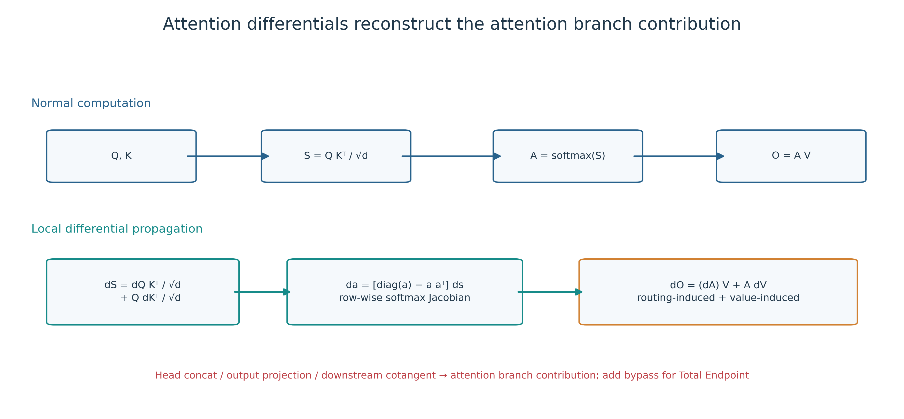

**图 4-1 注意力微分路径。** 查询和键改变注意力权重，值在当前权重下传递内容；三项在指定切面上重构完整注意力微分。

已执行的注意力负控制分别仅保留值路径而遗漏非零路由项，以及遗漏最大非零注意力头；这检验路由/取值和多头切面的覆盖。查询和键的单独遗漏是由闭合式推得的失败构造，本研究未把它计入已执行负控制。这里的查询和键分项均保留同一当前状态，分解局部微分而不改变原前向算子。

## 4.5 方法：残差路径图组

对残差计算 $y=u+f(u)$ 和固定下游目标，两个相加端口形成恒等与分支边实例。令 $g_y$ 为残差输出处的余切，则

**式（4-9）**

$$
E^{\mathrm{id}}=\operatorname{diag}(x)J_{u,x}^{\top}g_y,\qquad
E^{\mathrm{branch}}=\operatorname{diag}(x)J_{u,x}^{\top}J_{f,u}^{\top}g_y,\qquad
E^{\mathrm{res}}=E^{\mathrm{id}}+E^{\mathrm{branch}}.
$$

式（4-9）在同一输出余切下比较恒等和分支的输入响应。遗漏恒等边会破坏闭合；用已含分支的 $\nabla_uF$ 替代恒等边余切再加分支，会重复路径。实际执行的残差负控制在第一残差中重复恒等边，由重复边检查器拒绝。

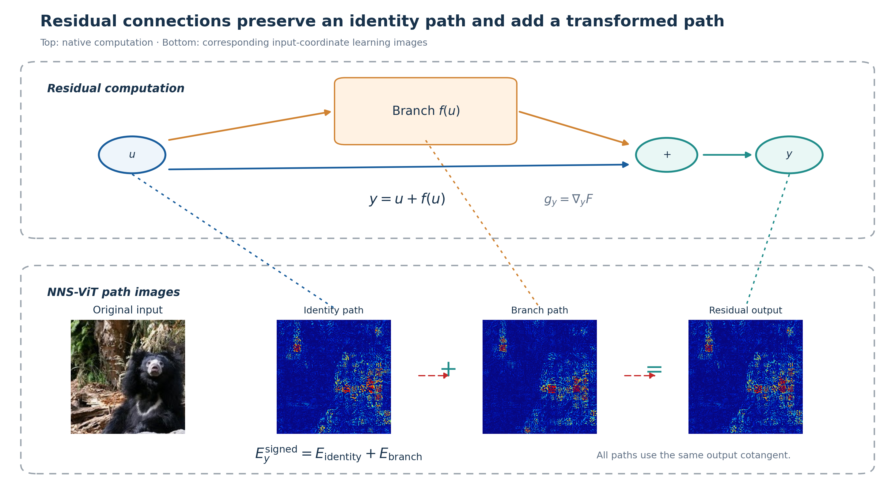

**图 4-2 残差路径。** 蓝底正值显示不具有可加性；等式只适用于原始带符号数组。 两个相加端口保留不同真实边身份，带符号分项相加恢复残差子图的输入响应。

## 4.6 图依赖与非唯一性

完整向量边对边内可逆线性坐标变换保持不变：

$$
z'=Rz,\quad g_{z'}=R^{-\mathsf T}g_z,\quad
J_{z',x}^{\mathsf T}g_{z'}=J_{z,x}^{\mathsf T}R^{\mathsf T}R^{-\mathsf T}g_z=J_{z,x}^{\mathsf T}g_z.
$$

坐标子分项可随混合而改变；跨边混合及切面粒度改变也会改变分组。

考虑 $x=(x_1,x_2)^\top$、隐藏变量 $h=x$ 和输出 $s=(1,1)h=x_1+x_2$。按隐藏坐标切分得到

**式（4-10）**

$$
E_1=(x_1,0)^\top,\qquad E_2=(0,x_2)^\top.
$$

令

**式（4-11）**

$$
R\,(x_1,x_2)^\top=(x_1+x_2,x_2)^\top,\qquad
h'=Rh,\qquad w'=R^{-\top}(1,1)^\top=(1,0)^\top.
$$

由式（4-11），同一函数可写为 $s=w'^\top h'$，新隐藏坐标下的分项为

**式（4-12）**

$$
E'_1=(x_1,x_2)^\top,\qquad E'_2=(0,0)^\top.
$$

式（4-10）和式（4-12）的总和相同，但分项不同。因此路径图相对于指定计算图、切面和参数化定义。闭合说明给定记账没有遗漏或重复；分项唯一性需要额外的不变性条件。

该反例界定了内部结构分配的识别条件。若研究问题关心端到端函数不变量，应使用总输入梯度、函数值或经证明不变的对象；若研究问题关心具体实现中信息经由哪些边传播，则图相对分解是合适对象，但必须报告实现和切面。本文选择后一问题，并把模型权重、软件路径与目标注册冻结为可复现条件。

切面粒度还会改变解释分辨率。把整个注意力子层作为一项只能比较子层与恒等路径；按头切分可比较头；在头内按查询、键和值切分可比较路由和内容传递。更细切面增加诊断能力，也增加项间抵消和多重比较负担。本文只在能够由真实边和同一余切定义、且有直接闭合验证的三个粒度上报告结果。

## 4.7 空间与尺度指标

令 $r_j$ 为 14×14 图像块网格中心，$t$ 为目标空间标记。

$$
H(q)=-\frac{\sum_{j=1}^{196}q_j\log q_j}{\log196},\qquad
L_t=\sum_{j:\|r_j-r_t\|_\infty\le1}q_j-\frac{|\{j:\|r_j-r_t\|_\infty\le1\}|}{196},\qquad
D_t=\sum_jq_j\frac{\|r_j-r_t\|_2}{13\sqrt2}.
$$

$$
S_Q=\frac{\|E^Q\|_1}{\|E^Q\|_1+\|E^K\|_1+\|E^V\|_1},\quad S_K,S_V\text{ analogously}.
$$

局部性扣除邻域均匀质量；CLS 的局部性和距离为 NA，零总质量的归一化指标为 NA。Q/K/V 分母为各项绝对质量之和；路由比例先合并 Q、K 的带符号图，二者不同。

对像素 $p$ 的三通道局部图，定义绝对质量和图像块质量分布

**式（4-13）**

$$
M(p)=\sum_{c\in\{R,G,B\}}|E_{p,c}|,\qquad
m_j=\sum_{p\in P_j}M(p),\qquad
q_j=\frac{m_j}{\sum_km_k}.
$$

总质量为零时，$q_j$ 记为缺失值。归一化空间熵、目标图像块邻域局部性和归一化距离分别衡量分布范围、近邻集中和到目标位置的距离。查询/键/值总体分析另使用两次从 $q$ 独立抽样所得位置距离的期望，从而不需要人为选定目标图像块。带符号图的抵消率定义为

**式（4-14）**

$$
C_{\mathrm{map}}=1-\frac{|\sum_iE_i|}{\sum_i|E_i|},\qquad
C_{\mathrm{path}}=1-\frac{\|E^{(1)}+E^{(2)}\|_1}{\|E^{(1)}\|_1+\|E^{(2)}\|_1}.
$$

路由相对尺度为

**式（4-15）**

$$
S_{\mathrm{route}}=\frac{\|E^{\mathrm{route}}\|_1}
{\|E^{\mathrm{route}}\|_1+\|E^{\mathrm{value}}\|_1},
$$

残差恒等相对尺度同理。式（4-14）用于报告正负项与路径间抵消。仅保留 $A\mathrm dV$ 的值路径近似误差为

**式（4-16）**

$$
\varepsilon_V=\frac{\|E^{\mathrm{attn}}-E^V\|_2}
{\|E^{\mathrm{attn}}\|_2}.
$$

## 4.8 结构闭合结果与计算复杂度

**算法 4-1 同目标结构路径分解**

| 步骤 | 操作 |
| --- | --- |
| 1 | 给定固定模型、输入 $x$、标量 $F$ 和合法切面 $C$ |
| 2 | 一次前向缓存实际使用端口张量 $z_c$ |
| 3 | 反向取得 $g_c=\partial F/\partial z_c$，固定余切种子 |
| 4 | 逐边 $E_c=x\odot\operatorname{VJP}(z_c,x;g_c)$，不再对 $g_c$ 求导 |
| 5 | 输出图组、切面重构误差和每个分项统计 |

设前向和反向成本为 $T_f,T_b$，缓存为 $A$，输入维数为 $d$。直接算法约需 $T_f+(1+|C|)T_b$，保存全部图需 $O(A+|C|d)$，流式统计需 $O(A+d)$。批量 VJP 提高并行效率，仍计算不同分项导数。

两模型共完成 76 800 项查询/键/值、路由/取值、多头及残差正向闭合，全部通过；28 800 项故意遗漏或重复路径的负控制全部被拒绝；6 144 项解析雅可比—向量积检查全部通过。独立复算的最大查询/键/值闭合绝对误差为 $1.574\times10^{-5}$，最大残差闭合绝对误差为 $2.480\times10^{-5}$。结果支持指定冻结图上的结构记账正确性。

闭合验证覆盖两种模型的全部 400 张评价图和 12 个编码块，因此既检查不同输入，也检查浅层到深层的数值条件变化。负控制分别遗漏最大非零头、遗漏非零路由项或重复第一残差恒等项；遗漏检查使用零绝对与相对容差，重复边由集合检查拒绝，因此它们验证检查器能发现指定错误构造；不能据此推断在正向数值容差下所有较小遗漏都会被拒绝。解析雅可比—向量积检查则直接比较局部方向响应，补充了输入空间分项加和。

计算成本取决于标量目标数和切面大小。一个总局部输入图需要一次反向传播；对含 $|C|$ 条边的切面逐项回传时，最直接实现至多需要 $|C|$ 次向量—雅可比作用。完整保存 $T$ 个目标、$|C|$ 个边分项和 $d$ 个输入坐标的浮点图需 $O(T|C|d)$ 存储；逐目标、逐边汇总可把图缓冲降低为 $O(d)$，另加前向激活和反向计算图的内存。该复杂度说明大规模内部目标研究需选择明确抽样和汇总粒度。

主要产物同时以原始带符号重构展示。图 4-3 使用冻结的块 5；图 4-4 在同一图像的 12 块中按 Q/K/V 抵消率最高选取，属于描述性案例，不进入总体推断。

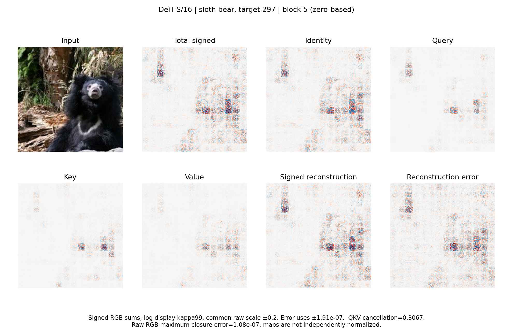

**图 4-3 块 5 的带符号重构。** 原图、总图、恒等与 Q/K/V 分项、带符号重构及原始误差来自同一注册目标。

**图 4-4 强抵消案例。** 零起始编号块 10 的 Q/K/V 抵消率为 0.5380，原始 RGB 重构最大误差为 $1.37	imes10^{-7}$。

## 4.9 本章小结

RQ3 的主要产物是带有输入坐标与真实边身份的结构路径图组。合法切面使查询键值、多头和残差分项闭合；重参数化反例界定其图依赖性质。后续章节使用这些对象研究层深差异和规定替换效用。

# 第 5 章 研究设计与统计分析

## 5.1 模型、数据与样本形成

原权重为 vit_base_patch16_224.augreg2_in21k_ft_in1k（ImageNet-21K 预训练、ImageNet-1K 微调）和 deit_small_patch16_224.fb_in1k（DeiT ImageNet-1K）。RGB 均值/标准差分别为 (0.5,0.5,0.5)/(0.5,0.5,0.5) 与 (0.485,0.456,0.406)/(0.229,0.224,0.225)。Pillow 10.2.0 解码 RGB，不作 EXIF 转置；torchvision 0.17.2 双三次短边缩放至 248、antialias=True、中心裁剪 224。模糊在 [0,1] RGB 上使用 31×31 高斯核、σ=10，再标准化。训练来源不同，模型间差异不单独归因于宽度或头数。

原样本排除 1098 个已暴露文件，990 类仍有合格图像，确定性选择其中 528 类各一图。图像自助区间近似将入选类别/图像视为可交换样本，不估计类内变异。三个初始化状态的区间仅描述这些状态；增加自助次数不会增加独立状态数。

两个原检查点均用于 ImageNet-1K 分类[1-2]。两模型含 12 个编码块；ViT-B/16 有 12 个注意力头、隐藏维 768，DeiT-S/16 有 6 个注意力头、隐藏维 384。推理关闭随机失活和随机深度。

样本以结果无关的确定性顺序形成：先从合格类别选择 528 类，再在每类选择一张图像；完整选择规则见附录 A。排序后的前 64 张为发现集，后 64 张为校准集，其余 400 张为评价集。三组互不重叠，每类至多贡献一张图像。主要总体实验在两个模型间共享同一 400 张评价图。

这一规则优先获得类别覆盖，并使分组完全由结果无关的元数据决定。发现集用于实现调试和图形方案，校准集用于固定数值容差与显示规则，评价集用于主要统计；评价图像在协议冻结前不会因模型输出或学习图像外观被选择。每类一图减少类别频数不平衡对图像级汇总的影响，但相应总体更接近“被选类别的一图分布”，而不是 ImageNet 同类图像的自然频率分布。

分层单元研究使用冻结的 100 图子集，每层抽取类别标记、15 个空间分层图像块标记和 32 个通道。每个模型—图像包含 6 144 个块后标量，共 1 228 800 个记录。五组独立复现保持这 100 张图不变，分别用互不相同、在结果读取前冻结的命名空间重新抽取 16 个标记和每层 32 个通道。参数状态对照使用每模型 32 张共享图像、三个独立随机初始化状态和同架构预训练状态。

标记抽样覆盖类别标记和空间分层图像块，通道抽样在每层独立生成。五组复现改变标记与通道目标，而不改变图像，因此检验层深方向是否依赖某一组内部目标；图像级自助法则在每组内部量化图像总体的不确定性。两者对应不同随机性来源，不能互相替代。

**表 5-1 模型与主要样本**

| 项目 | ViT-B/16 | DeiT-S/16 |
|---|---:|---:|
| 编码块数 | 12 | 12 |
| 注意力头数 | 12 | 6 |
| 隐藏维度 | 768 | 384 |
| 每图注册标量目标数 | 457 | 385 |
| 主要评价图像数 | 400 | 400 |
| 分层单元图像数 | 100 | 100 |
| 参数状态对照图像数 | 32 | 32 |
| 随机初始化状态数 | 3 | 3 |

原 400 图评价集未经分类正确性筛选；ViT-B/16 与 DeiT-S/16 的真实类别等于干净输入最高预测类别分别为 352/400（88.0%）和 336/400（84.0%）。第一批前瞻实验从原评估、校准、发现及历史暴露名单之外确定 900 张图像：前置 E1 诊断为 100 类×5 图，E2/E3 使用其中每类哈希第一图，E5 使用互斥的 400 类各一图。正式 E1-R2 再选择与第一批和历史名单均不重叠的 100 类×5 图。样本、单元及检验规则均在各自结果读取前冻结。

E5 另含 ViT-B/16 AugReg-IN1K 和 ViT-S/16 AugReg-IN21K→IN1K。四个检查点在 E5 独立 400 图上的正确数依次为 339、316、310 和 328。新增权重改变训练方案，后者还改变宽度；它们用于参数状态复现，不称为独立训练种子或纯模型规模对比。精确权重名、字节数和 SHA-256 见 evidence/revision_v5/protocol.json。

## 5.2 有限替换设计

区域任务先形成混合输入，再只把它产生的一个头输出插回原输入计算：

$$
x^{(R)}=(1-M_R)\odot x+M_R\odot x^{\rm ref},\qquad
e_{h,R}=F(x)-F\bigl(x;z_h\leftarrow z_h(x^{(R)})\bigr),
$$

$$
m_{h,R}=\sum_{i\in R}|E_{h,i}(x)|,\qquad
t_{h,R}=\left|\left\langle g_h,z_h(x)-z_h(x^{(R)})\right\rangle\right|.
$$

其他头和旁路保持原值，后续计算重新执行。区域泰勒需要每个候选混合输入的前向；不是输入梯度乘像素差，也不能从一次整体参照前向得到所有区域评分。$N_R$ 个候选需 $N_R$ 次候选输入前向和对应隔离后缀，另计算干净梯度。本文不据此主张实测效率优势。每个预算独立取最佳子集时，候选上界曲线可不对应一个嵌套排序。

$$
m_k=\sum_i|E_{k,i}|,\qquad b_k=|\langle g_k,z_k(x)\rangle|,\qquad
y_k=|F(x)-F(x;z_k\leftarrow z_k^{\rm ref})|.
$$

$$
\operatorname{capture@}K=\frac{\sum_{j=1}^{K}y_{\pi(j)}}{\sum_{j=1}^{K}y_{(j)}},\qquad
\operatorname{regret@}1=\max_ky_k-y_{\pi(1)}.
$$

$\pi$ 按评分递减排列，$y_{(j)}$ 按实测绝对效应递减排列，零分母捕获率为 NA。捕获率不是选对头的概率。原 C4a 每图跨层候选为 144/72 个头、24 个路由/取值成分或 24 个残差分支。M1 与多幅度比较先计算每层跨头的绝对值相关，再平均 12 层，最后跨图取中位数。

多幅度实验把注意力头输出 $z$ 从原输入状态插值到参照状态：

**式（5-1）**

$$
z_\alpha=(1-\alpha)z_{\mathrm{clean}}+\alpha z_{\mathrm{ref}},\qquad
\alpha\in\{0.05,0.10,0.25,0.50,1.00\}.
$$

真实有限效应和一阶预测定义为

**式（5-2）**

$$
e_\alpha=F(z_{\mathrm{clean}})-F(z_\alpha),\qquad
p_\alpha=\alpha\left\langle\nabla_zF,z_{\mathrm{clean}}-z_{\mathrm{ref}}\right\rangle.
$$

参照状态分别由归一化零输入和模糊输入产生。实验固定同一 400 图、真实类别逻辑值、12 层全部注意力头和两种参照状态。报告真实效应绝对值、预测绝对值、绝对误差、相对误差及图内头间斯皮尔曼秩相关（Spearman correlation）。

归一化零输入把模型坐标原点映射为参照状态，模糊输入保留低频颜色和轮廓但削弱细节。两种参照产生不同内部位移，能够检验局部排序是否依赖参照选择。多幅度实验沿每个具体原状态—参照状态方向取五个位置；它不是随机噪声强度扫描，而是对同一替换任务的距离连续化。

完整成分替换使用

**式（5-3）**

$$
e_k=F(x)-F(x;z_k\leftarrow z_k^{\mathrm{ref}}),\qquad
p_k=\left\langle\nabla_{z_k}F,z_k(x)-z_k^{\mathrm{ref}}\right\rangle.
$$

区域任务固定零起始编号块 5的三个注意力头，把输入划分为 $4\times4$ 候选区域，依次替换 1、2、4 个区域，即最高 25% 面积。每条曲线先取隔离效应绝对值，在面积 0–25% 上积分并除以 0.25，再在图内平均三个头。候选上界只在实际评价区域集合中取最优，不表示所有可能区域的全局最优。

成分排序与区域选择使用不同候选集合。成分任务在同一结构族内比较头或残差边，区域任务则在固定头内比较空间子集。前者用 Spearman、前若干项捕获率和遗憾值评价组件筛选；后者用绝对效应曲线下面积评价有限预算内逐步加入区域的收益。二者共同研究排序，但不能把一个任务的阈值直接移到另一个任务。

## 5.2.1 前瞻补充实验 E1-R2 与 E2–E5

E1-R2 在不与原样本或 E1 前置诊断重叠的新 100 类×5 图上，于块 0、3、7、11 分别冻结 32 个块后标记—通道单元和 32 个 GELU 后 MLP 单元。ImageNet devkit 的 WordNet 层级在不读取模型结果的条件下，为每类冻结最短层级距离的异类；并列时用 SHA-256 顺序决定。学习图像的 14×14 绝对质量分布使用 Jensen–Shannon 相似度。每图与四张同类图及匹配异类的五张图比较，先在图内汇总，再以类别为统计单位。激活类别 eta 平方和前置 RGB 外观匹配诊断单独报告。

E2 在两个原检查点、100 图、全部 12 块上分析 32 个 MLP 基本神经元和 8 个 patch-token 通道族。报告绝对质量、Hoyer 稀疏性、熵、符号抵消、单元间 JS 相似度及抽样候选 top-8 质量集中度。两类对象分别闭合；与注意力头只比较无量纲统计量。

E3 对同一 100 图及四个代表块的块后单元、MLP 单元和 MLP 通道族分别替换。参照为归一化零输入与模糊输入，幅度为 0.1 和 1，top-k 预算为 1、2、4、8。评分包括路径质量、激活、梯度、激活乘梯度、位移、位移感知泰勒及 20 次随机排序。激活匹配控制按对数激活幅度最近且不重用选择，候选不足为 NA。真实类别、最高非目标、冻结随机非目标逻辑值及动态类别间隔均保存带符号和绝对效应。

E4 在 E5 的 200/100/100 训练、验证、测试划分上用岭回归预测四个代表块的平均完整头替换绝对效应。输入为总图、总图加七类正确结构分项，或总图加同维度边标签打乱分项。标准化只用训练集，验证集从 0.1、1、10、100 中选正则项，测试集只评价一次。总图相似配对由测试总图 JS 距离最低 10% 形成，不读取结构差异或效应。

E5 固定四项假设：块后神经元熵、路由相对尺度、MLP 与注意力残差恒等轨迹差，以及路径图减激活乘梯度的头排序相关。每个检查点分别报告图像级中位数和区间，并在四项双侧符号检验内实施 Holm 校正。严格零质量、零分母捕获率和常量秩向量为 NA；不删除小效应。E1 以类别为统计单位，E2–E5 以图像为统计单位。

## 5.3 统计原则、误差与缺失值

统计单位为图像。同图标记、通道和头先按各估计量的定义聚合，两个模型分别汇总。配对差先在同一图像内相减，再计算跨图中位数；因此“差的中位数”通常不等于两个中位数之差。多幅度误差先在图内全部块和头上取中位数，排序则先逐块跨头计算 Spearman，再对有效块取平均。五组目标抽样共用同一 100 图，检验目标抽样敏感性，图像样本数仍为 100。

主要中位数区间采用 10 000 次图像自助法和线性分位数算法，取 2.5% 与 97.5% 分位点[36]。原确认性和 v3 后继分析有放回抽取完整图像；M1/M2 和本次层序重分析使用经验分布次序统计量的等分布中位数抽样。参数状态与类别目标补充分析采用 2 000 次自助均值区间；参数状态对比同时重采样图像和三个随机种子。各阶段使用 PCG64，按固定命名空间和完整分析键生成种子；附录 A 列出种子规则，逐项结果文件记录重分析种子。自助区间为逐项精度区间，Holm 校正作用于检验而非这些区间。

式（5-2）的相对误差为 $|e_\alpha-p_\alpha|/|e_\alpha|$。分母精确为零时记为缺失；v3 冻结规则没有给非零小效应加入稳定常数。仅值路径误差的分母为式（4-16）中的完整图二范数，零范数时缺失。Q/K/V 和目标抽样中零绝对质量导致空间指标缺失，不填零。原确认性规则另将绝对质量不超过 $10^{-12}$ 标记为近零；符号检验中绝对值不超过 $10^{-12}$ 记为平局。不同分析的规则各按原定义保留。

Spearman 对并列值使用平均秩。原确认性成分排序至少需要 8 个有效成分；v3 头间排序至少需要 4 个。常量向量、有效成分不足或非有限输入使相关无定义，记为缺失，不填零。完整层序趋势要求 12 块全部有效且指标非常量；相邻差和分段差使用配对有效图像。每项输出同时报告总数、有效数和缺失数，避免方法之间以不同有效集合获得表面优势。

原确认性联合族共有 28 个检验：两个模型、两种参照与三个成分族的 12 个 C4a 检验，加两个模型、两种参照与四个基线的 16 个 C4b 检验。对全部 28 个双侧精确符号检验统一实施 Holm 校正[37]，支持还要求方向为正。四个空间基线为总局部输入图、原始输入梯度、区域泰勒和随机区域；成分族为注意力头、路由/取值和残差分支。

0.10 与 0.05 是原协议在结果读取前冻结的操作门槛：前者为成分相关中位数的点估计门槛，后者为配对区域效应曲线下面积增益，单位为原始类别逻辑值。它们不是普适解释质量标准。成分规则要求点估计达到 0.10，同时相对零的相关方向显著；这不是对总体相关大于 0.10 的直接检验。另须满足至少 360 张有效图、300 个非零符号值，以及 C4a 区间宽度不超过 0.30、C4b 不超过 0.50。

400 图源于固定精度设计：二项正号比例在最坏情况 $p=0.5$ 下，95% 正态近似半宽为 $1.96\sqrt{0.25/400}=0.049$。该设计未进行功效模拟，也不声称达到指定功效；相关和逻辑值效应的精度由冻结区间宽度门限实际检验。封存 C4a 区间宽度为 0.0168–0.0557，C4b 为 0.0010–0.0082，均满足相应精度要求，因此原联合失败不是由这些精度门限不足造成。

## 5.3.1 完整层序的事后重分析

新增分析复用已读取的数值记录，性质为事后描述性重分析。对每图每块先取规定单元中位数，完整保留 0 至 11 块。早期、中期、后期分别为 0–3、4–7、8–11 块；每图先对阶段内块值取中位数，再计算中期减早期、后期减中期和后期减早期。这个两级中位数不同于原目标抽样把阶段内所有单元合并取中位数的估计量，两者分别报告。

每图计算块编号与指标的 Spearman 相关，汇总其中位数及图像自助区间；第 11 块减第 0 块另列为端点差。对 $\Delta_b=m_{b+1}-m_b$ 的 11 个相邻差分别求图像级中位数和区间，并在每个模型—对象—指标族内对 11 个双侧符号检验做 Holm 校正。各族互相独立报告，不据此构造跨所有指标的联合确认性主张。稀疏轨迹按图像标识的固定排序选取 12 图，全体图像轨迹随数据表提供。

## 5.4 分析类别与有效样本

**表 5-2 研究问题、估计量与分析性质**

| 研究问题 | 主要估计量 | 图像数/模型 | 分析性质 | 结论对象 |
|---|---|---:|---|---|
| RQ3 结构定义与闭合 | 切面加和误差、方向误差与负控制 | 400 | 方法与正确性验证 | 规定图和切面 |
| RQ2 原目标空间差异 | 阶段内合并单元的熵、局部性、距离 | 100 | 原冻结分析 | 原抽样目标 |
| RQ2 五组目标抽样 | 后期减前期与端点差 | 100 | 后继冻结分析 | 内部目标抽样敏感性 |
| RQ3 查询键值总体 | 绝对质量、熵、距离、抵消、尺度端点差 | 400 | 后继冻结分析 | 三类结构路径 |
| RQ2/RQ3 完整层序 | 逐块区间、趋势、阶段与相邻差 | 100 或 400 | 事后描述性重分析 | 阶段性层深差异 |
| RQ2 参数/目标敏感性 | 预训练减随机；最高预测减真实类别 | 32 或 100 | 冻结补充分析 | 参数状态或目标选择 |
| RQ4 多幅度替换 | 绝对/相对误差、头间排序 | 400 | 后继冻结分析 | 规定插值方向 |
| RQ4 完整成分排序 | 成分相关与联合规则 | 400 | 原确认性分析 | 全族联合与族级操作规则 |
| RQ4 原区域选择 | 原随机估计量下的配对增益 | 400 | 原确认性分析 | 原 C4b 判定 |
| RQ4 修正随机基线 | 逐重复绝对效应 AUC 再平均 | 400 | 事后估计量修正/敏感性分析 | 修正估计量下的区域比较 |
| RQ2 E1-R2 类别一致性 | 同类减 WordNet 元数据匹配异类 JS 相似度 | 100 类×5 图 | 前瞻补充实验 | 标记—通道与 MLP 神经元 |
| RQ2/RQ3 E2 MLP 单元 | 熵、稀疏性、抵消、冗余与闭合 | 100 | 前瞻补充实验 | 基本单元与通道族 |
| RQ4 E3 神经元干预 | 相关、捕获率、遗憾和 top-k 效应 | 100 | 前瞻补充实验 | 三类神经元对象及非目标控制 |
| RQ4 E4 信息增量 | 独立测试 MAE 与 Spearman | 200/100/100 | 前瞻补充实验 | 总图、结构分项与乱序标签 |
| RQ4 E5 外部验证 | 四项冻结图像级对比 | 400×4 检查点 | 前瞻补充实验 | 独立图像与公开参数状态 |

原确认性分析保持原样本、估计量、检验族和结论。后继冻结分析在新增结果读取前固定其任务，提供多幅度、查询键值总体统计和五组目标抽样。事后或敏感性分析包括修正随机基线、完整层序重分析、空间总变差解释及前置 RGB 匹配诊断。E1-R2 和 E3 分别检验类别一致性与行为目标选择性；对象掩码定位仍未评价。

**表 5-3 有效值和缺失值覆盖**

| 分析 | 总量 | 有效量 | 缺失量 |
|---|---:|---:|---:|
| C4a：12 族×400 图 | 4 800 | 4 800 | 0 |
| C4b：16 比较×400 图 | 6 400 | 6 400 | 0 |
| 多幅度：两模型×两参照×五幅度×400 图 | 8 000 | 8 000 | 0 |
| 多幅度逐块排序 | 96 000 | 96 000 | 0 |
| 完整层序图像—指标轨迹 | 30 200 | 30 200 | 0 |
| 完整层序逐块图像值 | 362 400 | 362 400 | 0 |
| 前置 E1 图像—模型任务 | 1 000 | 1 000 | 0 |
| 正式 E1-R2 图像—模型任务 | 1 000 | 1 000 | 0 |
| E2 图像—模型任务 | 200 | 200 | 0 |
| E3 图像—模型任务 | 200 | 200 | 0 |
| E5 图像—检查点任务 | 1 600 | 1 600 | 0 |

表 5-3 的多幅度有效性指图像级统计，不表示所有逐头相对误差均有效；精确零效应的逐头项按规则缺失，逐模型、参照和幅度的数量列于附录 A。五组抽样中类别标记没有空间目标位置，局部性与输入距离的该类单元按定义缺失；图内有效空间标记仍可形成统计量。逐项计数见补充数据。

## 5.5 可视化与复算

总体曲线使用原始数值的图像级汇总。阴影表示逐块 95% 自助区间，灰色稀疏轨迹显示固定选取图像的差异；显示转换不参与统计。完整数值、逐项缺失数和图像轨迹随论文材料提供，文件绑定和软件环境见附录 A。

# 第 6 章 神经元级与结构路径规律

## 6.1 本章问题与方法

本章回答 RQ2 与 RQ3。分析对象包括神经元级规律、查询键值、路由取值、MLP 单元及两类残差路径。原冻结统计和后继冻结端点结果保留；新增的逐块区间、每图趋势、阶段对比和相邻差均为事后重分析。所有模型分别报告，五组目标抽样保持各自身份。

完整重分析覆盖 98 个模型—对象—指标族、30 200 条图像轨迹和 362 400 个逐块图像值；图像级缺失为零。每个族均提供 12 块中位数及区间、全部图像轨迹、早中晚阶段值、三组阶段差、端点差、趋势和 11 个相邻差。正文选择与 RQ2 直接相关的指标，完整数值与图册在附录 B 指引的补充材料中提供。

## 6.2 结果：抽样内部目标的完整轨迹

五组目标抽样的原冻结后期减前期差列于表 6-1。每组使用相同 100 图，在组内重新选择标记和通道；该方向对五组独立内部目标抽样保持一致，反映目标选择敏感性。

**表 6-1 五组独立标记—通道抽样的后期减前期差**

| 模型 | 指标 | 第 1 组 | 第 2 组 | 第 3 组 | 第 4 组 | 第 5 组 |
|---|---|---:|---:|---:|---:|---:|
| ViT-B/16 | 熵 | 0.2351 | 0.2273 | 0.2179 | 0.2313 | 0.2247 |
| ViT-B/16 | 局部性 | −0.3685 | −0.3646 | −0.3537 | −0.3634 | −0.3618 |
| ViT-B/16 | 距离 | 0.1500 | 0.1473 | 0.1432 | 0.1445 | 0.1450 |
| DeiT-S/16 | 熵 | 0.2246 | 0.2301 | 0.2244 | 0.2271 | 0.2189 |
| DeiT-S/16 | 局部性 | −0.3408 | −0.3453 | −0.3357 | −0.3413 | −0.3401 |
| DeiT-S/16 | 距离 | 0.1311 | 0.1344 | 0.1294 | 0.1347 | 0.1320 |

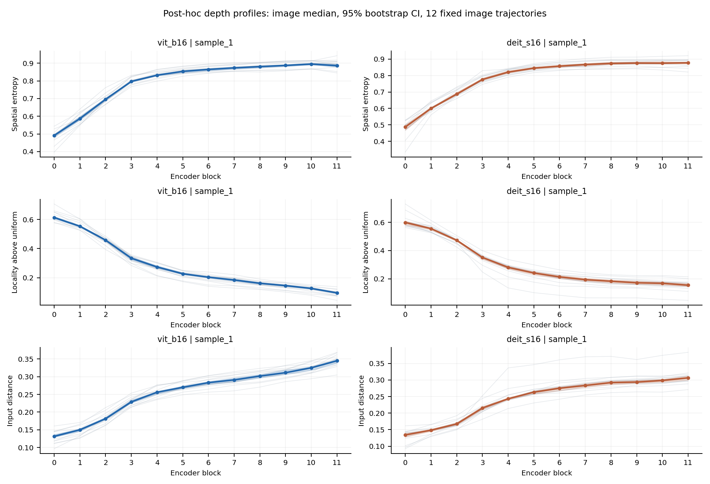

**图 6-1 内部目标完整层序。** 第一组目标抽样；点线为 100 图中位数，阴影为逐块 95% 图像自助区间，灰线为固定排序选取的 12 图。其余四组按同一规则绘制，见附录 B。局部性和距离排除无空间位置的类别标记，保留全部有效图像。

完整轨迹表明，熵和输入距离总体上升，邻域局部性总体下降，但熵在中间层存在局部回落。表 6-3 给出每图趋势中位数及相邻差方向，不能把趋势接近一解释为每张图在每个相邻块都同向变化。第一组中，ViT-B/16 只有 34 张图的熵严格满足非递减，DeiT-S/16 为 31 张；输入距离分别为 89 张和 65 张。总体趋势与个体单调轨迹的比例回答不同问题。

## 6.3 结果：查询、键和值的完整轨迹

表 6-2 保留后继冻结的端点估计。它衡量第 11 块与第 0 块的差，不检验其间的单调性。

**表 6-2 查询、键和值路径第 11 块减第 0 块的图像级中位差及 95% 区间**

| 模型 | 路径 | 绝对质量 | 熵 | 成对距离 | 抵消率 | 相对尺度 |
|---|---|---:|---:|---:|---:|---:|
| ViT-B/16 | 查询 | 208.8022 [193.7022, 229.1715] | 0.0268 [0.0217, 0.0314] | 0.0108 [0.0071, 0.0143] | 0.0099 [0.0083, 0.0122] | 0.0427 [0.0220, 0.0549] |
| ViT-B/16 | 键 | 308.5203 [285.6579, 347.7998] | −0.0586 [−0.0636, −0.0528] | −0.0109 [−0.0150, −0.0073] | 0.0104 [0.0093, 0.0123] | 0.2553 [0.2449, 0.2675] |
| ViT-B/16 | 值 | 255.5471 [235.9237, 295.1770] | −0.0530 [−0.0591, −0.0471] | −0.0082 [−0.0106, −0.0052] | 0.0018 [0.0015, 0.0023] | −0.3088 [−0.3249, −0.2882] |
| DeiT-S/16 | 查询 | 91.9272 [86.3993, 98.2857] | −0.0038 [−0.0080, 0.0005] | −0.0021 [−0.0046, 0.0022] | 0.0192 [0.0177, 0.0223] | 0.1292 [0.1169, 0.1376] |
| DeiT-S/16 | 键 | 140.0030 [128.9647, 148.3989] | −0.0669 [−0.0736, −0.0590] | −0.0100 [−0.0140, −0.0059] | 0.0119 [0.0106, 0.0144] | 0.2581 [0.2507, 0.2649] |
| DeiT-S/16 | 值 | 73.3232 [63.7414, 84.2214] | −0.0669 [−0.0748, −0.0609] | −0.0054 [−0.0094, −0.0021] | 0.0027 [0.0021, 0.0032] | −0.3915 [−0.4044, −0.3840] |

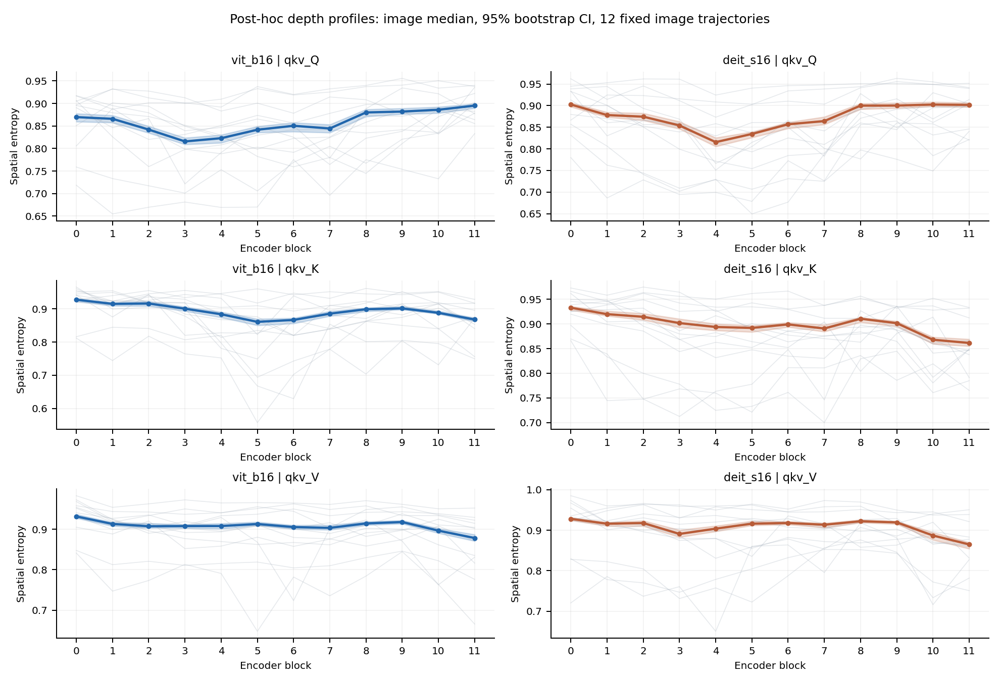

**图 6-2 查询、键和值的完整空间熵轨迹。** 每模型 400 图；阴影为逐块 95% 图像自助区间，灰线为固定 12 图。绝对质量、成对距离、抵消率和相对尺度的同格式曲线见附录 B。

查询路径体现端点与完整层序的区别。ViT-B/16 的熵趋势中位数为 0.4266，DeiT-S/16 为 0.2238，区间均位于零以上；但后者端点差为 −0.0038，区间跨零。DeiT-S/16 查询熵中期减早期为 −0.0308，后期减中期为 0.0516，呈先降后升。键和值熵在两个检查点中的完整趋势中位数均为负，仍存在正向相邻差。因而三条路径应按各自阶段轨迹描述。

绝对质量与相对尺度保留不同信息。端点比较中值路径绝对质量增加而相对尺度下降，说明其他路径的质量增长更大；这种端点关系不意味着每一层保持同样增长顺序。抵消率刻画带符号净和相对总幅度的缩减，不能把绝对质量较大的分项直接解释为同方向输出支持。

**表 6-3 完整 12 层趋势与相邻差方向（事后分析）**

| 模型 | 对象 | 图像趋势中位数 [95% 区间] | 相邻差正/负项数 | Holm 显著项数 |
|---|---|---|---|---|
| ViT-B/16 | 抽样 1 熵 | 0.9860 [0.9720, 0.9930] | 10 / 1 | 10 |
| ViT-B/16 | 抽样 1 局部性 | -1.0000 [-1.0000, -1.0000] | 0 / 11 | 11 |
| ViT-B/16 | 抽样 1 距离 | 1.0000 [1.0000, 1.0000] | 11 / 0 | 11 |
| ViT-B/16 | 查询熵 | 0.4266 [0.3846, 0.4602] | 7 / 4 | 6 |
| ViT-B/16 | 键熵 | -0.3706 [-0.3986, -0.3357] | 5 / 6 | 9 |
| ViT-B/16 | 值熵 | -0.3287 [-0.3706, -0.2797] | 4 / 7 | 7 |
| ViT-B/16 | 路由相对尺度 | 0.3951 [0.3497, 0.4336] | 7 / 4 | 8 |
| ViT-B/16 | 仅值路径误差 | 0.5664 [0.5245, 0.5874] | 8 / 3 | 9 |
| ViT-B/16 | 注意力恒等尺度 | -0.4895 [-0.5035, -0.4685] | 5 / 6 | 9 |
| ViT-B/16 | 多层感知机恒等尺度 | 0.7063 [0.6853, 0.7203] | 9 / 2 | 11 |
| DeiT-S/16 | 抽样 1 熵 | 0.9930 [0.9755, 0.9930] | 11 / 0 | 9 |
| DeiT-S/16 | 抽样 1 局部性 | -1.0000 [-1.0000, -1.0000] | 0 / 11 | 11 |
| DeiT-S/16 | 抽样 1 距离 | 1.0000 [1.0000, 1.0000] | 11 / 0 | 11 |
| DeiT-S/16 | 查询熵 | 0.2238 [0.1888, 0.2622] | 6 / 5 | 6 |
| DeiT-S/16 | 键熵 | -0.5035 [-0.5385, -0.4685] | 3 / 8 | 8 |
| DeiT-S/16 | 值熵 | -0.3217 [-0.3497, -0.2727] | 5 / 6 | 9 |
| DeiT-S/16 | 路由相对尺度 | 0.5175 [0.4930, 0.5455] | 7 / 4 | 9 |
| DeiT-S/16 | 仅值路径误差 | 0.6713 [0.6503, 0.7028] | 8 / 3 | 7 |
| DeiT-S/16 | 注意力恒等尺度 | -0.2797 [-0.3007, -0.2448] | 5 / 6 | 10 |
| DeiT-S/16 | 多层感知机恒等尺度 | 0.6993 [0.6783, 0.7133] | 7 / 4 | 11 |

表 6-3 的正负项数由 11 个“图内相邻差的中位数”计算，Holm 仅在对应 11 项内校正。完整的效应量、95% 区间和校正后概率均提供在相邻差数据表及逐族图册中。模型与指标之间不形成额外的联合显著性主张。

## 6.4 结果：路由与取值的相对尺度和近似误差

$$
\left\|\sum_hE_h\right\|_1,\qquad\sum_h\|E_h\|_1,\qquad\operatorname{median}_h\|E_h\|_1.
$$

以上三种汇总通常不同。表 6-2 先合并各头带符号图再取范数；表 6-4 先计算每头范数，再取图内头中位数。M4 路由尺度同样先求每头比例，再取图内中位数，不能读作整层因果份额。跨头抵消和中位数操作使两表量级不同；仅比例下降不能推出路径作用减弱。

路由相对尺度的第 0 与第 11 块中位数在 ViT-B/16 为 0.3092 与 0.5154，在 DeiT-S/16 为 0.2041 与 0.4808。仅值路径误差对应为 0.4407 与 0.8022、0.2774 与 0.8488。表 6-4 给出相应注意力路径的绝对质量端点。

**表 6-4 注意力路径的绝对质量中位数**

| 模型 | 编码块 | 路由绝对质量 | 取值绝对质量 | 完整注意力绝对质量 |
|---|---:|---:|---:|---:|
| ViT-B/16 | 0 | 2.6596 | 7.6041 | 9.8604 |
| ViT-B/16 | 11 | 40.7842 | 39.0241 | 54.6768 |
| DeiT-S/16 | 0 | 4.5294 | 18.4261 | 20.1427 |
| DeiT-S/16 | 11 | 35.9257 | 38.8767 | 44.5653 |

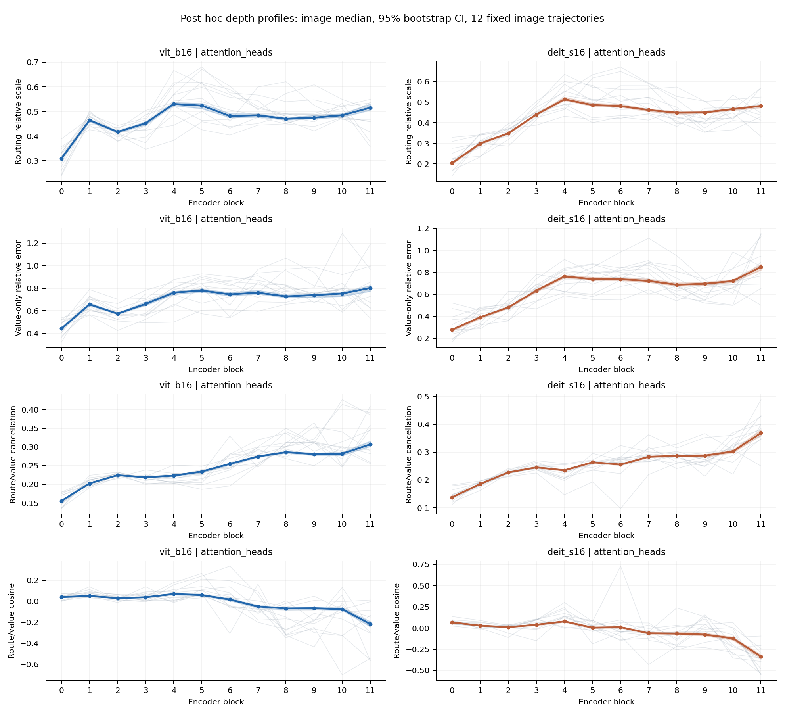

**图 6-3 路由尺度、仅值路径误差和路径关系。** 所有曲线覆盖 12 块；灰线、点线和阴影分别为个体、总体中位数和图像自助区间。

两模型的路由尺度均主要从早期到中期上升，后期相对中期回落，阶段差见表 6-5。仅值路径误差的完整趋势为正，但相邻差方向不一致。它们说明当前注意力权重下的值传递不能完整近似目标条件化输入响应；变化主要反映特定结构阶段，不能写成各层持续增强。

## 6.5 结果：注意力与多层感知机残差

注意力残差的恒等尺度从早期到中期下降，随后回升；多层感知机残差的阶段中位数则从早期到后期提高。后期减前期的原图像级中位差在注意力残差为 −0.1242、−0.0449，在多层感知机残差为 0.1798、0.1780。完整相邻差显示两种残差均有局部反向步骤。

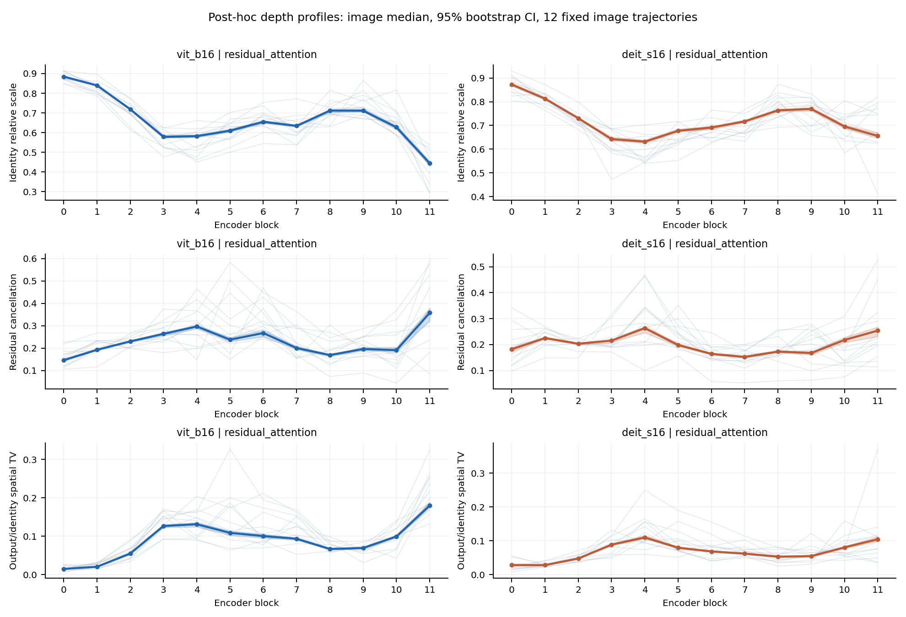

**图 6-4 注意力残差完整层序。** 恒等相对尺度、路径抵消和输出—恒等空间总变差分别度量尺度平衡、符号抵消与空间形状差异。

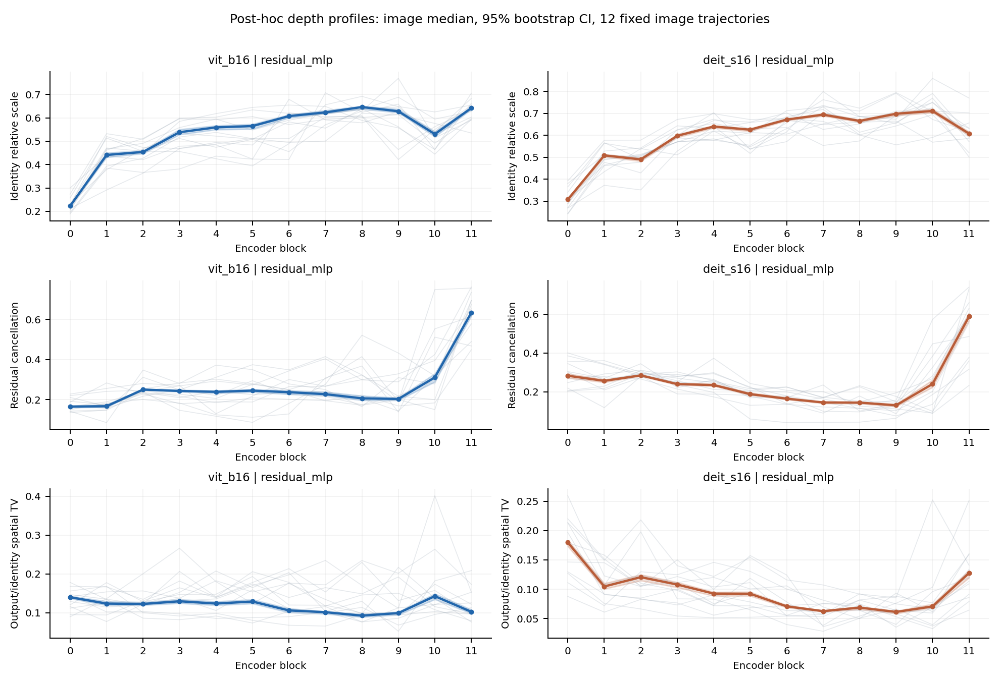

**图 6-5 多层感知机残差完整层序。** 与图 6-4 使用相同统计与显示规则；同名尺度的差异指向具体残差子层。

**表 6-5 阶段对比与端点差（事后分析）**

| 模型 | 对象 | 中期减早期 | 后期减中期 | 第 11 减第 0 块 |
|---|---|---|---|---|
| ViT-B/16 | 查询熵 | -0.0011 [-0.0043, 0.0028] | 0.0386 [0.0359, 0.0451] | 0.0268 [0.0218, 0.0313] |
| ViT-B/16 | 路由相对尺度 | 0.0787 [0.0715, 0.0848] | -0.0246 [-0.0286, -0.0200] | 0.2007 [0.1888, 0.2097] |
| ViT-B/16 | 注意力恒等尺度 | -0.1612 [-0.1672, -0.1563] | 0.0379 [0.0254, 0.0476] | -0.4354 [-0.4475, -0.4259] |
| ViT-B/16 | 多层感知机恒等尺度 | 0.1353 [0.1288, 0.1427] | 0.0375 [0.0269, 0.0443] | 0.4118 [0.4014, 0.4184] |
| DeiT-S/16 | 查询熵 | -0.0308 [-0.0342, -0.0273] | 0.0516 [0.0467, 0.0557] | -0.0038 [-0.0076, 0.0005] |
| DeiT-S/16 | 路由相对尺度 | 0.1611 [0.1533, 0.1686] | -0.0290 [-0.0349, -0.0232] | 0.2723 [0.2595, 0.2816] |
| DeiT-S/16 | 注意力恒等尺度 | -0.0900 [-0.0951, -0.0866] | 0.0440 [0.0380, 0.0495] | -0.2174 [-0.2291, -0.2080] |
| DeiT-S/16 | 多层感知机恒等尺度 | 0.1498 [0.1437, 0.1577] | 0.0176 [0.0093, 0.0254] | 0.3036 [0.2940, 0.3204] |

表 6-5 的配对差先在每图计算，因此不等于图中两个总体中位数之差。空间总变差与相对尺度也不是同一对象：某条边的范数相对较大，并不要求输出分布与其空间形状完全一致。

## 6.6 参数状态与目标选择敏感性

三个随机初始化状态也出现空间扩展，幅度与预训练状态不同。ViT-B/16 预训练状态熵的后期减前期为 0.2288，随机状态均值为 0.0940，差为 0.1348 [0.1232, 0.1466]；DeiT-S/16 为 0.2256、0.1718 和 0.0539 [0.0473, 0.0602]。这是参数状态比较，训练过程效应需要同架构多训练种子或过程检查点。

主分析保留真实类别逻辑值，问题是标注类别条件下的结构响应。表 6-6 在同一 100 图子样本中并列真实类别和冻结原输入最高预测类别；后者对应当前预测。两种目标在正确分类图像上相同，错误分类图像分别只有 8 张和 14 张，未作稳定分层推断。

**表 6-6 真实类别与冻结最高预测类别敏感性（100 图，后期减前期）**

| 模型 | 指标 | 真实类别均值 [95% 区间] | 最高预测类别均值 [95% 区间] |
|---|---|---|---|
| ViT-B/16 | 路由尺度 | 0.2031 [0.1868, 0.2189] | 0.2030 [0.1862, 0.2184] |
| ViT-B/16 | 仅值路径误差 | 0.3539 [0.3170, 0.3877] | 0.3572 [0.3203, 0.3917] |
| ViT-B/16 | 注意力恒等尺度 | -0.4390 [-0.4577, -0.4213] | -0.4392 [-0.4568, -0.4219] |
| ViT-B/16 | 多层感知机恒等尺度 | 0.4057 [0.3937, 0.4183] | 0.4033 [0.3919, 0.4144] |
| DeiT-S/16 | 路由尺度 | 0.2617 [0.2450, 0.2785] | 0.2607 [0.2438, 0.2778] |
| DeiT-S/16 | 仅值路径误差 | 0.5806 [0.5452, 0.6180] | 0.5745 [0.5354, 0.6131] |
| DeiT-S/16 | 注意力恒等尺度 | -0.2168 [-0.2369, -0.1960] | -0.2216 [-0.2418, -0.2006] |
| DeiT-S/16 | 多层感知机恒等尺度 | 0.3029 [0.2846, 0.3227] | 0.3041 [0.2847, 0.3235] |

表 6-6 的估计量是图像级阶段差的均值，区间对应 2 000 次图像自助均值；它与前文以中位数汇总的主分析分别报告。

前向通道能量与同通道局部输入绝对质量的图像级 Spearman 均值为 0.2663 和 0.2811，高于错误通道、跨层、空间置换和随机通道控制。该补充结果说明前向响应与局部输入依赖有关联，但不能仅凭前向热图恢复结构路径的空间分配。

## 6.7 前瞻实验 E1-R2：神经元学习图像的类别一致性

E1-R2 使用 500 张新图像，覆盖 100 类、每类 5 张。在零起始编号块 0、3、7、11，每模型每块固定 32 个块后单元和 32 个 GELU 后 MLP 单元。同类图像对与按 ImageNet devkit WordNet 层级冻结的异类图像比较。主要估计量为同类减元数据匹配异类的 Jensen–Shannon 相似度，先在图内汇总，再以类别为统计单位。

**表 6-7 E1-R2 同类减 WordNet 元数据匹配异类的学习图像相似度**

| 模型 | 单元族 | 块 | 中位数 [95% 区间] |
| --- | --- | --- | --- |
| vit_b16 | post | 0 | 0.0001 [-0.0016, 0.0040] |
| vit_b16 | post | 11 | -0.0011 [-0.0074, 0.0079] |
| vit_b16 | mlp | 0 | 0.0015 [-0.0021, 0.0042] |
| vit_b16 | mlp | 11 | 0.0014 [-0.0072, 0.0082] |
| deit_s16 | post | 0 | 0.0018 [-0.0030, 0.0060] |
| deit_s16 | post | 11 | -0.0004 [-0.0064, 0.0043] |
| deit_s16 | mlp | 0 | 0.0021 [-0.0027, 0.0063] |
| deit_s16 | mlp | 11 | 0.0006 [-0.0062, 0.0078] |

E1-R2 的 16 个模型—层—单元族区间均跨零，Holm 校正后均未获支持。此前不符合元数据匹配设计的 RGB 外观诊断在另一批 500 图上得到 16 项反向差异，仅作为敏感性结果保留。两批样本均未显示同类优势，而反向差异只出现在 RGB 外观匹配下。激活类别 eta 平方仍非零，但激活选择性与学习图像类别一致性是不同对象。

## 6.8 前瞻实验 E2：MLP 神经元及其结构路径

E2 在两个原检查点各使用 100 图并覆盖全部 12 块。基本 MLP 神经元定义为 GELU 后、第二线性层前的“标记×隐藏通道”标量；通道族为同一隐藏通道的 196 个 patch 标记集合。每图每块抽取 32 个基本神经元和 8 个通道族。

**表 6-8 E2 归一化空间熵**

| 模型 | 对象 | 块 0 | 块 5 | 块 11 |
| --- | --- | --- | --- | --- |
| vit_b16 | mlp_scalar | 0.4618 [0.4517, 0.4663] | 0.8571 [0.8520, 0.8621] | 0.8940 [0.8819, 0.9008] |
| vit_b16 | heads | 0.8991 [0.8943, 0.9030] | 0.8848 [0.8653, 0.8921] | 0.8620 [0.8465, 0.8717] |
| deit_s16 | mlp_scalar | 0.4794 [0.4750, 0.4866] | 0.8540 [0.8491, 0.8598] | 0.8682 [0.8559, 0.8803] |
| deit_s16 | heads | 0.9132 [0.9048, 0.9185] | 0.8890 [0.8813, 0.9009] | 0.8665 [0.8581, 0.8772] |

MLP 神经元熵随深度明显增加，稀疏性下降；抽样 MLP 单元间的 JS 相似度也升高，说明后层空间冗余增加。注意力头熵则下降。这些无量纲指标表明两类子层轨迹不同，没有直接比较未标准化质量。

每个模型—图像执行 72 项 MLP、注意力和残差切面检查，最大原始 RGB 误差为 $2.01	imes10^{-5}$，满足声明的混合容差。块 11 的 patch-token MLP 通道族到类别逻辑值的路径严格为零：最后一个逐标记 MLP 后没有新的 token 混合，patch token 无法再影响 CLS 分类头。这是结构性零值，不是缺失数据。

## 6.9 讨论与本章小结

RQ2 与 RQ3 的结果是结构分项具有不同的阶段性层深差异。抽样目标的空间范围在五组目标选择下呈一致总体方向；查询、键和值具有不同轨迹；路由尺度及两类残差在中期和后期有不同转折。端点差、完整趋势和相邻差分别描述距离较远的两个状态、全层排序和局部变化。熵、局部性和距离衡量局部输入依赖的空间分布，语义证据的操作定义见第 8 章。

# 第 7 章 神经元与结构路径的行为评价

## 7.1 本章问题

本章回答 RQ4 的行为评价部分：先检验路径图在完整成分、区域和神经元替换中的排序表现，再以参照位移感知泰勒量分析局部线性化的适用幅度。

## 7.2 方法

多幅度实验按式（5-1）和式（5-2）执行。每个模型使用同一 400 图、12 层全部注意力头、真实类别逻辑值及两种参照状态。Spearman 相关先在每图每层跨头计算，再平均 12 层。绝对误差为 $|e_\alpha-p_\alpha|$；相对误差使用冻结分母规则，零分母传播为缺失值。

完整成分替换按式（5-3）测量。局部图排序只使用原输入状态；泰勒排序显式使用实际参照位移。区域任务比较局部图、总局部输入图、原始梯度、区域泰勒和 20 次随机排序。两类方法的信息预算不同，结果解释为规定任务中的适配性。

## 7.3 结果：完整成分排序与原联合判据

**表 7-1 头内比较：图像中位数与 95% 区间（400 图，补充分析）**

| 模型 | 参照 | 指标 | 路径图 | 激活乘梯度 | 位移泰勒 | 随机 |
| --- | --- | --- | --- | --- | --- | --- |
| vit_b16 | normalized_zero | spearman | 0.2815 [0.2716, 0.2966] | 0.3995 [0.3942, 0.4085] | 0.6742 [0.6661, 0.6841] | -0.0000 [-0.0004, 0.0004] |
| vit_b16 | normalized_zero | capture_at_1 | 0.5174 [0.5037, 0.5352] | 0.6511 [0.6366, 0.6615] | 0.8038 [0.7945, 0.8113] | 0.3329 [0.3296, 0.3359] |
| vit_b16 | normalized_zero | regret_at_1 | 0.1701 [0.1609, 0.1821] | 0.1180 [0.1119, 0.1259] | 0.0571 [0.0519, 0.0623] | 0.2469 [0.2384, 0.2617] |
| vit_b16 | blur_rgb | spearman | 0.2727 [0.2587, 0.2864] | 0.2896 [0.2797, 0.3007] | 0.6856 [0.6760, 0.6941] | 0.0002 [-0.0000, 0.0005] |
| vit_b16 | blur_rgb | capture_at_1 | 0.5075 [0.4944, 0.5214] | 0.5964 [0.5839, 0.6086] | 0.8203 [0.8081, 0.8360] | 0.3478 [0.3439, 0.3513] |
| vit_b16 | blur_rgb | regret_at_1 | 0.1163 [0.1112, 0.1234] | 0.0896 [0.0852, 0.0961] | 0.0346 [0.0320, 0.0370] | 0.1707 [0.1619, 0.1789] |
| deit_s16 | normalized_zero | spearman | 0.1952 [0.1762, 0.2143] | 0.3190 [0.3048, 0.3381] | 0.6095 [0.5976, 0.6286] | 0.0000 [-0.0005, 0.0005] |
| deit_s16 | normalized_zero | capture_at_1 | 0.5609 [0.5459, 0.5736] | 0.6625 [0.6539, 0.6781] | 0.8028 [0.7961, 0.8118] | 0.4443 [0.4406, 0.4491] |
| deit_s16 | normalized_zero | regret_at_1 | 0.2381 [0.2083, 0.2676] | 0.1473 [0.1281, 0.1635] | 0.0860 [0.0793, 0.0916] | 0.2656 [0.2456, 0.2908] |
| deit_s16 | blur_rgb | spearman | 0.1476 [0.1333, 0.1619] | 0.2333 [0.2167, 0.2524] | 0.6238 [0.6095, 0.6381] | -0.0004 [-0.0009, 0.0000] |
| deit_s16 | blur_rgb | capture_at_1 | 0.5506 [0.5387, 0.5658] | 0.6243 [0.6099, 0.6352] | 0.8426 [0.8345, 0.8518] | 0.4599 [0.4560, 0.4664] |
| deit_s16 | blur_rgb | regret_at_1 | 0.1326 [0.1166, 0.1466] | 0.0997 [0.0934, 0.1155] | 0.0443 [0.0393, 0.0484] | 0.1656 [0.1465, 0.1816] |

**表 7-2 路径图减激活乘梯度的配对 Spearman 差**

| 模型 | 参照 | 配对差 [95% 区间] |
| --- | --- | --- |
| deit_s16 | blur_rgb | -0.0810 [-0.1048, -0.0619] |
| deit_s16 | normalized_zero | -0.1238 [-0.1452, -0.1000] |
| vit_b16 | blur_rgb | -0.0050 [-0.0221, 0.0064] |
| vit_b16 | normalized_zero | -0.1107 [-0.1230, -0.0956] |

激活乘梯度不使用参照状态，其排序在三组配对区间中优于路径图；ViT-B 模糊组跨零。路径图弱项不能只归因于缺少参照信息，输入坐标拉回、绝对聚合、尺度与抵消的相对作用尚未分离。

原预注册全族联合判据 C4a 未获支持。12 个成分族中 11 个满足预定族级操作规则；相关中位数为 0.0996–0.3063，属于弱到中等关联。未满足操作规则的族为 ViT-B/16、归一化零参照的路由/取值族，其中位数为 0.0996。族级条件同时涉及点估计门槛、方向检验、有效数和区间精度；11 个族通过不等于已检验这 11 个总体相关均大于 0.10。

在同一任务的冻结补充比较中，位移感知泰勒量通常保留更多完整替换排序信息。局部结构路径图提供当前输入状态下的边分配，泰勒量另使用实际参照位移；完整替换把组件位移幅度、方向和非线性同时纳入效应，因此数值近似和组件排序须分别评价。

## 7.4 结果：区域选择

**表 7-3 区域 AUC 配对差及 95% 区间**

| 模型 | 参照 | 路径图−泰勒 | 路径图−随机 |
| --- | --- | --- | --- |
| vit_b16 | normalized_zero | -0.0234 [-0.0257, -0.0217] | -0.002282 [-0.003341, -0.001454] |
| vit_b16 | blur_rgb | -0.0237 [-0.0272, -0.0216] | -0.003102 [-0.004538, -0.001539] |
| deit_s16 | normalized_zero | -0.0299 [-0.0338, -0.0258] | 0.000868 [-0.000954, 0.002884] |
| deit_s16 | blur_rgb | -0.0356 [-0.0393, -0.0308] | -0.001019 [-0.002495, 0.000784] |

ViT-B 两种参照区间均偏向随机，DeiT 两种参照区间均跨零。均为事后修正估计量的逐项精度区间。

**表 7-4 随机 20 次重复的稳定性（图像中位数）**

| 模型 | 参照 | 随机均值 MC 标准误 | 分半差 | 留一最大差 |
| --- | --- | --- | --- | --- |
| vit_b16 | normalized_zero | 0.001471 | -0.000106 | 0.000723 |
| vit_b16 | blur_rgb | 0.001935 | -0.000134 | 0.000986 |
| deit_s16 | normalized_zero | 0.003660 | 0.000017 | 0.001852 |
| deit_s16 | blur_rgb | 0.002683 | -0.000137 | 0.001396 |

单图 MC 标准误与跨图配对中位差属于不同层次，不能直接比较后宣布结果无效。原目标逻辑值可加共同常数，因此 AUC/logit 不解释为决策改变百分比。

原确认性 C4b 判定保持未获支持。后续敏感性分析修正了随机基线的绝对值计算顺序。原冻结估计量先平均 20 次带符号随机曲线，再取绝对值和积分；修正估计量先在每次重复内取绝对效应并计算曲线下面积，再平均 20 次重复。两者是不同估计量，表 7-5 使用后者，属于结果读取后的估计量修正。

用 $e_r(q)$ 表示第 $r$ 次随机选择在预算 $q$ 下的带符号效应，两个随机基线分别为

**式（7-1）**

$$
S_{\mathrm{old}}=\frac{1}{0.25}\int_0^{0.25}\left|\frac{1}{20}\sum_{r=1}^{20}e_r(q)\right|\,\mathrm dq,\qquad
S_{\mathrm{new}}=\frac{1}{20}\sum_{r=1}^{20}\frac{1}{0.25}\int_0^{0.25}|e_r(q)|\,\mathrm dq.
$$

式（7-1）按离散预算点使用梯形积分，再在图内平均三个头。修正后的比较不能重写原确认性结论。

**表 7-5 区域替换的绝对效应曲线下面积**

| 模型 | 参照 | 路径图 | 区域泰勒 | 修正随机 | 候选上界 |
| --- | --- | --- | --- | --- | --- |
| vit_b16 | normalized_zero | 0.0309 [0.0291, 0.0323] | 0.0558 [0.0529, 0.0579] | 0.0339 [0.0315, 0.0357] | 0.0654 [0.0627, 0.0699] |
| vit_b16 | blur_rgb | 0.0276 [0.0259, 0.0286] | 0.0518 [0.0490, 0.0545] | 0.0307 [0.0280, 0.0329] | 0.0747 [0.0682, 0.0791] |
| deit_s16 | normalized_zero | 0.0617 [0.0560, 0.0684] | 0.0961 [0.0874, 0.1030] | 0.0611 [0.0568, 0.0654] | 0.1474 [0.1375, 0.1594] |
| deit_s16 | blur_rgb | 0.0395 [0.0353, 0.0427] | 0.0770 [0.0685, 0.0819] | 0.0411 [0.0377, 0.0443] | 0.1063 [0.0984, 0.1136] |

局部图减区域泰勒的配对中位差依次为 −0.0234、−0.0237、−0.0299 和 −0.0356。局部图减随机的配对中位差依次为 −0.0023、−0.0031、0.0009 和 −0.0010，未显示稳定优势。局部图相对候选上界的归一化遗憾值为 0.5303–0.6366，区域泰勒为 0.1442–0.3352。原四个区域族的冻结确认性判定均未获支持；表 7-5 的修正估计量单独用于敏感性比较。

跨层全注意力头补充实验覆盖零起始编号块 2、5、10。完整输入替换的 12 个族中 11 个显著偏向区域泰勒，单头隔离替换的 12 个族全部显著偏向区域泰勒；该补充结果不改变原第 5 块三头确认性决策。

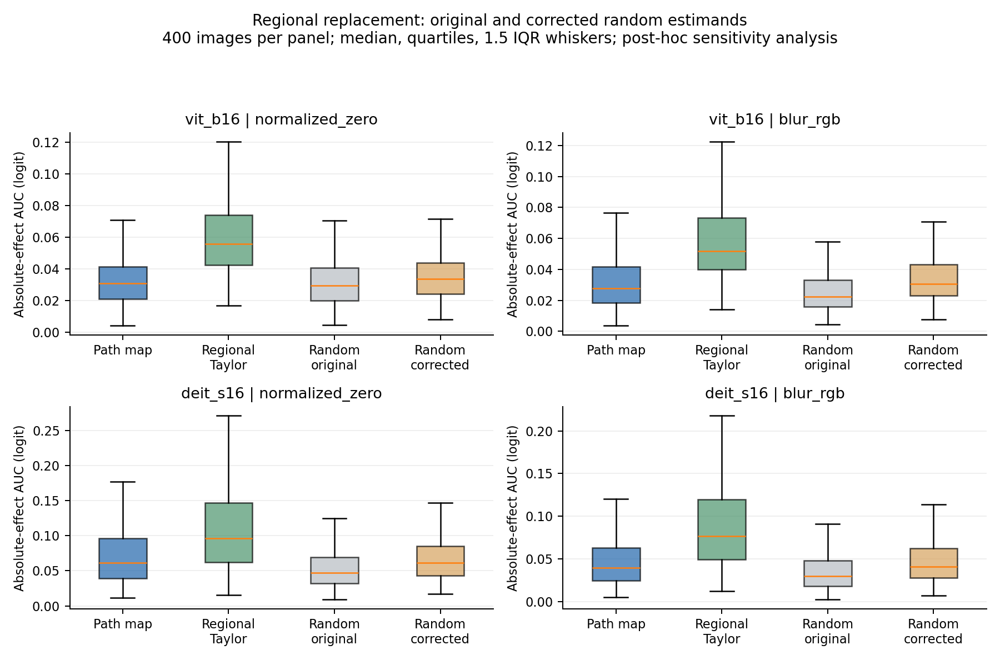

**图 7-1 区域干预边界。** 每个面板为 400 图的绝对效应曲线下面积分布，并列路径图、区域泰勒、原随机估计量和修正随机估计量。箱体为四分位数，横线为中位数，须线为 1.5 倍四分位距；离群点不显示。该图为事后敏感性分析。

## 7.5 前瞻实验 E3：神经元替换与目标选择性

E3 对两个原检查点各 100 图的块后标量、MLP 标量和 MLP 通道族执行干预，覆盖四个块、两种参照、0.1 与 1 两种幅度，以及 1、2、4、8 的 top-k 预算。路径质量与激活、梯度、激活乘梯度、位移、泰勒、随机及激活匹配基线比较；高分非目标类和冻结随机非目标类用于目标选择性控制。

**表 7-6 完整替换中路径质量相对激活乘梯度的 Spearman 增量**

| 模型 | 单元族 | 比较数 | 正向支持 | 反向 | 中位数范围 |
| --- | --- | --- | --- | --- | --- |
| vit_b16 | post | 8 | 0 | 3 | -0.1756 to 0.0062 |
| vit_b16 | mlp | 8 | 2 | 2 | -0.0550 to 0.0719 |
| vit_b16 | family | 8 | 1 | 0 | 0.0238 to 0.1429 |
| deit_s16 | post | 8 | 1 | 3 | -0.1420 to 0.0420 |
| deit_s16 | mlp | 8 | 4 | 1 | -0.0155 to 0.0678 |
| deit_s16 | family | 8 | 1 | 0 | -0.0476 to 0.1429 |

路径评分没有稳定优于激活乘梯度。部分早层 MLP 标量族出现秩相关增量，但 MLP 标量的 top-k 绝对效应没有任何校正后优势；早层块后单元出现反向结果，后层还存在大量平局或结构性零效应。路径选择在许多层优于随机和激活匹配集合，说明包含超出激活幅度的信息，但没有形成相对激活乘梯度的稳定增量。

真实类别路径分数所选集合的目标间隔变化未稳定大于高分非目标类或冻结随机非目标类所选集合。行为目标选择性未获支持。神经元图定位为描述性输入坐标表示，不表述为普遍优越的干预排序。

## 7.6 辅助诊断：参照位移感知泰勒量的多幅度近似

本节预测量为式（5-2）的参照位移感知泰勒量，计算不需要生成路径图。结果检验沿实际替换方向的局部线性化，Spearman 使用预测和实测效应的绝对值。

**表 7-7 ViT-B/16 参照位移感知泰勒量的多幅度近似**

| 参照状态 | 幅度 | 真实效应绝对值 | 预测绝对值 | 绝对误差 | 相对误差 | Spearman |
|---|---:|---:|---:|---:|---:|---:|
| 归一化零输入 | 0.05 | 0.002922 [0.002748, 0.003085] | 0.002903 [0.002743, 0.003104] | 0.000069 [0.000063, 0.000073] | 0.0272 [0.0265, 0.0286] | 0.9564 [0.9493, 0.9615] |
| 归一化零输入 | 0.10 | 0.005795 [0.005473, 0.006207] | 0.005807 [0.005493, 0.006208] | 0.000266 [0.000252, 0.000290] | 0.0524 [0.0507, 0.0543] | 0.9205 [0.9138, 0.9269] |
| 归一化零输入 | 0.25 | 0.014466 [0.013611, 0.015299] | 0.014517 [0.013714, 0.015492] | 0.001638 [0.001520, 0.001747] | 0.1216 [0.1165, 0.1255] | 0.8531 [0.8450, 0.8578] |
| 归一化零输入 | 0.50 | 0.028453 [0.027015, 0.030091] | 0.029035 [0.027471, 0.030983] | 0.006064 [0.005555, 0.006475] | 0.2231 [0.2153, 0.2329] | 0.7794 [0.7727, 0.7885] |
| 归一化零输入 | 1.00 | 0.056748 [0.053788, 0.059930] | 0.058069 [0.054943, 0.062078] | 0.021058 [0.019958, 0.022676] | 0.3913 [0.3801, 0.4065] | 0.6742 [0.6661, 0.6841] |
| 模糊输入 | 0.05 | 0.002471 [0.002343, 0.002631] | 0.002479 [0.002329, 0.002668] | 0.000057 [0.000053, 0.000062] | 0.0262 [0.0250, 0.0270] | 0.9639 [0.9586, 0.9665] |
| 模糊输入 | 0.10 | 0.004912 [0.004627, 0.005220] | 0.004957 [0.004650, 0.005336] | 0.000224 [0.000209, 0.000241] | 0.0514 [0.0493, 0.0531] | 0.9289 [0.9222, 0.9347] |
| 模糊输入 | 0.25 | 0.012021 [0.011416, 0.012916] | 0.012393 [0.011644, 0.013341] | 0.001341 [0.001260, 0.001450] | 0.1212 [0.1176, 0.1251] | 0.8633 [0.8537, 0.8706] |
| 模糊输入 | 0.50 | 0.023885 [0.022812, 0.025174] | 0.024786 [0.023287, 0.026678] | 0.005077 [0.004708, 0.005412] | 0.2219 [0.2138, 0.2283] | 0.7922 [0.7844, 0.8019] |
| 模糊输入 | 1.00 | 0.046413 [0.044270, 0.049867] | 0.049572 [0.046575, 0.053352] | 0.017925 [0.016553, 0.019065] | 0.3883 [0.3784, 0.3962] | 0.6856 [0.6760, 0.6941] |

**表 7-8 DeiT-S/16 参照位移感知泰勒量的多幅度近似**

| 参照状态 | 幅度 | 真实效应绝对值 | 预测绝对值 | 绝对误差 | 相对误差 | Spearman |
|---|---:|---:|---:|---:|---:|---:|
| 归一化零输入 | 0.05 | 0.004951 [0.004689, 0.005469] | 0.005035 [0.004631, 0.005425] | 0.000105 [0.000096, 0.000117] | 0.0259 [0.0247, 0.0271] | 0.9762 [0.9762, 0.9762] |
| 归一化零输入 | 0.10 | 0.010104 [0.009294, 0.010923] | 0.010071 [0.009247, 0.010887] | 0.000415 [0.000384, 0.000454] | 0.0511 [0.0486, 0.0537] | 0.9524 [0.9476, 0.9524] |
| 归一化零输入 | 0.25 | 0.025327 [0.023753, 0.027410] | 0.025177 [0.023157, 0.027127] | 0.002521 [0.002312, 0.002795] | 0.1227 [0.1179, 0.1268] | 0.8810 [0.8714, 0.8857] |
| 归一化零输入 | 0.50 | 0.052060 [0.048687, 0.054563] | 0.050354 [0.046234, 0.054304] | 0.010036 [0.009453, 0.010877] | 0.2342 [0.2235, 0.2434] | 0.7810 [0.7667, 0.7857] |
| 归一化零输入 | 1.00 | 0.105217 [0.097993, 0.111796] | 0.100707 [0.092402, 0.108510] | 0.037632 [0.035494, 0.043171] | 0.4345 [0.4229, 0.4477] | 0.6095 [0.6000, 0.6286] |
| 模糊输入 | 0.05 | 0.004384 [0.004067, 0.004663] | 0.004419 [0.004112, 0.004668] | 0.000093 [0.000086, 0.000103] | 0.0241 [0.0233, 0.0249] | 0.9810 [0.9810, 0.9810] |
| 模糊输入 | 0.10 | 0.008877 [0.008119, 0.009298] | 0.008838 [0.008225, 0.009336] | 0.000364 [0.000337, 0.000412] | 0.0477 [0.0465, 0.0500] | 0.9571 [0.9571, 0.9619] |
| 模糊输入 | 0.25 | 0.021907 [0.020097, 0.023655] | 0.022095 [0.020561, 0.023341] | 0.002371 [0.002127, 0.002569] | 0.1168 [0.1123, 0.1206] | 0.8905 [0.8857, 0.9000] |
| 模糊输入 | 0.50 | 0.044622 [0.040735, 0.048475] | 0.044191 [0.041123, 0.046682] | 0.008908 [0.008366, 0.009617] | 0.2244 [0.2170, 0.2311] | 0.7952 [0.7810, 0.8048] |
| 模糊输入 | 1.00 | 0.091581 [0.083202, 0.098171] | 0.088381 [0.082429, 0.093364] | 0.033841 [0.031285, 0.036674] | 0.4186 [0.4102, 0.4345] | 0.6238 [0.6095, 0.6381] |

四个模型—参照状态组合的样本中位绝对误差均随幅度单调增加，全部 1 600 条图像—参照状态曲线也逐图单调。排序相关随幅度下降。结果支持规定注意力头输出插值中的局部一阶边界：在 $\alpha=0.05$ 时相对误差中位数为 0.0241–0.0272，完整替换时为 0.3883–0.4345；对应头间相关由 0.9564–0.9810 降至 0.6095–0.6856。

误差随幅度的变化同时具有绝对和相对意义。绝对误差随真实效应尺度扩大，说明偏差不是固定数值噪声；相对误差从约 2.4%–2.7% 增至约 38.8%–43.5%，说明预测误差相对任务效应也在增加。两种参照下，泰勒近似误差均随替换幅度增加。

排序相关下降慢于数值误差增加。即使完整替换时相对误差接近四成，头间 Spearman 仍为 0.61–0.69。该泰勒量在大幅替换下不适合精确预测效应大小，但仍保留部分筛选顺序；路径图的捕获率和遗憾值已在第 7.3 节单独报告。

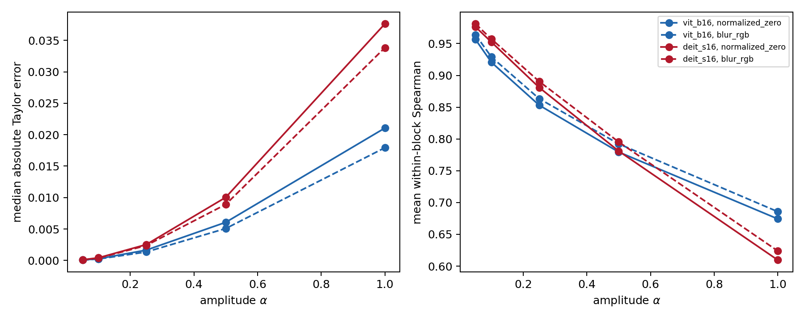

**图 7-2 多幅度有限干预。** 随插值幅度增加，绝对误差和相对误差增加，头间排序相关下降。

完整替换时，逐图逐头相对误差的高分位明显大于其中位数。四个模型—参照组合的图内第 90 百分位相对误差中位数为 2.45–2.92，第 99 百分位为 18.12–24.17。按真实效应绝对值四等分后，最小效应四分位的相对误差中位数为 1.20–1.43，最大效应四分位为 0.21–0.36。小分母放大相对误差尾部；绝对误差、高分位及效应分层随表格数据提供，主分析未删除小效应。

## 7.7 讨论

多幅度实验和完整替换实验回答两个相邻但不同的问题。前者固定注意力头输出位移方向并改变幅度，建立误差随距离扩大的经验边界；后者比较不同组件或区域在完整替换下的排序。小幅度时较高的头间相关不能推出完整替换时逐项数值准确。

从泰勒展开看，式（5-2）遗漏的是沿位移方向积分时梯度变化产生的高阶余项。多幅度结果直接测量这一余项随距离的经验变化；完整替换结果还叠加不同组件位移尺度和方向的异质性。因而前者更接近局部近似诊断，后者更接近资源约束下的筛选评价。

局部图只依赖当前输入和局部导数，区域泰勒还使用参照状态的实际位移。后者在参照状态已知的替换任务中拥有与任务更匹配的信息。局部图仍可用于描述当前点局部输入结构，但原区域效用复合主张未获支持。

## 7.8 本章小结

RQ4 的行为评价结果为：原全族联合判据未获支持，12 个成分族中 11 个满足预定族级操作规则；区域路径图相对修正随机基线没有稳定优势；E3 未发现神经元路径评分相对激活乘梯度的稳定增量。辅助泰勒量在小幅替换时数值误差较低，并在相应参照替换任务中表现最好。

# 第 8 章 外部验证、讨论与结论

## 8.1 前瞻实验 E4–E5：信息增量与外部验证

E4 冻结 200 张训练、100 张验证和 100 张测试图像。岭模型预测完整注意力头替换绝对效应，输入分别为总图、总图加四块七类正确标注结构路径，或总图加同维度边标签打乱特征。标准化和拟合只使用训练集，验证集选择正则参数。

**表 8-1 E4 独立测试效应预测**

| 检查点 | 总图 MAE | 结构 MAE | 乱序 MAE | 总图−结构配对误差 |
| --- | --- | --- | --- | --- |
| vit_b16 | 0.0507 | 0.0619 | 0.0578 | -0.0112 [-0.0160, -0.0060] |
| deit_s16 | 0.1369 | 0.1438 | 0.1517 | -0.0071 [-0.0176, 0.0097] |
| vit_b16_in1k | 0.0914 | 0.0999 | 0.0992 | -0.0036 [-0.0102, 0.0020] |
| vit_s16_augreg | 0.1336 | 0.1528 | 0.1468 | -0.0143 [-0.0264, -0.0020] |

结构特征没有提供稳定独立测试增益：在原 ViT-B/16 和新增 ViT-S/16 中显著差于总图，另两个区间跨零；正确边标签也未稳定优于乱序标签。总图 JS 距离最低 10% 的测试配对仍有 0.16–0.23 的结构 JS 距离中位数，说明分项保留了聚合丢失的信息；E4 同时表明这些信息没有改善规定预测器。

E5 在同一批 400 张独立图像上，对两个原检查点及两个新增公开检查点检验四项冻结假设。新增权重来自不同公开训练方案，不称为独立训练种子。H1 为神经元熵层深差；H2 为路由尺度差；H3 为 MLP 与注意力残差恒等路径轨迹之差；H4 为路径图减激活乘梯度的头排序相关。

**表 8-2 E5 独立图像与检查点对比**

| 检查点 | H1 | H2 | H3 | H4 |
| --- | --- | --- | --- | --- |
| vit_b16 | 0.4125 [0.4049, 0.4196] | 0.2386 [0.2206, 0.2594] | 0.8507 [0.8389, 0.8646] | -0.1136 [-0.1285, -0.0909] |
| deit_s16 | 0.3778 [0.3699, 0.3826] | 0.3223 [0.3097, 0.3293] | 0.5222 [0.4953, 0.5427] | -0.1857 [-0.2286, -0.1571] |
| vit_b16_in1k | 0.3358 [0.3300, 0.3396] | 0.2406 [0.2179, 0.2552] | 0.6323 [0.6196, 0.6478] | -0.1862 [-0.2054, -0.1678] |
| vit_s16_augreg | 0.3900 [0.3837, 0.3986] | 0.2763 [0.2558, 0.2959] | 0.8670 [0.8400, 0.8909] | -0.1357 [-0.1714, -0.1143] |

H1–H3 在四个检查点中均保持冻结的正方向。H4 在四个检查点中均为负：路径图的图内头排序相关比激活乘梯度低 0.1136–0.1862。空间与结构层深现象在所测试公开参数状态中复现，而路径图排序增量被独立证据否定。

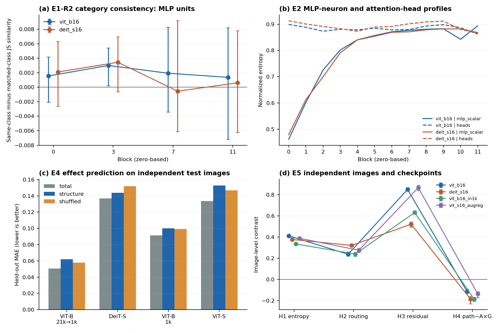

**图 8-1 E1-R2 与 E2–E5 前瞻补充结果。** E1-R2 区间以类别为单位，E5 以图像为单位；E4 柱为独立测试 MAE；H4 为路径图减激活乘梯度。

## 8.2 结构分解增加的信息

结构路径图组同时保留输入坐标和边身份。总图相同或相近时，查询、键、值、不同头及残差两条边仍可能具有不同的空间分布与符号抵消。保留这些分项后，可以回答同一目标的输入响应怎样分配到明确的模型内部结构，并将路径间的尺度变化与总图变化区分开。

目标注册与边实例是这一表示的两个必要组成。前者说明正在解释哪个标量，后者说明该标量的局部依赖经过哪次真实使用。把同一张量的不同端口混为一项，会掩盖共享使用；把不同目标的同名路径混在一起，则改变下游余切。固定目标与切面使比较具有明确对象，也使新的内部目标可以按相同定义纳入研究。

## 8.3 闭合、唯一性与有限效用

闭合检验给定切面上的分项是否不重不漏，重参数化反例表明内部坐标改变后分配也可能改变。它们分别回答记账正确性和识别条件。研究具体实现时，图与切面提供所需的操作坐标；跨架构比较则需先明确可比切面或共同的聚合对象。

有限效用属于另一个问题。闭合保证当前点局部响应的精确分配，有限替换同时涉及位移、沿途梯度变化和混合内部状态。实际参照位移为泰勒量提供任务特定信息，而只描述当前坐标的路径图不包含全部这类信息。小幅替换误差较低与完整区域选择负结果由不同估计对象产生，可以同时成立。

## 8.4 完整层序中的结构差异

完整 12 层分析揭示了端点比较无法定位的转折。抽样目标空间熵和距离具有总体上升趋势；查询熵包含中间下降和后期恢复；路由相对尺度从早期到中期上升后回落；注意力与多层感知机残差呈现不同阶段变化。两个检查点中的相同方向提供并列证据，但这两个固定模型不是 ViT 总体的可交换随机样本。

新增趋势、相邻差和阶段分析均来自已经读取的结果，属于事后描述性重分析。若将其中某一趋势提升为确认性结论，后续应在读取新样本前固定一个主要指标、一个方向、一种趋势估计量、独立图像样本及模型范围，并约定缺失和多重比较规则。当前曲线用于形成该假设。

## 8.5 负结果与适用任务

路径图的原全族联合判据未获支持，区域路径图相对修正随机基线也未显示稳定优势；E3 与 E5 进一步否定了相对激活乘梯度的普遍排序增量。参照位移感知泰勒量在指定替换任务中表现更好，其小幅替换误差较低。结构图的实证用途因此集中于描述当前目标的局部输入依赖与结构分配。

区域选择负结果也限制空间语义推断。本文的熵、局部性与距离描述空间分布。类别信息是否可解码、输入图是否与对象掩码一致、结构路径是否选择性影响某类别，是三个不同的语义问题，不能由空间范围替代。

## 8.6 局限

新增检查点是不同公开训练方案下的参数状态，不是独立训练种子。E1-R2 使用一个冻结的 WordNet 类别层级匹配规则；未支持类别一致性不等于检验了对象掩码或全部语义概念。E3 操作的是规定的混合内部状态。E4 使用线性岭模型和四个冻结块，负结果不能证明所有任务都无法利用结构索引。本文没有执行训练轨迹、受控 CNN 对比、对象掩码定位或分布变化实验。保留像素坐标是表示性质；主要空间统计仍在 14×14 图像块网格上，不能证明块内像素细节的新增效用。

## 8.7 结论

RQ1 明确定义了 ViT 神经元对象及其输入坐标学习图像。RQ2 发现后层 MLP 神经元图更广、更冗余，但前瞻 E1-R2 的 WordNet 元数据匹配比较未支持稳定类别一致性。RQ3 将类别目标依赖组织为 Q/K/V、注意力头、MLP 和残差路径，验证了切面闭合及可复现的层深异质性。RQ4 区分描述价值和干预排序：路径评分在许多神经元层组中优于随机与激活匹配控制，却未稳定优于激活乘梯度；区域路径图未优于修正随机；结构特征未改善冻结的独立测试预测器。参照位移感知泰勒量在与其信息匹配的替换任务中表现最好。

在 400 张独立图像和四个公开检查点上，神经元熵、路由及残差轨迹假设保持方向，而头排序增量在四个检查点中均为负。因此，本文成立的贡献是“神经元—结构路径”表示、可核验的记账性质及可复现的结构规律，而不是普遍更强的干预评分。

# 参考文献

[1] Dosovitskiy A, Beyer L, Kolesnikov A, et al. An image is worth 16×16 words:
Transformers for image recognition at scale[C]//International Conference on Learning
Representations. 2021.

[2] Touvron H, Cord M, Douze M, et al. Training data-efficient image transformers and
distillation through attention[C]//Proceedings of the 38th International Conference on
Machine Learning. PMLR, 2021, 139: 10347-10357.

[3] Vaswani A, Shazeer N, Parmar N, et al. Attention is all you need[C]//Advances in
Neural Information Processing Systems. 2017, 30.

[4] Dou H, Shen F, Zhao J, Mu X. Understanding neural network through neuron level
visualization[J]. Neural Networks, 2023, 168: 484-495.

[5] Simonyan K, Vedaldi A, Zisserman A. Deep inside convolutional networks: Visualising
image classification models and saliency maps[C]//ICLR Workshop. 2014.

[6] Shrikumar A, Greenside P, Kundaje A. Learning important features through propagating
activation differences[C]//Proceedings of the 34th International Conference on Machine
Learning. PMLR, 2017, 70: 3145-3153.

[7] Sundararajan M, Taly A, Yan Q. Axiomatic attribution for deep networks[C]//Proceedings
of the 34th International Conference on Machine Learning. PMLR, 2017, 70: 3319-3328.

[8] Dhamdhere K, Sundararajan M, Yan Q. How important is a neuron?[EB/OL].
arXiv:1805.12233, 2018.

[9] Srinivas S, Fleuret F. Full-gradient representation for neural network
visualization[C]//Advances in Neural Information Processing Systems. 2019, 32.

[10] Bach S, Binder A, Montavon G, et al. On pixel-wise explanations for non-linear
classifier decisions by layer-wise relevance propagation[J]. PLoS ONE, 2015, 10(7):
e0130140.

[11] Ancona M, Ceolini E, Öztireli C, Gross M. Towards better understanding of
gradient-based attribution methods for deep neural networks[C]//International Conference
on Learning Representations. 2018.

[12] Smilkov D, Thorat N, Kim B, et al. SmoothGrad: Removing noise by adding
noise[EB/OL]. arXiv:1706.03825v1, 2017. Preprint version v1; accessed 2026-09-21. https://arxiv.org/abs/1706.03825v1.

[13] Selvaraju R R, Cogswell M, Das A, et al. Grad-CAM: Visual explanations from deep
networks via gradient-based localization[C]//Proceedings of the IEEE International
Conference on Computer Vision. 2017: 618-626.

[14] Zeiler M D, Fergus R. Visualizing and understanding convolutional
networks[C]//European Conference on Computer Vision. Springer, 2014: 818-833.

[15] Ribeiro M T, Singh S, Guestrin C. Why should I trust you? Explaining the predictions
of any classifier[C]//Proceedings of the 22nd ACM SIGKDD International Conference on
Knowledge Discovery and Data Mining. 2016: 1135-1144.

[16] Lundberg S M, Lee S-I. A unified approach to interpreting model
predictions[C]//Advances in Neural Information Processing Systems. 2017, 30.

[17] Adebayo J, Gilmer J, Muelly M, et al. Sanity checks for saliency
maps[C]//Advances in Neural Information Processing Systems. 2018, 31: 9505-9515.

[18] Hooker S, Erhan D, Kindermans P-J, Kim B. A benchmark for interpretability methods
in deep neural networks[C]//Advances in Neural Information Processing Systems. 2019, 32.

[19] Sixt L, Granz M, Landgraf T. When explanations lie: Why many modified BP
attributions fail[C]//Proceedings of the 37th International Conference on Machine Learning.
PMLR, 2020, 119: 9046-9057.

[20] Montavon G, Samek W, Müller K-R. Methods for interpreting and understanding deep
neural networks[J]. Digital Signal Processing, 2018, 73: 1-15.

[21] Abnar S, Zuidema W. Quantifying attention flow in transformers[C]//Proceedings of
the 58th Annual Meeting of the Association for Computational Linguistics. 2020: 4190-4197.

[22] Chefer H, Gur S, Wolf L. Transformer interpretability beyond attention
visualization[C]//Proceedings of the IEEE/CVF Conference on Computer Vision and Pattern
Recognition. 2021: 782-791.

[23] Jain S, Wallace B C. Attention is not explanation[C]//Proceedings of NAACL-HLT.
2019: 3543-3556.

[24] Serrano S, Smith N A. Is attention interpretable?[C]//Proceedings of the 57th Annual
Meeting of the Association for Computational Linguistics. 2019: 2931-2951.

[25] Kobayashi G, Kuribayashi T, Yokoi S, Inui K. Attention is not only a
weight: Analyzing transformers with vector norms[C]//Proceedings of EMNLP. 2020:
7057-7075.

[26] Modarressi A, Fayyaz M, Yaghoobzadeh Y, Pilehvar M T. GlobEnc: Quantifying global
token attribution by incorporating the whole encoder layer in
Transformers[C]//Proceedings of NAACL-HLT. 2022: 258-271.

[27] Ferrando J, Gállego G I, Tsiamas I, Costa-jussà M R. Measuring the mixing of
contextual information in the Transformer[C]//Proceedings of EMNLP. 2022: 8698-8714.

[28] Modarressi A, Fayyaz M, Aghazadeh E, et al. DecompX: Explaining Transformers
decisions by propagating token decomposition[C]//Proceedings of the 61st Annual Meeting of
the Association for Computational Linguistics. 2023: 2649-2664.

[29] Achtibat R, Hatefi S M V, Dreyer M, et al. AttnLRP: Attention-aware layer-wise
relevance propagation for Transformers[C]//Proceedings of the 41st International Conference
on Machine Learning. PMLR, 2024, 235: 135-168.

[30] Mehri F, Soleymani Baghshah M, Pilehvar M T. LibraGrad: Balancing gradient flow for
universally better Vision Transformer attributions[C]//Proceedings of the IEEE/CVF
Conference on Computer Vision and Pattern Recognition. 2025: 67-78.

[31] Zhang F, Nanda N. Towards best practices of activation patching in language models:
Metrics and methods[EB/OL]. arXiv:2309.16042v1, 2023. Preprint version v1; accessed 2026-09-21. https://arxiv.org/abs/2309.16042v1.

[32] Syed A, Rager C, Conmy A. Attribution patching outperforms automated circuit
discovery[EB/OL]. arXiv:2310.10348v1, 2023. Preprint version v1; accessed 2026-09-21. https://arxiv.org/abs/2310.10348v1.

[33] Kramár J, Lieberum T, Shah R, Nanda N. AtP*: An efficient and scalable method for
localizing LLM behaviour to components[EB/OL]. arXiv:2403.00745v1, 2024. Preprint version v1; accessed 2026-09-21. https://arxiv.org/abs/2403.00745v1.

[34] Meng K, Bau D, Andonian A, Belinkov Y. Locating and editing factual associations in
GPT[C]//Advances in Neural Information Processing Systems. 2022, 35: 17359-17372.

[35] Geva M, Schuster R, Berant J, Levy O. Transformer feed-forward layers are key-value
memories[C]//Proceedings of EMNLP. 2021: 5484-5495.

[36] Efron B, Tibshirani R J. An Introduction to the Bootstrap[M]. New York: Chapman &
Hall/CRC, 1993.

[37] Holm S. A simple sequentially rejective multiple test procedure[J]. Scandinavian
Journal of Statistics, 1979, 6(2): 65-70.

[38] Bousselham W, Boggust A, Chaybouti S, Strobelt H, Kuehne H. LeGrad: An Explainability Method for Vision Transformers via Feature Formation Sensitivity[EB/OL]. arXiv:2404.03214v1, 2024. Preprint version v1; accessed 2026-09-21. https://arxiv.org/abs/2404.03214v1.

[39] Joseph S, Suresh P, Hufe L, et al. Prisma: An Open Source Toolkit for Mechanistic Interpretability in Vision and Video[EB/OL]. arXiv:2504.19475v1, 2025. Preprint version v1; accessed 2026-09-21. https://arxiv.org/abs/2504.19475v1.

[40] Żukowska N, Stammer W, Schiele B, Fischer J. Seeing Through Circuits: Faithful Mechanistic Interpretability for Vision Transformers[EB/OL]. arXiv:2604.14477v1, 2026. Preprint version v1; accessed 2026-09-21. https://arxiv.org/abs/2604.14477v1.

[41] Izadi A, Banayeeanzade M, Mirrokni A, et al. Causal Attribution via Activation Patching[EB/OL]. arXiv:2603.13652v1, 2026. Preprint version v1; accessed 2026-09-21. https://arxiv.org/abs/2603.13652v1.

[42] Raghu M, Unterthiner T, Kornblith S, Zhang C, Dosovitskiy A. Do Vision Transformers See Like Convolutional Neural Networks? NeurIPS, 2021. arXiv:2108.08810v1. https://arxiv.org/pdf/2108.08810v1. Accessed 2026-09-21.

# 附录 A 统计复算与实现材料

## A.1 样本、目标和数值实现

样本按 SHA-256(命名空间|class|WordNet 标识符) 选择前 528 类，再按 SHA-256(命名空间|image|文件名) 每类取一图；命名空间为 NNS_VIT_ENDPOINT_EP0_R1_20260918。排序前 64 图发现、后 64 图校准，其余 400 图评价。完整类别、图像和目标注册表保留在随附复算材料中。五组目标抽样的命名空间前缀为 ENDPOINT_REVISION_V3_STEP2_SAMPLE_20260921，每层选择类别标记与 15 个空间分层标记，以及 32 通道。

原始实验使用 Python 3.10.21、NumPy 1.26.4、Torch 2.2.2+cu121 与 timm 0.9.16。模型推理关闭混合精度与 TF32，确定性矩阵运算配置为 CUBLAS_WORKSPACE_CONFIG=:4096:8。任务以图像动态领取并保存终端收据；恢复过程在独立结果根中继承经校验的数值，不改写既有失败记录。本轮完整层序重分析仅使用 CPU 数值记录，没有图像解码或模型推理。

正向闭合的绝对容差为 1e-5、相对容差为 1e-4、近零范数阈值为 1e-6；遗漏控制的检查夹具使用零绝对与相对容差，重复边由集合合法性检查拒绝。正向、负控制和方向导数的完整记录与注册目标清单随原封存材料保留。当前重分析逐源重算 SHA-256，核验封存清单与终端收据的绑定；这些字段用于定位复算对象，不作为统计显著性证据。

## A.2 区间、种子与完整检验族

所有种子取指定字符串 SHA-256 摘要前 8 字节的大端整数，随机数生成器为 PCG64。原确认性区间种子字符串为 NNS_VIT_ENDPOINT_EP0_R1_20260918|bootstrap|family_id，10 000 次完整图像重采样；28 个检验 ID、实际整数种子、区间和有效数列于 original_test_family.csv。

M3 中位数区间使用 ENDPOINT_M3_BOOTSTRAP_20260919|分析键；M4 区间直接使用其 M4|统计范围|模型|指标键。M1/M2 使用 ENDPOINT_M1_20260918_V1|20260918|bootstrap|分析键。v3 多幅度、查询键值和目标抽样使用 ENDPOINT_REVISION_V3_STEP2_BOOTSTRAP_20260921|分析键，分别以 amplitude、qkv-block、qkv-contrast、sampling 开头并附模型、参照或组、块与指标；均为 10 000 次中位数区间。

参数状态和类别目标补充分析使用 2 000 次自助均值。参数状态对比的种子键为 模型|研究|指标|阶段，同时重采样 32 图和三个随机状态；随机初始化种子为 202609201、202609202、202609203。目标和前向特征的均值区间使用 shared_image_bootstrap|有效图像数，复用同一图像重采样索引以保留配对。

本次层序中位数区间使用 ENDPOINT_V4_DEPTH_20260921|模型|对象|指标|估计量，完整整数种子写入逐块、阶段、趋势和相邻差 CSV。对奇数样本，自助中位数对应经验分布上第 (n+1)/2 次序统计量；对偶数样本，取两个中央次序统计量均值。代码使用 Beta 次序统计量的精确边际分布生成这些抽样，与有放回抽 n 张图的中位数同分布。对有配对的分析先形成逐图差，再抽其经验分布。

原 Holm 族完整定义为 C4a.{模型}.{参照}.{成分族} 与 C4b.{模型}.{参照}.head_regions.vs_{基线} 的笛卡尔积：模型取 vit_b16、deit_s16；参照取 normalized_zero、blur_rgb；成分族取 heads、routing_value、residual_branches；基线取 total_gxi、raw_gradient、regional_taylor、random_regions。前者 12 项、后者 16 项合为一个 28 项族。新增相邻差另按每个模型—对象—指标的 11 项成族，平局阈值为 1e-12；没有把后继或事后分析并入原联合判据。

## A.3 缺失值与估计量清单

**表 A-1 多幅度逐头相对误差的精确零分母缺失**

| 模型 | 参照 | 幅度 | 总项 | 有效项 | 缺失项 |
|---|---|---:|---:|---:|---:|
| vit_b16 | normalized_zero | 0.05 | 57600 | 57598 | 2 |
| vit_b16 | normalized_zero | 0.10 | 57600 | 57595 | 5 |
| vit_b16 | normalized_zero | 0.25 | 57600 | 57599 | 1 |
| vit_b16 | normalized_zero | 0.50 | 57600 | 57599 | 1 |
| vit_b16 | normalized_zero | 1.00 | 57600 | 57599 | 1 |
| vit_b16 | blur_rgb | 0.05 | 57600 | 57598 | 2 |
| vit_b16 | blur_rgb | 0.10 | 57600 | 57595 | 5 |
| vit_b16 | blur_rgb | 0.25 | 57600 | 57600 | 0 |
| vit_b16 | blur_rgb | 0.50 | 57600 | 57600 | 0 |
| vit_b16 | blur_rgb | 1.00 | 57600 | 57600 | 0 |
| deit_s16 | normalized_zero | 0.05 | 28800 | 28799 | 1 |
| deit_s16 | normalized_zero | 0.10 | 28800 | 28797 | 3 |
| deit_s16 | normalized_zero | 0.25 | 28800 | 28797 | 3 |
| deit_s16 | normalized_zero | 0.50 | 28800 | 28800 | 0 |
| deit_s16 | normalized_zero | 1.00 | 28800 | 28800 | 0 |
| deit_s16 | blur_rgb | 0.05 | 28800 | 28797 | 3 |
| deit_s16 | blur_rgb | 0.10 | 28800 | 28800 | 0 |
| deit_s16 | blur_rgb | 0.25 | 28800 | 28800 | 0 |
| deit_s16 | blur_rgb | 0.50 | 28800 | 28800 | 0 |
| deit_s16 | blur_rgb | 1.00 | 28800 | 28800 | 0 |

五组抽样空间熵共 6 144 000 个单元值全部有效；局部性和输入距离各有 6 144 000 个单元，其中 384 000 个类别标记值无空间定义，5 760 000 个空间单元值有效。它们在图内聚合后均得到 100 图×五组×两模型的完整 12 层轨迹。图像级趋势没有常量或不完整轨迹。完整覆盖清单为 coverage.csv、sampling_unit_coverage.csv 和 amplitude_missing_counts.csv。

本稿区间的估计对象各按阶段区分：主层深分析及替换误差为中位数，参数状态和目标补充表为均值，区域修正主表为描述性中位数。原随机估计量与修正估计量保持双轨记录。

# 附录 B 完整层序图表索引

全部图像轨迹见 image_profiles.csv；逐图趋势见 image_trends.csv；逐块区间见 block_summary.csv；早中晚、阶段差和端点见 phase_endpoint_contrasts.csv；11 个相邻差的估计量、区间、符号计数与 Holm 概率见 adjacent_differences.csv。每个模型与每个目标抽样组分别列出。

补充图册 all_profiles_and_adjacent_differences.pdf 为 98 个族逐一并列完整曲线和 11 个相邻差；其图序与数据键一致。图 sample_1 至 sample_5 覆盖五组内部目标；qkv_absolute_mass、qkv_normalized_spatial_entropy、qkv_normalized_pairwise_distance、qkv_cancellation、qkv_relative_scale 覆盖查询键值全部指标；attention、residual_attention、residual_mlp 提供正文结构图的独立 PDF 与 PNG。所有图均为事后描述性重分析。

附录图表与论文主表的映射通过随附 figure_manifest.json 和结论—证据矩阵提供；主文引述的数值从对应原始记录或图像级表重新核对。

<!-- V5_FOUNDATIONS_APPLIED -->

<!-- V5_DETAILS_APPLIED -->

<!-- REVISION_V5_RESULTS_INTEGRATED -->

<!-- REVISION_V5_CHAPTER7_REORDERED -->
