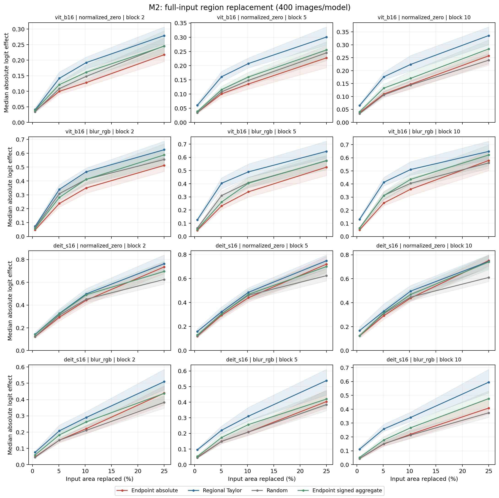
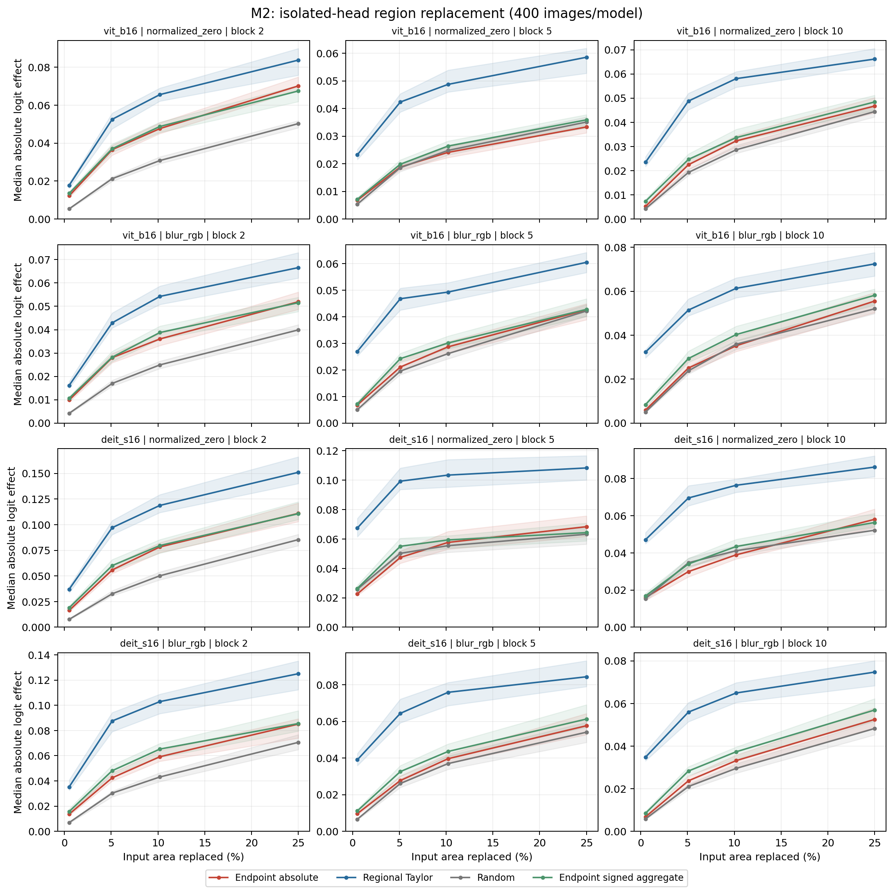
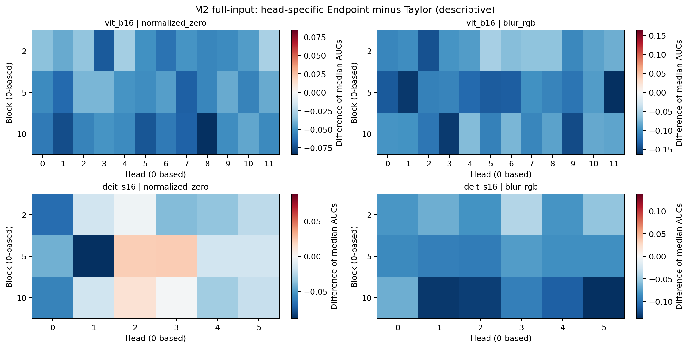

# M2：跨层全head空间效用补充结果

M2在两模型各400张图像上完成blocks 2、5、10的全部heads，比较两种reference、八种方法和四个patch预算。完整输入效应的12个model/reference/block比较中，Endpoint absolute相对regional Taylor优势通过统一Holm的有0项，Taylor优势通过的有11项；单head隔离效应对应为0和12项。逐层结果见表，未通过的方向检验不表示两方法等效。

## 1. 协议与定义

完整输入效应中唯一未通过Taylor优势检验的是DeiT-S、normalized-zero、block 5：Endpoint−Taylor的图像级配对中位AUC差为−0.0424，95% CI为[−0.0614, −0.0142]，Holm p=0.528。该CI是逐比较区间，Holm校正覆盖全部672项检验，因此二者回答的显著性问题不同。隔离效应中Taylor在early/middle/late全部组合上均占优，说明旧RQ4的空间负结果延伸到本次三个层级的全head平均；逐head差异保留为描述性结果。

本研究为原研究之后冻结的补充实验（supplementary frozen study）。原RQ3为11/12 family广泛但非普遍的支持，原C4a/C4b omnibus保持NOT_SUPPORTED。Endpoint基元为normalized-input Gradient × Input；head图来自局部Jacobian成分传播，结构闭合与有限区域效用分别评价。原registry覆盖表沿用已封存M1；registry-complete指注册集合完整。

采用0-based编号，blocks 2/5/10对应early/middle/late；ViT-B/16每层12 heads，DeiT-S每层6 heads。reference为normalized-zero及raw-RGB blur（kernel31、sigma10）。主要预算是1、10、20、49个16×16 patch，对应面积0.51%、5.10%、10.20%、25%；原4×4网格的1/2/4格结果在完整表中单独报告。

八方法为Endpoint absolute、Endpoint signed aggregate、regional Taylor、gradient-only、activation displacement、random、center和attention。对head h，E_h=x⊙J_hᵀg_h，g_h=∇_{z_h}F。absolute predictor为Σ|E|；signed predictor为|ΣE|，未取绝对值的sum保留于原始记录。regional Taylor为|g_hᵀ(z_h(x)−z_h(x_R))|，与指定head的有限激活位移匹配。所有方法从同一候选集合选择区域，按行优先ID打破平局；random固定20次均匀随机排列。

主要outcome是完整输入区域替换的绝对logit变化，|F(x)−F(x_R)|。隔离outcome将替换输入产生的指定head激活放回clean计算图，其余head与bypass保持clean。每个random重复先计算绝对效应与AUC，再平均重复和同层全部heads。统计单位为图像，中位数采用10000次image bootstrap和95% CI；672项双向AUC符号检验统一Holm。逐预算CI、逐head和跨三层均值汇总均为描述性。

## 2. 跨层比较

**Table M2-1. 完整输入区域替换，patch预算归一化AUC。** 配对差值与两方法各自中位数之差不同。

| Model | Reference | Block | Endpoint AUC | Taylor AUC | Random AUC | Paired E−T [95% CI] | Holm p(E>T) | Holm p(T>E) |
|---|---|---:|---:|---:|---:|---|---:|---:|
| vit_b16 | normalized_zero | 2 | 0.1451 | 0.1977 | 0.1614 | -0.0289 [-0.0376, -0.0206] | 1 | 2.49e-17 |
| vit_b16 | normalized_zero | 5 | 0.1481 | 0.2130 | 0.1606 | -0.0434 [-0.0531, -0.0358] | 1 | 9.41e-18 |
| vit_b16 | normalized_zero | 10 | 0.1640 | 0.2377 | 0.1604 | -0.0552 [-0.0633, -0.0414] | 1 | 2.31e-26 |
| vit_b16 | blur_rgb | 2 | 0.3629 | 0.4306 | 0.4013 | -0.0690 [-0.0835, -0.0531] | 1 | 4.34e-16 |
| vit_b16 | blur_rgb | 5 | 0.3624 | 0.4811 | 0.4044 | -0.1042 [-0.1222, -0.0789] | 1 | 2.59e-25 |
| vit_b16 | blur_rgb | 10 | 0.3783 | 0.4850 | 0.4055 | -0.0967 [-0.1146, -0.0809] | 1 | 5.56e-28 |
| deit_s16 | normalized_zero | 2 | 0.4657 | 0.5040 | 0.4426 | -0.0374 [-0.0550, -0.0197] | 1 | 0.0422 |
| deit_s16 | normalized_zero | 5 | 0.4608 | 0.5007 | 0.4347 | -0.0424 [-0.0614, -0.0142] | 1 | 0.528 |
| deit_s16 | normalized_zero | 10 | 0.4679 | 0.4998 | 0.4375 | -0.0406 [-0.0604, -0.0201] | 1 | 0.0282 |
| deit_s16 | blur_rgb | 2 | 0.2557 | 0.3385 | 0.2289 | -0.0551 [-0.0807, -0.0414] | 1 | 1.1e-08 |
| deit_s16 | blur_rgb | 5 | 0.2491 | 0.3597 | 0.2390 | -0.0701 [-0.0852, -0.0547] | 1 | 6.79e-15 |
| deit_s16 | blur_rgb | 10 | 0.2651 | 0.3782 | 0.2312 | -0.0984 [-0.1180, -0.0757] | 1 | 5.84e-20 |

**Table M2-2. 单head隔离区域替换，patch预算归一化AUC。**

| Model | Reference | Block | Endpoint AUC | Taylor AUC | Random AUC | Paired E−T [95% CI] | Holm p(E>T) | Holm p(T>E) |
|---|---|---:|---:|---:|---:|---|---:|---:|
| vit_b16 | normalized_zero | 2 | 0.0487 | 0.0630 | 0.0317 | -0.0140 [-0.0159, -0.0120] | 1 | 7.98e-47 |
| vit_b16 | normalized_zero | 5 | 0.0241 | 0.0470 | 0.0237 | -0.0229 [-0.0253, -0.0208] | 1 | 1.04e-115 |
| vit_b16 | normalized_zero | 10 | 0.0321 | 0.0555 | 0.0291 | -0.0228 [-0.0241, -0.0214] | 1 | 2.42e-97 |
| vit_b16 | blur_rgb | 2 | 0.0365 | 0.0527 | 0.0257 | -0.0135 [-0.0150, -0.0126] | 1 | 6.18e-64 |
| vit_b16 | blur_rgb | 5 | 0.0296 | 0.0487 | 0.0272 | -0.0194 [-0.0214, -0.0175] | 1 | 1.68e-91 |
| vit_b16 | blur_rgb | 10 | 0.0367 | 0.0594 | 0.0352 | -0.0209 [-0.0223, -0.0197] | 1 | 2.35e-94 |
| deit_s16 | normalized_zero | 2 | 0.0770 | 0.1156 | 0.0521 | -0.0343 [-0.0380, -0.0286] | 1 | 2.28e-58 |
| deit_s16 | normalized_zero | 5 | 0.0563 | 0.0989 | 0.0526 | -0.0399 [-0.0450, -0.0359] | 1 | 2.35e-82 |
| deit_s16 | normalized_zero | 10 | 0.0399 | 0.0738 | 0.0407 | -0.0323 [-0.0351, -0.0294] | 1 | 4.05e-90 |
| deit_s16 | blur_rgb | 2 | 0.0568 | 0.0977 | 0.0445 | -0.0380 [-0.0422, -0.0334] | 1 | 6.6e-69 |
| deit_s16 | blur_rgb | 5 | 0.0400 | 0.0705 | 0.0363 | -0.0282 [-0.0318, -0.0250] | 1 | 7.52e-85 |
| deit_s16 | blur_rgb | 10 | 0.0340 | 0.0622 | 0.0303 | -0.0272 [-0.0298, -0.0244] | 1 | 2.35e-82 |

## 3. 八方法比较

**Table M2-3. 八方法比较的方向性检验计数。** 每项分母12对应两模型×两reference×三层，计数包含相关条件。

| Outcome | Baseline | Endpoint greater / 12 | Baseline greater / 12 |
|---|---|---:|---:|
| full | endpoint_signed | 0 | 9 |
| full | regional_taylor | 0 | 11 |
| full | gradient_only | 0 | 0 |
| full | displacement_only | 0 | 9 |
| full | random | 1 | 2 |
| full | center | 0 | 8 |
| full | attention | 0 | 11 |
| isolated | endpoint_signed | 0 | 6 |
| isolated | regional_taylor | 0 | 12 |
| isolated | gradient_only | 0 | 3 |
| isolated | displacement_only | 2 | 8 |
| isolated | random | 9 | 0 |
| isolated | center | 4 | 4 |
| isolated | attention | 4 | 6 |

原4×4网格的补充结果方向一致：Taylor在完整输入效应中通过9/12项、隔离效应中通过12/12项；Endpoint优势均为0/12。四patch预算与原网格的不同候选大小分别呈现，不合并为同一空间尺度。

完整输入替换会同时改变多条模型路径，head隔离固定所选head之外的计算；regional Taylor使用的位移对应后者。跨层结论以每个model/reference/block的paired结果为准。高分辨率成分图的表达能力与有限区域选择效用需要分别评价。

regret以实际评估候选集合最优为参照：单区域预算穷举全部196或16个候选，更大预算使用各方法与random的候选并集。该参照的范围是已评估候选，并非全部区域组合的全局最优。

## 4. 图示

Image #1：完整输入effect–budget曲线；每panel固定model/reference/block，纵轴为图像级中位绝对logit效应，阴影为95% image-bootstrap CI。

Image #2：相同布局的单head隔离曲线；先在图像内平均heads，再跨图像计算中位数与CI。

Image #3：逐head的Endpoint与Taylor中位AUC之差，描述层级异质性；它与图像级配对中位差不同，色标按panel分别设置。

Sources: [Evidence matrix](../notes/endpoint_m2_evidence_matrix.md); [Figure manifest](../figure_manifest_m2.json).
