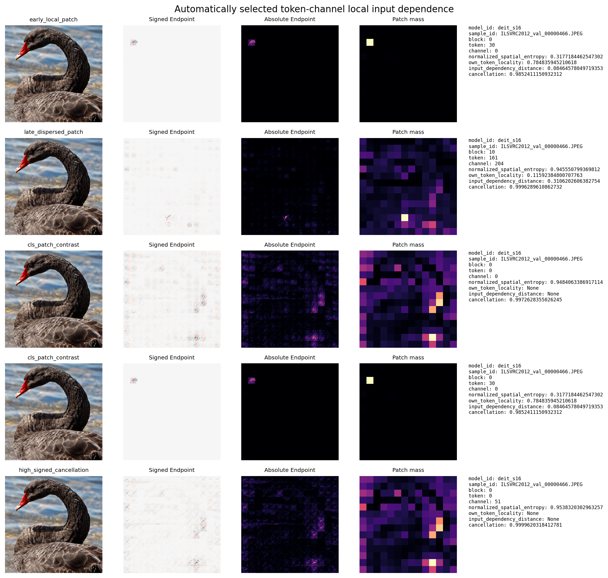
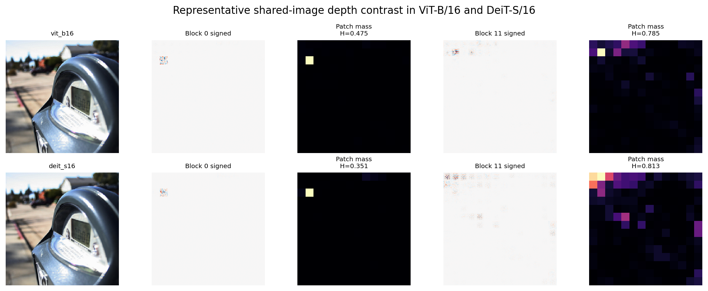
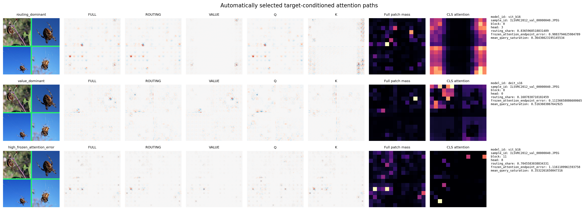
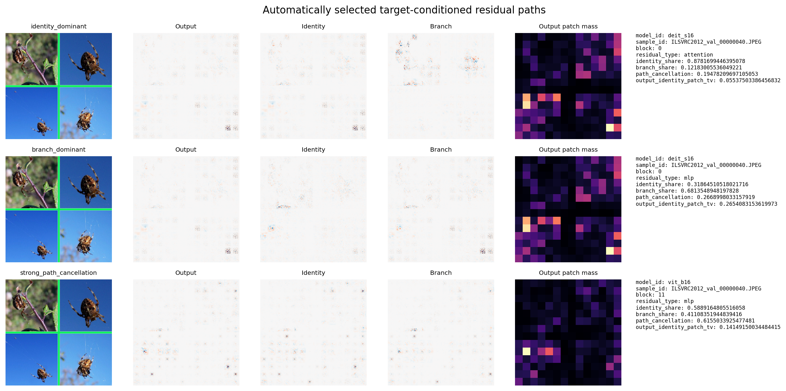
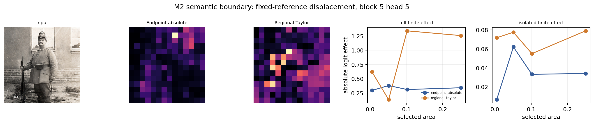

# Endpoint M6 机制案例与可视化 atlas

M6 按执行前冻结的指标从 M3/M4 全部封存记录中自动选择 11 类机制案例，并从 M2 选择 1 个方法语义边界案例。选择过程仅读取数值文件；原图与像素级 map 在选择封存后才读取或重算。没有根据图像观感复选，也没有增加推断检验。

| Case | Frozen metric | Selected value | Selected identity |
|---|---|---:|---|
| m3_early_local_patch | own_token_locality | 0.784836 | deit_s16/ILSVRC2012_val_00000466.JPEG/0/30/0/-/- |
| m3_late_dispersed_patch | normalized_spatial_entropy | 0.945551 | deit_s16/ILSVRC2012_val_00000466.JPEG/10/161/204/-/- |
| m3_cls_patch_contrast | cls_minus_patch_entropy_same_image_block_channel | 0.630688 | deit_s16/ILSVRC2012_val_00000466.JPEG/0/0/0/-/-; deit_s16/ILSVRC2012_val_00000466.JPEG/0/30/0/-/- |
| m4_routing_dominant | routing_share | 0.836597 | vit_b16/ILSVRC2012_val_00000040.JPEG/0/-/-/3/- |
| m4_value_dominant | routing_share | 0.168784 | deit_s16/ILSVRC2012_val_00000040.JPEG/0/-/-/0/- |
| m4_high_frozen_attention_error | frozen_attention_endpoint_error | 1.116119 | vit_b16/ILSVRC2012_val_00000040.JPEG/11/-/-/8/- |
| m4_identity_dominant | identity_share | 0.878170 | deit_s16/ILSVRC2012_val_00000040.JPEG/0/-/-/-/attention |
| m4_branch_dominant | identity_share | 0.318645 | deit_s16/ILSVRC2012_val_00000040.JPEG/0/-/-/-/mlp |
| m4_strong_path_cancellation | path_cancellation | 0.615503 | vit_b16/ILSVRC2012_val_00000040.JPEG/11/-/-/-/mlp |
| m3_high_signed_cancellation | cancellation | 0.999962 | deit_s16/ILSVRC2012_val_00000466.JPEG/0/0/51/-/- |
| m3_model_layer_difference | vit_minus_deit_late_minus_early_entropy | -0.003040 | vit_b16/ILSVRC2012_val_00031240.JPEG/0/30/271/-/-; vit_b16/ILSVRC2012_val_00031240.JPEG/11/30/369/-/-; deit_s16/ILSVRC2012_val_00031240.JPEG/0/30/89/-/-; deit_s16/ILSVRC2012_val_00031240.JPEG/11/30/138/-/- |
| m2_semantic_boundary | one_minus_spearman_endpoint_absolute_vs_regional_taylor | 0.965377 | deit_s16/ILSVRC2012_val_00005247.JPEG/5/-/-/5/- |

## Image #1：Neuron atlas

该图同时给出原图、signed Endpoint、absolute Endpoint、14×14 patch mass，以及 block/token/channel、entropy、locality、distance 和 cancellation。early-local、late-dispersed、CLS–patch 与 high-cancellation 案例分别由完整 M3 数值记录的冻结 5% 尾部确定。它们展示注册单元在当前输入处的 local input dependence，不把图案命名为神经元学到的概念。

## Image #2：ViT-B/16 与 DeiT-S/16 层级差异

共享图像按两模型 late-minus-early entropy 差异最接近跨图中位数选出；block 0/11 的 token 30 channel 再按最接近图内中位 entropy 自动确定。因此该图是预定义的代表案例，不是最显著模型差异。两模型均呈现深层 map 更分散的局部一阶输入依赖；channel ID 不表示跨模型语义对应。

## Image #3：Attention routing/value 案例

三行分别对应 routing share 最高 5%、最低 5% 和 frozen-attention Endpoint error 最高 5% 中按固定 ID 选出的 head。Full、routing、Value、Q、K maps 解释同一 ground-truth logit，且 Q+K 重构 routing、routing+Value 重构 full。右侧 attention 面板是同一 head 的 CLS-query 权重。Routing share 是相对 path-norm scale；它不是因果贡献百分比，attention weight 也不等于 Endpoint dependence。

## Image #4：Residual identity/branch 案例

三行分别来自 identity share 最高 5%、最低 5% 和 path cancellation 最高 5%。Output、identity/carry 与 branch 使用同一 residual-output cotangent，并满足 output = identity + branch。该图显示冻结目标条件下路径局部依赖的保留、改写与抵消，不把 path share 解释为有限删除效应。

## Image #5：M2 方法语义边界

固定 DeiT-S、block 5、patch geometry 和 normalized-zero reference 后，案例仅按 Endpoint absolute 与 regional Taylor 排名差异最接近候选中位数选出，未用 finite-effect outcome 选图。Endpoint 描述观测输入处的局部缩放依赖；regional Taylor 还使用指定 reference 的 activation displacement。右侧曲线沿用 M2 封存的 full/isolated finite effects，只用于展示两个 estimand 在同一案例中的不同排序。

## 结论

M6 把 M3 的 token-channel 空间扩展和 M4 的 attention/residual 路径差异落实为机器选择的可追溯案例。图像用于解释统计规律；总体结论仍以 M3/M4 的图像级分析为依据。显示归一化仅改变颜色映射，所有数值和闭合核对来自 raw arrays 与封存来源。
