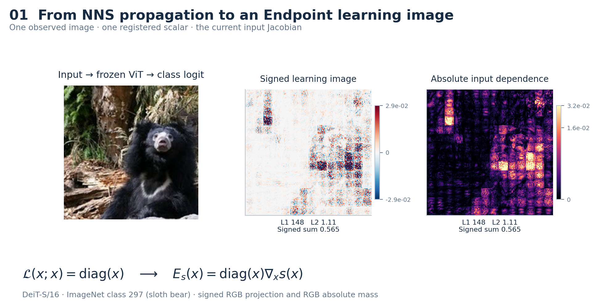
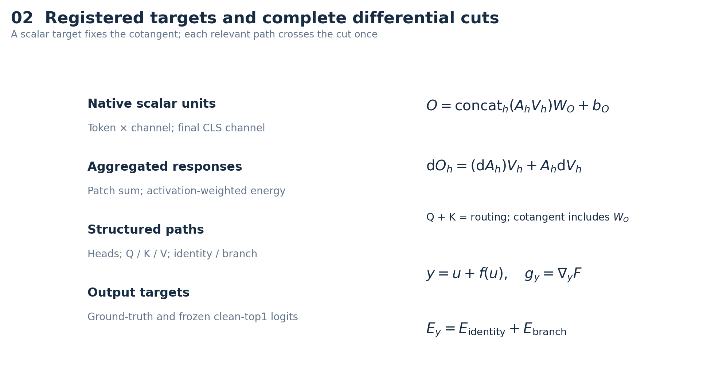
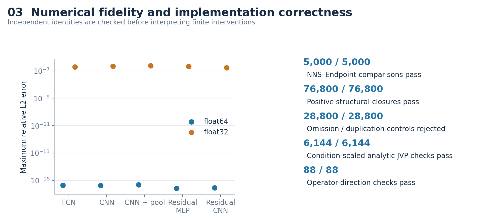
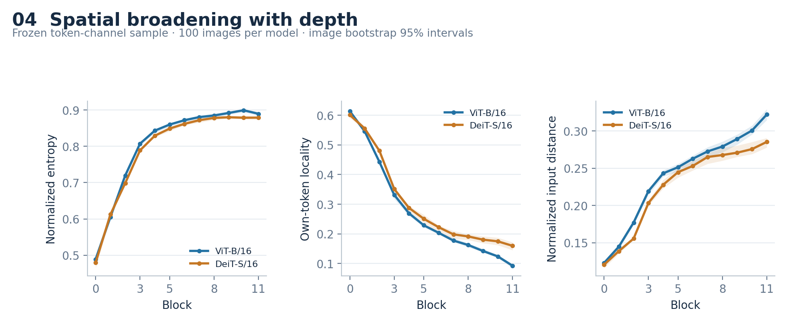
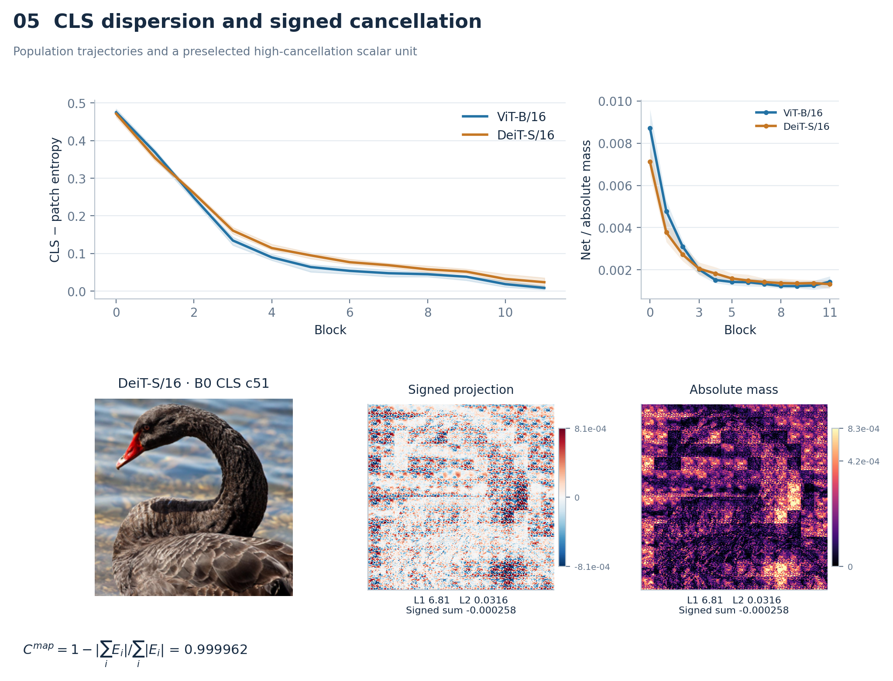
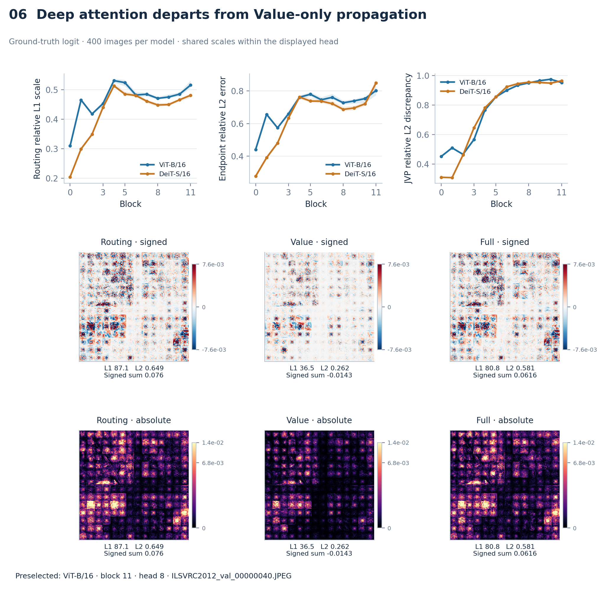
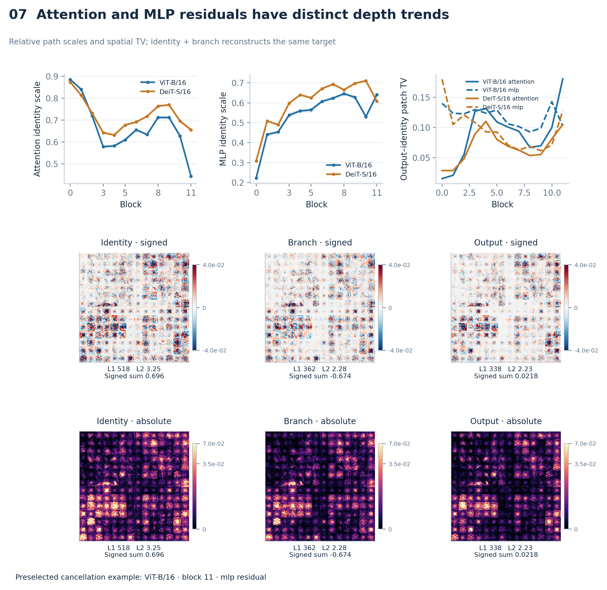
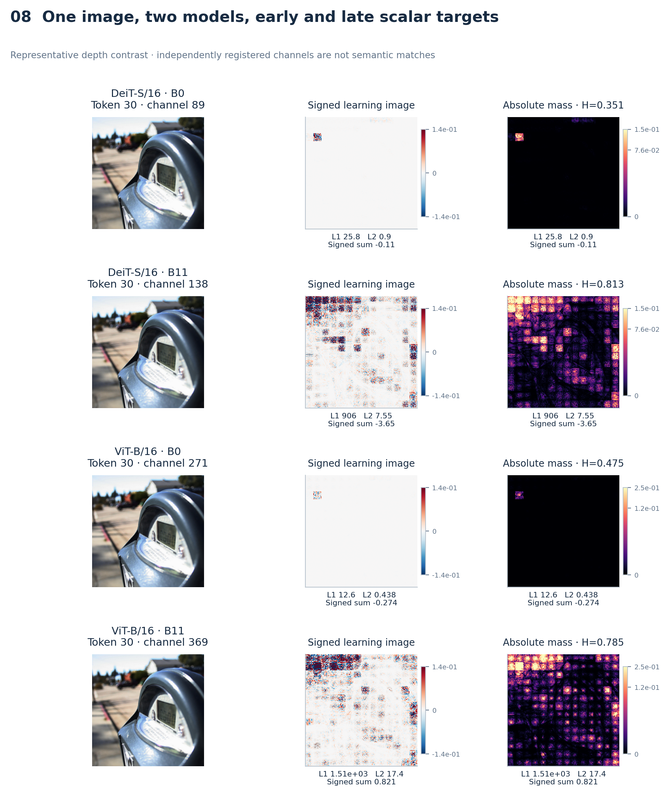
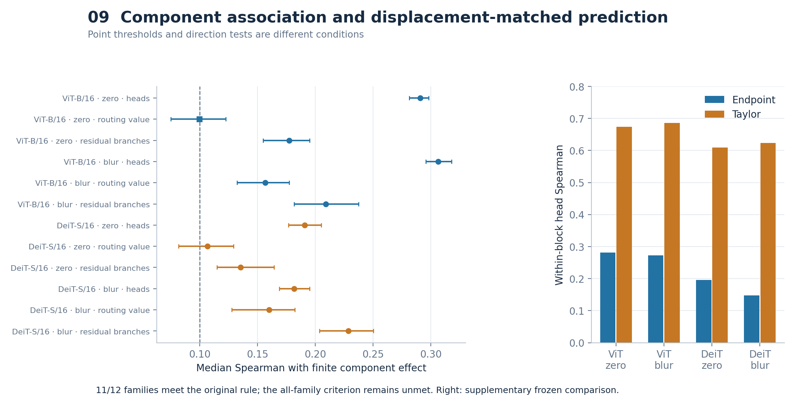
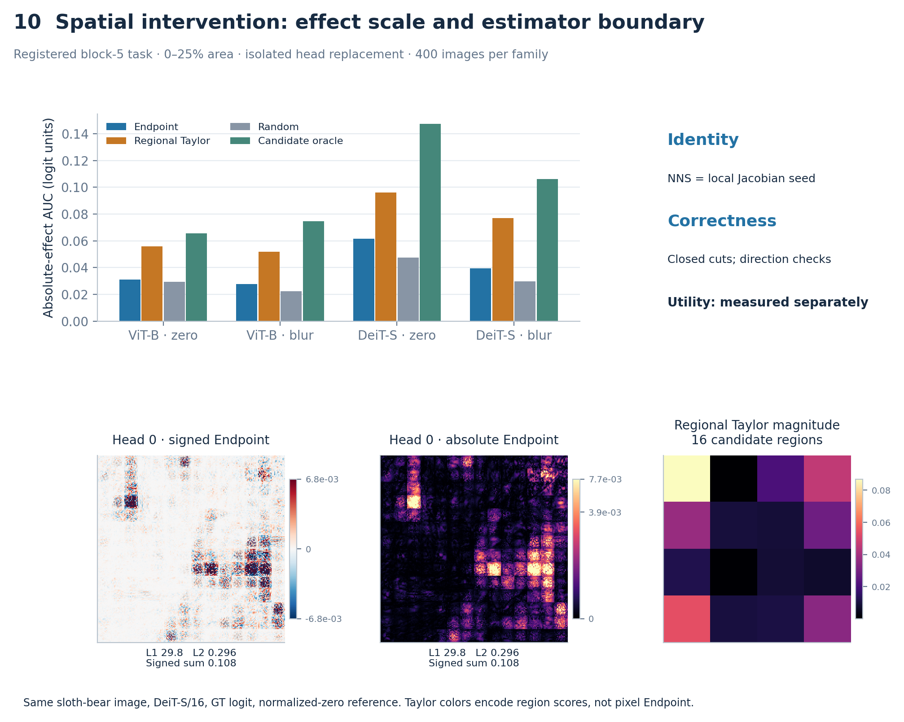

# 从 NNS 到视觉 Transformer：内部目标的可审计学习图像与结构化局部 Jacobian 分析

- 作者：[AUTHOR REQUIRED]
- 单位：[AFFILIATION REQUIRED]
- 通讯作者：[CORRESPONDING AUTHOR REQUIRED]

## 摘要

本文将 Neural Network Scanner（NNS）的输入坐标 learning-image propagation 推广到视觉 Transformer（ViT）。在原始 NNS 所覆盖的局部可微条件下，逐层传播等价于输入值初始化的局部 Jacobian 传播；标量目标的 Endpoint 为 normalized-input 坐标中的 $E_s(x)=x\odot\nabla_xs(x)$。技术贡献是 ViT 异构内部目标的统一注册、attention 与 residual 的结构分解，以及独立的闭合和方向导数验证。在 ViT-B/16 和 DeiT-S/16 上，5,000 项原始 NNS 数值比较及注册结构切面的闭合检查均通过。分层 token-channel 审计显示局部输入依赖随层深发生空间扩展；目标条件化的 attention 分解显示，深层 attention 更偏离固定权重的 Value-only Jacobian 近似。Attention 与 MLP residual 呈现不同的 identity/branch 层深趋势。有限替换实验发现广泛但非普遍的成分级关联，而 reference-matched regional Taylor 在注册空间干预中取得更高效果。NNS-ViT 为内部目标提供统一的局部输入坐标表示，并区分结构正确性、成分级行为关联与空间干预选择。

关键词：Vision Transformer；学习图像；Gradient × Input；局部 Jacobian；attention；有限干预

## 1. 引言

ViT 的内部对象包括 token-channel 单元、attention head、MLP 分支、residual stream 和类别 logit（Dosovitskiy et al., 2021）。它们处于不同的张量空间，activation 和 attention 权重本身无法说明某个内部目标如何依赖原始图像坐标。NNS 为 FCN/CNN 神经元构造保留输入位置的 learning image（Dou et al., 2023）。其当前状态传播原则为统一这些对象提供了起点。

我们把这一原则形式化为真实局部 Jacobian 传播，再扩展到 LayerNorm、GELU、softmax attention 和 residual connection。基础 Endpoint 与同目标 Gradient × Input 数值相同。本文有四项贡献：建立原始 NNS 的理论和数值联系；注册异构 ViT 标量目标；构造并验证 attention/residual differential cuts；用层深 atlas 和有限替换分别刻画局部结构规律与行为含义。

证据按以下顺序组织：RQ1 检验原始 NNS 忠实性；RQ2 检验目标注册与扫描覆盖；RQ3 检验结构闭合与数值正确性；RQ4a–c 分别研究 token-channel、attention routing/value 和 residual identity/branch；RQ5a–b 分别标定成分级行为关联与空间干预能力。最后分析 reference 改变时的估计对象。Figure 1 展示一张图像、一个标量目标与其 signed/absolute 学习图像的对应关系。

<!-- FIGURE_1_START -->

**Figure 1.** 当前输入的 ground-truth class logit 与两种互补学习图像。Signed 图对 RGB 求和，absolute 图先逐通道取绝对值再求和；正负项都保留在分析对象中。输入为冻结展示样本 class 297（懒熊）。
<!-- FIGURE_1_END -->

## 2. 相关工作

NNS 的单神经元图与 activation-weighted filter aggregation 保留输入坐标。本文对其局部传播作数学形式化，并推广其算子范围。Captum 的 NeuronGradient 和 InputXGradient 分别提供内部标量选择与输入乘梯度的已有实现；本文的增量集中于注册对象、结构路径和可核对的验证。

Integrated Gradients（Sundararajan et al., 2017）使用参考位移和路径平均梯度；conductance（Dhamdhere et al., 2018）进一步分析输出归因如何经过隐藏单元。Endpoint 则使用当前点 Jacobian 和输入值 seed。Attention rollout 描述跨层 token flow（Abnar and Zuidema, 2020），Chefer et al. (2021) 与 AttnLRP（Achtibat et al., 2024）采用 relevance propagation。它们的传播规则与解释对象不同，方法对照见补充材料 Table S5。

Activation patching 测量内部 activation 被替换后的有限输出变化。Activation-space Taylor 用 clean cotangent 与 replacement displacement 的内积近似该变化；AtP* 讨论了 attention saturation 和抵消带来的近似误差（Kramár et al., 2024）。本文同时评价整成分排序和成分内部的区域排序，让验证对象与使用任务对应。

## 3. 方法

### 3.1 命题 1：NNS 的局部 Jacobian 身份

设图像输入为列向量 $x\in\mathbb R^d$，标量梯度 $\nabla_xs\in\mathbb R^d$ 也按列向量记。对 $u(x)\in\mathbb R^m$，learning-image 矩阵为 $\mathcal L(u;x)\in\mathbb R^{m\times d}$。初始化与传播规则为

$$
\mathcal L(x;x)=\operatorname{diag}(x),\qquad
\mathcal L(v;x)=\sum_aJ_{f,u_a}(x)\mathcal L(u_a;x),\quad v=f(u_1,\ldots,u_r).
$$

**命题 1。** 若所有局部 Jacobian 在同一当前前向状态求值，则

$$
\mathcal L(u;x)=J_{u,x}(x)\operatorname{diag}(x),\qquad
\mathcal L(s;x)=\nabla_xs(x)^\top\operatorname{diag}(x),\qquad
E_s(x)=\mathcal L(s;x)^\top=\operatorname{diag}(x)\nabla_xs(x).
$$

**证明。** 输入处 $J_{x,x}=I$。按计算图拓扑顺序递推，将各前驱的表达式代入传播规则，再使用多输入链式法则，即得到每个节点的结论。对标量节点转置得到列向量 Endpoint。在线性、卷积和当前 ReLU gate 下，该规则恢复原始 NNS 系数；MaxPool 使用当前前向 winner。ReLU 零点和 MaxPool 并列遵循框架的固定导数选择，光滑区域内使用通常导数。

Endpoint 表示当前点上目标关于各输入坐标缩放方向的局部一阶依赖：对 $x_i\mapsto(1+\epsilon)x_i$，其一阶响应为 $\epsilon E_{s,i}$。一般有

$$
\sum_iE_{s,i}=x^\top\nabla_xs(x)\ne s(x).
$$

一阶齐次函数在可微点可由 Euler 定理得到等号；含 bias、固定 token、位置编码、LayerNorm、softmax 和 GELU 的一般 ViT 不满足这一条件。Endpoint 重构局部输入 Jacobian 记账，不能作为目标全部来源或函数值的完整分解。CLS token、位置编码和 patch/LN/QKV/MLP/classifier 的偏置没有独立图像坐标项，但会改变当前函数和 Jacobian。

若 $x=(r-\mu)/\sigma$，则

$$
x_i\frac{\partial s}{\partial x_i}=(r_i-\mu_i)\frac{\partial s}{\partial r_i}.
$$

因此 Endpoint 不需要外部选择的 intervention reference，但依赖模型输入坐标及 normalization origin。

### 3.2 标量目标与 filter aggregation

注册表区分原生 token-channel 单元、聚合响应、结构路径和输出目标（Figure 2）。对通道 $c$ 的 patch activations，定义

$$
s_{\mathrm{energy}}=\frac12\sum_{t=1}^{196}h_{t,c}^2,\qquad
\nabla_xs_{\mathrm{energy}}=\sum_th_{t,c}\nabla_xh_{t,c},\qquad
E_{\mathrm{energy}}=\sum_th_{t,c}E_{h_{t,c}}.
$$

这给出原始 NNS activation-weighted filter aggregation 的 Jacobian 形式；energy 是聚合标量而非单个神经元。目标还包括 patch sum、head 内部坐标、final CLS channel、ground-truth logit 和 frozen clean-top1 logit。跨模型同编号 channel 不视为同语义单元。

### 3.3 Attention 与 residual 的真实微分

对每个 head，$Q=XW_Q+b_Q$、$K=XW_K+b_K$、$V=XW_V+b_V$，且

$$
A=\operatorname{softmax}(QK^\top/\sqrt{d_h}),\quad O_h=AV,\quad
\mathrm dO_h=(\mathrm dA)V+A\mathrm dV.
$$

第一项再分为 Q 和 K 两条输入微分路径，因此

$$
E^{\mathrm{attn}}=E^Q+E^K+E^V=E^{\mathrm{routing}}+E^{\mathrm{value}}.
$$

Head 边位于拼接和 output projection 之前：$O=\operatorname{concat}_h(O_h)W_O+b_O$。其下游 cotangent 包含 $W_O$ 及目标之后的全部导数；偏置没有输入微分项。Q/K/V 路径共享上游输入，允许在输入空间重叠。路径 norm 比例描述局部尺度，不能解释为互斥因果百分比。

对 residual $y=u+f(u)$，令 $g_y=\nabla_yF$。正确的两项为

$$
E^{\mathrm{id}}=\operatorname{diag}(x)J_{u,x}^\top g_y,\qquad
E^{\mathrm{branch}}=\operatorname{diag}(x)J_{u,x}^\top J_{f,u}^\top g_y.
$$

Identity 使用 residual 输出处的 $g_y$；直接使用已包含 branch 的 $\nabla_uF$ 会重复记账。相加恢复 Endpoint，但不产生 $F=F_{\mathrm{id}}+F_{\mathrm{branch}}$ 的函数值分解。

<!-- FIGURE_2_START -->

**Figure 2.** 异构标量目录与 attention/residual differential cuts。Head edge 位于 output projection 之前，cotangent 包含该投影；residual identity 使用输出边 cotangent。
<!-- FIGURE_2_END -->

### 3.4 命题 2：合法 edge cut 的 Endpoint closure

对目标 $F$ 的切面边 $\{z_k\}$，定义

$$
E^C_{k,i}=x_i\left\langle g_{z_k},\frac{\partial z_k}{\partial x_i}\right\rangle.
$$

**命题 2。** 若每条相关 input-to-target differential path 恰好穿过切面一次，各成分使用同一前向状态，cotangent 位于相应真实边，且没有遗漏或重复路径，则 $\sum_kE^C_{k,i}=x_i\partial F/\partial x_i$。

**证明。** 展开链式法则为各输入到目标路径的 Jacobian 乘积。合法切面把路径不重不漏地分组；每组可因式分解为到达 $z_k$ 的上游 Jacobian 与该边的下游 cotangent。对所有组求和，再乘输入坐标 $x_i$，即得结论。分支内部的 cut 只重构该分支；重构完整 residual 或目标时还需纳入 bypass。

### 3.5 质量、抵消与 Value-only 近似

在原始 normalized-input RGB 张量坐标上定义 $m(E)=\sum_i|E_i|$、$a(E)=\sum_iE_i$。单图抵消和两路径抵消分别为

$$
C^{\mathrm{map}}=1-\frac{|\sum_iE_i|}{\sum_i|E_i|},\qquad
C^{\mathrm{path}}=1-\frac{\|E^{(1)}+E^{(2)}\|_1}{\|E^{(1)}\|_1+\|E^{(2)}\|_1}.
$$

Routing scale 为 $\|E^{\mathrm{routing}}\|_1/(\|E^{\mathrm{routing}}\|_1+\|E^{\mathrm{value}}\|_1)$；identity scale 同理。Value-only 近似保留 $A\mathrm dV$，遗漏 $(\mathrm dA)V$。Endpoint 与 JVP 的相对误差分别以完整 map 或完整方向响应的 L2 norm 为分母。约 0.95 的误差表示与完整响应同量级的差异。

Signed 显示为 $\sum_cE_c$，absolute 显示为 $\sum_c|E_c|$。同组比较使用共同 P99 robust scale 与 asinh 显示变换，并标原始 RGB L1、L2 和 signed sum。统计始终来自原始坐标；零分母或零范数记为 NA。

### 3.6 有限替换与空间区域选择

成分有限效应为 $e_k=F(x)-F(x;z_k\leftarrow z_k^{\mathrm{ref}})$，主要统计比较每图 $m(E_k)$ 与 $|e_k|$ 的 Spearman 相关。Taylor 量为 $p_k=\langle\nabla_{z_k}F,z_k(x)-z_k^{\mathrm{ref}}\rangle$。

空间任务固定 block 5 的三个 heads，将输入分成 $4\times4$ 区域并依次替换 1、2、4 个区域。干预只把目标 head 的边替换为对应扰动输入产生的 activation，其余 heads 与 identity 保持 clean。每条曲线先取 absolute isolated effect，在面积 0–25% 上作梯形积分并除以 0.25，再在图内平均三个 heads。随机基线先平均 20 条 signed effect 曲线，再取绝对值积分。Endpoint、total G×I、raw gradient、regional Taylor 和 random 共用候选池与面积预算。

## 4. 实验设计

### 4.1 模型、数据与抽样

两个冻结 ImageNet 模型共享 400 张 evaluation 图像。Discovery/calibration/evaluation 分别含 64/64/400 张，图像及类别互斥。短边 bicubic resize 到 248 后中心裁剪至 224；模型处于 eval 模式，dropout/drop path 关闭，结构实验使用 unfused attention。

<!-- TABLE_1_START -->
**Table 1. 模型与输入设置。**

| Model / setting | ViT-B/16 | DeiT-S/16 |
| --- | --- | --- |
| Blocks / heads / hidden dimension | 12 / 12 / 768 | 12 / 6 / 384 |
| Registered scalar targets/image | 457 | 385 |
| Evaluation images | 400 | 400 (same IDs) |
| Resize / crop | 248 / 224 | 248 / 224 |
| Normalization mean | [0.5, 0.5, 0.5] | [0.485, 0.456, 0.406] |
| Normalization std | [0.5, 0.5, 0.5] | [0.229, 0.224, 0.225] |
<!-- TABLE_1_END -->

分层 atlas 使用独立的 100 图 cohort，每层选择 CLS、15 个空间分层 patch tokens 和 32 个 hash-selected channels，每个 model-image 有 $12\times16\times32=6,144$ 个 post-block 标量。先图内聚合，再以图像为统计单位。Early/middle/late 分别为 blocks 0–3/4–7/8–11。令 $p_j$ 为 196 个输入 patch 的归一化 absolute mass，空间指标为

$$
H=-\frac{\sum_jp_j\log p_j}{\log196},\quad
L_t=\sum_{j:\|r_j-r_t\|_\infty\le1}p_j,\quad
D_t=\sum_jp_j\frac{\|r_j-r_t\|_2}{13\sqrt2},\quad
\operatorname{TV}(p,q)=\frac12\sum_j|p_j-q_j|.
$$

Locality 包含目标 patch 的 $3\times3$ 邻域，边界截断；CLS 的 locality/distance 为 NA。Attention saturation 为 $1+\sum_j A_{qj}\log A_{qj}/\log197$ 对全部 query 的平均，另报告 CLS-query 版本。上述定义与原始记录一致。

### 4.2 冻结统计与补充描述

原成分 family 规则要求相关点估计至少 0.10、相对零的正方向符号检验通过 Holm 校正、覆盖及 CI 精度达标。空间 family 要求相对四个基线的配对中位增益均至少 0.05，并满足同类方向、覆盖及精度条件。**0.10/0.05 是点估计实际效应门槛；符号检验的原假设针对零，不是总体中位数超过 0.10/0.05 的检验。** 原行为检验共用 28 项 Holm family，bootstrap 10,000 次；CI 最大宽度分别为 0.30/0.50。

Atlas 检验使用每模型五项 Holm family，attention/residual 使用各自冻结的模型内 family。后续 residual spatial-TV sensitivity 标为 post-hoc，并单独校正。本次补充的绝对 AUC、oracle regret、reference 变化和排序摘要均为描述性复算；不替代冻结判定。

## 5. 结果

### 5.1 RQ1：原始 NNS 忠实性

在 FCN、CNN、CNN-MaxPool、residual-MLP 和 residual-CNN 上，两种精度各用每网络 100 个输入，显式逐层传播与 Endpoint 的 5,000 项比较全部通过。Float64 与 float32 最大 relative-L2 分别为 $4.769\times10^{-16}$ 和 $2.427\times10^{-7}$（Figure 3）。Energy aggregation 与 MaxPool winner 的条件由同一传播身份解释。

<!-- FIGURE_3_START -->

**Figure 3.** 五类兼容网络中的原始 NNS 数值等价，以及结构闭合、负例与独立方向检查。左图每点为对应网络/精度的最大 relative-L2 error；验证项计数不是独立统计样本量。
<!-- FIGURE_3_END -->

### 5.2 RQ2：Registry 与扫描覆盖

800/800 个 image-model tasks 完成 336,800/336,800 次 scalar-target Endpoint evaluations。每图目标数为 457/385。原 post-block token-channel 覆盖率为 ViT-B/16 的 0.01058% 和 DeiT-S/16 的 0.02115%；分层 atlas 提高到 0.338%/0.677%，产生 1,228,800 个记录。这是对冻结目录无缺失的 registry-complete scan，空间结论对应抽样单元。完整覆盖表与资源记录见补充材料。

### 5.3 RQ3：结构闭合与数值验证

76,800 个正向闭合全部满足 float32 elementwise 合同 $|\mathrm{error}|\le10^{-5}+10^{-4}|\mathrm{reference}|$；28,800 个遗漏或重复负例全部被拒绝。最大 relative-L2 为 $1.41446\times10^{-5}$。6,144 个 condition-scaled analytic JVP 检查全部通过；11 类算子的 88 个 float64 方向检查也通过，最坏最优步长有限差分误差为 $1.632\times10^{-10}$。

分层 atlas 的 57,600 个 float32 有限差分检查中，36 个未满足容差（0.0625%）；按冻结流程进行的同坐标 float64 多步长复核全部通过。原始失败及精度曲线保留在补充材料，不能据此把误差唯一归因到某个上游算子。

### 5.4 RQ4a：Token-channel 的空间扩展与抵消

Late-minus-early entropy 在 ViT-B/16 与 DeiT-S/16 分别增加 0.2201/0.2250，locality 下降 0.3558/0.3424，normalized distance 增加 0.1312/0.1219。每个对比均有 100/100 张图呈注册方向并通过模型内 Holm 检验（Figure 4）。这描述局部输入依赖的空间扩展。

<!-- FIGURE_4_START -->

**Figure 4.** 冻结分层 token-channel 的 entropy、locality、distance 层深轨迹。蓝色/橙色为 ViT-B/16、DeiT-S/16；阴影为 100 张图的图像 bootstrap 95% CI。
<!-- FIGURE_4_END -->

CLS-minus-patch entropy 从 block 0 的 0.4752/0.4712 缩小至 block 11 的 0.0086/0.0238。Signed net/absolute mass 从 0.00872/0.00712 降至 0.00144/0.00132。Figure 5 将总体轨迹与一个预选高抵消案例并列。Absolute mass 是局部一阶项的总幅值，不能视为知识量或净方向效应。

<!-- FIGURE_5_START -->

**Figure 5.** 上排为 CLS-minus-patch entropy 与 net/absolute mass 的总体轨迹。下排为冻结指标选出的高 map-cancellation 单元；signed 和 absolute 视图并列，原始 RGB 质量与范数标于图下。
<!-- FIGURE_5_END -->

### 5.5 RQ4b：Attention routing/value

目标条件化分解覆盖 400 图、全部 12 层和全部 heads。Routing scale 从 block 0 的 0.3092/0.2041 增至 block 11 的 0.5154/0.4808；Value-only Endpoint error 从 0.4407/0.2774 增至 0.8022/0.8488。Late-minus-early 检验支持更大的 routing scale 和近似差异（Figure 6）。

<!-- FIGURE_6_START -->

**Figure 6.** 400 图的 routing scale、Value-only Endpoint error 与 JVP discrepancy；阴影为图像 bootstrap 95% CI。下方同一 head 的 routing/value/full maps 在 signed 行及 absolute 行内分别共用尺度，含原始质量、范数和 signed sum。案例只说明分解，不代替总体证据。
<!-- FIGURE_6_END -->

Block 11 的 JVP discrepancy 为 0.9516/0.9636；完整响应 norm 为 14.9711/1.5155，绝对差异为 13.8064/1.4228。因此近似差异与完整响应处于同一 norm 尺度，并非普遍由近零分母造成。该比值不是遗漏贡献百分比。

同图同层 heads 的 mean-query saturation 与 routing scale 呈负相关。控制 activation norm 和 cotangent norm 后，partial-rank 相关仍为 −0.1442/−0.3257。更尖锐的 attention 不能充当更强 routing differential 的代理；CLS-query 关系较弱，ViT-B 两项调整后检验为 $p=0.0629$。完整 post-hoc sensitivity 见补充材料。

### 5.6 RQ4c：Residual identity/branch

Attention residual 的 late-minus-early identity scale 为 −0.1242/−0.0449，MLP residual 为 +0.1798/+0.1780。两类子层的传递趋势不同（Figure 7）。Post-hoc 全 cohort spatial-TV 分析进一步得到 attention 的变化 +0.0520/+0.0282，MLP 的变化 −0.0187/−0.0462；四项均通过单独 Holm 校正。正负相反的一阶路径可以在相加后显著抵消，因此 path scale 不能直接视为最终贡献份额。

<!-- FIGURE_7_START -->

**Figure 7.** Attention/MLP identity scale 与 output–identity patch TV；下方高 path-cancellation 案例的 identity/branch/output 共用组内尺度。TV 曲线为冻结 cohort 描述；late-minus-early 推断来自单独的 post-hoc sensitivity。
<!-- FIGURE_7_END -->

Figure 8 用同一预选图像展示两模型早晚层的 signed/absolute 标量图，共享模型内显示尺度。案例按冻结指标选择，用于解释总体规律。Token-channel atlas 与 class-logit 路径分析使用不同目标和 cohort：每模型原始 bridge 仅有一张图与 100 图 atlas 重叠。两者只构成模型级描述性联系。

<!-- FIGURE_8_START -->

**Figure 8.** 按冻结指标选出的同图跨模型深度比较。每模型早晚层共用 signed/absolute 各自尺度；所选 channels 独立注册，不构成跨层或跨模型语义匹配。
<!-- FIGURE_8_END -->

### 5.7 RQ5a：广泛但非普遍的成分级关联

12 个 family 中，11 个满足全部冻结条件（Figure 9；Table 2）。未通过的 ViT-B/16 normalized-zero routing/value 点估计为 0.09956521739130435，95% CI [0.0748, 0.1226]，Holm $p=3.0036\times10^{-14}$。DeiT-S/16 对应点估计 0.1065，CI [0.0817, 0.1291]，满足原规则，但其区间也未确认总体中位数超过 0.10。Table 2 增列 CI 下界是否超过 0.10，作为描述性敏感性，不改变原支持状态。All-family omnibus C4a 保留 NOT_SUPPORTED。

<!-- TABLE_2_START -->
**Table 2. 原成分 family 与阈值敏感性。**

| Model | Reference | Family | Median rho | 95% CI | Holm p | Frozen status | CI lower > 0.10 |
| --- | --- | --- | --- | --- | --- | --- | --- |
| ViT-B/16 | normalized-zero | heads | 0.2909 | [0.2813, 0.2982] | 2.17e-119 | SUPPORTED | yes |
| ViT-B/16 | normalized-zero | routing/value | 0.0996 | [0.0748, 0.1226] | 3.00e-14 | NOT_SUPPORTED | no |
| ViT-B/16 | normalized-zero | residual/branches | 0.1774 | [0.1548, 0.1952] | 2.56e-46 | SUPPORTED | yes |
| ViT-B/16 | blur | heads | 0.3063 | [0.2957, 0.3181] | 2.17e-119 | SUPPORTED | yes |
| ViT-B/16 | blur | routing/value | 0.1565 | [0.1322, 0.1774] | 9.96e-29 | SUPPORTED | yes |
| ViT-B/16 | blur | residual/branches | 0.2091 | [0.1817, 0.2374] | 1.46e-41 | SUPPORTED | yes |
| DeiT-S/16 | normalized-zero | heads | 0.1910 | [0.1769, 0.2052] | 1.88e-76 | SUPPORTED | yes |
| DeiT-S/16 | normalized-zero | routing/value | 0.1065 | [0.0817, 0.1291] | 2.11e-10 | SUPPORTED | no |
| DeiT-S/16 | normalized-zero | residual/branches | 0.1352 | [0.1148, 0.1643] | 4.35e-19 | SUPPORTED | yes |
| DeiT-S/16 | blur | heads | 0.1817 | [0.1688, 0.1951] | 3.82e-72 | SUPPORTED | yes |
| DeiT-S/16 | blur | routing/value | 0.1600 | [0.1278, 0.1822] | 9.90e-31 | SUPPORTED | yes |
| DeiT-S/16 | blur | residual/branches | 0.2287 | [0.2035, 0.2504] | 3.70e-54 | SUPPORTED | yes |
<!-- TABLE_2_END -->

补充冻结实验在同层 head 排序中比较七类 predictor。Taylor 的 Spearman、Capture@1/3 均高于 Endpoint，Regret@1 更低（Table 3）。跨层 residual identity 的 Endpoint−Taylor Spearman 配对差为 0.0865–0.4209，但 Capture@1 差的中位数为零。增量价值依赖成分与指标。

<!-- TABLE_3_START -->
**Table 3. 补充冻结同层 head 排序：E=Endpoint，T=Taylor。**

| Model | Reference | E rho | T rho | E Capture@1 | T Capture@1 | E Capture@3 | T Capture@3 | E Regret@1 | T Regret@1 |
| --- | --- | --- | --- | --- | --- | --- | --- | --- | --- |
| ViT-B/16 | normalized-zero | 0.2815 | 0.6742 | 0.5174 | 0.8038 | 0.6149 | 0.8567 | 0.1701 | 0.0571 |
| ViT-B/16 | blur | 0.2727 | 0.6856 | 0.5075 | 0.8203 | 0.6185 | 0.8659 | 0.1163 | 0.0346 |
| DeiT-S/16 | normalized-zero | 0.1952 | 0.6095 | 0.5609 | 0.8028 | 0.7122 | 0.8894 | 0.2381 | 0.0860 |
| DeiT-S/16 | blur | 0.1476 | 0.6238 | 0.5506 | 0.8426 | 0.7105 | 0.8970 | 0.1326 | 0.0443 |
<!-- TABLE_3_END -->

<!-- FIGURE_9_START -->

**Figure 9.** 左图为原 C4a family 点估计及 95% 图像 bootstrap CI，虚线 0.10 是点估计门槛，方形为未通过 family。右图为补充冻结同层 head 排序的 Endpoint/Taylor Spearman；其检验不替代原 C4a。
<!-- FIGURE_9_END -->

### 5.8 RQ5b：空间干预边界

四个 family 均未达到相对四基线的联合 +0.05 条件，C4b 保留 NOT_SUPPORTED。Endpoint−regional Taylor 配对中位 AUC 差为 −0.023433、−0.023697、−0.029900、−0.035630，区间均低于零（Table 4）。相对随机的增益为正但远低于 0.05。

<!-- TABLE_4_START -->
**Table 4. 原空间干预配对 AUC 差。**

| Model | Reference | vs total G×I | vs gradient | vs Taylor | vs random | Frozen status |
| --- | --- | --- | --- | --- | --- | --- |
| ViT-B/16 | normalized-zero | -0.0009 | -0.0000 | -0.0234 | 0.0011 | NOT_SUPPORTED |
| ViT-B/16 | blur | -0.0010 | -0.0007 | -0.0237 | 0.0042 | NOT_SUPPORTED |
| DeiT-S/16 | normalized-zero | -0.0018 | -0.0006 | -0.0299 | 0.0107 | NOT_SUPPORTED |
| DeiT-S/16 | blur | 0.0002 | -0.0002 | -0.0356 | 0.0085 | NOT_SUPPORTED |
<!-- TABLE_4_END -->

绝对 AUC 见 Table 5。候选 oracle 在每个 head/预算上，从实际评价过的区域集合中取最大 absolute isolated effect，再积分并在图内平均；它不代表所有可能区域的最优干预，不同预算的最优集合也未必嵌套。Table 6 的 regret 为逐图 $(A_{oracle}-A_m)/A_{oracle}$ 后取中位数，零分母记 NA。Endpoint AUC 相对 $|F(x)|$ 的逐图比值中位数为 0.0031–0.0072，Taylor 为 0.0059–0.0107。Raw logit 比例只提供输出尺度参照，依赖模型的 logit 原点。

<!-- TABLE_5_START -->
**Table 5. 绝对 AUC 与输出尺度（每项 400 图）。**

| Model | Reference | Endpoint AUC | Taylor AUC | Random AUC | Candidate oracle AUC | Clean GT logit |
| --- | --- | --- | --- | --- | --- | --- |
| ViT-B/16 | normalized-zero | 0.0309 | 0.0558 | 0.0294 | 0.0654 | 8.8989 |
| ViT-B/16 | blur | 0.0276 | 0.0518 | 0.0225 | 0.0747 | 8.8989 |
| DeiT-S/16 | normalized-zero | 0.0617 | 0.0961 | 0.0475 | 0.1474 | 8.7974 |
| DeiT-S/16 | blur | 0.0395 | 0.0770 | 0.0296 | 0.1063 | 8.7974 |
<!-- TABLE_5_END -->

<!-- TABLE_6_START -->
**Table 6. 归一化 oracle regret 和逐图 logit 尺度比。**

| Model | Reference | Endpoint regret | Taylor regret | Random regret | Endpoint AUC/abs(logit) | Taylor AUC/abs(logit) |
| --- | --- | --- | --- | --- | --- | --- |
| ViT-B/16 | normalized-zero | 0.5303 | 0.1442 | 0.5563 | 0.0035 | 0.0062 |
| ViT-B/16 | blur | 0.6366 | 0.2557 | 0.6942 | 0.0031 | 0.0059 |
| DeiT-S/16 | normalized-zero | 0.5646 | 0.3352 | 0.6780 | 0.0072 | 0.0107 |
| DeiT-S/16 | blur | 0.6289 | 0.2705 | 0.7130 | 0.0045 | 0.0089 |
<!-- TABLE_6_END -->

<!-- FIGURE_10_START -->

**Figure 10.** 四个注册组合的 absolute-effect AUC 中位数，包含实际评价候选内的 oracle。下方同一懒熊图像、DeiT-S block 5 head 0 与 normalized-zero reference 的 signed/absolute Endpoint 和 regional Taylor。Taylor 的 16 格表示区域位移预测分数，不能与像素 Endpoint 色值比较。
<!-- FIGURE_10_END -->

### 5.9 方法语义与 reference 分析

Endpoint 在两个 intervention references 下相同来自其定义与复用的 clean map。163,200 个成分配对验证存储值一致。Taylor magnitude 与 absolute finite effect 的变化按 $|q_0-q_b|>\mathrm{atol}+\mathrm{rtol}\max(|q_0|,|q_b|)$ 判断，使用原分析的 $\mathrm{atol}=10^{-12},\mathrm{rtol}=0$；全部配对超过容差。绝对/相对变化的中位数和 q10/q90 见 Table S3。

完整排名一致仅有 Taylor 46/9,600、finite effect 64/9,600 个 head-block；全部来自 DeiT-S。更宽松的排序摘要见 Table 7：例如两模型 Taylor Top-1 agreement 的图像级中位数均为 0.3333，Top-3 overlap 为 0.5000/0.6111。排序改变不限于分数缩放；但完整排名不一致也不意味着所有头的相对顺序均改变。Table S4 给出图像分布的 q10/q90。

<!-- TABLE_7_START -->
**Table 7. 跨 reference head 排名一致性（先图内平均 12 层）。**

| Model | Quantity | Spearman | Kendall tau-b | Top-1 agreement | Top-3 overlap | Mean abs rank displacement |
| --- | --- | --- | --- | --- | --- | --- |
| DeiT-S/16 | finite_effect | 0.3071 | 0.2444 | 0.4167 | 0.6111 | 1.5278 |
| DeiT-S/16 | taylor | 0.3000 | 0.2389 | 0.3333 | 0.6111 | 1.5278 |
| ViT-B/16 | finite_effect | 0.3759 | 0.2803 | 0.3333 | 0.5000 | 2.9444 |
| ViT-B/16 | taylor | 0.3782 | 0.2828 | 0.3333 | 0.5000 | 2.9444 |
<!-- TABLE_7_END -->

## 6. 讨论

局部 Jacobian 身份、实现正确性和有限干预效用是三个可分别检验的性质。前两者确立内部目标与图像坐标之间的结构关系；后者取决于 replacement displacement、目标成分与候选区域。Regional Taylor 直接纳入指定 reference 的位移，与本研究区域干预的估计对象更接近。

空间扩展、Value-only 近似偏差以及 attention/MLP residual 的不同趋势，描述两个训练模型中的局部输入依赖。高 signed cancellation 同时表明，大 absolute mass 可以伴随很小净方向响应。Signed 图中的正部表示局部坐标缩放项的正号，不能直接解释为有限删除下支持预测的证据。

Mean-query attention sharpness 与 routing dependence 的负相关提示，仅看 attention 权重难以替代目标条件化路径分析。Token-channel 与 class-logit 轨迹互补；匹配目标的桥接实验仍是检验二者关系的直接下一步。

## 7. 局限

研究覆盖两个 ImageNet 分类 ViT。二者同时在模型规模、head 数、hidden dimension 和训练策略上不同，跨模型差异不能唯一归因于任何一项。当前没有随机初始化/未训练控制，因此无法区分空间扩展和路径趋势来自架构、初始化还是训练；不能据此声称它们是学习形成的语义机制。同架构替代 checkpoint、自监督模型及其他任务也尚未评价。

结构路径分析以 ground-truth logit 为条件，尚未完成 GT/clean-top1 以及正确/错误分类分组的机制稳健性分析。已存储的 clean-top1 total maps 不替代相应路径分解。Token-channel 与 class-logit 的 target/cohort 不匹配限制了 bridge；同目标 full–value entropy、locality 和 TV 比较列入后续实验。现有五类网络等价验证提供数值忠实性，原 NNS 风格 CNN 像素示例和现有方法小型可视化对照仍可补充。

Registry-complete 不等于全神经元穷举。空间干预结论固定于注册层、head、区域池、reference 和 raw-logit isolated effect。ViT-B 的 Path IG 在冻结 512 点上限仅通过 GT 41/64 与 clean-top1 40/64，低于 61/64 校准门；跨模型 Endpoint–Path 比较没有可发布的共同数值基础。完整复现实验与后续优先级见补充材料。

## 8. 结论

原始 NNS learning image 可形式化为输入值初始化的局部 Jacobian 传播，Endpoint 将其扩展到 ViT 算子。异构内部标量可映射到统一输入坐标，合法 attention/residual cuts 能闭合对应 Endpoint。两个训练模型的抽样 token-channel 呈层深相关空间扩展，深层 attention 更偏离 Value-only 近似，attention 与 MLP residual 呈不同局部传递趋势。有限替换标定得到广泛但非普遍的成分级关联，并表明 displacement-matched Taylor 更适合本研究 reference-specific 区域选择。

## 数据、代码与可复现材料

预处理、完整覆盖表、冻结判定、数值失败复核、补充图和本次描述性复算见 [补充材料](supplement_revision_v1.md)。作者、单位和最终归档信息由作者填写：[REPOSITORY AND ARCHIVE REQUIRED]。

## 参考文献

见 [参考文献清单](../references/endpoint_scanner_references_r1.md)。
