# NNS-ViT：视觉 Transformer 内部目标的可审计 Endpoint 图与结构化 Jacobian 分解

- 作者：`[AUTHOR REQUIRED]`
- 单位：`[AFFILIATION REQUIRED]`
- 通讯作者：`[CORRESPONDING AUTHOR REQUIRED]`

> 初稿 R3，2026-09-20。正文图号沿用已封存、统一组织的
> `ENDPOINT-ALL-FIGURES-R2` 图包 Figure 1–40；投稿排版可按
> `papers/nns_vit_endpoint/zh/outline.md` 的建议重新编号。

## 摘要

视觉 Transformer（ViT）的内部解释对象横跨 token-channel 单元、attention head、
routing/value 路径、MLP 分支、residual stream 和类别输出。本文提出 NNS-ViT Endpoint
Scanner，把原始 Neural Network Scanner 的输入值初始化与当前状态传播形式化为局部
Jacobian propagation。对任意注册标量目标 $s$，其输入坐标图为
$E_s(x)=x\odot\nabla_xs(x)$。该基础量与 Gradient × Input 相同；本文的技术贡献是异构
ViT 目标的统一 registry、可闭合的 attention/residual 切面和可独立审计的数值协议。
在共享的 400 张 ImageNet evaluation 图像上，ViT-B/16 和 DeiT-S/16 的 registry-complete
扫描完成 800/800 个图像—模型任务和 336,800 个目标评价。结构验证通过 76,800 个正向
闭合检查，拒绝 28,800 个遗漏或重复记账负例，并通过 6,144 个 condition-scaled analytic
JVP 检查。直接 fidelity bridge 在五类兼容网络上比较显式逐层 NNS propagation 与
Endpoint，共 5,000 项数值比较全部满足对应精度合同。冻结的 100 图分层审计为每个
model-image 计算 6,144 个 post-block token-channel targets；两个模型的 late blocks 均比
early blocks 具有更高空间 entropy、更低 own-token locality 和更大的 normalized input
distance。对冻结 ground-truth logit，late attention 的 routing-relative path scale 更大，
与 Value-only fixed-attention approximation 的差异也更大；post-hoc 全 cohort sensitivity
显示 attention residual 的空间改变随深度增加，而 MLP residual 的空间改变下降。行为标定
保持独立：12 个预注册成分 family
中有 11 个满足有限效应关联的 family-level 条件，但 all-family omnibus 保持
`NOT_SUPPORTED`；四个注册空间干预 family 中 regional Taylor 均取得更高的中位效果。
NNS-ViT 因而为目标条件化的局部输入依赖提供统一、可审计的表示；有限 replacement 与
reference-specific 区域选择仍需单独验证。

关键词：Vision Transformer；神经网络解释；Gradient × Input；结构分解；activation
replacement；attention head

## 1. 引言

Vision Transformer 将图像表示组织为 patch tokens，并通过多头自注意力、MLP 和
residual stream 反复变换这些表示（Dosovitskiy et al., 2021）。这套结构产生了丰富的
内部观察对象：一个 token-channel 单元、一条 head 分支、Q/K routing、Value 内容、
MLP 分支或最终类别 logit 都可以成为解释目标。然而，这些对象生活在不同的张量空间。
直接查看 activation 或 attention 权重能够描述内部状态，却不能自动回答某个对象如何依赖
原始输入，也不能保证多个结构成分对同一目标的记账既无遗漏又无重复。

已有 ViT 解释方法从不同角度处理这一问题。Attention rollout 递归聚合 token 间的
attention flow（Abnar and Zuidema, 2020）；Transformer relevance 方法把类别相关信息沿
计算图传播（Chefer et al., 2021；Achtibat et al., 2024）；输入归因方法则把最终输出映射
到像素坐标。它们回答的对象、传播规则和评价标准并不相同。对内部结构进行解释时，还需
区分三个问题：方法的数学身份是什么，代码是否忠实实现这一身份，以及所得数值是否能
预测有限干预。只验证梯度或闭合无法替代干预评价；一张空间细致的图也不一定比一个直接
针对候选区域的局部效应估计更适合区域选择。

Dou et al. (2023) 提出的 Neural Network Scanner（NNS）为 FCN/CNN 内部神经元构造
保留输入位置的 learning image。在线性层、卷积、当前 ReLU 门和唯一 MaxPool winner
采用真实局部传播系数时，该单神经元规则可写为输入值与当前点梯度的乘积。ViT 引入
LayerNorm、GELU、输入依赖的 softmax attention、两处 residual add 以及多种 token/branch
对象，因此需要明确其真实 Jacobian、结构切面和目标身份。本文沿用 NNS 的终点传播思想，
但不把 $x\odot\nabla_xs(x)$ 重新命名为新的基础归因公式。

Figure 1 用一条主线概括方法：在真实 ViT 中选定一个标量响应，在观测输入处求导，并把
所得 Endpoint map 保留在原始输入坐标。本文沿五个相互衔接的问题组织证据：

1. **RQ1：原始 NNS 忠实性。** 当前状态的 learning-image propagation 是否在理论与
   数值上归结为同一个局部 Jacobian 对象？
2. **RQ2：统一内部目标扫描。** 一个 registry 能否完整、可审计地扫描两个冻结 ViT 中
   形态不同的标量目标？
3. **RQ3：结构与数值可审计性。** Q/K/V、routing/value 和 residual identity/branch
   cuts 能否重构注册对象并通过独立微分检查？
4. **RQ4：ViT 内部机制。** Endpoint atlas 呈现出怎样的层深、token、routing/value 和
   residual path 规律？
5. **RQ5：行为相关性与解释边界。** Endpoint 图和统计量与有限 activation replacement
   有何关系，reference 信息何时会改变合适的估计量？

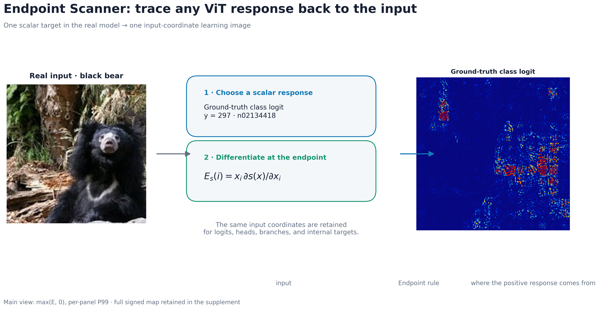

**Figure 1.** Endpoint Scanner 的核心流程。真实懒熊输入经过选定的 ground-truth class
logit 和终点规则 $E_s(i)=x_i\,\partial s(x)/\partial x_i$，得到位于原输入坐标的正贡献
learning image。主图使用蓝底 $\max(E,0)$ 和逐面板 P99 显示缩放；完整 signed map 保留在
补充材料中。

本文有四项贡献。第一，我们把原始 NNS learning-image propagation 形式化为局部 Jacobian
传播，在推广到 LayerNorm、GELU、softmax attention、MLP 和 residual connection 前，先
验证它与 Endpoint 的理论及数值等价。第二，我们为 token-channel、head、Q/K/V、
routing/value、residual branch、聚合目标和类别输出提供统一 registered-scalar 接口。第三，
我们建立完整 attention/residual differential cuts，并以正向闭合、负向控制、JVP/VJP、
有限差分和算子测试验证。第四，我们用 atlas 测量层深相关空间扩展和目标条件化的
attention/residual 机制，再以有限干预标定其行为含义，而不把 Endpoint 表述为通用干预
预测器。

## 2. 相关工作

### 2.1 神经元可视化与 NNS

内部可视化方法既可以寻找最大化某个单元的输入，也可以从一个实际样本出发追踪其内部
响应。Feature visualization、network dissection、deconvolutional views 和 class activation
maps 分别刻画偏好输入、语义概念、局部响应或类别相关区域。NNS 为另一类对象：它给
FCN/CNN 的单个神经元或聚合响应关联一张保留输入位置的 learning image（Dou et al.,
2023）。本文继承这一“内部目标—输入坐标图”的组织方式，并把当前状态传播扩展到 ViT
的真实算子。Captum 的 NeuronGradient 和 InputXGradient 已分别提供内部 scalar selector
和输入乘梯度的明确先例，因此本文的增量不在 hook、selector 或基础 G×I 公式，而在注册
范围、结构化切分、闭合验证与有限干预审计。

### 2.2 输入归因、路径积分与 conductance

Integrated Gradients（IG）沿参考输入到当前输入的路径积分梯度，并满足包括 sensitivity
和 implementation invariance 在内的公理（Sundararajan et al., 2017）。Neuron
conductance 进一步衡量输出归因如何流经隐藏单元（Dhamdhere et al., 2018）。这些方法
与 Endpoint 的差别不是 CNN 或 Transformer 的架构标签，而是归因定义：Endpoint 使用
当前点 Jacobian 和输入值 seed；IG 使用参考差值 seed 和路径平均 Jacobian。本文同时保留
这一方法边界。由于 ViT-B/16 在预注册的最大 512 点数值范围内没有达到 Path IG 校准门，
我们不发布跨模型 Endpoint–Path fidelity、stability 或成本—质量结论。

### 2.3 Transformer 解释与结构分析

Raw attention 提供 token 关系，但不包含完整的下游类别导数。Attention rollout 聚合跨层
attention 与 residual 路径（Abnar and Zuidema, 2020）；Chefer et al. (2021) 与 AttnLRP
（Achtibat et al., 2024）采用 relevance 规则处理 Transformer 计算图；LibraGrad 调整
backward 路径以缓解 Transformer 的梯度流不平衡（Mehri et al., 2025）。这些工作说明
attention、skip connection 和梯度路径都影响解释。Endpoint Scanner 保留模型的真实局部
Jacobian，并将 raw attention、relevance 传播和修改后的 backward attribution 视为不同方法。

### 2.4 Activation patching 与解释评价

Activation patching 通过替换内部 activation 直接测量模型输出变化；Attribution Patching
用 activation displacement 与 clean gradient 的内积近似该有限效应，AtP* 进一步分析了
attention saturation 和抵消导致的失效模式（Kramár et al., 2024）。这一区分对本文尤为
重要：局部导数身份属于 correctness，而有限 replacement 才检验行为预测。我们同时考察
整成分排序和固定空间预算下的区域排序，并把 activation-space regional Taylor 作为后者
的 mandatory baseline。

## 3. 方法

### 3.1 Endpoint learning image 的数学身份

设模型实际接收的输入为 $x\in\mathbb R^d$。对计算图节点
$u(x)\in\mathbb R^m$，定义 learning-image 矩阵
$\mathcal L(u;x)\in\mathbb R^{m\times d}$。输入坐标初始化为

$$
\mathcal L(x;x)=\operatorname{diag}(x).
$$

若 $v=f(u_1,\ldots,u_r)$，所有 Jacobian 在真实输入对应的当前前向状态求值，则

$$
\mathcal L(v;x)=\sum_{a=1}^{r}J_{f,u_a}(x)\mathcal L(u_a;x).
$$

对标量目标 $s(x)$ 递归应用链式法则得到

$$
\boxed{L_s^{\mathrm{Endpoint}}(x)=x\odot\nabla_xs(x)}.
$$

当输入值用于对角初始化、bias 不作为图像输入坐标、ReLU 零点使用框架次梯度、MaxPool
遵循当前前向 winner（并列时遵循框架规则）时，该身份恢复原始 NNS learning-image 规则。
等价对象是局部输入依赖，而非函数值分解。CLS token、position embedding 和模型 bias 不
单独分配图像坐标贡献。LayerNorm、GELU 和 softmax attention 是超出原始 NNS 算子集合的
Jacobian-form generalization。

Figure 2 区分原始 NNS-CNN、ViT Endpoint 与 Path IG 的 seed 和 Jacobian。Endpoint
不包含 reference forward，也不具备一般的 baseline-difference completeness。输入坐标是
模型实际接收的 normalized RGB。若 $x=(r-\mu)/\sigma$，则

$$
x_i\frac{\partial s}{\partial x_i}
=(r_i-\mu_i)\frac{\partial s}{\partial r_i}.
$$

因此 canonical Endpoint 在 raw-RGB 坐标中以模型 normalization mean 为坐标原点。二维
显示图由原始 signed RGB tensor 做通道求和得到；绝对值、正部或逐图显示缩放不进入统计。

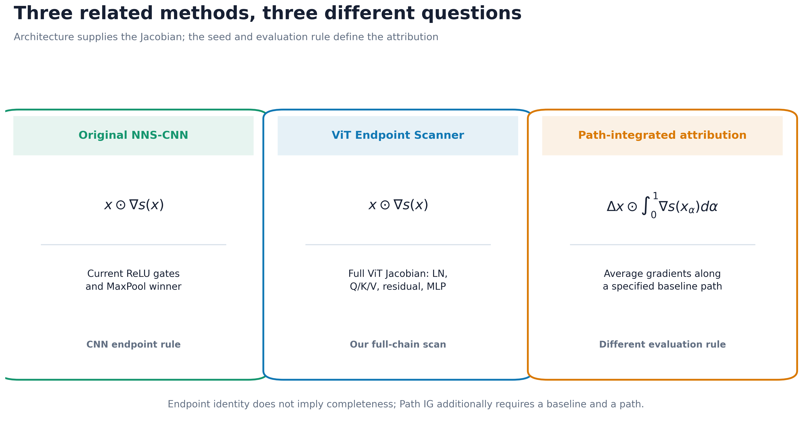

**Figure 2.** 三种相关方法回答不同问题。原始 NNS-CNN 和 ViT Endpoint Scanner 都按
当前状态传播；Path IG 使用输入位移 seed 和路径平均 Jacobian。ViT 扩展改变的是被追踪的
计算图，而不是 $x\odot\nabla_xs(x)$ 这一基础身份。

### 3.2 注册内部目标

Scanner 接受任何已登记的标量目标。目录包括 token-channel 单元、排除 CLS 的
patch-channel sum、patch-channel energy、attention head 内部坐标、final CLS channel、
ground-truth raw logit 和 frozen clean-top1 raw logit。Energy 目标定义为

$$
s_{\mathrm{energy}}(x)=\frac12\sum_{t=1}^{196}h_{t,c}(x)^2,
$$

它对应原始 NNS filter aggregation 的激活加权形式。ViT-B/16 每图注册 457 个目标，
DeiT-S/16 每图注册 385 个目标；两者均覆盖全部 12 个 blocks（Figure 7、11）。不同
模型中编号相同的 channel 不解释为语义相同。

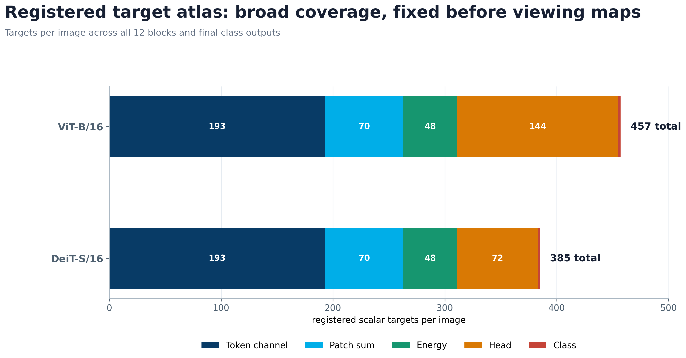

**Figure 11.** 注册 target atlas 的构成。横向区段分别表示 token-channel、patch sum、
energy、head 和 class targets；457 与 385 的主要差异来自两模型 attention head 数不同。

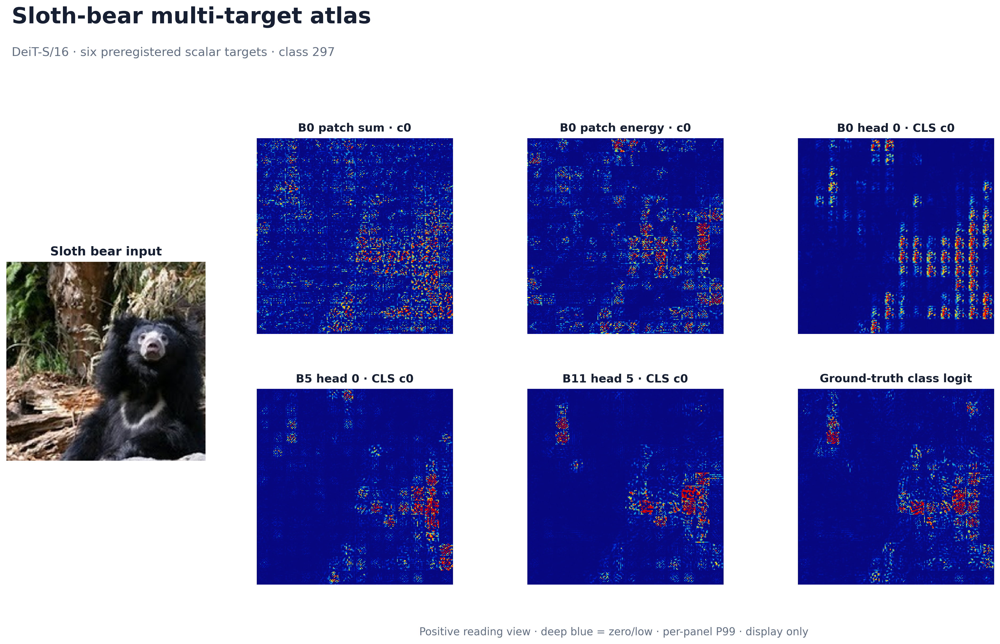

**Figure 13.** 预先保留的展示样本 ILSVRC2012_val_00005415.JPEG 的六个注册标量目标。
其封存 ImageNet 标签为 class 297，即懒熊（sloth bear，`n02134418`）。蓝底面板将 signed
RGB 通道求和后显示 $\max(L,0)$，各面板独立使用 P99 缩放，只用于目标内部的空间阅读，
不能比较跨面板绝对强度。完整 signed companion 和源数组哈希保留在统一 R2 图包中。

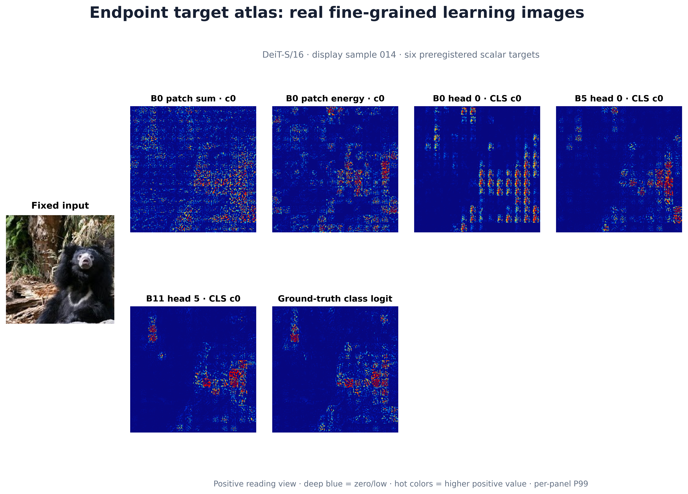

**Figure 34.** 同一封存懒熊样本六个注册 target 的扩展细粒度阅读页。科学 target 身份和
raw arrays 不变；蓝底正部仅用于阅读空间形态，signed companion 位于
`supplement/signed/`。

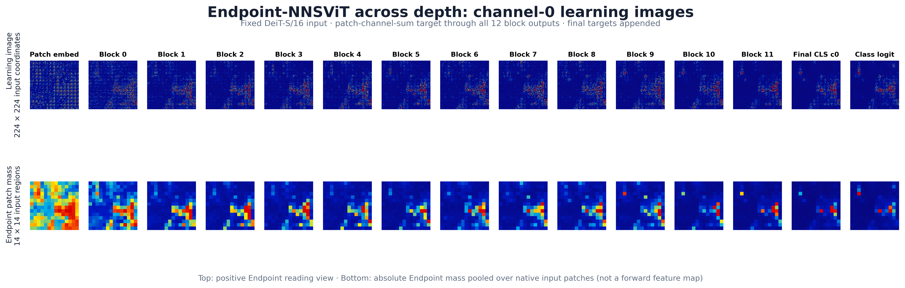

**Figure 37.** 参考原始 NNS 论文 Figure 13 的“横向跨层、上下对应”组织方式，固定
DeiT-S/16 的同一输入和 channel 0，依次展示 patch embedding、Block 0–11、final CLS 和
ground-truth class logit。上排是 224×224 Endpoint learning image 正部；下排是从同一 raw
map 在原生 16×16 input patch 内汇总出的 14×14 absolute Endpoint mass，表示输入依赖落在
哪些 patch 区域，**不是 forward feature map**。

### 3.3 ViT 算子与 attention differential paths

Canonical backend 使用 timm 0.9.16 的 standard unfused Block/Attention。Patch embedding、
LayerNorm、GELU、Q/K/V projections、row softmax、multi-head concatenation、output
projection、MLP、两次 residual add、final LayerNorm 和 classifier 均使用当前状态的真实
Jacobian。Fused backend 仅用于 forward parity，因为它不暴露注册结构边。

对于单个 attention head，令

$$
Q=XW_Q,\qquad K=XW_K,\qquad V=XW_V,
$$

$$
A=\operatorname{softmax}(QK^\top/\sqrt{d_h}),\qquad O=AV.
$$

其微分满足

$$
\mathrm dO=(\mathrm dA)V+A(\mathrm dV),
$$

其中 $\mathrm dA$ 继续由 Q 和 K 两条路径构成。由此得到 Q+K+V 与
routing+Value 两种注册分解（Figure 5）。LayerNorm 的均值、方差耦合和 GELU 的平滑
导数均保留，不能替换为冻结统计量或 ReLU 二值门。

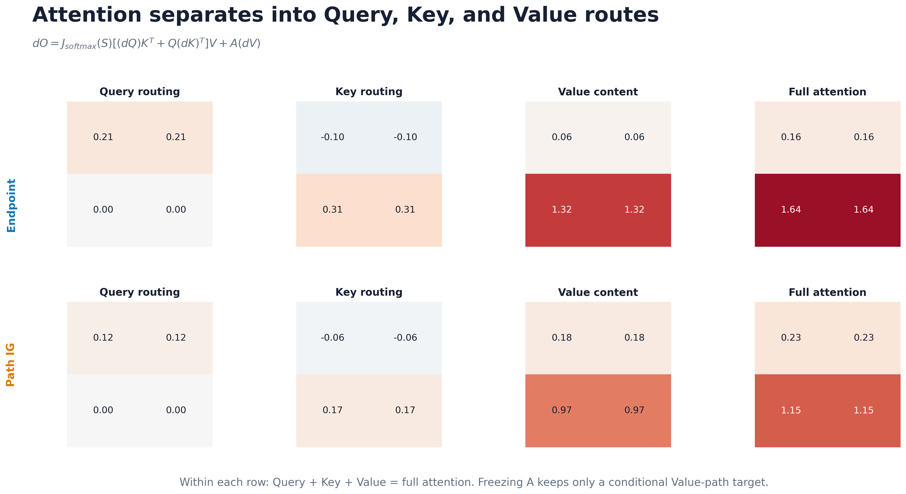

**Figure 5.** Query routing、Key routing 与 Value content 在各自归因规则内重构完整
attention contribution。Endpoint 在当前状态求值，Path IG 则沿指定路径积分相应路线。

### 3.4 Structured endpoint decomposition

对最终标量 $F$ 和切面成分 $z_k$，定义输入坐标成分图

$$
E^C_{k,i}=x_i\left\langle\nabla_{z_k}F(x),
\frac{\partial z_k(x)}{\partial x_i}\right\rangle.
$$

若 cut 包含所有从输入到目标的对应边且没有重复，则

$$
\sum_kE^C_{k,i}=x_i\frac{\partial F(x)}{\partial x_i}.
$$

我们登记六类切面：全 heads 重构 attention branch；identity 加 heads 重构第一个
residual total；Q+K+V 或 routing+Value 重构 attention branch；identity 加相应 differential
paths 重构 residual total；carry 加 MLP branch 重构第二个 residual total（Figure 10、15）。
Residual identity 必须按其真实输入边记账；遗漏一条非零 branch 或重复加入 bypass 都应被
闭合验证拒绝。

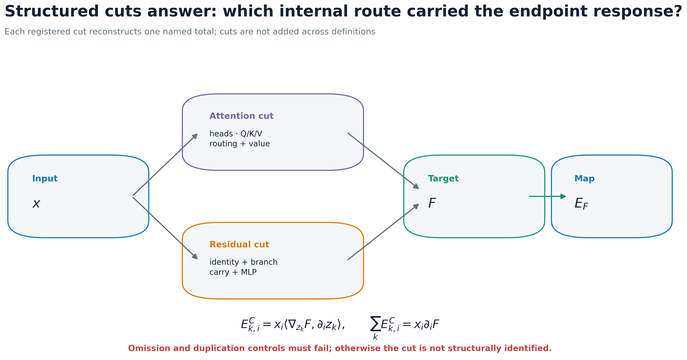

**Figure 10.** Structured cuts 在保持同一个下游 target 的前提下分开 attention routes 或
residual branches。有效切面必须让每条 input-to-target 路径恰好出现一次。

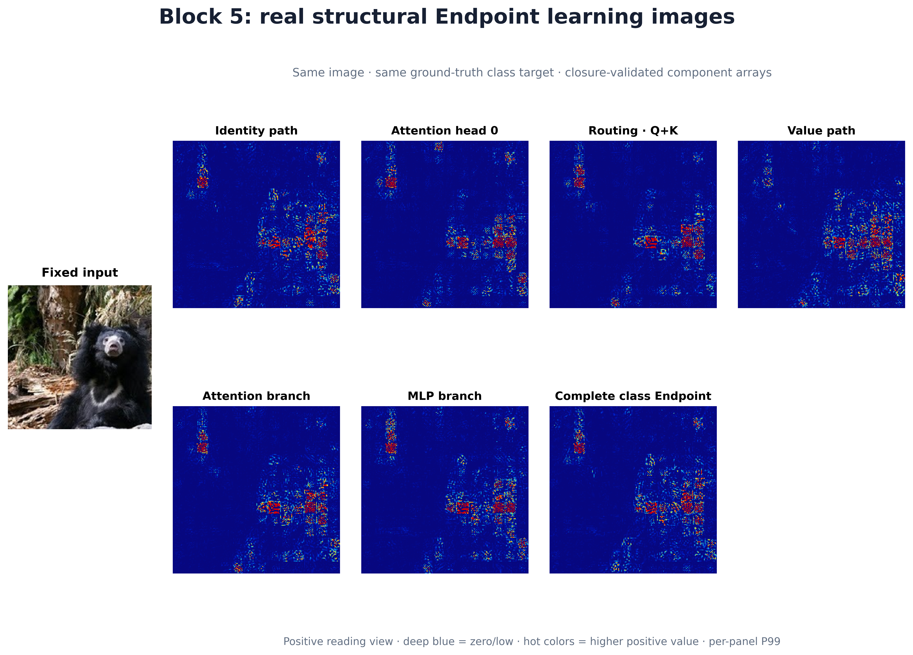

**Figure 35.** 同一图像、同一 ground-truth 类别目标与同一 block 5 的细粒度结构图。
Identity、head、routing、value、attention、MLP 和完整 Endpoint 使用与 Figure 17 相同的
结构切面，但改为展示样本 order 14 的已封存、通过闭合验证的 raw component arrays；
蓝底正部只是额外阅读视图，不改变 signed 科学口径。

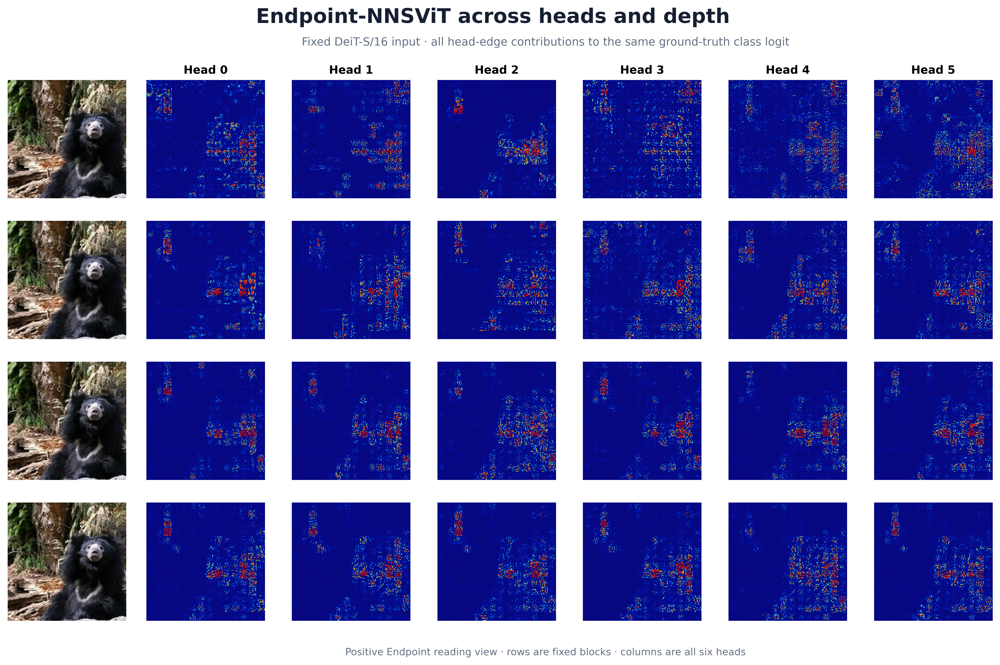

**Figure 38.** 固定 DeiT-S/16 输入，在 Block 0、1、5、11 展示全部六个 attention
head edges 对同一个 ground-truth class logit 的 Endpoint contribution map。行表示深度、列
表示 head index；所有格子来自 E3 已封存 raw component arrays，未按图像观感挑选 head。
逐面板缩放只允许比较
空间形态，不能直接比较跨 head 或跨层的绝对强度。

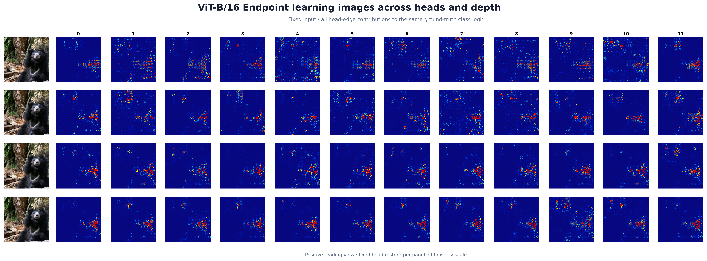

**Figure 39.** ViT-B/16 的对称版本，在四个代表深度展示全部十二个 heads，并保持相同
ground-truth class logit 作为共同下游目标。完整的
12 blocks × 12 heads 分层页保留在图包的 `supplement/all_heads/vit_b16/`，因此论文既有紧凑主图，
也有不省略 head 的补充材料。

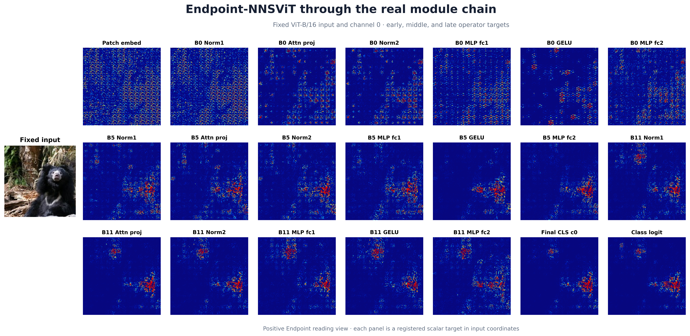

**Figure 40.** 对固定 ViT-B/16 输入和 channel 0，沿真实模块链展示 patch embedding、
Block 0/5/11 的 Norm1、attention projection、Norm2、MLP fc1、GELU、fc2，再到 final CLS
和类别 logit。该图对应 NNSViT-IG Figure 28–34 的模块阅读逻辑，但这里每格都是 Endpoint
注册标量的当前点 learning image。

### 3.5 局部正确性与有限 activation replacement

对每个成分图，定义 signed sum 和 absolute mass：

$$
a_k=\sum_iE^C_{k,i},\qquad m_k=\sum_i|E^C_{k,i}|.
$$

令 $v_k=J_{z_k,x}x$。解析局部合同为

$$
a_k=\langle\nabla_{z_k}F,v_k\rangle.
$$

它检查 hook、cotangent 和方向构造是否一致。有限效应通过同图 reference activation
replacement 定义：

$$
e_k=F(x)-F(x;z_k\leftarrow z_k^{\mathrm{ref}}).
$$

Reference 分为 normalized-zero 与 RGB blur。有限效应主量是每张图像内部
$\operatorname{Spearman}(m_k,|e_k|)$；head、routing/value 和 residual branches 分别形成
family。Activation-displacement Taylor

$$
p_k^{\mathrm{ref}}=\langle\nabla_{z_k}F,z_k(x)-z_k^{\mathrm{ref}}\rangle
$$

作为预注册次级 predictor 报告，但不进入 C4a 的支持门（Figure 19、22）。

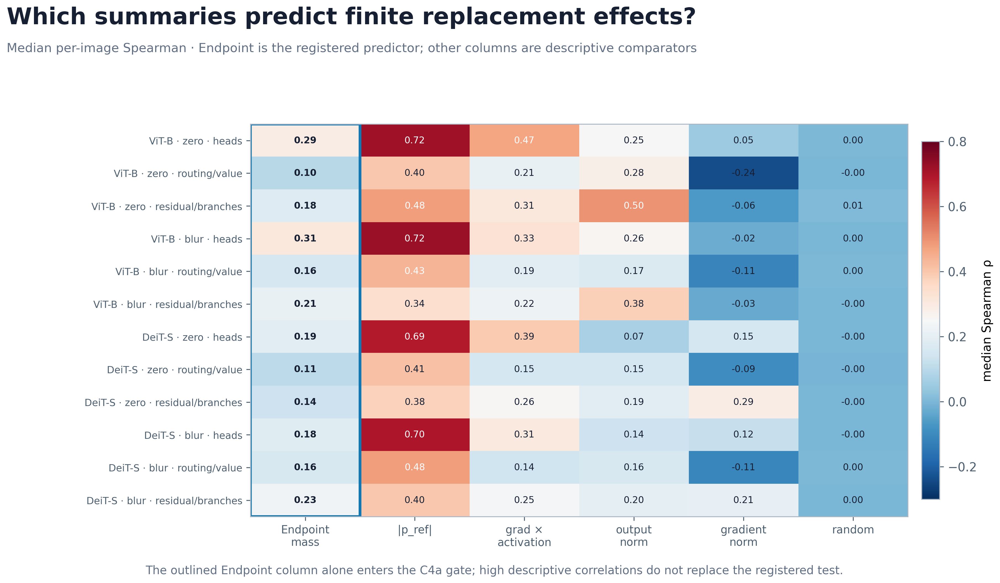

**Figure 22.** Endpoint mass 与预注册描述性 predictors 的逐图中位关联。只有蓝框中的
Endpoint 列进入 C4a；其余列帮助解释任务，但不替代注册检验。

### 3.6 空间定向干预

空间干预审计固定 block 5 的 head 0、中间 head 和最后一个 head。224×224 输入被划分为 4×4 个
不重叠的 56×56 区域；排序后选择前 1、2 或 4 个区域，对应 6.25%、12.5% 和 25% 面积。
Endpoint 区域分数为成分图的 RGB-level absolute mass。四个 mandatory baselines 是
total Endpoint/G×I、raw input gradient、regional activation-space Taylor 和 20 个冻结
随机区域排列（Figure 23）。

对同一 head 的候选区域并集 $R$，有限效果为

$$
F(x)-F\bigl(z_h(x_R),z_{-h}(x),\mathrm{identity}(x)\bigr),
$$

其中 $x_R$ 使用相应 reference 替换。每图先对三个 head 取平均，再计算 0–25% 面积上的
absolute isolated-effect trapezoidal AUC，并除以 0.25。所有方法共享候选区域池、面积预算和
有限效应定义。

### 3.7 分层 token-channel 审计

M3 通过 metadata-only hash 规则冻结 100 张共享图像。每个 block 选择 CLS token、15 个
固定空间分层 patch tokens 和 32 个独立 hash channels，因此每个 model-image 有
$12\times16\times32=6{,}144$ 个 post-block 标量单元，覆盖 ViT-B/16 post-block
token-channel 坐标的 0.338% 和 DeiT-S 的 0.677%。每个 Endpoint 流式化为 signed/absolute
mass、positive/negative mass、L2 norm、196 维 patch signed/absolute 向量、normalized
entropy、own-token locality、normalized input distance 和 signed cancellation。Zero-mass
map 的未定义比率记为 NA，不加入 epsilon。

统计前先在每张图、每个 block 内跨冻结单元聚合。CLS-patch 对比在每张图、每个 block
内分别聚合 32 个 CLS channels 和 $15\times32$ 个 patch-token channels，再计算配对差；
phase 汇总对四个 block-level 配对差取中位数。所有推断的统计单位均为图像。

## 4. 实验设计

### 4.1 模型、数据与预处理

实验使用 `vit_base_patch16_224.augreg2_in21k_ft_in1k` 和
`deit_small_patch16_224.fb_in1k`。两者均有 12 个 blocks；ViT-B/16 有 12 heads 和 768
维表示，DeiT-S/16 有 6 heads 和 384 维表示。共同输入来自 ImageNet validation，按冻结
元数据规则构造 64/64/400 张 discovery、calibration 和 evaluation 集合；集合间图像和类别
互斥，两个模型共享全部 400 个 evaluation ID。图像短边 resize 到 248，使用 bicubic
antialias，再 center crop 到 224；两模型使用各自冻结的 mean/std。

生产环境为 Torch 2.2.2+cu121、timm 0.9.16、torchvision 0.17.2+cu121、NumPy
1.26.4 和 Pillow 10.2.0。模型在 eval 模式运行，dropout 和 drop path 关闭；canonical
结构实验禁用 fused attention。模型文件、图像成员、目标表、任务 payload 和结果文件均以
SHA-256 绑定。

**Table 1. 模型、预处理与注册目标。**

| 项目 | ViT-B/16 | DeiT-S/16 |
|---|---:|---:|
| timm 模型 | `vit_base_patch16_224.augreg2_in21k_ft_in1k` | `deit_small_patch16_224.fb_in1k` |
| Blocks / heads / hidden dim | 12 / 12 / 768 | 12 / 6 / 384 |
| 注册目标数/图 | 457 | 385 |
| Evaluation images | 400 | 400（相同 ID） |
| Resize / crop | 短边 248 / center crop 224 | 短边 248 / center crop 224 |
| Normalization mean | [0.5, 0.5, 0.5] | [0.485, 0.456, 0.406] |
| Normalization std | [0.5, 0.5, 0.5] | [0.229, 0.224, 0.225] |

**Table 6. 原 registry 的实际覆盖率。** B=12，T=197（CLS + 196 patches），D=768/384，head width=64。候选总体按表中对象定义；module aggregate 总体固定为 blocks 0/5/11 的六个模块，每层四个 D 宽度模块和两个 4D 宽度模块。

| Model | Object | Candidate definition | Candidates | Registered/image | Coverage | Strategy | Scalar neuron |
|---|---|---|---:|---:|---:|---|---|
| vit_b16 | post-block token-channel | 12*197*D | 1,815,552 | 192 | 0.01058% | 12 blocks x 4 tokens x 4 channels | yes |
| vit_b16 | post-block patch sum/energy | 2*12*D | 18,432 | 96 | 0.52083% | 12 blocks x 4 channels x 2 aggregates | no |
| vit_b16 | attention-head coordinate | 12*H*197*64 | 1,815,552 | 144 | 0.00793% | all heads; CLS token; within-head channel 0 | yes |
| vit_b16 | module patch aggregate | 3*(4D+2*4D) | 27,648 | 18 | 0.06510% | blocks 0/5/11; six modules; channel 0 | no |
| vit_b16 | patch embedding aggregate | D | 768 | 4 | 0.52083% | four fixed channels; sum over patches | no |
| vit_b16 | final CLS coordinate | D | 768 | 1 | 0.13021% | channel 0 | yes |
| vit_b16 | ground-truth logit | 1000 | 1,000 | 1 | 0.10000% | frozen image label | output |
| vit_b16 | clean-top1 logit | 1000 | 1,000 | 1 | 0.10000% | frozen clean prediction | output |
| deit_s16 | post-block token-channel | 12*197*D | 907,776 | 192 | 0.02115% | 12 blocks x 4 tokens x 4 channels | yes |
| deit_s16 | post-block patch sum/energy | 2*12*D | 9,216 | 96 | 1.04167% | 12 blocks x 4 channels x 2 aggregates | no |
| deit_s16 | attention-head coordinate | 12*H*197*64 | 907,776 | 72 | 0.00793% | all heads; CLS token; within-head channel 0 | yes |
| deit_s16 | module patch aggregate | 3*(4D+2*4D) | 13,824 | 18 | 0.13021% | blocks 0/5/11; six modules; channel 0 | no |
| deit_s16 | patch embedding aggregate | D | 384 | 4 | 1.04167% | four fixed channels; sum over patches | no |
| deit_s16 | final CLS coordinate | D | 384 | 1 | 0.26042% | channel 0 | yes |
| deit_s16 | ground-truth logit | 1000 | 1,000 | 1 | 0.10000% | frozen image label | output |
| deit_s16 | clean-top1 logit | 1000 | 1,000 | 1 | 0.10000% | frozen clean prediction | output |

“完整扫描”仅指 registry-complete，即所有预注册条目均执行；post-block 坐标只覆盖 0.01058%/0.02115%，并非全部 ViT 神经元。head coordinate 是 CLS 的单一 head-channel 坐标，不代表该 head 全部 token-channel 坐标。ground-truth 与 clean-top1 是两个注册条目，在预测正确时对应相同 logit；条目数不等于不同标量函数数。Endpoint 是 normalized-input Gradient × Input；结构记账分解局部 Jacobian，不是函数值的因果分解。

### 4.2 确认性统计

统计计划在读取 evaluation outcomes 前冻结 16 个 family 和 28 个 test IDs。C4a 由
2 模型 × 2 references × 3 成分族形成 12 个 family；主统计量为 400 张图的逐图 Spearman
中位数，实际效应阈值为 0.10。C4b 由 2 模型 × 2 references 形成 4 个 family；每个
family 必须相对四个 mandatory baselines 的图像级配对中位差均至少为 0.05。

每个 family 使用 10,000 次 paired image-cluster percentile bootstrap 构造 95% CI。每个
test 使用双侧精确符号检验，28 个 test IDs 统一进行 Holm 校正，$\alpha=0.05$。每个
family 至少需要 360 张共同有效图，符号检验至少需要 300 个非零图像差；CI 最大宽度分别
为 C4a 的 0.30 和 C4b 的 0.50。统计单位始终是图像，不把 head、block、reference 或
随机排列当作独立样本。

### 4.3 验证与可复现性

各阶段使用不可变结果根、精确覆盖审计和独立验证器。结构闭合同时包含必须通过的正例和
必须失败的遗漏/重复负例。统计验证器不导入 Torch、timm 或 PIL，而是从封存的逐任务
结果重算逐图量、bootstrap、sign tests、Holm 调整和 family decisions。论文图包由 CPU-only
renderer 从封存数字和原始展示数组生成；显示归一化图不用于数值推断。

M3 还在 FCN、CNN、CNN-MaxPool、residual-MLP 和 residual-CNN 上比较显式逐层 NNS
propagation 与 autograd Endpoint，每种网络和精度使用 100 个输入。所得 5,000 个 target
comparisons 是数值验证案例，不作为独立统计样本。11 类 ViT 算子各接受 8 个 float64
方向检查，同时比较解析 Jacobian-vector product、autograd JVP/VJP 对偶和 9 个中心有限
差分步长。Atlas 报告图像级中位数和 10,000 次 bootstrap 区间；每模型 5 个冻结检验使用
双侧精确符号检验和模型内 Holm family。

## 5. 结果

### 5.1 RQ2：注册目标扫描完整且在资源上可执行

两个模型的 800/800 个 image-model tasks 均唯一完成，无缺失、重复、无效结果或正式重试。
ViT-B/16 每图的 457 个目标和 DeiT-S/16 每图的 385 个目标形成 336,800/336,800 个有限
target evaluations。所有图像保留 ground-truth 与 clean-top1 raw signed RGB class maps，
前 16 个 evaluation ID × 两模型保留 32 份 full raw atlas；未出现 near-zero 或失败索引。
Figure 12 与 Figure 13 使用预先保留的 evaluation order 14，即 class 297 的懒熊样本，
分别比较两个模型对同一 ground-truth class logit 的 Endpoint，并展示 DeiT-S/16 的六个
预注册目标。Figure 34 保留来自同一封存数组的扩展六目标阅读页。

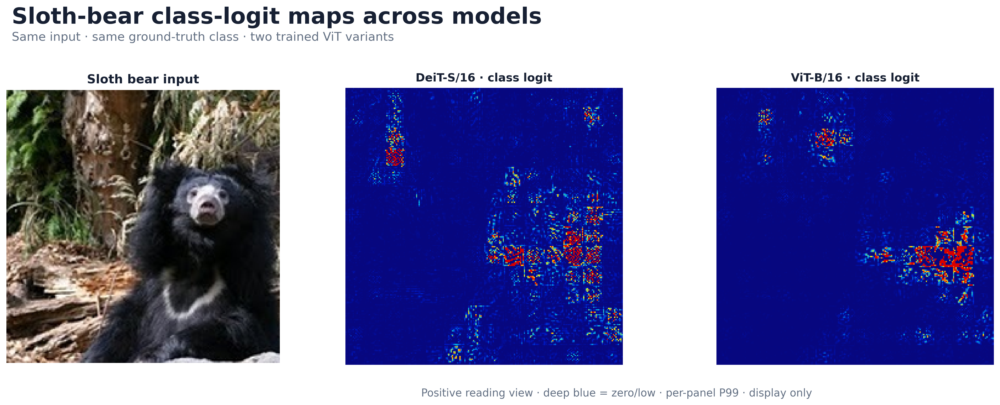

**Figure 12.** 同一张预留懒熊输入与同一个 ground-truth class-logit target 在 DeiT-S/16
和 ViT-B/16 中的 Endpoint。蓝底面板分别按 P99 显示 $\max(L,0)$；这里只比较空间形态，
不比较跨模型绝对强度，完整 signed companion 保留在 supplement。

正式扫描 wall time 为 1,752.71 s，按四卡同时占用的保守上界为 1.9475 GPU-hours。峰值
reserved GPU memory 为 2.284 GB，峰值 CPU RSS 为 2.018 GB，retained data 为 9.290 GB。
正式吞吐为 192.16 targets/s 和 0.4564 images/s。完整 atlas 的 median/P95/max latency 在
DeiT-S/16 上为 7.853/8.015/8.240 s，在 ViT-B/16 上为 9.485/9.751/10.615 s
（Figure 14）。这些结果支持 RQ2：注册目标表可以在固定模型和 cohort 上完整执行并形成
可核对的 atlas。

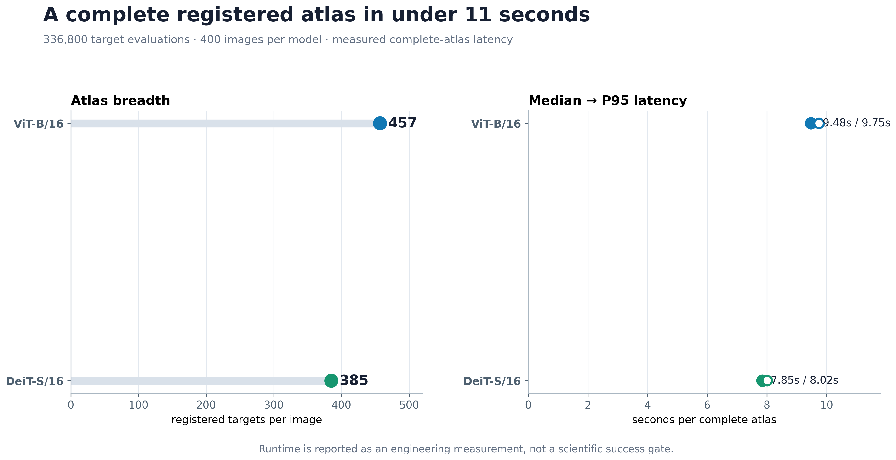

**Figure 14.** Registry 宽度与实测完整-atlas latency。实心点为 median，空心点为 P95；
运行时间是工程测量，不是科学成功门槛。

**Table 2. RQ2 注册扫描覆盖与资源。**

| 指标 | 结果 |
|---|---:|
| Image-model tasks | 800/800 |
| Finite target evaluations | 336,800/336,800 |
| Formal wall time | 1,752.71 s |
| Four-card upper-bound GPU-hours | 1.9475 |
| Formal throughput | 192.16 targets/s |
| Peak reserved GPU memory | 2.284 GB |
| Peak CPU RSS | 2.018 GB |
| Retained data | 9.290 GB |

### 5.2 RQ3：结构切面在正例和负例上均满足合同

正式闭合实验覆盖 400 张图、两个模型、全部 12 个 blocks 和每个 block 的 8 个注册 cuts，
共 76,800 个正向检查。全部检查均满足 float32 合同
`atol=1e-5, rtol=1e-4`；最大 relative L2 为
$1.4144569831842091\times10^{-5}$，最大 absolute error 为
$2.47955322265625\times10^{-5}$。由于 elementwise 合同为
$|\mathrm{error}|\leq\mathrm{atol}+\mathrm{rtol}|\mathrm{reference}|$，后一个数值本身不构成
违约。

每个 block 还执行三个 checker 负例，故意遗漏非零 head/routing 或重复 residual，共
28,800 项；这些负例全部按预期被拒绝（Figure 16）。前 16 个 evaluation ID 的 384 个 raw
block arrays 又由 CPU-only validator 从 component maps 独立重算。RQ3 因此得到支持：在
注册 cut 与两个标准 timm ViT 范围内，结构成分能够重构对应 attention branch 或 residual
total，checker 也能识别典型漏项和重复记账。

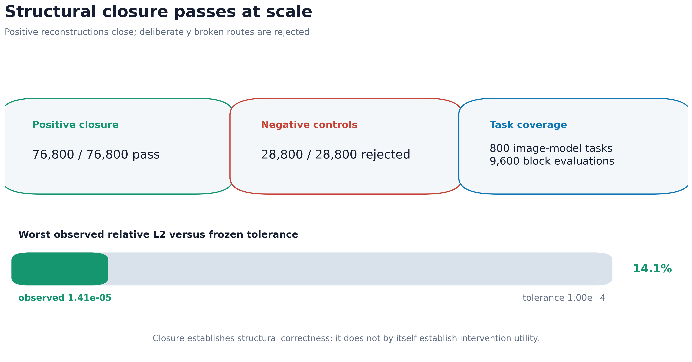

**Figure 16.** 76,800 个正向闭合检查全部通过，28,800 个故意破坏的 controls 全部被
拒绝；最坏 relative-L2 closure error 使用了冻结容差的 14.1%。

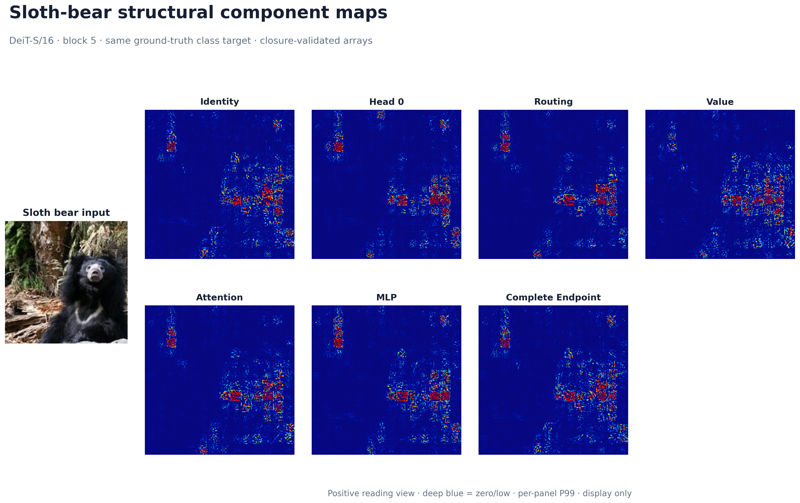

**Figure 17.** 预留懒熊输入、同一 ground-truth class target 下通过闭合验证的 block-5
结构成分。主面板采用蓝底正部阅读视图；完整 signed maps 保留在 `supplement/signed/`。

### 5.3 局部微分实现通过独立方向检查

解析局部合同进一步检查成分图的 signed sum 是否等于相同 hook 和 cotangent 下的 JVP
方向量。两个模型前 16 个 evaluation order 上的 6,144 个 condition-scaled analytic JVP
checks 全部通过（Figure 18）。最大 absolute error 为
$2.648076753197781\times10^{-5}$；最大
`error/sum_abs_products` 为 $6.948755071487438\times10^{-6}$，低于预先冻结的
$10^{-5}+10^{-5}\sum_i|g_i(Jx)_i|$ 边界。该结果验证局部微分实现，不替代下一节的
finite replacement 评价。

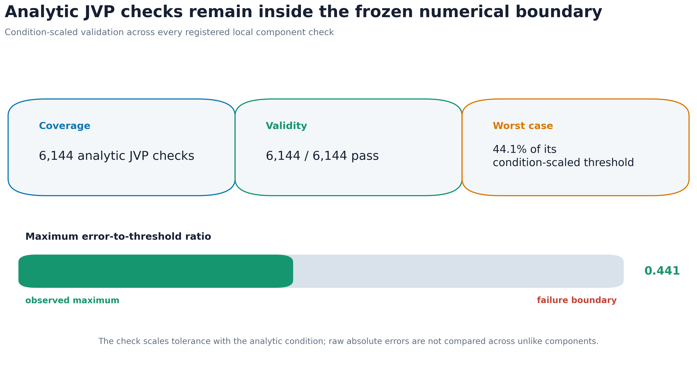

**Figure 18.** 6,144 个 analytic JVP checks 的覆盖、通过数和最坏 error-to-threshold ratio；
最大比例为 0.441，仍位于 condition-scaled failure boundary 内。

**Table 3. RQ3 结构闭合与局部微分检查。**

| 检查 | 数量 | 结果 | 最大误差 |
|---|---:|---|---:|
| Registered positive closures | 76,800 | 全部通过 | relative L2 = 1.41446e-05 |
| Omission/double-counting controls | 28,800 | 全部按预期拒绝 | 不适用 |
| Condition-scaled analytic JVP | 6,144 | 全部通过 | absolute = 2.64808e-05 |
| JVP condition-scaled ratio | 6,144 | 全部通过 | 6.94876e-06 |

### 5.4 行为标定：广泛但非普遍的成分级有限效应关联

RQ5 的行为标定比较每图的 Endpoint component absolute mass $m_k$ 与同一成分有限 replacement
effect 的绝对值 $|e_k|$。12 个预注册 family 中，11 个满足点估计至少 0.10、正方向、
Holm 显著、覆盖和 CI 精度的全部条件（Figure 20）。各 family 中位 Spearman 相关介于
0.099565 与 0.306320。Head family 在 ViT-B/16 上为 0.290853（normalized-zero）和
0.306320（blur），在 DeiT-S/16 上为 0.190961 和 0.181668。Residual-branch family 的
四个估计为 0.177391、0.209130、0.135217 和 0.228696。

唯一未达到全部条件的是 ViT-B/16 × normalized-zero × routing/value。其点估计为
0.09956521739130435，95% CI 为 [0.07478260869565218, 0.12260869565217392]，Holm
校正 $p=3.0036026037128944\times10^{-14}$。该点估计接近预注册的 0.10 门槛，
但其置信区间覆盖门槛上下，不能确认达到预设实际效应水平（Figure 21）。

**成分级关联在 family level 上表现出广泛但非普遍的支持，而预注册的 all-family omnibus
标准未得到支持。** C4a 保持 `NOT_SUPPORTED`。11/12 family 满足全部条件，未通过
family 的相关仍显著为正；原 C4a 检验绝对排序关联，基线增量由补充 M1 单独评价。

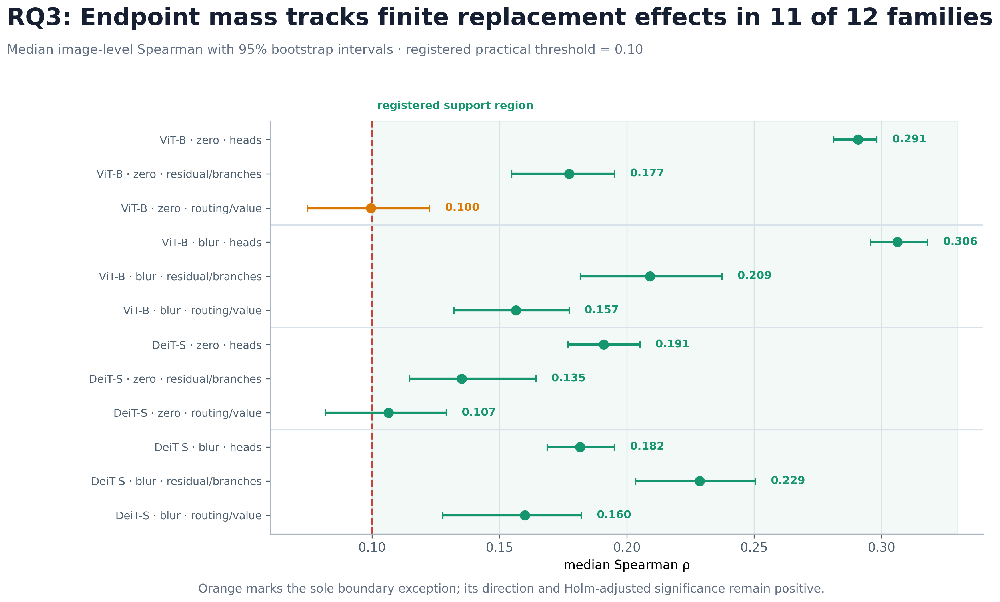

**Figure 20.** 十二个 C4a family 的点估计与 95% 图像 bootstrap 区间。阴影区从预注册
0.10 实际效应门槛开始；橙色表示唯一未满足全部支持条件的 family。

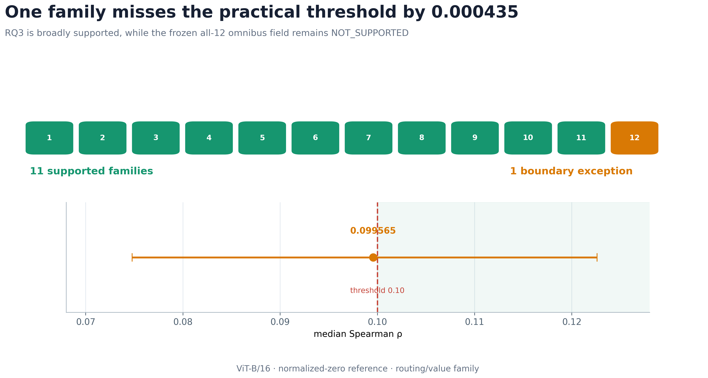

**Figure 21.** 十一个 family 满足全部条件。剩余 ViT-B/16 normalized-zero routing/value
family 的点估计为 0.099565；其正相关通过 Holm 校正，但置信区间跨越实际效应门槛。

**Table 4. RQ5 行为标定的 12 个 C4a family。** 每项 $n=400$；$p$ 为全 28 项 Holm 校正值。

| 模型 | Reference | 成分族 | 中位 Spearman | 95% CI | Holm $p$ | Family 状态 |
|---|---|---|---:|---:|---:|---|
| ViT-B/16 | normalized-zero | heads | 0.2909 | [0.2813, 0.2982] | 2.17e-119 | SUPPORTED |
| ViT-B/16 | normalized-zero | routing/value | 0.0996 | [0.0748, 0.1226] | 3.00e-14 | NOT_SUPPORTED |
| ViT-B/16 | normalized-zero | residual branches | 0.1774 | [0.1548, 0.1952] | 2.56e-46 | SUPPORTED |
| ViT-B/16 | blur | heads | 0.3063 | [0.2957, 0.3181] | 2.17e-119 | SUPPORTED |
| ViT-B/16 | blur | routing/value | 0.1565 | [0.1322, 0.1774] | 9.96e-29 | SUPPORTED |
| ViT-B/16 | blur | residual branches | 0.2091 | [0.1817, 0.2374] | 1.46e-41 | SUPPORTED |
| DeiT-S/16 | normalized-zero | heads | 0.1910 | [0.1769, 0.2052] | 1.88e-76 | SUPPORTED |
| DeiT-S/16 | normalized-zero | routing/value | 0.1065 | [0.0817, 0.1291] | 2.11e-10 | SUPPORTED |
| DeiT-S/16 | normalized-zero | residual branches | 0.1352 | [0.1148, 0.1643] | 4.35e-19 | SUPPORTED |
| DeiT-S/16 | blur | heads | 0.1817 | [0.1688, 0.1951] | 3.82e-72 | SUPPORTED |
| DeiT-S/16 | blur | routing/value | 0.1600 | [0.1278, 0.1822] | 9.90e-31 | SUPPORTED |
| DeiT-S/16 | blur | residual branches | 0.2287 | [0.2035, 0.2504] | 3.70e-54 | SUPPORTED |

### 5.5 行为边界：完整输入分辨 component map 未提供注册的空间增益

RQ5 的空间部分要求每个模型—reference family 同时相对 total G×I、raw gradient、regional Taylor
和随机区域取得至少 0.05 的配对中位增益。四个 family 均未满足该联合条件（Figure 26）。
Endpoint 相对随机区域的中位增益均为正，分别为 0.001069、0.004212、0.010689 和
0.008460，但均远低于冻结的 0.05 阈值。相对 total G×I 与 raw gradient 的差值接近零，
方向混合。

Regional Taylor 在全部四个 family 中得到更高的中位效果。Endpoint−regional Taylor
分别为 −0.023433、−0.023697、−0.029900 和 −0.035630，bootstrap intervals 也全部位于
零以下（Figure 27）。真实 block-5 component maps 与 baseline maps 见 Figure 24；这些图
展示空间形态，但统计结论来自 raw arrays 和有限干预曲线。注册空间效用判定因此为
`NOT_SUPPORTED`：在本研究固定的 head、区域池、面积预算、reference 和效果指标下，
完整输入分辨 component map 没有显示超越四个 mandatory baselines 的联合信息增益。

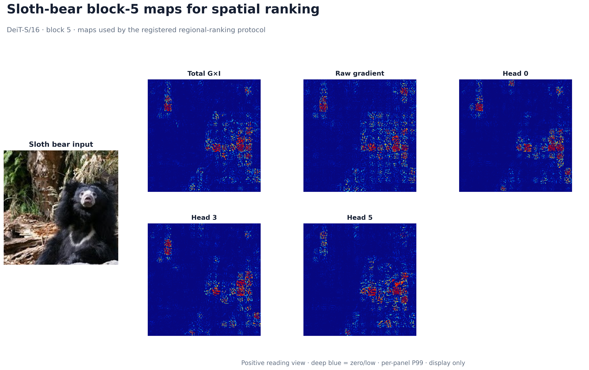

**Figure 24.** 预留懒熊空间排序任务的 total G×I、raw gradient 与三个 block-5 head
component maps。蓝底主面板使用独立 P99 显示正部空间形态；完整 signed maps 留在补充材料。

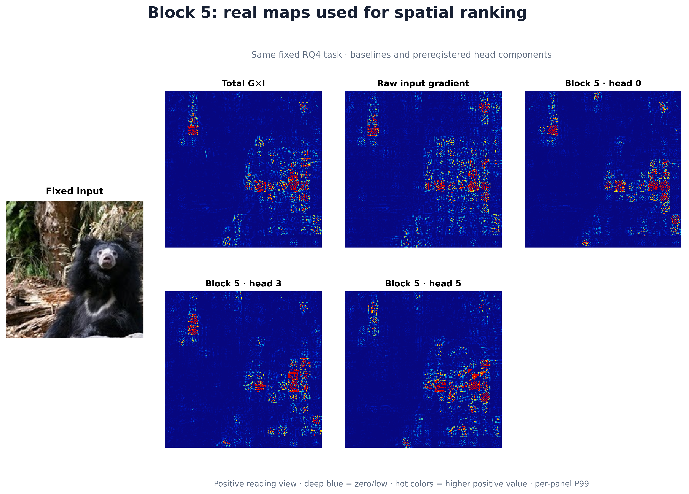

**Figure 36.** 同一预留样本和同一空间排序 map 定义的蓝底细粒度阅读页。该图显示区域
排序的输入；行为比较仍使用封存 raw arrays 与有限效应曲线。

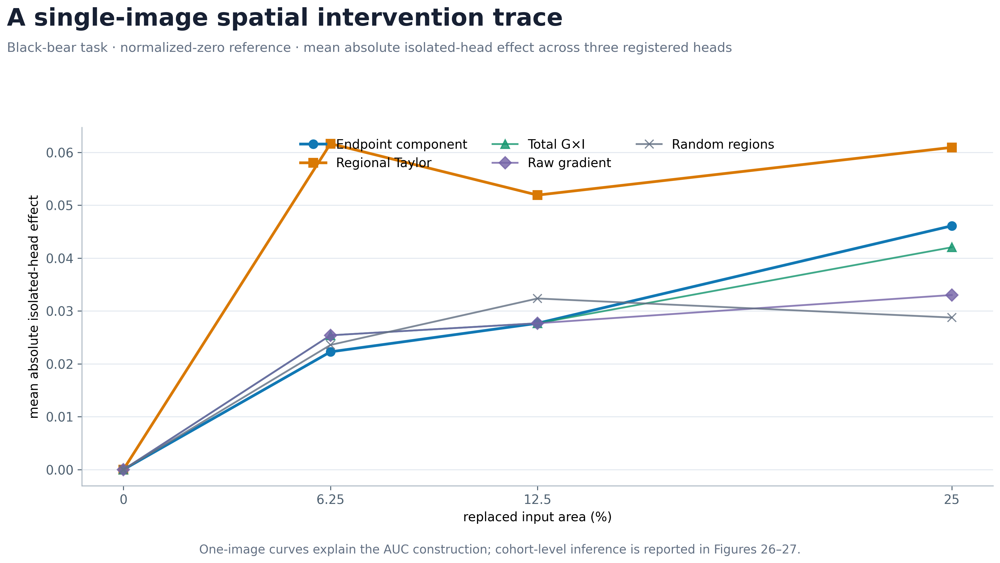

**Figure 25.** 同一预留懒熊任务在 normalized-zero reference 下的单图干预曲线。该页
说明固定 0–25% 区域 AUC 的形成方式；确认性结论仍来自完整 cohort 的图像级聚合。

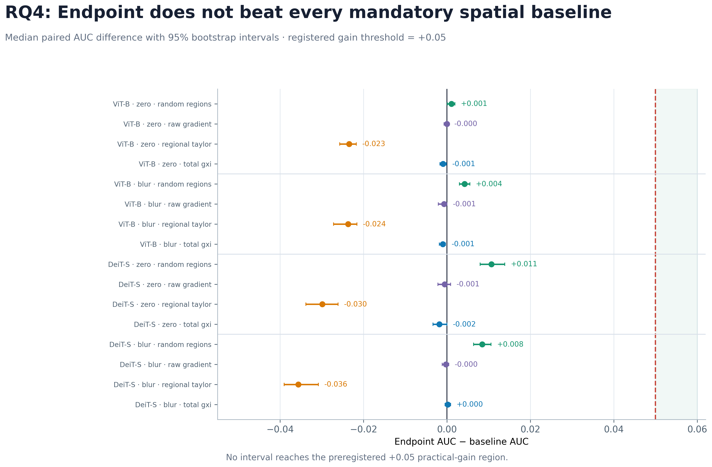

**Figure 26.** 相对四个 mandatory baselines 的全部 16 个配对 contrasts。黑线表示相等，
红色虚线表示预注册 +0.05 增益门槛；没有区间进入阴影支持区域。

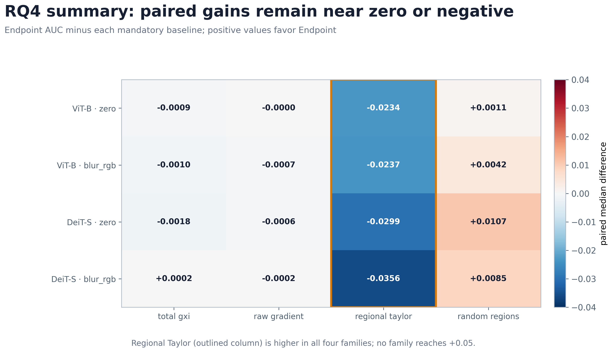

**Figure 27.** Endpoint-minus-baseline 中位 AUC 差的紧凑 family-level 汇总。橙框中的
regional-Taylor 列在四个 family 中均为负；相对 random 的正差也远低于 +0.05。

**Table 5. RQ5 空间标定的 C4b 图像级配对中位差。** 数值为 Endpoint 减 baseline；每个 family
需四列同时至少为 +0.05 才能支持。

| 模型 | Reference | vs total G×I | vs raw gradient | vs regional Taylor | vs random | Family 状态 |
|---|---|---:|---:|---:|---:|---|
| ViT-B/16 | normalized-zero | −0.0009 | −0.0000 | −0.0234 | 0.0011 | NOT_SUPPORTED |
| ViT-B/16 | blur | −0.0010 | −0.0007 | −0.0237 | 0.0042 | NOT_SUPPORTED |
| DeiT-S/16 | normalized-zero | −0.0018 | −0.0006 | −0.0299 | 0.0107 | NOT_SUPPORTED |
| DeiT-S/16 | blur | 0.0002 | −0.0002 | −0.0356 | 0.0085 | NOT_SUPPORTED |

<!-- M1_SUPPLEMENT_START -->
### 5.6 M1：强基线与分层排序（补充冻结实验）

M1在原研究之后冻结，采用同一400图、两模型、12层、两种reference和ground-truth logit。
七种predictor共享成分定义：Endpoint mass、activation norm、gradient norm、absolute
activation×gradient、displacement norm、absolute activation-space Taylor和random。
head、routing、value/V、Q、K及两类residual均覆盖400图，value/V为同一edge别名。
每集合1,000次random permutation，共128,000,000次；image bootstrap为10,000次、95% CI。
主Spearman配对检验统一Holm，median rho>0与>0.10分别检验。

**Table 7. M1同层head排序。** 每图先平均12层指标，再对400图取中位数。

| Model | Reference | Endpoint rho | Taylor rho | Endpoint Capture@1 | Taylor Capture@1 | Endpoint Capture@3 | Taylor Capture@3 | Endpoint Regret@1 | Taylor Regret@1 |
|---|---|---:|---:|---:|---:|---:|---:|---:|---:|
| vit_b16 | normalized_zero | 0.2815 | 0.6742 | 0.5174 | 0.8038 | 0.6149 | 0.8567 | 0.1701 | 0.0571 |
| vit_b16 | blur_rgb | 0.2727 | 0.6856 | 0.5075 | 0.8203 | 0.6185 | 0.8659 | 0.1163 | 0.0346 |
| deit_s16 | normalized_zero | 0.1952 | 0.6095 | 0.5609 | 0.8028 | 0.7122 | 0.8894 | 0.2381 | 0.0860 |
| deit_s16 | blur_rgb | 0.1476 | 0.6238 | 0.5506 | 0.8426 | 0.7105 | 0.8970 | 0.1326 | 0.0443 |

Taylor在四个组合中均取得更高Spearman和Capture、更低Regret。跨层residual identity的
Endpoint−Taylor Spearman配对中位差为0.0865–0.4209，均通过统一Holm；对应Capture@1
差值中位数均为0。增量价值依赖成分与指标。QKV三项和residual两项使用pairwise/top1，
Spearman记为NA。pooled先合并同图像两模型，仅为描述性补充。完整分层表、CI、随机提升
与复算来源见docs/endpoint_m1_results_20260918.md及M1结果根。原C4a保持NOT_SUPPORTED。
<!-- M1_SUPPLEMENT_END -->

### 5.7 RQ1/RQ4：NNS 忠实性与层深相关空间扩展

显式逐层 NNS propagation 与 Endpoint 的 5,000 个 target comparisons 全部满足对应精度
合同。总体 relative-L2 的中位数、99% 分位和最大值分别为
$1.088\times10^{-16}$、$1.602\times10^{-7}$ 和 $2.427\times10^{-7}$；float64 最大值为
$4.769\times10^{-16}$，float32 99% 分位为 $1.782\times10^{-7}$。88 个算子—方向记录
全部通过；最大 analytic-autograd JVP 误差、JVP-VJP 对偶误差和最坏最优步长有限差分误差
分别为 $3.431\times10^{-16}$、$2.344\times10^{-14}$ 和
$1.632\times10^{-10}$（Figure 32）。

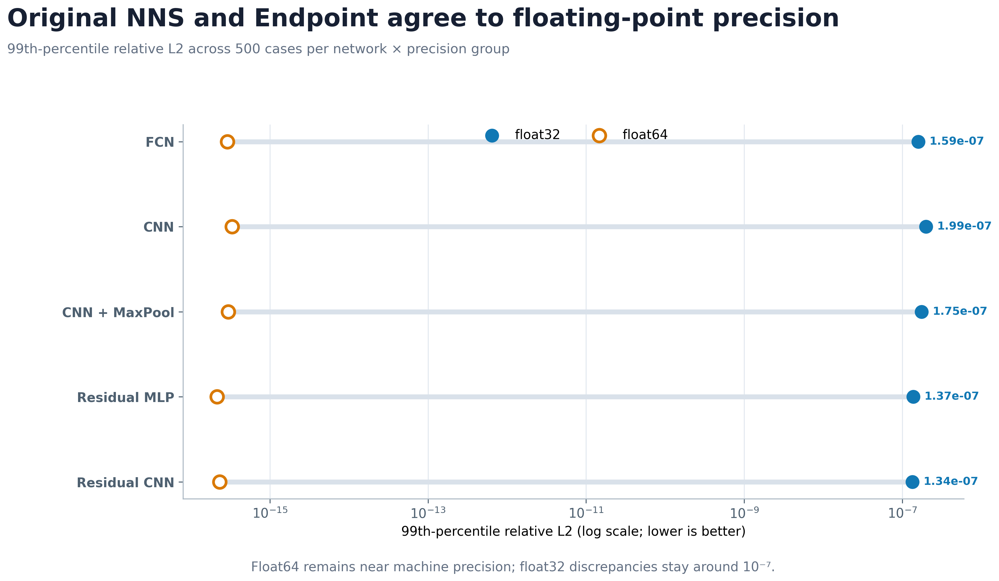

**Figure 32.** 在五类兼容网络上直接比较显式原始 NNS propagation 与 Endpoint。
Float64 保持在机器精度附近，float32 差异约为 $10^{-7}$。

200 个 image-model tasks 产生 1,228,800 个冻结 token-channel Endpoint 记录。两个模型的
全部图像级 late-minus-early 对比都呈现注册方向：ViT-B/16 与 DeiT-S 的 entropy 分别增加
0.2201/0.2250，locality 分别下降 0.3558/0.3424，normalized distance 分别增加
0.1312/0.1219。每个对比在 100/100 张图上的方向相同，并通过各自模型的 5 项 Holm
family。完整轨迹显示 entropy 的主要增长发生在 early/middle blocks，而 locality 持续下降、
distance 一直增加至 block 11（Figure 29）。该结果支持冻结抽样单元中**局部一阶输入依赖
的空间扩展**，不要求 map 达到均匀全图状态，也不等价于获得全局语义。

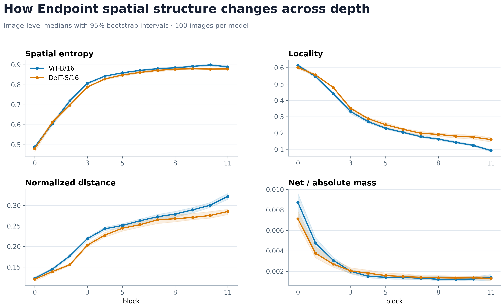

**Figure 29.** Entropy、locality、normalized input distance 与 net-to-absolute mass 的层深
轨迹；阴影是冻结 100 图样本上的图像 bootstrap 95% 区间。

两个模型的每个 block 中，CLS-unit entropy 都高于 patch-unit entropy（Figure 30）。
Block-level 配对差从 block 0 的 0.4752/0.4712 收窄至 block 11 的 0.0086/0.0238。采用
block-first 聚合后，ViT-B/16 的 early/middle/late 图像级差值为 0.3082/0.0592/0.0283，
DeiT-S 为 0.3084/0.0874/0.0406。这些描述性数值恢复了 CLS 输入依赖更分散的已知架构
属性，但 entropy 不是因果信息整合量。

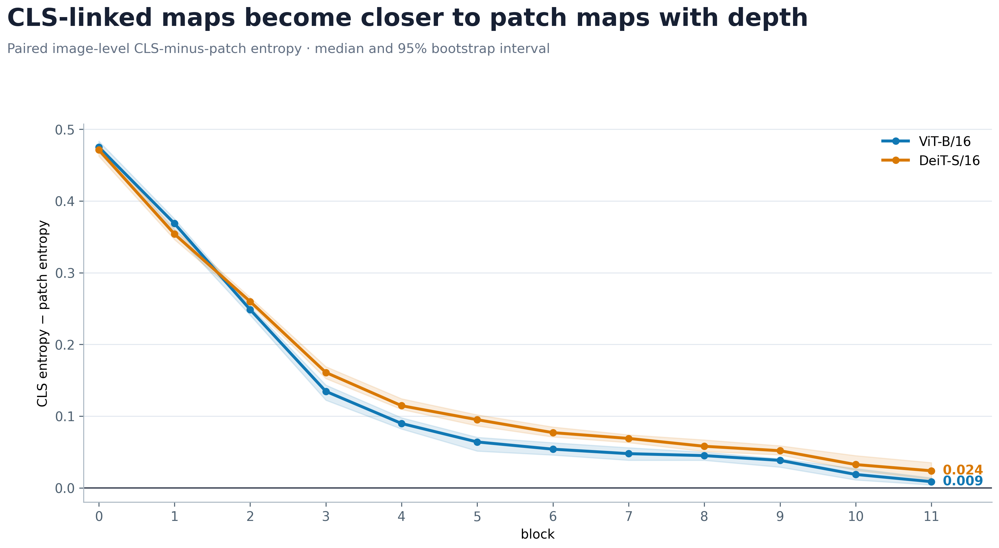

**Figure 30.** 各 block 的 CLS-minus-patch entropy 配对差。两个模型的正差都随深度
缩小，但在 block 11 仍高于零。

由于 signed cancellation 接近饱和，我们同时报告
$R_{\mathrm{net}}=|\sum_iE_i|/\sum_i|E_i|$。从 block 0 到 block 11，全部抽样单元的
图像级 $R_{\mathrm{net}}$ 中位数在 ViT-B/16 中从 0.00872 降至 0.00144，在 DeiT-S
中从 0.00712 降至 0.00132。120 张 raw map 子集进一步区分 RGB 通道内、RGB 聚合后
patch 内和 signed patch totals 之间的抵消（Figure 31）；嵌套生存率恒等式误差低于
$6.94\times10^{-18}$。同一 24 个 map 的 float64 重算使任一 cancellation 指标最多变化
$1.84\times10^{-6}$。Absolute mass 因而衡量局部一阶项的总幅值，而不是净方向效应。

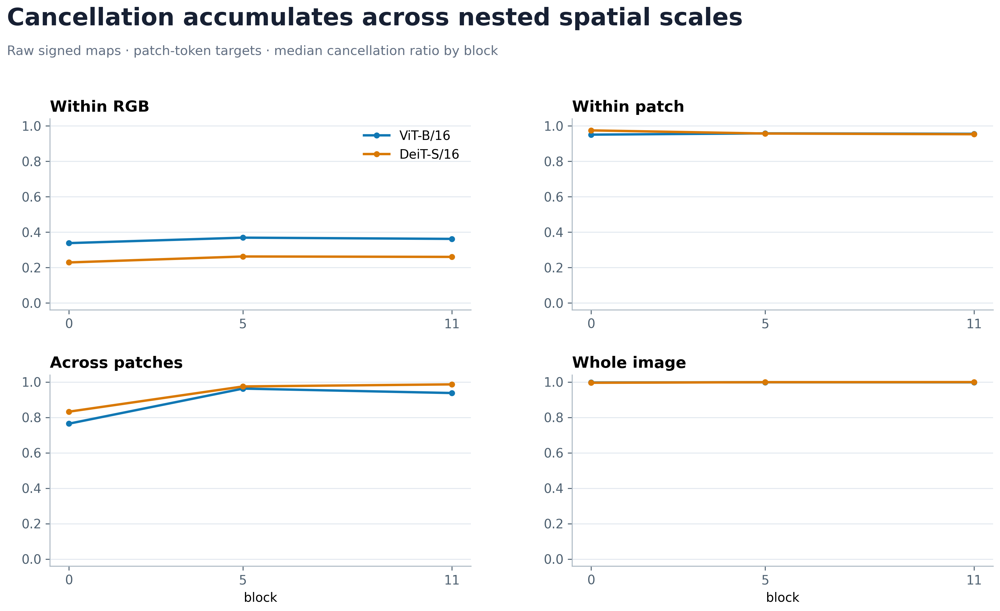

**Figure 31.** RGB channel 内、patch 内、signed patch totals 间以及全图尺度的
cancellation ratio。所有面板共用模型配色和对齐的 block anchors。

冻结 float32 方向检查在 57,600 项中保留 36 项失败（0.0625%），均来自 blocks 7-11 的
第一个抽样 patch token。Float32 误差随所测步长减小而增大；同一坐标的 float64 曲线先
下降后因舍入误差回升（Figure 33），36 个 float64 对照全部通过。由于目标是 post-block
token-channel，现有证据不能把这些失败唯一归因到 LayerNorm、softmax 或其他单个上游算子。

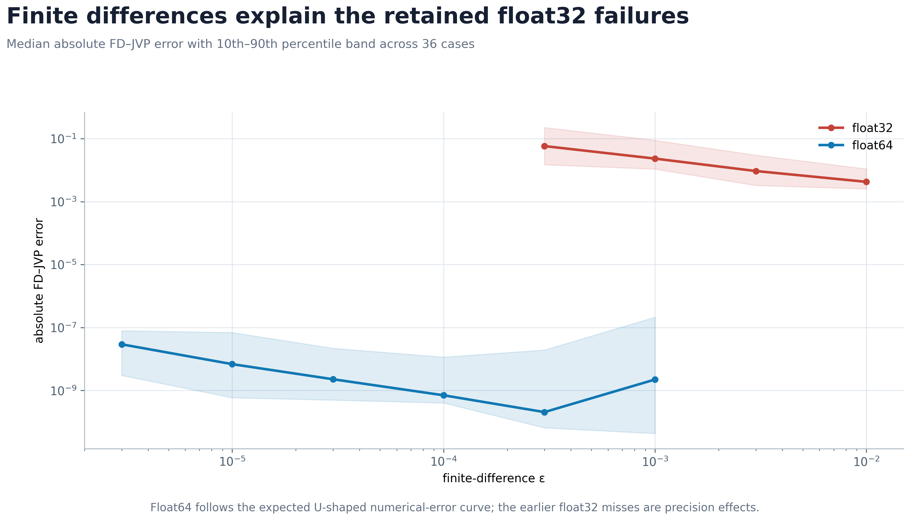

**Figure 33.** 36 个保留 float32 案例及其 float64 对照在不同有限差分步长下的误差。
按精度分开的曲线支持“数值精度效应”，而不是对某个具体上游算子作归因。

<!-- M4_MECHANISM_START -->
### 5.8 RQ4：Attention routing/value 与 residual 机制

M4 完成两模型共享 400 图、12 个 blocks 和全部 heads 的 ground-truth-logit 局部输入依赖分解，共 86,400 个 image-block-head attention records、19,200 个 image-block-residual records 和 691,200 个 direction-head JVP records。Q+K+V 逐 head 重构 native attention Endpoint；routing+value 重构同一对象；attention 和 MLP residual 的 identity/carry 加 branch 均重构完整 logit Endpoint。

独立 CPU 审计复算 230,400 个 E3 summary 字段。最大 Q/K/V closure 绝对误差为 1.574e-05，最大 residual closure 绝对误差为 2.480e-05，显式 attention differential 与 native JVP 的最大相对误差为 2.502e-05。全部 19,200 个省略 identity/carry 负控按预期闭合失败；冻结前 16 个 evaluation orders 的 384 个 attention-detach block checks 通过。

#### Attention routing/value

| 模型 | Block | Routing share | Frozen-attention Endpoint error | Frozen-attention JVP error | Mean-query saturation | Routing-value path cancellation |
|---|---:|---:|---:|---:|---:|---:|
| vit_b16 | 0 | 0.3092 | 0.4407 | 0.4508 | 0.4656 | 0.1555 |
| vit_b16 | 5 | 0.5239 | 0.7792 | 0.8547 | 0.3183 | 0.2342 |
| vit_b16 | 11 | 0.5154 | 0.8022 | 0.9516 | 0.3470 | 0.3069 |
| deit_s16 | 0 | 0.2041 | 0.2774 | 0.3099 | 0.3825 | 0.1377 |
| deit_s16 | 5 | 0.4852 | 0.7375 | 0.8548 | 0.3191 | 0.2635 |
| deit_s16 | 11 | 0.4808 | 0.8488 | 0.9636 | 0.3329 | 0.3692 |

Frozen-attention 只保留 A dV。因此 Endpoint 与 JVP error 分别测量它在输入缩放方向和 8 个冻结 Rademacher 方向上遗漏的 routing differential。以下检验先在图内按层和 head 聚合，再以图像为统计单位；Holm family 按模型冻结。

| 模型 | Domain | 类型 | 冻结检验 | 图像级中位数 | 正/负/平 | Holm p | 判定 |
|---|---|---|---|---:|---:|---:|---|
| vit_b16 | attention | attention-head | late_minus_early_routing_share | 0.0523 | 360/40/0 | 1.715e-65 | SUPPORTED_DIFFERENCE |
| vit_b16 | attention | attention-head | late_minus_early_frozen_attention_endpoint_error | 0.1444 | 383/17/0 | 5.545e-91 | SUPPORTED_DIFFERENCE |
| vit_b16 | attention | attention-head | saturation_routing_relation | -0.2937 | 5/395/0 | 2.611e-109 | SUPPORTED_DIFFERENCE |
| vit_b16 | attention | attention-head | saturation_error_relation | -0.2238 | 12/388/0 | 7.108e-98 | SUPPORTED_DIFFERENCE |
| vit_b16 | residual | attention | late_minus_early_identity_share | -0.1242 | 38/362/0 | 4.068e-67 | SUPPORTED_DIFFERENCE |
| vit_b16 | residual | attention | late_minus_early_path_cancellation | -0.0105 | 173/227/0 | 7.970e-03 | SUPPORTED_DIFFERENCE |
| vit_b16 | residual | mlp | late_minus_early_identity_share | 0.1798 | 396/4/0 | 1.644e-111 | SUPPORTED_DIFFERENCE |
| vit_b16 | residual | mlp | late_minus_early_path_cancellation | 0.0688 | 304/96/0 | 2.840e-26 | SUPPORTED_DIFFERENCE |
| deit_s16 | attention | attention-head | late_minus_early_routing_share | 0.1355 | 399/1/0 | 9.317e-118 | SUPPORTED_DIFFERENCE |
| deit_s16 | attention | attention-head | late_minus_early_frozen_attention_endpoint_error | 0.2896 | 400/0/0 | 3.098e-120 | SUPPORTED_DIFFERENCE |
| deit_s16 | attention | attention-head | saturation_routing_relation | -0.3143 | 15/379/6 | 5.158e-92 | SUPPORTED_DIFFERENCE |
| deit_s16 | attention | attention-head | saturation_error_relation | -0.2286 | 52/338/10 | 1.794e-52 | SUPPORTED_DIFFERENCE |
| deit_s16 | residual | attention | late_minus_early_identity_share | -0.0449 | 48/352/0 | 6.053e-58 | SUPPORTED_DIFFERENCE |
| deit_s16 | residual | attention | late_minus_early_path_cancellation | -0.0074 | 171/229/0 | 4.314e-03 | SUPPORTED_DIFFERENCE |
| deit_s16 | residual | mlp | late_minus_early_identity_share | 0.1780 | 397/3/0 | 1.652e-113 | SUPPORTED_DIFFERENCE |
| deit_s16 | residual | mlp | late_minus_early_path_cancellation | -0.0588 | 103/297/0 | 6.661e-23 | SUPPORTED_DIFFERENCE |

Saturation 关系是在每张图、每一层的 heads 内计算 Spearman 后再汇总，避免把共同层深趋势当成 head 内关系。其方向与支持状态由上表直接给出，不预设 softmax 越尖锐时 routing omission 越大。

#### Residual identity/branch

| 模型 | Residual | Block | Identity share | Path cancellation | Identity-branch cosine | Output-identity patch TV |
|---|---|---:|---:|---:|---:|---:|
| vit_b16 | attention | 0 | 0.8847 | 0.1465 | -0.3315 | 0.0150 |
| vit_b16 | attention | 5 | 0.6100 | 0.2381 | 0.0606 | 0.1089 |
| vit_b16 | attention | 11 | 0.4442 | 0.3578 | -0.0506 | 0.1803 |
| vit_b16 | mlp | 0 | 0.2225 | 0.1654 | 0.1849 | 0.1398 |
| vit_b16 | mlp | 5 | 0.5648 | 0.2450 | 0.1321 | 0.1287 |
| vit_b16 | mlp | 11 | 0.6418 | 0.6333 | -0.9071 | 0.1023 |
| deit_s16 | attention | 0 | 0.8729 | 0.1820 | -0.4181 | 0.0284 |
| deit_s16 | attention | 5 | 0.6775 | 0.1983 | 0.1826 | 0.0798 |
| deit_s16 | attention | 11 | 0.6559 | 0.2538 | 0.0757 | 0.1047 |
| deit_s16 | mlp | 0 | 0.3078 | 0.2831 | -0.0186 | 0.1798 |
| deit_s16 | mlp | 5 | 0.6257 | 0.1886 | 0.3342 | 0.0923 |
| deit_s16 | mlp | 11 | 0.6079 | 0.5878 | -0.7599 | 0.1276 |

Identity share 描述 absolute Endpoint mass 在 skip 与 branch 两条局部路径间的比例；path cancellation 比较两条 signed map 相加前后的 absolute mass。Output-identity patch TV 衡量 residual 输出相对只走 identity 时的空间依赖改变。ViT-B/16 中 attention/MLP residual 的最小与最大空间 TV 位于 blocks 0/11 和 8/10；DeiT-S 对应为 1/4 和 9/0。这些层级定位来自冻结 cohort 的描述性中位数。

| 模型 | Phase | Attention−MLP identity share | Attention−MLP path cancellation | Attention−MLP spatial TV |
|---|---|---:|---:|---:|
| vit_b16 | early | 0.3382 | 0.0004 | -0.0902 |
| vit_b16 | middle | 0.0327 | 0.0165 | -0.0050 |
| vit_b16 | late | 0.0376 | -0.0664 | -0.0173 |
| deit_s16 | early | 0.2697 | -0.0564 | -0.0796 |
| deit_s16 | middle | 0.0280 | 0.0009 | -0.0026 |
| deit_s16 | late | 0.0512 | -0.0041 | -0.0047 |

| 模型 | Residual | Branch share–path cancellation Spearman（跨 12 blocks） |
|---|---|---:|
| vit_b16 | attention | 0.5140 |
| vit_b16 | mlp | -0.2657 |
| deit_s16 | attention | 0.3182 |
| deit_s16 | mlp | 0.4650 |

前一表直接比较 attention 与 MLP residual；后一表回答 branch mass 较大时 path cancellation 是否一并变化。两表均为冻结 A1 描述性分析，不加入原 M4 Holm families。

#### Signed、absolute 与 cancellation

每条路径均同时保留 signed sum、absolute mass、positive/negative mass 和 map cancellation。M4 区分同一 map 内的正负抵消与 routing/value 或 identity/branch 之间的 path cancellation；二者没有合并为单一“重要性”指标。所有零分母、零范数和常数 head 关系严格传播为 NA，没有加入 epsilon。

| 模型 | 路径 | Block | Signed magnitude | Absolute mass | Map cancellation |
|---|---|---:|---:|---:|---:|
| vit_b16 | routing | 0 | 0.0362 | 2.6596 | 0.9867 |
| vit_b16 | routing | 5 | 0.0600 | 33.7856 | 0.9982 |
| vit_b16 | routing | 11 | 0.0608 | 40.7842 | 0.9982 |
| vit_b16 | value | 0 | 0.0306 | 7.6041 | 0.9952 |
| vit_b16 | value | 5 | 0.0380 | 28.0522 | 0.9986 |
| vit_b16 | value | 11 | 0.0654 | 39.0241 | 0.9981 |
| vit_b16 | attention_identity | 0 | 1.3315 | 495.2271 | 0.9972 |
| vit_b16 | attention_identity | 5 | 0.9816 | 387.1208 | 0.9977 |
| vit_b16 | attention_identity | 11 | 0.8778 | 313.3689 | 0.9974 |
| vit_b16 | attention_branch | 0 | 0.3930 | 63.8344 | 0.9934 |
| vit_b16 | attention_branch | 5 | 0.4140 | 250.3045 | 0.9983 |
| vit_b16 | attention_branch | 11 | 0.6133 | 398.0202 | 0.9986 |
| vit_b16 | mlp_identity | 0 | 0.6860 | 130.4998 | 0.9945 |
| vit_b16 | mlp_identity | 5 | 1.0976 | 334.0699 | 0.9971 |
| vit_b16 | mlp_identity | 11 | 1.8214 | 827.8407 | 0.9977 |
| vit_b16 | mlp_branch | 0 | 0.6309 | 438.0538 | 0.9986 |
| vit_b16 | mlp_branch | 5 | 0.4504 | 271.9139 | 0.9983 |
| vit_b16 | mlp_branch | 11 | 0.7961 | 460.2701 | 0.9981 |
| deit_s16 | routing | 0 | 0.0756 | 4.5294 | 0.9829 |
| deit_s16 | routing | 5 | 0.0506 | 38.3865 | 0.9986 |
| deit_s16 | routing | 11 | 0.0504 | 35.9257 | 0.9986 |
| deit_s16 | value | 0 | 0.0818 | 18.4261 | 0.9950 |
| deit_s16 | value | 5 | 0.0776 | 40.1955 | 0.9979 |
| deit_s16 | value | 11 | 0.0586 | 38.8767 | 0.9985 |
| deit_s16 | attention_identity | 0 | 1.6888 | 459.3077 | 0.9960 |
| deit_s16 | attention_identity | 5 | 1.1087 | 370.3635 | 0.9969 |
| deit_s16 | attention_identity | 11 | 1.1539 | 372.6598 | 0.9966 |
| deit_s16 | attention_branch | 0 | 0.4543 | 63.9204 | 0.9922 |
| deit_s16 | attention_branch | 5 | 0.4112 | 169.7186 | 0.9974 |
| deit_s16 | attention_branch | 11 | 0.3639 | 185.3893 | 0.9980 |
| deit_s16 | mlp_identity | 0 | 0.8741 | 170.6143 | 0.9946 |
| deit_s16 | mlp_identity | 5 | 1.1847 | 317.7498 | 0.9962 |
| deit_s16 | mlp_identity | 11 | 1.7620 | 614.5721 | 0.9973 |
| deit_s16 | mlp_branch | 0 | 0.7619 | 412.5634 | 0.9981 |
| deit_s16 | mlp_branch | 5 | 0.3466 | 197.6662 | 0.9982 |
| deit_s16 | mlp_branch | 11 | 0.4532 | 354.6503 | 0.9988 |

#### Review-R2 敏感性与 estimand 收紧

Review-R2 检验 late-block Value-only JVP discrepancy 是否由小分母造成。Block 11 的
relative discrepancy 中位数在 ViT-B/16 和 DeiT-S/16 中为 0.9516 和 0.9636；对应的
full-response denominator 为 14.9711 和 1.5155，absolute discrepancy 为 13.8064 和
1.4228。因此，差异与完整响应处于相同 norm 尺度，并非普遍来自接近零的分母。

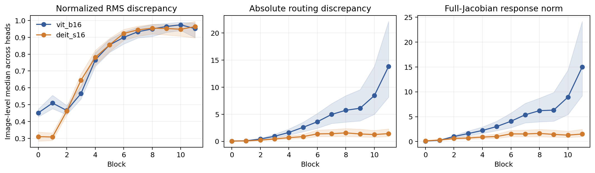

**M4 Review Figure 1.** 两模型 block 11 的 normalized JVP discrepancy、absolute
discrepancy 和 full-response denominator 分布。

控制 head projection-input activation norm 和 downstream-cotangent norm 后，两模型的
mean-query saturation 仍与 routing share、Endpoint error 和 JVP error 呈负相关。ViT-B/16
与 DeiT-S/16 的 fully adjusted correlations 依次为 −0.1442/−0.3257、
−0.1129/−0.2185 和 −0.1453/−0.2786。CLS-query 关系更弱：ViT-B 的 adjusted routing
share 和 Endpoint-error 检验均为 Holm $p=0.0629$。因此正式 summary 使用 all-query mean
saturation，并把关联主要定位在 early/middle blocks。

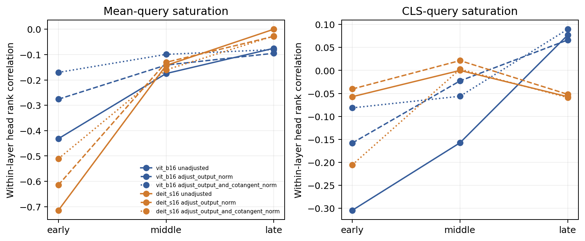

**M4 Review Figure 2.** Saturation 的 unadjusted/partial-rank 关系、phase sensitivity 与较弱的
CLS-query 结果。

全 cohort 空间分析使用 output 与 identity 的归一化 14×14 patch absolute distributions
之间的 total variation。Attention residual 的 late-minus-early 差在 ViT-B/16 和 DeiT-S/16
中为 +0.0520（[0.0488, 0.0547]）和 +0.0282（[0.0257, 0.0300]）；MLP residual 为
−0.0187（[−0.0220, −0.0150]）和 −0.0462（[−0.0516, −0.0412]）。四项 post-hoc
sensitivity tests 全部通过 Holm 校正，branch-relative path scale 与 spatial TV 在图内跨层
也呈正相关。

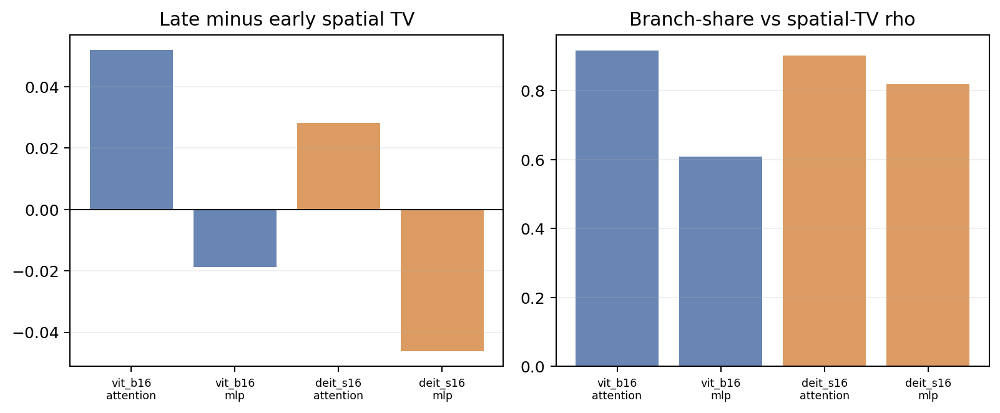

**M4 Review Figure 3.** Attention 与 MLP 子层的全 cohort residual spatial-change sensitivity。

在每模型 16 张事前保留的 class-logit maps 上，Full–Value patch TV 从 block 0 的
0.0550/0.0307 增至 block 11 的 0.1865/0.1811。其 12-block trajectory 与 M3 entropy、
locality 和 distance 方向相容；但 M3 使用 100 图 token-channel targets，且每模型仅一张图
重叠。因此这里只形成模型级 trajectory bridge，不构成 routing 导致空间扩展的逐单元或
因果联系。

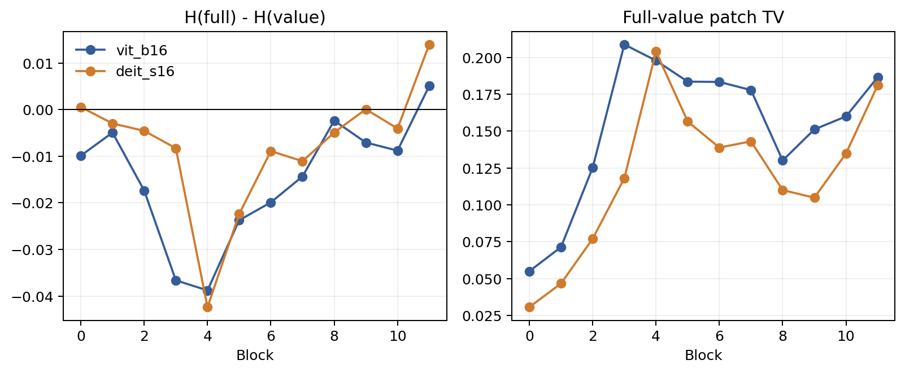

**M4 Review Figure 4.** M3 空间轨迹与 Full–Value class-logit map 差异之间的描述性桥接。

#### 图

- Image #1（m4_attention_depth）：逐 block 展示 routing share、frozen-attention Endpoint error 与 8-direction JVP error；阴影为 10,000 次图像 bootstrap 95% CI。
- Image #2（m4_attention_saturation）：展示 block-level saturation 与 routing/error 的描述性位置；正式相关检验仍使用图内 layer-wise head Spearman。
- Image #3（m4_residual_depth）：同时展示 attention/MLP residual 的 identity share、path cancellation 和空间 TV。

#### 解释边界

M4 定量描述当前输入点和冻结 ground-truth logit 下的局部 Jacobian 路径记账。较高 routing share 或 branch mass 表示该路径承载较多局部输入依赖；因果重要性仍需独立有限干预证据。
<!-- M4_MECHANISM_END -->

## 6. 讨论

### 6.1 Identity、Correctness 与 Utility 是三种不同结论

Endpoint 的数学身份由链式法则确定：对同一输入端标量目标，基础图就是
$x\odot\nabla_xs(x)$。结构闭合与解析 JVP 检查说明代码在注册计算图上正确实现了目标、
hook、cotangent 和 edge bookkeeping。有限 activation replacement 与空间干预则回答
这些量是否能预测模型在非无穷小替换下的行为。Figure 28 汇总了这三层证据。把它们分开
可以避免两种常见推断：闭合不等于行为效用，干预中的负结果也不推翻链式法则身份。

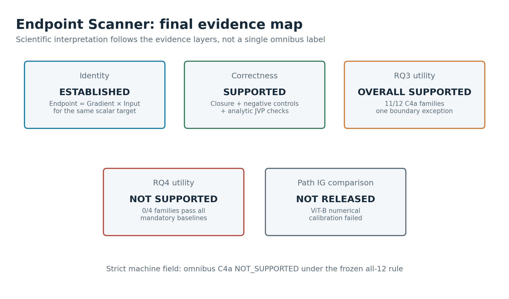

**Figure 28.** 本文采用的证据层级。数学身份、实现正确性与有限干预效用分别由不同测试
支持，不能互相替代。

### 6.2 成分排序与空间排序是不同评价任务

两种行为结果并不矛盾。成分排序在一张图像内比较多个结构成分，询问“哪个 head、
routing/value 或 residual branch 的整体质量更大，哪个成分被完整替换时的影响也更大”。
空间排序则固定一个 head，在 16 个候选输入区域中询问“先替换哪些局部区域会产生更大的有限
效应”。前者是 component-level ranking，后者是 within-component spatial ranking。

Endpoint absolute mass 保留结构成分相对输入的完整一阶分布，但它没有显式使用某个候选
区域替换后产生的 activation displacement。Regional Taylor 恰好把这一位移与 clean
cotangent 相乘，因此其估计对象与 RQ4 的区域替换更接近。四个 family 中一致出现的
regional Taylor 优势支持这一任务层面的解释。当前实验不进一步推出 regional Taylor 在
其他层、区域尺度、任务或模型上普遍占优。

### 6.3 如何解释成分关联的边界 family

ViT-B/16 normalized-zero routing/value family 的点估计为 0.099565，95% CI
为 [0.0748, 0.1226]。方向检验支持正相关，实际效应是否达到 0.10 仍不确定。
11/12 family 满足全部条件支持广泛但非普遍的关联；预注册 all-family omnibus
保持 `NOT_SUPPORTED`。

### 6.4 对 ViT 内部解释评价的启示

本研究显示，一种内部解释可以同时具备以下部分属性而缺少另一些属性：注册目标覆盖完整、
结构记账闭合、局部方向正确、成分级有限效应可预测、空间区域选择优于强基线。这些属性
需要各自的测试。特别是，可视化分辨率描述图像的坐标粒度，不等于其中包含额外可用的
干预信息。解释方法的评价应与使用目的对应：若任务是筛选结构成分，C4a 的结果更直接；
若任务是选择局部区域，C4b 表明 regional activation-space 信息不可忽略。

### 6.5 空间扩展与 signed cancellation

M3 增加了一种不同于有限干预预测的机制用途。Entropy、locality 与 distance 共同表明，
抽样 post-block 单元随层深依赖更广、更远的输入区域。12-block 曲线将主要转变定位在
early/middle 深度，而不是暗示二元的“局部到全局”跳变。同时，较小的
$R_{\mathrm{net}}$ 表明这些广泛分布的 map 包含方向相反的一阶项。这有助于解释：
Endpoint absolute mass 在 M1 中保留成分排序信息，却在 M2 的有限空间 replacement 中
不如 reference-matched Taylor 对实际位移敏感。

### 6.6 目标条件化 routing 与子层特异 residual 传递

M3 与 M4 描述局部 Jacobian 的两个互补层面。M3 测量抽样 post-block token-channel map
如何在输入坐标上扩展；M4 固定 ground-truth logit，并按 attention 与 residual 路径划分其
downstream-cotangent 加权输入 Jacobian。两个模型的 late attention 都有更大的
routing-relative path scale 和 Value-only approximation discrepancy。Attention residual 的
late-minus-early 空间改变为正，MLP residual 则为负。M3 与 M4 的层深轨迹方向相容，但
target 与 cohort 不同；证据支持模型级机制桥接，不构成逐单元因果链。

控制 head-output norm 与 downstream-cotangent norm 后，mean-query saturation 仍与 routing
scale 和两类 approximation error 呈负相关。CLS-query 关系更弱，ViT-B 的两项 fully
adjusted 检验未通过 post-hoc sensitivity family。因此结论限定为 all-query mean
saturation 和图内同层 head 比较。

### 6.7 方法定位与 reference 信息条件

对注册标量目标 $F$ 和 normalized input $x$，Endpoint 为
$E(x)=x\odot\nabla_xF(x)$。它不需要外部选择的 intervention reference，但并非与坐标无关：
若 $x=(r-\mu)/\sigma$，则
$x_i\partial F/\partial x_i=(r_i-\mu_i)\partial F/\partial r_i$。因此 normalization mean
是 canonical Endpoint 在 raw-RGB 中的坐标原点；对 logit target，它就是 normalized-input
坐标中的 Input × Gradient。

M1 的 163,200 个成分配对中，Endpoint absolute mass 与 signed sum 在 normalized-zero 和
blur-rgb 间逐项相同；Taylor magnitude 与 absolute finite effect 每项都发生变化。跨
reference 完全相同的排名只有 46/9,600 项 Taylor head-block 比较和 64/9,600 项
finite-effect 比较。

| 模型 | Taylor 跨 reference $\rho$ | Effect 跨 reference $\rho$ | Endpoint $\rho$：zero / blur | Taylor $\rho$：zero / blur |
|---|---:|---:|---:|---:|
| ViT-B/16 | 0.3782 | 0.3759 | 0.2815 / 0.2727 | 0.6742 / 0.6856 |
| DeiT-S/16 | 0.3000 | 0.3071 | 0.1952 / 0.1476 | 0.6095 / 0.6238 |

Reference 改变的是成分排序，不只是分数尺度。Endpoint 提供观测输入处的一套局部依赖
排序；activation-space Taylor 纳入所选 replacement displacement，与本文有限 replacement
outcome 更匹配。因此二者的差异首先是 estimand 与信息条件的差异。Attention rollout、

| 方法 | 主要对象 | 内部标量 | 输入图 | 外部 reference | 局部 Jacobian 闭合 | 有限 replacement |
|---|---|---:|---:|---:|---:|---:|
| Endpoint | 观测输入处的局部依赖 | 是 | 是 | 否 | 是 | 经验标定 |
| Activation-space Taylor | 指定 replacement 预测 | 是 | 区域分数 | 是 | 非主要合同 | displacement matched |
| Integrated Gradients | baseline 到输入的路径归因 | 是 | 是 | 是 | 可扩展 | baseline difference |
| Attention rollout | 跨层 attention flow | 通常否 | token map | 否 | 否 | 非主要合同 |
| Grad-CAM | 类别相关粗粒度定位 | 部分 | 是 | 否 | 否 | 非主要合同 |
| Chefer/AttnLRP | Transformer relevance propagation | 部分 | 是 | 依实现 | 依实现 | 不统一 |
| Attention weights | token allocation | attention 对象 | token map | 否 | 否 | 不能只由权重给出 |

Grad-CAM、Chefer/AttnLRP 和 raw attention 面向输出、relevance 或 token flow 等不同对象，
本文不把它们纳入内部目标排行榜。Path IG 也不进入跨模型结论，因为 ViT-B/16 在冻结的
512-point 上限只通过 41/64 个 ground-truth 和 40/64 个 clean-top1 校准案例，低于 61/64
release gate。

### 6.8 自动选择的机制案例

M6 在读取图像前冻结十二类选择规则：十一类来自完整 M3/M4 数值记录，一类来自 M2
estimand 边界。极端案例来自预定义 5% 尾部并按固定 ID 处理并列；跨模型案例取最接近
cohort 中位差的样本。选择封存后才读取或重算图像与像素级 map。以下五页解释总体规律；
population-level 结论仍以 M3/M4 图像级分析为依据。

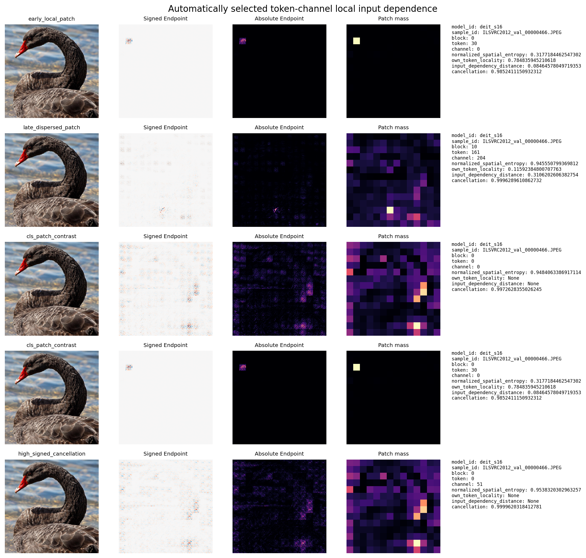

**M6 Figure 1.** 自动选择的 early-local、late-dispersed、CLS–patch 和高 signed-
cancellation token-channel 案例，同时给出 signed/absolute map、patch mass 与注册指标。

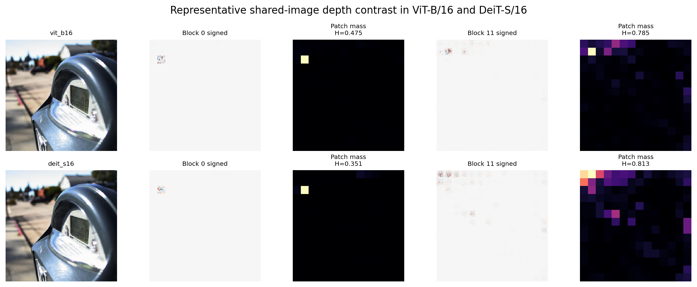

**M6 Figure 2.** 预定义的代表性 ViT-B/16 与 DeiT-S/16 block-0/block-11 对比；channel ID
不解释为跨模型语义匹配。

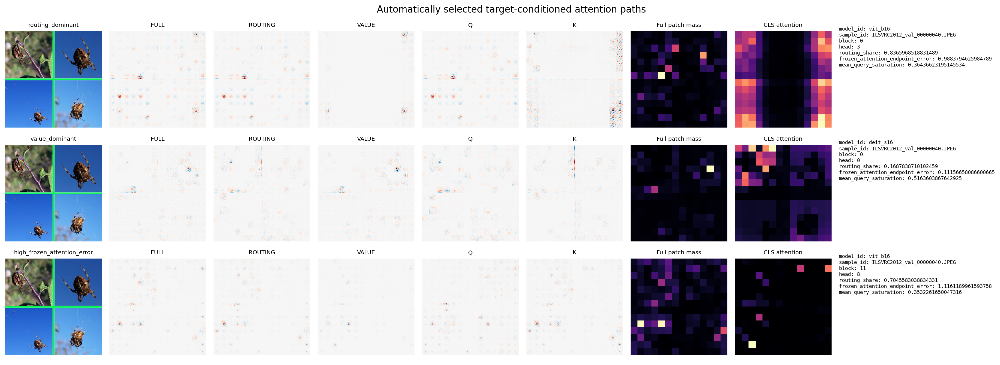

**M6 Figure 3.** Routing-dominant、Value-dominant 和高 fixed-attention-error heads。对同一
target，Q+K 重构 routing，routing+Value 重构 full Endpoint。

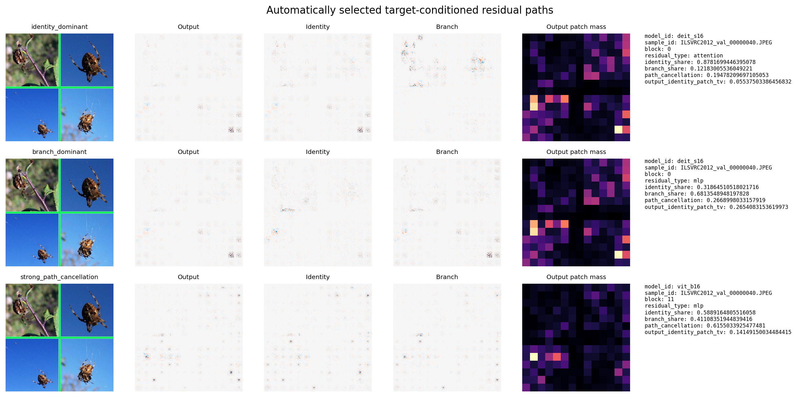

**M6 Figure 4.** Identity-dominant、branch-dominant 和高 path-cancellation residual 案例。
Output、identity 与 branch 共享同一个 residual-output cotangent 并满足闭合合同。

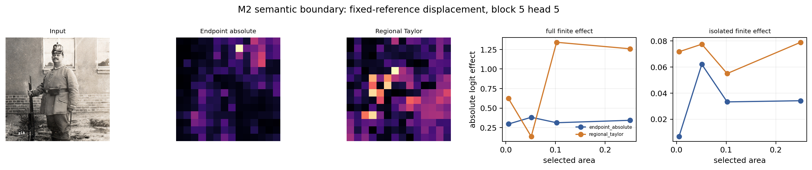

**M6 Figure 5.** Outcome-blind 选择的 M2 边界案例，对比 observed-input Endpoint 排序与
reference-displacement-matched regional Taylor；finite-effect 曲线只在选择后显示，用于在
同一任务中说明两个 estimand。

## 7. 局限

本研究覆盖两个 ImageNet 分类 ViT、一个共享的 400 图 evaluation cohort 和冻结的标准
timm 实现；结论不直接覆盖层级式 Transformer、检测/分割任务、自监督模型或其他数据域。
M3 atlas 每个 model-image 覆盖 6,144 个冻结 post-block token-channel 坐标，即
ViT-B/16 候选总体的 0.338% 和 DeiT-S 的 0.677%；不穷举全部 token-channel 组合、MLP
hidden units 或 Q/K/V coordinates。层深结果描述局部一阶图像坐标依赖，本身不建立全局
语义表示或因果重要性。
Canonical Endpoint 依赖输入坐标原点，并且一般不满足相对 baseline 的 completeness。
空间干预审计固定在 block 5、每模型三个 heads、4×4 区域池、最高 25% 面积、两种 reference 和
raw-logit isolated-effect AUC；其他空间尺度或干预对象可能形成不同排序。
M4 path maps 以冻结 ground-truth-logit 的 downstream cotangent 为条件。Routing/identity
share 是相对 path-norm scale，不是可加百分比；normalized JVP discrepancy 是方向 norm
比值。M3–M4 raw-map bridge 每模型使用 16 张 class-logit maps，并未与 100 图
token-channel cohort 配对。

预注册 Path IG 校准在 ViT-B/16 上未达到 61/64 的数值覆盖门，因此本文没有跨模型
Endpoint–Path fidelity、stability 或成本—质量比较。该数值失败不影响 Endpoint-only 的
身份、闭合、atlas 和干预结果，但限制了方法间结论。M3 保留的 36 个 float32 有限差分
失败通过冻结的 float64 recovery，因此数值状态是
`PASS_FLOAT64_RECOVERY_WITH_RETAINED_FLOAT32_FAILURE`，而非无条件 PASS。最后，论文中的颜色图按面板进行显示缩放，
只用于比较空间形态；跨图数值结论均来自原始 signed tensors、component summaries 和
有限干预记录。

## 8. 结论

NNS-ViT Endpoint Scanner 把原始 NNS 的终点传播原则适配到 Vision Transformer，为
注册内部目标提供统一的输入坐标图，并通过完整 edge cuts 对 attention 与 residual 结构进行
可核对分解。两个模型和 400 张图的实验支持其注册扫描完整性、结构闭合与局部微分正确性。
另一个 100 图分层审计直接连接原始 NNS propagation 与 Endpoint，并在两个模型的抽样
token-channel 中显示层深相关空间扩展。对冻结 ground-truth logit，late attention 具有更大的
routing-relative path scale 和 Value-only approximation discrepancy；attention residual 的
空间改变随深度增加，而 MLP residual 的空间改变下降。这些是目标条件化的局部路径记账
结果。有限 activation replacement 表明，Endpoint 成分质量在 12 个 family 中有 11 个
满足全部 family-level 条件，支持广泛但非普遍的关联；all-family omnibus 保持
`NOT_SUPPORTED`。空间干预未显示相对四个 mandatory baselines 的联合增益，regional
Taylor 在四个 family 中均更强。Endpoint 的主要价值是可审计的内部目标表示，而不是
成为通用干预预测器。

## 数据、代码与可复现材料

代码、冻结协议、目标注册表、逐阶段验证报告、统计 release，以及带 signed、M2–M6 和
all-head supplements 的统一 40 图包位于本项目仓库。提交版本的匿名链接、许可证、归档
DOI 与数据访问说明为
`[REPOSITORY AND ARCHIVE REQUIRED]`。

## 参考文献

本初稿使用的参考文献清单见
`papers/nns_vit_endpoint/references/endpoint_scanner_references_r1.md`。投稿前需完成最终 BibTeX、DOI、
页码和 venue metadata 审计。
