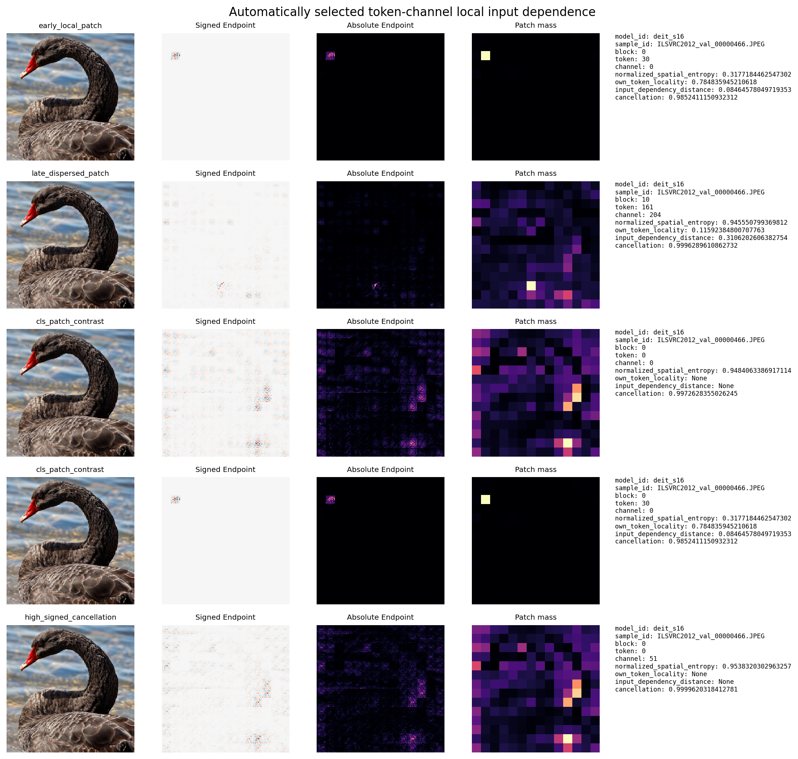
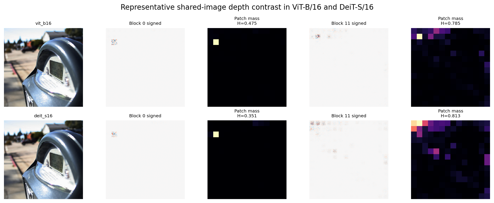
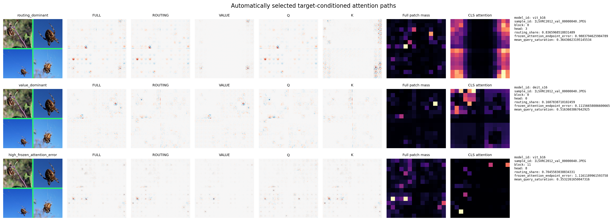
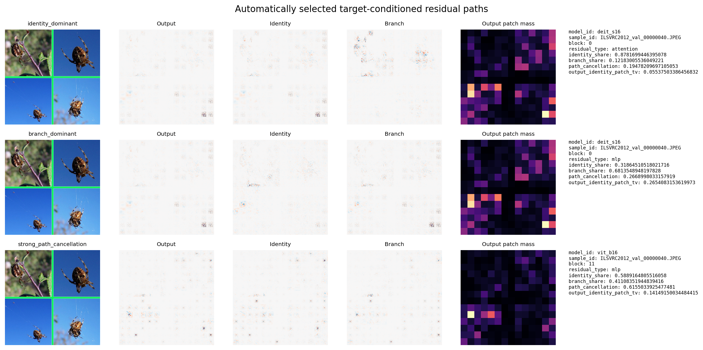
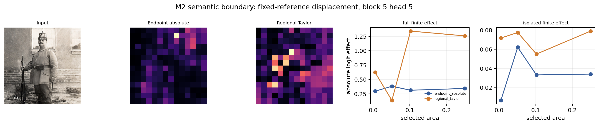

# NNS-ViT Endpoint Scanner：视觉 Transformer 的注册内部目标扫描与结构化分解

- 作者：`[AUTHOR REQUIRED]`
- 单位：`[AFFILIATION REQUIRED]`
- 通讯作者：`[CORRESPONDING AUTHOR REQUIRED]`

> 初稿 R2，2026-09-19。正文图号沿用封存 Endpoint 图包 Figure 1–33；投稿排版可按
> `papers/nns_vit_endpoint/zh/outline.md` 的建议重新编号。

## 摘要

视觉 Transformer（ViT）的内部解释对象横跨 token、channel、attention head、
routing/value 路径、MLP 分支和 residual stream。它们的张量形状与计算角色不同，使得
统一扫描、结构核对和行为评价难以在同一坐标系统中完成。本文提出 NNS-ViT Endpoint
Scanner：把原始 Neural Network Scanner 的输入值初始化与当前状态传播原则适配到 ViT，
对任意注册标量目标生成
$L_s^{\mathrm{Endpoint}}(x)=x\odot\nabla_xs(x)$，并以完整计算边切面把同一最终目标
分解为 head、Q/K/V、routing/value、attention residual 和 MLP residual 成分。该基础量
与 Gradient × Input 相同；本文研究的是 ViT 目标注册、结构化记账以及这些成分在有限
干预中的经验效用。我们在共享的 400 张 ImageNet evaluation 图像上评价 ViT-B/16 和
DeiT-S/16。注册扫描完成 800/800 个图像—模型任务和 336,800 个有限目标值；结构验证
通过 76,800 个正向闭合检查，拒绝 28,800 个遗漏或重复记账负例，并通过 6,144 个
condition-scaled analytic JVP 检查。直接 fidelity bridge 又在五类兼容网络上完成原始
逐层 NNS propagation 与 Endpoint 的 5,000 个 target-level 数值比较，全部满足对应精度
合同。冻结的 100 图分层审计为每个 model-image 计算 6,144 个 post-block token-channel
单元；两个模型均表现出层深相关的局部一阶输入依赖空间扩展，即 late blocks 相比 early
blocks 具有更高 entropy、更低自身邻域 locality 和更大的 normalized distance。对于匹配
activation replacement，12 个预注册
family 中有 11 个达到全部 family-level 条件。RQ3 呈现广泛但非普遍的成分级关联，
预注册 all-family omnibus 为 `NOT_SUPPORTED`。未通过 family 的相关仍显著为正，
但其置信区间跨越 0.10，不能确认达到预设实际效应水平。在
空间定向干预中，0/4 family 同时优于 total G×I、raw gradient、regional Taylor 和
随机区域；regional Taylor 在四个 family 中均取得更高的中位效果。针对冻结 ground-truth logit 的目标条件化分析进一步显示：late attention 的 routing-to-total-path norm 比和 Value-only Jacobian discrepancy 均高于 early attention；attention residual 与 MLP residual 的 identity-path 层深趋势相反，空间改变也呈分化。这些比率和归一化误差描述局部 Jacobian 几何，不是贡献百分比。

Endpoint 因而形成
一个经数值验证的内部目标表示，其抽样 token-channel map 随深度发生空间扩展；成分级
有限效应关联与 reference-specific 局部区域选择仍是两种不同能力。

关键词：Vision Transformer；神经网络解释；Gradient × Input；结构分解；activation
replacement；attention head

## 1. 引言

Vision Transformer 将图像表示组织为 patch tokens，并通过多头自注意力、MLP 和
residual stream 反复变换这些表示（Dosovitskiy et al., 2021）。这套结构产生了丰富的
内部观察对象：一个 token-channel 单元、一条 head 分支、Q/K routing、Value 内容、
MLP 分支或最终类别 logit 都可以成为解释目标。然而，这些对象生活在不同的张量空间。
直接查看 activation 或 attention 权重能够描述内部状态，却不能自动回答某个对象如何依赖
原始输入，也不能保证多个结构成分对同一目标的记账既无遗漏又无重复。

已有 ViT 解释方法从不同角度处理这一问题。Attention rollout 递归聚合 token 间的
attention flow（Abnar and Zuidema, 2020）；Transformer relevance 方法把类别相关信息沿
计算图传播（Chefer et al., 2021；Achtibat et al., 2024）；输入归因方法则把最终输出映射
到像素坐标。它们回答的对象、传播规则和评价标准并不相同。对内部结构进行解释时，还需
区分三个问题：方法的数学身份是什么，代码是否忠实实现这一身份，以及所得数值是否能
预测有限干预。只验证梯度或闭合无法替代干预评价；一张空间细致的图也不一定比一个直接
针对候选区域的局部效应估计更适合区域选择。

Dou et al. (2023) 提出的 Neural Network Scanner（NNS）为 FCN/CNN 内部神经元构造
保留输入位置的 learning image。在线性层、卷积、当前 ReLU 门和唯一 MaxPool winner
采用真实局部传播系数时，该单神经元规则可写为输入值与当前点梯度的乘积。ViT 引入
LayerNorm、GELU、输入依赖的 softmax attention、两处 residual add 以及多种 token/branch
对象，因此需要明确其真实 Jacobian、结构切面和目标身份。本文沿用 NNS 的终点传播思想，
但不把 $x\odot\nabla_xs(x)$ 重新命名为新的基础归因公式。

我们提出 NNS-ViT Endpoint Scanner，并围绕四个原始效用问题进行评价（Figure 1），另以
直接 NNS fidelity bridge 和分层 token-channel 机制审计补充证据链：

1. **RQ1：注册扫描。** 能否在两个冻结 ViT 上完整、有限且可审计地扫描统一登记的
   内部标量和输出目标？
2. **RQ2：结构正确性。** Head、Q/K/V、routing/value 和 residual cuts 能否在完整计算
   图上重构其注册对象，并拒绝遗漏或重复记账？
3. **RQ3：成分级效用。** Endpoint 成分的输入空间质量能否预测同一成分被 reference
   activation 替换时的有限 logit effect？
4. **RQ4：空间效用。** 完整输入分辨 component map 能否在固定区域池和预算下，比总
   G×I、raw gradient、regional Taylor 和随机区域更好地定位有限效应？

本文的贡献有六点。第一，我们把 NNS 的终点原则形式化为真实 ViT Jacobian，并明确
normalized-input 坐标原点以及 LayerNorm、GELU、softmax attention、MLP 和 residual 的
传播作用。第二，我们建立两个 ViT 的注册目标目录和可审计扫描流程，在同一 400 图 cohort
上完成 336,800 个目标评价。第三，我们定义完整 edge cuts，把 head、attention differential
paths 和两处 residual 分支映回同一输入坐标并重构注册对象。第四，我们用闭合负例、解析
JVP、匹配 activation replacement 和空间定向干预分别评价 correctness 与 utility。第五，
我们直接比较原始逐层 NNS propagation 与 Endpoint，并以 autograd 和方向有限差分验证
11 类 ViT 算子 Jacobian。第六，我们在冻结 token-channel 样本中观察到层深相关的空间扩展，并把该 atlas 结果与目标条件化的 attention routing 和子层特异 residual 传递联系起来；行为实验另行界定成分级与 reference-specific 空间效用。

## 2. 相关工作

### 2.1 神经元可视化与 NNS

内部可视化方法既可以寻找最大化某个单元的输入，也可以从一个实际样本出发追踪其内部
响应。Feature visualization、network dissection、deconvolutional views 和 class activation
maps 分别刻画偏好输入、语义概念、局部响应或类别相关区域。NNS 为另一类对象：它给
FCN/CNN 的单个神经元或聚合响应关联一张保留输入位置的 learning image（Dou et al.,
2023）。本文继承这一“内部目标—输入坐标图”的组织方式，并把当前状态传播扩展到 ViT
的真实算子。Captum 的 NeuronGradient 和 InputXGradient 已分别提供内部 scalar selector
和输入乘梯度的明确先例，因此本文的增量不在 hook、selector 或基础 G×I 公式，而在注册
范围、结构化切分、闭合验证与有限干预审计。

### 2.2 输入归因、路径积分与 conductance

Integrated Gradients（IG）沿参考输入到当前输入的路径积分梯度，并满足包括 sensitivity
和 implementation invariance 在内的公理（Sundararajan et al., 2017）。Neuron
conductance 进一步衡量输出归因如何流经隐藏单元（Dhamdhere et al., 2018）。这些方法
与 Endpoint 的差别不是 CNN 或 Transformer 的架构标签，而是归因定义：Endpoint 使用
当前点 Jacobian 和输入值 seed；IG 使用参考差值 seed 和路径平均 Jacobian。本文同时保留
这一方法边界。由于 ViT-B/16 在预注册的最大 512 点数值范围内没有达到 Path IG 校准门，
我们不发布跨模型 Endpoint–Path fidelity、stability 或成本—质量结论。

### 2.3 Transformer 解释与结构分析

Raw attention 提供 token 关系，但不包含完整的下游类别导数。Attention rollout 聚合跨层
attention 与 residual 路径（Abnar and Zuidema, 2020）；Chefer et al. (2021) 与 AttnLRP
（Achtibat et al., 2024）采用 relevance 规则处理 Transformer 计算图；LibraGrad 调整
backward 路径以缓解 Transformer 的梯度流不平衡（Mehri et al., 2025）。这些工作说明
attention、skip connection 和梯度路径都影响解释。Endpoint Scanner 保留模型的真实局部
Jacobian，并将 raw attention、relevance 传播和修改后的 backward attribution 视为不同方法。

### 2.4 Activation patching 与解释评价

Activation patching 通过替换内部 activation 直接测量模型输出变化；Attribution Patching
用 activation displacement 与 clean gradient 的内积近似该有限效应，AtP* 进一步分析了
attention saturation 和抵消导致的失效模式（Kramár et al., 2024）。这一区分对本文尤为
重要：局部导数身份属于 correctness，而有限 replacement 才检验行为预测。我们同时考察
整成分排序和固定空间预算下的区域排序，并把 activation-space regional Taylor 作为后者
的 mandatory baseline。

## 3. 方法

### 3.1 Endpoint learning image 的数学身份

设模型实际接收的输入为 $x\in\mathbb R^d$。对计算图节点
$u(x)\in\mathbb R^m$，定义 learning-image 矩阵
$\mathcal L(u;x)\in\mathbb R^{m\times d}$。输入坐标初始化为

$$
\mathcal L(x;x)=\operatorname{diag}(x).
$$

若 $v=f(u_1,\ldots,u_r)$，所有 Jacobian 在真实输入对应的当前前向状态求值，则

$$
\mathcal L(v;x)=\sum_{a=1}^{r}J_{f,u_a}(x)\mathcal L(u_a;x).
$$

对标量目标 $s(x)$ 递归应用链式法则得到

$$
\boxed{L_s^{\mathrm{Endpoint}}(x)=x\odot\nabla_xs(x)}.
$$

当输入值用于对角初始化、bias 不作为图像输入坐标、ReLU 零点使用框架次梯度、MaxPool
遵循当前前向 winner（并列时遵循框架规则）时，该身份恢复原始 NNS learning-image 规则。
等价对象是局部输入依赖，而非函数值分解。CLS token、position embedding 和模型 bias 不
单独分配图像坐标贡献。LayerNorm、GELU 和 softmax attention 是超出原始 NNS 算子集合的
Jacobian-form generalization。

Figure 2 区分原始 NNS-CNN、ViT Endpoint 与 Path IG 的 seed 和 Jacobian。Endpoint
不包含 reference forward，也不具备一般的 baseline-difference completeness。输入坐标是
模型实际接收的 normalized RGB。若 $x=(r-\mu)/\sigma$，则

$$
x_i\frac{\partial s}{\partial x_i}
=(r_i-\mu_i)\frac{\partial s}{\partial r_i}.
$$

因此 canonical Endpoint 在 raw-RGB 坐标中以模型 normalization mean 为坐标原点。二维
显示图由原始 signed RGB tensor 做通道求和得到；绝对值、正部或逐图显示缩放不进入统计。

### 3.2 注册内部目标

Scanner 接受任何已登记的标量目标。目录包括 token-channel 单元、排除 CLS 的
patch-channel sum、patch-channel energy、attention head 内部坐标、final CLS channel、
ground-truth raw logit 和 frozen clean-top1 raw logit。Energy 目标定义为

$$
s_{\mathrm{energy}}(x)=\frac12\sum_{t=1}^{196}h_{t,c}(x)^2,
$$

它对应原始 NNS filter aggregation 的激活加权形式。ViT-B/16 每图注册 457 个目标，
DeiT-S/16 每图注册 385 个目标；两者均覆盖全部 12 个 blocks（Figure 7、11）。不同
模型中编号相同的 channel 不解释为语义相同。

### 3.3 ViT 算子与 attention differential paths

Canonical backend 使用 timm 0.9.16 的 standard unfused Block/Attention。Patch embedding、
LayerNorm、GELU、Q/K/V projections、row softmax、multi-head concatenation、output
projection、MLP、两次 residual add、final LayerNorm 和 classifier 均使用当前状态的真实
Jacobian。Fused backend 仅用于 forward parity，因为它不暴露注册结构边。

对于单个 attention head，令

$$
Q=XW_Q,\qquad K=XW_K,\qquad V=XW_V,
$$

$$
A=\operatorname{softmax}(QK^\top/\sqrt{d_h}),\qquad O=AV.
$$

其微分满足

$$
\mathrm dO=(\mathrm dA)V+A(\mathrm dV),
$$

其中 $\mathrm dA$ 继续由 Q 和 K 两条路径构成。由此得到 Q+K+V 与
routing+Value 两种注册分解（Figure 5）。LayerNorm 的均值、方差耦合和 GELU 的平滑
导数均保留，不能替换为冻结统计量或 ReLU 二值门。

### 3.4 Structured endpoint decomposition

对最终标量 $F$ 和切面成分 $z_k$，定义输入坐标成分图

$$
E^C_{k,i}=x_i\left\langle\nabla_{z_k}F(x),
\frac{\partial z_k(x)}{\partial x_i}\right\rangle.
$$

若 cut 包含所有从输入到目标的对应边且没有重复，则

$$
\sum_kE^C_{k,i}=x_i\frac{\partial F(x)}{\partial x_i}.
$$

我们登记六类切面：全 heads 重构 attention branch；identity 加 heads 重构第一个
residual total；Q+K+V 或 routing+Value 重构 attention branch；identity 加相应 differential
paths 重构 residual total；carry 加 MLP branch 重构第二个 residual total（Figure 10、15）。
Residual identity 必须按其真实输入边记账；遗漏一条非零 branch 或重复加入 bypass 都应被
闭合验证拒绝。

### 3.5 局部正确性与有限 activation replacement

对每个成分图，定义 signed sum 和 absolute mass：

$$
a_k=\sum_iE^C_{k,i},\qquad m_k=\sum_i|E^C_{k,i}|.
$$

令 $v_k=J_{z_k,x}x$。解析局部合同为

$$
a_k=\langle\nabla_{z_k}F,v_k\rangle.
$$

它检查 hook、cotangent 和方向构造是否一致。有限效应通过同图 reference activation
replacement 定义：

$$
e_k=F(x)-F(x;z_k\leftarrow z_k^{\mathrm{ref}}).
$$

Reference 分为 normalized-zero 与 RGB blur。RQ3 的主量是每张图像内部
$\operatorname{Spearman}(m_k,|e_k|)$；head、routing/value 和 residual branches 分别形成
family。Activation-displacement Taylor

$$
p_k^{\mathrm{ref}}=\langle\nabla_{z_k}F,z_k(x)-z_k^{\mathrm{ref}}\rangle
$$

作为预注册次级 predictor 报告，但不进入 C4a 的支持门（Figure 19、22）。

### 3.6 空间定向干预

RQ4 固定 block 5 的 head 0、中间 head 和最后一个 head。224×224 输入被划分为 4×4 个
不重叠的 56×56 区域；排序后选择前 1、2 或 4 个区域，对应 6.25%、12.5% 和 25% 面积。
Endpoint 区域分数为成分图的 RGB-level absolute mass。四个 mandatory baselines 是
total Endpoint/G×I、raw input gradient、regional activation-space Taylor 和 20 个冻结
随机区域排列（Figure 23）。

对同一 head 的候选区域并集 $R$，有限效果为

$$
F(x)-F\bigl(z_h(x_R),z_{-h}(x),\mathrm{identity}(x)\bigr),
$$

其中 $x_R$ 使用相应 reference 替换。每图先对三个 head 取平均，再计算 0–25% 面积上的
absolute isolated-effect trapezoidal AUC，并除以 0.25。所有方法共享候选区域池、面积预算和
有限效应定义。

### 3.7 分层 token-channel 审计

M3 通过 metadata-only hash 规则冻结 100 张共享图像。每个 block 选择 CLS token、15 个
固定空间分层 patch tokens 和 32 个独立 hash channels，因此每个 model-image 有
$12\times16\times32=6{,}144$ 个 post-block 标量单元，覆盖 ViT-B/16 post-block
token-channel 坐标的 0.338% 和 DeiT-S 的 0.677%。每个 Endpoint 流式化为 signed/absolute
mass、positive/negative mass、L2 norm、196 维 patch signed/absolute 向量、normalized
entropy、own-token locality、normalized input distance 和 signed cancellation。Zero-mass
map 的未定义比率记为 NA，不加入 epsilon。

统计前先在每张图、每个 block 内跨冻结单元聚合。CLS-patch 对比在每张图、每个 block
内分别聚合 32 个 CLS channels 和 $15\times32$ 个 patch-token channels，再计算配对差；
phase 汇总对四个 block-level 配对差取中位数。所有推断的统计单位均为图像。

## 4. 实验设计

### 4.1 模型、数据与预处理

实验使用 `vit_base_patch16_224.augreg2_in21k_ft_in1k` 和
`deit_small_patch16_224.fb_in1k`。两者均有 12 个 blocks；ViT-B/16 有 12 heads 和 768
维表示，DeiT-S/16 有 6 heads 和 384 维表示。共同输入来自 ImageNet validation，按冻结
元数据规则构造 64/64/400 张 discovery、calibration 和 evaluation 集合；集合间图像和类别
互斥，两个模型共享全部 400 个 evaluation ID。图像短边 resize 到 248，使用 bicubic
antialias，再 center crop 到 224；两模型使用各自冻结的 mean/std。

生产环境为 Torch 2.2.2+cu121、timm 0.9.16、torchvision 0.17.2+cu121、NumPy
1.26.4 和 Pillow 10.2.0。模型在 eval 模式运行，dropout 和 drop path 关闭；canonical
结构实验禁用 fused attention。模型文件、图像成员、目标表、任务 payload 和结果文件均以
SHA-256 绑定。

**Table 1. 模型、预处理与注册目标。**

| 项目 | ViT-B/16 | DeiT-S/16 |
|---|---:|---:|
| timm 模型 | `vit_base_patch16_224.augreg2_in21k_ft_in1k` | `deit_small_patch16_224.fb_in1k` |
| Blocks / heads / hidden dim | 12 / 12 / 768 | 12 / 6 / 384 |
| 注册目标数/图 | 457 | 385 |
| Evaluation images | 400 | 400（相同 ID） |
| Resize / crop | 短边 248 / center crop 224 | 短边 248 / center crop 224 |
| Normalization mean | [0.5, 0.5, 0.5] | [0.485, 0.456, 0.406] |
| Normalization std | [0.5, 0.5, 0.5] | [0.229, 0.224, 0.225] |

**Table 6. 原 registry 的实际覆盖率。** B=12，T=197（CLS + 196 patches），D=768/384，head width=64。候选总体按表中对象定义；module aggregate 总体固定为 blocks 0/5/11 的六个模块，每层四个 D 宽度模块和两个 4D 宽度模块。

| Model | Object | Candidate definition | Candidates | Registered/image | Coverage | Strategy | Scalar neuron |
|---|---|---|---:|---:|---:|---|---|
| vit_b16 | post-block token-channel | 12*197*D | 1,815,552 | 192 | 0.01058% | 12 blocks x 4 tokens x 4 channels | yes |
| vit_b16 | post-block patch sum/energy | 2*12*D | 18,432 | 96 | 0.52083% | 12 blocks x 4 channels x 2 aggregates | no |
| vit_b16 | attention-head coordinate | 12*H*197*64 | 1,815,552 | 144 | 0.00793% | all heads; CLS token; within-head channel 0 | yes |
| vit_b16 | module patch aggregate | 3*(4D+2*4D) | 27,648 | 18 | 0.06510% | blocks 0/5/11; six modules; channel 0 | no |
| vit_b16 | patch embedding aggregate | D | 768 | 4 | 0.52083% | four fixed channels; sum over patches | no |
| vit_b16 | final CLS coordinate | D | 768 | 1 | 0.13021% | channel 0 | yes |
| vit_b16 | ground-truth logit | 1000 | 1,000 | 1 | 0.10000% | frozen image label | output |
| vit_b16 | clean-top1 logit | 1000 | 1,000 | 1 | 0.10000% | frozen clean prediction | output |
| deit_s16 | post-block token-channel | 12*197*D | 907,776 | 192 | 0.02115% | 12 blocks x 4 tokens x 4 channels | yes |
| deit_s16 | post-block patch sum/energy | 2*12*D | 9,216 | 96 | 1.04167% | 12 blocks x 4 channels x 2 aggregates | no |
| deit_s16 | attention-head coordinate | 12*H*197*64 | 907,776 | 72 | 0.00793% | all heads; CLS token; within-head channel 0 | yes |
| deit_s16 | module patch aggregate | 3*(4D+2*4D) | 13,824 | 18 | 0.13021% | blocks 0/5/11; six modules; channel 0 | no |
| deit_s16 | patch embedding aggregate | D | 384 | 4 | 1.04167% | four fixed channels; sum over patches | no |
| deit_s16 | final CLS coordinate | D | 384 | 1 | 0.26042% | channel 0 | yes |
| deit_s16 | ground-truth logit | 1000 | 1,000 | 1 | 0.10000% | frozen image label | output |
| deit_s16 | clean-top1 logit | 1000 | 1,000 | 1 | 0.10000% | frozen clean prediction | output |

“完整扫描”仅指 registry-complete，即所有预注册条目均执行；post-block 坐标只覆盖 0.01058%/0.02115%，并非全部 ViT 神经元。head coordinate 是 CLS 的单一 head-channel 坐标，不代表该 head 全部 token-channel 坐标。ground-truth 与 clean-top1 是两个注册条目，在预测正确时对应相同 logit；条目数不等于不同标量函数数。Endpoint 是 normalized-input Gradient × Input；结构记账分解局部 Jacobian，不是函数值的因果分解。

### 4.2 确认性统计

统计计划在读取 evaluation outcomes 前冻结 16 个 family 和 28 个 test IDs。C4a 由
2 模型 × 2 references × 3 成分族形成 12 个 family；主统计量为 400 张图的逐图 Spearman
中位数，实际效应阈值为 0.10。C4b 由 2 模型 × 2 references 形成 4 个 family；每个
family 必须相对四个 mandatory baselines 的图像级配对中位差均至少为 0.05。

每个 family 使用 10,000 次 paired image-cluster percentile bootstrap 构造 95% CI。每个
test 使用双侧精确符号检验，28 个 test IDs 统一进行 Holm 校正，$\alpha=0.05$。每个
family 至少需要 360 张共同有效图，符号检验至少需要 300 个非零图像差；CI 最大宽度分别
为 C4a 的 0.30 和 C4b 的 0.50。统计单位始终是图像，不把 head、block、reference 或
随机排列当作独立样本。

### 4.3 验证与可复现性

各阶段使用不可变结果根、精确覆盖审计和独立验证器。结构闭合同时包含必须通过的正例和
必须失败的遗漏/重复负例。统计验证器不导入 Torch、timm 或 PIL，而是从封存的逐任务
结果重算逐图量、bootstrap、sign tests、Holm 调整和 family decisions。论文图包由 CPU-only
renderer 从封存数字和原始展示数组生成；显示归一化图不用于数值推断。

M3 还在 FCN、CNN、CNN-MaxPool、residual-MLP 和 residual-CNN 上比较显式逐层 NNS
propagation 与 autograd Endpoint，每种网络和精度使用 100 个输入。所得 5,000 个 target
comparisons 是数值验证案例，不作为独立统计样本。11 类 ViT 算子各接受 8 个 float64
方向检查，同时比较解析 Jacobian-vector product、autograd JVP/VJP 对偶和 9 个中心有限
差分步长。Atlas 报告图像级中位数和 10,000 次 bootstrap 区间；每模型 5 个冻结检验使用
双侧精确符号检验和模型内 Holm family。

## 5. 结果

### 5.1 RQ1：注册目标扫描完整且在资源上可执行

两个模型的 800/800 个 image-model tasks 均唯一完成，无缺失、重复、无效结果或正式重试。
ViT-B/16 每图的 457 个目标和 DeiT-S/16 每图的 385 个目标形成 336,800/336,800 个有限
target evaluations。所有图像保留 ground-truth 与 clean-top1 raw signed RGB class maps，
前 16 个 evaluation ID × 两模型保留 32 份 full raw atlas；未出现 near-zero 或失败索引。
固定前 8 张图在两个模型上的结果见 Figure 12，多目标 atlas 示例见 Figure 13。

正式扫描 wall time 为 1,752.71 s，按四卡同时占用的保守上界为 1.9475 GPU-hours。峰值
reserved GPU memory 为 2.284 GB，峰值 CPU RSS 为 2.018 GB，retained data 为 9.290 GB。
正式吞吐为 192.16 targets/s 和 0.4564 images/s。完整 atlas 的 median/P95/max latency 在
DeiT-S/16 上为 7.853/8.015/8.240 s，在 ViT-B/16 上为 9.485/9.751/10.615 s
（Figure 14）。这些结果支持 RQ1：注册目标表可以在固定模型和 cohort 上完整执行并形成
可核对的 atlas。

**Table 2. RQ1 注册扫描覆盖与资源。**

| 指标 | 结果 |
|---|---:|
| Image-model tasks | 800/800 |
| Finite target evaluations | 336,800/336,800 |
| Formal wall time | 1,752.71 s |
| Four-card upper-bound GPU-hours | 1.9475 |
| Formal throughput | 192.16 targets/s |
| Peak reserved GPU memory | 2.284 GB |
| Peak CPU RSS | 2.018 GB |
| Retained data | 9.290 GB |

### 5.2 RQ2：结构切面在正例和负例上均满足合同

正式闭合实验覆盖 400 张图、两个模型、全部 12 个 blocks 和每个 block 的 8 个注册 cuts，
共 76,800 个正向检查。全部检查均满足 float32 合同
`atol=1e-5, rtol=1e-4`；最大 relative L2 为
$1.4144569831842091\times10^{-5}$，最大 absolute error 为
$2.47955322265625\times10^{-5}$。由于 elementwise 合同为
$|\mathrm{error}|\leq\mathrm{atol}+\mathrm{rtol}|\mathrm{reference}|$，后一个数值本身不构成
违约。

每个 block 还执行三个 checker 负例，故意遗漏非零 head/routing 或重复 residual，共
28,800 项；这些负例全部按预期被拒绝（Figure 16）。前 16 个 evaluation ID 的 384 个 raw
block arrays 又由 CPU-only validator 从 component maps 独立重算。RQ2 因此得到支持：在
注册 cut 与两个标准 timm ViT 范围内，结构成分能够重构对应 attention branch 或 residual
total，checker 也能识别典型漏项和重复记账。

### 5.3 局部微分实现通过独立方向检查

解析局部合同进一步检查成分图的 signed sum 是否等于相同 hook 和 cotangent 下的 JVP
方向量。两个模型前 16 个 evaluation order 上的 6,144 个 condition-scaled analytic JVP
checks 全部通过（Figure 18）。最大 absolute error 为
$2.648076753197781\times10^{-5}$；最大
`error/sum_abs_products` 为 $6.948755071487438\times10^{-6}$，低于预先冻结的
$10^{-5}+10^{-5}\sum_i|g_i(Jx)_i|$ 边界。该结果验证局部微分实现，不替代下一节的
finite replacement 评价。

**Table 3. RQ2 结构闭合与局部微分检查。**

| 检查 | 数量 | 结果 | 最大误差 |
|---|---:|---|---:|
| Registered positive closures | 76,800 | 全部通过 | relative L2 = 1.41446e-05 |
| Omission/double-counting controls | 28,800 | 全部按预期拒绝 | 不适用 |
| Condition-scaled analytic JVP | 6,144 | 全部通过 | absolute = 2.64808e-05 |
| JVP condition-scaled ratio | 6,144 | 全部通过 | 6.94876e-06 |

### 5.4 RQ3：广泛但非普遍的成分级有限效应关联

RQ3 比较每图的 Endpoint component absolute mass $m_k$ 与同一成分有限 replacement
effect 的绝对值 $|e_k|$。12 个预注册 family 中，11 个满足点估计至少 0.10、正方向、
Holm 显著、覆盖和 CI 精度的全部条件（Figure 20）。各 family 中位 Spearman 相关介于
0.099565 与 0.306320。Head family 在 ViT-B/16 上为 0.290853（normalized-zero）和
0.306320（blur），在 DeiT-S/16 上为 0.190961 和 0.181668。Residual-branch family 的
四个估计为 0.177391、0.209130、0.135217 和 0.228696。

唯一未达到全部条件的是 ViT-B/16 × normalized-zero × routing/value。其点估计为
0.09956521739130435，95% CI 为 [0.07478260869565218, 0.12260869565217392]，Holm
校正 $p=3.0036026037128944\times10^{-14}$。该点估计接近预注册的 0.10 门槛，
但其置信区间覆盖门槛上下，不能确认达到预设实际效应水平（Figure 21）。

**RQ3 在 family level 上表现出广泛但非普遍的支持，而预注册的 all-family omnibus
标准未得到支持。** C4a 保持 `NOT_SUPPORTED`。11/12 family 满足全部条件，未通过
family 的相关仍显著为正；原 C4a 检验绝对排序关联，基线增量由补充 M1 单独评价。

**Table 4. RQ3 的 12 个 C4a family。** 每项 $n=400$；$p$ 为全 28 项 Holm 校正值。

| 模型 | Reference | 成分族 | 中位 Spearman | 95% CI | Holm $p$ | Family 状态 |
|---|---|---|---:|---:|---:|---|
| ViT-B/16 | normalized-zero | heads | 0.2909 | [0.2813, 0.2982] | 2.17e-119 | SUPPORTED |
| ViT-B/16 | normalized-zero | routing/value | 0.0996 | [0.0748, 0.1226] | 3.00e-14 | NOT_SUPPORTED |
| ViT-B/16 | normalized-zero | residual branches | 0.1774 | [0.1548, 0.1952] | 2.56e-46 | SUPPORTED |
| ViT-B/16 | blur | heads | 0.3063 | [0.2957, 0.3181] | 2.17e-119 | SUPPORTED |
| ViT-B/16 | blur | routing/value | 0.1565 | [0.1322, 0.1774] | 9.96e-29 | SUPPORTED |
| ViT-B/16 | blur | residual branches | 0.2091 | [0.1817, 0.2374] | 1.46e-41 | SUPPORTED |
| DeiT-S/16 | normalized-zero | heads | 0.1910 | [0.1769, 0.2052] | 1.88e-76 | SUPPORTED |
| DeiT-S/16 | normalized-zero | routing/value | 0.1065 | [0.0817, 0.1291] | 2.11e-10 | SUPPORTED |
| DeiT-S/16 | normalized-zero | residual branches | 0.1352 | [0.1148, 0.1643] | 4.35e-19 | SUPPORTED |
| DeiT-S/16 | blur | heads | 0.1817 | [0.1688, 0.1951] | 3.82e-72 | SUPPORTED |
| DeiT-S/16 | blur | routing/value | 0.1600 | [0.1278, 0.1822] | 9.90e-31 | SUPPORTED |
| DeiT-S/16 | blur | residual branches | 0.2287 | [0.2035, 0.2504] | 3.70e-54 | SUPPORTED |

### 5.5 RQ4：完整输入分辨 component map 未提供注册的空间增益

RQ4 要求每个模型—reference family 同时相对 total G×I、raw gradient、regional Taylor
和随机区域取得至少 0.05 的配对中位增益。四个 family 均未满足该联合条件（Figure 26）。
Endpoint 相对随机区域的中位增益均为正，分别为 0.001069、0.004212、0.010689 和
0.008460，但均远低于冻结的 0.05 阈值。相对 total G×I 与 raw gradient 的差值接近零，
方向混合。

Regional Taylor 在全部四个 family 中得到更高的中位效果。Endpoint−regional Taylor
分别为 −0.023433、−0.023697、−0.029900 和 −0.035630，bootstrap intervals 也全部位于
零以下（Figure 27）。真实 block-5 component maps 与 baseline maps 见 Figure 24；这些图
展示空间形态，但统计结论来自 raw arrays 和有限干预曲线。RQ4 因此为
`NOT_SUPPORTED`：在本研究固定的 head、区域池、面积预算、reference 和效果指标下，
完整输入分辨 component map 没有显示超越四个 mandatory baselines 的联合信息增益。

**Table 5. RQ4 的 C4b 图像级配对中位差。** 数值为 Endpoint 减 baseline；每个 family
需四列同时至少为 +0.05 才能支持。

| 模型 | Reference | vs total G×I | vs raw gradient | vs regional Taylor | vs random | Family 状态 |
|---|---|---:|---:|---:|---:|---|
| ViT-B/16 | normalized-zero | −0.0009 | −0.0000 | −0.0234 | 0.0011 | NOT_SUPPORTED |
| ViT-B/16 | blur | −0.0010 | −0.0007 | −0.0237 | 0.0042 | NOT_SUPPORTED |
| DeiT-S/16 | normalized-zero | −0.0018 | −0.0006 | −0.0299 | 0.0107 | NOT_SUPPORTED |
| DeiT-S/16 | blur | 0.0002 | −0.0002 | −0.0356 | 0.0085 | NOT_SUPPORTED |

<!-- M1_SUPPLEMENT_START -->
### 5.6 M1：强基线与分层排序（补充冻结实验）

M1在原研究之后冻结，采用同一400图、两模型、12层、两种reference和ground-truth logit。
七种predictor共享成分定义：Endpoint mass、activation norm、gradient norm、absolute
activation×gradient、displacement norm、absolute activation-space Taylor和random。
head、routing、value/V、Q、K及两类residual均覆盖400图，value/V为同一edge别名。
每集合1,000次random permutation，共128,000,000次；image bootstrap为10,000次、95% CI。
主Spearman配对检验统一Holm，median rho>0与>0.10分别检验。

**Table 7. M1同层head排序。** 每图先平均12层指标，再对400图取中位数。

| Model | Reference | Endpoint rho | Taylor rho | Endpoint Capture@1 | Taylor Capture@1 | Endpoint Capture@3 | Taylor Capture@3 | Endpoint Regret@1 | Taylor Regret@1 |
|---|---|---:|---:|---:|---:|---:|---:|---:|---:|
| vit_b16 | normalized_zero | 0.2815 | 0.6742 | 0.5174 | 0.8038 | 0.6149 | 0.8567 | 0.1701 | 0.0571 |
| vit_b16 | blur_rgb | 0.2727 | 0.6856 | 0.5075 | 0.8203 | 0.6185 | 0.8659 | 0.1163 | 0.0346 |
| deit_s16 | normalized_zero | 0.1952 | 0.6095 | 0.5609 | 0.8028 | 0.7122 | 0.8894 | 0.2381 | 0.0860 |
| deit_s16 | blur_rgb | 0.1476 | 0.6238 | 0.5506 | 0.8426 | 0.7105 | 0.8970 | 0.1326 | 0.0443 |

Taylor在四个组合中均取得更高Spearman和Capture、更低Regret。跨层residual identity的
Endpoint−Taylor Spearman配对中位差为0.0865–0.4209，均通过统一Holm；对应Capture@1
差值中位数均为0。增量价值依赖成分与指标。QKV三项和residual两项使用pairwise/top1，
Spearman记为NA。pooled先合并同图像两模型，仅为描述性补充。完整分层表、CI、随机提升
与复算来源见docs/endpoint_m1_results_20260918.md及M1结果根。原C4a保持NOT_SUPPORTED。
<!-- M1_SUPPLEMENT_END -->

### 5.7 M3：NNS 忠实性与层深相关空间扩展

显式逐层 NNS propagation 与 Endpoint 的 5,000 个 target comparisons 全部满足对应精度
合同。总体 relative-L2 的中位数、99% 分位和最大值分别为
$1.088\times10^{-16}$、$1.602\times10^{-7}$ 和 $2.427\times10^{-7}$；float64 最大值为
$4.769\times10^{-16}$，float32 99% 分位为 $1.782\times10^{-7}$。88 个算子—方向记录
全部通过；最大 analytic-autograd JVP 误差、JVP-VJP 对偶误差和最坏最优步长有限差分误差
分别为 $3.431\times10^{-16}$、$2.344\times10^{-14}$ 和
$1.632\times10^{-10}$（Figure 32）。

200 个 image-model tasks 产生 1,228,800 个冻结 token-channel Endpoint 记录。两个模型的
全部图像级 late-minus-early 对比都呈现注册方向：ViT-B/16 与 DeiT-S 的 entropy 分别增加
0.2201/0.2250，locality 分别下降 0.3558/0.3424，normalized distance 分别增加
0.1312/0.1219。每个对比在 100/100 张图上的方向相同，并通过各自模型的 5 项 Holm
family。完整轨迹显示 entropy 的主要增长发生在 early/middle blocks，而 locality 持续下降、
distance 一直增加至 block 11（Figure 29）。该结果支持冻结抽样单元中**局部一阶输入依赖
的空间扩展**，不要求 map 达到均匀全图状态，也不等价于获得全局语义。

两个模型的每个 block 中，CLS-unit entropy 都高于 patch-unit entropy（Figure 30）。
Block-level 配对差从 block 0 的 0.4752/0.4712 收窄至 block 11 的 0.0086/0.0238。采用
block-first 聚合后，ViT-B/16 的 early/middle/late 图像级差值为 0.3082/0.0592/0.0283，
DeiT-S 为 0.3084/0.0874/0.0406。这些描述性数值恢复了 CLS 输入依赖更分散的已知架构
属性，但 entropy 不是因果信息整合量。

由于 signed cancellation 接近饱和，我们同时报告
$R_{\mathrm{net}}=|\sum_iE_i|/\sum_i|E_i|$。从 block 0 到 block 11，全部抽样单元的
图像级 $R_{\mathrm{net}}$ 中位数在 ViT-B/16 中从 0.00872 降至 0.00144，在 DeiT-S
中从 0.00712 降至 0.00132。120 张 raw map 子集进一步区分 RGB 通道内、RGB 聚合后
patch 内和 signed patch totals 之间的抵消（Figure 31）；嵌套生存率恒等式误差低于
$6.94\times10^{-18}$。同一 24 个 map 的 float64 重算使任一 cancellation 指标最多变化
$1.84\times10^{-6}$。Absolute mass 因而衡量局部一阶项的总幅值，而不是净方向效应。

冻结 float32 方向检查在 57,600 项中保留 36 项失败（0.0625%），均来自 blocks 7-11 的
第一个抽样 patch token。Float32 误差随所测步长减小而增大；同一坐标的 float64 曲线先
下降后因舍入误差回升（Figure 33），36 个 float64 对照全部通过。由于目标是 post-block
token-channel，现有证据不能把这些失败唯一归因到 LayerNorm、softmax 或其他单个上游算子。

<!-- M4_MECHANISM_START -->
### 5.8 M4：目标条件化 attention routing/value 与 residual 机制

M4 测量冻结 ground-truth logit 的目标条件化局部输入 Jacobian 路径记账；每个分量都包含该目标的下游 cotangent。Routing share 与 identity share 是两条路径 absolute Endpoint norm 的相对尺度，JVP error 是归一化 RMS 方向差异。它们分别描述路径尺度和方向响应偏差，不是函数值或因果贡献百分比。

三项主发现得到保留和收紧：late attention 的 routing relative path-norm scale 与 Value-only approximation error 高于 early attention；mean-query saturation 与 routing scale/error 呈负相关；attention residual 与 MLP residual 的 identity-path depth trend 相反。补充分析进一步排除了 block-11 JVP relative error 由近零分母普遍放大的解释，并为 attention residual 的空间改变提供了完整 400 图推断。

#### JVP discrepancy 的分布和分母

| 模型 | Block-11 指标 | q10 | q25 | median [95% image-bootstrap CI] | q75 | q90 |
|---|---|---:|---:|---:|---:|---:|
| vit_b16 | relative_error | 0.8295 | 0.8994 | 0.9516 [0.9450, 0.9634] | 0.9847 | 0.9975 |
| vit_b16 | absolute_error | 4.9251 | 8.1568 | 13.8064 [12.5536, 14.9287] | 22.1253 | 37.3237 |
| vit_b16 | full_response_denominator | 5.5214 | 9.2066 | 14.9711 [13.5656, 16.5269] | 24.1453 | 38.1938 |
| deit_s16 | relative_error | 0.8212 | 0.8966 | 0.9636 [0.9546, 0.9718] | 0.9947 | 1.0191 |
| deit_s16 | absolute_error | 0.4985 | 0.8908 | 1.4228 [1.3004, 1.5479] | 2.3028 | 3.5636 |
| deit_s16 | full_response_denominator | 0.5719 | 0.9790 | 1.5155 [1.4165, 1.6181] | 2.4635 | 3.6999 |

Block 11 的归一化 RMS discrepancy 中位数为 0.9516 和 0.9636。对应 full-Jacobian response denominator 的图像级 head-median 分别为 14.9711（q10=5.5214）和 1.5155（q10=0.5719），而 absolute routing discrepancy 中位数为 13.8064 和 1.4228。因此高 relative error 伴随同量级 absolute discrepancy，并非由普遍近零分母造成。该比值应解释为方向响应差异与完整响应同量级，而非可加的遗漏或路径贡献分数。

#### Saturation 稳健性

| 模型 | Saturation | Outcome | Unadjusted rho | 调整 output/cotangent norm 后 rho [95% CI] |
|---|---|---|---:|---:|
| vit_b16 | mean_query | routing_share | -0.2937 | -0.1442 [-0.1613, -0.1321] |
| vit_b16 | mean_query | frozen_attention_endpoint_error | -0.2238 | -0.1129 [-0.1293, -0.0968] |
| vit_b16 | mean_query | frozen_attention_jvp_error | -0.3462 | -0.1453 [-0.1555, -0.1342] |
| vit_b16 | cls_query | routing_share | -0.1608 | -0.0296 [-0.0450, -0.0017] |
| vit_b16 | cls_query | frozen_attention_endpoint_error | -0.1469 | -0.0255 [-0.0450, -0.0013] |
| vit_b16 | cls_query | frozen_attention_jvp_error | -0.2133 | -0.0642 [-0.0855, -0.0487] |
| deit_s16 | mean_query | routing_share | -0.3143 | -0.3257 [-0.3521, -0.2894] |
| deit_s16 | mean_query | frozen_attention_endpoint_error | -0.2286 | -0.2185 [-0.2428, -0.1870] |
| deit_s16 | mean_query | frozen_attention_jvp_error | -0.2857 | -0.2786 [-0.3005, -0.2428] |
| deit_s16 | cls_query | routing_share | -0.0857 | -0.1082 [-0.1392, -0.0838] |
| deit_s16 | cls_query | frozen_attention_endpoint_error | -0.0286 | -0.0969 [-0.1372, -0.0596] |
| deit_s16 | cls_query | frozen_attention_jvp_error | -0.0571 | -0.1259 [-0.1549, -0.1023] |

Mean-query saturation 在两个模型和三个 outcome 上，控制 head projection-input activation norm 与 downstream cotangent norm 后仍保持负相关。CLS-query 关系更弱：ViT-B 的 fully adjusted routing-share 与 Endpoint-error 检验在 18 项 model-specific sensitivity Holm family 中未通过（Holm p 均为 0.0629），而 JVP error 及 DeiT-S 的三项关系仍通过。由此，正式结果应以 all-query saturation 为主，不把单一 CLS row 当作等价代理。

| 模型 | Phase | Fully adjusted mean-query saturation–Endpoint-error rho | q10 | q90 |
|---|---|---:|---:|---:|
| vit_b16 | early | -0.1704 | -0.3816 | 0.0372 |
| vit_b16 | middle | -0.0992 | -0.3445 | 0.1507 |
| vit_b16 | late | -0.0804 | -0.3566 | 0.2067 |
| deit_s16 | early | -0.5109 | -0.8463 | -0.1098 |
| deit_s16 | middle | -0.1604 | -0.6083 | 0.3660 |
| deit_s16 | late | -0.0266 | -0.4684 | 0.4543 |

负相关主要集中在 early/middle blocks；late phase 接近零。这进一步限定了“sharpness 不是 routing proxy”：它是同图同层 head-level、且具有深度异质性的相关关系，不是 saturation 导致 routing 变化的因果证据。

#### Residual 空间改变

空间指标为 output 与 identity 的归一化 14×14 patch absolute distribution total variation。

| 模型 | Residual | Late−early spatial TV [95% CI] | 正/负/平图像 | Holm p | Branch-share–TV rho [95% CI] |
|---|---|---:|---:|---:|---:|
| vit_b16 | attention | 0.0520 [0.0488, 0.0547] | 378/22/0 | 2.144e-84 | 0.9161 [0.9091, 0.9231] |
| vit_b16 | mlp | -0.0187 [-0.0220, -0.0150] | 111/289/0 | 2.181e-19 | 0.6084 [0.5664, 0.6434] |
| deit_s16 | attention | 0.0282 [0.0257, 0.0300] | 383/17/0 | 1.109e-90 | 0.9021 [0.8951, 0.9091] |
| deit_s16 | mlp | -0.0462 [-0.0516, -0.0412] | 36/364/0 | 4.300e-69 | 0.8182 [0.7972, 0.8322] |

两个模型的 attention residual 在 late blocks 相对 early blocks具有更大的 output–identity 空间差异，ViT-B/16 为 +0.0520，DeiT-S 为 +0.0282；MLP residual 分别为 −0.0187 和 −0.0462。四项 post-hoc spatial sensitivity tests 均通过 Holm。Branch relative path-norm scale 与 spatial TV 的图像内跨层相关也为正。因而“attention residual 更具空间重写特征”现在同时有 share 和空间分布证据；结论仍限定为目标条件化局部 Jacobian，而不是有限干预效应。

#### MLP path cancellation 的模型差异

| 模型 | Late−early path cancellation [95% CI] | 正/负/平图像 | 原 M4 Holm p |
|---|---:|---:|---:|
| vit_b16 | 0.0688 [0.0561, 0.0832] | 304/96/0 | 2.840e-26 |
| deit_s16 | -0.0588 [-0.0674, -0.0492] | 103/297/0 | 6.661e-23 |

ViT-B/16 中 MLP identity–branch cancellation 随深度上升，DeiT-S 中下降；两项原冻结检验均通过校正。因此可写“呈相反的显著趋势”，但不能归纳为跨模型统一的 MLP cancellation 规律。

#### M3–M4 描述性桥接

E3 事前保留的每模型 16 个 class-logit raw maps 允许比较完整 attention、routing 和 Value 路径的 patch absolute distributions。

| 模型 | Block | H(full) | H(value) | H(full)−H(value) | Full–Value patch TV [95% CI] |
|---|---:|---:|---:|---:|---:|
| vit_b16 | 0 | 0.9208 | 0.9257 | -0.0099 | 0.0550 [0.0455, 0.0952] |
| vit_b16 | 5 | 0.8802 | 0.9054 | -0.0237 | 0.1835 [0.1618, 0.2495] |
| vit_b16 | 11 | 0.9033 | 0.8912 | 0.0051 | 0.1865 [0.1534, 0.2116] |
| deit_s16 | 0 | 0.9273 | 0.9282 | 0.0006 | 0.0307 [0.0268, 0.0365] |
| deit_s16 | 5 | 0.8976 | 0.9097 | -0.0224 | 0.1565 [0.1221, 0.2476] |
| deit_s16 | 11 | 0.8826 | 0.8714 | 0.0140 | 0.1811 [0.1403, 0.2226] |

Full–Value patch TV 从 block 0 的 0.0550/0.0307 增至 block 11 的 0.1865/0.1811，说明深层 Value-only approximation 与完整 attention 的空间形态差异更大。Entropy difference 不是单调且在 ViT-B block 11 跨零，因此不支持“routing 可加地增加 entropy”。

| 模型 | M3 指标 | M4 bridge 指标 | 12-block median trajectory Spearman |
|---|---|---|---:|
| vit_b16 | entropy | full_minus_value_entropy | 0.3916 |
| vit_b16 | entropy | full_value_patch_tv | 0.2727 |
| vit_b16 | locality | full_minus_value_entropy | -0.4406 |
| vit_b16 | locality | full_value_patch_tv | -0.3357 |
| vit_b16 | distance | full_minus_value_entropy | 0.4406 |
| vit_b16 | distance | full_value_patch_tv | 0.3357 |
| deit_s16 | entropy | full_minus_value_entropy | 0.1259 |
| deit_s16 | entropy | full_value_patch_tv | 0.4406 |
| deit_s16 | locality | full_minus_value_entropy | -0.1259 |
| deit_s16 | locality | full_value_patch_tv | -0.5105 |
| deit_s16 | distance | full_minus_value_entropy | 0.1259 |
| deit_s16 | distance | full_value_patch_tv | 0.5105 |

M3 entropy 与 Full–Value TV 的 block-trajectory rho 为 0.2727/0.4406，locality 为 −0.3357/−0.5105，distance 为 0.3357/0.5105。方向与 M3 spatial broadening 相容，但 M3 使用 100 图 token-channel targets，而 raw bridge 使用 16 图 class-logit targets；每模型仅 1 张图重叠。因此这些值只构成模型级深度轨迹桥接，不识别 routing 对 M3 空间扩展的因果效应。

#### Cut、cotangent 与数值位置

Attention cut 位于每个 head 的 AV 输出、head concatenation 和 output projection 之前；concat、projection 和所有后续层的作用进入该 AV edge 的 downstream cotangent。Q/K 取 q/k normalization 后的实际 edge，Value 取 value projection edge。模型是 pre-LN timm ViT：第一处 residual 为 u + attention(norm1(u))，使用 clean g_r1；第二处为 r1 + MLP(norm2(r1))，使用 clean g_r2。Identity 与 branch 始终共享同一 residual-output cotangent。

| 数值诊断 | 模型 | 图像 | Block | Head/Residual | 最大误差 |
|---|---|---|---:|---|---:|
| qkv_closure_max_abs | vit_b16 | ILSVRC2012_val_00005415.JPEG | 11 |  | 1.574e-05 |
| frozen_identity_max_abs | vit_b16 | ILSVRC2012_val_00005415.JPEG | 11 |  | 1.621e-05 |
| explicit_jvp_relative_error | vit_b16 | ILSVRC2012_val_00025231.JPEG | 0 | 3 | 2.502e-05 |
| residual_closure_max_abs | vit_b16 | ILSVRC2012_val_00005592.JPEG | 11 | mlp | 2.480e-05 |

最大显式-vs-native JVP relative error 为 2.502e-5，位于 ViT-B/16 block 0 head 3；其余最大误差位置如表。闭合、实现正确性和行为含义继续分开报告。

#### 修订后的一句话结论

在所测试模型、当前输入和冻结 ground-truth logit 下，late attention 的目标条件化局部输入 Jacobian 更难由固定 attention weights 的 Value-only 路径近似；attention residual 的 branch-relative path norm 与空间改变随深度增强，而 MLP residual 的 identity-relative path norm 增强。以上是局部 Jacobian 路径和空间分布结果，不是函数值贡献比例或有限因果重要性。

<!-- M4_MECHANISM_END -->

## 6. 讨论

### 6.1 Identity、Correctness 与 Utility 是三种不同结论

Endpoint 的数学身份由链式法则确定：对同一输入端标量目标，基础图就是
$x\odot\nabla_xs(x)$。结构闭合与解析 JVP 检查说明代码在注册计算图上正确实现了目标、
hook、cotangent 和 edge bookkeeping。有限 activation replacement 与空间干预则回答
这些量是否能预测模型在非无穷小替换下的行为。Figure 28 汇总了这三层证据。把它们分开
可以避免两种常见推断：闭合不等于行为效用，干预中的负结果也不推翻链式法则身份。

### 6.2 RQ3 与 RQ4 的差异来自评价任务

RQ3 和 RQ4 并不矛盾。RQ3 在一张图像内比较多个结构成分，询问“哪个 head、
routing/value 或 residual branch 的整体质量更大，哪个成分被完整替换时的影响也更大”。
RQ4 则固定一个 head，在 16 个候选输入区域中询问“先替换哪些局部区域会产生更大的有限
效应”。前者是 component-level ranking，后者是 within-component spatial ranking。

Endpoint absolute mass 保留结构成分相对输入的完整一阶分布，但它没有显式使用某个候选
区域替换后产生的 activation displacement。Regional Taylor 恰好把这一位移与 clean
cotangent 相乘，因此其估计对象与 RQ4 的区域替换更接近。四个 family 中一致出现的
regional Taylor 优势支持这一任务层面的解释。当前实验不进一步推出 regional Taylor 在
其他层、区域尺度、任务或模型上普遍占优。

### 6.3 如何解释 RQ3 的边界 family

ViT-B/16 normalized-zero routing/value family 的点估计为 0.099565，95% CI
为 [0.0748, 0.1226]。方向检验支持正相关，实际效应是否达到 0.10 仍不确定。
11/12 family 满足全部条件支持广泛但非普遍的关联；预注册 all-family omnibus
保持 `NOT_SUPPORTED`。

### 6.4 对 ViT 内部解释评价的启示

本研究显示，一种内部解释可以同时具备以下部分属性而缺少另一些属性：注册目标覆盖完整、
结构记账闭合、局部方向正确、成分级有限效应可预测、空间区域选择优于强基线。这些属性
需要各自的测试。特别是，可视化分辨率描述图像的坐标粒度，不等于其中包含额外可用的
干预信息。解释方法的评价应与使用目的对应：若任务是筛选结构成分，RQ3 的结果更直接；
若任务是选择局部区域，RQ4 表明 regional activation-space 信息不可忽略。

### 6.5 空间扩展与 signed cancellation

M3 增加了一种不同于有限干预预测的机制用途。Entropy、locality 与 distance 共同表明，
抽样 post-block 单元随层深依赖更广、更远的输入区域。12-block 曲线将主要转变定位在
early/middle 深度，而不是暗示二元的“局部到全局”跳变。同时，较小的
$R_{\mathrm{net}}$ 表明这些广泛分布的 map 包含方向相反的一阶项。这有助于解释：
Endpoint absolute mass 在 M1 中保留成分排序信息，却在 M2 的有限空间 replacement 中
不如 reference-matched Taylor 对实际位移敏感。

### 6.6 目标条件化 routing 与子层特异 residual 传递

M3 与 M4 描述局部 Jacobian 的两个层面。M3 测量抽样 post-block token-channel map 如何在输入坐标上扩展；M4 固定 ground-truth logit，并按 attention 和 residual 路径划分其 downstream-cotangent 加权输入 Jacobian。两个模型的 late attention 均表现出更大的 routing path-norm 比和 Value-only approximation discrepancy。Attention residual 的 late-minus-early 空间改变为正，MLP residual 则为负。每模型 16 个事前保留 raw maps 也显示 full 与 Value patch distribution 的距离随深度扩大。模型级 block 轨迹与 M3 atlas 在方向上相容，但目标与 cohort 不匹配，不能升级为逐单元或因果结论。

Saturation 结果依赖具体 summary。Mean-query saturation 在控制 head-output norm 与 downstream-cotangent norm 后，仍与 routing scale 和两类 approximation error 呈负相关。CLS-query 关系更弱；ViT-B 中充分调整后的 routing 与 Endpoint-error 检验未通过 post-hoc sensitivity Holm family。因此正文以 mean-query 为主结论，CLS-query 作为更窄的敏感性边界。

<!-- M5_POSITIONING_START -->
### 6.7 方法定位与 reference 信息条件

对注册标量目标 $F$ 与 normalized input $x$，Endpoint 为
$E(x)=x\odot\nabla_xF(x)$，不需要外部选择的 intervention reference。它并非与坐标无关：若 $x=(r-\mu)/\sigma$，则
$x_i\partial F/\partial x_i=(r_i-\mu_i)\partial F/\partial r_i$，因此 canonical Endpoint 在 raw-RGB 中以 normalization mean 为原点。对 logit 目标，Endpoint 就是 normalized-input 坐标中的 Input × Gradient。

我们复用 M1 的两种封存 reference。每图每层分别排列全部 attention heads，再对 12 个层级 Spearman 取图内均值并汇总 400 图。全部 163,200 个成分配对的 Endpoint absolute mass 和 signed sum 在两 reference 间逐项完全相同；Taylor magnitude 和 absolute finite effect 则在每一项都发生变化。9,600 个 head-block 比较中，Taylor 排名只有 46 项完全相同，有限效应排名只有 64 项完全相同。

| 模型 | Taylor 跨 reference rho | Effect 跨 reference rho | Endpoint rho：zero / blur | Taylor rho：zero / blur | Taylor−Endpoint：zero / blur |
|---|---:|---:|---:|---:|---:|
| ViT-B/16 | 0.3782 | 0.3759 | 0.2815 / 0.2727 | 0.6742 / 0.6856 | 0.3878 / 0.4082 |
| DeiT-S/16 | 0.3000 | 0.3071 | 0.1952 / 0.1476 | 0.6095 / 0.6238 | 0.4048 / 0.4738 |

较低的跨 reference 一致性说明 intervention reference 会改变成分排序，而非只改变分数尺度。Endpoint 保持一套 observed-input 排名，再分别与 reference-specific outcome 比较；activation-space Taylor 纳入相应 displacement，在四个 model-reference 组合中均有更高的行为关联。封存 M2 数组在空间选择上给出相同的任务级模式：24 个 model-reference-block-outcome 组的 regional Taylor 中位 AUC 都高于 Endpoint，原 M2 Holm 判定不变。

| 方法 | 主要问题 | 内部标量 | 输入图 | 外部 reference | 局部 Jacobian 闭合 | 有限替换 |
|---|---|---:|---:|---:|---:|---:|
| Endpoint | 当前输入处的局部依赖 | 是 | 是 | 否 | 是 | 有限、需实证 |
| Activation-space Taylor | 指定 replacement 的一阶预测 | 是 | 区域分数 | 是 | 非主要合同 | 强匹配 |
| Integrated Gradients | baseline 到输入的路径归因 | 是 | 是 | 是 | 可扩展 | baseline difference |
| Attention rollout | 跨层 attention flow | 通常否 | 是 | 否 | 否 | 非主要合同 |
| Grad-CAM | 类别相关粗粒度定位 | 部分 | 是 | 否 | 否 | 非主要合同 |
| Chefer/AttnLRP | Transformer relevance propagation | 部分 | 是 | 通常否 | 依实现 | 非统一 |
| Attention weights | token allocation | attention 对象 | patch/token | 否 | 否 | 不能仅由权重给出 |

该比较聚焦 estimand 与信息条件。输出定位方法回答的问题不同于注册内部目标扫描，本文不主张输出定位优越性。Path IG 未进入跨模型发布：在冻结的最大 512 点下，ViT-B 的 ground-truth 与 clean-top1 校准分别只有 41/64 和 40/64 通过，低于 61/64 门。

观测 package 成本为 M1 新增采集 0.079 GPU-hours、M2 联合干预 5.982 GPU-hours。两者都共享 forward，并混合多个 predictor、控制和反事实，不能分离成可比的逐方法 runtime。操作上，Endpoint 使用当前输入 forward 和目标 backward/VJP；Taylor 另需 reference displacement；IG 评估多个路径点；有限 replacement 对候选执行反事实 forward。
<!-- M5_POSITIONING_END -->

<!-- M6_ATLAS_START -->
### 6.8 自动选择的机制案例

M6 按执行前冻结的指标从 M3/M4 全部封存记录中自动选择 11 类机制案例，并从 M2 选择 1 个方法语义边界案例。选择过程仅读取数值文件；原图与像素级 map 在选择封存后才读取或重算。没有根据图像观感复选，也没有增加推断检验。

| Case | Frozen metric | Selected value | Selected identity |
|---|---|---:|---|
| m3_early_local_patch | own_token_locality | 0.784836 | deit_s16/ILSVRC2012_val_00000466.JPEG/0/30/0/-/- |
| m3_late_dispersed_patch | normalized_spatial_entropy | 0.945551 | deit_s16/ILSVRC2012_val_00000466.JPEG/10/161/204/-/- |
| m3_cls_patch_contrast | cls_minus_patch_entropy_same_image_block_channel | 0.630688 | deit_s16/ILSVRC2012_val_00000466.JPEG/0/0/0/-/-; deit_s16/ILSVRC2012_val_00000466.JPEG/0/30/0/-/- |
| m4_routing_dominant | routing_share | 0.836597 | vit_b16/ILSVRC2012_val_00000040.JPEG/0/-/-/3/- |
| m4_value_dominant | routing_share | 0.168784 | deit_s16/ILSVRC2012_val_00000040.JPEG/0/-/-/0/- |
| m4_high_frozen_attention_error | frozen_attention_endpoint_error | 1.116119 | vit_b16/ILSVRC2012_val_00000040.JPEG/11/-/-/8/- |
| m4_identity_dominant | identity_share | 0.878170 | deit_s16/ILSVRC2012_val_00000040.JPEG/0/-/-/-/attention |
| m4_branch_dominant | identity_share | 0.318645 | deit_s16/ILSVRC2012_val_00000040.JPEG/0/-/-/-/mlp |
| m4_strong_path_cancellation | path_cancellation | 0.615503 | vit_b16/ILSVRC2012_val_00000040.JPEG/11/-/-/-/mlp |
| m3_high_signed_cancellation | cancellation | 0.999962 | deit_s16/ILSVRC2012_val_00000466.JPEG/0/0/51/-/- |
| m3_model_layer_difference | vit_minus_deit_late_minus_early_entropy | -0.003040 | vit_b16/ILSVRC2012_val_00031240.JPEG/0/30/271/-/-; vit_b16/ILSVRC2012_val_00031240.JPEG/11/30/369/-/-; deit_s16/ILSVRC2012_val_00031240.JPEG/0/30/89/-/-; deit_s16/ILSVRC2012_val_00031240.JPEG/11/30/138/-/- |
| m2_semantic_boundary | one_minus_spearman_endpoint_absolute_vs_regional_taylor | 0.965377 | deit_s16/ILSVRC2012_val_00005247.JPEG/5/-/-/5/- |

## Image #1：Neuron atlas

该图同时给出原图、signed Endpoint、absolute Endpoint、14×14 patch mass，以及 block/token/channel、entropy、locality、distance 和 cancellation。early-local、late-dispersed、CLS–patch 与 high-cancellation 案例分别由完整 M3 数值记录的冻结 5% 尾部确定。它们展示注册单元在当前输入处的 local input dependence，不把图案命名为神经元学到的概念。

## Image #2：ViT-B/16 与 DeiT-S/16 层级差异

共享图像按两模型 late-minus-early entropy 差异最接近跨图中位数选出；block 0/11 的 token 30 channel 再按最接近图内中位 entropy 自动确定。因此该图是预定义的代表案例，不是最显著模型差异。两模型均呈现深层 map 更分散的局部一阶输入依赖；channel ID 不表示跨模型语义对应。

## Image #3：Attention routing/value 案例

三行分别对应 routing share 最高 5%、最低 5% 和 frozen-attention Endpoint error 最高 5% 中按固定 ID 选出的 head。Full、routing、Value、Q、K maps 解释同一 ground-truth logit，且 Q+K 重构 routing、routing+Value 重构 full。右侧 attention 面板是同一 head 的 CLS-query 权重。Routing share 是相对 path-norm scale；它不是因果贡献百分比，attention weight 也不等于 Endpoint dependence。

## Image #4：Residual identity/branch 案例

三行分别来自 identity share 最高 5%、最低 5% 和 path cancellation 最高 5%。Output、identity/carry 与 branch 使用同一 residual-output cotangent，并满足 output = identity + branch。该图显示冻结目标条件下路径局部依赖的保留、改写与抵消，不把 path share 解释为有限删除效应。

## Image #5：M2 方法语义边界

固定 DeiT-S、block 5、patch geometry 和 normalized-zero reference 后，案例仅按 Endpoint absolute 与 regional Taylor 排名差异最接近候选中位数选出，未用 finite-effect outcome 选图。Endpoint 描述观测输入处的局部缩放依赖；regional Taylor 还使用指定 reference 的 activation displacement。右侧曲线沿用 M2 封存的 full/isolated finite effects，只用于展示两个 estimand 在同一案例中的不同排序。

## 结论

M6 把 M3 的 token-channel 空间扩展和 M4 的 attention/residual 路径差异落实为机器选择的可追溯案例。图像用于解释统计规律；总体结论仍以 M3/M4 的图像级分析为依据。显示归一化仅改变颜色映射，所有数值和闭合核对来自 raw arrays 与封存来源。
<!-- M6_ATLAS_END -->

## 7. 局限

本研究覆盖两个 ImageNet 分类 ViT、一个共享的 400 图 evaluation cohort 和冻结的标准
timm 实现；结论不直接覆盖层级式 Transformer、检测/分割任务、自监督模型或其他数据域。
M3 atlas 每个 model-image 覆盖 6,144 个冻结 post-block token-channel 坐标，即
ViT-B/16 候选总体的 0.338% 和 DeiT-S 的 0.677%；不穷举全部 token-channel 组合、MLP
hidden units 或 Q/K/V coordinates。层深结果描述局部一阶图像坐标依赖，本身不建立全局
语义表示或因果重要性。
Canonical Endpoint 依赖输入坐标原点，并且一般不满足相对 baseline 的 completeness。
RQ4 固定在 block 5、每模型三个 heads、4×4 区域池、最高 25% 面积、两种 reference 和
raw-logit isolated-effect AUC；其他空间尺度或干预对象可能形成不同排序。

预注册 Path IG 校准在 ViT-B/16 上未达到 61/64 的数值覆盖门，因此本文没有跨模型
Endpoint–Path fidelity、stability 或成本—质量比较。该数值失败不影响 Endpoint-only 的
身份、闭合、atlas 和干预结果，但限制了方法间结论。M3 保留的 36 个 float32 有限差分
失败通过冻结的 float64 recovery，因此数值状态是
`PASS_FLOAT64_RECOVERY_WITH_RETAINED_FLOAT32_FAILURE`，而非无条件 PASS。最后，论文中的颜色图按面板进行显示缩放，
只用于比较空间形态；跨图数值结论均来自原始 signed tensors、component summaries 和
有限干预记录。

## 8. 结论

NNS-ViT Endpoint Scanner 把原始 NNS 的终点传播原则适配到 Vision Transformer，为
注册内部目标提供统一的输入坐标图，并通过完整 edge cuts 对 attention 与 residual 结构进行
可核对分解。两个模型和 400 张图的实验支持其注册扫描完整性、结构闭合与局部微分正确性。
另一个 100 图分层审计直接连接原始 NNS propagation 与 Endpoint，并在两个模型的抽样
token-channel 中显示一致的层深相关空间扩展。
匹配 activation replacement 进一步表明，Endpoint 成分质量在 12 个 family 中有 11 个
满足全部 family-level 条件，支持广泛但非普遍的关联；all-family omnibus 保持
`NOT_SUPPORTED`。空间定向
实验没有发现相对四个 mandatory baselines 的联合增益，regional Taylor 在四个 family 中
均更强。由此，结构成分级解释和空间区域选择应被视为两个需要分别验证的用途。

## 数据、代码与可复现材料

代码、冻结协议、目标注册表、逐阶段验证报告、统计 release 和新增的 5 张 M3 补充图位于
本项目仓库。提交版本的匿名链接、许可证、归档 DOI 与数据访问说明为
`[REPOSITORY AND ARCHIVE REQUIRED]`。

## 参考文献

本初稿使用的参考文献清单见
`papers/nns_vit_endpoint/references/endpoint_scanner_references_r1.md`。投稿前需完成最终 BibTeX、DOI、
页码和 venue metadata 审计。
