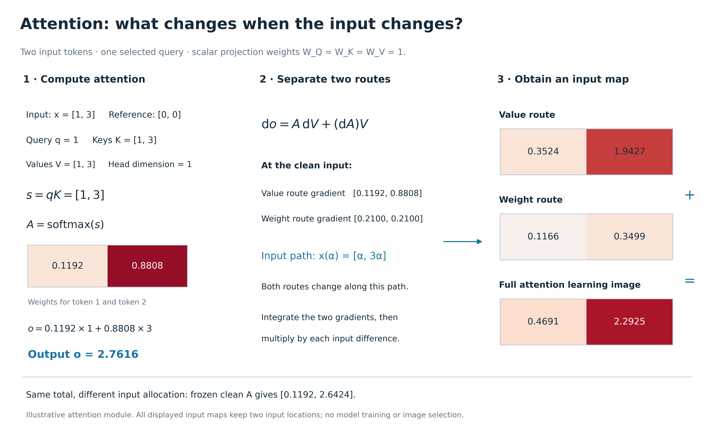
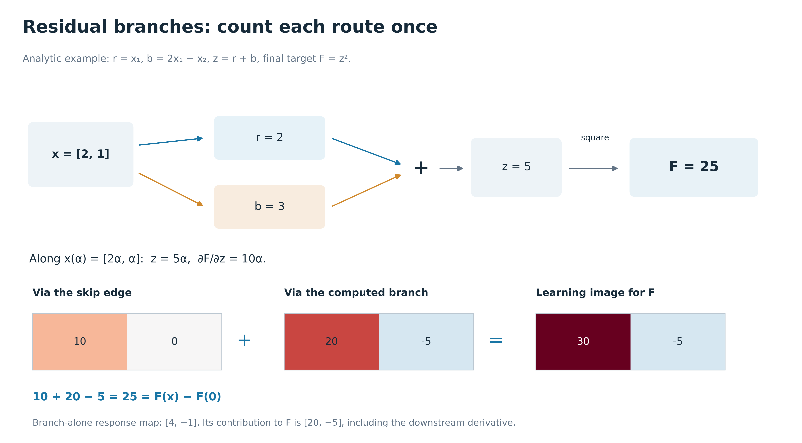
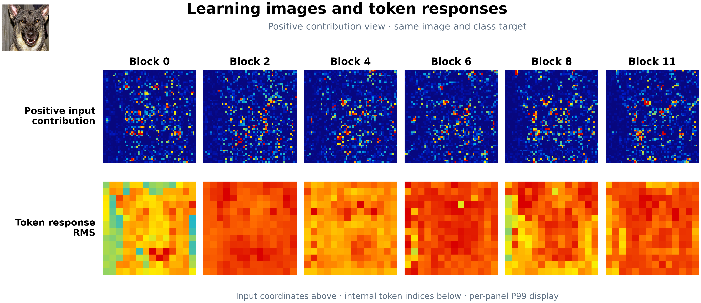

# Attention 与 residual：详细例子和图

[详细公式与逐步计算](../../docs/attention_residual_learning_image_详解_20260917.md) · [画廊](gallery.html) · [原 Figure 15–21](../nns_vit_learning_image_figures_15_21_20260917/gallery.html)

## Image #22

两个 token 的解析 attention 例子。固定选第一个 token 作 query，输入 [1,3]、参考 [0,0]，Q/K/V 标量投影权重均为 1，d_k=1。先算 qK、softmax 和输出，再将输入导数分为 A dV 与 (dA)V 两项。沿直线路径 [α,3α] 采用 Gauss–Legendre 数值积分，得到两个输入位置的完整归因。冻结 clean attention 时的图是另一个条件函数的归因，不等于完整路径中 A dV 那一项。本图是解析示意，不是已训练 ViT 的实测结果。

## Image #23

解析 residual 例子。输入 [2,1]、参考 [0,0]，旁路 r=x₁，分支 b=2x₁−x₂，相加 z=r+b，最终目标 F=z²。沿路径 z=5α，下游导数为 10α。分别经过旁路和分支的输入贡献为 [10,0] 和 [20,−5]，和为 [30,−5]，总和 25 恢复目标差值。分支对 F 的贡献包括下游导数，因此不同于它自身响应的 [4,−1]。两格固定表示输入位置 1 和 2。

## Image #19

Figure 19 的正贡献正文候选版：上排是同一类别目标下的 attention 分支正输入贡献，下排是该分支在 patch tokens 上的 RMS。样本、原始地图、六个 block、逐面板 P99 和 nearest 显示均沿用旧 Figure 19；只去除负幅度行。完整 signed 数据和负图保留在原图组。低值不表示“不重要”，可能为负贡献或较小正贡献。

