# Endpoint-NNSViT 逐图分析

[Gallery](gallery.html) · [Figure index](figure_index.md) · [逐图分析](figure_analysis.md)

## Image #1: Endpoint Scanner method overview

Replaces the process-heavy overview with one real input, one scalar target, the endpoint formula, and the black-bear ground-truth class-logit map.

边界：Blue-base maps are display-normalized shape views; raw arrays and signed companions, not display pixels, define scientific values.

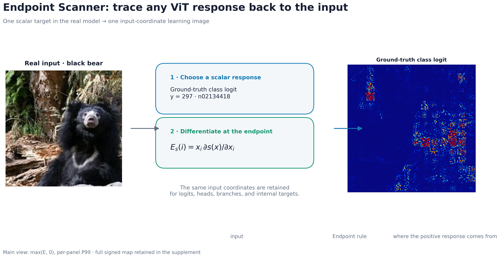

## Image #2: Endpoint, CNN, and Path method identity

Separates Original NNS-CNN, ViT Endpoint, and Path IG by rule, evaluated state, and scientific question.

边界：The figure summarizes existing evidence and does not introduce a new cohort, test, or scientific decision.

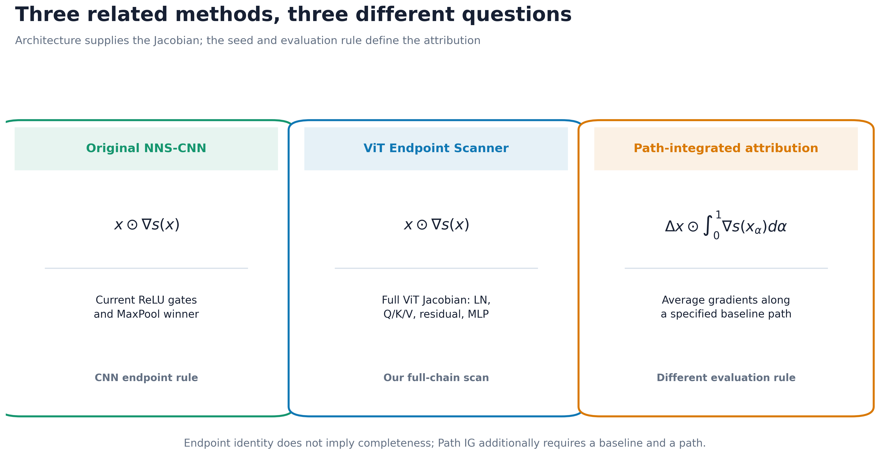

## Image #3: Same target: Endpoint versus Path

Keeps the target fixed and shows exactly where endpoint and path maps diverge after nonlinear attention.

边界：The figure summarizes existing evidence and does not introduce a new cohort, test, or scientific decision.

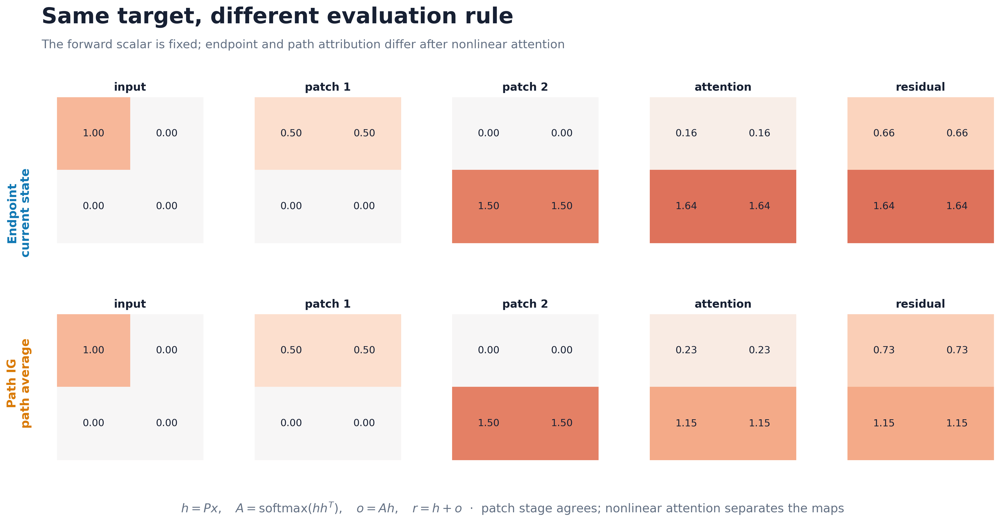

## Image #4: Original CNN endpoint gates

Shows the current ReLU gate and unique MaxPool winner without an overloaded derivation page.

边界：The figure summarizes existing evidence and does not introduce a new cohort, test, or scientific decision.

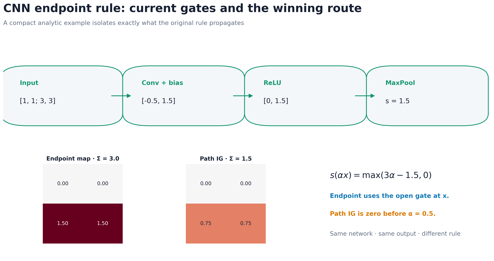

## Image #5: Attention Q/K/V differential paths

Organizes Q, K, V, and full-attention maps as a closure relation rather than a dense formula wall.

边界：The figure summarizes existing evidence and does not introduce a new cohort, test, or scientific decision.

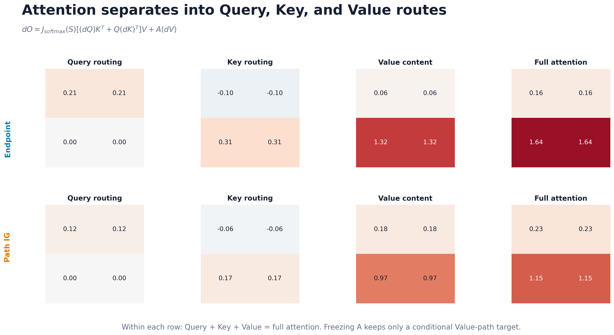

## Image #6: Residual edge accounting

Makes identity-plus-branch accounting and the double-counting failure mode visually explicit.

边界：The figure summarizes existing evidence and does not introduce a new cohort, test, or scientific decision.

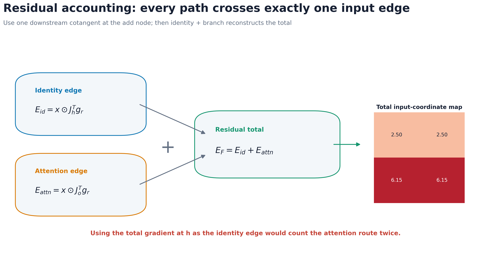

## Image #7: Unit, sum, and energy targets

Contrasts three scalar target definitions; the figure does not treat them as interchangeable visual variants.

边界：The figure summarizes existing evidence and does not introduce a new cohort, test, or scientific decision.

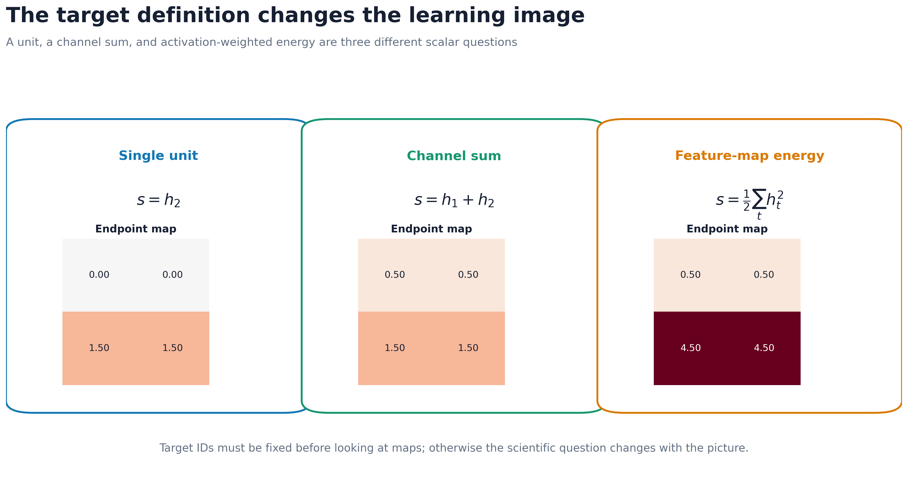

## Image #8: State, seed, and input coordinates

Places canonical Endpoint, baseline-relative Endpoint, and IG in a single state-seed-origin comparison.

边界：The figure summarizes existing evidence and does not introduce a new cohort, test, or scientific decision.

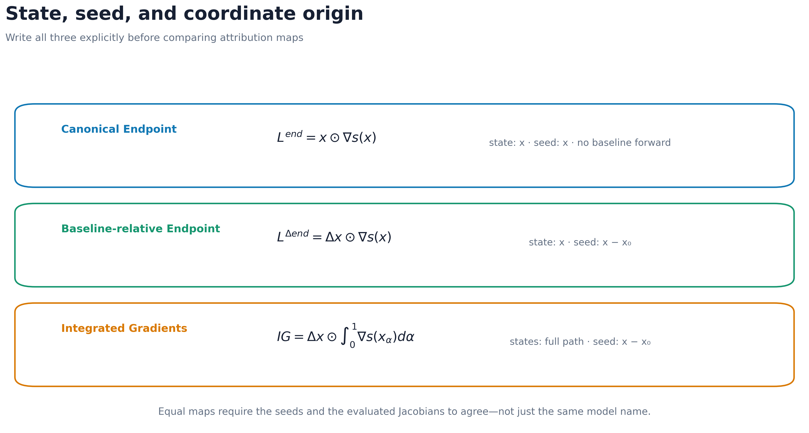

## Image #9: LayerNorm and GELU Jacobians

Pairs the LayerNorm Jacobian with the GELU derivative and removes unrelated analytic clutter.

边界：The figure summarizes existing evidence and does not introduce a new cohort, test, or scientific decision.

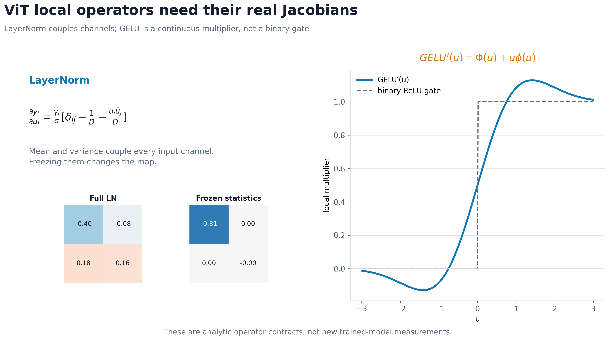

## Image #10: Structured edge cuts

Reduces structured cuts to one graph, one component formula, and one closure condition.

边界：The figure summarizes existing evidence and does not introduce a new cohort, test, or scientific decision.

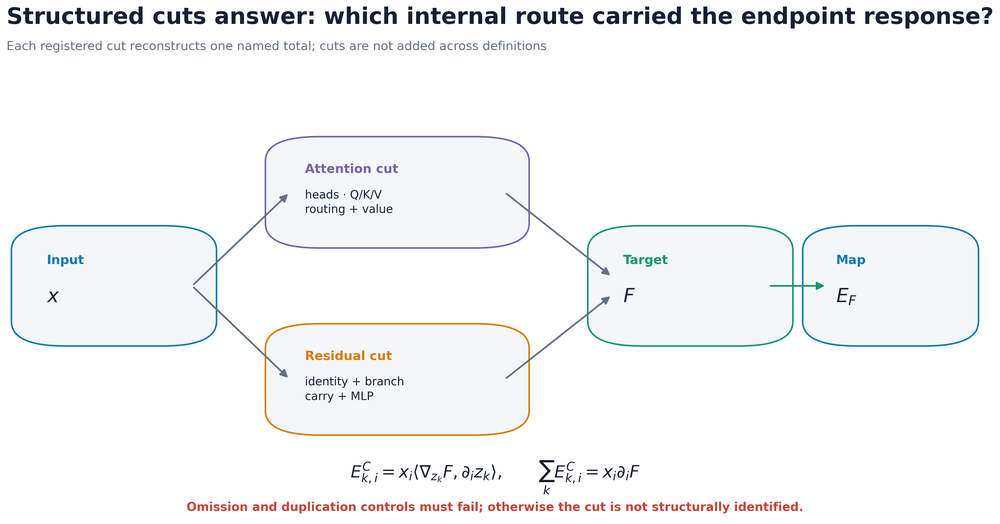

## Image #11: Registered target atlas design

Uses directly labeled horizontal composition bars; counts and model differences are readable without legend hunting.

边界：The figure summarizes existing evidence and does not introduce a new cohort, test, or scientific decision.

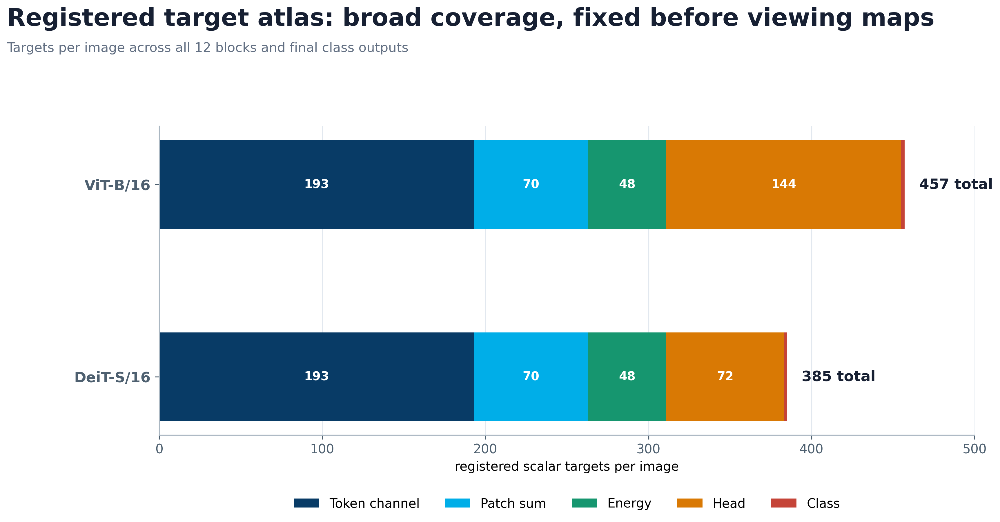

## Image #12: Black-bear class-logit maps across models

Uses the fixed black-bear display sample for both models and the ground-truth class logit in the R10 blue-base positive view.

边界：Blue-base maps are display-normalized shape views; raw arrays and signed companions, not display pixels, define scientific values.

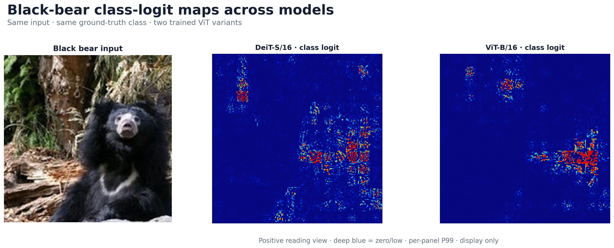

## Image #13: Black-bear multi-target atlas

Uses the same black-bear input and six preregistered targets, with blue-base positive main panels and a signed supplement.

边界：Blue-base maps are display-normalized shape views; raw arrays and signed companions, not display pixels, define scientific values.

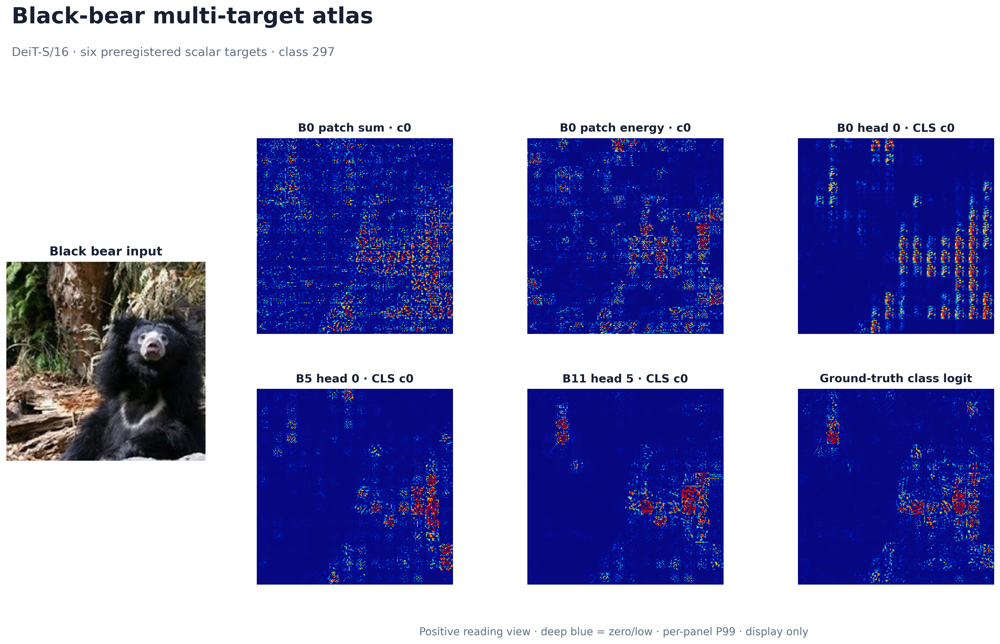

## Image #14: Scan scale, latency, and resources

Recasts counts and latency as two labeled dot-range panels with the total workload in the subtitle.

边界：The figure summarizes existing evidence and does not introduce a new cohort, test, or scientific decision.

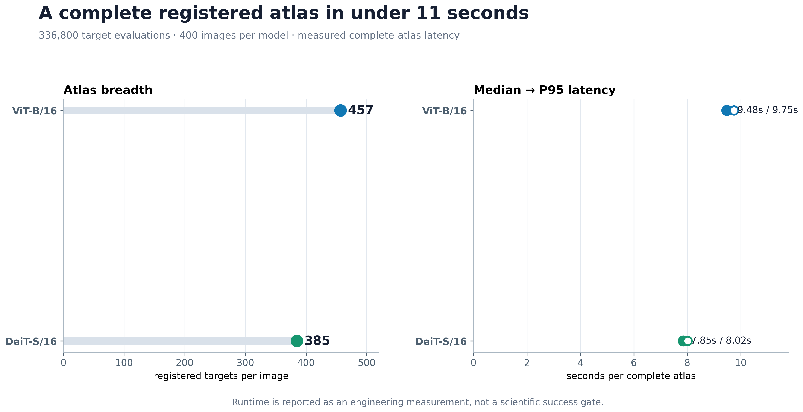

## Image #15: Structural closure contracts

Inherited byte-for-byte from a verified source package and reorganized under the main-figure directories.

边界：The figure summarizes existing evidence and does not introduce a new cohort, test, or scientific decision.

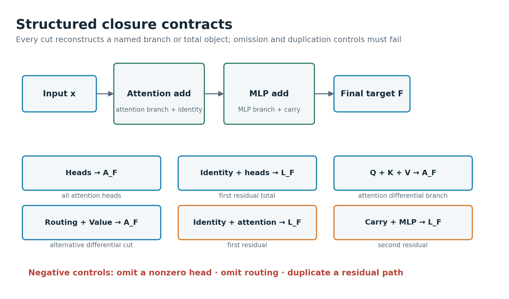

## Image #16: Formal closure and negative controls

Uses three evidence cards and a tolerance utilization bar instead of incomparable raw-height bars.

边界：The figure summarizes existing evidence and does not introduce a new cohort, test, or scientific decision.

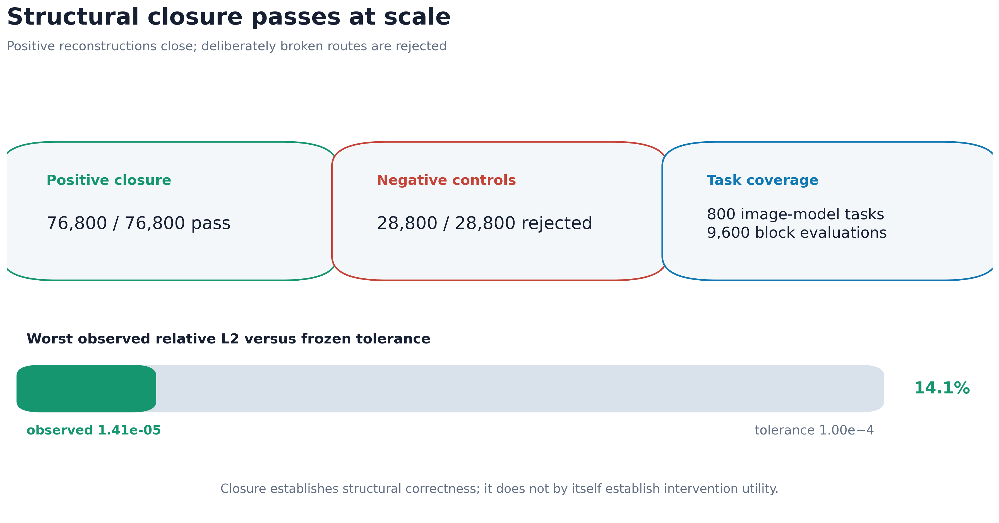

## Image #17: Black-bear structural component maps

Uses black-bear block-5 raw component arrays in the blue-base positive reading view; signed maps remain supplemental.

边界：Blue-base maps are display-normalized shape views; raw arrays and signed companions, not display pixels, define scientific values.

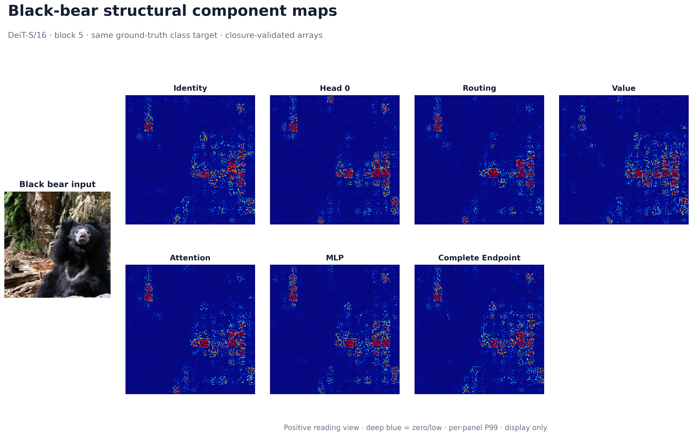

## Image #18: Condition-scaled analytic JVP checks

Summarizes all analytic JVP checks with coverage, pass count, and worst threshold utilization instead of an unreadable scatter cloud.

边界：The figure summarizes existing evidence and does not introduce a new cohort, test, or scientific decision.

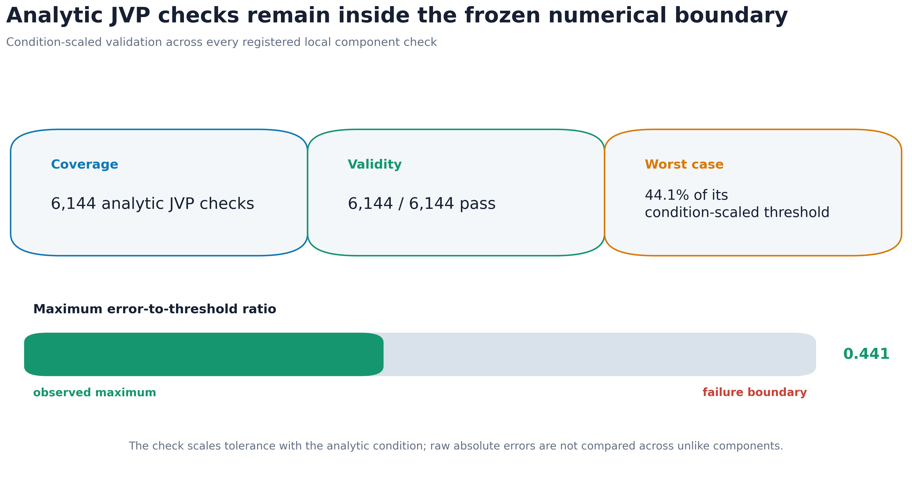

## Image #19: Matched finite activation replacement

Inherited byte-for-byte from a verified source package and reorganized under the main-figure directories.

边界：The figure summarizes existing evidence and does not introduce a new cohort, test, or scientific decision.

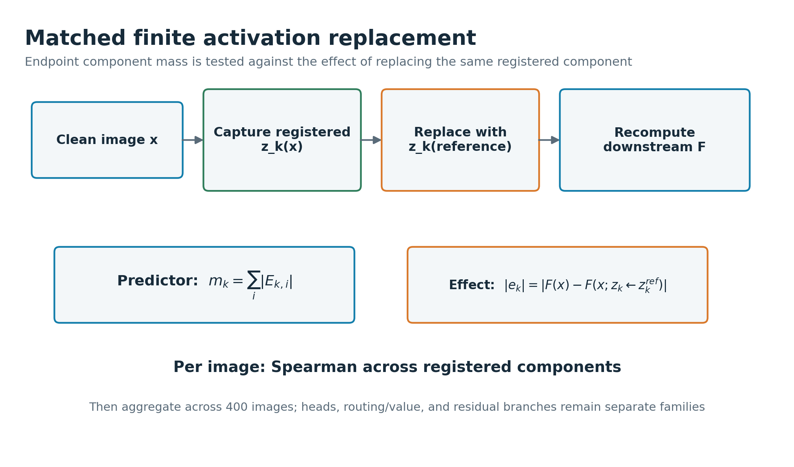

## Image #20: C4a family estimates and intervals

Shortens family labels, groups rows, shades the registered support region, and labels estimates directly.

边界：The figure summarizes existing evidence and does not introduce a new cohort, test, or scientific decision.

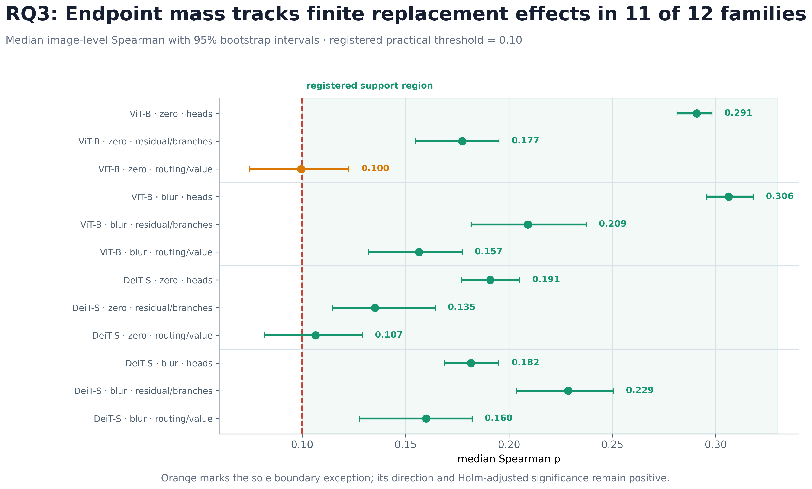

## Image #21: RQ3 threshold zoom and boundary exception

Shows the 11-of-12 decision and the 0.000435 threshold miss without a redundant count bar.

边界：The figure summarizes existing evidence and does not introduce a new cohort, test, or scientific decision.

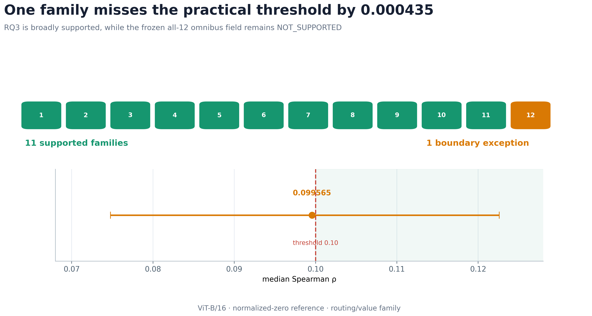

## Image #22: Endpoint and registered secondary predictors

Retains the full predictor matrix while outlining the registered Endpoint column and clarifying that the remaining predictors are descriptive.

边界：The figure summarizes existing evidence and does not introduce a new cohort, test, or scientific decision.

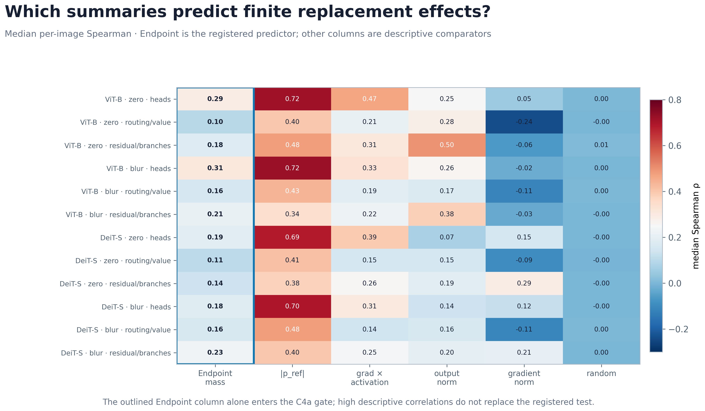

## Image #23: Spatial intervention protocol

Inherited byte-for-byte from a verified source package and reorganized under the main-figure directories.

边界：The figure summarizes existing evidence and does not introduce a new cohort, test, or scientific decision.

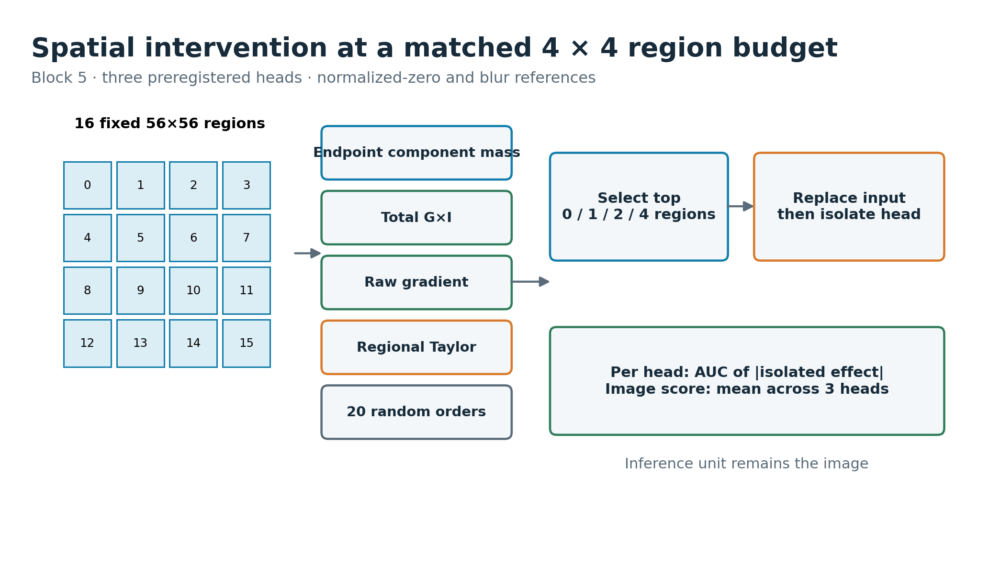

## Image #24: Black-bear block-5 maps for spatial ranking

Uses black-bear spatial-ranking arrays and a consistent blue-base positive reading view; signed maps remain supplemental.

边界：Blue-base maps are display-normalized shape views; raw arrays and signed companions, not display pixels, define scientific values.

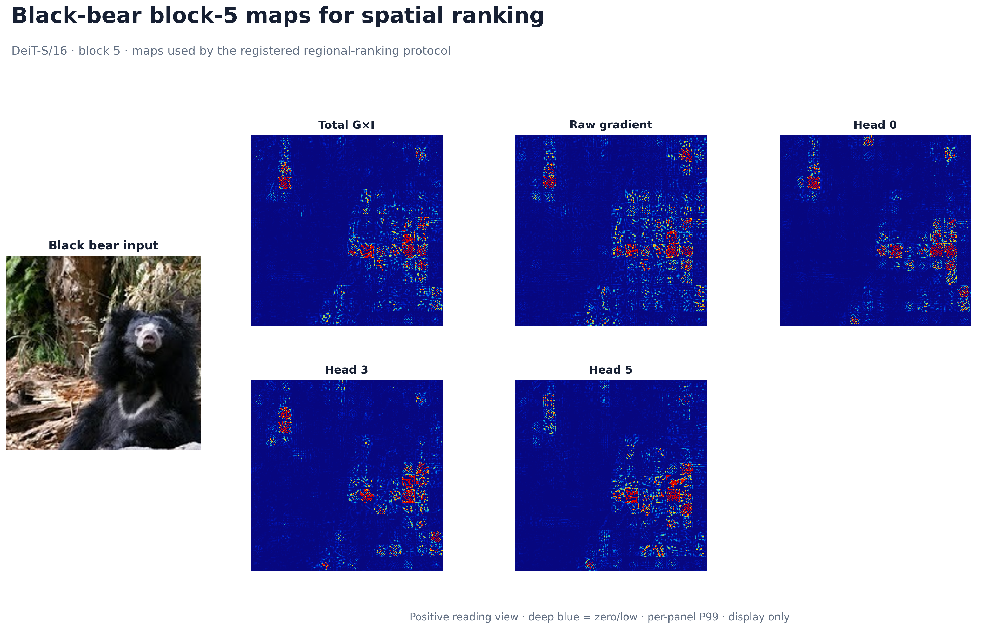

## Image #25: One-image spatial effect curves

Uses the black-bear task and a clean emphasis hierarchy for the single-image regional intervention curves.

边界：The figure summarizes existing evidence and does not introduce a new cohort, test, or scientific decision.

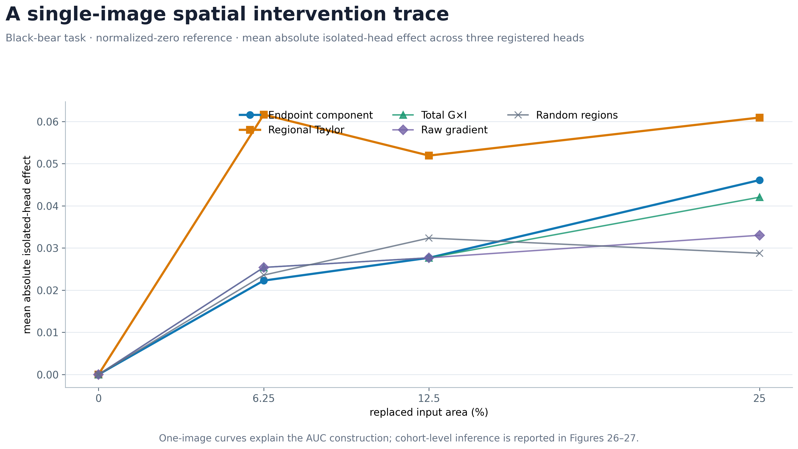

## Image #26: C4b mandatory-baseline contrasts

Shortens all sixteen contrast labels, groups the four study families, and marks zero and the registered +0.05 region separately.

边界：The figure summarizes existing evidence and does not introduce a new cohort, test, or scientific decision.

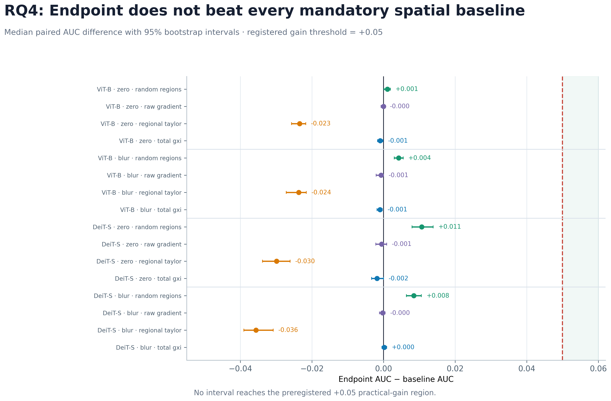

## Image #27: RQ4 family summary

Keeps the exact paired-difference matrix but highlights the regional-Taylor column that dominates all four families.

边界：The figure summarizes existing evidence and does not introduce a new cohort, test, or scientific decision.

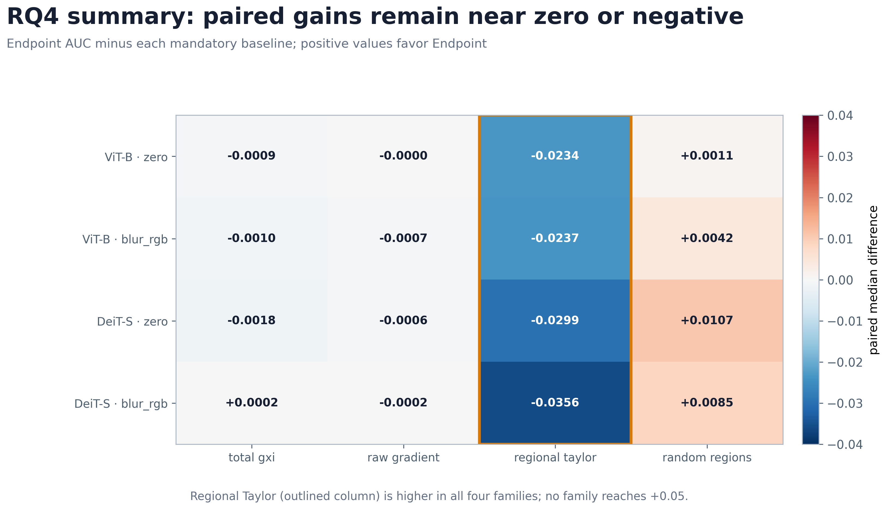

## Image #28: Identity–Correctness–Utility conclusion

Inherited byte-for-byte from a verified source package and reorganized under the main-figure directories.

边界：The figure summarizes existing evidence and does not introduce a new cohort, test, or scientific decision.

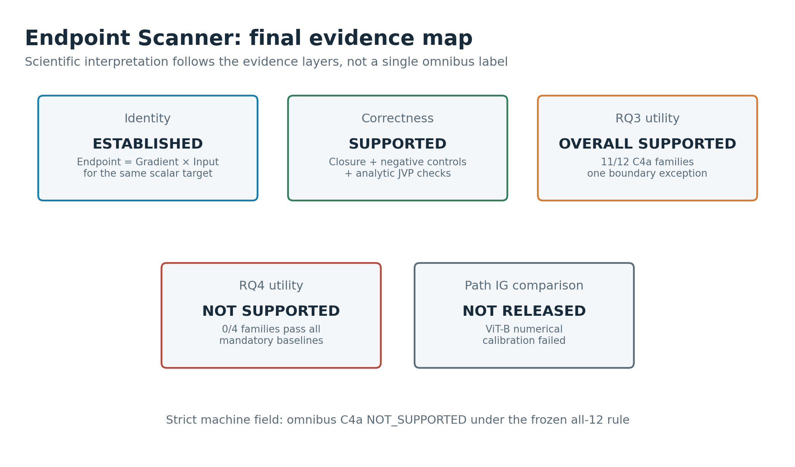

## Image #29: M3 block trajectories

Replots the four depth metrics with a common model palette, consistent intervals, and aligned block axes.

边界：The figure summarizes existing evidence and does not introduce a new cohort, test, or scientific decision.

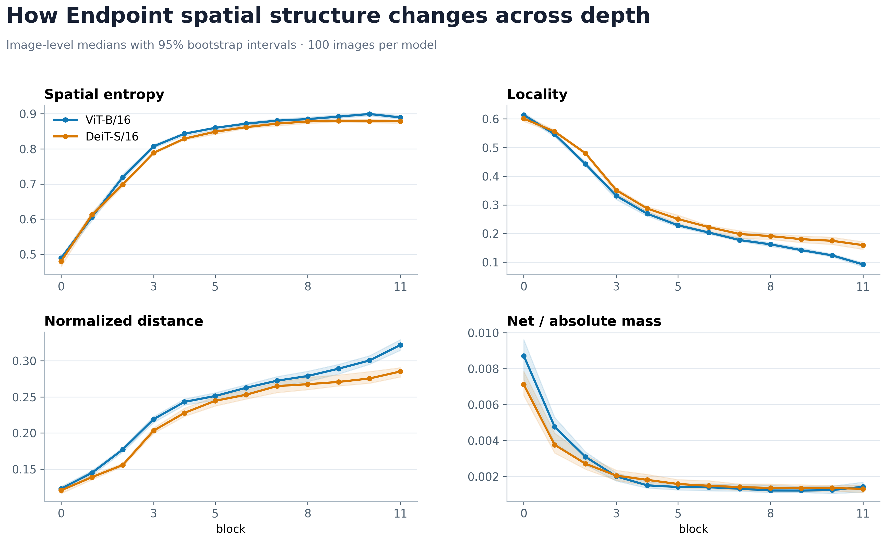

## Image #30: M3 CLS-minus-patch entropy by block

Emphasizes the shared depth trend and directly labels the final-block differences.

边界：The figure summarizes existing evidence and does not introduce a new cohort, test, or scientific decision.

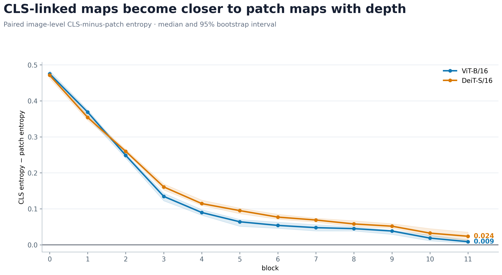

## Image #31: M3 cancellation scales

Uses aligned small multiples and one model legend for the four nested cancellation scales.

边界：The figure summarizes existing evidence and does not introduce a new cohort, test, or scientific decision.

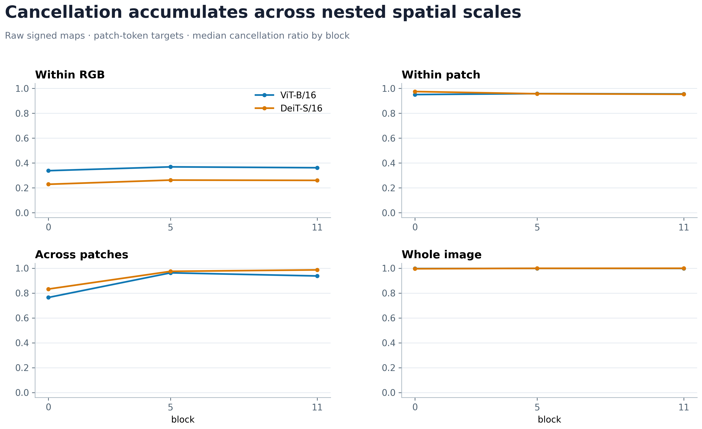

## Image #32: Original-NNS versus Endpoint numerical equivalence

Uses a horizontal log-scale dumbbell plot so float32 and float64 precision are comparable across five network families.

边界：The figure summarizes existing evidence and does not introduce a new cohort, test, or scientific decision.

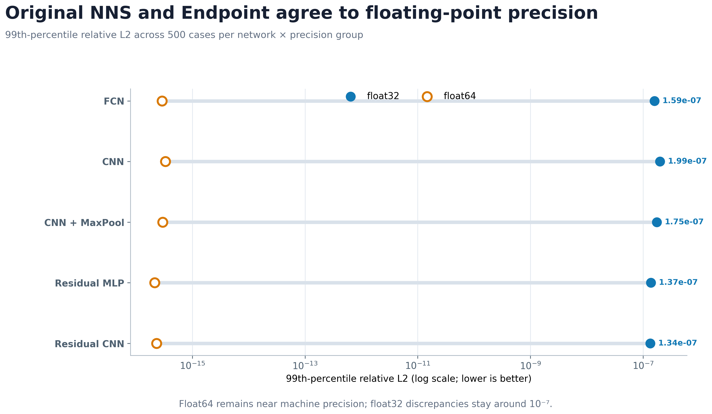

## Image #33: M3 finite-difference diagnostics

Uses the same precision palette as Figure 32 and a clear log-log finite-difference diagnostic with interval bands.

边界：The figure summarizes existing evidence and does not introduce a new cohort, test, or scientific decision.

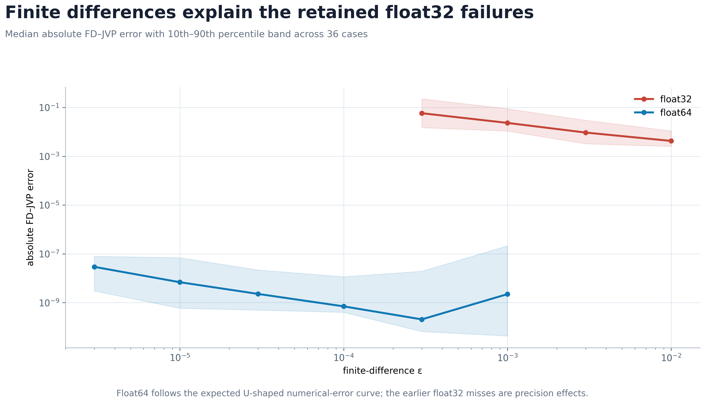

## Image #34: Endpoint target atlas: real fine-grained learning images

Inherited byte-for-byte from a verified source package and reorganized under the main-figure directories.

边界：Blue-base maps are display-normalized shape views; raw arrays and signed companions, not display pixels, define scientific values.

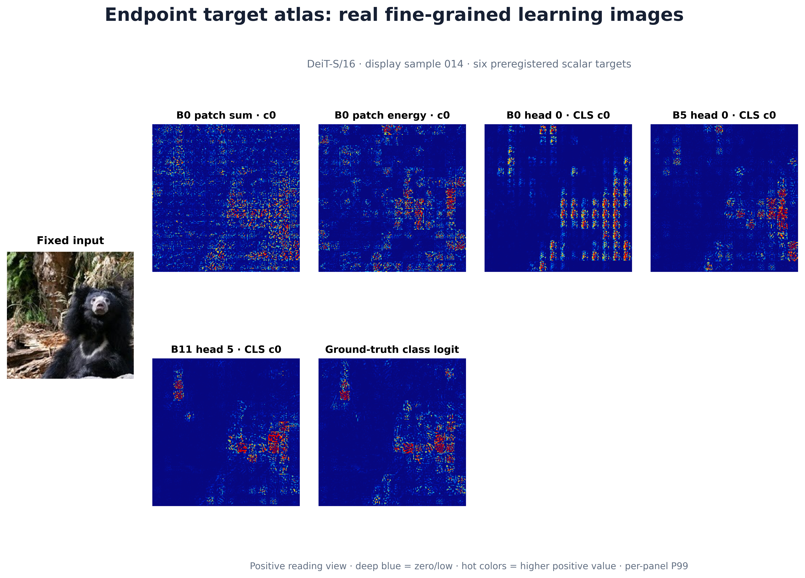

## Image #35: Block 5 structural Endpoint learning images

Inherited byte-for-byte from a verified source package and reorganized under the main-figure directories.

边界：Blue-base maps are display-normalized shape views; raw arrays and signed companions, not display pixels, define scientific values.

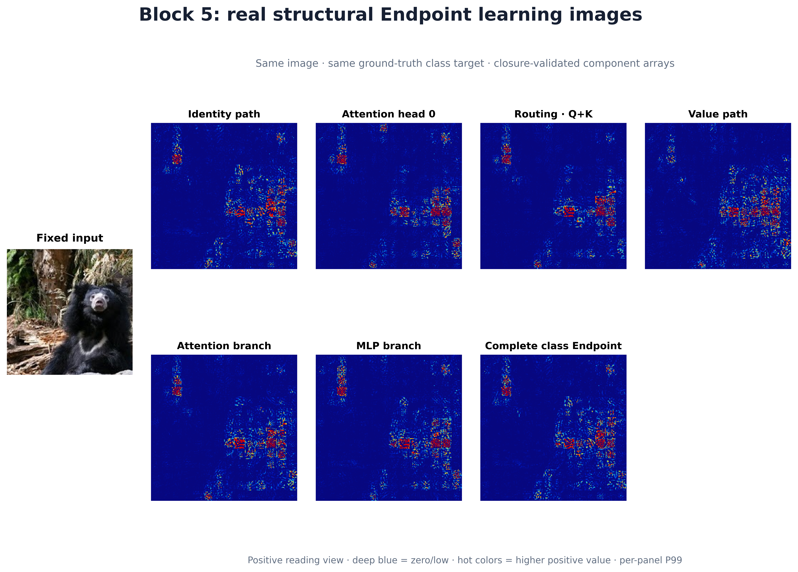

## Image #36: Block 5 maps used for spatial ranking

Inherited byte-for-byte from a verified source package and reorganized under the main-figure directories.

边界：Blue-base maps are display-normalized shape views; raw arrays and signed companions, not display pixels, define scientific values.

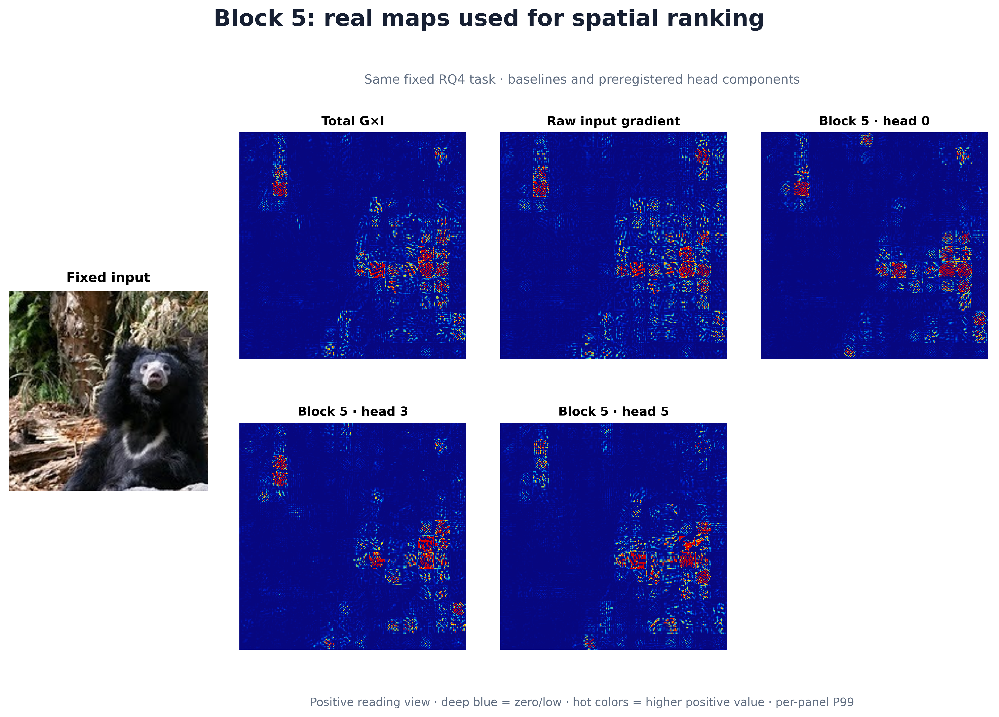

## Image #37: Endpoint-NNSViT across depth

Inherited byte-for-byte from a verified source package and reorganized under the main-figure directories.

边界：Blue-base maps are display-normalized shape views; raw arrays and signed companions, not display pixels, define scientific values.

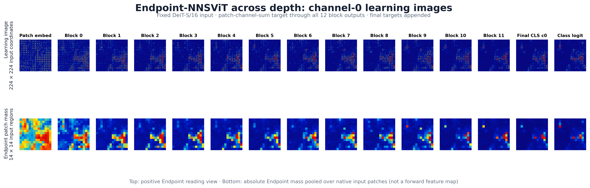

## Image #38: Endpoint-NNSViT across heads and depth

Inherited byte-for-byte from a verified source package and reorganized under the main-figure directories.

边界：Blue-base maps are display-normalized shape views; raw arrays and signed companions, not display pixels, define scientific values.

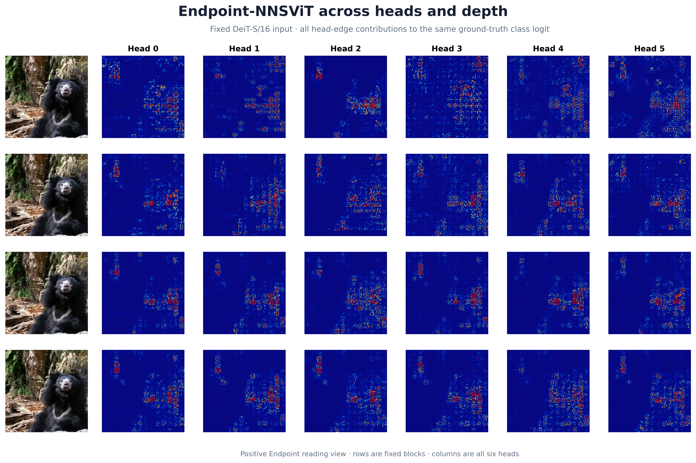

## Image #39: ViT-B/16 Endpoint across heads and depth

Inherited byte-for-byte from a verified source package and reorganized under the main-figure directories.

边界：Blue-base maps are display-normalized shape views; raw arrays and signed companions, not display pixels, define scientific values.

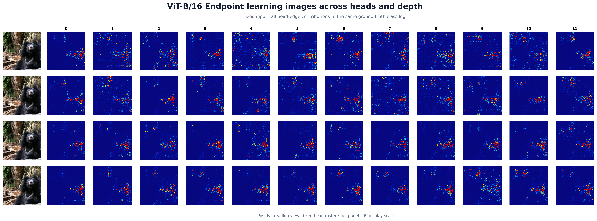

## Image #40: Endpoint-NNSViT through the real module chain

Inherited byte-for-byte from a verified source package and reorganized under the main-figure directories.

边界：Blue-base maps are display-normalized shape views; raw arrays and signed companions, not display pixels, define scientific values.

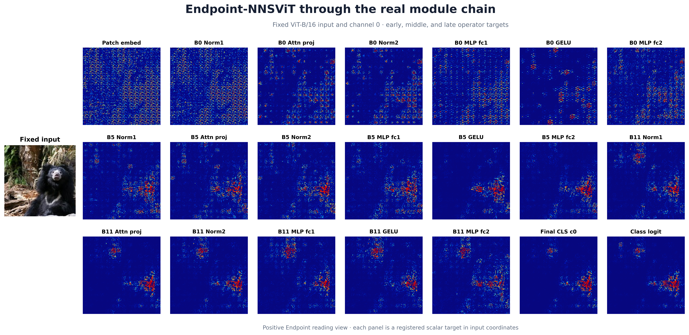

