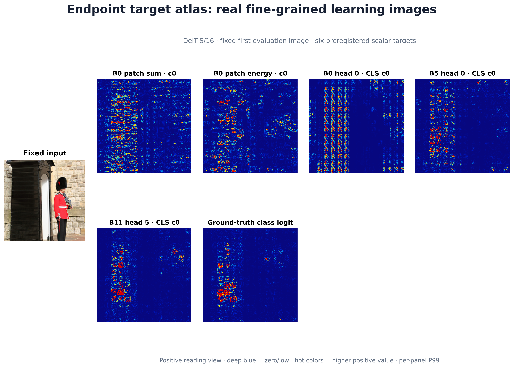
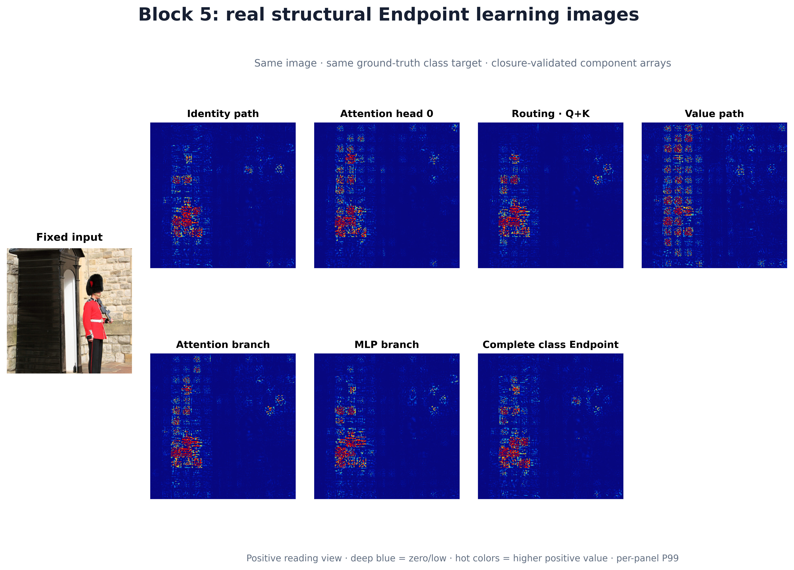
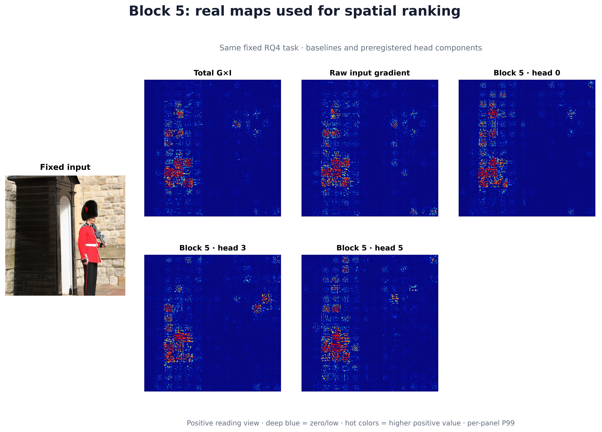
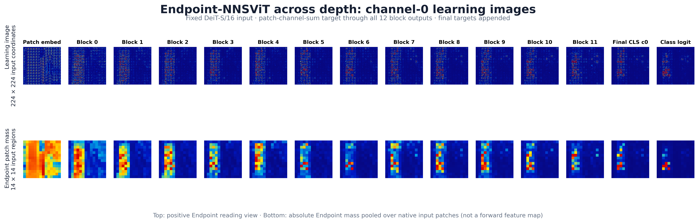
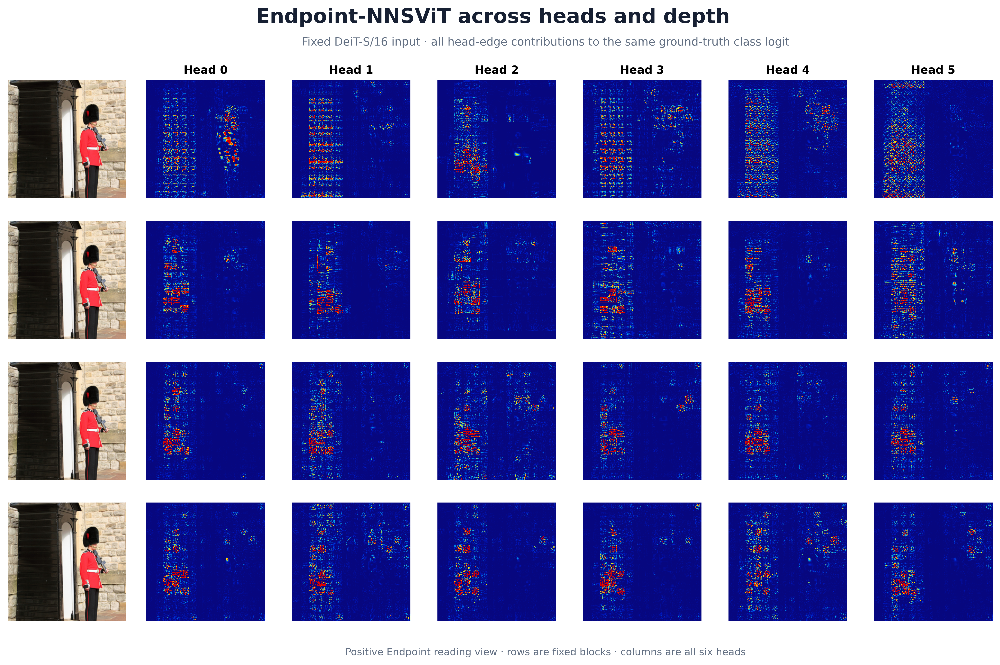
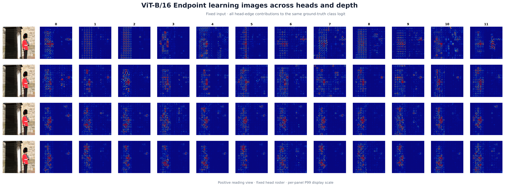
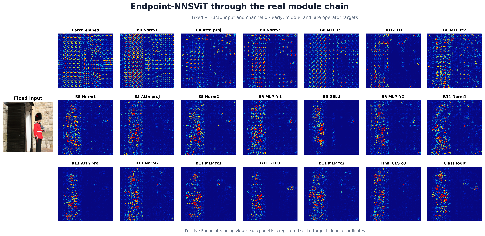

# Endpoint 细粒度蓝底图逐图分析

## Image #1: Endpoint target atlas: real fine-grained learning images

固定第一张 DeiT-S/16 evaluation 图像的六个注册标量目标。蓝底主图只显示正部，逐面板 P99 缩放；它是空间阅读视图，不用于跨目标比较强度。

[Signed companion](signed_companions_png/figure_34_registered_target_learning_images_signed.png)

## Image #2: Block 5: real structural Endpoint learning images

同一图像、同一 ground-truth 类别目标、同一 block 5 的 identity、head、routing、value、attention、MLP 与完整 Endpoint。各图直接来自通过闭合验证的 raw component arrays。

[Signed companion](signed_companions_png/figure_35_block5_structural_learning_images_signed.png)

## Image #3: Block 5: real maps used for spatial ranking

RQ4 固定任务使用的 total G×I、raw gradient 与三个注册 head component map。图只解释排序输入的细粒度空间形态，行为结论仍由有限干预曲线决定。

[Signed companion](signed_companions_png/figure_36_spatial_ranking_learning_images_signed.png)

## Image #4: Endpoint-NNSViT across depth

参考 NNS 论文 Figure 13 的跨层结构，展示固定 DeiT-S/16 输入从 patch embedding、Block 0–11 到 final CLS 与类别 logit 的 Endpoint learning image。下排是由同一 raw Endpoint map 在原生 16×16 input patches 内汇总得到的 14×14 absolute mass，不是 forward feature map。

[Signed companion](signed_companions_png/figure_37_channel0_depth_progression_signed.png)

## Image #5: Endpoint-NNSViT across heads and depth

固定 DeiT-S/16 输入在 Block 0、1、5、11 的全部六个 attention heads。每格是相应 head edge 对同一个 ground-truth class logit 的 224×224 Endpoint contribution map；行比较深度、列比较 head index，显示尺度逐面板独立。

[Signed companion](signed_companions_png/figure_38_attention_head_depth_atlas_signed.png)

## Image #6: ViT-B/16 Endpoint across heads and depth

固定 ViT-B/16 输入在 Block 0、1、5、11 的全部十二个 attention heads。每格解释同一个 ground-truth class logit，因此可在共同目标下比较各 head 的空间形态；完整 12-block × 12-head 页面保留在 all_heads_vit_b16/。

[Signed companion](signed_companions_png/figure_39_vit_b16_attention_head_depth_atlas_signed.png)

## Image #7: Endpoint-NNSViT through the real module chain

固定 ViT-B/16 输入和 channel 0，展示 patch embedding、Block 0/5/11 的 Norm1、attention projection、Norm2、MLP fc1、GELU、fc2，以及 final CLS 和类别 logit。它对应 NNSViT-IG Figure 28–34 的模块链阅读方式，但使用 Endpoint 标量目标。

[Signed companion](signed_companions_png/figure_40_vit_b16_module_chain_signed.png)
