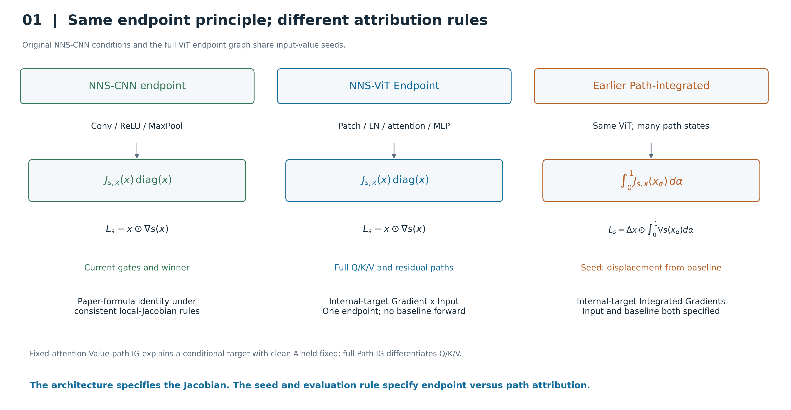
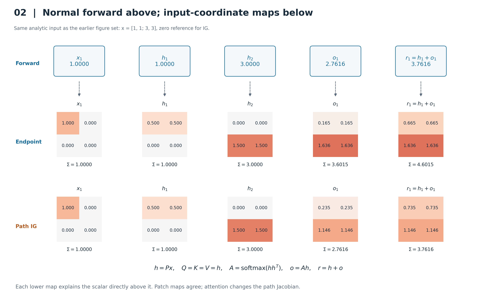
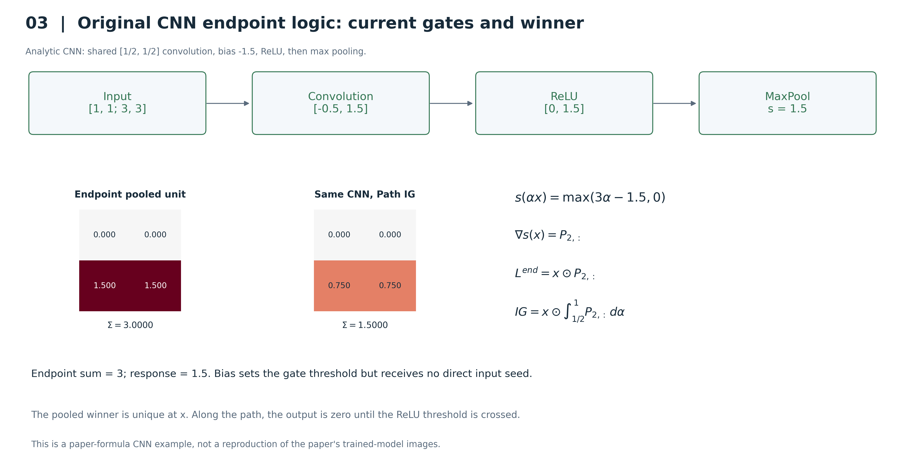
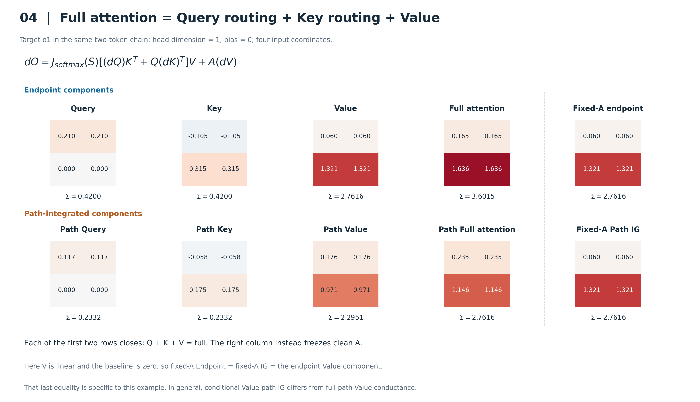
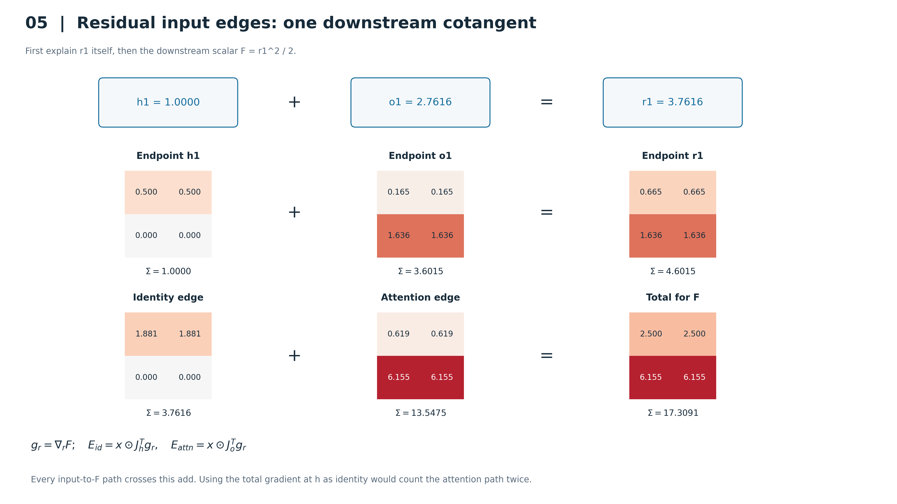
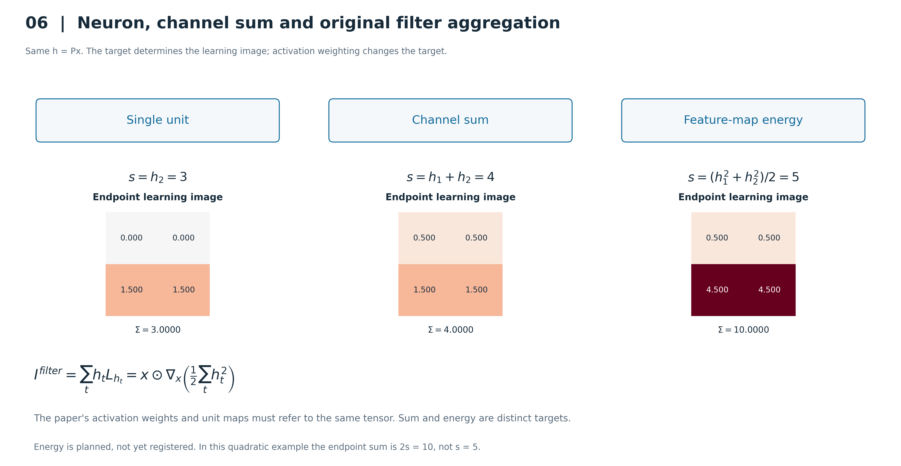
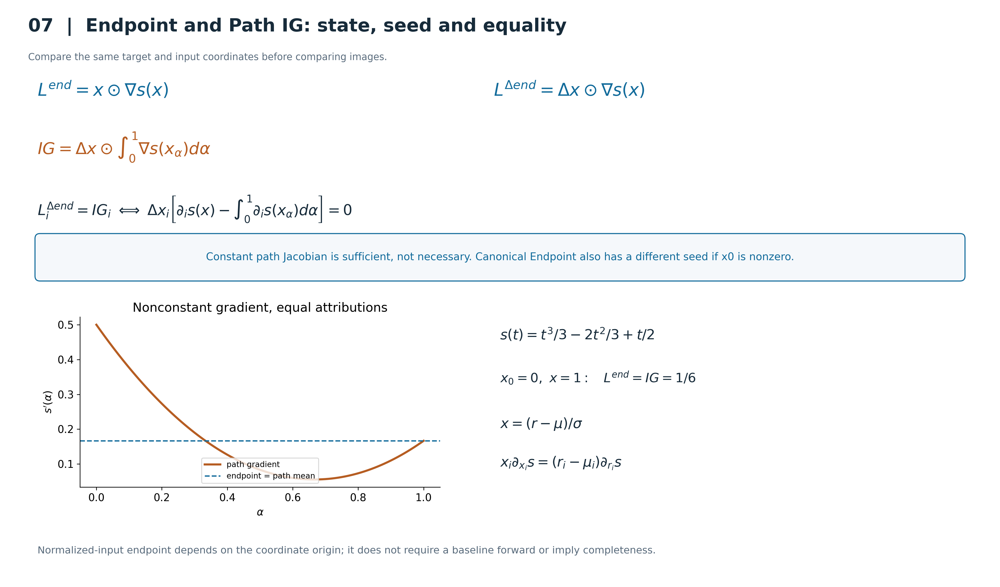
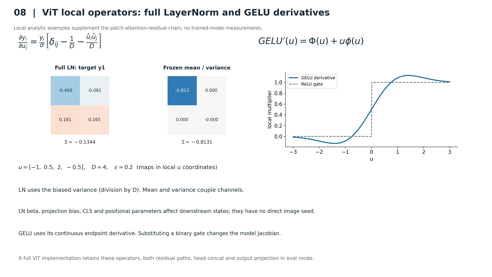
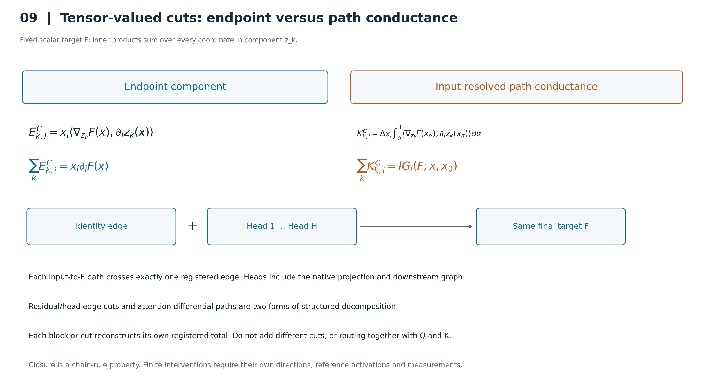

# Endpoint / Path / NNS-CNN：数学对比图

[图册](gallery.html) · [论文规划](../../docs/NNS_ViT_Endpoint_Scanner论文思路与规划与步骤_20260918.md) · [数学分析](../../docs/NNS_ViT_Endpoint_Scanner数学分析与方法对比_20260918.md)

本图包全部为可复算的解析示意。红为正、蓝为负、白为零；格内数字是未经显示归一化的数值。Figure 2–6 各图内部使用固定对称色标（Residual 的两种目标分排设色标），颜色跨图不比较大小。

## Image #1：三种方法的身份

NNS-CNN 与 Endpoint Scanner 共享输入值 seed 和当前点 Jacobian；ViT 增加新的局部算子。此前完整 Path IG 改用输入差值和路径平均 Jacobian。原 NNS-CNN 等价限定为门控一致的单神经元生成规则；fixed-attention Value-path IG 解释另一个条件目标。

[PNG](figures_png/01_method_identity.png) · [PDF](figures_pdf/01_method_identity.pdf) · [SVG](figures_svg/01_method_identity.svg)

## Image #2：同一前向量的 Endpoint 与 Path 图

上排是实际解析前向值；中排是对应标量的 canonical Endpoint；下排是同一标量的 zero-baseline IG。每图保留四个原始输入位置。Patch 层相等，attention 层不同；Endpoint 的像素和不要求等于上排响应。所有图使用共同色标 [-3,3]，未逐图归一化。

[PNG](figures_png/02_forward_endpoint_path.png) · [PDF](figures_pdf/02_forward_endpoint_path.pdf) · [SVG](figures_svg/02_forward_endpoint_path.svg)

## Image #3：原始 CNN 终点门控

共享卷积核 [0.5,0.5] 加 bias -1.5，经 ReLU 后 max-pool 输出 1.5。终点图像素和为 3；路径在 alpha=0.5 才打开获胜门，因此 IG 和为 1.5。当前 winner 唯一；非激活路径段的零输出不影响积分。这是原论文规则的解析例子，不是训练 CNN 的复现实验。

[PNG](figures_png/03_cnn_endpoint_gates.png) · [PDF](figures_pdf/03_cnn_endpoint_gates.pdf) · [SVG](figures_svg/03_cnn_endpoint_gates.svg)

## Image #4：Attention Q/K/V 完整传播

前四列为 Q、K、V 及其和；上排使用终点，下排沿路径积分。最右列固定 clean A，在本例线性 Value、零参考条件下，两种 fixed-A 方法恰好相等，并等于终点 Value 分量；它不等于完整 attention，也不等于下排 full-path Value 分量。一般上游非线性时该特例等式不成立。

[PNG](figures_png/04_attention_qkv.png) · [PDF](figures_pdf/04_attention_qkv.pdf) · [SVG](figures_svg/04_attention_qkv.svg)

## Image #5：Residual 输入边与下游目标

上排 r1=h1+o1；中排对这个 residual 响应的图逐像素相加。下排改为同一个下游目标 F=r1^2/2，identity/attention 都乘加法器输出 cotangent g_r。每条输入到 F 的路径经过该 add，因此闭合。不同排目标不同；不能把源 h 的总梯度当 identity 再加 branch。

[PNG](figures_png/05_residual_edges.png) · [PDF](figures_pdf/05_residual_edges.pdf) · [SVG](figures_svg/05_residual_edges.svg)

## Image #6：单元、求和与原论文 energy 聚合

单元、channel sum 和 energy 使用同一 h=Px，却定义三个不同标量。原 NNS filter aggregate 的激活加权和对应 energy 的 endpoint 图，前提是权重与单元图使用同一激活张量。二次 energy 的 endpoint 和为 10，即响应 5 的两倍，不具有响应 completeness。图为数学定义演示；当前 scanner 尚未注册 energy kind。

[PNG](figures_png/06_unit_sum_energy.png) · [PDF](figures_pdf/06_unit_sum_energy.pdf) · [SVG](figures_svg/06_unit_sum_energy.svg)

## Image #7：路径、seed 与坐标原点

列出 canonical、baseline-relative endpoint 与 IG 的精确定义。Jacobian 恒定只是相等的充分条件；例子 s(t)=t^3/3-2t^2/3+t/2 在 [0,1] 上梯度变化，但平均值与终点同为 1/6。右下说明 normalized-input 的坐标原点依赖。

[PNG](figures_png/07_path_seed_coordinates.png) · [PDF](figures_pdf/07_path_seed_coordinates.pdf) · [SVG](figures_svg/07_path_seed_coordinates.svg)

## Image #8：LayerNorm 与 GELU 的真实 Jacobian

独立局部例子，地图坐标是当前 LN 输入 u 而非完整图像像素：完整 LN Jacobian 与冻结均值/方差的近似产生不同的输入坐标图。采用总体方差、epsilon=0.2 便于展示，非生产模型参数；gamma=[1,1.2,0.8,1.1]、beta=[0.2,-0.1,0.3,0]。GELU 导数曲线与二值 ReLU 门不同。主解析链省略 LN/MLP，这张补充其真实算子合同。

[PNG](figures_png/08_layernorm_gelu.png) · [PDF](figures_pdf/08_layernorm_gelu.pdf) · [SVG](figures_svg/08_layernorm_gelu.svg)

## Image #9：向量成分的 Endpoint cut 与 Path conductance

成分可以是向量或张量，内积遍历其全部内部坐标。Endpoint 在单点使用 seed x，Path 在路径上使用 seed Δx；完整切面条件在相应求值状态成立时分别闭合到 G×I 和 IG。Head 对最终目标的分解须包含 identity bypass、projection 与下游。它是公式示意，未新增多 head 模型实验。

[PNG](figures_png/09_structured_cuts.png) · [PDF](figures_pdf/09_structured_cuts.pdf) · [SVG](figures_svg/09_structured_cuts.svg)

## 数值与来源

[numeric_data.json](numeric_data.json) 保存输入、前向、完整 Endpoint/IG 图、Q/K/V、CNN、residual、LN/GELU 例子及数值检查。[validation_report.json](validation_report.json) 是解析验证结果；[artifact_manifest.json](artifact_manifest.json) 绑定脚本、文档、原论文文本、旧图数据和全部图文件。

同一旧解析链的 Path 数组按原始 JSON 复核；本轮没有加载训练模型或使用 GPU。