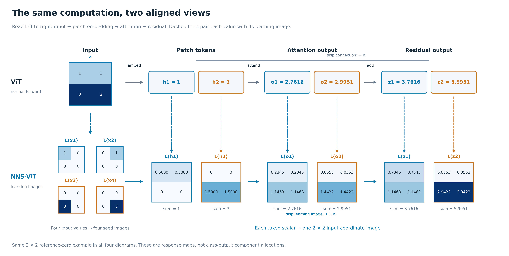
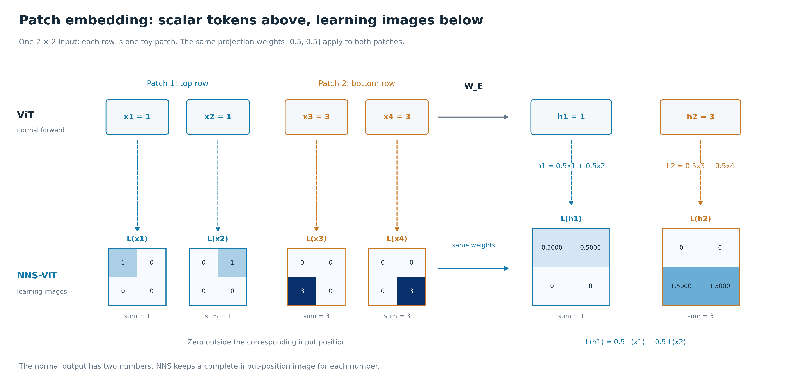
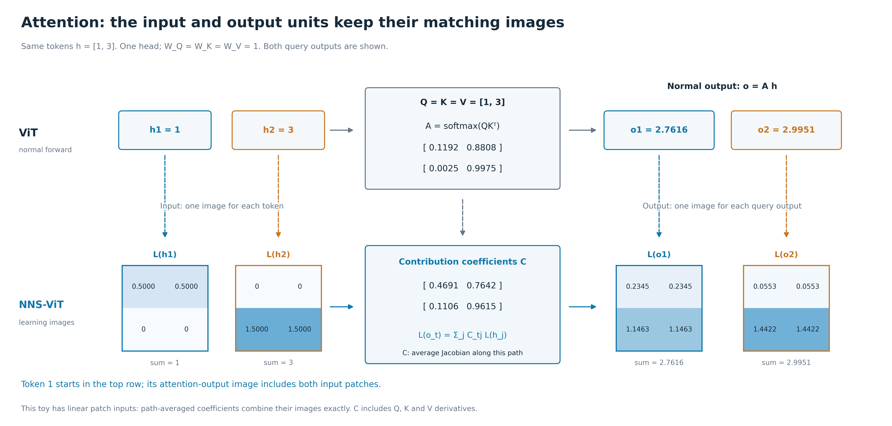
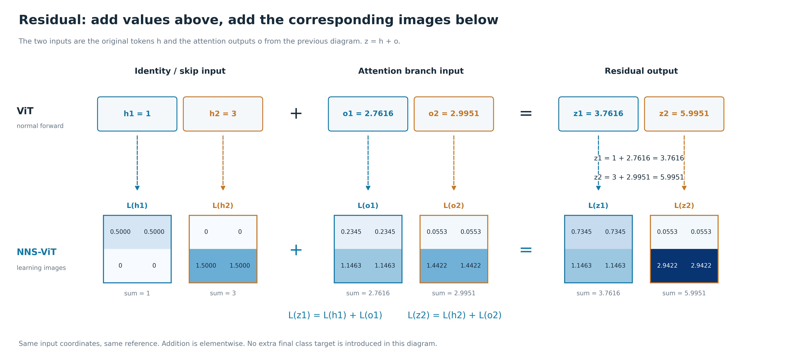

# 正常 ViT 与 NNS learning image：两排逐步对照

[画廊](gallery.html) · [完整读图说明](../../docs/ViT正常前向与NNS学习图像逐步对照_20260917.md)

这四张图使用同一个 2×2 输入和同一条模块链。先看总览，再按 Patch embedding → Attention → Residual 阅读。

## 先看这张：正常前向与 learning image 的两排总览

只看上下对应关系。上排是同一个小网络的正常输入和输出；下排每一张 2×2 小图，都对应正上方同名标量。虚线负责上下对应，横向从 patch embedding 走到 attention，再走到 residual。图中不切换样本，也不切换到另一个最终分类目标。

[PNG](figures_png/01_overview.png) · [PDF](figures_pdf/01_overview.pdf) · [SVG](figures_svg/01_overview.svg)

## Patch embedding：四个输入值与两张 token 学习图

上排：原输入的第一行 [1,1] 平均得到 h1=1，第二行 [3,3] 平均得到 h2=3。下排：h1 对应的图是 [0.5,0.5;0,0]，h2 对应的图是 [0,0;1.5,1.5]。每张图仍保留整张原图的四个位置；不属于这个 patch 的位置在这里是零。

[PNG](figures_png/02_patch_embedding.png) · [PDF](figures_pdf/02_patch_embedding.pdf) · [SVG](figures_svg/02_patch_embedding.svg)

## Attention：输入 token 图怎样对应到输出 token 图

上排输入 h1=1、h2=3，用 attention 矩阵 A 得到 o1≈2.7616、o2≈2.9951。下排左侧就是上一张图得到的 L(h1)、L(h2)，用图中明确列出的贡献系数 C 逐格加权，得到各输出单元的 L(o1)、L(o2)。o1 的图从只含上半输入扩展到两块输入都有贡献。C 沿路径追踪 Q/K/V，在这个线性 patch 输入例子中可直接组合两张图；一般非线性上游需要保留路径上的位置导数。

[PNG](figures_png/03_attention.png) · [PDF](figures_pdf/03_attention.pdf) · [SVG](figures_svg/03_attention.svg)

## Residual：上面两个数相加，下面两张图逐格相加

这次上排和下排执行同一种“逐项相加”关系。上排 z1=h1+o1、z2=h2+o2；下排 L(z1)=L(h1)+L(o1)、L(z2)=L(h2)+L(o2)，对同一位置的格子相加。图中两个 residual 输出都能从前一张 attention 图接过来。

[PNG](figures_png/04_residual.png) · [PDF](figures_pdf/04_residual.pdf) · [SVG](figures_svg/04_residual.svg)
