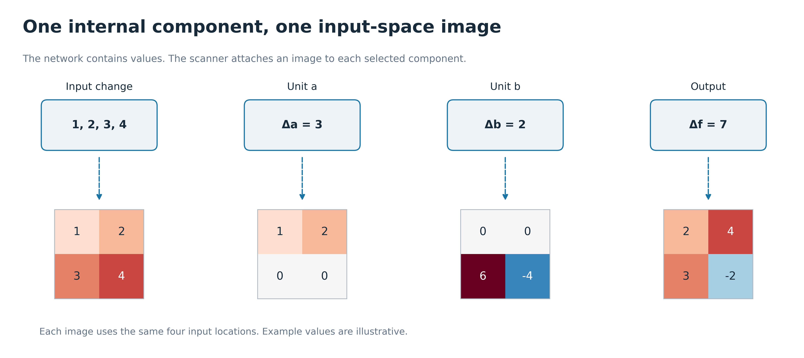
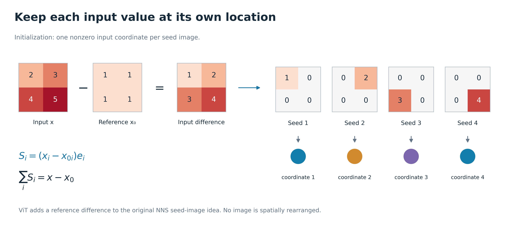
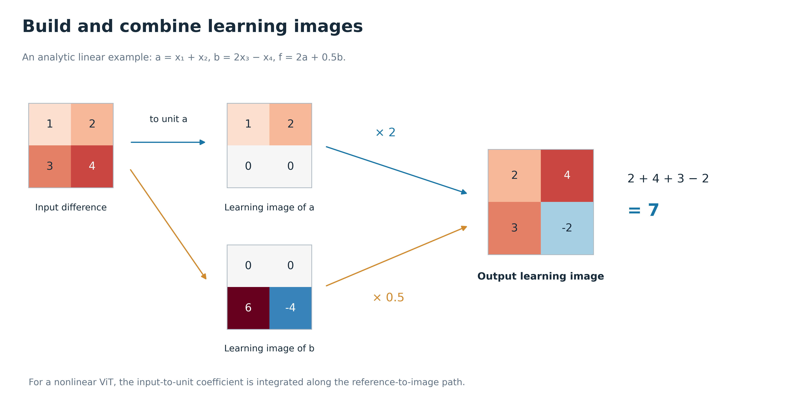
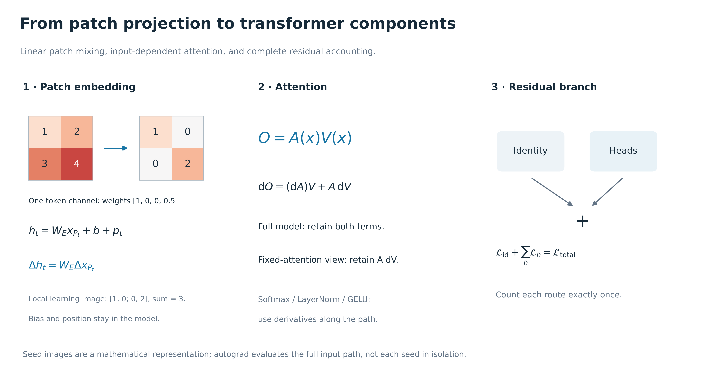
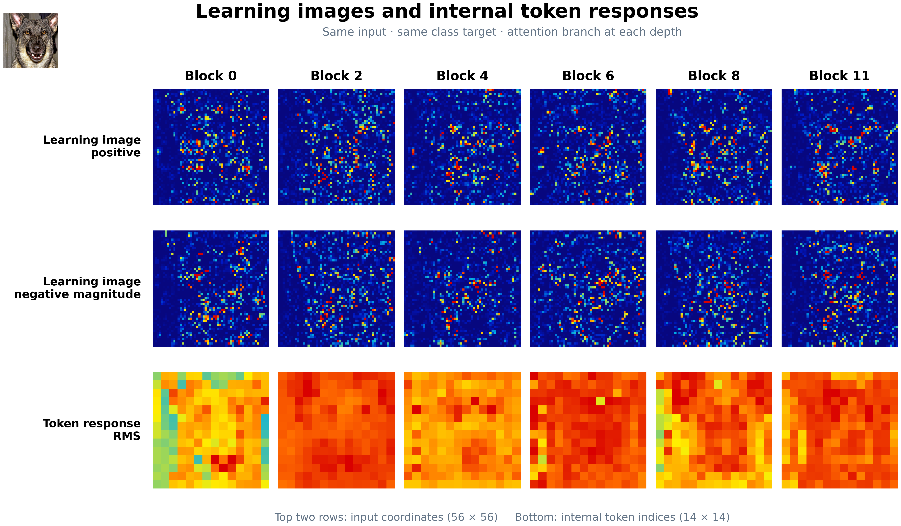
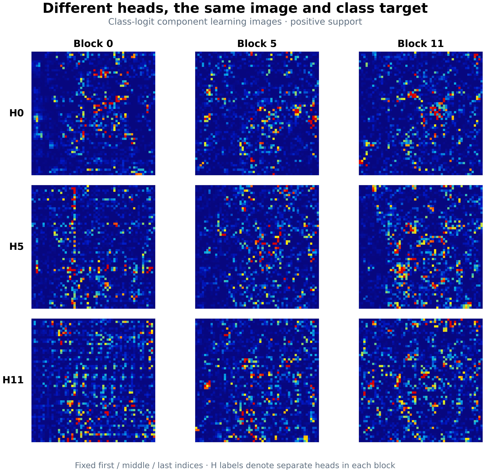
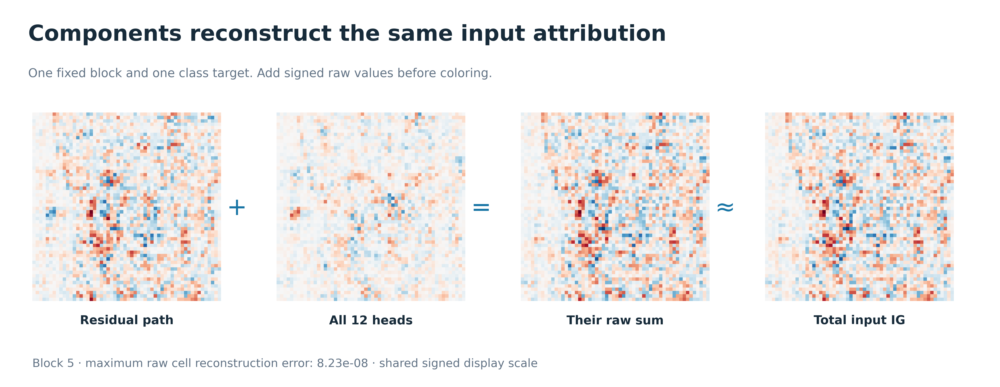

# NNS-ViT 与 learning image：Figure 15–21

NNS-ViT 是把 NNS 的内部单元可视化思路用于 Vision Transformer 的方法体系；它给选定的内部响应或组件配一张保持输入坐标的贡献图。learning image 就是这张图。

本组 Figure 15–18 用数学例子讲清原理；Figure 19–21 使用完整类别目标下的真实 NNS-v2 组件图。原 Figure 1–14 在 [R8 画廊](../nns_vit_unified_paper_figures_r8_20260916/gallery.html)。

## Image #15: One internal component, one input-space image

把网络里的一个数和一张输入位置图配起来。上面是内部响应的变化量，下面说明这次变化来自输入的哪几个位置。四张图始终用同一套位置坐标。这张采用可手算的线性示例，不是 ViT 实测结果。

## Image #16: Keep each input value at its own location

先用原图减去参考图，得到这次需要解释的输入变化。然后拆成四张小图，每张只保留一个位置，其余位置为零；四张相加正好恢复输入差值。真实 RGB 输入对应每个像素的三个通道。实现用自动微分计算这些位置的贡献，不必真的存下十几万张稀疏图。

## Image #17: Build and combine learning images

沿用上一图的输入差值。单元 a 的图是 [1,2;0,0]，单元 b 的图是 [0,0;6,-4]。输出用 2a+0.5b，因此输出图是 [2,4;3,-2]，总和为 7。你可以看见数值被重新加权，但原来的位置始终没丢。ViT 的系数还随输入变化，所以实际方法要沿参考到原图的路径累计。

## Image #18: From patch projection to transformer components

Patch embedding 可以先按线性连接理解；位置编码和偏置仍保留在模型里。到了 attention，输入既会改变注意力权重 A，也会改变 Value，完整方法需要两部分导数。最后 residual 旁路也要算，才能把贡献账算完整。旧的固定 attention 图只研究其中一个条件视角。

## Image #19: Learning images and internal token responses

这张对应原论文 Figure 13 的上下对照读法。上面两行是同一类别目标的 attention 分支 learning image：正贡献和负贡献分开看；下面是同一分支输出在各个 token 上的响应强度。前者回答“输入哪里贡献了多少”，后者回答“内部哪个 token 的向量较大”。它们使用不同坐标，不能要求长得一样。每列换一个 block，始终保持同一张输入和同一个类别目标。

## Image #20: Different heads, the same image and class target

固定同一输入和最终类别，比较不同 head 分到的输入贡献。每个小图是一个 head 的成分 learning image，这比换不同 head 自身的响应目标更适合看共同任务下的差异。图中保留 H0/H5/H11、B0/B5/B11 这些固定位置，完整逐 block 12-head 图另附。颜色逐面板缩放，亮度不用于排名。

## Image #21: Components reconstruct the same input attribution

同一个 block 的 residual 旁路图，加上全部 12 个 head 的图，会恢复总输入贡献图。这里先对原始正负数求和，再着色；不是把几张颜色图片叠起来。它展示 learning image 怎样组合成更大组件，同时能检查是否漏掉某条路径。

## 实测图的来源

Y2 冻结队列第一张有效样本：ILSVRC2012_VAL_OFFICIAL:ILSVRC2012_val/ILSVRC2012_val_00007922.JPEG，selection_order=0，类别目标=235。
归因地图来自已有封存数据；对应 token 响应由同一模型的一次 CPU 前向取得，类别与目标 logit 已核对。没有重新计算归因或干预。
图 19–20 的非负显示分别按 P99 缩放，保持原始格子；图 21 使用统一 signed-log 色阶。展示结果不用于新的总体统计。
