# R10 · 34 张论文图

[画廊](gallery.html) · [图表索引](figure_index.md) · [论文大纲](../../docs/论文大纲_NNS_ViT_R10_20260917.md)

## Image #1: Scanning a Vision Transformer with NNS

先看左边：同一张图被分成 patch，送进 ViT。再看右边：每一列换一层，每一行换一个 head，NNS 给每个内部响应配了一张能对回原图位置的图。

这就是首图要讲的价值：我们不只看 ViT 最后给出的类别，还能打开它，查看不同层、不同 head 的响应与输入哪些位置有关。亮点是这些响应的正贡献位置，不是 attention 权重。这里只画了九个真实例子，完整 144-head 图在附带画廊。

图里的 patch 网格说明输入位置；已有数据测的是 CLS 的 head 响应，并没有把每个 patch token 都单独算一张解释图。

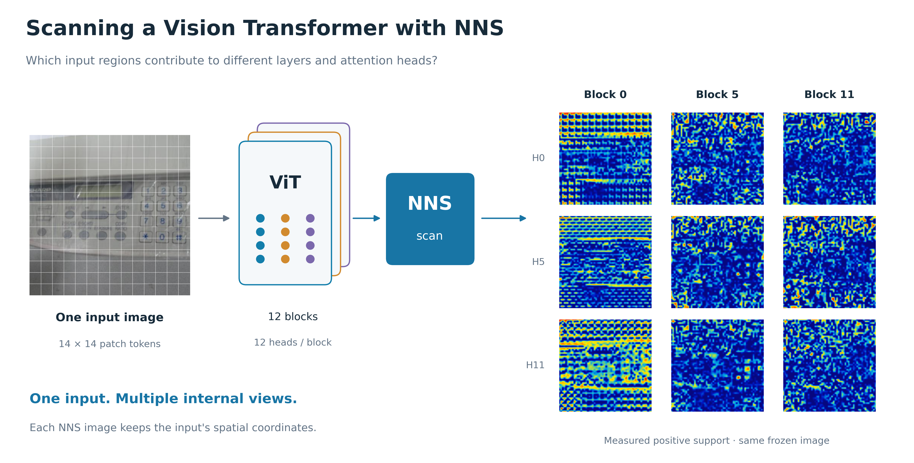

## Image #2: A learning image keeps the input origins of an internal response

真实输入经过 ViT 的 patch embedding 和 B0 attention 后，选定 channel 0 的 196 个 patch-token 输出之和作为内部响应 s。右侧只画一张完整的 224×224 signed learning image，所有值来自本次实际输入路径积分。它保留输入位置，各 RGB 通道贡献相加，整图之和恢复相对灰色参考的响应变化。红/蓝编码同一张图的符号，采用 max-abs signed-log(kappa=9)、nearest，无空间平滑。输入固定为既有 Y2 队列首图，channel 0 在计算前按索引固定。本图定义的是模块自身响应；Figure 3–7 的正式实验仍使用原先指定的 B0/H9 条件 Value-path 目标。

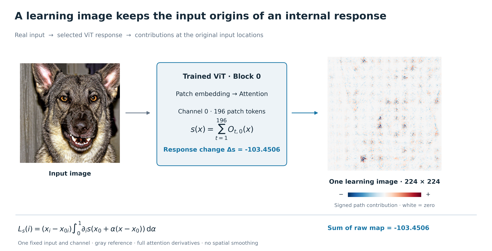

## Image #3: Evaluate the ranking at a shared spatial scale

这张图说明“怎么判断一张解释图有没有用”。先把图像切成同样的评价单位：每个 ViT patch 里面再分成 16 个 `4×4` 小格。NNS 可以给同一个 patch 里的小格不同分数；token baseline 在同一个 patch 里同分。

然后按分数排序做两件事：从灰图开始优先恢复高分区域，看内部目标恢复得快不快；从原图开始优先遮挡高分区域，看内部目标掉得快不快。谁的排序更贴近模型内部信号，谁的 AUC 就更好。

这图只是流程图，不是结果图。真正结果看 Figure 4 和 Figure 5。图里放大的遮挡块是为了让流程看得懂，真实实验用的是 `4×4` 小格，并且每张图内部会处理同分排序。

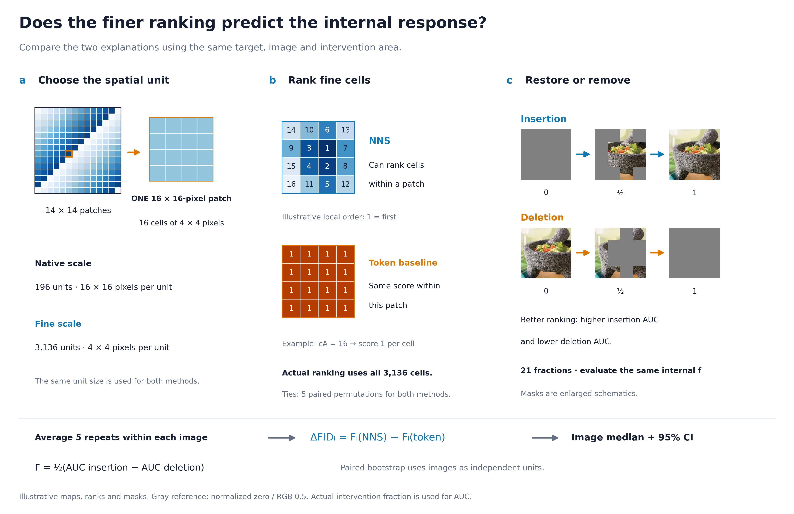

## Image #4: Primary effect distribution

这是主结果。每一个点/柱背后是一张图像的 `NNS - token baseline` 忠实度差值。500 张图全部为正，说明在这个固定内部目标和 `4×4` 评价设置下，NNS 的排序稳定高于同目标 token baseline。

中位数和置信区间是总体结论，不是单张图的误差条。它证明的是这个预定设置下的主效应，不是证明 NNS 在所有模型、所有 head、所有解释任务上都更好。

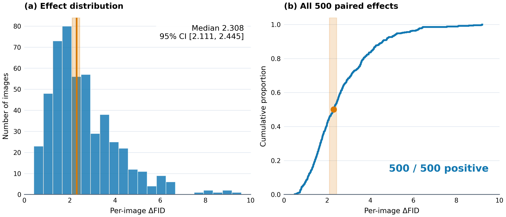

## Image #5: Fidelity trajectories

这张图把 Figure 4 的差值拆开看：差距到底来自恢复曲线，还是遮挡曲线。直觉上，好的解释应该让重要区域恢复得更快、遮掉后响应掉得更快。

看这图时重点看曲线之间的距离和它出现的位置。它不是新的统计结论，而是帮你理解 `ΔFID` 是怎么来的。

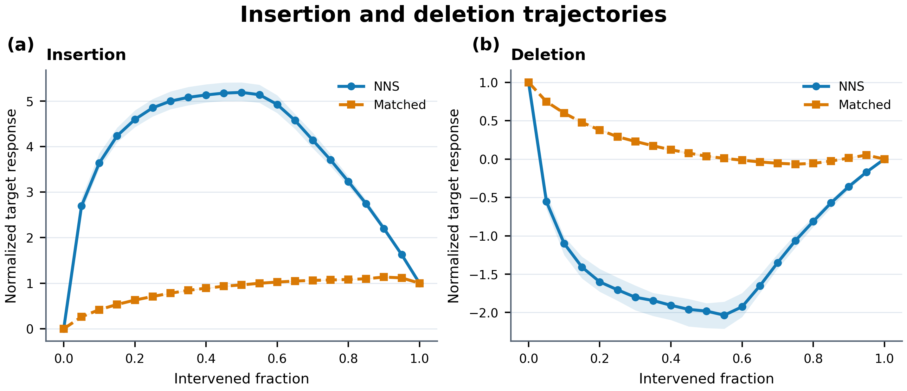

## Image #6: Scale and operator sensitivity

这张图回答一个很容易被误解的问题：NNS 的收益是不是只因为我们用更细的评价格子？结果是，细到 `4×4` 时主效应很明显；回到原生 `14×14` patch 尺度，差异接近消失。

所以这张图给论文一个边界：主结果依赖 fine-cell 干预设置。右边的插值/算子比较是敏感性分析，用来确认展示和空间实现没有随便换规则。

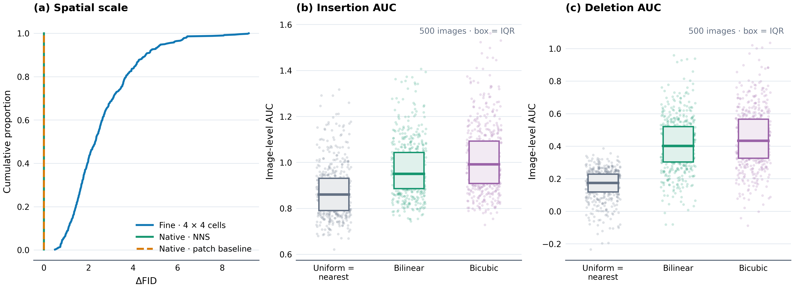

## Image #7: Layer/head and prediction strata

这张图说明：NNS 的效果不是 ViT 任意层任意 head 都一样。主 head `block 0/head 9` 很强，另外三个预先指定坐标小很多。右上角只是把小效应放大看清楚，主图和 inset 不是两组数据。

灰、蓝、橙分别是 overall、正确分类、误分类。三组方向类似，说明主结果不是只靠正确分类样本撑起来的。但这不是等效性检验，也不能把三个组当成三个独立实验相加。

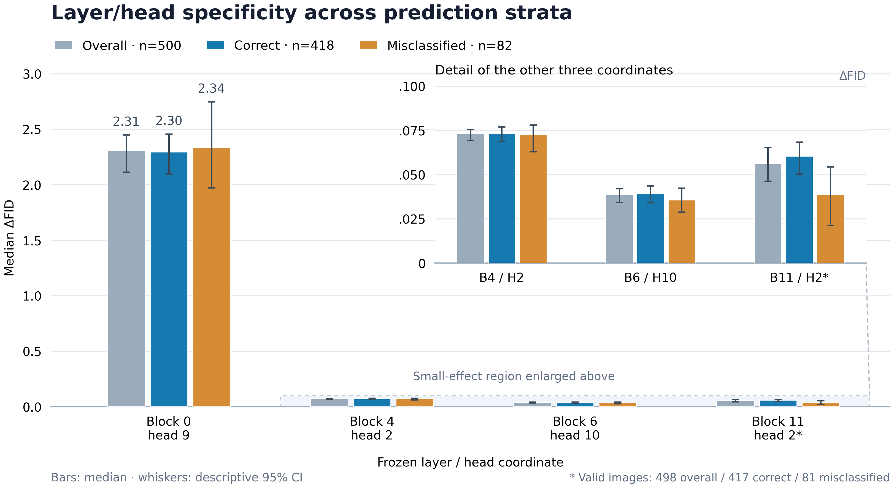

## Image #8: A median-effect image viewed through all 144 heads

这张就是你喜欢的全 144-head 汇总视图。它仍然是原来的中位效应样本，只是不再只展示最浅层的一个 head，而是把全部 12 层、每层 12 个 head 的显示图汇总起来。

从左到右看原图、NNS 正向、baseline 正向、NNS 负向、baseline 负向。可以对照按键、显示屏、面板边界附近的空间纹理；“正、负”说的是对各自内部响应的作用方向。

这里的汇总是把显示图平均起来看空间形态，不是说 144 个 head 的类别贡献已经加总完成。“中位效应”仍然指这张图在原主实验里的位置。

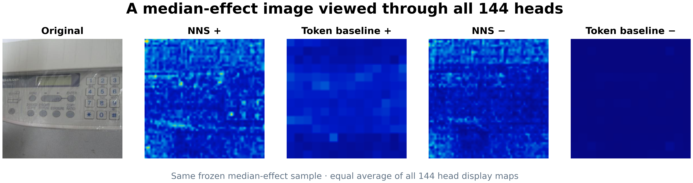

## Image #9: Spatial support across transformer depth

这张图把 Figure 8 的全头汇总拆成四段：浅层、两段中间层、深层。每一列都包含三层的全部 head，所以能看到整体形态怎样随深度变化。

先横着看第一行，再看第三行，分别观察正向和负向结构；第二、四行是同目标 token baseline。不要仅凭亮度说哪一层更重要，每个内部坐标的显示尺度不同。

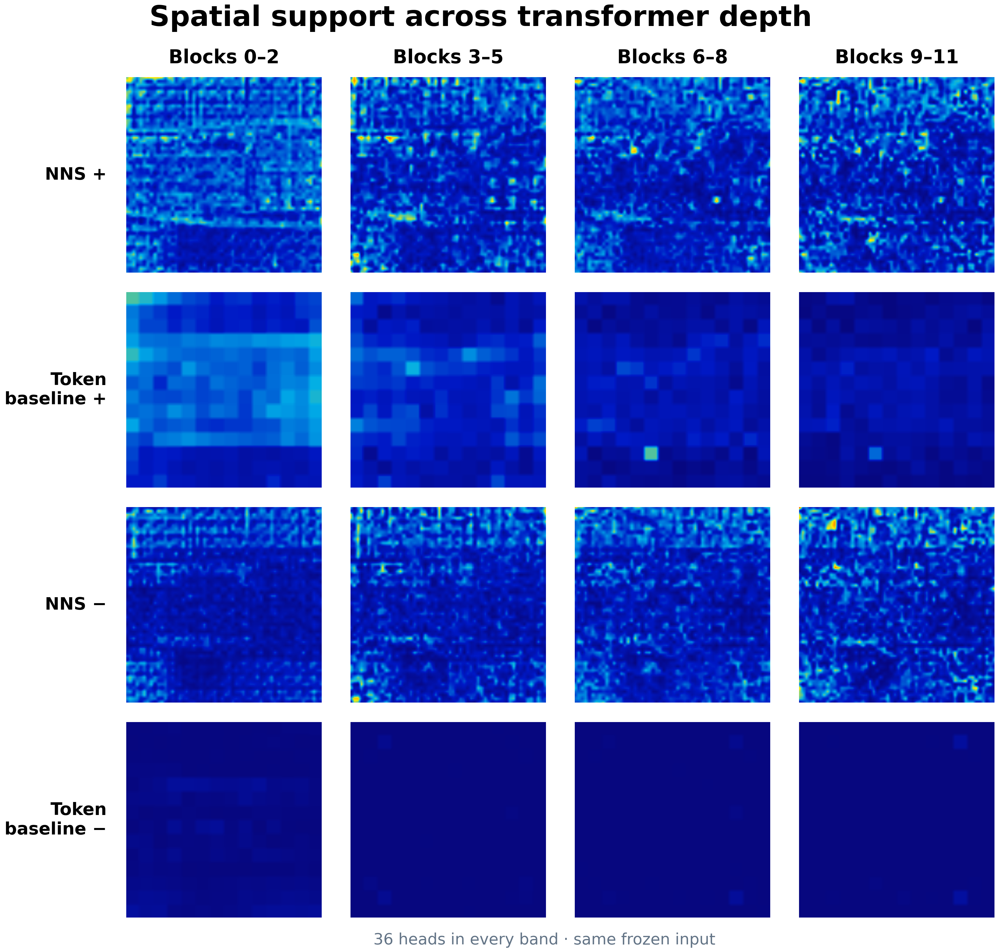

## Image #10: Different explanations of the same images

这张沿用你喜欢的 F3C 图库风格，并完整放入第一页的五张图，没有从中只留 NNS 好看的样本。每一行是一张输入，横着看不同方法给出的解释。

NNS 和 full IG 各有两列：原图尺寸的细节版，以及 4×4 最大池化后的易读版。后者更容易看到成片的结构，但只是换了显示方式，没有提高实验分数。Grad-CAM、rollout、raw CLS 也都保留。

这里问的是类别输出，前面全头图问的是内部 head 响应，两组图的目标不同。到底哪个方法分数更高，接着看 Figure 11。

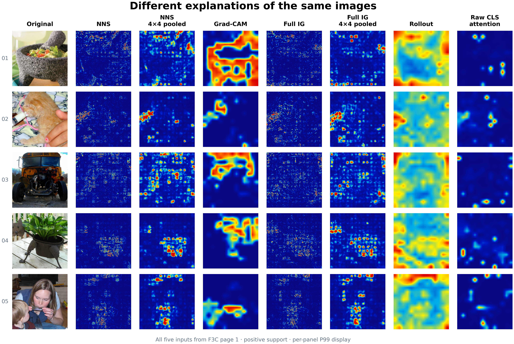

## Image #11: Method comparison statistics

这张图是方法比较的定量版。结论很直接：在这组 class-targeted 比较里，NNS 低于 Grad-CAM，高于 rollout；和 full IG、raw CLS attention 的差异区间跨过 0。

所以论文不能写“NNS 全面优于现有解释方法”。更准确的说法是：NNS 在主 Value-path 实验中优于同目标 token baseline；在另一个 class-targeted 比较里，它和不同方法的关系各不相同。

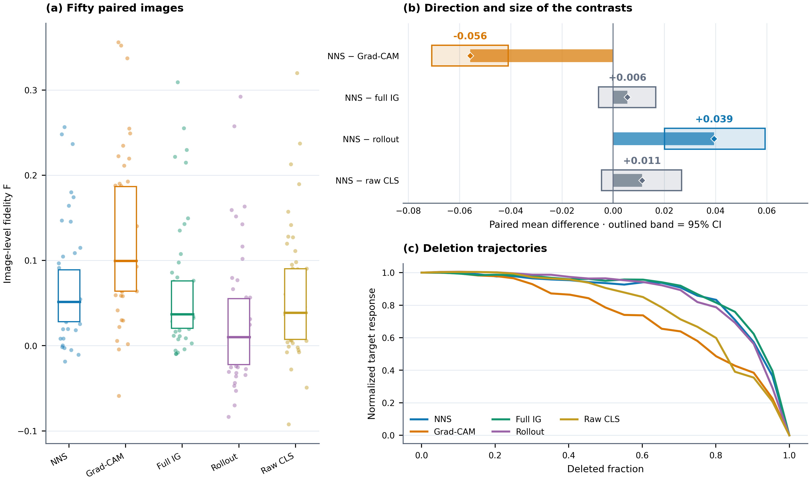

## Image #12: Post-hoc exploratory multiscale mechanism

这张图解释一个后续现象：把热图从 pixel 看粗到 `4×4`、`16×16` 后，几何一致性会变高。也就是说，一些不稳定来自小区域内部的重新分配。

这不是正式通过的稳定性结果。它只能作为 post-hoc exploratory 机制线索，不能把之前的稳定性 NO-GO 改写成 PASS。

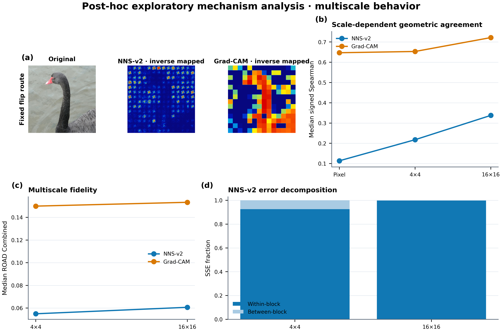

## Image #13: Branch allocation across ViT blocks

这张图把“输入贡献经过哪些内部分支”说得更具体。左边看 12 个 block 的轨迹，右边看深层减浅层的方向和大小。

可以记住的结论是：attention 分支和 MLP 分支的贡献份额随深度变化，而且方向不同。不要把两条曲线相加当成 100% 概率；它们来自不同的 cut 定义。

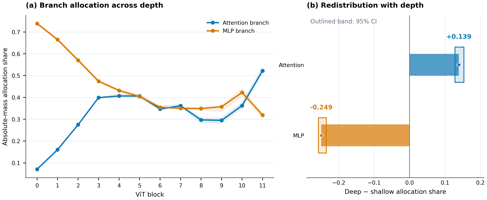

## Image #14: Post-hoc exploratory depth extension

这张图是深度方向的探索性扩展。它把几个问题放在一起：高贡献区域是否更贴近目标、遮挡这些区域是否更影响输出、深层表示是否更容易读出目标信息，以及这些变化之间是否同步。

表格里的四个 endpoint 量纲不同，不能横向比谁“大”。整张图都属于 post-hoc exploratory，用来形成后续机制假设，不是主论文的 confirmatory 结论。

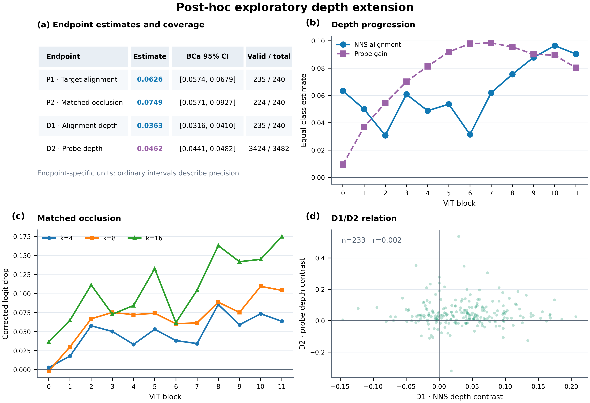

## Image #15: One internal component, one input-space image

把网络里的一个数和一张输入位置图配起来。上面是内部响应的变化量，下面说明这次变化来自输入的哪几个位置。四张图始终用同一套位置坐标。这张采用可手算的线性示例，不是 ViT 实测结果。

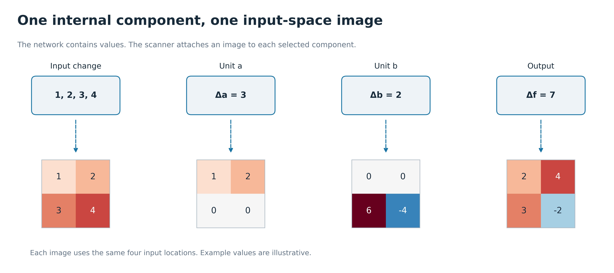

## Image #16: Keep each input value at its own location

先用原图减去参考图，得到这次需要解释的输入变化。然后拆成四张小图，每张只保留一个位置，其余位置为零；四张相加正好恢复输入差值。真实 RGB 输入对应每个像素的三个通道。实现用自动微分计算这些位置的贡献，不必真的存下十几万张稀疏图。

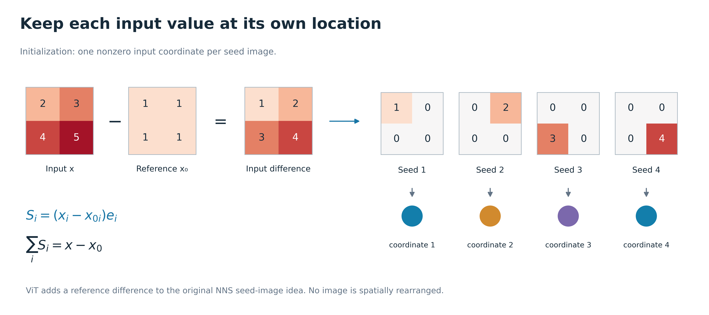

## Image #17: Build and combine learning images

沿用上一图的输入差值。单元 a 的图是 [1,2;0,0]，单元 b 的图是 [0,0;6,-4]。输出用 2a+0.5b，因此输出图是 [2,4;3,-2]，总和为 7。你可以看见数值被重新加权，但原来的位置始终没丢。ViT 的系数还随输入变化，所以实际方法要沿参考到原图的路径累计。

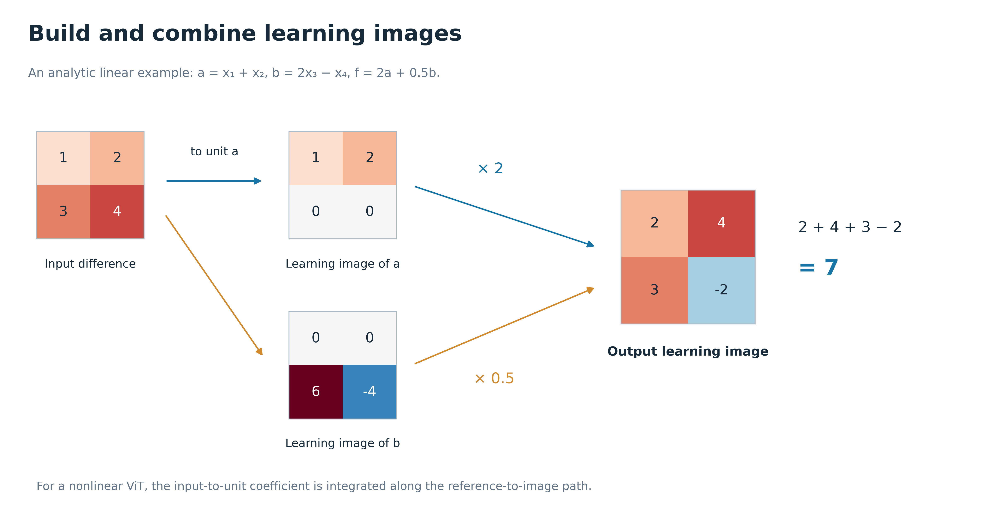

## Image #18: From patch projection to transformer components

Patch embedding 可以先按线性连接理解；位置编码和偏置仍保留在模型里。到了 attention，输入既会改变注意力权重 A，也会改变 Value，完整方法需要两部分导数。最后 residual 旁路也要算，才能把贡献账算完整。旧的固定 attention 图只研究其中一个条件视角。

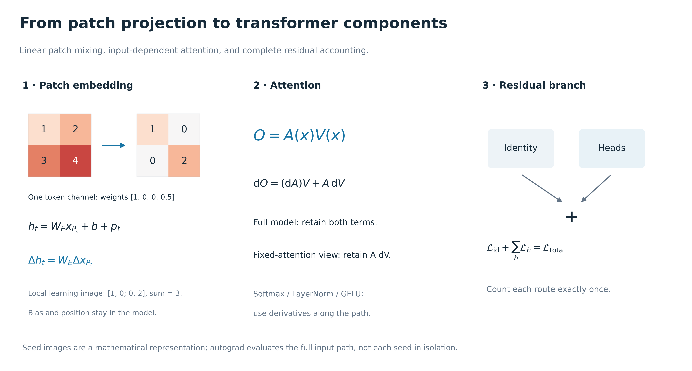

## Image #19: Class-component learning images and token responses

同一类别目标下，六个 block 的 attention 分支正输入贡献与对应 token RMS。上排为既有 56×56 input-cell 成分图，下排为 196 个 patch-token 输出跨通道的 RMS。输入固定为 Y2 队列首图、类别目标 235；采用逐面板 P99 与 nearest。完整 signed/负幅度图保留于本包 supplement。上排解释最终类别的分支成分；Figure 28–31 解释模块自身响应。

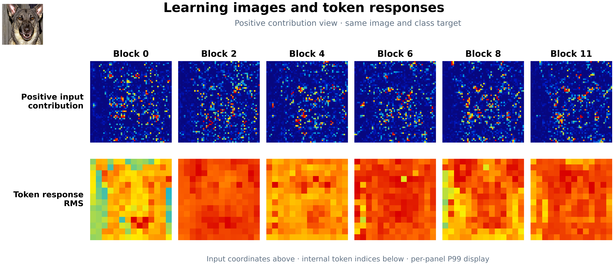

## Image #20: Different heads, the same image and class target

固定同一输入和最终类别，比较不同 head 分到的输入贡献。每个小图是一个 head 的成分 learning image，这比换不同 head 自身的响应目标更适合看共同任务下的差异。图中保留 H0/H5/H11、B0/B5/B11 这些固定位置，完整逐 block 12-head 图另附。颜色逐面板缩放，亮度不用于排名。

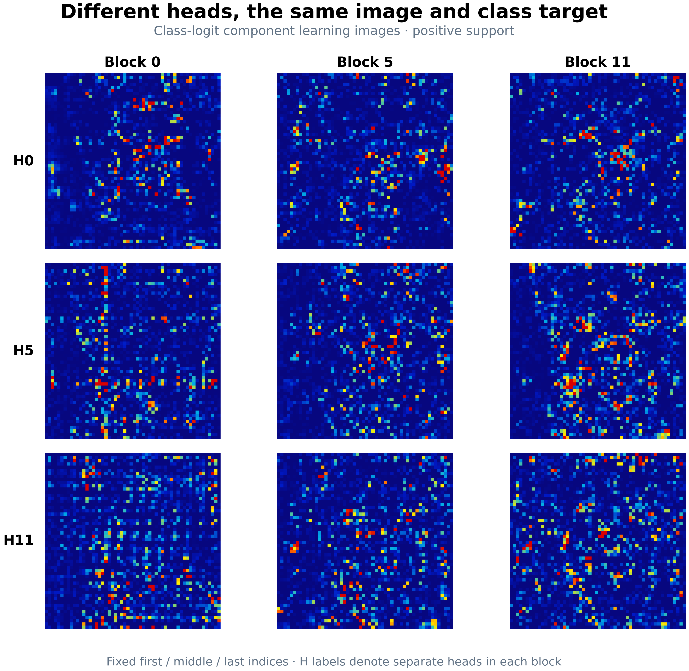

## Image #21: Components reconstruct the same input attribution

同一个 block 的 residual 旁路图，加上全部 12 个 head 的图，会恢复总输入贡献图。这里先对原始正负数求和，再着色；不是把几张颜色图片叠起来。它展示 learning image 怎样组合成更大组件，同时能检查是否漏掉某条路径。

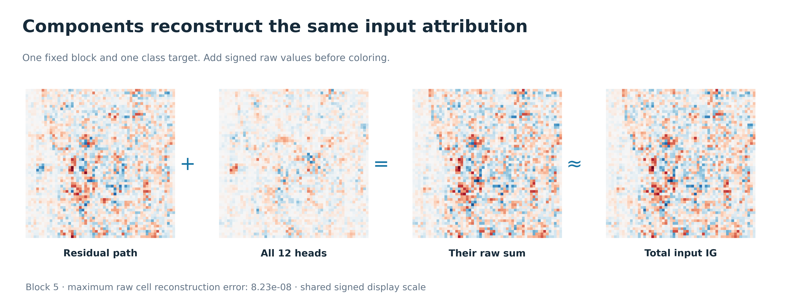

## Image #22: Attention: Value and routing derivatives

两个 token 的解析 attention 例子。固定选第一个 token 作 query，输入 [1,3]、参考 [0,0]，Q/K/V 标量投影权重均为 1，d_k=1。先算 qK、softmax 和输出，再将输入导数分为 A dV 与 (dA)V 两项。沿直线路径 [α,3α] 采用 Gauss–Legendre 数值积分，得到两个输入位置的完整归因。冻结 clean attention 时的图是另一个条件函数的归因，不等于完整路径中 A dV 那一项。本图是解析示意，不是已训练 ViT 的实测结果。

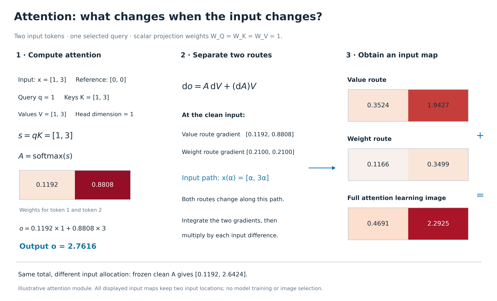

## Image #23: Residual: contributions to a downstream target

解析 residual 例子。输入 [2,1]、参考 [0,0]，旁路 r=x₁，分支 b=2x₁−x₂，相加 z=r+b，最终目标 F=z²。沿路径 z=5α，下游导数为 10α。分别经过旁路和分支的输入贡献为 [10,0] 和 [20,−5]，和为 [30,−5]，总和 25 恢复目标差值。分支对 F 的贡献包括下游导数，因此不同于它自身响应的 [4,−1]。两格固定表示输入位置 1 和 2。

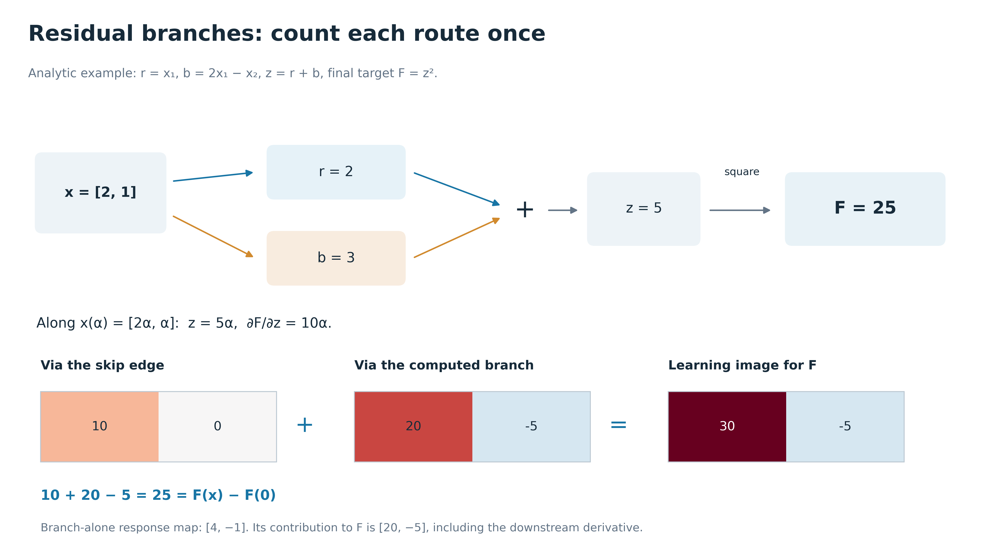

## Image #24: Normal forward and learning images: step-by-step overview

同一小型解析链的总览：输入 [1,1;3,3] 依次经过线性 patch embedding、完整 softmax attention 和 residual。上排是正常响应，下排是同名响应 learning image，虚线逐一对应。 原始四图全部原样纳入 R9。这是算子示意，不是训练后 ViT 实测；真实输出见 Figure 28–31。

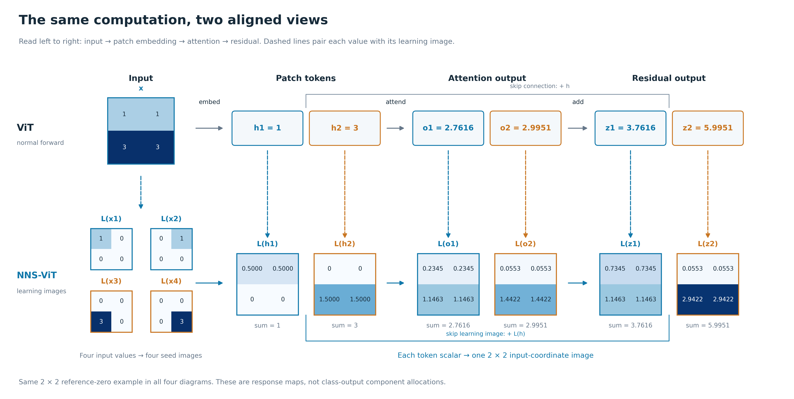

## Image #25: Patch embedding: matching values and learning images

四个单坐标输入图通过 [0.5,0.5] 权重形成两张 token 学习图。图值相加分别得到响应 1 和 3，输入位置保留。 原始四图全部原样纳入 R9。这是算子示意，不是训练后 ViT 实测；真实输出见 Figure 28–31。

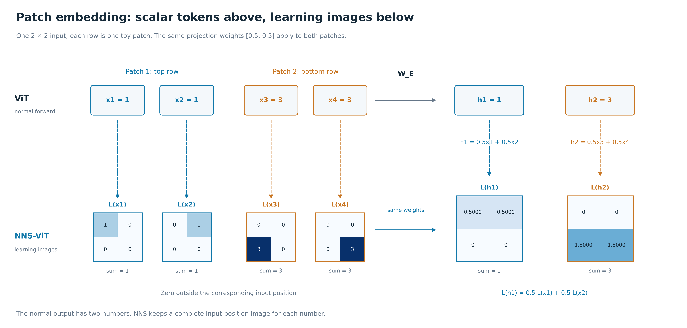

## Image #26: Attention: matching values and learning images

正常值使用 A 组合 V；本例输入 patch 映射为线性，learning image 可用沿路径平均的完整 Jacobian 系数 C 组合。C 含 Q/K/V 路径，不等于 clean attention。 原始四图全部原样纳入 R9。这是算子示意，不是训练后 ViT 实测；真实输出见 Figure 28–31。

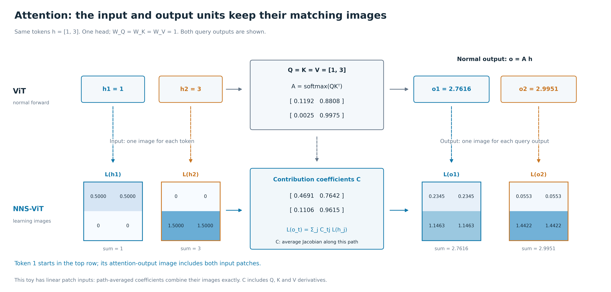

## Image #27: Residual: matching values and learning images

同一参考和路径下，residual 的响应图逐位置相加，L(z)=L(h)+L(o)。相加发生在原始值上，着色在之后。 原始四图全部原样纳入 R9。这是算子示意，不是训练后 ViT 实测；真实输出见 Figure 28–31。

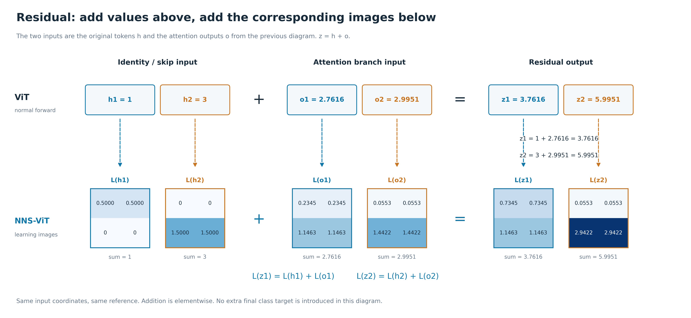

## Image #28: Real learning images through three ViT modules

同一通道 0 连续经过三个模块。固定输入 ILSVRC2012_val_00007922.JPEG，规范化灰色参考为零；patch 输出与 B0 attention、B0 第一次 residual 相加前后的真实响应。每个目标为指定通道在 196 个 patch-token 输出上的总和，CLS 参与前向但不计入这项空间聚合。上排为该响应的输入 IG 正贡献，224×224，RGB 先带符号求和；下排为相同通道的原始 signed token 值，排为 14×14。上排各面板正部 P99（零则 max）缩放，下排各面板 max-abs signed-log(kappa=9)，均用 nearest。完整 signed learning image 与 RGB 原始数组在补充目录。该单样本图不度量总体层间趋势或 feature-map 相关性。 128 点与 64 点积分对照通过，最大完整性误差 4.547e-13；原始 residual 相加误差 2.220e-16。

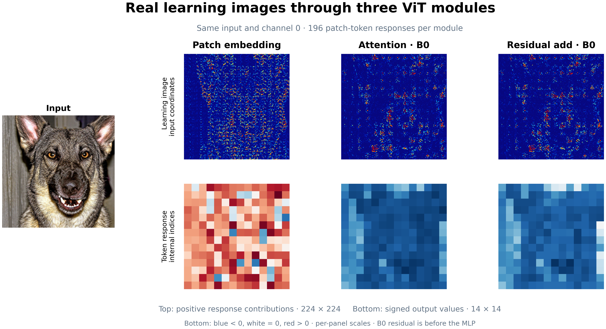

## Image #29: Patch embedding: real channel learning images

Patch embedding 的固定通道 0、255、511、767。固定输入 ILSVRC2012_val_00007922.JPEG，规范化灰色参考为零；patch 输出与 B0 attention、B0 第一次 residual 相加前后的真实响应。每个目标为指定通道在 196 个 patch-token 输出上的总和，CLS 参与前向但不计入这项空间聚合。上排为该响应的输入 IG 正贡献，224×224，RGB 先带符号求和；下排为相同通道的原始 signed token 值，排为 14×14。上排各面板正部 P99（零则 max）缩放，下排各面板 max-abs signed-log(kappa=9)，均用 nearest。完整 signed learning image 与 RGB 原始数组在补充目录。该单样本图不度量总体层间趋势或 feature-map 相关性。 128 点与 64 点积分对照通过，最大完整性误差 4.547e-13；原始 residual 相加误差 2.220e-16。

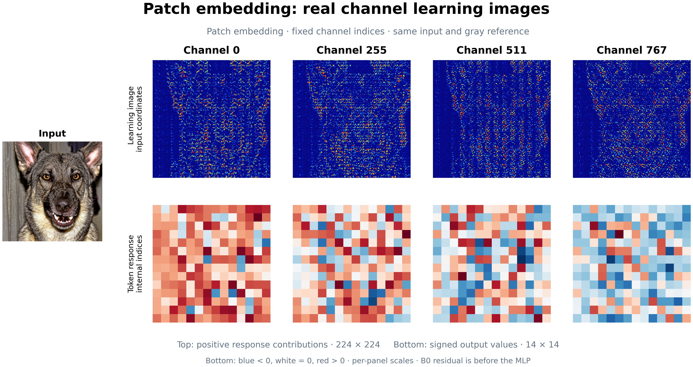

## Image #30: Attention: real channel learning images

Attention · B0 的固定通道 0、255、511、767。固定输入 ILSVRC2012_val_00007922.JPEG，规范化灰色参考为零；patch 输出与 B0 attention、B0 第一次 residual 相加前后的真实响应。每个目标为指定通道在 196 个 patch-token 输出上的总和，CLS 参与前向但不计入这项空间聚合。上排为该响应的输入 IG 正贡献，224×224，RGB 先带符号求和；下排为相同通道的原始 signed token 值，排为 14×14。上排各面板正部 P99（零则 max）缩放，下排各面板 max-abs signed-log(kappa=9)，均用 nearest。完整 signed learning image 与 RGB 原始数组在补充目录。该单样本图不度量总体层间趋势或 feature-map 相关性。 128 点与 64 点积分对照通过，最大完整性误差 4.547e-13；原始 residual 相加误差 2.220e-16。

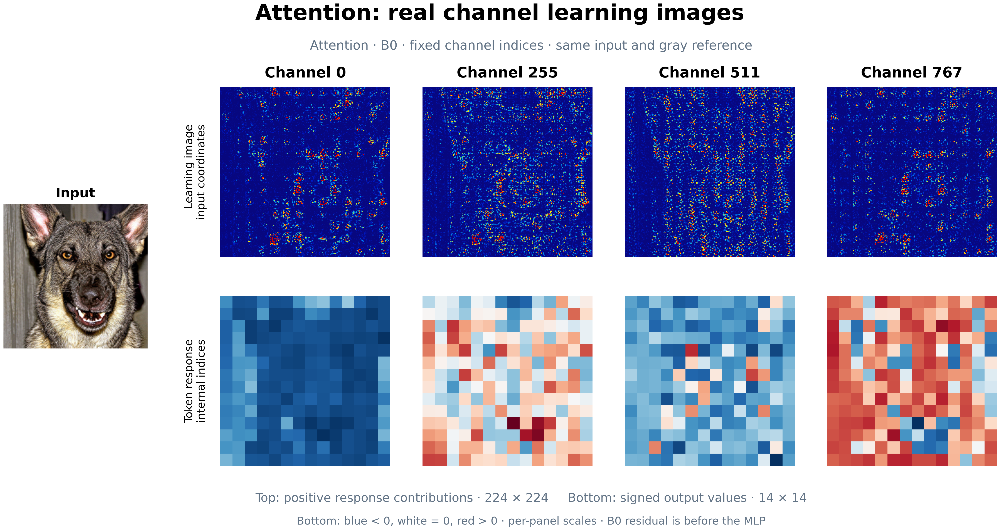

## Image #31: Residual: real channel learning images

Residual add · B0 的固定通道 0、255、511、767。固定输入 ILSVRC2012_val_00007922.JPEG，规范化灰色参考为零；patch 输出与 B0 attention、B0 第一次 residual 相加前后的真实响应。每个目标为指定通道在 196 个 patch-token 输出上的总和，CLS 参与前向但不计入这项空间聚合。上排为该响应的输入 IG 正贡献，224×224，RGB 先带符号求和；下排为相同通道的原始 signed token 值，排为 14×14。上排各面板正部 P99（零则 max）缩放，下排各面板 max-abs signed-log(kappa=9)，均用 nearest。完整 signed learning image 与 RGB 原始数组在补充目录。该单样本图不度量总体层间趋势或 feature-map 相关性。 128 点与 64 点积分对照通过，最大完整性误差 4.547e-13；原始 residual 相加误差 2.220e-16。

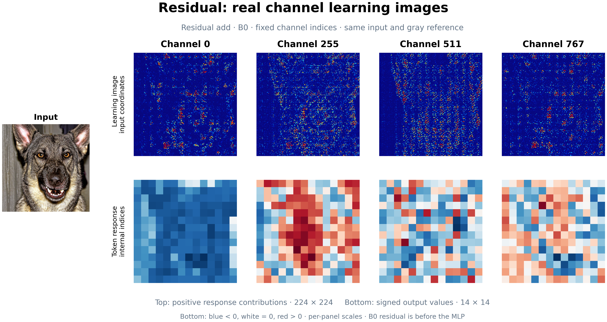

## Image #32: B0 MLP branch: real channel learning images

B0 MLP branch 的真实响应 learning image。固定通道 0、255、511、767，每个目标为该通道在 196 个 patch-token MLP 输出上的总和。上排为 224×224 输入贡献正部，下排为同一通道的 14×14 signed token 值。真实前向包含 LN2、fc1、GELU、fc2、layer scale 与 drop path；完整 signed 图见 supplement。 这页回答的是 MLP 分支自身在各输入位置上的响应来源，不是 MLP 对最终类别的下游贡献。四个通道按索引固定，不按图像观感筛选。

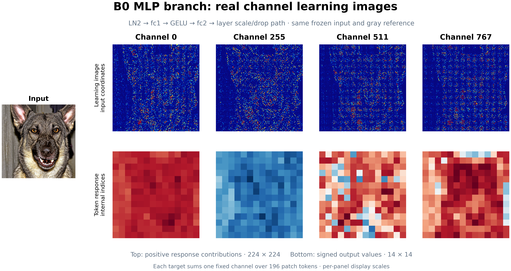

## Image #33: B0 block output: real channel learning images

B0 第二次 residual add 后的完整 block output。固定通道和版式与 Figure 32 相同。原始 RGB learning image 逐像素满足 L(second residual)=L(first residual)+L(MLP branch)，最大误差为 3.33×10⁻¹⁶；着色只在加法核对之后进行。 与 Figure 31 对照时，Figure 31 是进入 MLP 前的 first residual，Figure 33 才是完整 Block 0 输出。

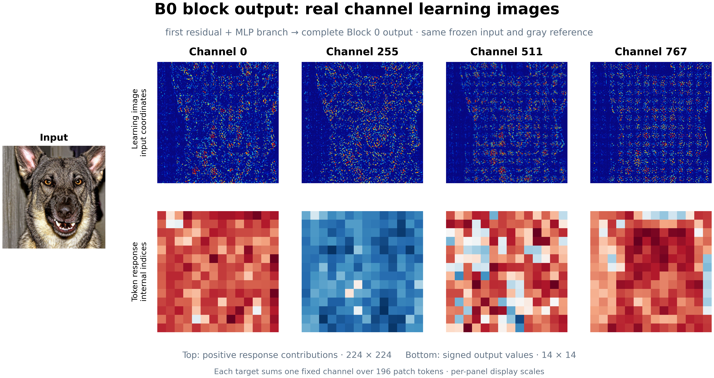

## Image #34: From the image to the predicted class logit

真实预测类别 235 的完整 logit learning image。梯度经过全部 12 个 blocks、final norm、CLS 选择与 Linear(768,1000)，相对灰色参考积分回 224×224 输入坐标。clean logit 为 8.082624，参考 logit 为 −0.384007。类别标量没有 14×14 token 输出，因此本图不套用模块通道页。 4096 阶相对 2048 阶的地图 L1 变化为 8.293×10⁻⁴，completeness 绝对误差为 0.004874；这是一张图的方法展示，不外推类别总体规律。

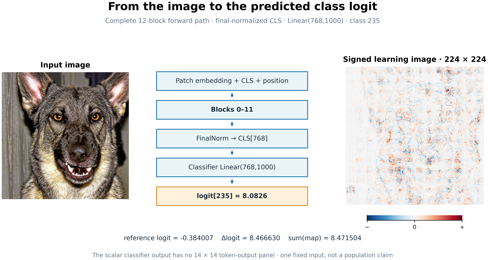
