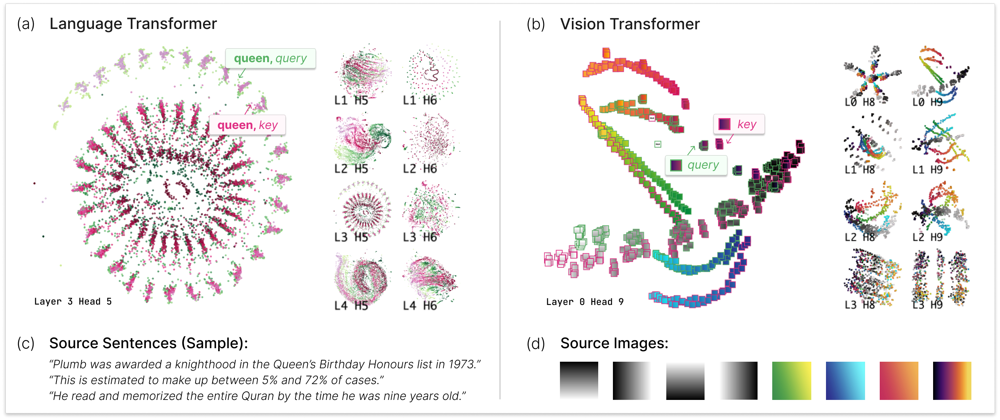

# 1. Introduction

*Fig. 1. AttentionViz, our interactive visualization tool, allows users to explore transformer self-attention at scale by creating a joint embedding space for queries and keys. (a) In language transformers, these visualizations reveal striking visual traces that can be linked to attention patterns. Each point in the scatterplot represents the query or key version of a word, as denoted by point color. Users can explore individual attention heads or zoom out for a global view of attention. (b) The visualizations also reveal insights in vision transformers, such as attention heads that group image patches by hue and brightness. Border color denotes query embeddings of a patch (green) or key embeddings (pink). (c) Sample input sentences and (d) images are provided for reference.*

The transformer neural network architecture (Vaswani et al. 2017) is having a major impact on fields ranging from natural language processing (NLP) (Devlin et al. 2018; Radford et al. 2019) to computer vision (Dosovitskiy et al. 2021). Indeed, transformers are now deployed in large, real-world systems used by hundreds of millions of people (e.g.,[Stable Diffusion](https://stability.ai/), [ChatGPT](https://openai.com/blog/chatgpt), [Microsoft Copilot](https://blogs.microsoft.com/blog/2023/03/16/introducing-microsoft-365-copilot-your-copilot-for-work/)). However, the mechanisms behind this success remain somewhat mysterious, especially as new capabilities continue to emerge with increasing model complexities and sizes (Dehghani et al. 2023; Wei et al. 2022). A deeper understanding of transformer models could help us build more reliable systems, troubleshoot problems, and suggest avenues for improvement.

In this work, we describe a new visualization technique aimed at better comprehending how transformers operate. (We include a brief introduction to transformers in Sec. 1.) The target of our analysis is the characteristic transformer *self-attention* mechanism, which allows these models to learn and use a rich set of relationships between input elements. Although attention patterns have been intensively studied, previous techniques generally visualize information related to just a single input sequence (e.g., one sentence or image) at a time. Typical approaches create bipartite graph (Vig 2019; Vaswani et al. 2018) or heatmap  (Liu et al. 2018; Hoover et al. 2020) representations of attention weights for a given input sequence.

Our method offers a higher-level perspective, in which we can view the self-attention patterns of many input sequences at once. One inspiration for this approach is the success of tools such as the Activation Atlas (Carter et al. 2019), which allows a researcher to “zoom out” to see an overview of a neural network, then drill down for details. In our case, we seek to build a kind of “attention atlas” that can provide researchers with a rich and detailed view of how a transformer’s various attention heads operate. The primary new technique is visualizing a joint embedding of the *query* and *key* vectors used by transformers, which creates a visual signature for an individual attention head.

To illustrate our technique, we implement AttentionViz, an interactive visualization tool that allows users to explore attention in both language and vision transformers. AttentionViz affords exploration through multiple levels of detail (Fig. 1), providing both a global view to see all attention heads at once and the ability to zoom in on details in a single attention head or input sequence.

We demonstrate the utility of our technique through several application scenarios with AttentionViz and domain expert interviews. For concreteness, we focus on what the visualization can reveal about a few widely-used transformers: BERT (Devlin et al. 2018), GPT-2 (Radford et al. 2018), and ViT (Dosovitskiy et al. 2021). We find several identifiable “visual traces” linked to attention patterns in BERT, detect novel hue/frequency behavior in ViT’s visual attention mechanism, and uncover potentially anomalous behavior in GPT-2. User feedback also supports the wider applicability of our approach in visualizing other embeddings at scale.

To summarize, the contributions of this work include:

- A visualization technique for exploring attention trends in transformer models based on joint query-key embeddings.

- AttentionViz, an interactive tool that applies our technique for studying self-attention in vision and language transformers at multiple scales.

- Application scenarios and expert feedback showing how AttentionViz can reveal insights about transformer attention patterns.
