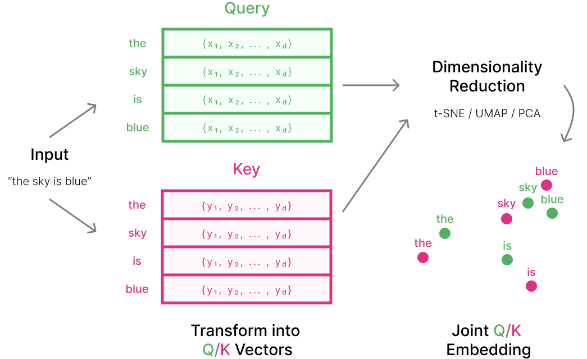
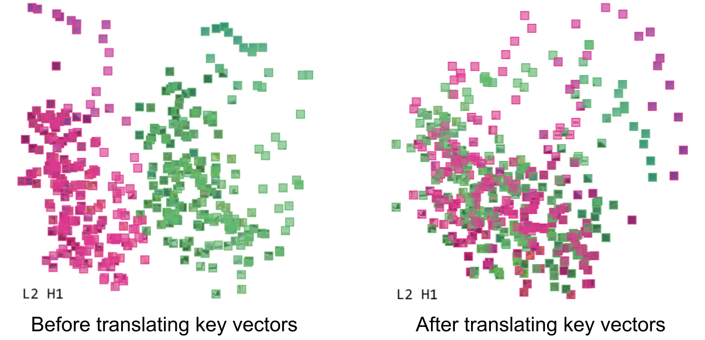
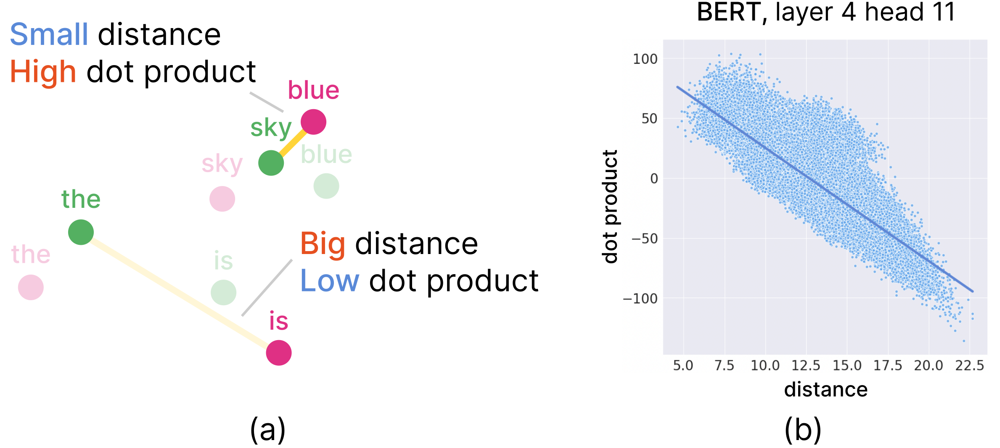
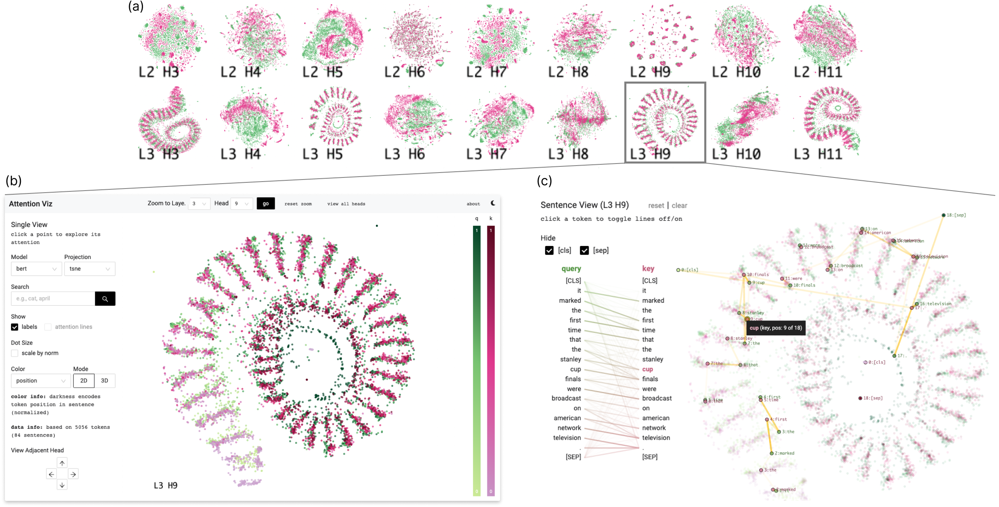
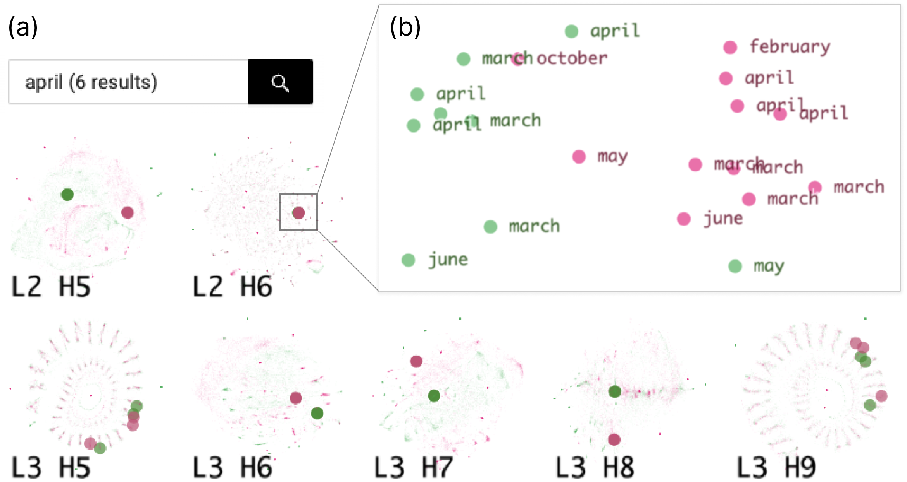
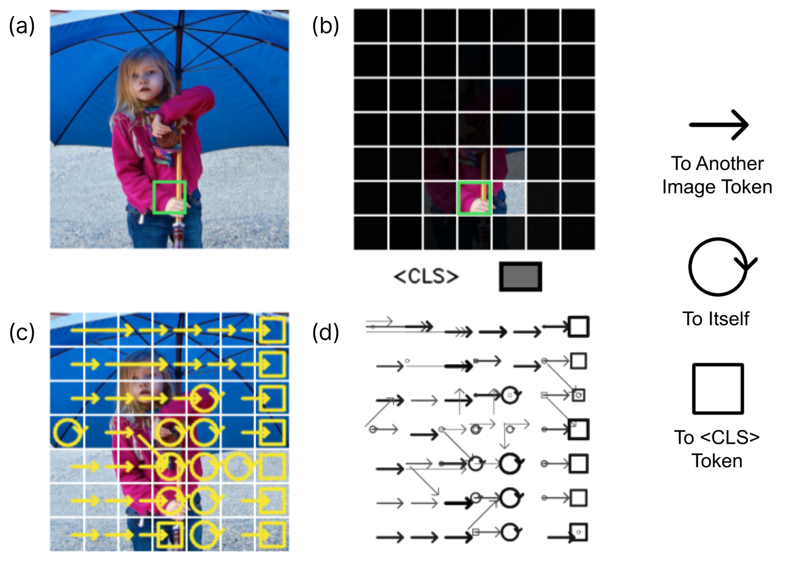

# 5. Query/Key Embeddings & Design of AttentionViz

To address these goals and tasks, we build a tool called AttentionViz. The primary technique used by our tool is a visualization of the joint embedding of query and key vectors for each attention head. In this section, we first describe the motivation and mathematics that underlie this technique, then discuss the design of the full application.

*Fig. 2. Creating a joint query-key embedding space for a single attention head. In the NLP case, given an input sentence, we first transform each token into its corresponding query and key vector. Then, we use t-SNE/UMAP/PCA to project these $1 \times d$ vectors into 2D/3D scatterplot coordinates. For the BERT, GPT-2, and ViT models used, $d = 64$.*

## Visualizing Query/Key Embeddings

The technique behind AttentionViz is relatively simple, although as we describe below, it requires two mathematical tricks to be effective. Recall that each transformer attention head transforms input embeddings into query vectors and key vectors by applying matrices $W_Q$ and $W_K$, respectively (Sec. 1). These matrices project the original vector embeddings to a lower dimensional space, essentially selecting a particular type of information from the higher-dimensional vector embeddings. Therefore, by inspecting the query and key vectors, one might hope to learn what information is selected by $W_Q$ and $W_K$.

A central observation is that the relative positions of query and key vectors can offer clues about how attention will be distributed, since attention coefficients depend on the dot product between queries and keys. To see why, consider a hypothetical situation where query and key vectors always have the same norm. Then, closer distances would directly relate to higher attention coefficients. In practice, query and key vectors vary in norm, so the relationship between dot product and distance is not precise. However, as described in the following sections, we can arrange for this relation to be surprisingly close.

Fig. 2 illustrates our technique with a synthetic example of a single attention head in a language transformer. To create the joint embedding, we first obtain the query and key vector representation of each token in a given sentence (Sec. 1). Then, we use one of three dimensionality-reduction methods to project these high-dimensional vectors onto a shared, lower-dimensional subspace: **t-SNE** (Maaten and Hinton 2008), **UMAP** (McInnes et al. 2018), or **PCA** (Jolliffe 1986). The output from these dimensionality-reduction algorithms is a 2D/3D scatterplot, where each point represents a single query or key token. The same process can be used to create joint embeddings for ViT attention heads, where each token is an image patch. By default, we visualize queries in *green* and keys in *pink*. However, there are multiple color encodings users can choose from (see Sec. 4.2), and other palettes can be easily substituted into the system.

Our joint embeddings allow users to explore the fine-grained interactions between queries and keys, and the shape of these plots can often serve as visual indicators of the underlying self-attention patterns (see Sec. 6). Each dimensionality-reduction technique produces different patterns for a given dataset, offering unique insights and use cases.

*Fig. 3. **Left:** original queries and keys in joint embedding space. **Right:** Increased overlap after translating keys to align query and key centroids.*

### Vector Normalization

While designing AttentionViz, we noticed two “free parameters,” which can be varied without losing any information. Tuning these parameters creates a closer relationship between embedding distance and attention weights, and greatly improves the readability of the visualization. These normalizations are applied prior to dimensionality reduction (Fig. 2).

**Key Translation:** Query and key vectors are sometimes well separated in our visualizations (Fig. 3, left). This separation makes it difficult to directly compare query and key embeddings. However, a simple mathematical trick allows us to move these embeddings closer together, without affecting the self-attention computation for any given input sequence. In particular, note that the softmax function is *translation invariant*: i.e., for any constant $a$, we have $\mathrm{softmax}_j(x_1 + a, x_2 + a, \ldots) = \mathrm{softmax}_j(x_1, x_2, \ldots)$. Now, consider a query vector $x$ and key vectors $y_1, \ldots, y_n$. For any vector $v$, we have:
$$
\begin{equation*}
\begin{split}
\mathrm{attention}_j(x) &= \mathrm{softmax}_j(\langle x, y_1 \rangle, \langle x, y_2 \rangle, \ldots) \\
&= \mathrm{softmax}_j(\langle x, y_1 \rangle + \langle x, v \rangle, \langle x, y_2 \rangle + \langle x, v \rangle, \ldots) \\
 &= \mathrm{softmax}_j(\langle x, y_1 +v \rangle, \langle x, y_2 +v \rangle , \ldots) 
\end{split}
\end{equation*}
$$
where the second step follows by translation invariance. This implies that without changing attention patterns in any given input, we can translate all key vectors such that the query and key distributions for each attention head have identical centroids. This makes it much easier to compare queries and keys (Fig. 3, right).

**Scaling Queries and Keys:** In some transformers, such as GPT-2, we observed cases where the average query norm was very different from the average key norm. This difference makes it hard to interpret key-query relations in a joint embedding. Mathematically, it indicates a poor relationship between dot product and distance; visually, it means queries might be a tiny cluster, surrounded by a loose cloud of keys.

Luckily, scale is another “free parameter” of the system. Self-attention levels depend only on dot products of query and key vectors, so if we scale all query vectors by a factor of $c \neq 0$, and all key vectors by a factor of $c^{-1}$, the attention values are unchanged. This allows high-attention query-key pairs to be closer together in our joint visualizations as depicted in Fig. 4a. (A subtle point: on its own, scaling leaves cosine distance unchanged; however, in combination with translation normalization it has a nontrivial effect.)

To determine the optimal value of $c$, we can define a *weighted correlation* metric that places heavier weight on query-key pairs with smaller distances, since we care most about nearby queries and keys in the joint visualization. We can thus choose a scale factor $c$ such that the weighted correlation between query-key dot products and distances is maximized. This scaling method allows for the distances in the joint embedding space to most accurately represent the actual attention values between queries and keys.

*Fig. 4. **(a)** Ideal distance-attention relationship, where query-key pairs with higher dot products are closer in the joint embedding space. **(b)** Example attention head with a strong, negative correlation (**-0.983**) between query-key distance and dot product in BERT.*

### Distance as a Proxy for Attention

As explained above, ideally, if a query-key pair has a large, positive dot product (corresponding to a high final self-attention value), they should be placed closer together in the embedding space, and vice versa (Fig. 4a). Thus, we expect distance to be *inversely correlated* with attention in our joint query-key embeddings. We study this potential link by computing the Spearman rank correlation between cosine distance and dot product for each attention head in BERT, GPT-2, and ViT. We also experimented with using Euclidean distance as our distance metric when creating t-SNE and UMAP projections of queries and keys, but this generally led to weaker distance-dot product correlations.

Across multiple datasets and models, the relationship between distance and attention holds fairly well. For example, with Wiki-Auto data (Jiang et al. 2020), the mean correlation between query-key distances and dot products is **-0.938** for BERT and **-0.792** for GPT. An example result from BERT is shown in Fig. 4b. On the set of COCO images used (Lin et al. 2014), the mean correlation is **-0.873** for ViT-32 and **-0.884** for ViT-16.

## Color Encodings

To visualize different properties of queries and keys, AttentionViz offers various color encodings. The default option colors points by *token type*, i.e., query or key. For vision transformers, users can color by image patch *row* or *column* to visualize positional patterns (Fig. 10). Since images encode their own color information, we also allow users to view the *original* patches without additional styling elements (Fig. 8).

For language transformers, we support two positional color schemes: *normalized* and *discrete*. To compute normalized position, we divide each token’s position in a sentence by the sentence length to produce a continuous color scale. Lighter hues denote tokens closer to the beginning of the sentence (Fig. 5b). Our discrete position encoding takes each token’s position and applies the modulo operator to get its remainder when divided by 5. Thus, the $1^{st}$ and $6^{th}$ tokens receive the same color, the $2^{nd}$ and $7^{th}$ tokens receive the same color, etc. We use the same five colors to encode queries and keys at different positions, using darker hues for the former. Although this scheme introduces ambiguity for sentences with length \> 5, we find our discrete coloring helpful in seeing relationships based on small offsets in position (e.g., queries paying attention to keys one step away as in Fig. 11, left). Ambiguities are also easily resolved by hovering over tokens, and in our explorations, we did not see patterns with offsets greater than 2 or 3. Users can color by *query/key norm* as well (Fig. 12a).

## Views

AttentionViz provides three main interactive views for attention exploration: *Matrix View*, *Single View*, and *Sentence/Image View*.

*Fig. 5. Connecting form to function in BERT. **(a)** In Matrix View, there are several spiral-shaped plots in layer 3. **(b)** By zooming into one such head (*L3 H9*) using Single View, we can see positional attention patterns by using a light-to-dark color scheme that encodes position in the input sequence. **(c)** These patterns can be confirmed by exploring sentence-level visualizations.*

*Fig. 6. Exploring attention patterns with global search. **(a)** Heads with fewer clusters of search results often demonstrate more semantic behavior, while heads with dispersed results focus more on token position. **(b)** Zooming into L2 H6, a head with one main result cluster, we indeed see a large group of semantically related query and key tokens.*

### Matrix View

The initial view in AttentionViz is *Matrix View*, which uses small multiples to visualize all the attention heads in a transformer at once (Fig. 5a), directly addressing **\[T1\]** and **\[T3\]**. Each row corresponds to a model layer, moving from earlier layers at the top of the interface to later layers at the bottom. With this “global” perspective, users can more easily scan for patterns across different transformer layers and heads, compared with single-plot (e.g., (Vig 2019)) or instance-level visualizations (e.g., (Boggust et al. 2022; Smilkov et al. 2016)). All the models used in this work had the same architecture: 12 layers x 12 heads per layer = 144 attention heads in total, but our system scales to other dimensions.

In Matrix View, users can view the joint query-key embeddings created with t-SNE, UMAP, or PCA. They can also switch between model types (i.e., BERT, GPT-2, ViT-16/32) or datasets **\[T4\]**, explore different color schemes, and view the resultant plots in 2D or 3D. Matrix View supports a global search feature (Fig. 6a), which helps highlight patterns in token locations across different heads and offers another way to analyze attention at scale (see Sec. 6).

### Single View

Users can click on any plot in Matrix View to zoom into *Single View* (Fig. 5b), which affords exploration of a single attention head in closer detail **\[T3\]**. Like Matrix View, users can switch between colorings, dimensions, projection modes, datasets, and models in Single View **\[T4\]**; all graphical changes sync between views to facilitate comparison. The user can click on a point to highlight all tokens in the corresponding input sequence, spotlighting the relevant queries and keys in our joint embedding space. Users also have the option to project attention lines onto the scatterplots, which connect query and key tokens (Fig. 5c). We only show the top 2 attention weights for each token to enhance readability. Our attention lines feature supports **\[T2\]** and offers a new way to visualize attention patterns in transformers at the head level.

In Single View, users can also search for tokens and use our labelling feature to uncover semantic patterns in the data, similar to (Smilkov et al. 2016). For instance, in Fig. 6b, search reveals that query/key tokens with similar meanings are placed together in the joint embedding for this BERT head, indicating strong attention between them (Sec. 4.1.2).

*Fig. 7. ViT Image View. **(a)** Original image. **(b)** Transparency attention heatmap. We highlight the selected token (query) with a green border. **(c)** Overlaid attention arrows. **(d)** Global attention flow. The square icon means an image patch has the strongest attention connection with the <CLS> token, which is not in the original image.*

### Sentence/Image View

*Sentence/Image View* allows for exploration of the fine-grained attention patterns within a single sentence or image **\[T2, T3\]**. Both views are synchronized with Single View, matching the attention lines overlaid on each query/key scatterplot for a smooth user experience.

**Sentence View.** When using BERT or GPT-2, users can click on a point in Single View to open Sentence View in the left sidebar, which displays a BertViz-inspired visualization of sentence-level attention with the clicked token highlighted (Vig 2019) (Fig. 5c). We also considered using heatmap visualizations (e.g., (Park et al. 2019)), but it seemed that the bipartite graph approach would offer greater readability and ease of pattern exploration for longer sentences. The opacity of the lines connecting query tokens in the left column and key tokens in the right column signifies their corresponding attention strength. Hovering on a token highlights token-specific attention lines. To reduce the noise from classification tokens and separators in BERT, or the first token in GPT-2 (Sec. 6), users can hide the attention lines from these special tokens. Other query and key tokens can also be toggled on/off, and all attention lines will be re-normalized accordingly. Users have the option of viewing the aggregate attention pattern for each attention head as well, to offer another layer of comparison (Fig. 11a).

**Image View.** For image-based input in ViT, when users click on an image patch, the side panel displays its corresponding original image and highlights the clicked token with a colored border (Fig. 7a). Users also see an image overlaid with an attention heatmap, where the transparency indicates the attention weight between the clicked image patch and other regions of the image (Fig. 7b).

Beyond visualizing the attention of a single token, Image View allows users to explore the overall attention pattern within an image by showing arrowed attention lines between different image patches. We provide users with two options when visualizing the attention arrows. The first option overlays arrows on the top of original image patches, with each arrow representing the strongest attention connection between a starting image patch and destination patch (Fig. 7c). This creates a simplified bipartite attention graph for users to characterize the most important patterns within a specific head. The second option shows all strong attention connections (i.e.,$attn(x_i, x_j) > 0.1$) beside the original image, offering a more comprehensive view of attention (Fig. 7d). In this visualization, both opacity and line thickness are used to encode the strength of attention connections. We also tried visualizing all weights between queries and keys to more closely mirror (Vig 2019), but this often produced overcrowded, inscrutable results.
