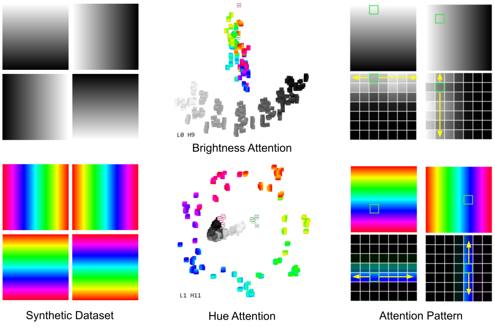

# 6. System Implementation

To process model inputs and compute attention information, we use the [Hugging Face Transformers](https://huggingface.co/docs/transformers/index) library and PyTorch. We use pre-trained implementations of BERT, GPT-2 (small), and ViT-16/32 with model weights from Google and OpenAI. For each NLP dataset, we randomly sample 200 sentences ($\sim$<!-- -->10k tokens per attention head, including both queries and keys). Due to the increased computational size of image attention data, we display 10 images per head (1000 tokens) for ViT-32 and 4 images per head (1576 tokens) for ViT-16. Larger datasets can be inputted into AttentionViz at the cost of increased system latency. Currently, it takes $\sim$<!-- -->6 seconds to load each NLP dataset, and $\sim$<!-- -->10 seconds to load ViT-16 data. After extracting query and key vector embeddings for each attention head, we generate the corresponding 2D/3D t-SNE, UMAP, and PCA coordinates (Sec. 4.1). To produce semantic labels (e.g.,“dog” or “background”) for image patches in ViT, we use the DeepLabv3 segmentation model (Chen et al. 2017). In total, it takes $\sim$<!-- -->3 hours to preprocess each BERT/GPT-2 dataset on a NVIDIA A100 GPU; for ViT-32, it takes $\sim$<!-- -->30 minutes.

Our final AttentionViz prototype consists of a Python/Flask backend that communicates with a frontend written in Vue and Typescript. The demo system is available at: <http://attentionviz.com>. Due to the large size of the data and browser memory constraints, we load pre-computed attention/projection information via JSON files through the backend. For ViT, the backend also performs image manipulation (e.g., patch highlighting and transparency adjustments) to display in the frontend. We use [Deck.gl](https://deck.gl/) to visualize the resultant query-key joint embeddings. AttentionViz is highly extensible and model-agnostic, allowing users to add new transformers and datasets to the system.

*Fig. 8. In ViT-32 Matrix View, we find two interesting visual attention heads: one head orders the black-and-white image tokens according to brightness, while the other aligns the colorful patches based on hue. Attention patterns shown in Image View confirm attention flow between patches with the same luminance.*
