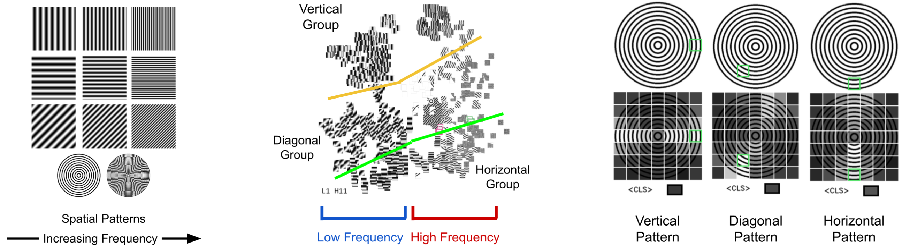
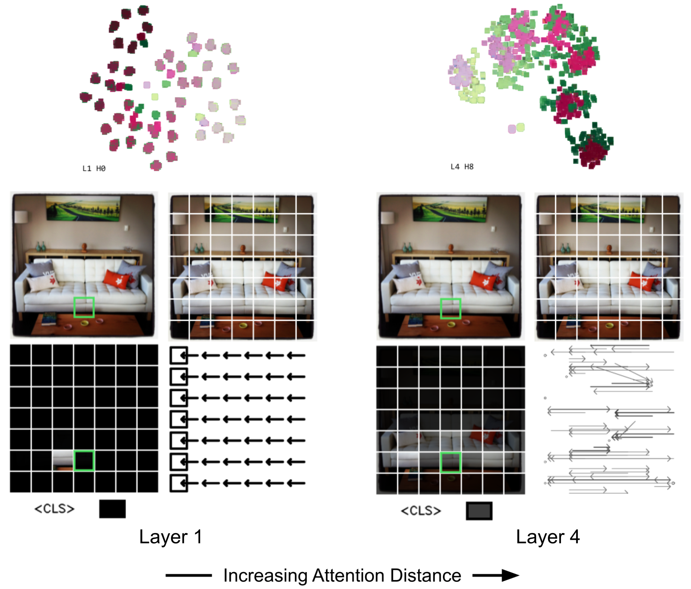
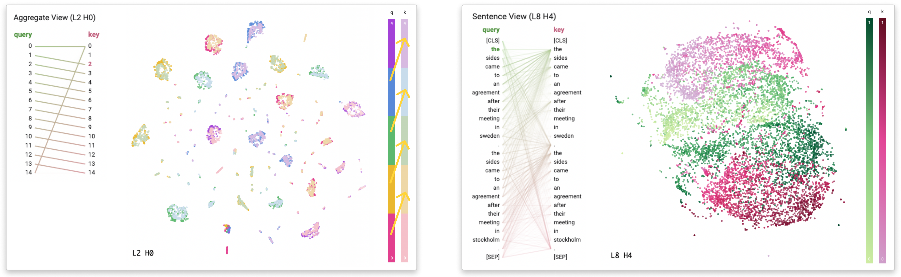
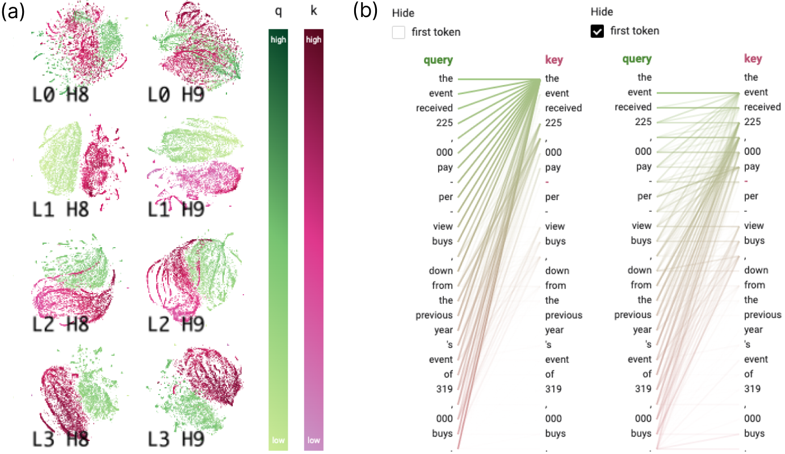
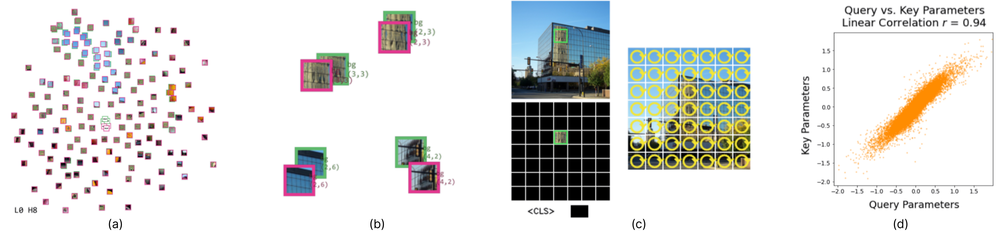

# 7. Findings & Evaluation

We illustrate the utility of AttentionViz with three application scenarios, as well as feedback from domain experts. Our scenarios target the goals in Sec. 3, and show how AttentionViz can offer insights about global self-attention trends in vision and language transformers.

**Data.** For BERT/GPT-2, we experimented with various NLP datasets but focus on two for our application scenarios. We use Wiki-Auto (Jiang et al. 2020) as a baseline to sample general input sentences and SuperGLUE AX$_b$ (Wang et al. 2019) to explore task-specific attention patterns for textual entailment. For ViT, we sample images from ImageNet (Russakovsky et al. 2015) and Microsoft COCO (Lin et al. 2014), as well as synthetic image data.

**User Interviews.** We invited **E2** and **E3** for a second round of interviews, and included two new experts, **E6** (interpretability researcher) and **E7** (vision science Ph.D. student). As in Sec. 3, all experts were interviewed individually. We first gave experts a quick demo of our tool and shared some of our own findings, asking them to share any thoughts or insights (Sec. 6.1-6.3). Then, we asked for more general feedback about the main strengths, weaknesses, and novelties of AttentionViz (Sec. 6.4). We also asked experts about possible extensions or applications of this technique for visualizing embeddings at scale.

*Fig. 9. **Left:** Dataset of spatial patterns with different frequencies and angles. **Center:** In Single View, we observe that one attention head of ViT-32 arranges image tokens based on the frequencies and angles of their spatial pattern. **Right:** The attention heatmap in Image View further confirms these findings – spatial patterns with similar angles pay greater attention to each other.*

## Goal: Understanding Machine Visual Attention

AttentionViz can be especially helpful in uncovering new insights about attention in vision transformers due to the inherently visual nature of image patch data **\[G1\]**.

**Hue/brightness specializations in visual attention.** We were curious if any visual attention heads specialize in either color-based and brightness-based patterns. To test this, we provided the pre-trained ViT-32 model with synthetic color and brightness gradient images (Fig. 8), loading the resultant query and key tokens into AttentionViz.

Browsing global PCA patterns in Matrix View, we identified two attention heads that resemble color and colorless vision. One head appears to align black-and-white image tokens based on brightness, and the other aligns colorful patches based on hue. Our dataset contains color and brightness gradient images in all orientations, and we see similar patches cluster together in the joint embedding space regardless of their position in the original images. The attention heatmap in Image View confirms these findings; tokens pay the most attention to other tokens with the same color or brightness. **E7** was intrigued by these results, having previously studied the color latent space of convolutional neural networks (CNNs), and expressed interest in using our tool to further explore the differences between CNN and ViT behavior.

**Frequency filtering and angle detection.** Frequencies and angles are low-level characteristics of image data. To investigate if the vision transformer has an attention head that associates visual patterns based on these features, we created images of sinusoidal signals with varying frequencies and orientations, processing them using our pretrained ViT-32 model. Examining the resultant query and key embeddings in Matrix View, we identified an attention head that separates image tokens based on their spatial pattern’s frequencies (x-axis) and angles (y-axis) (Fig. 9). With Image View, we observed that tokens in the images of concentric circles are paying attention to other tokens with similar curvatures, further confirming that this attention head associates visual patterns based on their angles.

**E7** said this result was interesting, but not too surprising given our hue/brightness findings, and was more curious about heads that do not exhibit this “attend to similar patches” behavior. One experiment they proposed was to study attention modulation, e.g., if the same image patch (e.g., vertical stripes) occurs in different contexts in two images (e.g., zebra vs. umbrella), do we see unique attention patterns?

*Fig. 10. Coloring image patches by row highlights positional attention patterns in ViT-32. In **Layer 1**, tokens in the same row and adjacent columns form small clusters. Image View reveals a *look at left* pattern. In **Layer 4**, large clusters of tokens form based on row positions. Using the arrowed lines, we see a wider, bidirectional attention flow.*

*Fig. 11. Other visual traces of attention. **Left:** Heads with small “clumps” often have even tighter positional patterns than spirals. Our discrete position encoding, which colors each token based on its position modulo 5, highlights a “next-token” attention trend. **Right:** Layered bands of queries and keys only appear with SuperGLUE AX$_b$ data (Wang et al. 2019), indicating strong attention to text start, end, and midpoint.*

**Increasing attention distance across model layers.** As noted in (Dosovitskiy et al. 2021), self-attention attends more broadly across images in deeper layers of vision transformers. We confirmed this finding using our interactive, joint visualizations of query and key tokens in AttentionViz. With Matrix View, we colored patches by image “row” and “column” to find four attention heads in layers 1 and 2 of ViT-32 that group tokens with their nearest spatial neighbors: on their left, right, top, and bottom. In layers 3 and 4, we saw similar positional attention patterns, but image tokens pay attention to all the patches in the same row or column, beyond their nearest neighbors (Fig. 10). This suggests that unlike CNNs, which process images using a square filter, the self-attention mechanism in transformers often processes images row by row and column by column, analogous to an elongated filter.

## Goal: Finding Global Attention Traces

To understand how self-attention patterns vary across different heads in language transformers **\[G2\]**, we used AttentionViz to explore BERT.

**Positional attention signatures.** With TSNE, we observed several attention heads with unique shapes, e.g., the spiral-shaped plots in layer 3 (Fig. 5a). For example, coloring layer 3 head 9 by *normalized* position in Single View reveals that token position increases as we move from the outside to the inside of the spiral (Fig. 5b). We used Sentence View to examine this pattern more closely (Fig. 5c), confirming that there is a positional, “next-token” attention pattern. This “spiral” also reflects the initial ordering vector given to transformers (Sec. 1).

We then noticed other identifiable “traces” in Matrix View, finding that plots with small “clumps” also encode positional patterns (Fig. 11, left), which we verified with our *discrete* position coloring. The difference between “spirals” and “clumps” appears to be whether tokens attend selectively to others one position away, versus at several different possible positions (Fig. 5c). Similarly, we learned that in heads with high query-key overlap, tokens typically attend to themselves and other instances of the same token, exhibiting a “look at self” pattern. Zooming into these heads, we see clear semantic clusters of nearby query-key pairs as shown in Fig. 6b, further supporting this observation.

 (Lin et al. 2019) shows that earlier transformer layers have the most information about linear word order, aligning with our findings and previous work such as (Clark et al. 2019; Vig 2019). During our interviews, **E2**, **E6**, and **E7** immediately noticed these interesting geometries, particularly spirals, and were curious about how much of the observed structure is purely due to position. This inspired several follow-up experiment ideas from experts, e.g., manipulating or removing the positional embeddings in transformer models and seeing how our query-key visualizations change.

**Task-specific traces.** After visualizing multiple datasets with AttentionViz, we found that the shapes of joint embeddings are highly consistent across different NLP tasks. However, we did see one visual trace that only arises in some later layers of BERT with the SuperGLUE AX$_b$ data (Fig. 11, right). Clicking on one such head (layer 8 head 9) and coloring by position, we observed a query-key “sandwich,” where keys and queries at the beginning of the text are stacked on top, followed by queries and keys at the end of the text in reverse order.

Sentence View reveals that the start, middle, and end of the text receive the most attention. The overall plot shape and attention pattern suggests that these heads can identify a text’s “midpoint” and differentiate between sentences, mirroring how in entailment tasks, two sentences are compared to see if they have similar meanings. Queries also mostly attend to keys in the same sentence. (Kovaleva et al. 2019; Vig and Belinkov 2019) shows how syntactic and task-specific information is most prominent in mid-to-later model layers, perhaps explaining the uniqueness of this trace.

**Global search patterns.** The aggregate search feature in Matrix View can also be used to quickly scan for and compare attention trends across heads **\[G2\]**. We found that patterns in the search results reflect the previously identified visual attention traces (Fig. 6a). For example, heads that are spiral-shaped or have small clumps of queries/keys have more dispersed search results, indicative of their underlying positional attention patterns. On the other hand, heads with the “look at self” attention pattern only have one cluster of search results, emphasizing the strong interaction between queries and keys of the same token.

Even if a joint query-key embedding does not have a distinctive shape, we see that if there are only a few search result clusters, the head may display more *semantic* behavior; otherwise, there is likely a *positional* attention pattern. (Tenney et al. 2019) notes that semantic information is spread across BERT’s layers, which we confirmed with AttentionViz. All of our experts were particularly excited by this feature of our tool and its ability to facilitate attention pattern comparisons.

## Goal: Identifying Anomalies and Unexpected Behavior

Through interacting with the joint query-key embeddings in AttentionViz, we discovered some irregular model behaviors **\[G3\]**.

*Fig. 12. Anomalies in GPT-2. **(a)** In early model layers, we witness a significant disparity between query-key norms for many attention heads (e.g., *L1 H8* prior to norm scaling). **(b)** Example of the prevalent “attend to first” pattern in later layers. Sentence View reveals latent attention behavior after hiding the first token.*

*Fig. 13. Identifying a “look at self” attention head in ViT-32. **(a)** Single View shows queries and keys are sparsely distributed in the joint embedding space. **(b)** Zooming in, query and key vectors of the same image token are tightly overlapped. **(c)** Image View reveals tokens pay most attention to themselves. **(d)** Comparing the learned parameters of query and key projection layers confirms that they learn redundant projections.*

**Norm disparities and null attention.** While exploring GPT-2 in Matrix View, we observed that in early model layers, some query and key clusters were well-separated, even after key translation (Sec. 4.1.1). By coloring by norm (as measured before the norm scaling step), we saw that in many heads, there is a significant disparity between the norms of query and key vectors (Fig. 12a). When query norms are small (i.e., light green), key norms tend to be large (i.e., dark pink), and vice versa. Computing the average norm difference between queries and keys in GPT-2 vs. BERT, we found that in the former, the mean query norm - key norm = **-4.59** across attention heads, while in the latter, the mean difference is only **0.41**. None of our experts could explain this finding: “It doesn’t really make sense why queries and keys would have such different norms” **(E6)**. Interestingly, a paper published after we made this observation (Dehghani et al. 2023) points to out-of-control query and key norms as a cause of serious training instability, indicating that this phenomenon may be worth studying further. This observation inspired our scaling approach from Sec. 4.1.1 as well.

We also noticed that in many GPT-2 heads, most attention is directed to the first token (Fig. 12b), especially in later layers.  (Vig and Belinkov 2019) briefly mentions that the first token is treated as a null position for attention-receiving in GPT-2 “when the linguistic property captured by the attention head doesn’t appear in the input text.” However, this phenomenon remains underexplored, proposing another open interpretability question to consider. **E2** and **E6** both noticed this anomalous behavior on their own with our tool, and all of our experts were surprised by this finding.  (Voita et al. 2019) shows that pruning the majority of attention heads in transformers may not significantly impact model performance, which perhaps can be partially attributed to this dominant null attention pattern. Regardless, AttentionViz allows users to filter out attention paid to the first token, uncovering hidden query-key interactions.

**“Look at self” attention heads.** AttentionViz can also reveal surprising attention patterns in vision transformers. In Matrix View, we identified several heads in early layers of ViT-32 with very diffused key-query clusters (Fig. 13a). Looking at one such attention head (layer 0 head 8), we discovered that the query and key embeddings of the same token form a small but dense cluster, with each query-key pair well-separated from the others (Fig. 13b). From the transparency heatmap in Image View, we see that the patch is solely attending to itself (Fig. 13c). Switching to the arrowed attention lines, we discover that the overall attention pattern for this image is “look at self,” where no information is flowing between image tokens in this head.

After identifying this irregular attention pattern, we checked the learned parameters of the query and key matrices with a correlation test. We found a strong similarity score (linear correlation $= \textbf{0.94}$), indicating that the query and key layers in this ViT head are indeed learning redundant projections (Fig. 13d). **E3** noted that this knowledge could inform model pruning experiments, and AttentionViz could similarly be used to detect potential training failures or other irregularities.

## Takeaways from User Feedback

**Merits of Matrix View.** Several experts found the “global” perspective provided by Matrix View to be the most novel and valuable part of AttentionViz. As **E6** said, “It’s great for quick comparison and frees you from tuning hyperparameters when you want to visualize multiple embeddings at once.” **E7** also mentioned that Matrix View is useful because “for smaller visualizations, I can just code up something myself, but it’s a lot harder at scale and with more data.” These comments suggest that this idea of visualizing and comparing embeddings at scale may be beneficial in other ML settings as well.

**Applications for joint query-key embeddings.** Experts proposed various use cases and extensions for our visualization technique, evidencing its wider applicability. For example, **E2** suggested visualizing patterns in untrained or corrupt transformers, and both **E3** and **E7** wanted to visualize changes in attention during training for their own models, aligning with our original goals (Sec. 3). **E2** and **E6** also suggested adapting our tool to help with causal tracing, explaining that “it might be useful to track attention flow throughout the model for hypothesis testing.” Similarly, **E3** expressed interest in looking into “how two attention patterns connect in different heads,” which could certainly be applied to visualizing induction head pairs. **E2** noted that adding a way to “quantify similarity between two heads” could be useful, while **E6** proposed “measuring or visualizing randomness in heads” for model pruning purposes.

**Embedding projections – to trust or not to trust?** **E3** highlighted the challenges of using projection methods. While they appreciated the striking geometric patterns (e.g., spirals) we found, **E3** expressed some skepticism about interpreting these visualizations due to the distortion from techniques such as t-SNE and UMAP: “How do I know if I can trust what I see?” This emphasizes the importance of tying visual insights to actionable interventions, perhaps through augmenting our tool to support hypothesis testing in addition to exploration.

**Flexibility-usability tradeoff.** **E2** indicated that AttentionViz “feels very usable and customizable,” contrasting with “existing visualization tools that are too overwhelming to learn and use.” However, some experts like **E6** were still worried that “showing all the features and heads might be overwhelming... Is there a way to summarize the information? Or focus more on a specific task?” **E7** added, “I wonder if there’s a quicker, more digestible way to label heads,” suggesting an approach closer to feature visualization (Olah et al. 2017). We designed AttentionViz to be a flexible tool (e.g., allowing attention analysis in different transformers and at different granularities), but it seems that the flexibility-usability tradeoff (Lidwell et al. 2010) of our design could still be improved.

**Additional interaction modes.** Some experts suggested additional interaction modes, e.g., on-the-fly inference **(E3)** or further dimensionality reductions on circled clusters of queries and keys to reveal additional information and perform fine-grained analyses **(E2)**. **E7** stressed the importance of allowing users to directly upload new datasets to the system: “The tool could be even more powerful... people are going to want to explore more with it like adding their own images.”
