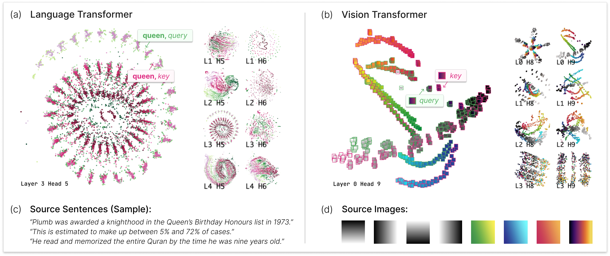

# 1. 引言

*图 1. AttentionViz 是我们的交互式可视化工具，它通过为查询和键创建联合嵌入空间，让用户在大规模上探索 Transformer 自注意力。 (a) 在语言 Transformer 中，这些可视化揭示了与注意力模式相关联的视觉痕迹。散点图中的每个点代表一个单词的查询或键版本，如点的颜色所示。用户可以探索单个注意力头，也可以放大以获得全局注意力视图。 (b) 这些可视化还揭示了在视觉 Transformer 中的见解，例如注意力头将图像块按色调和亮度分组。边框颜色表示图像块的查询嵌入（绿色）或键嵌入（粉红色）。 (c) 提供了参考样本输入句子， (d) 提供了参考图像。*

Transformer 神经网络架构（Vaswani et al. 2017）已经在从自然语言处理（NLP）（Devlin et al. 2018；Radford et al. 2019）到计算机视觉（Dosovitskiy et al. 2021）等多个领域产生重大影响。确实，如今，Transformer已被部署在数百万人使用的大型真实世界系统中（例如[Stable Diffusion](https://stability.ai/)，[ChatGPT](https://openai.com/blog/chatgpt)，[Microsoft Copilot](https://blogs.microsoft.com/blog/2023/03/16/introducing-microsoft-365-copilot-your-copilot-for-work/)）。然而，这种成功的机制仍有些神秘，尤其是在模型复杂度和规模不断增加的情况下，新的能力继续涌现（Dehghani et al. 2023；Wei et al. 2022）。对 Transformer 模型的更深入理解可能有助于我们构建更可靠的系统、排查问题以及提出改进方向。

在这项工作中，我们描述了一种新的可视化技术，旨在更好地理解Transformer是如何工作的。我们包括了对Transformer的简要介绍（见第1节）。我们的分析目标是Transformer的 *自注意力* 机制，该机制使这些模型能够学习和使用输入元素之间丰富的关系。尽管注意力模式已经被广泛研究，但之前的技巧通常仅在一次时间点上可视化单个输入序列（例如，一个句子或图像）的相关信息。典型的做法是为给定的输入序列创建注意力权重的二分图（Vig 2019；Vaswani et al. 2018）或热力图（Liu et al. 2018；Hoover et al. 2020）表示。

我们的方法提供了一个更高层次的视角，在这种视角下，我们可以同时查看许多输入序列的自注意力模式。这一方法的灵感来自于工具如激活图谱（Carter et al. 2019）的成功，后者允许研究人员“拉远”以查看神经网络的整体概览，然后深入以获取细节。在我们的案例中，我们寻求构建一种“注意力图谱”，为研究人员提供一个丰富的、详细的Transformer各种注意力头如何运作的视觉概览。主要新方法是可视化 Transformer使用的查询和键向量的联合嵌入，这创造了一个注意力头的视觉签名。

为了说明我们的技术，我们实现了 AttentionViz，这是一个交互式可视化工具，允许用户探索语言和视觉 Transformer 的注意力。AttentionViz 提供了多级细节的探索（图 1），提供了一个全局视图来同时查看所有注意力头，以及能够放大单个注意力头或输入序列中的细节的能力。

通过几个应用场景和注意力可视化以及领域专家访谈，我们展示了该技术的实用性。为了具体性，我们专注于几种广泛使用的视觉 Transformer：BERT（Devlin et al. 2018）、GPT-2（Radford et al. 2018）和ViT（Dosovitskiy et al. 2021）。我们发现BERT中存在一些可识别的“视觉痕迹”，这些痕迹与注意力模式相关；在ViT的视觉注意力机制中检测到新颖的色调/频率行为；并且在GPT-2中发现了潜在的异常行为。用户反馈也支持我们在大规模可视化其他嵌入式方法时该方法的更广泛适用性。

总结而言，本工作的主要贡献包括：

一种基于联合查询-键嵌入的注意力趋势探索技术，用于可视化 Transformer 模型。

- AttentionViz，一个应用于视觉和语言Transformer中自注意力研究的多尺度交互式工具，采用我们的技术。

- 应用场景和专家反馈展示了如何通过 AttentionViz 揭示 transformer 的注意力模式的见解。
