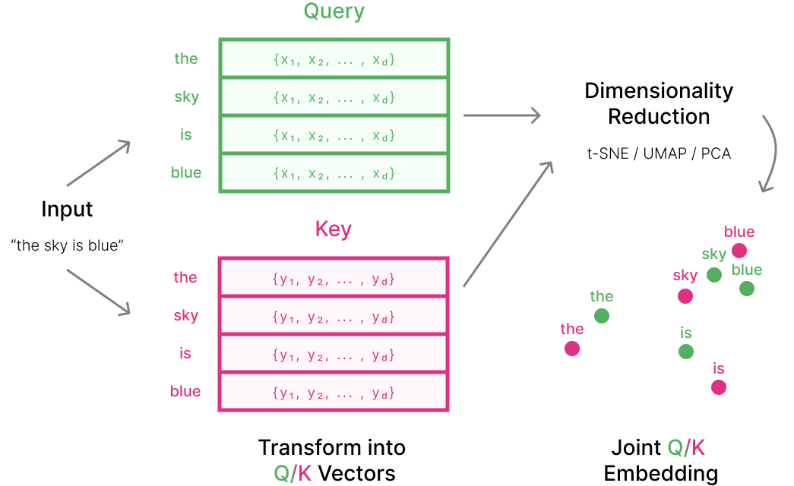
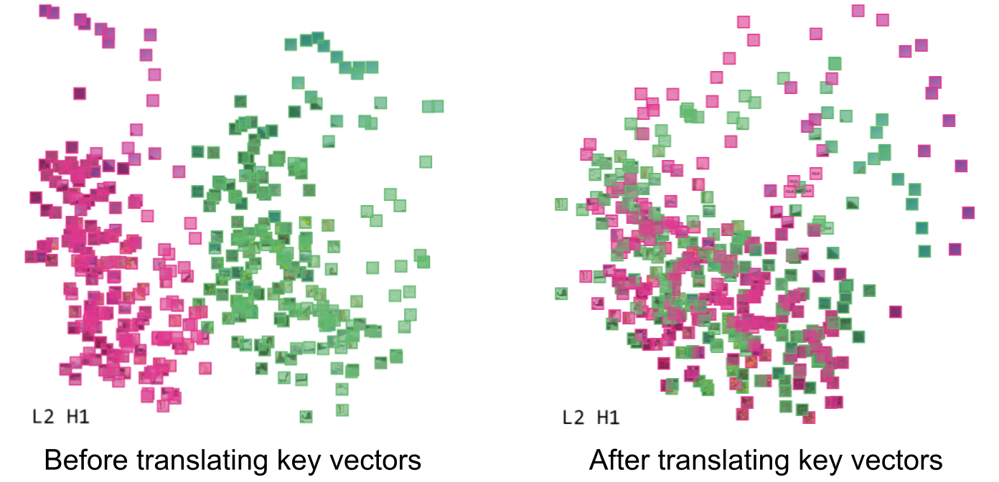
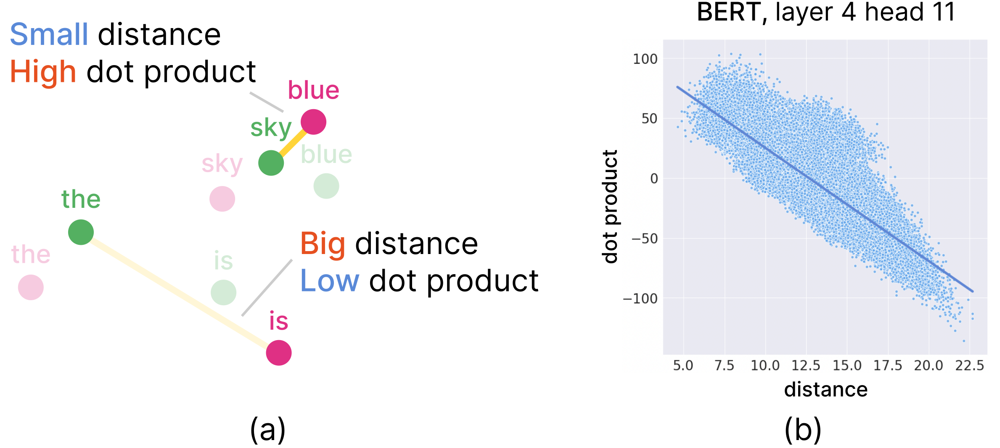
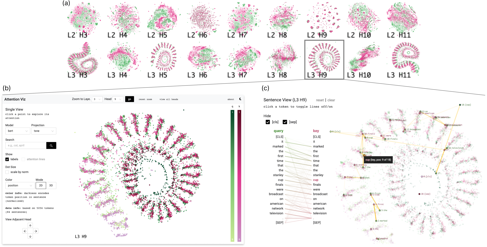
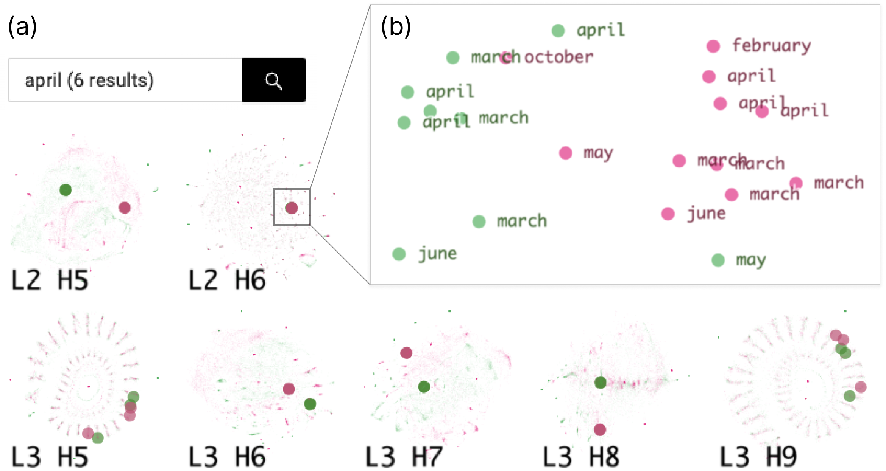
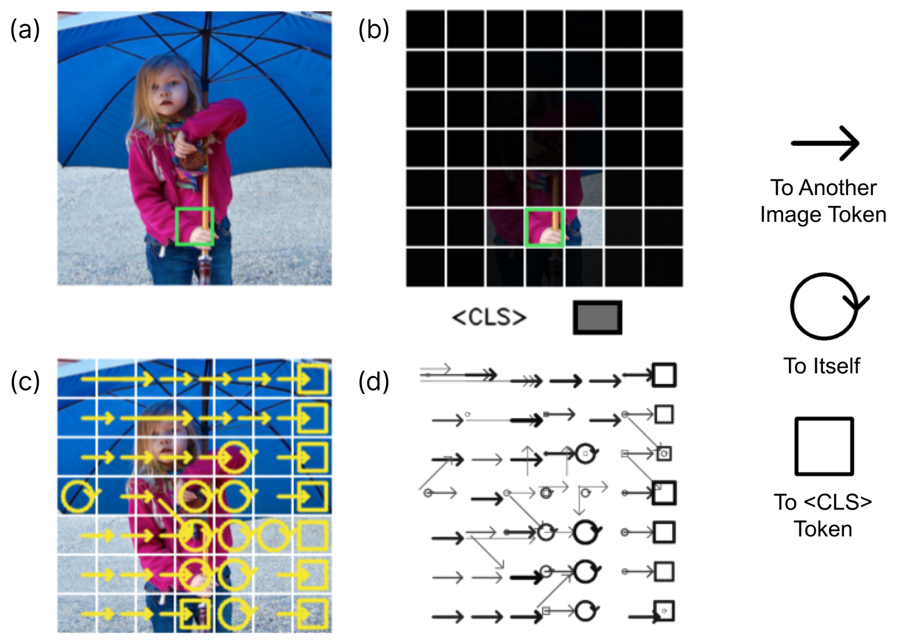

# 5. 查询/键嵌入与 AttentionViz 设计

为了实现这些目标和任务，我们构建了一个名为AttentionViz的工具。我们工具的主要技术是可视化每个注意力头的查询和键向量的联合嵌入。在本节中，我们首先描述了支撑这一技术的动机和数学原理，然后讨论了整个应用程序的设计。

*图 2. 为单个注意力头创建联合查询-键嵌入空间。在 NLP 案例中，给定一个输入句子，我们首先将每个 token 变换为其对应的查询和键向量。然后，我们使用 t-SNE/UMAP/PCA 将这些 $1 \times d$ 向量投影到 2D/3D 散点图坐标中。对于 BERT、GPT-2 和 ViT 模型，$d = 64$。*

## 查询/键嵌入可视化

AttentionViz的技术原理相对简单，尽管如下面所述，它需要两个数学技巧才能有效工作。请记住，每个Transformer注意力头通过应用矩阵$W_Q$和$W_K$，分别将输入嵌入转换为查询向量和键向量（参见第1节）。这些矩阵将原始向量嵌入投影到更低维的空间中，本质上选择更高维向量嵌入中的特定类型的信息。因此，通过检查查询和键向量，人们希望了解$W_Q$和$W_K$选择了什么信息。

一个中心观察是，查询和键向量之间的相对位置可以提供关于注意力如何分配的线索，因为注意力系数依赖于查询和键之间的点积。为了理解这一点，考虑一个假设情况，其中查询和键向量始终具有相同的范数。那么，更近的距离将直接与更高的注意力系数相关。在实践中，查询和键向量的范数会有所不同，因此点积和距离之间的关系并不精确。然而，如接下来的几节所述，我们可以安排这种关系变得非常接近。

图 2 以语言 Transformer 中的一个合成注意力头为例说明了该技术。为创建联合嵌入，我们首先获得给定句子中每个 token 的查询向量和键向量表示（参见第 1 节），随后使用 t-SNE、UMAP 或 PCA 将这些高维向量投影到共享的低维子空间。降维算法输出二维或三维散点图，其中每个点代表一个查询 token 或键 token。同样的过程也适用于 ViT 注意力头，此时每个 token 对应一个图像块。默认情况下，查询以绿色显示，键以粉色显示；用户还可以选择其他颜色编码，系统也能方便地替换调色板。

我们的联合嵌入允许用户探索查询与键之间的细粒度交互，这些图的形状通常可以作为潜在自注意力模式的视觉指示器（参见第6节）。对于给定的数据集，每个降维技术都会产生不同的模式，提供独特的见解和用例。

*图 3. **左:** 查询和键在联合嵌入空间中的原始表示。 **右:** 键经过翻译后，使其与查询和键的质心重叠增加。*

### 向量归一化

在设计 AttentionViz 时，我们注意到有两个“自由参数”，可以调整而不会丢失任何信息。调整这些参数会创建嵌入距离与注意力权重之间的更密切关系，并极大地提高可视化结果的可读性。这些归一化处理在降维之前进行（图 2）。

查询和键向量在我们的可视化中有时是分离的（图3，左图）。这种分离使得直接比较查询和键嵌入变得困难。然而，一个简单的数学技巧允许我们将这些嵌入移动得更接近，而不会影响任何给定输入序列的自注意力计算。特别是，注意软化函数是 *平移不变* 的：即对于任何常数 $a$, 我们有 $\mathrm{softmax}_j(x_1 + a, x_2 + a, \ldots) = \mathrm{softmax}_j(x_1, x_2, \ldots)$. 现在，考虑查询向量 $x$ 和键向量 $y_1, \ldots, y_n$. 对于任何向量 $v$，我们有：
$$
\begin{equation*}
\begin{split}
\mathrm{attention}_j(x) &= \mathrm{softmax}_j(\langle x, y_1 \rangle, \langle x, y_2 \rangle, \ldots) \\
&= \mathrm{softmax}_j(\langle x, y_1 \rangle + \langle x, v \rangle, \langle x, y_2 \rangle + \langle x, v \rangle, \ldots) \\
 &= \mathrm{softmax}_j(\langle x, y_1 +v \rangle, \langle x, y_2 +v \rangle , \ldots) 
\end{split}
\end{equation*}
$$
在第二步中，我们通过不变性翻译。这表明，在给定输入中不改变注意力模式的情况下，我们可以将所有键向量翻译成使得每个注意力头的查询和键分布具有相同的质心。这使得比较查询和键变得非常容易（图3，右侧）。

**查询和键的规模:** 在一些Transformer中，例如 GPT-2, 我们观察到查询的平均范数与键的平均范数非常不同。这种差异使得联合嵌入中的键-查询关系难以解释。从数学上讲，这表明点积与距离之间的关系不佳；从视觉上讲，这意味着查询可能是一个微小的簇，被松散的键云包围。

幸运的是，规模是系统中的另一个“自由参数”。自注意力的强度仅取决于查询和键向量的点积，因此如果我们将所有查询向量乘以一个因子 $c \neq 0$, 将所有键向量乘以一个因子 $c^{-1}$, 则注意力值不会改变。这使得在图 4a 中展示的联合可视化中，高注意力查询-键对可以更靠近。 (一个微妙的点：单独使用缩放操作不会改变余弦距离；然而，与平移归一化结合使用时，它具有非平凡的影响。)

为了确定 $c$ 的最优值，我们可以定义一个“加权相关性”指标，该指标将更多的权重放在距离较小的查询-键对上，因为我们最关心的是查询和键之间的邻近性。因此，我们可以选择一个缩放因子 $c$，使得查询-键点积与距离之间的加权相关性最大化。这种方法允许在联合嵌入空间中的距离最准确地表示查询和键之间的实际注意力值。

*图 4. **(a)** 理想的距离-注意力关系，其中查询-键对在联合嵌入空间中距离更近，其点积更大。 **(b)** 示例注意力头，在 BERT 中，查询-键距离与点积之间存在强负相关 (**-0.983**)。*

### 以距离近似注意力

如上所述，理想情况下，如果一个查询-键对具有较大的正点积（对应于最终的自注意力值较高），它们应该在嵌入空间中更接近，反之亦然（图4a）。因此，我们期望距离与嵌入空间中的注意力呈 *反相关*。我们通过计算每个注意力头在 BERT、GPT-2 和 ViT 中余弦距离与点积的斯皮尔曼秩相关性来研究这种潜在的联系。我们还尝试使用余弦距离作为我们在查询和键的 t-SNE 和 UMAP 投影中创建的距离度量，但这种方法通常会导致更弱的距离-点积相关性。

在多个数据集和模型中，距离与注意力之间的关系表现得相当不错。例如，对于 Wiki-Auto 数据集（Jiang et al. 2020），查询-键距离与点积之间的平均相关系数分别为 BERT 的 **-0.938** 和 GPT 的 **-0.792**。图 4b 中展示了 BERT 的一个示例结果。对于 Lin 等人（2014）使用的 COCO 图像集，ViT-32 和 ViT-16 的平均相关系数分别为 **-0.873** 和 **-0.884**。

## 颜色编码

为了可视化查询和键的不同属性，AttentionViz提供了多种颜色编码选项。默认选项是根据 *token类型* 来着色，即查询或键。对于视觉 Transformer，用户可以选择按图像块 *行* 或 *列* 来着色，以可视化位置模式（图 10）。由于图像自身包含颜色信息，我们还允许用户查看不附加任何样式元素的 *原始* 块（图 8）。

对于语言 Transformer，我们支持两种位置色彩方案：*归一化*和*离散*。为了计算归一化位置，我们将句子中每个 token 的位置除以句子长度，以产生连续的色彩尺度。较亮的色调表示 token 更接近句子的开头（图 5b）。我们的离散位置编码将每个 token 的位置应用模运算，以获取其除以 5 后的余数。因此，$1^{st}$ 和 $6^{th}$ 令牌获得相同的颜色，$2^{nd}$ 和 $7^{th}$ 令牌获得相同的颜色，依此类推。我们使用相同的五种颜色来编码查询和键在不同位置，使用较暗的色调来表示前者。尽管这种方案在长度 > 5 的句子中引入了模糊性，但我们发现我们的离散着色有助于基于位置的小偏移看到关系（例如，如图 11 左所示，查询关注键一个位置）。模糊性也可以通过悬停在 token 上轻松解决，在我们的探索中，我们没有看到超过 2 或 3 的偏移模式。用户也可以通过着色*查询/键 norm*来查看（图 12a）。

## 视图

AttentionViz 提供了三种主要的交互式视图用于注意力探索：*矩阵视图*、*单视图*和*句子/图像视图*。

*图 5. 在 BERT 中，从形式到功能的连接。**(a)** 在矩阵视图中，第 3 层有几条螺旋形的图表。**(b)** 通过使用单视图将注意力聚焦在一个这样的头 (*L3 H9*) 上，我们可以使用一种编码输入序列位置的亮暗颜色方案来观察位置注意力模式。**(c)** 通过探索句子级别的可视化，这些模式可以得到证实。*

*图 6. 通过全局搜索探索注意力模式。**(a)** 搜索结果较少聚类的注意力头往往表现出更多的语义行为，而分散结果的注意力头则更关注于 token 的位置。**(b)** 针对 L2 H6 进行放大，可以看到一个主要结果聚类的注意力头确实包含一组语义相关的查询和键 token。*

### 矩阵视图

AttentionViz的初始视图是“矩阵视图”，它使用小倍数来同时可视化一个Transformer的所有注意力头（图5a），直接解决**\[T1\]**和**\[T3\]**。每一行对应一个模型层，从界面顶部的早期层移动到底部的后期层。凭借这种“全局”视角，用户可以更容易地扫描不同Transformer层和头之间的模式，相比单图（例如（Vig 2019））或实例级可视化（例如（Boggust et al. 2022; Smilkov et al. 2016））而言。本文中使用的所有模型都具有相同的架构：12层x每层12个头=总共144个注意力头，但我们的系统可以扩展到其他维度。

在矩阵视图中，用户可以查看使用t-SNE、UMAP或PCA创建的联合查询-键嵌入。他们还可以在模型类型之间切换（即，BERT, GPT-2, ViT-16/32），探索不同的数据集**\[T4\]**，切换不同的颜色方案，并在2D或3D中查看结果图。矩阵视图支持全局搜索功能（图6a），有助于突出不同头中令牌位置的模式，并提供另一种分析规模注意力的方式（参见第6节）。

### 单头视图

用户可以在矩阵视图中点击任何图表以放大到单视图（图5b），从而更详细地探索单个注意力头（\[T3\]）。与矩阵视图类似，用户可以在单视图中切换颜色、维度、投影模式、数据集和模型；所有图形更改在视图之间同步，以促进比较。用户可以点击一个点来高亮显示对应输入序列中的所有标记，突出显示我们的联合嵌入空间中的相关查询和键。用户还可以选择将注意力线投影到散点图上，这些散点图连接查询和键标记（\[T5\]）。我们只显示每个标记的前2个注意力权重以增强可读性。我们的注意力线功能支持\[T2\]，提供了一种新的方式来可视化 Transformer中的注意力模式，以头为单位。

在单视图中，用户也可以搜索 token 并使用我们的标注功能来揭示数据中的语义模式，类似于 (Smilkov et al. 2016)。例如，在图 6b 中，搜索揭示了对于这个 BERT 个注意力头，具有相似意义的查询/键 token 被放置在一起，这表明它们之间存在强烈的注意力（参见第 4.1.2 节）。

*图 7.ViT图像视图。**(a)** 原始图像。**(b)** 透明度注意力热力图。我们用绿色边框突出显示所选的令牌（查询）。**(c)** 重叠的注意力箭头。**(d)** 全局注意力流。正方形图标表示图像块与查询之间最强的注意力连接。<CLS>token，不在原始图像中。

### 句子/图像视图

*Sentence/Image View* 允许探索单个句子或图像中的细粒度注意力模式 **\[T2, T3\]**。两者均与单视图同步，匹配每个查询/键散点图上的注意力线条，提供平滑的用户体验。

**视图视图。** 使用 BERT 或 GPT-2 时，用户可以在左侧边栏中打开 Sentence View，点击点将显示一个基于 BertViz 的句子级注意力可视化图（Vig 2019）（图 5c）。我们还考虑使用热力图可视化（例如，Park et al. 2019），但似乎双部分图方法将为更长的句子提供更好的可读性和模式探索便利。连接左列查询标记和右列键标记之间的线条的透明度表示其对应的注意力强度。悬停在标记上会高亮显示标记特定的注意力线条。为了减少分类标记和分隔符在 BERT 中或 GPT-2 中第一标记（第 6 节）的噪声，用户可以选择隐藏这些特殊标记的注意力线条。其他查询和键标记也可以打开/关闭，所有注意力线条将相应地重新归一化。用户可以选择查看每个注意力头的汇总注意力模式，以提供另一层比较（图 11a）。

**图像视图。** 对于基于图像的输入 ViT，当用户点击图像块时，侧边栏会显示其对应的原始图像，并用带有彩色边框的标记突出显示点击的 token（图 7a）。用户还可以看到一张带有注意力热力图的图像，其中透明度表示点击的图像块与其他图像区域之间的注意力权重（图 7b）。

超越单一token的注意力可视化，Image View允许用户通过展示不同图像块之间的箭头式注意力线来探索图像的整体注意力模式。我们为可视化箭头提供了两种选项。第一种选项在原始图像块上方叠加箭头，每个箭头代表起始图像块与目标块之间最强的注意力连接（图7c）。这为用户创建了一个简化了的双部分注意力图，以便在特定头内描述最重要的模式。第二种选项在原始图像旁边展示所有强注意力连接（即$attn(x_i, x_j) > 0.1$），提供了一个更全面的注意力视图（图7d）。在这一可视化中，透明度和线条粗细都被用来表示注意力连接的强度。我们还尝试过可视化查询和键之间的所有权重，以更接近地模仿（ViT 2019），但这通常会产生拥挤且难以理解的结果。
