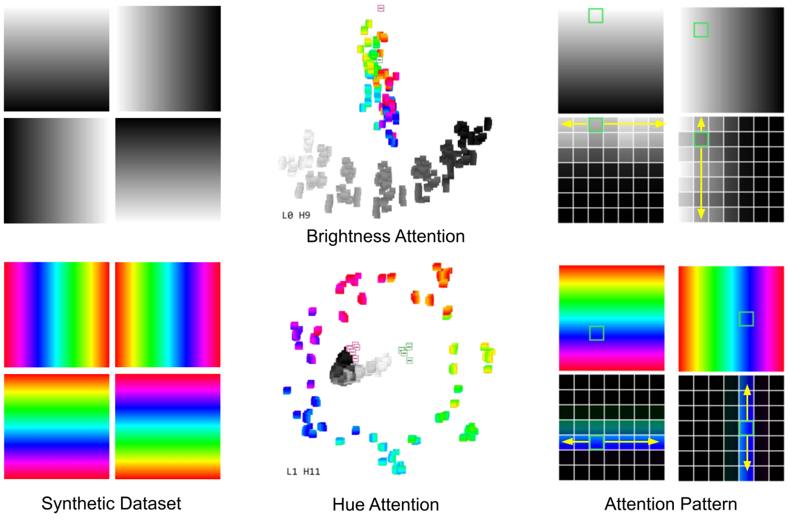

# 6. 系统实现

为了处理模型输入并计算注意力信息，我们使用视觉 Transformer。[Hugging Face Transformers](https://huggingface.co/docs/transformers/index)我们使用预训练的视觉 Transformer 实现库和 PyTorch。BERT, GPT-2(小)，和ViT从Google和OpenAI的模型权重中，采用-16/32的设置。对于每个NLP数据集，我们随机采样200个句子（$\sim$<!-- -->每个注意力头包含查询和键共有10k个tokens。由于图像注意力数据的计算规模增加，我们每头显示10张图像（1000个tokens）。ViT-32 个注意力头，每个头 4 张图像（1576 个 token）对于ViT-16. 更大的数据集可以输入到AttentionViz中，代价是系统延迟增加。目前，这需要花费16秒。$\sim$<!-- -->6秒加载每个NLP数据集$\sim$<!-- -->10秒加载完毕ViT-16 数据。提取每个注意力头的查询和键向量嵌入后，我们生成相应的 2D/3D t-SNE、UMAP 和 PCA 坐标（见第 4.1 节）。为了生成图像块的语义标签（例如，“狗”或“背景”），我们ViT，我们使用 DeepLabv3 分割模型 (Chen et al. 2017)。总共需要$\sim$<!-- -->3小时预处理每一份BERT/GPT-2使用 NVIDIA A100 GPU 的数据集；对于ViT-32，需要$\sim$<!-- -->三十分钟。

我们的最终 AttentionViz 原型由一个 Python/Flask 后端与一个使用 Vue 和 TypeScript 编写的前端进行通信。演示系统可在 <http://attentionviz.com> 获取。由于数据量庞大和浏览器内存限制，我们在后端通过 JSON 文件加载预先计算的注意力/投影信息。对于 ViT，后端还执行图像操作（例如，块高亮和透明度调整）以在前端显示。我们使用 [Deck.gl](https://deck.gl/) 来可视化结果查询-键联合嵌入。AttentionViz 非常具有扩展性且模型无关，允许用户向系统中添加新的 Transformer 和数据集。

*图 8. 在 ViT-32 矩阵视图中，我们发现两个有趣的视觉注意力头：一个注意力头按照亮度顺序排列黑白图像 token，另一个注意力头则根据色调排列彩色块。图像视图中的注意力模式证实了相同亮度的块之间的注意力流动。*
