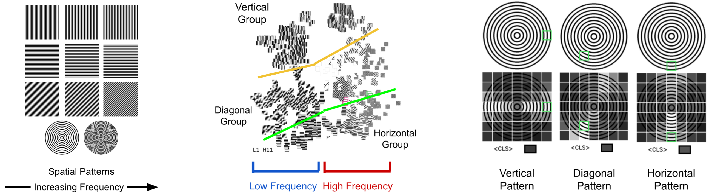
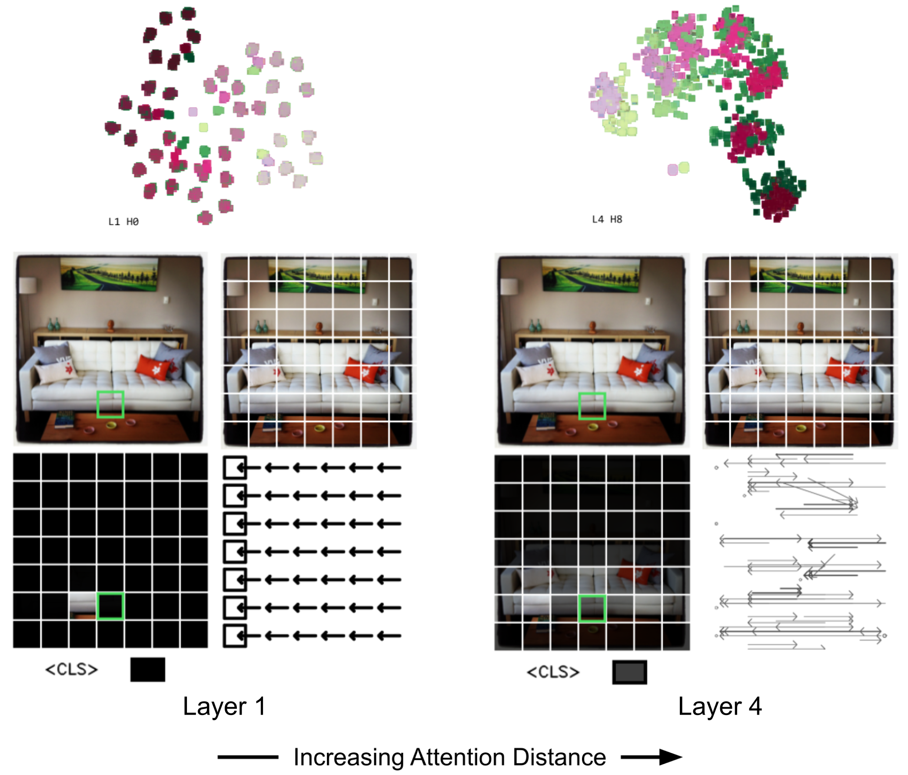
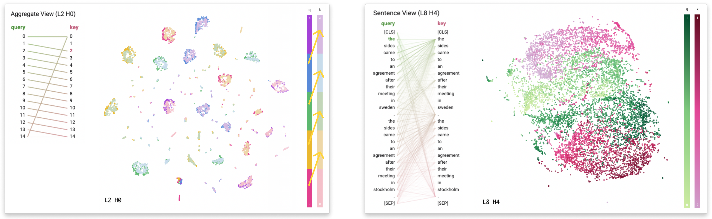
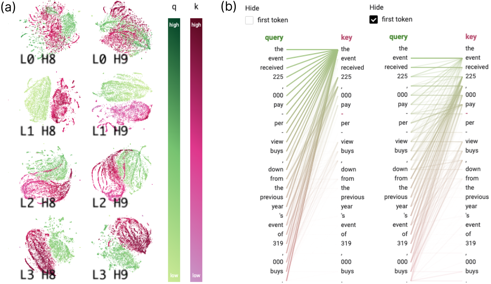
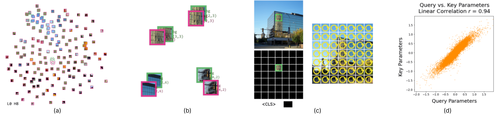

# 7. 发现与评估

我们通过三个应用场景展示了AttentionViz的实用性，同时也得到了领域专家的反馈。我们的应用场景旨在实现第3节中的目标，并展示了AttentionViz如何提供关于视觉和语言Transformer中全局自注意力趋势的见解。

数据。BERT/GPT-2, 我们尝试了各种NLP数据集，但专注于两个数据集用于我们的应用场景。我们使用Wiki-Auto（Jiang et al. 2020）作为基线，采样通用输入句子，以及SuperGLUE AX$_b$(Wang 等人，2019) 探索针对文本蕴含任务的特定任务注意力模式。对于文本蕴含任务。ViT, 我们从 ImageNet (Russakovsky et al. 2015) 和 Microsoft COCO (Lin et al. 2014) 实际图像数据，以及合成图像数据中采样图像。

**用户访谈。** 我们邀请了 **E2** 和 **E3** 进行第二次访谈，并包括了两位新专家 **E6**（可解释性研究员）和 **E7**（视觉科学博士生）。正如第3节所述，所有专家都进行了单独访谈。我们首先向专家们演示了我们的工具，并分享了一些自己的发现，询问他们分享任何想法或见解（第6.1-6.3节）。然后，我们询问了专家们对 AttentionViz 的主要优点、缺点和创新的看法（第6.4节）。我们还询问了专家们关于扩展或应用此技术来可视化大规模嵌入的可能性。

*图 9. **左:** 不同频率和角度的空间模式数据集。 **中:** 在单视角下，我们观察到 ViT-32 个注意力头根据其空间模式的频率和角度排列图像标记。 **右:** 在图像视图中的注意力热力图进一步证实了这些发现 – 具有相似角度的空间模式之间给予更多的注意力。*

## 目标：理解机器视觉注意力

AttentionViz 对于揭示视觉 Transformer 中的注意力具有特别的助益，因为图像块数据的固有视觉性质 **\[G1\]**。

视觉注意力中的色调/亮度专化。我们好奇视觉注意力头是否专精于基于颜色和亮度的模式。为了测试这一点，我们向预先训练的 ViT-32 模型提供了合成的色调/亮度梯度图像（图 8），并将结果查询和键标记加载到 AttentionViz 中。

浏览全局PCA模式，在矩阵视图中，我们识别出两个注意力头，它们类似于颜色和无色的视觉。一个头似乎根据亮度将黑白图像令牌对齐，另一个头根据色调将彩色块对齐。我们的数据集中包含所有方向的彩色和亮度梯度图像，无论它们在原始图像中的位置如何，我们都能看到相似的块在联合嵌入空间中聚在一起。图像视图中的注意力热力图证实了这些发现；令牌对其他具有相同颜色或亮度的令牌给予最多的注意力。E7对这些结果感到好奇，他此前曾研究过卷积神经网络（CNNs）的颜色潜在空间，并表示有兴趣使用我们的工具进一步探索CNN和ViT行为之间的差异。

频率过滤和角度检测。频率和角度是图像数据的低级特征。为了探究视觉 Transformer是否有一个注意力头，基于这些特征关联视觉模式，我们创建了具有不同频率和方向的正弦信号图像，并使用我们的预训练 ViT-32模型对其进行处理。在Matrix View中检查结果的查询和键嵌入，我们识别出一个注意力头，该注意力头根据图像标记的频率（x轴）和角度（y轴）将图像标记分开（图9）。在Image View中，我们观察到同心圆图像中的标记正在关注具有相似曲率的其他标记，进一步证实了该注意力头基于角度关联视觉模式。

E7认为这个结果有趣，但并不太出乎意料，鉴于我们的色调/亮度发现。他们更感兴趣的是那些不表现出“关注相似图像块”行为的注意力头。他们提出的一个实验是研究注意力的调制，例如，如果同一图像块（例如，竖条纹）出现在两张图像的不同上下文（例如，斑马 vs. 雨伞）中，我们是否会看到独特的注意力模式？

*图 10. 通过行着色图像块来突出显示位置注意力模式 ViT-32。在 **第 1 层**，同一行中的标记和相邻列中的标记形成小集群。图像视图揭示了 *左看* 模式。在 **第 4 层**，标记基于行位置形成大集群。通过箭头线，我们可以看到更宽、双向的注意力流动。*

*图 11. 其他注意力的视觉痕迹。 **左图:** 小“团块”注意力头往往比螺旋状的注意力模式更加集中。我们的离散位置编码，将每个 token 根据其位置模 5 进行着色，突出了“下一个 token”注意力的趋势。 **右图:** 只有在 SuperGLUE AX$_b$ 数据集（Wang et al. 2019）中，才会出现查询和键的分层带状图案，这表明对文本开始、结束和中间点有很强的注意力。*

**增加模型层间注意力距离。** 如 (Dosovitskiy et al. 2021) 所述，视觉 Transformer 的深层层中，自注意力会更多地关注图像中的更广泛区域。我们通过交互式联合可视化 AttentionViz 中查询和键 token 的方式，证实了这一发现。使用 Matrix View，我们将图像的“行”和“列”颜色标记，以在 ViT-32 层 1 和 2 中找到四个注意力头，这些注意力头会将 token 与其最近的邻域 token 组合在一起：在左侧、右侧、顶部和底部。在层 3 和 4 中，我们看到了类似的位置注意力模式，但图像 token 会关注同一行或列中的所有 patch，而不仅仅是最近的邻域（图 10）。这表明，与使用方形滤波器的 CNN 不同，Transformer 的自注意力机制通常会按行和列依次处理图像，类似于一个拉长的滤波器。

## 目标：发现全局注意力轨迹

为了理解语言 Transformer **\[G2\]** 中不同头的自注意力模式如何变化，我们使用 AttentionViz 来探索 BERT。

**注意力签名的位置。** 使用TSNE，我们观察到几个注意力头具有独特的形状，例如，第3层（图5a）中的螺旋形状的图。例如，通过将第3层的第9个头用标准化位置着色，我们可以看到随着从螺旋的外部向内部移动，令牌位置增加（图5b）。我们使用Sentence View更仔细地检查了这种模式（图5c），证实存在一种位置上的“下一个令牌”注意力模式。这种“螺旋”也反映了给Transformer分配的初始顺序向量（第1节）。

然后我们注意到矩阵视图中还有其他可识别的“痕迹”，发现具有小“团块”的图也编码了位置模式（图 11 左图），我们通过离散位置着色验证了这一点。团块与螺旋之间的差异似乎在于标记是否选择性地关注一个位置以外的其他标记，还是在几个可能的位置上（图 5c）。同样，我们了解到在查询-键重叠较高的头中，标记通常会关注自身以及同一标记的不同实例，表现出一种“看自己”的模式。放大这些头时，我们看到附近查询-键对的清晰语义簇，如图 6b 所示，进一步支持了这一观察。

(Lin et al. 2019) 表明，早期的 Transformer 层包含关于线性词序的最多信息，这与我们的发现和先前的工作（如 Clark et al. 2019 和 Vig 2019）一致。在我们的访谈中，**E2**、**E6** 和 **E7** 立刻注意到这些有趣的几何形状，特别是螺旋，对观察到的结构中有多大比例纯粹由位置决定感到好奇。这激发了专家们的一些后续实验想法，例如，操纵或移除 Transformer 模型中的位置嵌入，并观察我们的查询-键可视化如何变化。

任务特定的痕迹。在使用 AttentionViz 视图可视化多个数据集后，我们发现联合嵌入的形状在不同 NLP 任务中高度一致。然而，我们在 BERT 的某些后期层中看到了一个只在 SuperGLUE AX$_b$ 数据集出现的视觉痕迹（图 11 右）。点击其中一个这样的注意力头（第 8 层第 9 个头），并按位置着色，我们观察到一个查询-键“ sandwich”，其中文本开头的键和查询堆叠在顶部，然后是文本结尾的查询和键以相反的顺序排列。

视图显示，文本的开头、中间和结尾部分接收到了最多的注意力。整体的叙事形状和注意力模式表明，这些头可以识别文本的“中间点”并区分句子，这与在 entailment 任务中，比较两个句子以判断它们是否有相似意义的情况相似。查询也主要关注同一句子中的键。 (Kovaleva et al. 2019; Vig and Belinkov 2019) 揭示了语法和任务特定信息在中间到后期模型层中最为突出，或许可以解释这种痕迹的独特性。

**全局搜索模式。** 矩阵视图中的聚合搜索功能还可以用于快速扫描并比较各头的注意力趋势 **\[G2\]**。我们发现搜索结果中的模式反映了先前识别的视觉注意力轨迹 (图 6a)。例如，具有螺旋形状或查询/键小团块的头具有更分散的搜索结果，表明其潜在的定位注意力模式。另一方面，具有“查看自身”注意力模式的头只有单一的搜索结果集群，强调了同一token的查询和键之间强烈的相互作用。

即使联合查询-键嵌入没有独特的形状，我们看到如果只有少数搜索结果簇，注意力头可能会表现出更多的语义行为；否则，很可能存在位置注意力模式。Tenney等人（2019）指出，语义信息散布在BERT的各层中，我们通过AttentionViz验证了这一点。我们的所有专家都特别兴奋于我们工具的这一功能及其促进注意力模式比较的能力。

## 目标：识别异常与非预期行为

通过与注意力视图中的联合查询-键嵌入相互作用，我们在 **\[G3\]** 发现了一些不规则的模型行为。

*图 12. GPT-2中的异常。**(a)** 在早期模型层中，我们观察到许多注意力头（例如，*L1 H8*在归一化之前）的查询-键范数之间存在显著差异。**(b)** 后期层中常见的“首先关注”模式的示例。句视图揭示了隐藏第一个标记后的潜在注意力行为。*

*图 13. 在 ViT-32 中识别“看自己”注意力头。**(a)** 单视图显示查询和键在联合嵌入空间中稀疏分布。**(b)** 放大后，相同图像标记的查询和键向量紧密重叠。**(c)** 图像视图揭示标记最关注自身。**(d)** 比较查询和键投影层的学习参数证实它们学习冗余投影。*

**模型偏差和零注意力。** 在探索 GPT-2 的矩阵视图中，我们注意到在早期模型层中，一些查询和键簇即使经过键翻译（见第4.1.1节）后仍然很好地分离（节 4.1.1）。通过按范数着色（即在范数缩放步骤之前测量），我们看到在许多头中，查询和键向量的范数之间存在显著差异（图12a）。当查询范数较小（即浅绿色）时，键范数倾向于较大（即深粉红色），反之亦然。在 GPT-2 和 BERT 之间计算查询和键的平均范数差异，我们发现前者平均查询范数-键范数为-4.59，而在后者中，平均差异仅为0.41。我们的专家都无法解释这一发现：“为什么查询和键会有如此不同的范数实在不理解”（E6）。有趣的是，一篇在我们做出这一观察之后发表的论文（Dehghani et al. 2023）指出，查询和键范数失控是严重训练不稳定的原因之一，这表明这一现象可能值得进一步研究。这一观察启发了我们在第4.1.1节中提出的缩放方法。

我们也注意到，在许多GPT-2注意力注意力注意力注意力头数量量量量方面，大部分注意力都集中在第一个token（图12b）上，尤其是在后期的层中。 （Vig和Belinkov 2019）简要提到，第一个token在注意力接收时被视为一个空位置。GPT-2当注意力头捕捉到的语义属性并未出现在输入文本中时。然而，这一现象仍待进一步探索，提出了另一个需考虑的可解释性问题。**E2** 和 **E6** 都在我们的工具的帮助下各自发现了这一异常行为，所有专家都对这一发现感到惊讶。 (Voita et al. 2019) 表明，在Transformer中剪枝大部分注意力头并不会显著影响模型性能，这或许部分可以归因于这种主导的空注意力模式。无论如何，AttentionViz 允许用户过滤掉对第一个 token 的注意力，揭示隐藏的查询-键交互。

“自看”注意力头。AttentionViz还可以揭示视觉 Transformer 中的令人惊讶的注意力模式。在矩阵视图中，我们识别出ViT-32层中的几个早期注意力头（图13a）。查看其中一个注意力头（层0头8），我们发现同一token的查询和键嵌入形成一个小但密集的集群，每个查询-键对与其他查询-键对都很好地分离（图13b）。从图像视图中的透明度热力图中，我们可以看到该图像块仅关注自身（图13c）。切换到箭头注意力线，我们发现该图像的整体注意力模式为“自看”，其中该头中的图像token之间没有信息流动。

在识别到这种不规则的注意力模式后，我们通过相关性测试检查了查询和键矩阵的学习参数。我们发现相似度得分很高（线性相关性 $= \textbf{0.94}$），表明这个 ViT 头的查询和键层确实正在学习冗余投影（图 13d）。**E3** 提到，这种知识可以指导模型剪枝实验，AttentionViz 也可以用于检测潜在的训练失败或其他不规则性。

## 用户反馈要点

**矩阵视角的优点。** 几位专家发现，AttentionViz 中由矩阵视角提供的“全局”视角是最新颖且有价值的部分。正如 **E6** 所说，“它非常适合快速比较，并且当你想同时可视化多个嵌入时，可以省去调参的麻烦。” **E7** 也提到，对于较小的可视化，自己编写代码即可，但在规模更大且数据量更多时，这变得非常困难。这些评论表明，将嵌入在大规模和更多数据下进行可视化和比较的想法可能在其他 ML 设置中也有益处。

**联合查询-键嵌入的应用。** 专家们提出了各种用例和扩展我们的可视化技术，证明了其更广泛的应用性。例如，**E2** 建议可视化未训练或受损坏的视觉 Transformer 中的模式，而 **E3** 和 **E7** 都希望可视化他们在训练过程中注意力的变化，这与我们的原始目标一致（第 3 节）。**E2** 和 **E6** 还建议将我们的工具适配用于因果追踪，他们认为“跟踪模型中的注意力流动可能对假设测试有用。”同样地，**E3** 表示有兴趣“查看不同头中的两个注意力模式如何连接”，这显然可以应用于可视化诱导头对。**E2** 提到添加一种“量化两个头之间相似性的方法”可能是有用的，而 **E6** 提议“为剪枝目的测量或可视化头中的随机性”。

**Embedding projections – 信任还是不信任？** **E3** 强调了使用投影方法的挑战。虽然他们欣赏了我们发现的几何图案（例如，螺旋）的惊人效果，**E3** 对于通过 t-SNE 和 UMAP 等技术造成的扭曲的可视化结果表示了一些怀疑：“我如何知道我能信任我所看到的内容？”这突出了将视觉洞察与可执行干预措施联系起来的重要性，或许可以通过增强我们的工具来支持除了探索之外的假设检验。

灵活性-可使用性权衡。**E2** 表示“AttentionViz 使用起来非常方便且可定制”，与“现有的可视化工具学习和使用起来过于复杂”形成对比。然而，一些专家如 **E6** 仍然担心“展示所有特征和注意力头可能会让人感到困惑……是否有方法总结信息？或者更专注于特定任务？”**E7** 补充道，“我想知道是否有更快、更易于消化的方式来标注注意力头”，暗示一种更接近特征可视化的方法（Olah 等人 2017 年）。我们设计 AttentionViz 为一个灵活的工具（例如，在不同的 Transformer 和不同的粒度上进行注意力分析），但我们的设计灵活性-可使用性权衡（Lidwell 等人 2010 年）似乎仍可进一步改进。

**附加交互模式。** 一些专家提出了附加的交互模式，例如即时推理 **(E3)** 或对圈出的查询和键的进一步降维以揭示更多信息并进行细粒度分析 **(E2)**。 **E7** 强调了允许用户直接上传新数据集到系统的必要性：“这个工具将更加强大……人们会想要用它做更多的探索，比如添加自己的图像。”
