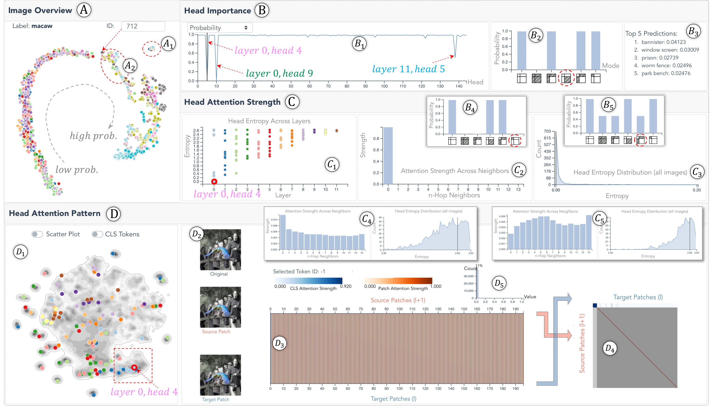

# 1. Introduction

Transformer models have demonstrated outstanding performance on tasks in natural language processings (NLP) (Vaswani et al. 2017; Devlin et al. 2019; Liu et al. 2019) and time-series forecastings (Lim et al. 2021). Recently, their success has also been extended to the vision domain, and the resulting vision transformer (ViT) has achieved on-par and even better performance than the state-of-the-art CNNs (Dosovitskiy et al. 2021). ViT converts a 2D image into a 1D sequence by decomposing it into many patches and arranging the patches sequentially. Each patch is analogous to a token of sequential data, and the multi-head self-attentions are then applied to the sequence to learn the relation among tokens.

Despite the superb performance, it remains unclear how ViT works internally, especially how the multi-head self-attention works on image patches. To be specific, we found ViT designers are often puzzled by the following questions:

- *First*, how important are individual heads, and is their importance consistent across images? As different heads emphasize different pair-wise attentions, their contributions to the prediction are also different. Identifying the important ones would limit the scope of model analysis.

- *Second*, how strong is the attention between two patches that are nearby or far away from each other, and does the attention strength show any trend across layers? It is widely known that CNNs extract basic shapes/colors in early layers but complex objects/concepts in later layers. Since ViTs demonstrate on-par performance with CNNs, it becomes a natural question to ask if the models have any learning heuristic from early to later layers.

- *Third*, what attention patterns have individual heads learned, and are those patterns related to image contents? We have observed heads with interesting patterns, e.g., always attending to the patch itself regardless of the image content (content-agnostic) or only attending to patches with target objects (content-relevant). But, there lacks an exhaustive summary of all possible patterns.

Answering these questions will provide a fundamental understanding of ViTs and assist their further development.

*Fig. 1. Our system contains four components. The *Image Overview* (A) lays out all images for selection. The *Head Importance View* (B) shows all heads in different importance metrics (B1) and dissects a head’s importance through partial pruning (B2, B3). The attention strengths between patches in a head are shown in the *Attention Strength View* (C), where users first obtain an overview of all heads (C1), and then focus on one head (C2, C3). The *Attention Pattern View* (D) clusters all heads by their attention pattern (D1), and presents the pattern details in one head (D2${\sim}$D5).*

However, there are multiple challenges in answering them. *First*, Michel and Levy (Michel et al. 2019) proved that heads are not equally important in transformers through intensive ablation studies. Hao et al. (Hao et al. 2021) proposed a self-attention attribution score for each head to quantify its importance through token interactions. These works focus on NLP tasks and use a head’s impact on the prediction to verify its importance. In ViTs, however, we find that heads with little impact on the ultimate predictions may considerably influence the intermediate representations, indicating the need to profile head importance from multiple perspectives. *Second*, for attention strengths and attention patterns, multiple works have proposed to visualize them with heatmap, flow map, or matrix visualizations (Kovaleva et al. 2019; Park et al. 2019; DeRose et al. 2020; Li et al. 2021). However, all these works focus on language transformers with 1D attentions (forward/backward). ViTs, though rearrange image patches into 1D, still present 2D attention behaviors in the 2D spatial context (e.g., upward/downward attention). The 2D attention behavior results in much richer attention patterns, and the patches’ attention strength to their neighbors needs to be redefined considering the spatial distance in 2D. *Lastly*, based on our collaborations with domain experts, existing ViT analyses are often piece-by-piece and lack a fluent analytical workflow. For example, to understand the attention between image patches, the patches and attentions between them need to be presented intuitively and explored coordinately. However, most ViT researchers still connect the two parts manually by eyeballing them back and forth.

Our work interprets ViTs from three aspects: *head importance*, *head attention strengths*, and *head attention patterns*. For head importance, we introduce multiple pruning-based head importance metrics, which are computed offline and can be easily plugged into our system to support head exploration and importance analysis. For attention strengths, we profile a patch’s attention strength to its $k$-hop neighbors as a $k$-dimensional vector. Aggregating the vectors from all patches of a head reflects the head’s attention strength distribution. For attention patterns, we train an autoencoder for the heads’ attention matrices, and summarize all possible attention patterns by clustering the latent representations of all heads. The three parts are integrated into a coordinated visual analytics (VA) system. We validate the system’s efficacy by studying different ViTs with experienced deep learning experts. In short, our contributions include:

1.  Multiple pruning-based metrics describing ViT heads’ importance from different perspectives.

2.  A characterization of heads’ attention strength across image patches’ $k$-hop neighbors.

3.  A comprehensive summary of the possible attention patterns in ViTs using an autoencoder-based solution.

4.  An interactive visual analytics system integrating the above three parts for coordinated interpretations of ViTs.
