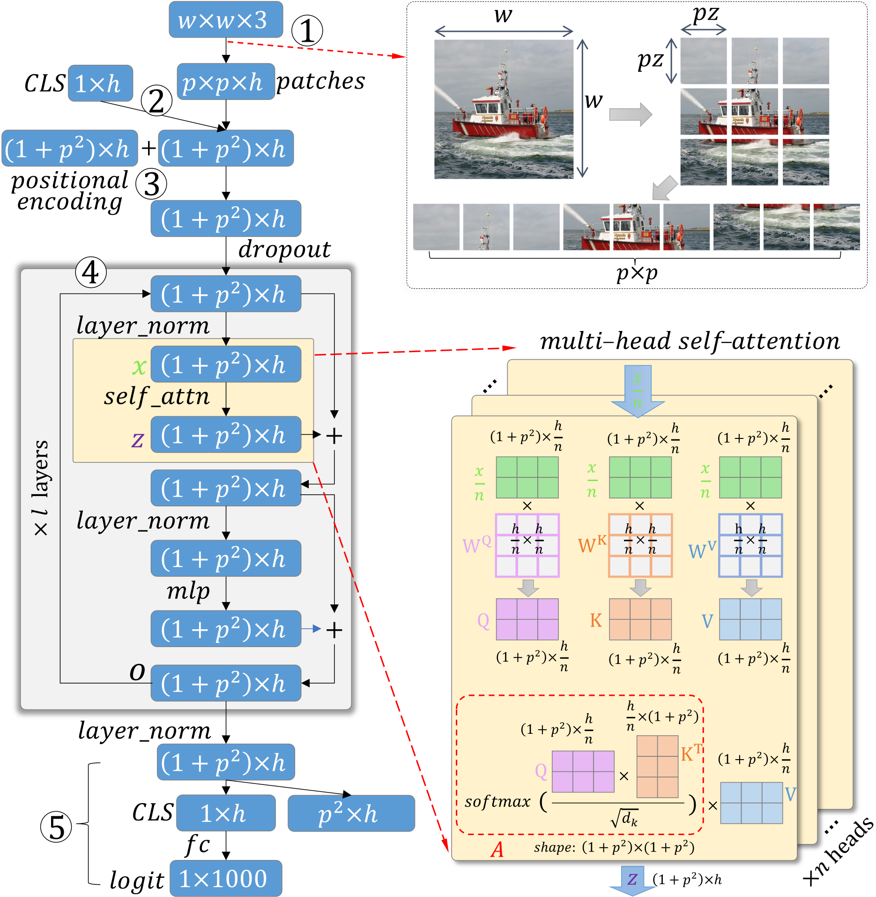

# 3. Background

**ViT Model.** The most popular ViT application is image classification, which is also the focus of this paper. As shown in Fig. 2-, a ViT classifier runs in five key steps:

1.  *Decompose the input image into a sequence of patch tokens*. Without loss of generality, we assume the same width and height for each input RGB image, denoted as $w$. If the patch size is $pz{\times}pz$, the number of patches will be $p^2{=}\frac{w}{pz}{\times}\frac{w}{pz}$. The patches are then arranged into a sequence of tokens; each is encoded as an $h$-dimensional ($h$D) vector. Each patch token learns a concise representation for the corresponding image patch.

2.  *Concatenate `CLS`.* A zero-initialized $h$D class token (`CLS`) is concatenated with the $p^2$ patch tokens, resulting in a $(1{+}p^2){\times}h$ matrix. `CLS` learns to accumulate class-related features used to generate the final class probability.

3.  *Add positional encodings.* The zero-initialized positional encodings are added to the $(1{+}p^2){\times}h$ matrix. They are trained to learn each patch’s positional information. We skip their details as they are not our interpretation focus.

4.  *Multi-head self-attention.* This step contains $l$ stacked attention layers, each with $n$ attention heads. Each head learns a $(1{+}p^2){\times}(1{+}p^2)$ attention weight matrix $A$, reflecting the pair-wise attention between all $1{+}p^2$ tokens.

5.  *Use the `CLS` token for prediction.* This step decouples the `CLS` embedding from the patch tokens, and transforms it into class logits through fully-connected layers.

*Fig. 2. ViT executes in five steps: (1) decompose the input image into patch tokens; (2) concatenate the CLS token; (3) add the positional encoding; (4) multi-layer multi-head self-attention; (5) use CLS for prediction. Step (4) includes $l$ attention layers, each has $n$ heads. The attention weight in each head, i.e., $A$, is our interpretation focus.*

**Self-Attention.** Step 4 is the most important. The self-attention in each attention head (one yellow slice in Fig. 2, right) gathers information from all $1{+}p^2$ tokens to learn how much attention each token should pay to itself and others. The attentions are then used to update the tokens’ representations. Specifically, the $(1{+}p^2){\times}h$ matrix at the end of Step 3, after some dropout and normalization layers, is evenly split over the $n$ heads, each with the shape of $(1{+}p^2){\times}\frac{h}{n}$. Inside each head, the matrix is further transformed into $Q$, $K$, and $V$ through three separate learnable weight matrices $W^Q$, $W^K$, and $W^V$. The self-attention is then computed as:
$$
\label{eq:single_head}
Attention(Q, K, V) = A{\cdot}V = softmax(\frac{Q K^{T}}{\sqrt{d_K}}){\cdot}V.
$$

The attention weight $A$ of size $(1{+}p^2){\times}(1{+}p^2)$ encodes the pair-wise attention between all $1{+}p^2$ tokens. For clarity, we call the $1{+}p^2$ tokens ***source*** tokens when they attend to others, but ***target*** tokens when they are attended by others.

**Multi-Layer and Multi-Head.** The self-attention computation is conducted in all $n$ heads, and the resulting attentions are concatenated and linearly transformed to generate the final multi-head self-attention, denoted as $z$, i.e.,
$$
\label{eq:multi_head}
z= Concat(head_1, head_2, \dots, head_n){\cdot}W^O + b,
$$
where $head_i{=}Attention(Q_i, K_i, V_i)$. As shown in Fig. 2, $z$ will go through more layers to generate the final attention layer output $o$ with shape $(1{+}p^2){\times}h$, which is the updated $h$D representation for the $1{+}p^2$ tokens. It will be fed to a new self-attention layer, and the process is repeated for $l$ times, resulting in $l$ stacked layers. In total there are $l{\times}n$ attention heads, each with an attention weight matrix $A$ recording the learned attention between patches in the respective heads.
