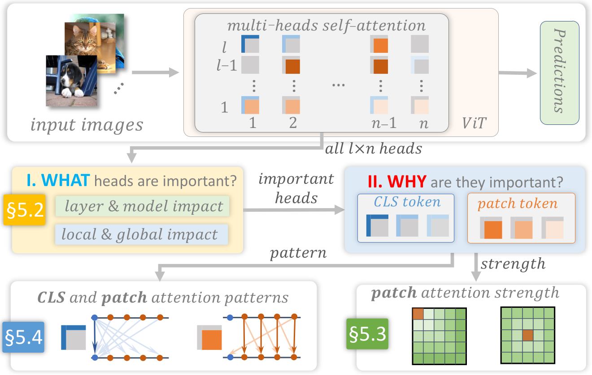

# 4. Requirements and Solution Overview

We maintained weekly discussions with five domain experts (all are full-time researchers with 5+ years of deep learning experience) working on transformers in vision, NLP, and time-series domains. Over these discussions and our review of the tasks in related literature (DeRose et al. 2020; Park et al. 2019; Michel et al. 2019; Hao et al. 2021), we elicit the following design requirements for a visual analytics system.

: ***Head Importance.*** To start the interpretation, we first need to quantify the importance of a large number of heads and dissect their importance. Specifically, this requires us to:

- **R1.1**: Assess the importance of a ViT head. We want to reflect a head’s impact on both its own attention layer and the ViT’s final predictions. The impact should be assessed both on a single image and over all images.

- **R1.2**: Dissect a head’s importance. This is to disclose the contributions from two types of tokens to a head’s importance: the `CLS` learns class-related features for prediction; the patch tokens learn important image contents.

- **R1.3**: Use head importance to guide image explorations. To analyze important heads, users need to select the right images for which the corresponding heads show importance. Therefore, we need to provide an informative overview of a large number of images based on their head importance to guide their exploration.

: ***Head Attention Strength.*** From the original ViT paper (Dosovitskiy et al. 2021) and the domain experts, we noticed that most ViT designers are wondering how the patches distribute their attention strengths spatially, e.g., whether they attend more to near/far patches and how the attention strength distribution is different across heads. Thus, we should answer:

- **R2.1**: For a single head of an image, how strong are patches attending to their spatially near/far neighbors?

- **R2.2**: For all heads of an image, does their attention show any patterns across layers? What are the patterns?

- **R2.3**: For a single head, does its attention strength show consistent spatial distributions across all images?

: ***Head Attention Pattern.*** As ViT shows more and much richer attention patterns in the 2D context, it is crucial to disclose them with the image semantics. Thus, we need to:

- **R3.1**: Exhaustively summarize all possible attention patterns from the $l{\times}n$ heads (for both `CLS` and patch tokens) and provide an effective overview of the patterns.

- **R3.2**: Drill down to individual heads of an image to effectively present its attention pattern and investigate if it is agnostic/relevant to the image contents.

**Solution Overview.** We design a visual analytics system to meet the above requirements. Fig. 3 illustrates the system’s workflow. To interpret a well-trained ViT, we first feed the image of interest into the model to get its $l{\times}n$ heads. Next, we answer *what* heads are important (Fig. 3 I) through four pruning-based metrics, meeting . Focusing on these important heads, we explain *why* they are important (Fig. 3 II) from two perspectives. First, we disclose the attention strength distribution in individual heads by averaging attention strength across $k$-hop neighbors of individual patches (). Second, using an unsupervised clustering method, we summarize the attention patterns in both `CLS` and patch tokens and visualize the patterns in important heads (). An integrated visualization system (Fig. 1) has been developed following the workflow.

*Fig. 3. Overview of our visual interpretation solution for ViT.*
