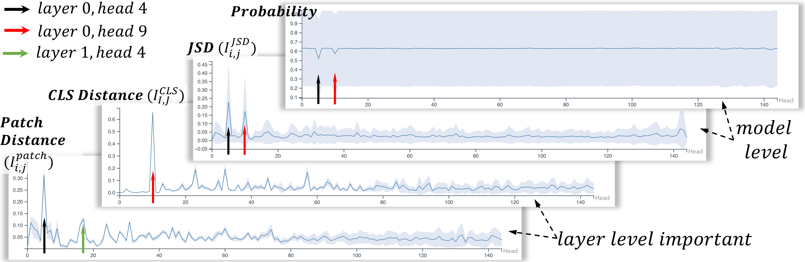
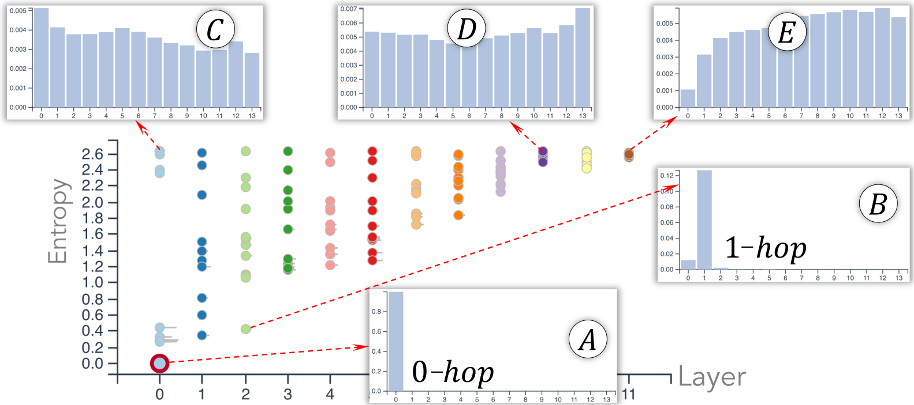
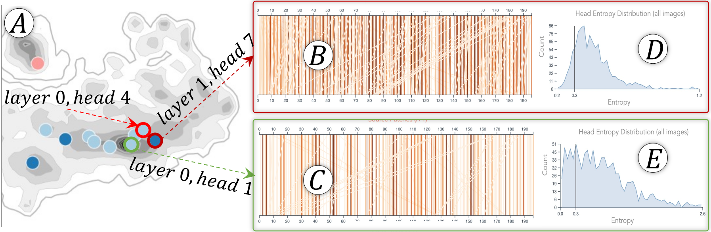
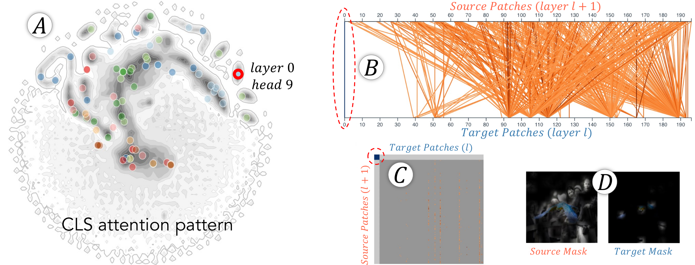
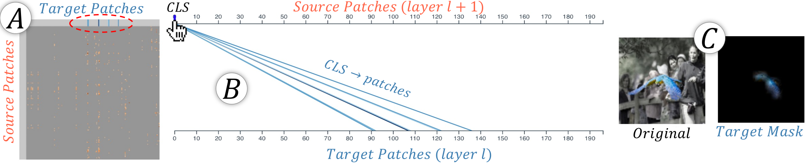
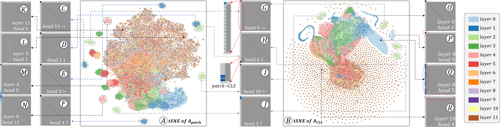
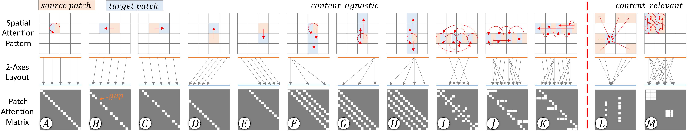
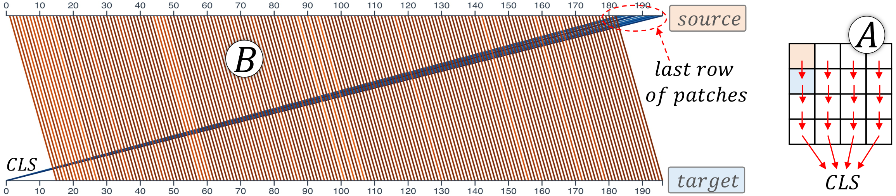
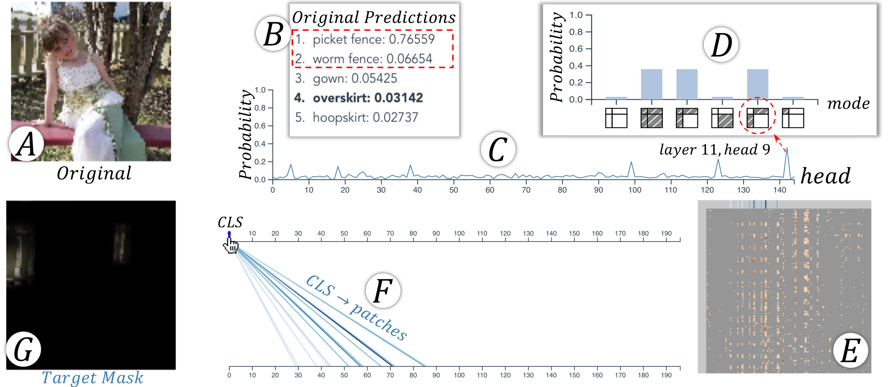
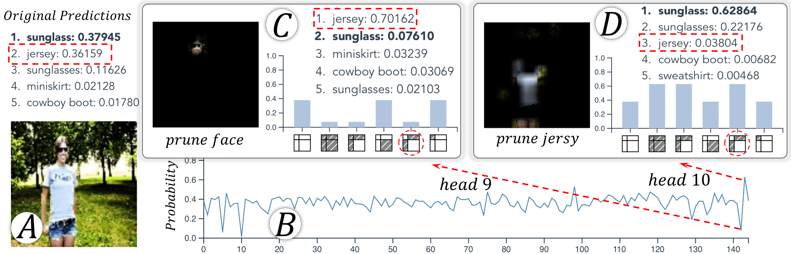

# 6. Case Study and Experts’ Feedback

We use multiple case studies, conducted together with deep learning experts, to show the capability of our system. The experts’ feedback is summarized at the end of Sec. 5.5.

For ViTs, we explored four pre-trained ViTs with different image resolutions ($w$), numbers of layers ($l$) and heads ($n$) (Dosovitskiy et al. 2021). As our findings are consistent across them, we focus our illustrations on one model only but include results of the other three in our Appendix. The parameters of the focused model are: $w{=}224$, $l{=}12$, $n{=}12$, and $p{=}14$.

For datasets, we used 1000 images sampled from the validation set of ImageNet (Russakovsky et al. 2015). The images are from 20 classes (10 classes with the best and 10 classes with the worst predictions), each has 50 images. We have also explored our system with another dataset. However, as the model-level findings from the two datasets are mostly similar, we include the exploration of the other dataset in our Appendix.

## Head Importance

Fig. 1A shows the 1000 images, laid out by their $l{\times}n$-dimensional head importance vector (each dimension is $\textbf{P}_{i,j}[idx_{label}]$ in Eq. [eq:prob]). From the layout, we found images are arranged clockwise with an increasing true-class probability.

*Fig. 7. The mean (blue curve) and standard deviation (blue band) of the four head importance metrics computed over all images.*

Fig. 7 shows the four head importance metrics aggregated over all images. Both *model-level* metrics (‘Probability’, ‘JSD’) reflect head $4$ and $9$ from layer 0 are very important. The very wide band of the ‘Probability’ plot is due to our choice of images with the best and worst performances. The two *layer-level* metrics (‘`CLS` Distance’, ‘Patch Distance’) show heads 9 and 4 contribute significantly to the changes of `CLS` and patch representations, respectively.

Moreover, the *layer-level* metrics show more oscillations, identifying important heads that cannot be identified from the *model-level* metrics. For example, removing layer 1 head 4 barely changes the final predictions but significantly affects the layer activations. As shown in the ‘Patch Distance’ plot, the mean for this head is large and its standard deviation is small, indicating the head is important to the layer across images. This head has a fixed function of making all patches attend to the patch above themselves (explained later in Fig. 12F). The *model-level* metrics cannot identify it as heads from later layers show similar functionalities (i.e., head 3 from layer 2, explained later in Fig. 12J), hiding its importance. Also, an increasing standard deviation is observed from the two *layer-level* metrics, indicating that higher-layer heads’ importance is more influenced by image contents.

By coordinately exploring the *Image Overview* and *Head Importance View*, we find image clusters, to which, individual heads are very important (e.g., heads 9 and 4 from layer 0 are important to images in Fig. 1-A1, A2). To analyze their importance, we randomly select an image (ID: 712, label: `macaw`) from one cluster for further exploration. The three heads that are very important to the selected image are: *layer 0 head 4*, *layer 0 head 9*, and *layer 11 head 5* (Fig. 1-B1).

Fig. 1-B2 shows the partial pruning results for *layer 0 head 4*. The probability drops only if the $patches{\to}patches$ attentions are pruned, and pruning `CLS`-related attentions has little impact. This attributes head 4’s importance to its attentions between patches. Fig. 1-B3 shows the top-five probabilities are very low when this head is pruned, and `macaw` (the true label) is not among them.

Fig. 1-B4 and B5 show the partial pruning results for *layer 0 head 9* and *layer 11 head 5*, respectively. From them, *layer 0 head 9* is important due to the `CLS` self-attention ($\texttt{CLS}{\to}\texttt{CLS}$); *layer 11 head 5* is important due to the attentions between `CLS` and patches ($\texttt{CLS}{\to}patches$ and $patches{\to}\texttt{CLS}$).

## Attention Strength

Next, we examine why the heads are important through their attention strengths. The attention strength analysis is for patch tokens only (`CLS` has no spatial information), so our analysis focuses on *layer 0 head 4*. Fig. 1-C1 shows the attention strength overview of all heads. *layer 0 head 4* (in the red circle) has the smallest entropy. Fig. 1-C2 shows the head’s $p$D $k$-hop neighborhood vector. From it, all patches’ attention strengths focus on the $0$-hop neighbor, i.e., the head makes all patches strongly attend to themselves. It is reasonable that such a head is important in lower layers, as no details should be overlooked at the beginning. From Fig. 1-C3, we also notice that this head’s functionality is consistent across all images, as its entropies for different images are always low (distributed dominantly to the left).

Fig. 1-C4, C5 show the attention strengths of the other two important heads. Their importance majorly comes from `CLS`-related attentions, and the attention strengths (for patch tokens) are scattered across all hops of neighbors (the bar chart) and varying across images (the area plot).

*Fig. 8. Lower-layer heads can distribute patches’ attention strength only to their near neighbors (A, B), or evenly to all $k$-hop neighbors (C). Higher-layer heads can only do the latter (D, E).*

The overview in Fig. 1-C1 and Fig. 8 also reveals the attention strength distribution of heads over layers. In general, lower-layer heads can make patches attend strongly to their local regions, e.g., $0$-hop or $1$-hop neighbors (the low entropy heads in Fig. 8A-B). Low-layer heads can also make patches evenly distribute their attention across the entire image (e.g., Fig. 8C). For higher-layer heads, patches only attend globally with similar attention strengths across all $k$-hop neighbors, e.g., Fig. 8D-E. A similar overview can always be observed no matter which image is selected. This observation is consistent with the original claims about attention strengths (Dosovitskiy et al. 2021) (see details about (Dosovitskiy et al. 2021) in our Appendix).

## Attention Pattern

The attention patterns further answer why *layer 0 head 4* is important. From the *Attention Pattern View*, i.e., the vertical lines in Fig. 1-D3 and the diagonal pattern in Fig. 1-D4, all patches in this head strongly attend to themselves, echoing our earlier findings from the *Attention Strength View*.

*Fig. 9. Exploring heads that have similar attention patterns with *layer 0 head 4* to explain why it is important while others are not.*

Are there heads with attention patterns similar to *head 4*? If yes, why is only *head 4* so important? To answer these questions, we zoom into the red dashed region of the tSNE layout in Fig. 1-D1. The zoomed-in details are shown in Fig. 9A. From it, we explore heads close to *head 4* and check their attention patterns. Fig. 9B-C show two of them, where the vertical lines indicate the patches also majorly attend to themselves in these two heads. However, different from *head 4*, the self-attentions in these two heads are not always strong, i.e., all lines in Fig. 1-D3 are in dark orange, but most lines in Fig. 9B-C are in light orange. Moreover, the two heads’ functionality is not as consistent as that of *head 4* across images (comparing Fig. 1-C3 and Fig. 9D-E).

*Fig. 10. The attention pattern of *layer 0 head 9*.*

*Fig. 11. The $\texttt{CLS}{\to}patches$ attention in *layer 11 head 5*.*

*Fig. 12. (A/B) tSNE layouts of heads using their patch/CLS attention patterns. Content-agnostic heads from lower layers show similar patterns across images, and thus each forms an isolated cluster no matter they are laid out by the patch (C-J, M, N) or CLS (G-J, O-Q) patterns. Content-relevant heads from higher layers show dissimilar patterns for different images. These heads are scattered in both layouts (K, L, R).*

*Fig. 13. The 13 possible attention patterns between image patches presented in the (top) image space, (middle) two-axes, and (bottom) heatmap visualization. Each pattern is a mix of one/multiple of the four basic patterns: *diagonal* (A-K), *horizontal* (J, K), *vertical* (L), and *block* (M). The first two are *content-agnostic* and often appear in lower-layer heads; the latter two are *content-relevant* and often occur in higher-layer heads.*

For *layer 0 head 9*, we have known its importance comes from the $\texttt{CLS}{\to}\texttt{CLS}$ attention in Fig. 1-B4. Visualizing its attention patterns, we can see the dark blue vertical line in Fig. 10B and the dark blue cell in the top-left corner of Fig. 10C, echoing the importance of `CLS`’s self-attention. Meanwhile, the $\texttt{CLS}{\to}patches$ and $patches{\to}\texttt{CLS}$ attentions are not noticeable. The $patches{\to}patches$ attentions (the orange lines in Fig. 10B and the vertical pattern in Fig. 10C), as well as the masked source and target images (Fig. 10D), show no obvious extracted features, confirming the less importance of the patch-related attentions. Also, we noticed that the `CLS` attention pattern of *head 9* is very unique, as it is the only head (of the selected image) in the isolated cluster of Fig. 10A (the tSNE layout of all heads’ $A_\texttt{CLS}$). The background contour shows the head 9 from other images, reflecting that head 9’s functionality is fixed across images.

For *layer 11 head 5*, its importance is from the $patches{\to}\texttt{CLS}$ and $\texttt{CLS}{\to}patches$ attentions (Fig. 1-B5). In Fig. 11A, the $patches{\to}\texttt{CLS}$ attentions (the leftmost column) are not noticeable, but the $\texttt{CLS}{\to}patches$ attentions (the top row) show four major regions, indicating the `CLS` attends to four groups of patches. Hovering over the `CLS` token on the top axis of Fig. 11B, the four groups of target patches are highlighted in the masked target image (Fig. 11C). From it, the four regions accurately extract the `macaw`’s wings in blue.

### Attention Pattern Summary

Our explorations identified different attention patterns. This section provides an exhaustive summary.

**Patch Attention ($A_{Patch}$) Patterns.** Fig. 12A shows the tSNE layout of all heads’ patch attentions from the 1000 images (Fig. 1-D1 is the density plot of it). The points from an isolated cluster often represent the same head from different images, verifying the head’s fixed functionality. Exploring individual heads in the *Attention Pattern View*, we summarize them into 13 patterns in Fig. 13. The three rows of the illustrative figure show how each patch attends to others in the image space (top), the two-axes (middle), and the heatmap (bottom). From the last row, each of the 13 patterns is a combination of four basic patterns, i.e., ***diagonal***, ***horizontal***, ***vertical***, and ***block***.

Fig. 13A-K include the ***diagonal** pattern*. Fig. 13A denotes self-attention. Fig. 13B-C show each patch attends to its left or right patch (one cell off the diagonal), where the gaps indicate the leftmost or rightmost patches without further ones to attend to. Each patch in Fig. 13D-E attends to the patch above or below itself, i.e., the white-squares shift from the diagonal for a row of patches. The four heads in Fig. 12C-F (all from layer 1) show examples where each patch attends to its right, bottom, left, and top patch, respectively. The four heads in Fig. 12G-J (all from layer 2) show similar patterns, revealing the repeating functionalities. Coming to middle attention layers, patches can attend to multiple patches above and/or below themselves (Fig. 13F-H). Fig. 12M-N show two such examples from layer 4. Fig. 13I includes the counter-diagonal patterns, in which the left/right patches symmetrically attend to the right/left ones in the same row.

Fig. 13J-K contain the ***horizontal** pattern* (mixed with the diagonal pattern). The pattern indicates that a patch attends to multiple patches before/after itself in the same row.

Fig. 13L shows the ***vertical** pattern*, i.e., multiple source patches (heatmap rows) attend to the same target patches (heatmap columns). This usually indicates the target patches include important semantics to the class (e.g., the `cat` face region of a `cat` image, Fig. 12K-L). The pattern often occurs in higher-layer heads, as indicated by the yellow/brown color in Fig. 12A (the big chaotic cluster in the center).

Fig. 13M shows the ***block** pattern*, i.e., patches in a local region mutually attend to each other (e.g., the face patches of a `cat` attend to its body patches and vice versa). Similar to segmentation, the attentions extract the object’s pixels.

Attention patterns can also be categorized into ***content-agnostic*** and ***content-relevant***. The *diagonal* and *horizontal* patterns are often agnostic to the image content, e.g., heads in Fig. 12C-J. The same head from all images forms an isolated cluster in Fig. 12A. The *vertical* and *block* patterns are content-relevant, as their position depends on the content of images. They are the big chaotic cluster in Fig. 12A. Content-agnostic patterns often occur in lower layers, whereas content-relevant patterns often occur in higher layers.

*Fig. 14. Each patch attends to the one beneath it, e.g., patch 0 (row 0, column 0) attends to patch 14 (row 1, column 0, $p{=}14$). The bottom row of patches all attend to CLS since there is no further patch.*

**`CLS` Attention ($A_{\texttt{CLS}}$) Patterns.** The `CLS`-related attention patterns follow a similar layer-wise trend. As shown in Fig. 12B (its density plot is in Fig. 10A), heads in lower layers form clear clusters, indicating the `CLS`’s attentions in them are more content-agnostic. For example, Fig. 12P shows dominantly strong $\texttt{CLS}{\to}\texttt{CLS}$ attentions; Fig. 12Q shows strong $patches{\to}\texttt{CLS}$ attentions. In higher layers, the attentions are more content-relevant, e.g., in Fig. 12R (the top row), the `CLS` focuses only on specific image patches.

The four heads with isolated clusters in Fig. 12A, G-J also form four isolated clusters in their `CLS` layout (Fig. 12B, G-J). By coordinately exploring the patch and `CLS` patterns, we found the boundary patches without further patch to attend in these heads will attend to `CLS`. For example, in Fig. 12H, all patches attend to the patch beneath themselves. The bottom row of patches have no patches beneath them, so they attend to `CLS` (Fig. 14A). The two-axes view of this head is shown in Fig. 14B, which is consistent with the pattern in Fig. 12H (and the inset). This explains how information is passed across patches row-by-row to `CLS` for classification.

## Head Attention Diagnosis

Our coordinated system also helps to diagnose the roles of different heads (especially the important ones) in mispredictions. We brief two example cases in this section.

***Case 1:*** Fig. 15A shows an image from the `overskirt` class, but the ViT performs badly on its prediction (Fig. 15B). From the *Head Importance View*, we notice a sharp increase in the true label probability when head 9 of layer 11 is pruned (Fig. 15C). The partial pruning result of this head (Fig. 15D) reflects that the probability of `overskirt` will *increase* only if the attentions between `CLS` and patches are pruned. As the $patches{\to}\texttt{CLS}$ attentions are very small in Fig. 15E (the first column), we hover over the $\texttt{CLS}{\to}patches$ attentions in Fig. 15F. The masked target image (Fig. 15G) shows that the `CLS` attends strongly to the background fences. Pruning such a misleading head will help the model focus more on the right features, leading to a probability increase. The importance of this head also explains why the top two classes in the original predictions (Fig. 15B) are `fences`.

*Fig. 15. The head 9 from layer 11 incorrectly attends to the background fence. Pruning it will increase the true class’s probability.*

***Case 2:*** The ViT correctly predicts the image in Fig. 16A to be `sunglass`, but also assigns a high probability to `jersey`. We found two important heads in the last layer but with opposite effects (Fig. 16B). Pruning heads 9 and 10 from layer 11 separately leads to a big decrease and increase of the `sunglass` probability. From the partial pruning results, we found the attentions between `CLS` and patches dominate the decrease (Fig. 16C) or increase (Fig. 16D). We then visualize the $\texttt{CLS}{\to}patches$ attentions and the corresponding masked images. For head 9, the `CLS` focuses on the face region, whereas for head 10, the `CLS` attends solely to the jersey region. Heads 9 and 10 contribute largely to the probability of `sunglass` and `jersey` respectively. Pruning them increases the opposite class’s probability (Fig. 16C, D). These details significantly deepens the understanding of how ViT works.

*Fig. 16. Heads 9 and 10 (layer 11) extract the sunglass and jersey features respectively, impacting the corresponding classes’ probability.*

## Domain Experts’ Feedback

The above case studies were conducted with 7 deep learning experts in separate sessions, using the protocol of *guided exploration+think-aloud discussions*. All experts are researchers with 5+ years of experience in deep learning. Five experts ($E_1{\sim}E_5$) have participated in our requirement analysis. The other two ($E_6{\sim}E_7$) had no knowledge about our visualization system until the case study sessions.

In general, all experts confirmed the importance of the three focused topics and appreciated our findings. $E_2$, $E_4$, and $E_5$ enjoyed the system’s interactivity, especially the linked visualizations, which helped them connect the dots for comprehensive interpretations of important heads. Their existing visualization tools with piece-by-piece analysis fall short of such coordinated explorations. Using our system, $E_1$ and $E_3$ obtained an overview of ViTs’ head attention patterns for the first time. Both experts found our findings intriguing and had thorough discussions on the analogy between CNNs and ViTs. For example, patches in Fig. 12G always attend to their right patch. The $3{\times}3$ CNN filter also aggregates the right pixel’s value to the current pixel. So, the ViT head and CNN filter share equivalent functions. Similar equivalence analysis can also be extended to other heads/filters. $E_7$ pointed out similar learning trends across layers of CNNs and ViTs, i.e., lower-layer heads/filters focus on local features, whereas higher layers aggregate the output of lower layers to extract object-level information. $E_7$ also found the interactions between the `CLS` and patches very insightful. In Fig. 14A, all patches attend to the patch below them and the last row attends to the `CLS`. This is similar to propagating the information top-down, and the final accumulated results are passed to `CLS` for classification. $E_6$ was interested in the content-agnostic/relevant attentions and believed they could be adopted for anomaly detection.

The experts also pointed out some insufficiency of the current system. First, $E_7$ initially thought only the three heads in Fig. 1-B1 were important to the prediction of image 712, which was misleading as we only pruned one head at a time and did not consider the dependency between heads. Second, both $E_1$ and $E_7$ worked on token pruning of transformers (instead of head pruning). They liked our image masks in disclosing the tokens’ semantics but also wanted to see similar saliency maps highlighting the importance of individual patches through ablations. These comments provide promising future directions for us to explore.
