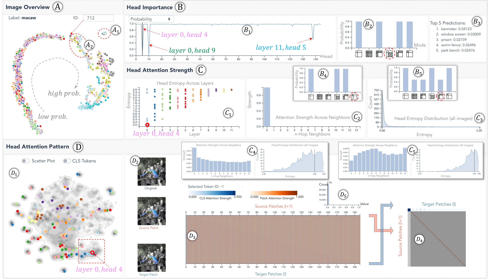

# 1. 引言

Transformer 模型在自然语言处理 (NLP) (Vaswani et al. 2017; Devlin et al. 2019; Liu et al. 2019) 和时间序列预测 (Lim et al. 2021) 任务中已展示出卓越的性能。最近，它们的成功也扩展到了视觉领域，由此产生的视觉 Transformer (视觉 Transformer) 已经取得显著进展。ViT视觉 Transformer 在性能上已经达到了甚至超过了最先进的 CNNs 的水平 (Dosovitskiy et al. 2021)。ViT将一个2D图像分解成许多图像块，并按顺序排列这些块，可以将其转换为一个1D序列。每个图像块类似于序列数据中的一个token，然后对序列应用多头自注意力，以学习tokens之间的关系。

尽管表现出色，但其性能背后的机制仍不清楚。ViT该模型内部运作，尤其是图像块上的多头自注意力是如何工作的。具体来说，我们发现ViT设计者常常对以下问题感到困惑：

- *首先*，单个注意力头的重要性如何，它们在不同图像上的重要性是否一致？由于不同的注意力头强调不同的对 pairwise 注意力，它们对预测的贡献也不同。识别重要的注意力头会限制模型分析的范围。

- *第二*，相邻或远离的两个图像块之间的注意力强度如何，且注意力强度在各层之间是否有趋势？众所周知，CNNs在早期层中提取基本形状/颜色，而在后期层中提取复杂对象/概念。由于ViTs与CNNs表现相当，自然会提出模型在早期到后期层之间是否具有任何学习策略。

- *第三*, 每个注意力头学习了哪些注意力模式，这些模式是否与图像内容相关？我们观察到一些注意力头具有有趣的模式，例如，某些头总是关注图像中的特定块（内容无关），而另一些头则仅关注包含目标对象的块（内容相关）。但缺乏对所有可能模式的详尽总结。

这些问题的答案将提供对视觉 Transformer 的基本理解，并有助于其进一步发展。

*图 1. 系统包含四个组件。图像概览（A）排列所有图像供用户选择。注意力头重要性视图（B）以不同指标展示所有注意力头的重要性（B1），并通过部分剪枝剖析单个注意力头的重要性（B2、B3）。注意力强度视图（C）展示注意力头中图像块之间的注意力强度，用户可以先查看所有注意力头的概览（C1），再聚焦单个注意力头（C2、C3）。注意力模式视图（D）按注意力模式聚类所有注意力头（D1），并展示单个注意力头的模式细节（D2–D5）。*

然而，回答这些问题存在多重挑战。首先，Michel和Levy（Michel et al. 2019）通过密集的消融研究证明，Transformer中的注意力头的重要性并不均衡。Hao等人（Hao et al. 2021）提出了一种自注意力归因分数，用于量化每个头的重要性，通过令牌交互进行量化。这些工作专注于NLP任务，并通过预测的影响来验证头的重要性。然而，在视觉 Transformer（ViT）中，我们发现那些对最终预测影响较小的头可能显著影响中间表示，表明需要从多个角度来评估头的重要性。其次，对于注意力强度和注意力模式，已有多个研究提出了通过热力图、流图或矩阵可视化来可视化它们的方法（Kovaleva et al. 2019；Park et al. 2019；DeRose et al. 2020；Li et al. 2021）。然而，所有这些工作都专注于具有1D注意力（向前/向后）的语言Transformer。尽管ViT将图像块重新排列成1D，但仍以2D空间上下文呈现2D注意力行为（例如，向上/向下注意力）。2D注意力行为导致了更丰富的注意力模式，而2D中块对邻近块的注意力强度需要重新定义，考虑到2D中的空间距离。最后，基于与领域专家的合作，现有的ViT分析往往零散且缺乏流畅的分析流程。例如，要理解图像块之间的注意力，需要直观地呈现这些块及其之间的注意力，并协调地探索它们。然而，大多数ViT研究人员仍然通过来回观察手动连接这两部分。

我们的工作从三个方面解释视觉 Transformer（ViT）：*头重要性*、*头注意力强度*和*头注意力模式*。对于头重要性，我们引入了多种基于剪枝的头重要性指标，这些指标是离线计算的，并且可以轻松地集成到我们的系统中，以支持头探索和重要性分析。对于注意力强度，我们分析了头对 $k$-hop邻居的注意力强度，将其表示为一个 $k$ 维向量。将所有头的向量聚合反映了头的注意力强度分布。对于注意力模式，我们训练了一个自编码器来编码头的注意力矩阵，并通过聚类所有头的潜在表示来总结所有可能的注意力模式。这三个部分整合成一个协调的视觉分析（VA）系统。通过与经验丰富的深度学习专家一起研究不同的 ViT，我们验证了系统的有效性。简而言之，我们的贡献包括：

1. 多个基于剪枝的指标描述ViT从不同角度评估不同注意力头的重要性。

2. 图像块中注意力头强度的头对头注意力强度的特征描述$k$-hop邻居。

3. 使用基于自编码器的方法对 ViT 中可能的注意力模式进行全面总结。

4.  一个集成上述三部分的交互式视觉分析系统，用于协调解释 ViTs。
