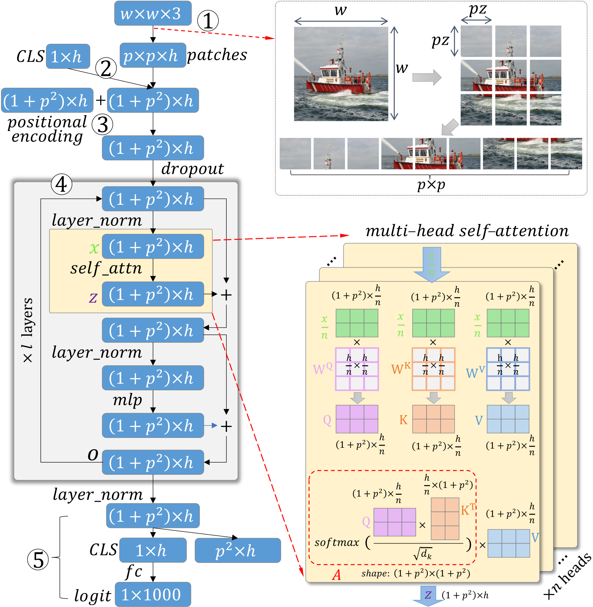

# 3. 背景

**ViT 模型。** 最受欢迎的ViT应用为图像分类，这也是本文的重点。如图2-所示，一个图像通过将图像分割成图像块（image patch）来输入到视觉 Transformer 中。视觉 Transformer 使用自注意力（self-attention）机制，其中每个图像块被编码为一个 token。随后，通过多头自注意力（multi-head self-attention）机制，这些 token 与查询（query）、键（key）和值（value）进行交互，以生成最终的分类结果。ViT分类器运行五个关键步骤：

1. *将输入图像分解为一个序列的块标记*。不失一般性，我们假设每个输入 RGB 图像的宽度和高度相同，记为 $w$。如果块大小为 $pz{\times}pz$, 则块的数量将为 $p^2{=}\frac{w}{pz}{\times}\frac{w}{pz}$。然后将这些块排列成一个标记序列；每个标记都被编码为一个 $h$ 维（$h$D）向量。每个块标记学习对应图像块的简洁表示。

2. *连接`CLS`.* 零初始化的$h$D类 token`CLS`查询与键值对被连接起来，$p^2$图像块 token，从而得到一个$(1{+}p^2){\times}h$矩阵。`CLS`学习积累与类别相关的特点，用于生成最终的类别概率。

3. *添加位置编码。* 零初始化的位置编码被添加到 $(1{+}p^2){\times}h$ 矩阵中。它们被训练以学习每个块的位置信息。我们跳过它们的细节，因为它们不是我们的解释重点。

4. *多头自注意力.* 此步骤包含 $l$ 层堆叠的注意力层，每层有 $n$ 个注意力头。每个头学习一个 $(1{+}p^2){\times}(1{+}p^2)$ 个注意力权重矩阵 $A$，反映所有 $1{+}p^2$ 个 token 之间的 pairwise 注意力。

5. *使用`CLS`用于预测的token。此步骤将预测与表示解耦。`CLS`将图像块转换为嵌入，通过全连接层将其变换为类别logits。

*图 2. ViT 执行五步：（1）将输入图像分解为图像块 token；（2）连接 CLS token；（3）添加位置编码；（4）多层多头自注意力；（5）使用 CLS 进行预测。步骤（4）包括 $l$ 个注意力层，每个有 $n$ 个注意力头。每个头的注意力权重，即 $A$，是我们解释的重点。*

自注意力。步骤4最为关键。每个注意力头（图2右图中的一个黄色片）中的自注意力会收集来自所有图像块的信息。$1{+}p^2$将注意力用于确定每个令牌应向自身和他人支付多少注意力，然后利用这些注意力更新令牌的表示。具体来说，注意力被用来更新令牌的表示。$(1{+}p^2){\times}h$第三步结束时，经过一些dropout和归一化层后的矩阵均匀地分割成多个部分。$n$注意力头，每个的形状为$(1{+}p^2){\times}\frac{h}{n}$. 在每个头中，矩阵进一步变换为$Q$, $K$, 和$V$通过三个可学习权重矩阵$W^Q$, $W^K$, 和$W^V$. 然后计算自注意力为：
$$
\label{eq:single_head}
Attention(Q, K, V) = A{\cdot}V = softmax(\frac{Q K^{T}}{\sqrt{d_K}}){\cdot}V.
$$

注意力权重$A$大小$(1{+}p^2){\times}(1{+}p^2)$将所有 之间的成对注意力编码$1{+}p^2$token。为 clarity，我们称 token。$1{+}p^2$在进行自注意力时，源tokens关注其他tokens，而在被其他tokens关注时，目标tokens。

多层和多头。自注意力计算在所有 $n$ 个头中进行，然后将得到的注意力进行拼接并线性变换以生成最终的多头自注意力，记为 $z$。
$$
\label{eq:multi_head}
z= Concat(head_1, head_2, \dots, head_n){\cdot}W^O + b,
$$
那里$head_i{=}Attention(Q_i, K_i, V_i)$. 如图2所示，$z$将通过更多层生成最终注意力层输出$o$形状为$(1{+}p^2){\times}h$，这是更新的$h$图像块的 D 维表示$1{+}p^2$token。然后将其喂给一个新的自注意力层，该过程将重复进行。$l$重复多次，从而导致$l$层。总共包含层数。$l{\times}n$注意力头，每个注意力权重矩阵$A$记录各自注意力头之间的块之间的学习注意力。
