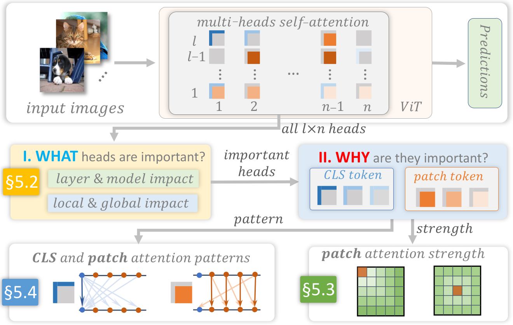

# 4. 需求与方案概览

我们每周与五位领域专家（均为拥有5年以上深度学习经验的全职研究人员）进行讨论，他们在视觉、自然语言处理（NLP）和时间序列领域使用Transformer。通过这些讨论和对相关文献中任务的审查（DeRose et al. 2020; Park et al. 2019; Michel et al. 2019; Hao et al. 2021），我们提出了视觉分析系统的以下设计要求。

***注意力头重要性。*** 首先，我们需要量化大量注意力头的重要性并解析它们的重要性。具体来说，这要求我们：

- **R1.1**: 评估一个 ViT 头的重要性。我们希望反映该头在自身注意力层和 ViT 最终预测上的影响。这种影响应在单张图像和所有图像上进行评估。

- **R1.2**: 分析注意力头的重要性。这旨在揭示两种类型的token对注意力头的重要性贡献：图像块中的token和token本身的重要性。`CLS`学习与预测相关的类别特征；图像块token 学习重要的图像内容。

- **R1.3**: 使用注意力头重要性来指导图像探索。为了分析重要的注意力头，用户需要选择对应注意力头重要的图像。因此，我们需要基于注意力头的重要性提供大量图像的详尽概述，以指导他们的探索。

***注意力头强度。*** 根据原 ViT 纸（Dosovitskiy et al. 2021）和领域专家，我们注意到大多数 ViT 设计者都在思考这些小块如何在空间上分配注意力强度，例如，他们是否更关注近邻/远端的小块，以及不同注意力头的注意力强度分布有何不同。因此，我们应该回答：

- **R2.1**: 对于图像中的单个注意力头，图像块是如何强地关注其空间上邻近/远邻的块？

- **R2.2**: 对于图像中的所有注意力头，它们在各层上的注意力是否表现出任何模式？这些模式是什么？

- **R2.3**: 对于单个注意力头，其注意力强度是否在所有图像中表现出一致的空间分布？

**注意力模式。** 随着 ViT 在二维（2D）上下文中的注意力模式越来越丰富和多样化，揭示这些模式与图像语义之间的关系变得至关重要。因此，我们需要：

- **R3.1**: 全面总结来自该视觉 Transformer 的所有可能的注意力模式。$l{\times}n$注意力头（对于两者）`CLS`以及将它们视为图像块 token，并提供对模式的有效概述。

- **R3.2**:深入到图像的单个注意力头中，有效地展示其注意力模式，并探究其是否对图像内容无偏或相关。

**系统概述。** 我们设计了一个视觉分析系统以满足上述要求。图3展示了系统的流程。为了解释一个经过良好训练的视觉 Transformer 模型，ViT，首先将感兴趣图像输入模型中以获取其$l{\times}n$头。接下来，我们通过四种基于剪枝的方法来回答哪些头是重要的（如图3I所示），满足。聚焦于这些重要的头，我们从两个角度解释它们为什么重要（如图3II所示）。首先，我们通过在注意力强度上对单个头进行平均来披露每个头的注意力强度分布。$k$-个图像块的-hop邻居()。其次，使用一种无监督的聚类方法，我们总结了两种的注意力模式。`CLS`并可视化重要注意力头中的模式（）。开发了一个集成的可视化系统（图1），遵循工作流程。

*图 3. 我们为 ViT 的视觉解释解决方案概述。*
