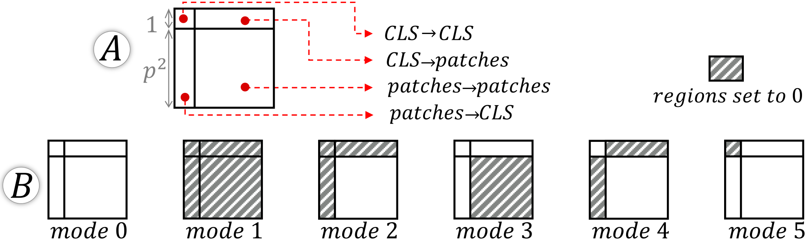
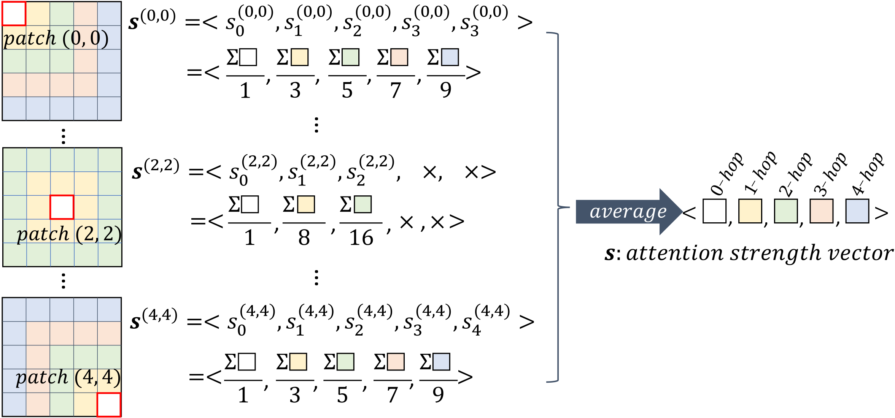
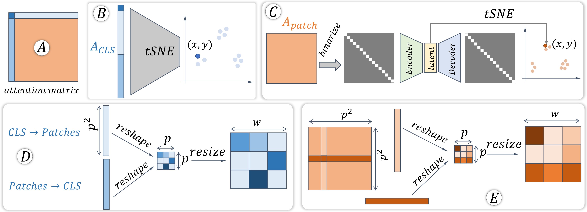

# 5. 方法与可视分析系统

我们的视觉分析系统（图 1）包含四个组件：图像概览、注意力头重要性视图、注意力强度视图和注意力模式视图。图像概览（图 1A）根据注意力头重要性向量布局图像实例，为探索提供入口。其余三个视图（图 1B-D）设计以满足三个要求。

## 图像概览

图 1A 使用 tSNE+散点图提供图像概览。每个点代表一个图像，其颜色表示类别标签。每个点的坐标是对应图像的头重要性向量的降维结果，即每个维度对应头的重要性（式 [eq:prob]）（维度为 $(l{\times}n)$）。基于此向量的 tSNE 布局将具有相似头重要性的图像聚类在一起，引导用户的探索（**R1.3**）。例如，在探索过程中，用户会立即注意到右上角的小集群（参见第 5 节）。

点击顶部右方的输入框中的任何一点或提供一个ID，都会将对应的图像选入其他三个视图中。在每个视图中，分析可以聚焦于所选图像，也可以扩展到其他所有图像。

## 注意力头重要性视图

我们定义了几种指标来量化注意力头的重要性。这些指标通过“留一出”删减法生成，即通过删除注意力头后的最终输出（模型级影响）或下一层激活（层级影响）的变化来编码注意力头的重要性。删减一个注意力头的操作是将其注意力矩阵（式[eq:single_head]中的$A$）设置为0。通过删减研究广泛应用于NLP领域，例如（Bau et al. 2019；Michel et al. 2019；Hao et al. 2021）。

### 对模型输出的重要性（R1.1）

我们提出了每个头的两个 *模型级* 重要性指标。一个反映真实类别的概率变化（式 [eq:prob]）；另一个编码了该头被剪枝前后两个概率分布之间的 Jensen-Shannon Divergence（JSD）（式 [eq:jsd]）。数学上，$ViT()$ 表示的是经过充分训练的模型，它接受图像作为输入并输出一个概率分布，即 $\textbf{P} {=} ViT(img)$。 $ViT_{i, j}()$ 是同模型，但第 $j$ 层的第 $i$ 个头已被剪枝，且 $\textbf{P}_{i,j} {=}ViT_{i, j}(img)$。 $idx_{label}$ 是图像的真实类别索引。第 $(i, j)$ 个头的重要性为：
$$
\label{eq:prob}
   I^{prob}_{i,j} = \textbf{P}{[idx_{label}]}-\textbf{P}_{i,j}[idx_{label}]
$$
$$
\label{eq:jsd}
   I^{JSD}_{i,j} = JSD(\textbf{P}||\textbf{P}_{i,j})
$$

### 对注意力层的重要性（R1.1）

仅评估最终输出的变化无法反映注意力层中注意力头的重要性。正如我们的专家所注意到的，剪枝一个重要的头部可能会显著改变相应层的输出（即式[eq:multi_head]中的$z$），但对最终概率的变化却很小。这是因为来自较后层的头部可能会补偿剪枝注意力头的贡献，从而掩盖其重要性。

为了识别每个注意力层中的重要注意力头，我们提出两个层级重要性指标，以注意力头剪枝前后相邻层激活之间的余弦距离 $D_{cos}$ 定义。如图 2 所示，注意力层的输出 $z$ 是一个 $(1{+}p^2){\times}h$ 矩阵，其中包含分类 token 的激活（前 $1{\times}h$ 部分）和图像块 token 的激活（后 $p^2{\times}h$ 部分）。层级指标分别衡量分类 token 与图像块 token 的重要性。对于分类 token，指标 $I_{i,j}^{\texttt{CLS}}$ 表示两次激活之间的余弦距离；对于图像块 token，指标 $I_{i,j}^{patch}$ 以同样方式计算余弦距离，并对所有图像块取平均。数学上，$z$ 和 $z'$ 分别表示剪枝前后的层输出：
$$
I_{i,j}^{{CLS}} = D_{cos}(z[0], z'[0])
    \label{eq:cls}
$$
$$
I_{i,j}^{patch} =\frac{1}{p^2}\Sigma_{i=1}^{p^2} D_{cos}(z[i], z'[i])
    \label{eq:patch}
$$

### 注意力头剪枝模式（R1.2）

一旦重要头被识别出来，我们进一步通过部分剪枝来剖析它们的重要性。

*图 4. 剪枝模式。 (A) 注意矩阵被分为四个区域。 (B) 不同的剪枝模式将一个/多个区域设置为 0。*

如图4A所示，基于源和目标token，一个头的注意力矩阵可以分为四个区域：$\texttt{CLS} {\to} \texttt{CLS}$、$\texttt{CLS} {\to} patches$、$patches {\to} \texttt{CLS}$和$patches {\to} patches$。区域$\texttt{CLS}{\to} patches$和$patches {\to} \texttt{CLS}$被一起考虑，因为它们都编码了对`CLS`和图像块token的相互作用。通过设置不同的区域为零，定义了六种剪枝模式（图4B），即模式0是未剪枝的原始头；模式1完全剪枝头；模式$2{\sim}5$是仅剪枝条纹区域的额外情况。展示这些模式的影响将头的重要性归因于各个区域。

### 可视化

图 1B 展示了我们提出的指标和剪枝模式。首先，图 1-B1 使用线图来呈现单个选定图像（即注意力头对图像的局部重要性）的四个注意力头重要性指标。横轴代表所有 $l{\times}n$ 头部，纵轴表示指标值，其中下拉控件允许用户切换四个指标之一。请注意，对于 $I_{i,j}^{prob}$，我们直接显示 $\textbf{P}_{i,j}[idx_{label}]$ 的值（而不是公式 [eq:prob] 中的差异），因为这更具直观性。当未选择图像（例如，在探索开始时）时，该视图中的曲线显示了所有图像上选择指标的平均值。同时，围绕曲线的蓝色带表示指标值的标准差（参见图 7）。平均值和标准差反映了所有图像上的全局重要性，指导用户选择全局重要的头部。

第二，如图1-B1中通过拖动垂直线选择头部后，图1-B2中的条形图展示了不同剪枝模式（x轴）下选择的重要性度量（y轴）。进一步揭示了注意力头的重要性。例如，图1-B2显示所选注意力头的重要性仅来源于图像块token，而剪枝后该注意力头的重要性会显著降低。`CLS`相关的注意力没有显示出影响。

最后，图 1-B3 展示了当前剪枝状态下选中的图像的前 5 名预测概率。如果真实标签在前 5 名中，则会用粗体高亮显示。

## 注意力强度视图

注意力头的强度反映了所有块上的注意力强度的空间分布，这通过揭示它关注的块的位置来说明为什么该注意力头很重要。

### 视觉 Transformer 中注意力强度对 $k$-hop邻居的影响 (**R2.1**)

我们定义每个头的 $p$ 维 ($p$D) “注意力强度向量”，$\textbf{s}$, 以描述所有块对它们 $k$ 邻居 ($k\in [0, p{-}1]$ative) 的平均注意力强度，即
$$
\label{eq:khop}
    \textbf{s}=\frac{1}{p^2}\Sigma_i\Sigma_j \textbf{s}^{(i,j)},\  i{\in}[0, p{-}1],\ j{\in}[0, p{-}1],
$$
$$
\textbf{s}^{(i,j)} = <s^{(i,j)}_0, s^{(i,j)}_1, s^{(i,j)}_2, \dots, s^{(i,j)}_{p - 1}>,
$$
where $s^{(i,j)}_k$ 表示从图像块 $(i,j)$ 对其在二维域的第 $k$ 个跳跃邻近块的注意力平均值。

*图 5. 计算单个头的注意力强度向量。*

不失一般性，图5展示了计算过程为$\textbf{s}$当$p{=}5$. 从图像块开始$(0,0)$, $s^{(0,0)}_0$是图像块的自注意力。$(0,0)$自己关注（即0-hop注意力）；$s^{(0,0)}_1$是其3个1-hop邻居所支付的注意力之和，除以邻居数量（即3）。$s^{(0,0)}_2$是绿色部分对它的2-hop邻居的总注意力（即5个邻居）除以邻居数量的结果；以此类推。最终，我们得到一个$5$图像块 (0, 0) 的 D 向量，即$\textbf{s}^{(0,0)}$将此计算重复应用于所有图像块，我们即可得到$25$ $5$注意力强度向量，每个图像块一个。它们的平均值是注意力头的“注意力强度向量”，即：$\textbf{s}$.

注意的是，有些块可能没有某些跳数的邻居，例如，块$(2,2)$图5 中并没有$3$-头或$4$-hop 邻居（标记为‘$\times$因此，$s^{(2,2)}_3$和$s^{(2,2)}_4$在计算对应元素时，将不会被计入。$\textbf{s}$换句话说，式子 [eq:khop] 中的分母不是$p^2$对于所有元素的$\textbf{s}$; 有些的分母会因为缺少邻近元素而变小。

### 可视化

图 1C 的“注意力强度视角”展示了所有注意力头的注意力强度的三个组成部分。第一部分（图 1-C1）通过散点图展示了选定图像的全部注意力头的概览。散点图中的每个点代表一个注意力头。其水平位置（以及颜色）反映了该头来自的层。其垂直位置表示注意力强度向量 $\textbf{s}$ 的熵（归一化）。 $\textbf{s}$ 的熵反映了该头的注意力强度是否集中在某个跳数的邻居上（低熵，一个元素的值主导向量）还是均匀分布在所有 $k$ 跳数邻居上（高熵，所有元素的值相似）。从概览中可以看出，注意力头随层的变化存在明显趋势（**R2.2**），即来自较高层的注意力头更均匀地关注所有图像块，而较低层的注意力头则局部或全局地关注。

第二，如图1-C1中点击对应点后，所选注意力头的注意力强度向量在图1-C2中以条形图的形式呈现（**R2.1**）。在当前可视化中，我们可以看到所选注意力头的所有块仅关注自身（即所有注意力强度均分配给0-hop邻居）。

最后，图 1-C3 的面积图展示了所有图像上选定头的熵值分布（**R2.3**）。例如，当前选定的头具有较小的熵（图 1-C1），因为所有块仅关注 0-hop 邻居（图 1-C2）。图 1-C3 进一步揭示，该头在所有图像上始终具有较低的熵，这在左角的峰值中有所体现。面积图上方的垂直线标记了当前选定图像的头的熵，反映了头对当前图像的关注强度与对其他图像的关注强度之间的差异程度。

## 注意力模式视图

注意力头的模式反映了令牌彼此关注的方式。我们希望总结所有头的可能模式，以加深对视觉 Transformer (ViT) 的理解。

### 无监督模式识别（R3.1）

由于视觉 Transformer 与 Transformer 功能上的差异，`CLS`对于输入图像及其对应的注意力头，我们分别处理它们并学习各自的模式。具体而言，给定一个输入图像和其中的一个注意力头，对应的注意力矩阵为$A$形状为${(1{+}p^2){\times}(1{+}p^2)}$(图2). 我们将图像分割为$A$翻译成简体中文为：将英文忠实翻译为简体中文，语气正式、准确、简洁。术语统一：视觉 Transformer=视觉 Transformer；Transformer=Transformer；自注意力=self-attention；多头自注意力=多头自注意力；注意力头=注意力头；图像块=image patch；token=token；查询=query；键=key；值=value；剪枝=剪枝。保留模型名、数据集名、变量名和人名。只输出译文。`CLS`相关注意力$A_{\texttt{CLS}} {=} concat(A[0, :], A[1:, 0]) {\in} \mathbb{R}^{2p^2 {+} 1}$图像块注意力和图像块自注意力$A_{patch} {=} A[1:, 1:] {\in} \mathbb{R}^{p^2 \times p^2}$如图6A所示。

*图 6. (A) 每个注意力矩阵分别分离出与 CLS 相关的注意力 ($A_{\texttt{CLS}}$, 蓝色) 和图像块注意力 ($A_{\texttt{patch}}$, 橙色)。 (B) 通过 tSNE+散点图可视化所有图像的 $A_{\texttt{CLS}}$。 (C) 对于所有图像的 $A_{\texttt{patch}}$，我们训练一个自动编码器来聚类它们。 (D, E) 可以将 $A_{\texttt{CLS}}$ 和 $A_{\texttt{patch}}$ 映射回图像作为掩模。*

**`CLS` 关注模式。** `CLS` 相关的关注 ($A_{\texttt{cls}}$) 将 $\texttt{CLS}{\to}\texttt{CLS}$, $\texttt{CLS}{\to} patches$, 和 $patches{\to}\texttt{CLS}$ 区域连接起来 (图 6A)，其大小为 $(2p^2{+}1)$。 如果我们有 $m$ 张图像，每个都会从 $l{\times}n$ 个注意力头生成 $l{\times}n$ 个注意力矩阵，我们将得到 $m{\times}l{\times}n$ 个这样的向量。 使用 tSNE，我们将它们从 $(2p^2{+}1)$ 维投影到 2 维，并以散点图的形式呈现 (图 6B)。 具有相似 `CLS` 关注模式的注意力头将被聚类在一起。

**Patch Attention Patterns。** 我们将相同的方法应用于 $A_{patch} {=} A[1:, 1:] {\in} \mathbb{R}^{p^2 {\times} p^2}$ 的 patch attentions，但得到的 tSNE 布局无法清晰地分离/聚类不同的/相似的 patch attention 模式。我们认为这是由于 patch attentions 的维度更高所致，并尝试通过多种补救措施来解决这个问题。例如，我们使用最大池化来在空间上缩小 $A_{patch}$ 之前，再进行 tSNE，尝试在 tSNE 之前应用 PCA 在 $A_{patch}$。这两种解决方案都没有带来显著的性能提升。

最后，我们提出了一种基于自动编码器（AE）的学习解决方案（图6C）。首先，由于我们更关注注意力模式而非其幅度，因此我们将注意力模式二值化。$A_{patch}$使用截断的方法，例如，将前1%的值设为1，其余的设为0。这有助于增强模式，使其更容易学习。 *第二*，使用这些值。$m{\times}l{\times}n$二值化$A_{patch}$, 我们训练了一个AE。AE有两个对称的子网络，即编码器和解码器，每个子网络包含两个卷积层和一个全连接层。*第三*，我们使用已充分训练的AE瓶颈层的潜在表示进行tSNE布局。布局显示了明显的簇，揭示了不同的注意力模式。

### 可视化

“概览+细节”的探索策略被应用于可视化注意力模式。

概述展示了所有图像的所有头。$m{\times}l{\times}n$总共通过 tSNE+散点图 (**R3.1**, 图 1-D1)，如第 4.4.1 节所述。 tSNE 布局可以是针对 256 个图像块的，也可以是针对 512 个图像块的。`CLS`注意力 ($A_{\texttt{CLS}}$) 或者对于 patch attentions （$A_{patch}$). 左上切换开关控制此功能。为了实现可扩展性，我们允许用户将散点图转换为密度图，左上切换开关控制这一功能。例如，图1-D1背景密度等值线展示了所有数据点的分布，即图中的所有数据点。$m{\times}l{\times}n$注意力头作为上下文。当从*图像概览*（图1A）中选择感兴趣图像时，其$l{\times}n$每个点代表密度图顶部的注意力头，该点的颜色反映了其所在层。

图1D（R3.2）右侧展示了选定头的注意力矩阵详情。注意力矩阵表示（$1{+}p^2$）之间的注意力，我们以两种不同的方式呈现它（图1-D3，D4）。

图 1-D3 列出了所有 ($1{+}p^2$) token，分为两行（上行：源 token，下行：目标 token），使用浅色到深色的线条来表示注意力强度。蓝色和橙色分别用于标记 $A_{\texttt{CLS}}$ 和 $A_{patch}$。显示所有 $(1{+}p^2){\times}(1{+}p^2)$ 线会使视图非常杂乱。因此，我们允许用户指定一个阈值，低于该阈值的注意力值关联线条将被禁用。图 1-D5 中的直方图显示了 $(1{+}p^2){\times}(1{+}p^2)$ 值的分布，通过在直方图顶部拖动垂直条，用户可以指导自己指定阈值。图 1-D5 中的当前阈值为 1%，表明只有顶部的 1% 线是可见的。从图 1-D3 中的深色垂直线条可以看出，所有 token（无论是 `CLS` 还是 patch token）都强烈地关注自身。

图 1-D4 用热力图呈现注意力矩阵，其中行表示源 token，列表示目标 token。热力图的四个区域见图 4A。右下角的 $A_{patch}$ 区域中，每个像素对应一个注意力值。对于 $A_{\texttt{CLS}}$，由于单行和单列的注意力值几乎不可见，我们将每个值扩展为 10 个像素。颜色映射与图 1-D3 一致：蓝色表示 $A_{\texttt{CLS}}$，橙色表示 $A_{patch}$。热力图中清晰的对角线模式表明，图像块 token 强烈关注自身；左上角的深蓝色单元格说明 `CLS` token 也强烈关注自身。与此同时，`CLS` 对不同图像块 token 的注意力很弱，对应顶行的浅蓝色或白色。图 1-D5 直方图中指定的阈值同样适用于该热力图。

为了利用它们各自的优点，将注意力矩阵以两种可视化方式呈现，因为热力图直观地展示了注意力模式，而二维视图则能更好地呈现查询与键之间的注意力关系。`CLS`图像块和 token 的二维视图（如稍后图 14 所示）优于热力图，尤其是在与 token 交互方面，例如，它可以轻松突出显示感兴趣的 token（如图 11 所示）。除了这些之外，我们在早期设计阶段还考虑了其他可视化方法。例如，我们尝试在热力图之上叠加箭头来显示注意力方向，或者将图像块像素嵌入热力图中。然而，这两种设计在扩展到我们问题规模时都不容易。

**图像上下文。** 为了直观地呈现块相关的注意力，我们需要将块映射回2D图像。对于 $\texttt{CLS}{\to}patches$ (形状：$1{\times}p^2$) 和 $patches{\to}\texttt{CLS}$ (形状：$p^2{\times}1$) 注意力，我们将它们重塑为一个 $p{\times}p$ 的正方形，将其缩放至 $w{\times}w$，并将其作为透明度掩膜叠加在图像之上（图6D，更强的注意力${\to}$更透明）。对于 $patches{\to}patches$ 注意力（形状：$p^2{\times}p^2$），我们将每一行/列重塑为一个 $p{\times}p$ 的正方形，将其缩放至 $w{\times}w$，并将其作为掩膜叠加在图像上，以显示从一个令牌到所有其他令牌的注意力（一行）或反之（一列），如图6E所示。图1-D2（上-下）中的三张图像显示了原始图像、带有源注意力掩膜的图像和带有目标注意力掩膜的图像。在图1-D3的顶部/底部轴上悬停在个体源/目标令牌上将动态更新源/目标注意力掩膜（例如，图10D，图11C）。
