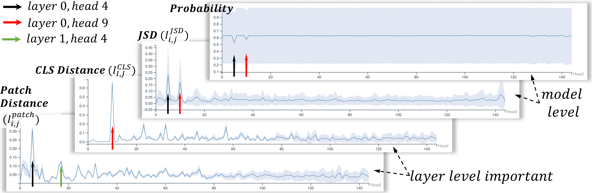
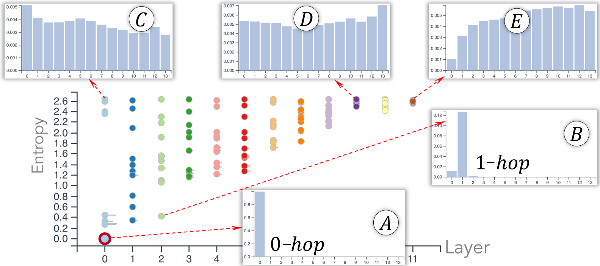
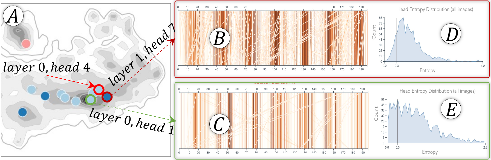
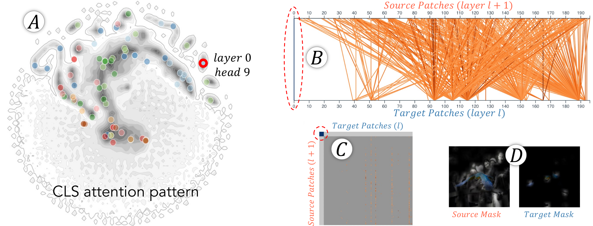
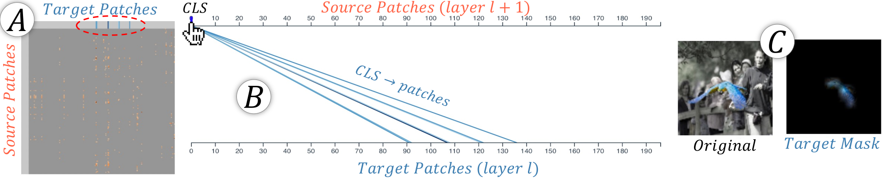
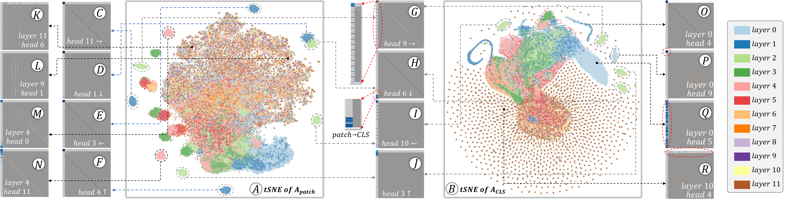
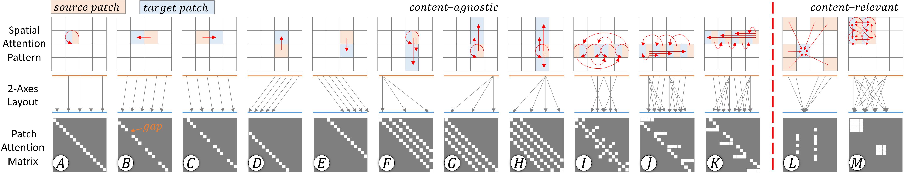
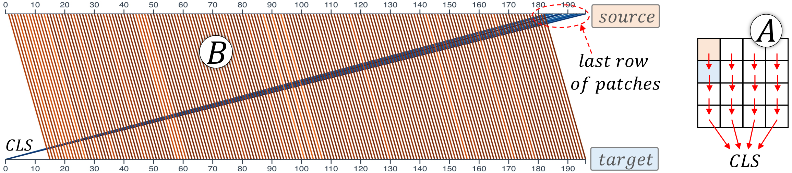
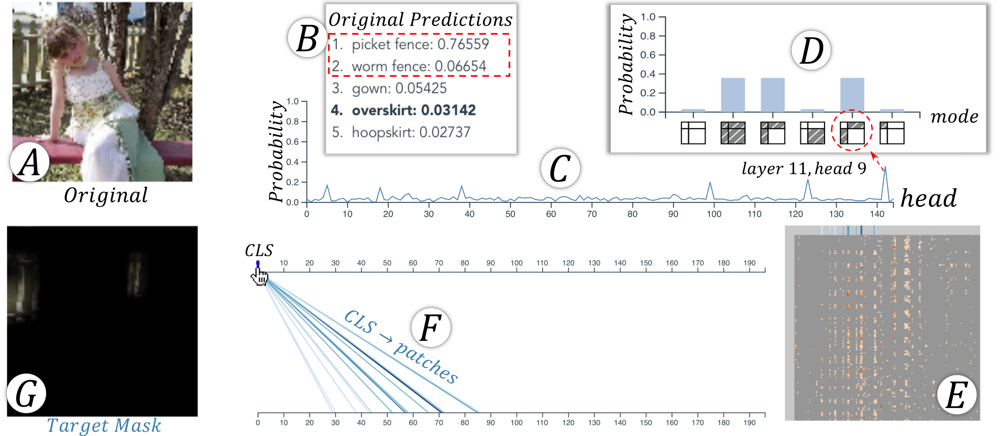
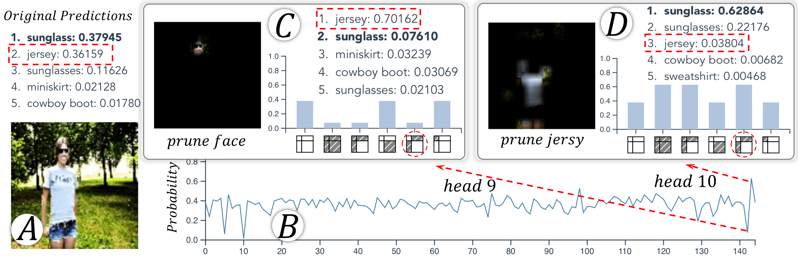

# 6. 案例研究与专家反馈

我们通过与深度学习专家共同进行的多个案例研究，展示了系统的实力。专家的反馈总结于第5.5节末尾。

对于 ViTs，我们探索了四种不同图像分辨率（$w$）、层数（$l$）和注意力注意力注意力注意力头数量量量量（$n$）的预训练 ViTs（Dosovitskiy et al. 2021）。由于我们的发现在这四个模型中是一致的，我们专注于一个模型的示例，但将其他三个模型的结果包括在附录中。关注的模型的参数为：$w{=}224$、$l{=}12$、$n{=}12$和$p{=}14$。

对于数据集，我们使用了从ImageNet（Russakovsky et al. 2015）验证集采样的1000张图像。这些图像来自20个类别（每个类别10个最佳预测和10个最差预测），每个类别有50张图像。我们还对另一个数据集进行了探索。然而，两个数据集的模型层面发现结果大多相似，因此我们在附录中包含了对另一个数据集的探索。

## 注意力头重要性

图1A显示了1000张图像，按其排列。$l{\times}n$-维头重要性向量（每个维度表示一个头的重要性）$\textbf{P}_{i,j}[idx_{label}]$如公式[eq:prob]所示，我们发现图像按顺时针方向排列，其真类概率逐渐增大。

*图 7. 所有图像上计算的四个头重要性指标的均值（蓝色曲线）和标准差（蓝色带）*

图7展示了所有图像汇总的四个头重要性度量。无论是*模型级*度量（“概率”、“JSD”），都反映了头的重要性。$4$和$9$层 0 的各个层非常重要。 “概率”图的宽频带是由于我们选择了表现最好的和最差的图像所致。两个 “层级” 指标（“‘Probability’”）是：`CLS`“距离”（‘Distance’, ‘Patch Distance’) 显示第 9 和第 4 个注意力头对变化的贡献显著。`CLS`分别得到图像块表示和token表示。

此外，层级指标显示出更多的波动，识别出模型级指标无法识别的重要注意力头。例如，移除第1层第4个头几乎不会改变最终预测结果，但会对层激活产生显著影响。如“图像块距离”图所示，该头的均值较大且标准差较小，表明该头在整个图像中对层至关重要。该头有一个固定的功能，即使所有图像块都关注其上方的图像块（稍后在图12F中解释）。模型级指标无法识别它，因为来自较后期层的注意力头具有相似的功能（例如，第2层的第3个头，稍后在图12J中解释），从而掩盖了它的重要性。此外，从两个层级指标中观察到标准差的增加，表明较高层注意力头的重要性更受图像内容的影响。

通过协调探索 *图像概览* 和 *头重要性视图*，我们发现图像簇，其中个别头对于某些图像非常重要（例如，图 1-A1 和 A2 中图像 0 层的第 9 和第 4 个头对图像非常重要）。为了分析其重要性，我们随机选择一个图像（ID: 712，标签：`macaw`从一个簇中抽取图像最为重要的三个注意力头：第0层，注意力头4, 第0层，注意力头9, 和第11层，注意力头5(图1-B1)。

图1-B2展示了部分剪枝结果第0层，注意力头4. 只有在概率下降时$patches{\to}patches$注意力被剪枝，和剪枝`CLS`-相关的注意力影响较小。这个注意力头4的重要性归因于其块之间的注意力。图1-B3显示，当剪枝这个注意力头时，前五的概率非常低。`macaw`(真实的标签)不在其中。

图 1-B4 和 1-B5 分别展示了 *layer 0 head 9* 和 *layer 11 head 5* 的部分剪枝结果。从这些结果可以看出，*layer 0 head 9* 的重要性归因于其 `CLS` 自注意力 ($\texttt{CLS}{\to}\texttt{CLS}$); *layer 11 head 5* 的重要性归因于其对 `CLS` 和图像块 ($\texttt{CLS}{\to}patches$ 和 $patches{\to}\texttt{CLS}$）之间的注意力。

## 注意力强度

接下来，我们通过其注意力强度来探讨注意力头的重要性。注意力强度分析仅针对图像块 token (`CLS`没有空间信息)，因此我们的分析集中在*层 0 头 4*。图1-C1展示了所有注意力头的注意力强度概述。*层 0 头 4*（在红色圆圈内）具有最小的熵。图1-C2展示了该头的$p$D$k$跳邻域向量。从图中可以看出，所有图像块的注意力强度都集中在$0$跳邻域，即该头使所有图像块强烈关注自身。在层的早期阶段，忽略细节是不合理的，因此该头在较低层中很重要。从图1-C3中，我们还注意到该头的功能在所有图像中都是一致的，因为其不同图像的熵始终较低（主要分布在左侧）。

图 1-C4, C5 显示了其他两个重要头的注意力强度。它们的重要性主要来自 `CLS`-相关注意力，且注意力强度（针对图像块 token）在所有邻居跳数（条形图）和图像之间变化（面积图）。

*图 8. 低层注意力头只能将图像块的注意力强度分配给其近邻（A、B），或者均匀分配给所有 $k$-hop 邻居（C）。高层注意力头只能做后者（D、E）。*

图 1-C1 和 图 8 也揭示了头在层上的注意力强度分布情况。一般来说，较低层的头可以使得图像块强烈关注其局部区域，例如，$0$-hop 或 $1$-hop 邻居（图 8A-B 中的低熵头）。较低层的头还可以使得图像块在整个图像上均匀地分配注意力，例如，图 8C。对于较高层的头，图像块仅在所有 $k$-hop 邻居之间以相似的注意力强度关注全局，例如，图 8D-E。无论选择哪张图像，这种观察结果始终可以观察到。这一观察结果与关于注意力强度的原始声明一致（Dosovitskiy 等人 2021）（有关 Dosovitskiy 等人 2021 的详细信息，请参见我们的附录）。

## 注意力模式

注意力模式进一步解释了为什么第 0 层第 4 个注意力头（*layer 0 head 4*）很重要。从注意力模式视角来看，即图 1-D3 中的垂直线和图 1-D4 中的对角模式，该注意力头中的所有块都强烈地关注自身，这与我们之前从注意力强度视角得出的发现一致。

*图 9. 探索与层 0 头 4 有相似注意力模式的头，以解释为什么它很重要，而其他头则不然。*

是否有与 *head 4* 的注意力模式相似的注意力头？如果是，为什么只有 *head 4* 是如此重要？为回答这些问题，我们放大 图 1-D1 中的红色虚线区域的 tSNE 布局。放大后的细节如 图 9A 所示。从中，我们探索与 *head 4* 接近的注意力头，并检查它们的注意力模式。如 图 9B-C 所示的两个注意力头中，垂直线表示这两个头也主要关注自身。然而，与 *head 4* 不同，这两个头的自注意力并不总是强，即 图 1-D3 中所有线条均为暗橙色，而 图 9B-C 中大部分线条为浅橙色。此外，这两个头在图像上的功能并不像 *head 4* 那样一致（比较 图 1-C3 和 图 9D-E）。

*图 10. 层 0 头 9 的注意力模式。*

*图11.$\texttt{CLS}{\to}patches$层 11 的注意力头 5.*

*图 12. (A/B) 使用其 patch/CLS 注意力模式的头的 tSNE 布局。较低层的内容无关头在图像之间表现出相似的模式，因此无论它们按照 patch (C-J, M, N) 或 CLS (G-J, O-Q) 模式布局，都会形成孤立的集群。较高层的内容相关头对于不同图像表现出不同的模式。这些头在两种布局 (K, L, R) 中都分布散乱。*

*图 13 展现了在顶视图、二维视图和热力图可视化中的 13 种图像块之间的可能注意力模式。每种模式都是四种基本模式之一或多者混合：*对角线*（A-K）、*水平*（J、K）、*垂直*（L）和*块*（M）。前两种是*内容无关*的，通常出现在较低层的注意力头中；后两种是*内容相关*的，通常出现在较高层的注意力头中。

为了第0层，注意力头9, 我们已知其重要性源于其重要性。$\texttt{CLS}{\to}\texttt{CLS}$图1-B4中的注意力机制，我们可以通过可视化其注意力模式来观察，图10B中的深蓝色垂直线和图10C左上角的深蓝色单元格，这表明了对某些部分的重要性。`CLS`多头自注意力。与此同时，视觉 Transformer 的自注意力。$\texttt{CLS}{\to}patches$和$patches{\to}\texttt{CLS}$注意力并不明显。$patches{\to}patches$注意力 (图10B中的橙色线条以及图10C中的垂直模式)以及遮蔽源图像和目标图像 (图10D)均未提取出明显的特征，这证实了与图像块相关的注意力的重要性较低。此外，我们注意到，`CLS`第9个注意力头的注意力模式非常独特，因为它是在图10A（所有注意力头的t-SNE布局）中孤立簇中的唯一一个头（所选图像中的）。$A_\texttt{CLS}$背景轮廓展示了来自其他图像的第9个头，这表明第9个头的功能在不同图像中是固定的。

对于第 11 层的第 5 个注意力头，其重要性来自 $patches{\to}\texttt{CLS}$ 和 $\texttt{CLS}{\to}patches$ 两类注意力（图 1-B5）。在图 11A 中，$patches{\to}\texttt{CLS}$ 注意力（最左列）并不明显，而 $\texttt{CLS}{\to}patches$ 注意力（顶行）呈现四个主要区域，表明 `CLS` 会关注四组图像块。在图 11B 的顶部坐标轴上悬停 `CLS` token 时，这四组目标图像块会在遮罩目标图像中高亮显示（图 11C）；这些区域准确提取出了蓝色金刚鹦鹉的翅膀。

### 注意力模式总结

我们的探索识别出了不同的注意力模式。本节提供了一个详尽的总结。

**图像块注意力模式 ($A_{Patch}$)**。图 12A 显示了所有头的图像块注意力的 tSNE 布局（图 1-D1 是其密度图）。来自孤立簇的点通常代表来自不同图像的同一头，验证了头的固定功能。在 *注意力模式视图* 中探索每个头，我们总结为图 13 中的 13 种模式。该示意图的三行展示了每个图像空间中的块如何关注其他块（顶部）、二维（中间）和热力图（底部）。从最后一行可以看出，每一种 13 种模式都是由四种基本模式组合而成的，即 ***对角线***、***水平***、***垂直*** 和 ***块***。

图 13A-K 包含对角线模式。图 13A 表示自注意力。图 13B 和图 13C 显示每个块关注其左或右的块（偏离对角线的一个单元格），其中的空隙表示没有更多块可以关注的最左或最右的块。图 13D 和图 13E 中的每个块关注其上方或下方的块，即白色方块在一行块中从对角线移动。图 12C 和图 12F（均来自第 1 层）中的四个头展示了每个块分别关注其右、下、左、上块的例子。图 12G 到图 12J（均来自第 2 层）中的四个头展示了类似模式，揭示了重复的功能。来到中间注意力层，块可以关注其上方和下方的多个块（图 13F 和图 13H）。图 12M 和图 12N 显示了来自第 4 层的两个此类示例。图 13I 包含反对角线模式，其中最左/右的块对称地关注同一行中的最右/左块。

图 13J-K 包含了 **水平** 模式（混合了对角模式）。该模式表明，同一行中的某个块在之前/之后会关注多个块。

图 13L 展示了 **垂直** 模式，即多个源块（热力图行）关注同一目标块（热力图列）。这通常表明目标块包含对类别重要的语义（例如，图 12K-L 中的 `cat` 面部区域的 `cat` 图像）。这种模式通常出现在较高层的注意力头中，如图 12A 中（中心的大混乱簇）所示，颜色为黄色/棕色。

图13M展示了***块**模式*，即局部区域中的图像块彼此相互关注（例如，人脸块相互关注）。`cat`将注意力集中在其体块上，反之亦然。类似于分割任务，注意力提取对象的像素。

注意力模式也可以分为 ***内容无关*** 和 ***内容相关*** 两类。图 12C-J 中的对角线和水平模式通常对图像内容无偏见，例如图 12C-J 中的图 12C-J 中的注意力头。所有图像中的同一注意力头形成孤立的集群，如图 12A。垂直和块模式与内容相关，因为它们的位置取决于图像的内容。它们是图 12A 中的大混乱集群。内容无关的模式通常出现在较低层，而内容相关的模式通常出现在较高层。

*图 14. 每个块都关注其下面的块，例如，块 0（行 0，列 0）关注块 14（行 1，列 0，$p{=}14$）。最下面的一行块都关注CLS，因为没有进一步的块。*

**`CLS` 注意力模式（$A_{\texttt{CLS}}$）。** 与 `CLS` 相关的注意力模式呈现相似的分层趋势。如图 12B（其密度图见图 10A）所示，低层注意力头形成清晰簇，说明这些头中的 `CLS` 注意力更偏向内容无关模式。例如，图 12P 主要表现为较强的 $\texttt{CLS}{\to}\texttt{CLS}$ 注意力，图 12Q 则表现为较强的 $patches{\to}\texttt{CLS}$ 注意力。在较高层中，注意力与内容的关系更强；例如图 12R 顶行所示，`CLS` 只关注特定的图像块。

图 12A 的 G–J 四个注意力头在对应的 `CLS` 布局中同样形成四个孤立簇（图 12B 的 G–J）。通过联合分析图像块模式和 `CLS` 模式，我们发现：在这些注意力头中，边界图像块如果没有更远的图像块可供关注，就会转而关注 `CLS`。例如图 12H 中，所有图像块都关注其下方的图像块；最底行没有更下方的图像块，因此转而关注 `CLS`（图 14A）。该注意力头的双轴视图见图 14B，与图 12H 及其插图中的模式一致。这说明信息如何逐行在图像块之间传递，并最终汇聚到 `CLS` 用于分类。

## 注意力头诊断

我们的协调系统还帮助诊断不同注意力头（尤其是重要注意力头）在错误预测中的角色。本节举了两个例子。

***案例 1：*** 图 15A 展示了一张真实类别为 `overskirt` 的图像，但 ViT 的预测表现较差（图 15B）。从注意力头重要性视图可以看到，当剪枝第 11 层第 9 个注意力头时，真实类别的预测概率显著上升（图 15C）。部分剪枝结果表明，只有剪除 `CLS` 与图像块之间的注意力时，`overskirt` 的概率才会上升（图 15D）。由于图 15E 最左列的 $patches{\to}\texttt{CLS}$ 注意力很弱，我们进一步检查图 15F 中的 $\texttt{CLS}{\to}patches$ 注意力；对应的遮罩目标图像（图 15G）显示，`CLS` 强烈关注了背景中的栅栏。剪枝这一具有误导性的注意力头可以使模型更关注正确特征，从而提高真实类别概率；这也解释了原始预测中排名前两位的类别为何都是 `fences`。

*图 15. 层 11 的第 9 个注意力头错误地关注到背景栅栏。剪枝它会提高真类的概率。*

***案例2：*** 在图16A中，模型ViT正确预测图像为`sunglass`，但同时也赋予了较高的概率给`jersey`。我们在最后一层发现有两个重要的注意力头，但它们的作用相反（图16B）。分别从第11层剪枝第9和第10个头后，`sunglass`的概率有显著下降或上升。从部分剪枝结果可以看出，`CLS`和图像块之间的注意力主导了下降（图16C）或上升（图16D）。然后我们可视化了$\texttt{CLS}{\to}patches$的注意力以及对应的遮蔽图像。对于第9个头，`CLS`关注的是面部区域，而对于第10个头，`CLS`仅关注球衣区域。第9和第10个头分别对`sunglass`和`jersey`的概率贡献很大。剪枝它们会增加相反类别概率（图16C，D）。这些细节显著加深了对ViT工作原理的理解。

*图 16. 注意力头 9 和 10 分别提取太阳镜和球衣特征，影响相应类别的概率值。*

## 领域专家反馈

上述案例研究是在7位深度学习专家的单独会话中进行的，采用“引导探索+口头讨论”的协议。所有专家都有5年以上深度学习研究经验。五位专家（$E_1{\sim}E_5$）参与了我们的需求分析。另外两位（$E_6{\sim}E_7$）直到案例研究会话之前，都没有了解我们的可视化系统。

总体而言，所有专家都确认了三个聚焦话题的重要性，并赞赏了我们的发现。$E_2$, $E_4$, 和$E_5$他们享受了系统的互动性，尤其是那些链接的可视化图，它们帮助他们将重要头连接起来，从而进行全面的解释。他们现有的分析式可视化工具在协调探索方面不及我们的系统。使用我们的系统，$E_1$和$E_3$首次获得了对视觉 Transformer (ViT) 的头注意力模式的概述。两位专家都对我们的发现感到非常有趣，并就 CNN 和 ViT 之间的类比进行了深入讨论。例如，图 12G 中的图像块总是关注其右侧的图像块。$3{\times}3$ CNN这个滤波器还会聚合当前像素右侧像素的值。因此，当前像素不仅会考虑自身的值，还会考虑右侧像素的值。ViT注意力头和CNN过滤器共享等效功能。类似地，等效分析也可以扩展到其他头/过滤器。$E_7$指出了CNN和视觉 Transformer在各层学习趋势的相似性，即较低层的头/滤波器关注局部特征，而较高层则聚合较低层的输出以提取对象级别的信息。$E_7$还发现了注意力之间的交互作用。`CLS`图14A中，所有图像块都关注其下方的图像块，最后一行关注其下方的图像块。`CLS`这类似于从上至下传播信息，最终累积的结果会被传递至……`CLS`用于分类。$E_6$他对内容无关/相关的注意力内容感兴趣，并认为这些注意力机制可以应用于异常检测。

专家们也指出了当前系统的不足之处。首先，$E_7$最初认为图1-B1中的三个头对于预测图像712是至关重要的，这误导了我们，因为我们一次只剪枝一个头，并未考虑头之间的依赖关系。其次，$E_1$和$E_7$都致力于剪枝Transformer中的token（而不是剪枝头）。他们喜欢我们揭示token语义的图像掩码，但也希望看到通过删减验证单个块的重要性时，类似显著图突出单个块的重要性。这些评论为我们探索未来方向提供了有希望的方向。
