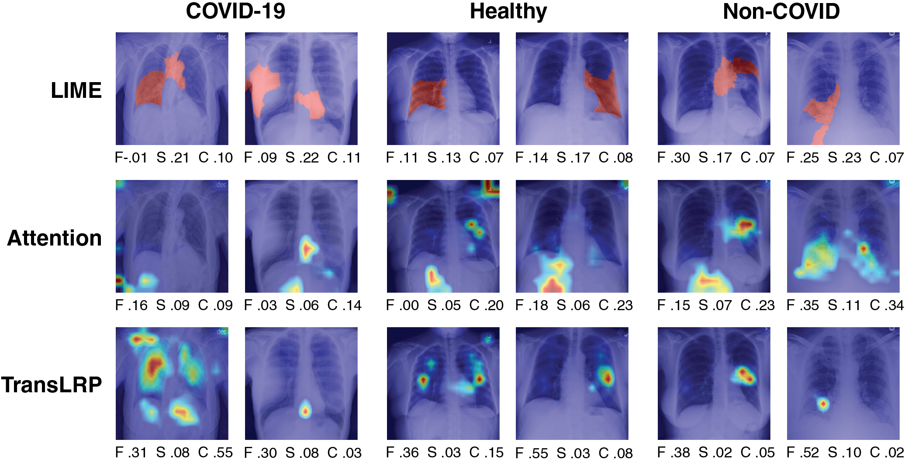

# 1. Introduction

Vision Transformer (ViT) (Dosovitskiy et al. 2021) is a novel class of deep learning models that use self-attention mechanism (Vaswani et al. 2017) to process images in a sequence of patches, rather than relying on convolutional operations. ViTs have achived impressive results on image classification tasks (Chen et al. 2021; Dosovitskiy et al. 2021), including medical imaging (Tulder et al. 2021; Mondal et al. 2022). However, as deep neural networks are increasingly deployed in critical domains such as healthcare, it is valuable to understand what features they rely on (Hryniewska et al. 2021). Explainable Artificial Intelligence (XAI) methods aim to provide such understanding by generating human-interpretable representations of model behavior (Lapuschkin et al. 2015; Ribeiro et al. 2016; Holzinger et al. 2022).

Several XAI methods have been proposed or adapted for ViTs (Abnar and Zuidema 2020; Chefer et al. 2021b), yet a rigorous and standardized evaluation of these methods in terms of their quality of explanations is still lacking. To address this issue, we propose utilizing two key criteria, namely faithfulness (Bhatt et al. 2020) and sensitivity (Yeh et al. 2019; Bhatt et al. 2020), to assess the quality of the explanations. Moreover, there is no clear consensus on how to best visualize the attention maps produced by ViTs, which can be ambiguous or even misleading (Bibal et al. 2022).

This paper first introduces the notion of evaluating faithfulness, sensitivity, and complexity of ViT explanations. We then perform experiments with three interpretation methods: model-agnostic, attention-based and gradient-based applied to a ViT trained on a chest X-ray classification task (see examples in Fig. 1). Specifically, the obtained results show that a gradient-based approach outperforms baselines in both metrics providing more accurate and consistent explanations of ViT’s decisions. Our goal is to foster the use of comprehensive metrics for a unified benchmarking protocol of ViT explanations, which is essential in medical imaging.

*Fig. 1. Exemplary explanations of ViT trained on the X-ray classification task. There are two images per class label (columns) and each one is explained using three interpretation methods (rows). For each explanation, we report their corresponding performance metrics measured with faithfulness (F), sensitivity (S), and complexity (C). For sensitivity and complexity lower scores are better, and for faithfulness higher ones. More such examples are presented in 6.*
