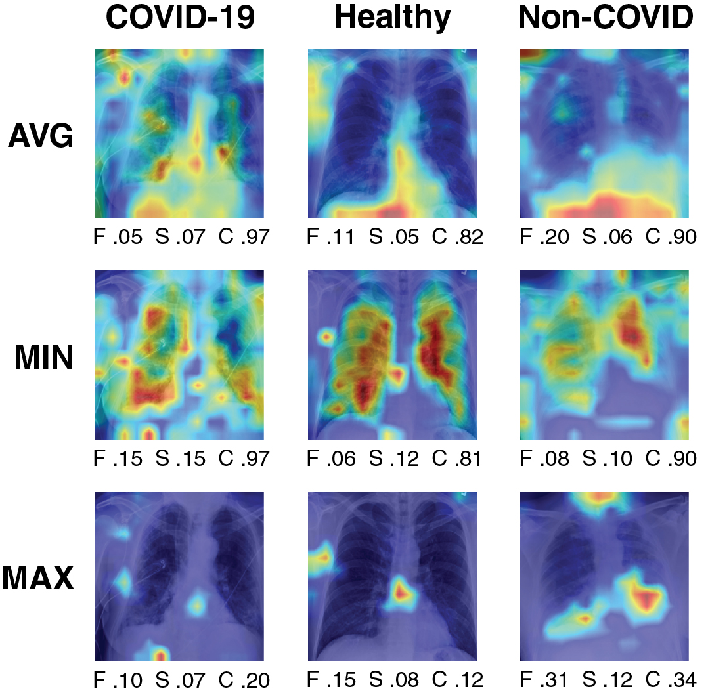

# 4. Experiments with medical images

We now critically evaluate ViT explanations for a medical imaging task, specifically chest X-ray classification.

### Setup

We use the **COVID-QU-Ex dataset** (Tahir et al. 2021) consisting of $33{,}920$ CXR images including $11{,}956$ images with COVID-19 infection, $10{,}701$ healthy chest X-rays, and $11{,}263$ non-COVID infections, , viral or bacterial pneumonia. The dataset authors’ recommended $65/15/20$ split was adopted for training, validation, and test sets, respectively. We finetune a **base-sized ViT model** (Dosovitskiy et al. 2021) that was pre-trained on the ImageNet dataset (Deng et al. 2009). The model achieved a test set accuracy of $0.954$, with balanced accuracy across all three classes. Details of model training are further described in 8. For calculating explanation evaluation metrics, $300$ images were randomly sampled from the test set, with $100$ images belonging to each class.

| Explanation | Faithfulness$\uparrow$ | Sensitivity$\downarrow$ | Complexity$\downarrow$ |
|:---|:--:|:--:|:--:|
| LIME | $0.07_{\pm 0.13}$ | $0.21_{\pm 0.06}$ | $0.09_{\pm 0.04}$ |
| Attention | $0.10_{\pm 0.08}$ | $0.07_{\pm 0.03}$ | $0.16_{\pm 0.12}$ |
| TransLRP | $0.16_{\pm 0.18}$ | $0.06_{\pm 0.03}$ | $0.21_{\pm 0.16}$ |

Evaluation results where lower sensitivity and higher faithfulness scores indicate better explanations. We report mean $\pm$ standard deviation over metric values calculated for $300$ images. TransLRP outperforms LIME and Attention visualization but provides more complex explanations. 

### Results

1 presents a benchmark comparing interpretation methods in the three dimensions of interest. We observe that TransLRP outperforms the other techniques based in terms of two primary evaluation criteria: faithfulness, and to a lesser extent, sensitivity. This indicates that LRP provides feature attributions that are highly correlated with the model’s predicted outcome, as reflected in its relatively high faithfulness score. Moreover, as demonstrated by a low sensitivity metric value, its estimations remain the most consistent under small changes to input data.

Based on the *quantitative results*, TransLRP appears to be a strong candidate for explaining ViT’s predictions on the COVID-QU-Ex task, and thus can be recommended to be interpreted by humans, , radiologist experts. A *qualitative assessment* of explanation visualizations suggests that TransLRP is generally robust to imaging artifacts, although instances of spurious correlation leading to prediction can still occur (refer to Fig. 1, column 1). LIME explanations are more consistent across images, but their reliance on superpixels may result in inaccuracies when the focus is not entirely on the lungs (see Fig. 1, columns 2 & 6). Attention visualization, when compared to TransLRP and LIME, appears to generate even more inaccurate explanations. Additional examples are available in 6.

### On the quality-complexity tradeoff in interpretability

In addition to the main metrics focusing on explanation quality, we also considered the complexity of the generated explanations, which becomes crucial when presenting visualizations to humans (see a discussion on information overload in (Poursabzi-Sangdeh et al. 2021)). 1 reports that the Attention explanations are slightly less complicated than TransLRP. However, the complexity is quite low in both cases when compared to other aggregating methods of Attention heads (see 3). For the purpose of this study, LIME attributions are binary, and therefore serve as a relatively simple baseline as indicated by the complexity metric. Note that the complexity metric’s values depend significantly on a cutoff threshold and therefore will be biased toward binary feature attributions, which should be addressed in future work.

### Are explanations equally good across classes?

Our study unveils the disparate quality of generated attributions across COVID-19, non-COVID, and healthy CXR cases as presented in 2. Plausibly, the overlapping symptomatic features of COVID pneumonia with other diseases based on medical imaging may limit the efficacy of generated attributions (Hryniewska et al. 2021). Conversely, non-COVID pneumonia and healthy CXR cases with more unambiguous indications could facilitate the production of more accurate explanations. Such an analysis can be especially important to assess bias under an imbalanced class distribution. In each case, further explanation benchmarking is required to validate this challenge.

| Class | Faithfulness$\uparrow$ | Sensitivity$\downarrow$ | Complexity$\downarrow$ |
|:---|:--:|:--:|:--:|
| COVID-19 | $0.07_{\pm0.13}$ | $0.07_{\pm0.03}$ | $0.34_{\pm0.19}$ |
| Healthy | $0.22_{\pm0.17}$ | $0.05_{\pm0.02}$ | $0.16_{\pm0.09}$ |
| Non-COVID | $0.20_{\pm0.18}$ | $0.06_{\pm0.02}$ | $0.15_{\pm0.08}$ |

Evaluation results for TransLRP divided into class labels. Explanations for the COVID-19 class perform visibly worst. 

### On the (im)proper attention aggregation over ViT heads

The architecture of ViT utilizes multi-head self-attention and there are various methods to aggregate attention across the "heads" dimension. In (Abnar and Zuidema 2020), it is proposed to average attention over ViT heads. However, our findings show that this approach produces overcomplex outcomes, as illustrated in Fig. 2, where the entire image is highlighted. Even though minor input perturbations do not significantly impact the explanations, as shown by the sensitivity metric, their complexity renders them unsuitable. In (Gildenblat 2020), attention rollout on natural images is analyzed, concluding that the best aggregation approach is to take the maximum over attention heads and discard a fraction of the lowest attributions. They also considered the minimum approach, which we included in our study. Ultimately, we have decided to adopt the maximum approach as it offers comparable explanation quality while maintaining significantly lower complexity (3).

| Aggregation | Faithfulness$\uparrow$ | Sensitivity$\downarrow$ | Complexity$\downarrow$ |
|:---|:--:|:--:|:--:|
| Average | $0.11_{\pm 0.09}$ | $0.06_{\pm 0.02}$ | $0.93_{\pm 0.06}$ |
| Minimum | $0.11_{\pm 0.09}$ | $0.08_{\pm 0.04}$ | $0.63_{\pm 0.31}$ |
| Maximum${-}$ | $0.10_{\pm 0.08}$ | $0.07_{\pm 0.03}$ | $0.16_{\pm 0.12}$ |

Evaluation results for Attention visualization divided into different approaches of its aggregation over ViT heads. Following (Gildenblat 2020), we discard $99\%$ of the lowest attention values after aggregation with maximum, resulting in less complex explanations. 

*Fig. 2. Exemplary explanations for Attention visualization divided into different approaches of its aggregation over ViT heads.*
